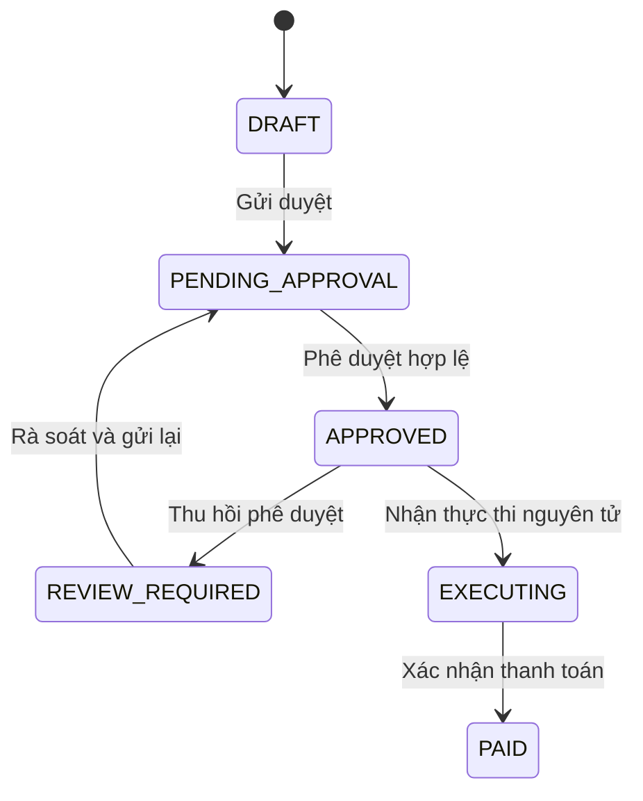

# Transition rollback — Đảo ngược chuyển trạng thái an toàn

## 1. Vì sao rollback là một vấn đề bảo mật nghiệp vụ?

Trong một hệ thống nghiệp vụ, trạng thái không chỉ là nhãn hiển thị. Nó quyết định một hồ sơ còn được sửa hay không, bằng chứng phê duyệt nào có hiệu lực và tác vụ nào được phép tạo ra tác động tài chính.

Giả sử một lệnh chi đã đi qua các bước:

```text
DRAFT → PENDING_APPROVAL → APPROVED → EXECUTING → PAID
```

Khi phát hiện sai thông tin, người dùng có thể muốn “quay lại bước trước”. Nếu ứng dụng chỉ thực hiện `state = previousState`, thao tác này có thể mở ra một đường tấn công:

- Đưa lệnh chi đã thanh toán về trạng thái được phép thanh toán lần nữa.
- Thu hồi phê duyệt nhưng vẫn giữ tác vụ chuyển tiền đang chờ chạy.
- Cho sửa số tiền rồi tiếp tục dùng phê duyệt dành cho số tiền cũ.
- Phát lại yêu cầu thu hồi cũ để tác động vào một vòng phê duyệt mới.
- Dùng quyền tạo hồ sơ để gọi chức năng thu hồi vốn chỉ dành cho người quản lý phê duyệt.

Trong phạm vi bảo vệ logic nghiệp vụ, **transition rollback sau khi commit phải được thiết kế như một hành động nghiệp vụ mới**, với quyền, điều kiện, tác động và dấu vết riêng. Không thể suy ra quyền thực hiện hành động này chỉ từ quyền thực hiện bước tiến trước đó.

Sau bài học, bạn cần phân biệt được các loại rollback, định nghĩa điều kiện thu hồi an toàn, xử lý cuộc đua với tác vụ thực thi và kiểm thử các cách lạm dụng đường quay lui của state machine.

## 2. Phân biệt bốn khái niệm dễ nhầm

| Khái niệm | Xảy ra khi nào? | Ý nghĩa | Giới hạn cần nhớ |
| --- | --- | --- | --- |
| Rollback transaction cơ sở dữ liệu | Các thay đổi còn thuộc transaction chưa commit | Hủy các thay đổi dữ liệu trong phạm vi transaction đó | Không tự thu hồi email, HTTP request hay giao dịch bên ngoài đã được thực hiện |
| Chuyển trạng thái đảo ngược | Một bước nghiệp vụ đã commit nhưng chính sách còn cho phép thu hồi | Tạo một transition mới để hủy hiệu lực hoặc đưa hồ sơ về trạng thái cần xử lý lại | Phải đánh giá trạng thái hiện tại, quyền hiện tại và các tác động đã phát sinh |
| Giao dịch bù, hay compensation | Một tác động đã xảy ra và không thể xóa bằng rollback cục bộ | Thực hiện một hành động mới, chẳng hạn hoàn tiền cho một khoản đã thu | Có thể bất đồng bộ, có thể thất bại và không nhất thiết khôi phục thế giới về đúng trạng thái ban đầu |
| Khôi phục snapshot hoặc backup | Vận hành khôi phục dữ liệu sau sự cố | Phục hồi một phần hay toàn bộ dữ liệu theo quy trình vận hành | Không thay thế API thu hồi nghiệp vụ; cần đối soát với các tác động bên ngoài |

Ví dụ, nếu transaction cập nhật lệnh chi và ghi audit thất bại trước commit, cơ sở dữ liệu có thể hủy cả hai thay đổi. Nếu ứng dụng đã gọi nhà cung cấp và tiền đã được chuyển, rollback transaction tiếp theo không làm tiền tự quay lại.

Một tình huống khác là kẻ tấn công cố đưa hệ thống về trạng thái cũ để tận dụng quyền hoặc bằng chứng cũ. Đây là lạm dụng đường rollback, không phải một lần hoàn tác hợp lệ chỉ vì trạng thái đích từng tồn tại trong lịch sử.

## 3. Mô hình nghiệp vụ xuyên suốt

Xét lệnh chi có các trạng thái sau:

| Trạng thái | Ý nghĩa |
| --- | --- |
| `DRAFT` | Người lập đang chuẩn bị nội dung |
| `PENDING_APPROVAL` | Nội dung đã được gửi để phê duyệt |
| `APPROVED` | Có phê duyệt hợp lệ cho nội dung và vòng phê duyệt hiện tại |
| `REVIEW_REQUIRED` | Phê duyệt đã bị thu hồi; hồ sơ phải được rà soát và gửi duyệt lại |
| `EXECUTING` | Hệ thống đã nhận trách nhiệm thực thi một lệnh chuyển tiền cụ thể |
| `PAID` | Đã có bằng chứng thanh toán thành công |



Sơ đồ chỉ trình bày các cạnh cần cho bài học. Các nhánh từ chối, hủy hồ sơ, lỗi thực thi, đối soát và hoàn tiền cần được thiết kế riêng khi triển khai hệ thống thực tế.

Ở đây, rollback của bước phê duyệt là `APPROVED → REVIEW_REQUIRED`. Ta cố ý không quay về `DRAFT` rồi giữ nguyên mọi thuộc tính khác: việc thu hồi phải làm mất hiệu lực phê duyệt cũ và buộc hồ sơ đi qua các kiểm tra cần thiết lần nữa.

Quy tắc ví dụ:

1. Chỉ người có quyền thu hồi phê duyệt trên chính lệnh chi đó mới được thực hiện.
2. Lệnh chi phải còn ở `APPROVED` và chưa có tiến trình thực thi nhận quyền xử lý.
3. Mọi phê duyệt đang có hiệu lực của vòng hiện tại bị đánh dấu thu hồi.
4. `version` và `approval_round` đều tăng; không quay ngược bộ đếm.
5. Thu hồi, audit, outbox và kết quả idempotency được commit trong cùng transaction cục bộ.
6. Từ `EXECUTING` trở đi, phải dùng quy trình xử lý thực thi hoặc đối soát phù hợp, không gọi lại đường thu hồi trước thực thi.

Đây là chính sách của ví dụ, không phải khẳng định mọi tổ chức đều phải có cùng tên trạng thái hoặc cùng người có thẩm quyền.

## 4. Những bất biến phải còn đúng sau rollback

Trước khi viết endpoint, hãy mô tả các điều kiện phải đúng với mọi lịch thực thi được cho phép.

| Bất biến | Điều có thể hỏng nếu chỉ đổi nhãn trạng thái | Biện pháp trong thiết kế |
| --- | --- | --- |
| Không thực thi khi thiếu phê duyệt còn hiệu lực | Worker dùng tác vụ được tạo trước khi phê duyệt bị thu hồi | Ràng buộc tác vụ với vòng phê duyệt và nhận quyền thực thi bằng cập nhật nguyên tử |
| Phê duyệt chỉ áp dụng cho đúng nội dung | Đổi người nhận hoặc số tiền sau rollback nhưng tái dùng chữ ký cũ | Gắn phê duyệt với vòng và dấu vân tay của dữ liệu nghiệp vụ được duyệt |
| Một hiệu ứng tài chính không bị nhân đôi bởi retry | Cùng một lệnh chuyển tiền được gửi nhiều lần với mã mới | Lệnh thực thi bền vững và idempotency của hiệu ứng bên ngoài |
| Quyền bị giới hạn theo đối tượng | Người có vai trò chung thu hồi hồ sơ của tenant khác | Lấy tenant từ danh tính tin cậy và kiểm tra quyền trên đối tượng |
| Lịch sử không bị viết lại | Xóa phê duyệt cũ làm mất bằng chứng đã từng phê duyệt | Giữ bản ghi cũ, ghi trạng thái thu hồi và thêm sự kiện mới |
| Phiên bản tiến về phía trước | Đặt lại version khiến request cũ trở nên hợp lệ | Tăng version sau mỗi thay đổi có liên quan |
| Hiệu lực có thời hạn không được hồi sinh | Snapshot cũ khôi phục quyền, hạn mức hoặc báo giá đã hết hạn | Đánh giá lại theo thời gian và chính sách hiện tại |
| Tài nguyên được hoàn trả đúng một lần nếu có | Retry thu hồi làm cộng số dư hoặc tồn kho hai lần | Sổ giao dịch hoặc bản ghi giải phóng có khóa duy nhất theo nghiệp vụ |

### 4.1. Trạng thái quay lui, lịch sử vẫn tiến tới

Ví dụ một hồ sơ có:

```text
Trước thu hồi: state=APPROVED,        version=18, approval_round=3
Sau thu hồi:   state=REVIEW_REQUIRED, version=19, approval_round=4
```

Vòng 3 vẫn xuất hiện trong lịch sử nhưng các phê duyệt của vòng đó không còn cấp quyền thực thi. Lần gửi duyệt tiếp theo dùng vòng 4 theo chính sách của ví dụ.

Nếu phiên bản cũng quay từ 18 về 12, một request từng mang `expectedVersion=12` có thể vô tình khớp trở lại. Bộ đếm đơn điệu giúp phân biệt những lần hồ sơ có cùng nhãn trạng thái nhưng thuộc các thời điểm nghiệp vụ khác nhau.

### 4.2. Không phục hồi toàn bộ snapshot một cách mù quáng

Giả sử snapshot trước phê duyệt ghi người nhận A, số tiền 10 triệu và địa chỉ liên hệ cũ. Sau đó có thay đổi hợp lệ về địa chỉ, cờ chống gian lận hoặc quyền truy cập.

Khôi phục cả snapshot để “undo approve” có thể xóa những thay đổi độc lập đó. Hành động thu hồi nên chỉ cập nhật các trường mà hợp đồng nghiệp vụ của nó sở hữu. Nếu cần sửa nội dung lệnh chi, đó là hành động khác với kiểm tra và phiên bản riêng.

## 5. Một thiết kế nguy hiểm trông như thế nào?

```java
// Ví dụ không an toàn: client quyết định trạng thái đích.
public void rollback(UUID requestId, String previousState) {
    PurchaseRequest request = repository.findById(requestId).orElseThrow();
    request.setState(previousState);
    repository.save(request);
}
```

Các vấn đề không nằm ở cú pháp Java:

- Không xác định người gọi được phép thao tác trên hồ sơ nào.
- Tin `previousState` do client cung cấp.
- Không kiểm tra phiên bản và trạng thái nguồn.
- Không vô hiệu hóa phê duyệt, lệnh thực thi hoặc token của vòng cũ.
- Không xét tác động bên ngoài đã bắt đầu hay chưa.
- Không có hợp đồng cho retry và không ghi rõ ý định nghiệp vụ.

Đổi `previousState` thành `history.getLastState()` vẫn chưa giải quyết được vấn đề. Trạng thái từng xuất hiện trong quá khứ không chứng minh rằng việc quay lại trạng thái đó hiện còn được phép.

Một thiết kế nguy hiểm khác là xử lý ngoại lệ bằng cách mở transaction mới để ghi trả `oldState`:

```text
Transaction A: cập nhật một số dữ liệu rồi gặp lỗi
Catch exception: Transaction B đặt state về oldState
```

Nếu A đã rollback đúng, B có thể ghi đè thay đổi mới của tiến trình khác. Nếu A đã commit hoặc tạo tác động bên ngoài, B chỉ che khuất tác động đó. Phải xác định ranh giới commit và tình trạng hiệu ứng trước khi chọn rollback cục bộ hay compensation.

## 6. Thiết kế API theo ý định nghiệp vụ

Thay vì cung cấp API chung kiểu `PATCH state=...`, hãy biểu diễn hành động cụ thể:

```http
POST /purchase-requests/8a81.../approval-revocations
Authorization: Bearer <access-token>
Idempotency-Key: 8dd01051-f3be-4fa1-85f0-d6ae5028089c
Content-Type: application/json

{
  "expectedVersion": 18,
  "reason": "Thông tin người nhận cần được xác minh lại"
}
```

Server tự xác định trạng thái đích và danh tính người thao tác. Nếu hệ thống có bước chọn tenant trên giao diện, tenant được chọn vẫn phải được đối chiếu với danh tính và quyền; không được tin một `tenantId` tùy ý trong body.

Một kết quả đã commit có thể được biểu diễn như sau:

```json
{
  "commandId": "5b8b7d6b-2f07-4b60-b9b8-d417b8cdf6c9",
  "requestId": "8a81...",
  "stateAfterCommand": "REVIEW_REQUIRED",
  "appliedVersion": 19,
  "approvalRoundAfterCommand": 4
}
```

`stateAfterCommand` là kết quả tại thời điểm lệnh được áp dụng. Khi phát lại request nhiều giờ sau, kết quả idempotency này không hứa rằng trạng thái hiện tại của hồ sơ vẫn là `REVIEW_REQUIRED`. Client cần đọc tài nguyên hiện tại nếu muốn cập nhật giao diện theo thời gian thực.

Các nhóm kết quả cần được định nghĩa rõ trong hợp đồng API:

| Tình huống | Hành vi mong muốn |
| --- | --- |
| Danh tính không hợp lệ | Từ chối trước khi xử lý nghiệp vụ |
| Không có quyền trên hồ sơ | Từ chối theo chính sách phản hồi của hệ thống; tránh tiết lộ dữ liệu đối tượng |
| Phiên bản không khớp | Báo xung đột; yêu cầu người dùng xem lại dữ liệu |
| Đã vào `EXECUTING` hoặc `PAID` | Từ chối thu hồi trước thực thi; hướng đến quy trình xử lý phù hợp |
| Cùng key, cùng nội dung, đã thành công | Trả lại kết quả của lệnh cũ sau khi kiểm tra quyền truy cập phù hợp |
| Cùng key nhưng nội dung khác | Báo xung đột idempotency; không diễn giải thành một lệnh mới |

Ví dụ có thể dùng HTTP `409` cho xung đột phiên bản hoặc trạng thái. Việc chọn mã cụ thể cần nhất quán với chuẩn API của hệ thống; mã HTTP tự nó không bảo vệ bất biến.

## 7. Guard của transition phải kiểm tra điều gì?

Một guard đầy đủ thường kết hợp nhiều loại điều kiện:

```text
được_thu_hồi =
    danh_tính_hợp_lệ
    AND đúng_phạm_vi_tenant
    AND có_quyền_trên_đối_tượng
    AND thỏa_chính_sách_phân_tách_nhiệm_vụ
    AND state == APPROVED
    AND version == expectedVersion
    AND chưa_nhận_thực_thi
    AND còn_trong_điều_kiện_thu_hồi_của_nghiệp_vụ
```

Các điều kiện đó phải còn đúng tại thời điểm cập nhật có hiệu lực. Kiểm tra ở controller rồi vài câu lệnh sau mới ghi dữ liệu mà không khóa hoặc không dùng cập nhật có điều kiện sẽ để lại khoảng đua.

Một số điểm dễ bỏ sót:

- **Quyền theo đối tượng:** Có vai trò quản lý ở đơn vị A không đồng nghĩa được thu hồi lệnh chi của đơn vị B.
- **Phân tách nhiệm vụ:** Nếu chính sách không cho người lập tự phê duyệt, đường thu hồi và gửi lại không được làm mất danh tính người lập hoặc lịch sử sửa nội dung để vượt quy tắc này.
- **Thời hạn:** Mốc thời gian thu hồi phải do server đánh giá. Không lấy giờ từ request và không khôi phục thời hạn hết hiệu lực từ snapshot.
- **Bằng chứng phê duyệt:** Chữ ký, mã xác nhận hoặc approval token cũ không cấp quyền cho vòng mới.
- **Mức nhạy cảm:** Với thao tác cần xác thực tăng cường hoặc phê duyệt kép, rollback cũng phải tuân thủ chính sách tương ứng.

Nếu quyền lấy từ một hệ thống bên ngoài và không thể cùng tham gia transaction, cần định nghĩa rõ độ trễ thu hồi quyền được chấp nhận. Không được tuyên bố tính nguyên tử xuyên hai hệ thống chỉ vì hàm kiểm tra quyền nằm bên trong một method có annotation transaction.

## 8. Thiết kế transaction cục bộ

### 8.1. Dữ liệu tối thiểu của ví dụ

Ví dụ dùng các nhóm bản ghi sau trong cùng một cơ sở dữ liệu hỗ trợ transaction:

| Nhóm dữ liệu | Các trường đáng chú ý |
| --- | --- |
| `purchase_request` | `id`, `tenant_id`, `state`, `version`, `approval_round`, `execution_ref` |
| `request_approval` | Hồ sơ, vòng phê duyệt, dấu vân tay nội dung, trạng thái, thông tin thu hồi |
| `rollback_command` | Tenant, hồ sơ, actor, operation, key, fingerprint, kết quả đã áp dụng |
| `workflow_audit` | Command, actor, trạng thái nguồn/đích, phiên bản nguồn/đích, lý do, thời điểm |
| `outbox` | Event ID, command ID, loại sự kiện và payload cần phát sau commit |

Đối với ví dụ này, khóa idempotency có phạm vi:

```text
UNIQUE(tenant_id, request_id, actor_id, operation, idempotency_key)
```

Phạm vi theo hồ sơ là một lựa chọn có chủ ý. Cùng một key dùng trên hồ sơ khác thuộc phạm vi khác. Nếu API chọn phạm vi rộng hơn, chẳng hạn tenant + actor + operation, cần xử lý cả xung đột key giữa các hồ sơ và có ràng buộc unique tương ứng.

Mọi đường xử lý lệnh thu hồi của cùng hồ sơ trong ví dụ đều khóa bản ghi `purchase_request` trước khi đọc hoặc ghi `rollback_command`. Nhờ đó, các lần gọi cùng phạm vi được tuần tự hóa trên cùng một bản ghi; ràng buộc unique vẫn là lớp bảo vệ ở cơ sở dữ liệu.

### 8.2. Thứ tự xử lý

```text
BEGIN
  1. Khóa hồ sơ theo tenant và id.
  2. Kiểm tra quyền hiện tại trên hồ sơ.
  3. Tìm kết quả idempotency cùng phạm vi.
     - Nếu có và fingerprint khớp: trả lại kết quả cũ.
     - Nếu có nhưng fingerprint khác: báo xung đột.
  4. Kiểm tra version, trạng thái và điều kiện thu hồi.
  5. Thu hồi các phê duyệt đang có hiệu lực của vòng cũ.
  6. Cập nhật trạng thái, tăng version và approval_round.
  7. Ghi audit, outbox và kết quả command.
COMMIT
```

Kiểm tra idempotency trước guard phiên bản giúp một request thành công được retry với `expectedVersion` ban đầu. Nếu đảo thứ tự, lần retry hợp lệ sẽ bị từ chối vì chính lần thực thi đầu đã tăng version.

Kiểm tra quyền vẫn phải có trước khi trả dữ liệu đã lưu. Một idempotency key không phải thông tin xác thực và không thay thế quyền truy cập. Chính sách đọc lại kết quả cũng cần rõ ràng khi quyền của actor đã thay đổi.

### 8.3. Ví dụ service Java

Đoạn mã sau minh họa thiết kế service theo Spring transaction. Các repository, policy và kiểu dữ liệu là thành phần cần triển khai cho hệ thống cụ thể; đây không phải một ứng dụng hoàn chỉnh có thể chạy độc lập.

Giả định tất cả repository dùng chung transaction manager và cơ sở dữ liệu; `lockForUpdate` thực hiện khóa bản ghi thật, giữ đến cuối transaction. Ví dụ chưa có giữ chỗ hạn mức, ghi sổ tiền hoặc giữ tồn kho. Nếu nghiệp vụ có các hiệu ứng đó, phải bổ sung xử lý tương ứng thay vì sao chép nguyên mẫu này.

```java
@Service
public class ApprovalRevocationService {
    // Constructor injection cho các dependency được lược bỏ.
    private final PurchaseRequestRepository requests;
    private final ApprovalRepository approvals;
    private final RollbackCommandRepository commands;
    private final WorkflowAuditRepository audits;
    private final OutboxRepository outbox;
    private final RevocationPolicy policy;
    private final CommandFingerprint fingerprints;

    @Transactional(rollbackFor = Exception.class)
    public RollbackResult revokeApproval(
            Actor actor,
            RevokeApprovalCommand command) {

        actor.requireAuthenticated();
        command.validateSyntaxAndLimits();

        PurchaseRequest current = requests.lockForUpdate(
                actor.tenantId(), command.requestId())
            .orElseThrow(RequestNotFoundException::new);

        // Kiểm tra quyền hiện tại và phạm vi đối tượng.
        // Guard trạng thái được kiểm tra riêng ở bên dưới.
        policy.requireApprovalRevocationPermission(actor, current);

        CommandScope scope = new CommandScope(
                actor.tenantId(),
                current.id(),
                actor.id(),
                "REVOKE_APPROVAL",
                command.idempotencyKey());

        // Fingerprint từ biểu diễn canonical ổn định của operation,
        // requestId, expectedVersion và reason theo hợp đồng API.
        String fingerprint = fingerprints.forRevocation(command);

        var existing = commands.find(scope);
        if (existing.isPresent()) {
            if (!existing.get().fingerprint().equals(fingerprint)) {
                throw new IdempotencyConflictException();
            }
            return existing.get().result();
        }

        if (current.version() != command.expectedVersion()) {
            throw new StaleVersionException();
        }

        if (current.state() != RequestState.APPROVED
                || current.executionRef() != null) {
            throw new TransitionNotAllowedException();
        }

        // Bao gồm thời hạn và các điều kiện riêng của nghiệp vụ.
        policy.requireRevocationConditions(actor, current);

        UUID commandId = UUID.randomUUID();
        long oldVersion = current.version();
        long oldRound = current.approvalRound();

        approvals.revokeActiveApprovals(
                actor.tenantId(), current.id(), oldRound,
                commandId, actor.id());

        int changed = requests.moveApprovedToReviewRequired(
                actor.tenantId(), current.id(), oldVersion);
        if (changed != 1) {
            throw new ConcurrentTransitionException();
        }

        RollbackResult result = new RollbackResult(
                commandId,
                current.id(),
                RequestState.REVIEW_REQUIRED,
                oldVersion + 1,
                oldRound + 1);

        audits.appendApprovalRevoked(
                commandId, actor, current,
                result, command.reason());

        outbox.appendApprovalRevoked(
                UUID.randomUUID(), commandId,
                actor.tenantId(), current.id(),
                oldRound, result.approvalRoundAfterCommand(),
                result.appliedVersion());

        commands.insert(scope, fingerprint, result);
        return result;
    }
}
```

Các dependency `final` cần được khởi tạo bằng constructor trong mã thực tế. Với cách quản lý transaction qua proxy thông thường của Spring, lời gọi phải đi qua bean được quản lý để annotation có hiệu lực; một lời gọi nội bộ trong cùng instance không tự tạo ranh giới transaction mới.

Method cập nhật chính có thể dùng câu lệnh dạng sau, minh họa theo PostgreSQL:

```sql
UPDATE purchase_request
SET state = 'REVIEW_REQUIRED',
    version = version + 1,
    approval_round = approval_round + 1,
    updated_at = CURRENT_TIMESTAMP
WHERE tenant_id = :tenantId
  AND id = :requestId
  AND state = 'APPROVED'
  AND version = :expectedVersion
  AND execution_ref IS NULL;
```

Các giá trị có dấu `:` là tham số bind của thư viện truy cập dữ liệu, không phải chuỗi được nối từ input. Chỉ chấp nhận thành công khi số dòng cập nhật bằng 1.

Ví dụ vừa khóa bản ghi vừa dùng điều kiện cập nhật để hợp đồng của repository thể hiện rõ điều kiện chuyển. Có thể chọn thiết kế optimistic concurrency chỉ dùng cập nhật có điều kiện, nhưng khi đó toàn bộ thao tác liên quan, xung đột idempotency và retry transaction phải được thiết kế tương ứng. Một lần đọc trạng thái không khóa rồi ghi đè không đạt cùng tính chất.

### 8.4. Các điều kiện để transaction thực sự bảo vệ được bất biến

- Không gọi hệ thống chuyển tiền trong transaction thu hồi này.
- Không gửi sự kiện ra broker trực tiếp trước commit; ghi outbox cùng transaction.
- Không nuốt ngoại lệ rồi trả về thành công khi một bước bắt buộc thất bại.
- Không lưu audit bắt buộc ở một transaction độc lập rồi xem đó là bằng chứng transaction chính đã commit.
- Bảo đảm những đường ghi khác cũng tuân theo giao thức chuyển trạng thái và phiên bản. Một đoạn SQL quản trị bỏ qua quy tắc có thể phá bất biến.
- Giữ transaction ngắn và thứ tự khóa nhất quán. Nếu có deadlock hoặc lỗi serialization, chỉ retry các lỗi tạm thời được phân loại, với số lần hữu hạn và cùng định danh command thích hợp.

Nếu ghi audit bắt buộc thất bại, ví dụ này hủy cả thu hồi và kết quả idempotency. Lần gọi tiếp theo có thể thử lại vì chưa có command thành công được commit. Hệ thống có thể ghi riêng dấu vết lần thử thất bại, nhưng phải phân biệt với sự kiện thu hồi đã hoàn tất.

## 9. Cuộc đua giữa thu hồi và thực thi

Tình huống nguy hiểm:

```text
Worker đọc APPROVED.
Người quản lý thu hồi, commit REVIEW_REQUIRED.
Worker dùng kết quả đọc cũ để gửi tiền.
```

Kiểm tra lại ngay trước HTTP request vẫn để lại khoảng thời gian giữa kiểm tra và gửi. Cần một điểm phân định trong cơ sở dữ liệu: **nhận quyền thực thi bằng transition nguyên tử**.

Ví dụ worker tạo `executionId` và thực hiện trong transaction riêng:

```sql
UPDATE purchase_request
SET state = 'EXECUTING',
    execution_ref = :executionId,
    version = version + 1,
    updated_at = CURRENT_TIMESTAMP
WHERE tenant_id = :tenantId
  AND id = :requestId
  AND state = 'APPROVED'
  AND version = :approvedVersion
  AND approval_round = :approvedRound
  AND execution_ref IS NULL;
```

Chỉ khi cập nhật được đúng một dòng, worker mới ghi lệnh thực thi bền vững và outbox tương ứng trong cùng transaction. Sau commit, bộ gửi lệnh dùng định danh thực thi đã lưu để làm việc với nhà cung cấp.

Hai kết quả hợp lệ của cuộc đua là:

| Bên giành được quyền thay đổi trước | Kết quả thu hồi | Kết quả thực thi |
| --- | --- | --- |
| Thu hồi | Commit `REVIEW_REQUIRED`, tăng version và vòng | Không nhận được quyền thực thi từ phê duyệt cũ |
| Worker thực thi | Bị từ chối vì hồ sơ đã vào `EXECUTING` | Có thể tiếp tục xử lý lệnh thực thi đã nhận |

Worker được coi là đã bắt đầu thực thi tại điểm nhận quyền này, ngay cả khi HTTP request chưa được gửi. Đó là ranh giới nghiệp vụ được chọn để loại bỏ khoảng đua. Nếu muốn hủy sau điểm này, cần giao thức hủy riêng với cơ chế phối hợp worker và nhà cung cấp.

Nếu worker chết sau khi commit `EXECUTING`, cơ chế phục hồi phải tiếp tục hoặc đối soát **cùng lệnh thực thi**. Không tự đưa về `APPROVED` để tạo một lệnh mới. Retry ra nhà cung cấp dùng cùng idempotency key của hiệu ứng chuyển tiền nếu nhà cung cấp hỗ trợ, theo phạm vi và thời hạn bảo đảm thực tế của họ.

## 10. Vô hiệu hóa tác vụ, token và callback cũ

Thay đổi trạng thái trong bảng chính chưa đủ nếu hệ thống có hàng đợi hoặc cơ chế cấp quyền tạm thời.

Một sự kiện hoặc tác vụ có thể mang:

```json
{
  "eventId": "cebc1f11-11a0-454a-ad2f-d91c6f6d7c83",
  "requestId": "8a81...",
  "approvalRound": 3,
  "approvedVersion": 18,
  "eventType": "ApprovalGranted"
}
```

Sau thu hồi, hồ sơ có vòng 4 và version 19. Tác vụ của vòng 3 không được cấp quyền thực thi ở vòng 4, kể cả khi sự kiện đến muộn hoặc bị phát lại.

Các lớp kiểm soát có vai trò khác nhau:

- Xác thực nguồn thông điệp cho biết thông điệp đến từ nguồn được tin cậy.
- Dedupe theo event ID giúp tránh xử lý lặp cùng một thông điệp.
- Kiểm tra vòng, phiên bản và trạng thái hiện tại giúp loại bỏ thông điệp đã lỗi thời.
- Transition nhận quyền thực thi nguyên tử giải quyết cuộc đua với thu hồi.

Chỉ dedupe không đủ: một sự kiện cũ chưa từng được xử lý vẫn là sự kiện mới đối với bảng dedupe. Chỉ kiểm tra chữ ký cũng không đủ: chữ ký hợp lệ chứng minh nguồn và tính toàn vẹn theo cơ chế ký, không chứng minh rằng hành động vẫn được phép ở thời điểm hiện tại.

Nếu dùng approval token, nên gắn token với hồ sơ, tenant, hành động, vòng phê duyệt, hạn dùng và nội dung cần bảo vệ. Phần kiểm tra cấp quyền phải đối chiếu với hiệu lực hiện tại ở server. Một token tự chứa còn hạn không nên tự làm sống lại phê duyệt đã bị thu hồi.

Callback thanh toán được xử lý theo lệnh thực thi mà nó tham chiếu, sau khi xác thực nguồn và kiểm tra trạng thái tương ứng. Không dùng callback đến muộn để tự ý đặt hồ sơ về một trạng thái cũ, cũng không được bỏ qua bằng chứng tiền thực sự đã chuyển chỉ vì nhãn trạng thái trong một bản ghi đang không như mong đợi; tình huống bất nhất cần được đối soát.

## 11. Khi nào cần compensation?

Với tác động vượt ranh giới transaction cục bộ, câu hỏi không còn chỉ là “đổi state về đâu”. Cần biết điều gì thực sự đã xảy ra.

| Tình trạng quan sát được | Hướng xử lý |
| --- | --- |
| Chưa nhận quyền thực thi, chưa có hiệu ứng bên ngoài | Có thể thu hồi cục bộ nếu thỏa guard |
| Đã nhận quyền, chưa biết yêu cầu bên ngoài có được nhận hay không | Giữ trạng thái phản ánh việc đang xử lý hoặc chưa xác định; đối soát theo định danh thực thi |
| Nhà cung cấp xác nhận thất bại dứt điểm và không có hiệu ứng | Chuyển theo quy trình xử lý thất bại; chỉ mở lại khi lệnh cũ đã được kết thúc an toàn |
| Nhà cung cấp xác nhận thành công | Ghi nhận thanh toán; nếu cần hoàn tác, khởi tạo nghiệp vụ hoàn tiền riêng |
| Compensation đã gửi nhưng chưa rõ kết quả | Theo dõi và đối soát chính lệnh compensation đó; không tạo lệnh mới chỉ vì timeout |

**Timeout không chứng minh thất bại.** Có thể nhà cung cấp đã chuyển tiền nhưng response bị mất. Đưa hồ sơ về `APPROVED` hoặc `DRAFT` lúc này có thể cho phép tạo lần chi thứ hai.

Một nghiệp vụ hoàn tiền có thể có vòng đời riêng:

```text
REFUND_REQUESTED → REFUND_PROCESSING → REFUNDED
                                  ↘ REFUND_RECONCILING
```

Nó cần quyền riêng, tham chiếu giao dịch gốc, giới hạn số tiền được hoàn, idempotency riêng và audit riêng. Hoàn tiền cũng có thể có phí, chênh lệch tỷ giá hoặc thời gian chờ; do đó compensation không đồng nghĩa khôi phục chính xác mọi thứ như chưa từng giao dịch.

Khi quy trình trải qua nhiều dịch vụ, saga có thể tổ chức các bước tiến và bước bù. Mỗi bước bù vẫn là một nghiệp vụ có điều kiện, có thể thất bại, cần retry an toàn và có thể cần can thiệp thủ công. Việc đặt tên method là `compensate()` không tạo ra transaction phân tán.

## 12. Nếu rollback liên quan tiền, tồn kho hoặc hạn mức

Ví dụ service phía trên không có các tài nguyên này. Khi bổ sung, cần mở rộng bất biến và mô hình dữ liệu.

### 12.1. Hoàn trả hạn mức hoặc số dư giữ chỗ

Giả sử một lần phê duyệt đã giữ chỗ 10 triệu. Thu hồi có thể cần giải phóng đúng khoản giữ chỗ đó, không phải cộng 10 triệu vào một số dư tổng hợp mỗi lần request đến.

Một cách mô hình hóa:

```text
Reservation R-431:
  owner_request = request-123
  approval_round = 3
  amount = 10_000_000 VND
  status = HELD

Release:
  chuyển R-431 từ HELD sang RELEASED bằng cập nhật có điều kiện
  ghi hiệu ứng giải phóng với định danh nghiệp vụ duy nhất
```

Nếu tài nguyên cùng cơ sở dữ liệu, việc đổi trạng thái reservation và hồ sơ có thể thuộc cùng transaction. Nếu reservation thuộc dịch vụ khác, cần lệnh giải phóng có idempotency và trạng thái theo dõi; không tuyên bố đã giải phóng xong ngay khi mới đưa lệnh vào outbox.

Trong thiết kế sự kiện, cần xử lý cả trường hợp lệnh giải phóng đến trước lệnh giữ chỗ do đảo thứ tự. Không được coi lần giải phóng “chưa thấy reservation” là thành công cuối cùng rồi để lệnh giữ chỗ đến muộn tạo ra khoản treo mới. Giao thức cần thứ tự, phiên bản hoặc dấu vết hủy đủ để ngăn hiệu ứng cũ xuất hiện lại.

### 12.2. Sổ giao dịch

Nếu hệ thống dùng ledger, hoàn tác một bút toán đã xác lập thường được biểu diễn bằng bút toán đảo hoặc điều chỉnh có tham chiếu, theo quy tắc của ledger đó. Không sửa lịch sử để làm như khoản chi chưa từng tồn tại.

Bất biến cần được kiểm tra trên số tiền đã ghi nhận và số tiền đang bị các lệnh đồng thời giữ chỗ. Ví dụ, tổng tiền hoàn thành công cộng với khoản hoàn đang được nhận xử lý không được vượt khoản được phép hoàn. Chỉ kiểm tra các khoản hoàn đã hoàn tất sẽ để hai lệnh hoàn đồng thời cùng vượt qua.

### 12.3. Tồn kho và dữ liệu theo thời điểm

Giải phóng tồn kho phải tham chiếu đúng reservation, số lượng và kho. Một snapshot tồn kho cũ không thể ghi đè số lượng hiện tại vì kho có thể đã xử lý nhiều đơn khác.

Tương tự, rollback không tự khôi phục mã giảm giá đã hết hạn, báo giá cũ hoặc hạn mức đã bị thu hồi. Khi hồ sơ được gửi lại, server tính toán và kiểm tra theo hợp đồng nghiệp vụ hiện hành; client không được quyết định giá chỉ bằng cách gửi lại dữ liệu từng được chấp nhận.

## 13. Idempotency không thay thế bất biến nghiệp vụ

Có hai lớp idempotency thường bị gộp làm một:

| Lớp | Câu hỏi giải quyết |
| --- | --- |
| Idempotency của API thu hồi | Cùng một ý định thu hồi bị gửi lại thì có tạo thêm hiệu ứng không? |
| Idempotency của hiệu ứng nghiệp vụ | Một lệnh chuyển tiền hoặc giải phóng tài nguyên bị giao lại thì có thực hiện hai lần không? |

Một API thu hồi trả lại response cũ không bảo đảm nhà cung cấp không nhận hai lệnh chuyển tiền. Ngược lại, nhà cung cấp hỗ trợ idempotency không bảo đảm ứng dụng đã kiểm tra đúng quyền thu hồi.

Những quy tắc hữu ích:

1. Định nghĩa phạm vi key rõ ràng và ràng buộc bằng unique constraint tương ứng.
2. Fingerprint bao gồm các dữ liệu quyết định ý định; dùng cách canonical hóa ổn định, không hash tùy tiện chuỗi JSON có thứ tự field không ổn định.
3. Cùng key nhưng khác nội dung phải bị từ chối, kể cả chỉ khác `expectedVersion` theo hợp đồng trong ví dụ.
4. Lưu kết quả thành công trong cùng transaction với hiệu ứng cục bộ.
5. Tách lần thu hồi mới của vòng mới khỏi lần retry cũ; không tự đổi key khi retry do lỗi mạng.
6. Sau khi dữ liệu idempotency hết thời gian lưu, guard, version và ràng buộc nghiệp vụ vẫn phải ngăn hiệu ứng sai. TTL không phải cơ chế bảo vệ duy nhất.

Ví dụ, hồ sơ đã bị thu hồi ở version 19 rồi được duyệt lại ở version 23. Request cũ có key cũ phải trả kết quả command cũ nếu còn được lưu, không thu hồi vòng mới. Nếu bản ghi idempotency đã hết thời gian lưu, `expectedVersion=18` vẫn phải bị từ chối.

## 14. Audit, quan sát và phục hồi

Audit của một lần thu hồi thành công nên đủ để trả lời:

- Ai thực hiện, trong tenant và phạm vi tổ chức nào?
- Thao tác trên hồ sơ và vòng phê duyệt nào?
- Trạng thái, version, vòng trước và sau là gì?
- Vì sao thu hồi, bằng command ID nào và liên quan sự kiện nào?
- Những approval, reservation hoặc execution command nào có liên quan?

Không ghi access token, approval token hoặc thông tin thanh toán nhạy cảm vào log. Trường lý do cần giới hạn độ dài, kiểm soát truy cập và được hiển thị bằng cơ chế escaping phù hợp. Audit có cấu trúc không đồng nghĩa mọi nội dung do người dùng nhập đều an toàn để hiển thị trực tiếp.

Các tín hiệu đáng theo dõi gồm:

| Tín hiệu | Điều cần kiểm tra |
| --- | --- |
| Nhiều yêu cầu thu hồi bị từ chối vì trạng thái | Có client lỗi, thao tác nhầm hay đang dò các cạnh state machine? |
| Key lặp với nhiều fingerprint | Client tái dùng key sai hay có chủ ý thay nội dung? |
| Sự kiện liên tục mang vòng cũ | Queue bị trễ, consumer sai logic hay có replay? |
| Hồ sơ mắc ở `EXECUTING` | Có worker chết, phản hồi bị mất hoặc lỗi đối soát? |
| Hồ sơ đã thu hồi nhưng còn hiệu ứng tài nguyên treo | Giao thức giải phóng hoặc consumer có bị thiếu bước? |

Runbook phục hồi nên dựa vào command và bằng chứng bên ngoài. Nếu cần can thiệp quản trị, dùng một lệnh nghiệp vụ có quyền phù hợp, kiểm tra trạng thái và audit. Sửa tay một cột `state` có thể tạo trạng thái mà các bảng liên quan không thể giải thích.

## 15. Kiểm thử các tình huống tấn công logic

Kiểm thử không nên dừng ở việc endpoint trả `200` hay trạng thái đổi đúng tên. Cần kiểm tra cả các bản ghi liên quan và hiệu ứng bị cấm.

| Tình huống | Kết quả cần chứng minh |
| --- | --- |
| Người không có quyền trên hồ sơ gọi thu hồi | Không đổi state, approval, command hoặc outbox thành công |
| Actor tenant A dùng ID hồ sơ tenant B | Không đọc hoặc thay đổi dữ liệu ngoài phạm vi được phép |
| Người lập dùng đường thu hồi để vượt phân tách nhiệm vụ | Không mất danh tính người lập và không được tự phê duyệt trái chính sách |
| Client gửi thêm `targetState=APPROVED` hoặc trường giá | Không điều khiển transition hoặc dữ liệu không thuộc hợp đồng API |
| Thu hồi hợp lệ từ `APPROVED` | Tăng version, tăng vòng, vô hiệu hóa approval, ghi đúng một command và sự kiện tương ứng |
| Gửi lại cùng key và nội dung sau thành công | Nhận cùng kết quả command; không tăng version hoặc giải phóng tài nguyên thêm lần nữa |
| Dùng cùng key với lý do hoặc version khác | Xung đột idempotency, không có hiệu ứng mới |
| Dùng key mới nhưng version cũ | Bị từ chối vì dữ liệu cũ |
| Thu hồi từ `EXECUTING` hoặc `PAID` | Không mở lại khả năng chi; không gọi hoàn tiền ngầm |
| Phát lại approval token hoặc event của vòng cũ | Không cấp quyền thực thi ở vòng mới |
| Retry command thu hồi cũ sau khi đã duyệt vòng mới | Không thu hồi vòng mới ngoài ý định |
| Audit hoặc outbox insert thất bại | Toàn bộ transaction thu hồi rollback; không có thành công nửa vời |
| Response bị mất sau commit | Retry tìm được command đã lưu và không thực thi lại |
| Nhà cung cấp timeout khi thực thi | Không tự đưa hồ sơ về trạng thái cho phép chi lần nữa |
| Hai yêu cầu giải phóng hoặc hoàn tiền chạy đồng thời | Không giải phóng hoặc hoàn vượt số tài nguyên được phép |
| Quyền actor bị thu hồi trước lần retry | Phản hồi tuân thủ quyền hiện tại; key không trở thành đường truy cập trái phép |

### 15.1. Kiểm thử cuộc đua thu hồi và thực thi

Dùng hai transaction độc lập trên cơ sở dữ liệu có hành vi khóa tương ứng với môi trường triển khai. Bài kiểm thử nên điều khiển điểm đồng bộ bằng barrier hoặc latch, không dựa vào `sleep` để hy vọng hai luồng đụng nhau.

Hai lịch cần kiểm tra có chủ đích:

```text
Lịch A:
  T1 khóa hồ sơ APPROVED để thu hồi.
  T2 thử nhận thực thi và phải chờ hoặc thất bại theo cơ chế khóa.
  T1 commit REVIEW_REQUIRED.
  T2 không được tạo execution command hợp lệ từ vòng cũ.

Lịch B:
  T2 nhận thực thi và commit EXECUTING cùng execution command.
  T1 thử thu hồi.
  T1 phải bị từ chối, không hủy approval hoặc giải phóng tài nguyên ngầm.
```

Không nhất thiết yêu cầu mọi engine trả cùng một loại lỗi cạnh tranh. Cần chứng minh các kết quả cuối không bao giờ đồng thời bao gồm “thu hồi thành công trước thực thi” và “đã nhận thực thi từ chính phê duyệt bị thu hồi đó”.

### 15.2. Kiểm thử lỗi tại ranh giới commit

Chèn lỗi có kiểm soát ở các điểm:

1. Sau khi sửa approval nhưng trước khi đổi state.
2. Sau khi đổi state nhưng trước khi ghi audit hoặc outbox.
3. Sau khi ghi outbox nhưng trước commit.
4. Sau commit nhưng trước khi response đến client.

Ba điểm đầu không được để lại một lần thu hồi thành công bị dở dang. Điểm cuối phải được phục hồi bằng retry và idempotency. Nếu chỉ giả lập repository bằng mock, bạn chưa kiểm tra được các tính chất commit, rollback và khóa của cơ sở dữ liệu thật.

### 15.3. Kiểm thử theo chuỗi hành động

Ngoài các test riêng lẻ, có thể sinh chuỗi hành động:

```text
submit → approve → revoke → retry revoke
       → edit → resubmit → approve
       → replay old event → claim execution
```

Sau mỗi hành động, kiểm tra bất biến: không có execution hợp lệ thiếu approval đúng vòng; version không giảm; phê duyệt cũ không được tái kích hoạt; tổng hiệu ứng tài nguyên không vượt hạn mức. Cách này giúp phát hiện lỗi chỉ xuất hiện sau nhiều vòng tiến và lùi.

## 16. Các lỗi thiết kế cần tránh khi triển khai

| Cách làm | Vì sao dễ gây lỗi | Hướng thay thế |
| --- | --- | --- |
| Đặt lại `state` theo lịch sử | Không kiểm tra khả năng đảo ngược hiện tại | Transition có tên và guard riêng |
| Giảm version về giá trị cũ | Làm request cũ có thể khớp trở lại | Version và vòng phê duyệt tiến tới |
| Xóa approval cũ | Mất bằng chứng và khó phân biệt các vòng | Giữ lịch sử, ghi thu hồi rõ ràng |
| Cho frontend ẩn nút là đủ | Người gọi vẫn tự gửi HTTP request | Kiểm tra quyền và transition ở server |
| Gọi HTTP trong transaction rồi trông chờ rollback | Hiệu ứng bên ngoài không tự bị hủy | Lệnh bền vững, outbox, idempotency và đối soát |
| Cho worker đọc `APPROVED` rồi gửi tiền | Có khoảng đua với thu hồi | Nhận quyền thực thi nguyên tử trước |
| Đánh dấu timeout là thất bại chắc chắn | Có thể tạo thêm lần chi khi lần đầu đã thành công | Lưu trạng thái chưa xác định và đối soát |
| Cộng trả tài nguyên theo mỗi lần request | Retry làm tăng tài nguyên nhiều lần | Tham chiếu reservation hoặc bút toán cụ thể |
| Tin event ký hợp lệ còn đủ quyền mãi mãi | Không xét phê duyệt đã bị thu hồi | Kiểm tra vòng, trạng thái và điều kiện hiện tại |
| Sửa tay trạng thái khi phục hồi | Bỏ qua phê duyệt, ledger, outbox và lệnh đang chạy | Quy trình phục hồi có bằng chứng và audit |

## 17. Bài tập tự thực hành

Thiết kế chức năng thu hồi phê duyệt cho lệnh chi theo mô hình trong bài, rồi mở rộng thêm khoản giữ chỗ hạn mức nằm ở một dịch vụ khác.

Hãy mô tả cụ thể:

1. Ai được thu hồi và quyền đó bị giới hạn theo hồ sơ như thế nào?
2. Thời điểm nào đóng đường thu hồi trước thực thi?
3. Phê duyệt, token và tác vụ của vòng cũ mất hiệu lực bằng cơ chế nào?
4. Thu hồi đã commit nhưng lệnh giải phóng hạn mức chưa đến dịch vụ kia thì hệ thống hiển thị trạng thái gì?
5. Điều gì ngăn một lệnh giữ chỗ đến muộn làm sống lại khoản giữ chỗ đã hủy?
6. Khi phát lại request cũ sau vòng phê duyệt mới, dữ liệu nào giúp phân biệt retry với một ý định thu hồi mới?
7. Những bất biến nào phải kiểm tra khi callback thành công đến sau timeout?

Một thiết kế đạt yêu cầu phải giải thích được trạng thái của hồ sơ, bằng chứng phê duyệt, tài nguyên liên quan và tác động bên ngoài tại từng điểm lỗi. Chỉ liệt kê các tên trạng thái hoặc thêm một hàm `rollback()` chưa đủ để chứng minh đường quay lui được bảo vệ.
