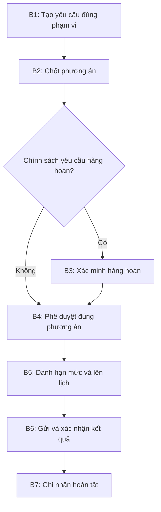

# Workflow step ordering: bảo vệ thứ tự các bước nghiệp vụ

Trong chương **Workflow Security**, bảo vệ thứ tự các bước có nghĩa là máy chủ chỉ cho thực hiện một hành động khi những điều kiện tiên quyết của hành động đó đã được hoàn tất hợp lệ. Việc người dùng đã đi qua các màn hình theo đúng thứ tự không chứng minh quy trình phía máy chủ đã được tuân thủ.

Trong module bảo vệ logic nghiệp vụ, vấn đề này xuất hiện khi người dùng bỏ qua phê duyệt, thay giá sau khi kiểm tra, dùng kết quả của hồ sơ này cho hồ sơ khác hoặc gửi nhiều yêu cầu để thực hiện một bước nhiều lần. Một endpoint có xác thực vẫn có thể gây tổn thất nếu nó cho phép thực hiện đúng hành động nhưng sai thời điểm hoặc trên sai phiên bản dữ liệu.

Bài học sử dụng quy trình hoàn tiền để giải thích cách biểu diễn thứ tự bằng quan hệ phụ thuộc, bằng chứng đáng tin cậy và ranh giới transaction. Ví dụ chỉ mô tả thiết kế ứng dụng; các điều kiện hoàn tiền cụ thể phải do nghiệp vụ của hệ thống xác định.

Sau bài này, bạn có thể:

- Phân biệt thứ tự màn hình với thứ tự nghiệp vụ được máy chủ thực thi.
- Xác định bước nào là tiền đề bắt buộc, bước nào có điều kiện và bước nào có thể thực hiện song song.
- Gắn bằng chứng kiểm tra hoặc phê duyệt với đúng đối tượng, tổ chức và phiên bản nội dung.
- Ngăn việc bỏ bước, đảo bước, tái sử dụng kết quả cũ và gọi lặp bước có tác dụng phụ.
- Thiết kế xử lý khi nhiều yêu cầu chạy đồng thời hoặc sự kiện đến sai thứ tự.

## 1. Endpoint hợp lệ chưa chắc được gọi vào lúc hợp lệ

Giả sử giao diện hoàn tiền có các màn hình:

```text
Chọn giao dịch → Kiểm tra điều kiện → Xin duyệt → Thực hiện hoàn tiền
```

Người dùng phát hiện endpoint cuối và gọi trực tiếp:

```http
POST /refunds/rf-123/execute
Content-Type: application/json

{
  "step": 4,
  "eligibilityChecked": true,
  "approved": true,
  "amountMinor": 5000000
}
```

Nếu máy chủ tin các cờ trong body, nó đang để client tự khai rằng các tiền đề đã hoàn tất. Kiểm tra người gọi đã đăng nhập hoặc có quyền xem giao dịch gốc không chứng minh người đó được duyệt hay được thực hiện hoàn tiền.

Một biến thể khó thấy hơn là máy chủ thực sự từng kiểm tra điều kiện, nhưng sau đó client sửa mặt hàng, số lượng hoặc số tiền trước khi gọi bước thực hiện. “Đã kiểm tra” vẫn đúng về mặt lịch sử, nhưng kết quả kiểm tra không còn áp dụng cho nội dung hiện tại.

Mỗi hành động cần trả lời bốn câu hỏi:

1. Các tiền đề bắt buộc cho hành động này là gì?
2. Bằng chứng hoàn tất tiền đề đến từ nguồn nào?
3. Bằng chứng có thuộc đúng lần chạy quy trình và đúng nội dung hiện tại không?
4. Điều gì ngăn tiền đề mất hiệu lực hoặc bị sử dụng nhiều lần trong lúc thực hiện?

## 2. Thứ tự nghiệp vụ là quan hệ phụ thuộc

Không nên đồng nhất quy trình với một biến `currentStep = 3`. Một con số chỉ cho biết vị trí dự kiến; nó không cho biết bước trước đã được ai thực hiện, dữ liệu nào đã được kiểm tra và kết quả còn hiệu lực hay không.

Gọi `A ≺ B` là quan hệ “A phải hoàn tất hợp lệ trước khi B được bắt đầu”. Ví dụ:

```text
Chốt phương án hoàn tiền ≺ Phê duyệt phương án
Phê duyệt phương án ≺ Dành hạn mức và lên lịch hoàn tiền
Xác nhận hoàn tiền từ nguồn đáng tin cậy ≺ Ghi nhận hoàn tất
```

Trong một quy trình có nhánh, không phải mọi bước đều có thứ tự tuyệt đối. Chẳng hạn kiểm tra hàng hoàn và kiểm tra dấu hiệu lạm dụng có thể chạy song song, nhưng cả hai đều phải đạt trước khi duyệt nếu chính sách yêu cầu.

Một điều kiện thực thi có thể viết:

```text
canExecute(step, workflow, actor, now) khi:
  actor được phép thực hiện step trên workflow này
  AND mọi tiền đề bắt buộc của nhánh hiện tại đều có bằng chứng hợp lệ
  AND bằng chứng gắn với đúng nội dung và phiên bản chính sách
  AND dữ liệu hiện tại vẫn thỏa business invariants
  AND thao tác chưa được thực hiện theo cách loại trừ lần thực thi mới
```

Hệ thống nên lưu dữ liệu nghiệp vụ và bằng chứng đủ để đánh giá điều kiện này. Một trường trạng thái tổng hợp có thể hỗ trợ truy vấn và chặn nhanh, nhưng không thay thế toàn bộ điều kiện thực thi.

## 3. Quy trình ví dụ: hoàn tiền có kiểm tra và phê duyệt

Giả định ứng dụng có các quy tắc sau:

- Người yêu cầu chỉ tạo yêu cầu hoàn tiền cho giao dịch thuộc phạm vi được phép của mình.
- Máy chủ tính số tiền đề xuất từ giao dịch gốc, mặt hàng, số lượng và chính sách; không nhận tổng tiền client khai báo làm căn cứ cuối cùng.
- Một số trường hợp bắt buộc xác minh đã nhận hàng hoàn. Quyết định có cần bước này do chính sách phía máy chủ xác định.
- Người duyệt phải có quyền với yêu cầu cụ thể, đủ hạn mức và khác người yêu cầu trong quy trình ví dụ.
- Trước khi gửi lệnh ra ngoài, hệ thống dành một phần hạn mức còn được hoàn của giao dịch gốc.
- Chỉ bằng chứng kết quả đáng tin cậy mới cho phép ghi nhận đã hoàn tiền thành công.

Các bước và bằng chứng chính:

| Bước | Hành động | Đầu ra đáng tin cậy |
| --- | --- | --- |
| B1 | Tạo yêu cầu và liên kết giao dịch gốc | Yêu cầu có ID riêng, tổ chức, người yêu cầu và giao dịch gốc đã được xác minh |
| B2 | Tính và chốt phương án hoàn tiền | Bản phương án bất biến gồm mặt hàng, số lượng, số tiền, loại tiền và phiên bản chính sách |
| B3 | Xác minh điều kiện hàng hoàn nếu bắt buộc | Bằng chứng áp dụng cho đúng yêu cầu và phạm vi hàng cần hoàn |
| B4 | Phê duyệt phương án | Quyết định duyệt gắn với đúng bản phương án, người duyệt và thời hạn áp dụng |
| B5 | Kiểm tra cuối, dành hạn mức và lên lịch | Bản dành hạn mức cùng định danh thao tác gửi tiền được ghi bền vững |
| B6 | Gửi lệnh và xác nhận kết quả bên ngoài | Kết quả đối chiếu được với đúng thao tác và giao dịch hoàn tiền |
| B7 | Ghi nhận hoàn tất | Trạng thái và số liệu nội bộ phản ánh kết quả đã xác nhận |

Nếu không cần hàng hoàn, quy trình được bỏ B3 theo quyết định chính sách có căn cứ. Nếu có yêu cầu hàng hoàn, B4 không được coi là hoàn tất hợp lệ khi thiếu B3.



Sơ đồ mô tả phụ thuộc nghiệp vụ, không phải danh sách URL mà trình duyệt buộc phải truy cập. Các thao tác có thể đến từ giao diện, API, worker hoặc callback nhưng vẫn phải thỏa cùng các tiền đề.

## 4. Ràng buộc bằng chứng với đúng lần chạy và đúng nội dung

Một giao dịch gốc có thể có nhiều yêu cầu hoàn tiền từng phần. Vì vậy, chỉ kiểm tra “giao dịch này từng được duyệt hoàn tiền” là quá rộng.

Ví dụ có hai yêu cầu:

```text
Giao dịch PAY-9
  ├─ Yêu cầu RF-A: hoàn mặt hàng X, 100.000 VND
  └─ Yêu cầu RF-B: hoàn mặt hàng Y, 900.000 VND
```

Quyết định duyệt RF-A không được dùng để thực hiện RF-B, dù cả hai cùng thuộc một người dùng và một giao dịch gốc.

Một bằng chứng phê duyệt cần ràng buộc ít nhất với những dữ liệu quyết định phạm vi của nó:

| Dữ liệu ràng buộc | Mục đích |
| --- | --- |
| Tổ chức hoặc tenant | Ngăn dùng bằng chứng giữa các phạm vi tổ chức |
| ID yêu cầu hoàn tiền | Ngăn dùng quyết định của yêu cầu A cho yêu cầu B |
| ID giao dịch gốc | Ngăn đổi nguồn tiền sau khi duyệt |
| ID hoặc phiên bản phương án | Gắn quyết định với đúng nội dung đã xét |
| Số tiền và loại tiền, trực tiếp hoặc qua phương án bất biến | Ngăn thay số tiền hoặc đơn vị tiền mà vẫn giữ phê duyệt |
| Phạm vi mặt hàng và số lượng | Ngăn dùng bằng chứng hàng hoàn của mặt hàng khác |
| Phiên bản chính sách áp dụng | Giải thích vì sao bước bắt buộc hoặc được miễn |
| Chủ thể, kết quả và thời hạn | Xác định nguồn thẩm quyền và thời gian hiệu lực |

Có thể lưu bằng chứng trỏ tới một bản phương án bất biến thay vì lặp lại tất cả trường. Điều kiện quan trọng là ID hoặc phiên bản đó phải xác định duy nhất nội dung; không được sửa âm thầm bản phương án mà quyết định cũ đang tham chiếu.

Một hash nội dung có thể hỗ trợ đối chiếu khi được tính từ dữ liệu chuẩn hóa phía máy chủ. Hash do client tự gửi không chứng minh ai đã duyệt hoặc nội dung nào thực sự được kiểm tra.

## 5. Máy chủ phải giữ quyền quyết định bước tiếp theo

Một thiết kế API có thể sử dụng:

```http
POST /refunds
POST /refunds/rf-123/submit-for-approval
POST /refunds/rf-123/approve
POST /refunds/rf-123/schedule-execution
GET  /refunds/rf-123
```

Mỗi endpoint biểu diễn ý định cụ thể và có chính sách quyền riêng. Khách hàng được tạo yêu cầu không mặc nhiên có quyền phê duyệt hoặc lên lịch thực hiện. Việc xử lý kết quả từ bên ngoài thuộc luồng dịch vụ hoặc callback đã xác thực.

Ví dụ một chủ thể có quyền thực hiện gửi yêu cầu lên lịch:

```http
POST /refunds/rf-123/schedule-execution
Idempotency-Key: refund-rf-123-schedule-01
Content-Type: application/json

{
  "expectedWorkflowVersion": 12,
  "planRevision": 3
}
```

Các giá trị phiên bản thể hiện phiên bản mà người gọi định thao tác. Máy chủ phải tải dữ liệu thật rồi so sánh; không lấy chúng làm bằng chứng rằng phiên bản đã được duyệt.

Máy chủ tự xác định:

- Danh tính và phạm vi tổ chức đã được xác minh.
- Phương án hiện tại và bằng chứng áp dụng cho phương án đó.
- Chính sách nào yêu cầu bước hàng hoàn và bước phê duyệt.
- Số tiền cuối cùng, hạn mức còn lại và định danh thao tác bên ngoài.
- Trạng thái có thể ghi sau khi hoàn tất transaction.

Không cho phép body ghi trực tiếp `approved`, `stepsCompleted`, `returnVerified`, `executedBy`, `providerConfirmed` hoặc trạng thái thành công. Với trường không được hỗ trợ, API có thể từ chối theo hợp đồng của nó; dù chọn cách báo lỗi nào, những trường đó không được điều khiển dữ liệu do máy chủ quản lý.

## 6. Bằng chứng phải đến từ nguồn có thẩm quyền

Mỗi tiền đề có một nguồn sự thật phù hợp:

| Tiền đề | Nguồn có thể được tin cậy sau khi xác minh | Nguồn không đủ để kết luận |
| --- | --- | --- |
| Người gọi có quyền với giao dịch | Dữ liệu quyền và giao dịch do máy chủ truy vấn | `ownerId` trong body |
| Phương án có số tiền hợp lệ | Tính toán từ dữ liệu giao dịch và chính sách | Tổng tiền trên giao diện |
| Đã nhận hàng hoàn cần thiết | Dữ liệu kho hoặc kết quả nghiệp vụ được xác thực, đúng mặt hàng và số lượng | Cờ `returned=true` từ khách hàng |
| Đã được phê duyệt | Quyết định được tạo qua luồng duyệt có kiểm tra quyền | URL của màn hình “Duyệt thành công” |
| Đã gửi lệnh bền vững | Thao tác và outbox đã commit | Worker vừa bắt đầu xử lý trong bộ nhớ |
| Đã hoàn tiền thành công | Kết quả từ nhà cung cấp đã xác thực và đối chiếu | Trang chuyển hướng của trình duyệt hoặc timeout |

Nhật ký audit có thể giải thích chuyện đã xảy ra, nhưng không nên tùy tiện dùng một dòng log văn bản làm dữ liệu điều khiển bước tiếp theo. Bằng chứng thực thi cần cấu trúc, định danh, nguồn và quy tắc hiệu lực rõ ràng.

Nếu dùng một token để chuyển bằng chứng giữa các dịch vụ, token cần được kiểm chứng về tính xác thực, mục đích, đối tượng nhận, đối tượng nghiệp vụ và thời hạn. Chữ ký hợp lệ chỉ chứng minh dữ liệu do bên giữ khóa phát hành; nó không tự chứng minh token chưa bị thu hồi hoặc chưa được sử dụng.

Với bước chỉ được tiêu thụ một lần, cần lưu và tiêu thụ định danh tương ứng bằng thao tác nguyên tử hoặc cơ chế bền vững tương đương. Không xem “token khó đoán” là toàn bộ cơ chế bảo vệ thứ tự.

## 7. Thay đổi nội dung có thể làm mất hiệu lực các bước trước

Giả sử RF-123 có phương án phiên bản 3, đã kiểm tra và duyệt hoàn 100.000 VND. Sau đó số lượng thay đổi và máy chủ tạo phương án phiên bản 4 trị giá 500.000 VND.

Không được giữ một cờ toàn cục `approved=true` rồi thực hiện phiên bản 4. Quyết định cũ chỉ có hiệu lực cho phạm vi mà nó đã duyệt.

```text
Phương án v3 → Kiểm tra v3 → Phê duyệt v3
                  |
                  └─ không phải bằng chứng cho phương án v4

Phương án v4 → Kiểm tra lại phần bị ảnh hưởng → Phê duyệt v4
```

Có hai hướng thiết kế thường gặp:

1. Khóa nội dung sau khi gửi duyệt. Muốn thay đổi, người dùng rút hoặc tạo một bản sửa đổi theo quy trình rõ ràng.
2. Cho tạo phiên bản nội dung mới, đồng thời làm mất hiệu lực những bằng chứng phụ thuộc vào phần đã đổi.

Hướng thứ hai cần một quy tắc phụ thuộc cụ thể. Nếu chỉ đổi ghi chú nội bộ không ảnh hưởng số tiền, hệ thống có thể giữ một số kết quả theo chính sách. Nếu đổi giao dịch gốc, mặt hàng, số lượng, loại tiền hoặc số tiền, các quyết định liên quan không được tự động kế thừa.

Không nhất thiết xóa bằng chứng cũ. Có thể giữ nó cho audit và đánh dấu rằng nó thuộc phiên bản trước, không còn cấp quyền cho lần thực hiện hiện tại.

Phân biệt hai loại phiên bản:

- `planRevision`: phiên bản nội dung nghiệp vụ được kiểm tra và phê duyệt.
- `workflowVersion`: phiên bản dùng để phát hiện cập nhật cạnh tranh trên tiến trình.

Một ghi chú vận hành có thể làm tăng `workflowVersion` mà không đổi `planRevision`. Ngược lại, thay nội dung phải tạo quan hệ rõ ràng với hiệu lực của bằng chứng, không chỉ tăng một bộ đếm kỹ thuật.

## 8. Minh họa Java: kiểm tra tiền đề của bước dành hạn mức

Đoạn mã dưới đây minh họa việc đối chiếu bằng chứng với một phương án bất biến. Các record là mô hình nội bộ được dựng từ dữ liệu tin cậy, không phải DTO để client tự gửi. Ví dụ dùng record của Java 16 trở lên và chủ ý chỉ kiểm tra một phần chính sách thứ tự bước.

```java
import java.time.Instant;
import java.util.Objects;
import java.util.UUID;

record RefundPlan(
        UUID tenantId,
        UUID refundId,
        UUID paymentId,
        long revision,
        long amountMinor,
        String currency,
        String policyVersion,
        boolean returnRequired) {
}

record EligibilityEvidence(RefundPlan plan, Instant validUntil) {
}

record ApprovalEvidence(
        RefundPlan plan,
        UUID approvedBy,
        Instant validUntil) {
}

record ReturnEvidence(RefundPlan plan, boolean verified) {
}

final class WorkflowStepPolicy {
    private WorkflowStepPolicy() {
    }

    static void requireReadyToReserve(
            RefundPlan current,
            EligibilityEvidence eligibility,
            ApprovalEvidence approval,
            ReturnEvidence returned,
            UUID requestedBy,
            Instant now) {
        Objects.requireNonNull(current);
        Objects.requireNonNull(requestedBy);
        Objects.requireNonNull(now);

        require(current.amountMinor() > 0, "INVALID_AMOUNT");
        require(eligibility != null, "ELIGIBILITY_REQUIRED");
        require(approval != null, "APPROVAL_REQUIRED");

        require(current.equals(eligibility.plan()),
                "ELIGIBILITY_PLAN_MISMATCH");
        require(now.isBefore(eligibility.validUntil()),
                "ELIGIBILITY_EXPIRED");

        require(current.equals(approval.plan()),
                "APPROVAL_PLAN_MISMATCH");
        require(now.isBefore(approval.validUntil()),
                "APPROVAL_EXPIRED");
        require(approval.approvedBy() != null,
                "APPROVER_REQUIRED");
        require(!requestedBy.equals(approval.approvedBy()),
                "SELF_APPROVAL_FORBIDDEN");

        if (current.returnRequired()) {
            require(returned != null, "RETURN_EVIDENCE_REQUIRED");
            require(current.equals(returned.plan()),
                    "RETURN_PLAN_MISMATCH");
            require(returned.verified(), "RETURN_NOT_VERIFIED");
        }
    }

    private static void require(boolean condition, String code) {
        if (!condition) {
            throw new IllegalStateException(code);
        }
    }
}
```

Trong mô hình này, mỗi phương án là bất biến và `equals()` đối chiếu đầy đủ các trường. Vì vậy, bằng chứng của một yêu cầu, tổ chức, số tiền hoặc phiên bản khác không được chấp nhận. Trong ứng dụng thật, thường chỉ cần đối chiếu ID bản phương án cùng các quan hệ được cơ sở dữ liệu bảo vệ.

Đoạn mã không thay thế các trách nhiệm còn lại:

- Việc tạo bằng chứng duyệt phải kiểm tra quyền người duyệt, phạm vi đối tượng và hạn mức.
- Dữ liệu phải bảo đảm các trường bắt buộc không rỗng; ví dụ không trình bày toàn bộ constructor validation và ánh xạ lỗi.
- Bằng chứng bị thu hồi hoặc dữ liệu điều kiện đã thay đổi phải được phát hiện khi tải và kiểm tra trạng thái có thẩm quyền.
- Chủ thể gọi bước dành hạn mức vẫn cần quyền thực hiện bước đó.
- Tiền đề phải được kiểm tra cùng cơ chế transaction và kiểm soát cạnh tranh phù hợp.
- Hạn mức còn được hoàn của giao dịch gốc chưa được kiểm tra trong hàm này.

Nếu chỉ gọi `requireReadyToReserve()` rồi ghi dữ liệu ở một thời điểm không được bảo vệ khác, ứng dụng vẫn có thể gặp lỗi kiểm tra trước, sử dụng sau.

## 9. Bảo vệ ranh giới giữa phê duyệt và thực hiện

Phê duyệt xác nhận một phương án được chấp nhận theo chính sách. Nó không tự dành phần tiền còn được hoàn. Hai yêu cầu khác nhau có thể cùng hợp lệ khi kiểm tra riêng lẻ nhưng vượt tổng hạn mức khi thực hiện đồng thời.

Ví dụ giao dịch gốc còn được hoàn 1.000.000 VND:

```text
Yêu cầu A: 700.000 VND
Yêu cầu B: 600.000 VND

A đọc hạn mức còn lại = 1.000.000
B đọc hạn mức còn lại = 1.000.000
A và B cùng kết luận đủ tiền
```

Khóa riêng từng yêu cầu hoàn tiền không ngăn được tình huống này, vì A và B là hai bản ghi khác nhau. Cần bảo vệ hạn mức dùng chung ở cấp giao dịch gốc hoặc một cấu trúc số dư có thẩm quyền tương đương.

Trong mô hình minh họa, đặt:

```text
C = số tiền giao dịch đã thu được phép làm cơ sở hoàn
R = tổng tiền đã xác nhận hoàn thành
H = tổng tiền đang được dành cho các thao tác chưa có kết quả cuối cùng

Invariant: R + H <= C

Chỉ dành thêm x khi: x > 0 AND x <= C - R - H
```

Tất cả giá trị phải cùng loại tiền và theo quy tắc độ chính xác đã xác định. Ví dụ `amountMinor` dùng số nguyên theo đơn vị nhỏ nhất của loại tiền; không mặc định mọi loại tiền đều có hai chữ số thập phân. Tính toán cần giới hạn miền giá trị để tránh tràn số.

Một transaction B5 có thể thực hiện:

```text
BEGIN
  nhận quyền xử lý idempotency key
  khóa giao dịch gốc và yêu cầu theo thứ tự khóa thống nhất
  tải phương án hiện tại và các bằng chứng liên quan
  kiểm tra quyền, phiên bản, phụ thuộc bước và hiệu lực bằng chứng
  kiểm tra lại dữ liệu giao dịch gốc ảnh hưởng điều kiện hoàn
  kiểm tra x <= C - R - H
  tạo bản dành hạn mức cho đúng phương án
  tạo định danh thao tác hoàn tiền duy nhất
  ghi outbox yêu cầu gửi lệnh
  cập nhật tiến trình sang trạng thái chờ xử lý
  ghi audit và kết quả idempotency tương ứng
COMMIT
```

Đây là một chiến lược dùng khóa, không phải yêu cầu phải dùng chính xác loại khóa đó. Có thể dùng cập nhật có điều kiện hoặc mức cô lập phù hợp nếu chúng thực thi cùng invariant. Mọi đường thay đổi `R`, `H` hoặc `C` phải tuân thủ giao thức nhất quán; một tác vụ nền bỏ qua nó có thể phá vỡ bảo đảm.

Nếu bằng chứng duyệt có thể bị thu hồi đồng thời, cần xác định lúc nào quyết định được coi là đã được tiêu thụ để thực hiện. Tải bằng chứng, kiểm tra hiệu lực và nhận quyền thực hiện phải được bảo vệ theo ranh giới đó; không chỉ kiểm tra một bản sao cũ trong bộ nhớ đệm.

Không giữ transaction mở từ lúc người dùng tạo yêu cầu đến lúc người duyệt thao tác. Các bước dài được liên kết bằng dữ liệu bền vững và transaction ngắn tại từng ranh giới thực thi.

## 10. Yêu cầu lặp không được tạo một lần thực hiện mới

Thứ tự đúng vẫn có thể bị lạm dụng nếu bước cuối được gọi nhiều lần. Sau khi B5 thành công nhưng phản hồi bị mất, client thường cần retry. Hệ thống cần nhận diện cùng một ý định thay vì dành hạn mức và tạo lệnh mới.

Một thiết kế có thể dùng:

- Idempotency key có phạm vi theo tổ chức, chủ thể và loại thao tác.
- Dấu vân tay gồm ID yêu cầu, phiên bản phương án và dữ liệu có ý nghĩa của lệnh.
- Ràng buộc duy nhất bảo vệ việc nhận quyền xử lý key.
- Ràng buộc nghiệp vụ bảo đảm một lần thực hiện đang có hiệu lực cho một phương án theo chính sách đã chọn.
- Kết quả và định danh thao tác được lưu cùng transaction tạo tác dụng phụ nội bộ.

| Tình huống | Hành vi cần thiết |
| --- | --- |
| Cùng key, cùng lệnh, lần trước đã commit | Trả cùng kết quả lên lịch và định danh thao tác; không dành hạn mức thêm |
| Cùng key nhưng đổi phương án hoặc đối tượng | Từ chối vì key không còn biểu diễn cùng ý định |
| Key khác nhưng cùng cố thực hiện một phương án đã lên lịch | Quy tắc nghiệp vụ và ràng buộc duy nhất chặn lần thực hiện mới |
| Hai lần gửi cùng key đến đồng thời | Chỉ một lần nhận quyền thực thi; lần còn lại nhận trạng thái xử lý hoặc kết quả theo hợp đồng |
| Transaction trước rollback | Không trả một kết quả thành công chưa từng commit |

Phản hồi đã lưu cũng cần được bảo vệ bằng kiểm tra quyền truy cập hiện tại. Biết idempotency key không đồng nghĩa được đọc kết quả của người khác.

Không thêm đường “nếu đã duyệt thì cho thực hiện lại” chỉ để làm retry dễ hơn. Retry là tiếp tục hoặc truy vấn cùng thao tác đã định danh; một yêu cầu nghiệp vụ mới cần quyền và điều kiện riêng.

## 11. Sự kiện đến sai thứ tự và callback đến muộn

Trong hệ thống có hàng đợi hoặc dịch vụ bên ngoài, thứ tự nhận thông điệp có thể khác thứ tự phát sinh. Thông điệp cũng có thể được gửi lại.

Ví dụ:

```text
Sự kiện E1: xác nhận đã nhận hàng hoàn
Sự kiện E2: xác nhận lệnh hoàn tiền thành công

Consumer có thể nhận lại E1 nhiều lần hoặc thấy E2
trước khi một bản chiếu phục vụ giao diện cập nhật trạng thái đang xử lý.
```

Không nên dùng timestamp client hoặc số thứ tự hiển thị trên màn hình làm căn cứ duy nhất. Mỗi sự kiện cần đủ định danh để đối chiếu với tiến trình có thẩm quyền:

- Tổ chức và đối tượng nghiệp vụ.
- Định danh thao tác đang chờ kết quả.
- Phiên bản hoặc bản phương án liên quan.
- Nguồn phát và loại sự kiện được nguồn đó phép xác nhận.
- ID sự kiện để xử lý lặp.
- Trình tự hoặc phiên bản nguồn nếu giao thức thực sự cung cấp và bảo đảm ý nghĩa đó.

Quy tắc xử lý nên phân biệt:

| Tình huống | Hướng xử lý |
| --- | --- |
| Sự kiện hợp lệ cho thao tác đang chờ | Kiểm tra invariant rồi cập nhật nguyên tử và ghi nhận đã xử lý |
| Bản sao của sự kiện đã áp dụng | Không áp dụng hiệu ứng lần nữa |
| Sự kiện của phương án hoặc thao tác cũ | Không dùng để hoàn tất thao tác mới; lưu kết quả đối chiếu phù hợp |
| Sự kiện chưa thể khớp vì dữ liệu đến trước tiền đề | Lưu chờ, retry hoặc đối soát theo thiết kế; không tự tạo tiền đề giả |
| Hai kết quả cuối cùng mâu thuẫn | Đưa vào đối soát và kiểm tra nguồn có thẩm quyền; không tùy tiện cho thông điệp đến sau ghi đè |
| Sự kiện không được xác thực hoặc không thuộc phạm vi | Từ chối trước khi thay đổi nghiệp vụ |

Không được bỏ qua một bằng chứng thành công thật chỉ vì bản chiếu giao diện chưa theo kịp. Cần kiểm tra thao tác có thẩm quyền đã được ghi ở B5, đối chiếu kết quả và cập nhật hoặc lên lịch đối soát. Ngược lại, cũng không được đánh dấu thành công chỉ vì callback có trường `success=true`.

Nếu dùng bảng inbox để chống lặp, việc ghi “đã xử lý sự kiện” và áp dụng thay đổi cần nằm trong cùng transaction cục bộ. Nếu hai việc này tách rời, crash có thể làm mất hiệu ứng hoặc làm hiệu ứng chạy lại.

## 12. Timeout không chứng minh bước bên ngoài thất bại

Sau khi B6 gửi yêu cầu, kết nối có thể timeout trong khi nhà cung cấp đã hoàn tiền. Nếu hệ thống lập tức giải phóng phần dành hạn mức rồi cho tạo một lệnh mới, cùng khoản tiền có thể bị sử dụng hai lần.

Một mô hình kết quả cần phân biệt:

```text
Chưa gửi
Đang chờ gửi
Đã gửi, chưa biết kết quả
Đã xác nhận thành công
Đã xác nhận thất bại cuối cùng
```

Khi kết quả chưa rõ, giữ định danh thao tác và phần hạn mức liên quan cho tới khi có quy tắc đối soát an toàn. Chỉ giải phóng phần dành hạn mức khi đủ bằng chứng rằng thao tác không thành công và không thể tiếp tục tạo hiệu ứng, hoặc theo một quy trình xử lý ngoại lệ đã xác định rõ trách nhiệm.

Khi đã xác nhận thành công, chuyển khoản tương ứng từ `H` sang `R` bằng cập nhật nhất quán, không cộng vào `R` nhiều lần cho các callback lặp.

Outbox giúp việc ghi ý định gửi gắn với commit cục bộ. Nó không tự bảo đảm phía ngoài chỉ hoàn tiền đúng một lần. Cần phối hợp định danh thao tác ổn định, cơ chế idempotency của bên nhận nếu có và đối soát khi kết quả không rõ.

Bù trừ cũng là hành động nghiệp vụ mới có điều kiện riêng. Không thể coi việc đặt lại `status` là hoàn tác một khoản tiền đã được chuyển ra ngoài.

## 13. Nhánh tùy chọn, bước song song và vòng sửa đổi

### 13.1. Bước có điều kiện

Nếu chính sách cho phép miễn nhận hàng hoàn với một số mặt hàng, máy chủ cần lưu hoặc tái lập được căn cứ miễn đó. Client không được gửi `skipReturnCheck=true` để tự chọn nhánh ngắn hơn.

Quy tắc phải xác định phiên bản chính sách nào áp dụng: tại lúc tạo yêu cầu, gửi duyệt hay thực hiện. Nếu quy định thay đổi giữa chừng, hệ thống cần quyết định rõ giữ quyết định cũ hay yêu cầu đánh giá lại; không để các dịch vụ tự chọn các phiên bản khác nhau.

### 13.2. Bước song song

Giả sử có hai tiền đề độc lập:

```text
Kiểm tra hàng hoàn ───────┐
                        ├─> Cho phép phê duyệt
Kiểm tra dấu hiệu lạm dụng ┘
```

Điều kiện phải là phép **AND** nếu cả hai đều bắt buộc. Thiết kế “có bất kỳ một kết quả kiểm tra nào thì tăng step” có thể cho phép một callback lặp thay thế tiền đề còn thiếu.

Mỗi kết quả cần có loại kiểm tra và phạm vi riêng. Không chỉ đếm `completedChecks = 2` khi hai bản ghi có thể là bản sao của cùng một kiểm tra.

### 13.3. Vòng sửa đổi

Nếu người duyệt yêu cầu chỉnh sửa, quy trình có thể quay về bước chuẩn bị. Việc quay lại phải xác định những bằng chứng nào mất hiệu lực và có được giữ phần dành hạn mức hay không.

Sau khi đã gửi thao tác ra ngoài, không mở lại phương án như thể chưa từng thực hiện. Muốn thay đổi cần quy trình phù hợp với kết quả thực tế và các thao tác đang chờ; nếu không, callback cũ có thể hoàn tất nhầm phiên bản mới.

## 14. Những cơ chế dễ bị nhầm là bảo vệ thứ tự

| Cơ chế | Vì sao chưa đủ | Việc cần bổ sung |
| --- | --- | --- |
| Ẩn nút và vô hiệu hóa màn hình tiếp theo | Client có thể gọi API trực tiếp | Kiểm tra tiền đề ở máy chủ |
| Lưu `currentStep` trong trình duyệt hoặc body | Người dùng tự sửa được | Dữ liệu và bằng chứng có thẩm quyền phía máy chủ |
| Lưu một cờ `verified=true` trong session | Có thể bị dùng lẫn giữa nhiều tab hoặc nhiều yêu cầu | Ràng buộc với ID quy trình và phiên bản nội dung |
| URL hoặc ID khó đoán | Người đã biết URL vẫn có thể gọi sai bước | Quyền theo đối tượng và kiểm tra phụ thuộc |
| Token ký số | Có thể đúng chữ ký nhưng sai phạm vi, cũ hoặc bị replay | Kiểm tra mục đích, ràng buộc, hiệu lực và tiêu thụ khi cần |
| Chỉ kiểm tra bước trước từng xảy ra | Nội dung hoặc chính sách có thể đã đổi | Đối chiếu bằng chứng với nội dung hiện tại |
| Chỉ có transaction trên từng yêu cầu hoàn tiền | Không bảo vệ hạn mức chung của giao dịch gốc | Cơ chế nhất quán trên tài nguyên dùng chung |
| CSRF token | Bảo vệ một loại yêu cầu giả mạo, không chứng minh tiền đề nghiệp vụ | Giữ cơ chế chống CSRF cần thiết và thêm bảo vệ thứ tự riêng |

Công cụ quản trị, chức năng xử lý hàng loạt và worker nền cũng là đường thực thi workflow. Nếu chúng cập nhật trực tiếp cờ “đã duyệt” hoặc “đã hoàn tất”, người dùng có quyền truy cập các chức năng đó có thể đi vòng quy trình.

Quyền xử lý ngoại lệ nên được mô hình hóa thành hành động cụ thể với lý do, giới hạn và audit. Một quyền chung “bỏ qua mọi bước” làm mất khả năng đánh giá invariant ở các ranh giới quan trọng.

## 15. Kiểm thử bằng cách cố tình làm sai thứ tự

Một bộ kiểm thử chỉ đi hết luồng thành công theo đúng màn hình sẽ khó phát hiện lỗi ordering. Cần gọi trực tiếp các hành động và thay đổi lịch thực thi.

### 15.1. Bỏ bước và đổi nhánh

| Tình huống | Kết quả cần xác minh |
| --- | --- |
| Gọi lên lịch ngay sau khi tạo yêu cầu | Bị từ chối; không dành hạn mức, không có outbox gửi lệnh |
| Gọi phê duyệt khi chưa có phương án hợp lệ | Không tạo bằng chứng duyệt có hiệu lực |
| Bỏ kiểm tra hàng hoàn trong trường hợp bắt buộc | Không được duyệt hoặc thực hiện theo chính sách đã định |
| Gửi cờ miễn kiểm tra từ client | Không thay đổi nhánh mà máy chủ đã quyết định |
| Dùng quyền tạo yêu cầu để gọi endpoint duyệt | Bị từ chối quyền, kể cả dữ liệu đủ tiền đề khác |
| Người yêu cầu có thêm vai trò duyệt tự duyệt | Vẫn bị chặn theo quy tắc phân tách trách nhiệm của ví dụ |

### 15.2. Đổi đối tượng, đổi nội dung và tái sử dụng bằng chứng

- Dùng quyết định duyệt RF-A để lên lịch RF-B, kể cả khi cùng giao dịch gốc.
- Giữ nguyên ID yêu cầu nhưng đổi giao dịch gốc, tổ chức hoặc loại tiền.
- Tăng số lượng hoặc số tiền sau khi phê duyệt rồi gửi phiên bản mới để thực hiện.
- Dùng kết quả nhận một mặt hàng để thay cho toàn bộ các mặt hàng phải hoàn.
- Thực hiện bằng quyết định đã hết hạn hoặc bị thu hồi.
- Đổi phiên bản chính sách theo hướng làm mất một tiền đề bắt buộc.
- Mở hai tab cho hai yêu cầu rồi thử dùng trạng thái session của tab này cho tab kia.

Trong mọi trường hợp, kiểm tra cả dữ liệu phụ. Một phản hồi lỗi không đủ nếu outbox hoặc phần dành hạn mức đã được tạo trước khi lỗi xảy ra.

### 15.3. Đồng thời, yêu cầu lặp và điểm crash

| Kịch bản | Invariant hoặc hành vi phải giữ |
| --- | --- |
| Hai yêu cầu khác nhau cùng dành phần hạn mức còn lại | `R + H <= C` sau mọi commit |
| Hai lần lên lịch cùng phương án bằng key khác nhau | Không tạo hai thao tác thực hiện trái chính sách |
| Retry cùng key sau khi mất phản hồi | Trả định danh thao tác cũ; không tăng phần dành hạn mức |
| Đổi phương án đồng thời với phê duyệt | Quyết định chỉ có hiệu lực cho đúng bản đã được duyệt |
| Thu hồi duyệt đồng thời với lên lịch | Kết quả tuân theo ranh giới tiêu thụ quyết định đã thiết kế |
| Crash trước commit B5 | Không có một phần tiến trình được coi là đã lên lịch thành công |
| Crash sau commit B5 nhưng trước gửi lệnh | Outbox cho phép tiếp tục cùng thao tác, không tạo thao tác mới |
| Nhà cung cấp thành công nhưng phản hồi timeout | Giữ trạng thái chưa rõ kết quả phù hợp; đối soát trước khi giải phóng hoặc tạo lại |
| Callback thành công gửi lại nhiều lần | Chỉ chuyển phần hạn mức và ghi nhận hoàn tất một lần |
| Callback cũ đến sau vòng sửa đổi | Không được hoàn tất nhầm phương án hoặc thao tác mới |

Các kiểm thử cạnh tranh cần điều khiển được thời điểm đọc, cập nhật và commit để tạo ra lịch thực thi cần kiểm tra. Chỉ gọi hai hàm tuần tự hoặc mock repository không chứng minh invariant được giữ khi chạy đồng thời trên cơ sở dữ liệu thực tế.

## 16. Audit để tái dựng được thứ tự có ý nghĩa

Audit cho một bước nên ghi được:

```text
workflowId / refundId
tenantId và paymentId
hành động, kết quả, chủ thể và loại chủ thể
planRevision và workflowVersion liên quan
ID bằng chứng tiền đề đã sử dụng
ID thao tác bên ngoài hoặc sự kiện tương ứng
thời điểm máy chủ, mã tương quan và lý do nghiệp vụ khi cần
```

Thứ tự dòng log theo thời gian không đủ để suy ra quan hệ nhân quả giữa các dịch vụ. Định danh thao tác, phiên bản và tham chiếu bằng chứng giúp xác định bước nào thực sự cấp điều kiện cho bước nào.

Audit thành công cần phản ánh thao tác đã commit. Những lần bị từ chối vì thiếu tiền đề có thể được ghi vào nhật ký an ninh với kết quả riêng, không được đọc nhầm thành bằng chứng bước đó đã hoàn tất.

Các tín hiệu đáng quan sát gồm nhiều lần gọi bước cuối khi chưa duyệt, sử dụng bằng chứng sai phiên bản, xung đột idempotency và callback không khớp thao tác. Chỉ ghi thông tin cần thiết; tránh đưa token, bí mật xác thực hoặc toàn bộ dữ liệu nhạy cảm vào log.

## 17. Cách áp dụng vào một quy trình khác

Với quy trình đặt hàng, đổi tài khoản nhận tiền, cấp quyền hay phát hành chứng từ, có thể thiết kế theo các bước sau:

1. Xác định hành động tạo hậu quả quan trọng và mọi tiền đề phải đúng trước hành động đó.
2. Vẽ quan hệ phụ thuộc, ghi rõ điều kiện chọn nhánh và điểm hội tụ của các bước song song.
3. Với mỗi tiền đề, chỉ ra nguồn có thẩm quyền, phạm vi đối tượng, nội dung được kiểm tra và quy tắc hết hiệu lực.
4. Xác định dữ liệu nào trở nên bất biến sau kiểm tra hoặc phê duyệt; thiết kế lại việc kiểm tra khi dữ liệu thay đổi.
5. Đặt ranh giới transaction tại lúc tiêu thụ bằng chứng và tạo ý định thực hiện; bảo vệ cả tài nguyên dùng chung.
6. Thiết kế idempotency, nhận diện thao tác, xử lý sự kiện lặp và đối soát kết quả chưa rõ.
7. Kiểm tra mọi đường thực thi, gồm API, worker, callback, công cụ quản trị và xử lý hàng loạt.
8. Viết ca kiểm thử bỏ bước, đảo bước, dùng bằng chứng chéo, sửa phiên bản và thực thi đồng thời.

Bảo vệ thứ tự workflow đòi hỏi máy chủ chứng minh các tiền đề còn đúng cho chính hành động sắp thực hiện. Khi bằng chứng được ràng buộc với đúng nội dung và được tiêu thụ trong ranh giới nhất quán, việc đổi thứ tự gọi API không thể tự tạo ra quyền đi tiếp trong quy trình.
