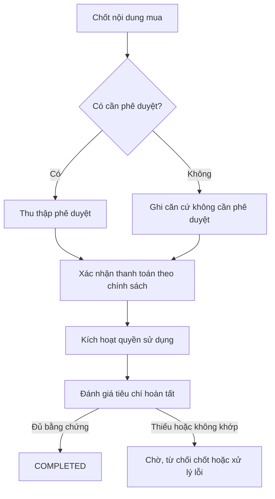

# Tiêu chí hoàn tất quy trình nghiệp vụ (Workflow completion criteria)

Một quy trình có nhiều bước chỉ an toàn khi hệ thống chứng minh được kết quả nghiệp vụ cuối cùng đã đạt. Việc người dùng đi tới màn hình cuối, nhận HTTP thành công hoặc nhìn thấy mọi ô đã được đánh dấu không đủ để kết luận quy trình hoàn tất.

Trong bảo mật logic nghiệp vụ, kẻ lạm dụng có thể gọi thẳng lệnh hoàn tất, bỏ qua bước phê duyệt, thay đổi nội dung sau khi được duyệt, dùng bằng chứng của giao dịch khác hoặc gửi lại một kết quả cũ. Nếu tiêu chí hoàn tất chỉ là một cờ do client gửi hoặc một phép đếm thiếu ngữ cảnh, toàn bộ quy trình có thể bị vượt qua dù từng API riêng lẻ đều yêu cầu đăng nhập.

Bài học thuộc chủ đề **Workflow Security**, tập trung vào cách định nghĩa, thực thi và kiểm thử điều kiện hoàn tất. Ví dụ xuyên suốt là quy trình mua và kích hoạt một gói dịch vụ doanh nghiệp, có báo giá, phê duyệt khi cần, xác nhận thanh toán và cấp quyền sử dụng.

## 1. Hoàn tất phải có ý nghĩa nghiệp vụ cụ thể

Trước khi viết điều kiện `if`, cần trả lời: sau khi quy trình được đánh dấu hoàn tất, tổ chức cam kết điều gì đã xảy ra?

Trong ví dụ này, `COMPLETED` có nghĩa là:

- Nội dung mua đã được chốt bằng dữ liệu và giá do máy chủ xác định.
- Các quyết định phê duyệt bắt buộc đã hợp lệ với đúng phiên bản nội dung đó.
- Khoản thanh toán cần thiết đã được xác nhận ở mức mà nghiệp vụ yêu cầu.
- Quyền sử dụng đúng gói đã thực sự được kích hoạt cho đúng khách hàng.
- Không còn lỗi, yêu cầu hủy hoặc kết quả chưa rõ nào có tác dụng ngăn việc chốt quy trình.

Gửi email thông báo là công việc theo sau, không phải tiêu chí hoàn tất của ví dụ. Nếu một nghiệp vụ khác coi việc giao thông báo có xác nhận là bắt buộc, tiêu chí của nghiệp vụ đó phải thể hiện rõ.

### 1.1. Phân biệt các dấu mốc thường bị nhầm

| Dấu mốc | Điều đã biết | Điều chưa được bảo đảm |
|---|---|---|
| Request hợp lệ | Đã nhận đầu vào đúng cấu trúc | Quy tắc nghiệp vụ đã được đáp ứng |
| HTTP trả về thành công | Endpoint đã xử lý theo hợp đồng của nó | Tất cả công việc bất đồng bộ đã xong |
| Lệnh được đưa vào hàng đợi | Có yêu cầu chờ xử lý | Dịch vụ đích đã thực hiện thành công |
| Các bước đã được khởi chạy | Có các lần thực thi | Các kết quả bắt buộc đã đạt |
| Người dùng mở trang “thành công” | Trình duyệt đã điều hướng tới trang | Thanh toán hoặc cấp quyền đã được xác nhận |
| Quy trình `COMPLETED` | Tất cả tiêu chí cuối đã được kiểm chứng | Mọi hoạt động tương lai như hoàn tiền hay gia hạn đều đã xong |

Nếu API chỉ tiếp nhận yêu cầu, nên trả trạng thái phản ánh việc đã tiếp nhận hoặc đang xử lý. Không dùng một nhãn “thành công” chung cho cả tiếp nhận lệnh và hoàn tất nghiệp vụ.

### 1.2. Xác định ranh giới kết quả

Với một đơn hàng vật lý, “đặt hàng hoàn tất” có thể chỉ bao gồm xác nhận đơn và thu tiền, còn giao hàng là quy trình khác. Với dịch vụ số trong bài này, kích hoạt quyền sử dụng nằm trong chính tiêu chí hoàn tất.

Không có danh sách bước bắt buộc giống nhau cho mọi hệ thống. Điều quan trọng là hợp đồng kết quả phải được ghi rõ và tương ứng với các tác dụng nghiệp vụ mà ứng dụng công bố.

## 2. Viết tiêu chí thành bất biến có thể kiểm chứng

Gọi:

- `W`: một lần chạy quy trình cụ thể.
- `r`: phiên bản nội dung nghiệp vụ đang được chốt.
- `p`: phiên bản chính sách áp dụng.
- `e`: thế hệ thực thi, dùng để phân biệt một lần chạy với các lần chạy lại.
- `R(W, r, p)`: tập yêu cầu bắt buộc do máy chủ suy ra từ nội dung và chính sách.
- `T`: thời điểm quyết định hoàn tất.

Một cách mô tả điều kiện:

```text
Complete(W, r, p, e, T) khi và chỉ khi:

    W đang ở trạng thái cho phép chốt
    AND người hoặc dịch vụ chốt có thẩm quyền
    AND nội dung, chính sách và thế hệ thực thi vẫn khớp
    AND tập yêu cầu bắt buộc đã được xác định hợp lệ
    AND mọi yêu cầu bắt buộc đều có bằng chứng chấp nhận được
    AND các điều kiện tổng hợp giữa các bước đều đúng
    AND không còn vấn đề có tác dụng chặn hoàn tất
    AND quyết định chốt được ghi nhận nhất quán với dữ liệu đã kiểm tra
```

Điều kiện “mọi yêu cầu” cần xét theo ngữ nghĩa, không chỉ theo số lượng bản ghi. Hai bằng chứng cho cùng một bước không thay thế được bằng chứng của một bước bắt buộc khác.

Tương tự, “thành công” của một bước chỉ có giá trị khi gắn với đúng đối tượng, đúng nội dung, đúng nguồn và đúng lần thực thi. Một bản ghi có `status=SUCCESS` nhưng thuộc đơn hàng khác không giúp quy trình hiện tại hoàn tất.

### 2.1. Điều kiện tổng hợp giữa các bước

Một số quy tắc không thuộc riêng bước nào:

- Tổng số tiền được ghi nhận phải đáp ứng số tiền cần thu theo chính sách và đúng tiền tệ.
- Người thụ hưởng và đối tượng được cấp quyền phải trùng với nội dung đã được chốt.
- Các phê duyệt phải có đủ số người độc lập, đúng cấp thẩm quyền và không vi phạm quy tắc người tạo không tự duyệt.
- Không được dùng cùng một giao dịch thanh toán để hoàn tất hai đơn khác nhau nếu nghiệp vụ không cho phép phân bổ như vậy.
- Gói đã được cấp phải đúng mã sản phẩm, phạm vi và thời hạn được mua.

Tất cả bước riêng lẻ có nhãn thành công vẫn có thể tạo ra kết quả tổng hợp sai. Vì vậy, bước chốt cần kiểm tra cả mối liên hệ giữa các bằng chứng.

## 3. Xác định các bước bắt buộc từ nguồn đáng tin cậy

Tập yêu cầu phải do máy chủ xác định theo dữ liệu nghiệp vụ và chính sách. Client có thể gửi lựa chọn hợp lệ như gói muốn mua, nhưng không được tự quyết định rằng thanh toán hoặc phê duyệt là không cần thiết.

Ví dụ chính sách:

| Yêu cầu | Khi nào bắt buộc? | Bằng chứng được chấp nhận |
|---|---|---|
| Xác nhận nội dung và giá | Mọi lần mua | Báo giá đã chốt, còn đáp ứng quy tắc hiệu lực, đúng nội dung |
| Phê duyệt | Khi giá trị hoặc loại gói đạt điều kiện chính sách | Tập quyết định đáp ứng hạn mức, số người và phân tách trách nhiệm |
| Xác nhận thanh toán | Khi số tiền phải thu lớn hơn không | Kết quả thu tiền đã xác minh và đối soát theo yêu cầu nghiệp vụ |
| Kích hoạt quyền sử dụng | Mọi lần mua trong ví dụ | Xác nhận hệ thống cấp quyền đã kích hoạt đúng entitlement |
| Email thông báo | Công việc bổ sung | Không chặn hoàn tất trong hợp đồng ví dụ |

Một gói dùng thử có số tiền bằng không có thể không cần thanh toán. Tuy nhiên, số tiền bằng không phải được máy chủ xác định từ chính sách hợp lệ. Giá trị `total=0` do client gửi không đủ để loại bỏ bước thu tiền.

### 3.1. Không dùng cờ đầu vào để miễn bước

Đầu vào sau là dấu hiệu thiết kế nguy hiểm nếu được dùng trực tiếp:

```json
{
  "workflowId": "WF-410",
  "paymentRequired": false,
  "approvalRequired": false,
  "allStepsCompleted": true
}
```

Các cờ này chỉ là lời khai của người gọi. Handler cần tải nội dung quy trình và tính kế hoạch thực thi có thẩm quyền.

Nếu người dùng được phép chọn một chế độ mua khác, máy chủ phải kiểm tra điều kiện để dùng chế độ đó. Ví dụ, chế độ “thanh toán theo hợp đồng công nợ” cần có hợp đồng đang áp dụng và quyền tương ứng; không phải chỉ đổi tên phương thức thanh toán.

### 3.2. Phiên bản chính sách

Một quy trình chạy lâu có thể bắt đầu dưới chính sách `p1`, trong khi hệ thống đã chuyển sang `p2`. Phải xác định cách áp dụng:

- Giữ chính sách đã chốt lúc bắt đầu nếu nghiệp vụ cho phép và ghi lại phiên bản đó.
- Đánh giá lại theo chính sách mới tại một mốc cụ thể nếu có yêu cầu bắt buộc.
- Chuyển quy trình sang trạng thái cần xem xét khi thay đổi chính sách làm bằng chứng cũ không còn đủ.

Không lấy tập bước từ chính sách cũ rồi kiểm tra hạn mức theo chính sách mới một cách tình cờ. Dữ liệu và phiên bản chính sách phải tạo thành một quyết định có thể giải thích được.

## 4. Phân biệt thành công, miễn bước và chưa có kết quả

Một mô hình trạng thái bước có thể gồm:

| Trạng thái bước | Ý nghĩa | Có mặc nhiên thỏa yêu cầu bắt buộc không? |
|---|---|---|
| `PENDING` | Chưa thực hiện hoặc chưa có kết quả | Không |
| `RUNNING` | Đang thực thi | Không |
| `SUCCEEDED` | Đã đạt kết quả bước theo hợp đồng | Chỉ khi bằng chứng hợp lệ và khớp ngữ cảnh |
| `FAILED` | Lần thực thi thất bại | Không; chỉ có kết quả thay thế hợp lệ mới có thể đáp ứng yêu cầu |
| `UNKNOWN` | Chưa biết hệ thống ngoài đã thực hiện hay chưa | Không đối với kết quả bắt buộc cần xác nhận |
| `CANCELLED` | Đã bị hủy | Không |
| `EXEMPTED` | Được miễn theo một quyết định hoặc quy tắc có thẩm quyền | Chỉ khi chính sách cho phép loại miễn đó |

Không nên để `SKIPPED` mang đồng thời nghĩa “không cần thực hiện”, “người dùng bỏ qua”, “lỗi nên bỏ qua” và “quản trị viên đã miễn”. Các trường hợp này có giá trị chứng minh khác nhau.

### 4.1. Miễn bước cũng cần bằng chứng

Một quyết định miễn nên xác định được:

- Bước hoặc yêu cầu được miễn.
- Quy tắc hoặc thẩm quyền cho phép miễn.
- Đúng đối tượng và phiên bản nội dung.
- Phạm vi, thời hạn nếu có và lý do áp dụng.
- Người hoặc dịch vụ ra quyết định, cùng dấu vết kiểm toán.

Nếu chính sách không cho phép miễn thanh toán trong trường hợp hiện tại, một bản ghi `EXEMPTED` không làm thanh toán trở thành hợp lệ. Kiểm tra loại trạng thái phải đi cùng kiểm tra căn cứ của nó.

### 4.2. Tránh bẫy tập rỗng và phép đếm

Đoạn mã sau có thể cho kết quả đúng dù không có bước nào:

```java
boolean completed = steps.stream()
        .allMatch(step -> step.status() == SUCCEEDED);
```

Với tập rỗng, `allMatch` trả về `true`. Nếu cấu hình bước bị thiếu hoặc truy vấn sai tenant trả về tập rỗng, quy trình có thể bị đánh dấu hoàn tất.

Cần xác nhận kế hoạch hợp lệ và sự hiện diện của từng yêu cầu bắt buộc. Với nghiệp vụ cho phép quy trình không có bước, đó phải là một trường hợp được định nghĩa rõ bằng chính sách, không phải hệ quả ngẫu nhiên của tập rỗng.

Tương tự, điều kiện `successfulRows == requiredCount` không chứng minh đã đủ các bước khác nhau. Nên đối chiếu theo định danh yêu cầu và các thuộc tính cần thiết.

## 5. Thiết kế bằng chứng hoàn tất

Bằng chứng là dữ liệu có thể dùng để kiểm chứng một kết quả, không chỉ là một cờ trạng thái. Ví dụ, bằng chứng thanh toán cần phân biệt với việc đã gửi một yêu cầu thu tiền.

Một cấu trúc tham chiếu có thể gồm:

```text
Evidence:
    evidenceId
    tenantId
    workflowId
    stepId
    contentRevision
    executionEpoch
    source
    sourceOperationId
    outcome
    verifiedAt
    các thuộc tính nghiệp vụ cần đối chiếu
```

Không phải bằng chứng nào cũng có cùng trường hoặc thời hạn. Báo giá có thể cần còn hiệu lực tại mốc chấp nhận mua; bằng chứng giao dịch đã ghi nhận lại có vòng đời khác. Cần xác định mốc hiệu lực theo ý nghĩa từng loại bằng chứng thay vì áp một thời gian hết hạn chung cho tất cả.

### 5.1. Các ràng buộc phải kiểm tra

| Ràng buộc | Câu hỏi cần trả lời |
|---|---|
| Phạm vi | Bằng chứng có thuộc đúng tenant và đúng workflow không? |
| Nội dung | Nó chứng minh kết quả cho đúng phiên bản giá, sản phẩm và người nhận không? |
| Lần thực thi | Nó thuộc thế hệ hiện tại hay một lần chạy đã bị hủy? |
| Nguồn | Kết quả đến từ thành phần có thẩm quyền và đã được xác minh chưa? |
| Tính duy nhất | Bằng chứng này có bị sử dụng trái phép cho đối tượng khác không? |
| Ngữ nghĩa | `accepted`, `authorized`, `captured` hoặc `active` có đáp ứng đúng hợp đồng kết quả không? |
| Hiệu lực | Kết quả có còn đủ giá trị tại mốc kiểm tra được chính sách quy định không? |

Ví dụ, một kết quả chỉ xác nhận đã giữ hạn mức thanh toán không tự chứng minh tiền đã được thu nếu tiêu chí yêu cầu thu tiền. Tên trạng thái cụ thể phụ thuộc hệ thống thanh toán; ứng dụng phải ánh xạ chúng vào nghĩa nghiệp vụ đã chọn.

### 5.2. Callback và trang chuyển hướng

Trang chuyển hướng về trình duyệt không phải nguồn xác nhận đáng tin cậy cho một khoản thanh toán. Client có thể tự mở URL hoặc phát lại tham số.

Kết quả từ dịch vụ ngoài cần được xử lý qua kênh đã xác minh theo hợp đồng tích hợp. Sau bước xác minh nguồn, vẫn phải đối chiếu đúng giao dịch, merchant hoặc tài khoản liên quan, số tiền, tiền tệ, người nhận và đối tượng nghiệp vụ.

Xác minh nguồn trả lời câu hỏi “ai gửi thông báo”; đối chiếu nghiệp vụ trả lời câu hỏi “thông báo này chứng minh điều gì cho quy trình nào”. Cần cả hai.

## 6. Các nhánh song song và điều kiện tổng hợp

Một quy trình có thể có nhiều nhánh chạy đồng thời:



Sơ đồ chỉ minh họa một lựa chọn thứ tự. Nếu phê duyệt và một bước kiểm tra khác chạy song song, điểm ghép nhánh phải biết rõ cần tất cả nhánh hay một lựa chọn hợp lệ.

### 6.1. Ghép AND và lựa chọn OR

- **AND:** phải có mọi kết quả bắt buộc. Thành công thanh toán không thay thế được kích hoạt quyền.
- **OR có điều kiện:** một trong các phương án được chính sách cho phép có thể đáp ứng yêu cầu. Ví dụ, trả trước hoặc hợp đồng công nợ hợp lệ.
- **Quorum:** cần đủ số chủ thể độc lập đáp ứng điều kiện, không chỉ đủ số bản ghi.

Với yêu cầu hai người phê duyệt, hai request từ cùng một người hoặc hai event trùng không tạo thành hai quyết định độc lập. Cần kiểm tra danh tính người duyệt, cấp thẩm quyền, phạm vi, phiên bản nội dung và các ràng buộc về quan hệ giữa họ.

### 6.2. Cách chọn kết quả từ nhiều lần thử

Một bước có thể thất bại rồi retry thành công. Không nên yêu cầu mọi bản ghi lịch sử của bước đều thành công; cũng không nên chọn tùy tiện một kết quả thành công cũ.

Cần xác định kết quả có hiệu lực của bước theo định danh thao tác, thế hệ thực thi và quy tắc thay thế. Lịch sử các lần thử được giữ để điều tra, còn quyết định chốt chỉ dùng những bằng chứng có hiệu lực trong lần chạy hiện tại.

## 7. Chốt nội dung trước khi chốt quy trình

Nếu giá, sản phẩm hoặc người nhận thay đổi sau khi đã thu thập bằng chứng, bằng chứng cũ có thể không còn chứng minh đúng giao dịch hiện tại.

Ví dụ:

```text
Nội dung revision 12:
    gói BASIC, số tiền 100, khách hàng A
    → được phê duyệt và thanh toán

Nội dung bị sửa thành revision 13:
    gói ENTERPRISE, số tiền 1.000, khách hàng B
    → client yêu cầu hoàn tất bằng bằng chứng revision 12
```

Máy chủ phải từ chối chốt revision 13 bằng bằng chứng không phù hợp. Không chỉ kiểm tra “đã có một phê duyệt” hoặc “đã có một giao dịch thanh toán”.

Có thể đóng băng nội dung trong giai đoạn chốt, hoặc cho thay đổi nhưng tạo revision mới và đánh giá lại những yêu cầu chịu ảnh hưởng. Việc sửa một trường mô tả không liên quan và việc đổi người nhận quyền sử dụng có thể cần chính sách khác nhau.

### 7.1. Ba loại phiên bản hữu ích

| Giá trị | Mục đích |
|---|---|
| `rowVersion` | Phát hiện các lần ghi cạnh tranh trên dữ liệu gốc |
| `contentRevision` | Liên kết bằng chứng với nội dung nghiệp vụ cần xét |
| `executionEpoch` | Loại bỏ kết quả muộn từ một lần chạy đã hủy hoặc đã bị thay thế |

Ba giá trị có thể được triển khai khác nhau tùy hệ thống, nhưng không nên đánh đồng mục đích. Tăng version khi cập nhật thời gian nhận callback không có nghĩa mọi bằng chứng nội dung cũ đều phải bị vô hiệu.

Khi một lần chạy bị hủy hoặc được khởi động lại, callback cũ không được phép khôi phục quy trình. Nó có thể được lưu để đối soát, nhưng cần bị loại khỏi tập bằng chứng dùng để chốt lần chạy mới.

## 8. Chốt nhất quán trước cạnh tranh

Giả sử một transaction đang kiểm tra đủ bằng chứng, trong khi transaction khác hủy quy trình hoặc thay đổi quyền lợi cần cấp. Nếu quyết định hoàn tất dựa trên một ảnh chụp không được bảo vệ, cả hai có thể cùng được ghi nhận theo cách mâu thuẫn.

Một thiết kế có thể dùng hàng workflow làm điểm điều phối:

1. Mọi thao tác thay đổi nội dung, trạng thái và bằng chứng có hiệu lực đều khóa cùng hàng gốc theo thứ tự đã quy định.
2. Handler chốt tải nội dung và bằng chứng trong cùng transaction sau khi có khóa.
3. Handler đánh giá tiêu chí trên tập dữ liệu nhất quán.
4. Ghi trạng thái hoàn tất, bản ghi tổng kết, audit và sự kiện outbox trong cùng transaction.
5. Chỉ công bố kết quả thành công sau khi commit.

Khóa riêng hàng workflow chỉ có tác dụng như trên nếu các đường ghi liên quan thực sự tuân thủ cùng giao thức. Nếu callback có thể sửa bằng chứng mà không phối hợp, việc handler chốt giữ khóa hàng gốc không tự ngăn được thay đổi đó.

### 8.1. Cập nhật có điều kiện

Ngay cả khi đã khóa, câu lệnh ghi có thể củng cố các giả định:

```sql
UPDATE workflow
SET state = 'COMPLETED',
    completed_at = :completed_at,
    completion_id = :completion_id,
    row_version = row_version + 1
WHERE tenant_id = :tenant_id
  AND id = :workflow_id
  AND state = 'COMPLETING'
  AND row_version = :expected_row_version
  AND content_revision = :content_revision
  AND execution_epoch = :execution_epoch
  AND policy_version = :policy_version;
```

Các placeholder biểu diễn tham số bind. Handler phải kiểm tra đúng một hàng được cập nhật và rollback các bản ghi liên quan nếu không đạt.

Câu lệnh này không tự chứng minh đã có đủ bằng chứng ở bảng con hoặc dịch vụ khác. Tính đúng đắn vẫn phụ thuộc việc kiểm tra và cơ chế phối hợp đã chọn.

### 8.2. Không gọi dịch vụ ngoài trong khi giả định có transaction toàn cục

Transaction cơ sở dữ liệu cục bộ không tự bao phủ hệ thống thanh toán và hệ thống cấp quyền. Không thể gọi hai API bên ngoài rồi kỳ vọng rollback cơ sở dữ liệu sẽ thu hồi mọi tác dụng đã xảy ra.

Có thể dùng trạng thái `COMPLETING` để điều phối công việc cuối:

```text
RUNNING
    → COMPLETING
    → gửi lệnh cấp quyền qua cơ chế giao nhận bền vững
    → nhận và xác minh kết quả kích hoạt
    → đánh giá lại điều kiện
    → COMPLETED
```

Việc đã ghi outbox gửi lệnh kích hoạt chứng minh ý định giao việc đã được lưu. Nó chưa chứng minh quyền sử dụng đã hoạt động. Trong hợp đồng của ví dụ, phải chờ xác nhận kết quả kích hoạt trước khi chốt.

Nếu một phần đã thành công nhưng phần còn lại thất bại, quy trình cần retry, đối soát hoặc bù trừ theo chính sách. Không đổi nhãn thành hoàn tất chỉ để tránh một trạng thái đang xử lý kéo dài.

## 9. Ví dụ Java: đánh giá tiêu chí bằng kế hoạch và bằng chứng

Đoạn mã sau là mã giả theo cú pháp Java, tập trung vào thứ tự kiểm tra. Các kiểu dữ liệu và cổng kiểm chứng được mô tả bằng hợp đồng, không phải một ứng dụng có thể chạy độc lập.

```java
CompletionManifest evaluateCompletion(
        WorkflowSnapshot workflow,
        CompletionPlan plan,
        Instant decisionTime) {

    if (workflow.state() != WorkflowState.COMPLETING) {
        throw new CompletionRejected("WORKFLOW_NOT_COMPLETABLE");
    }

    if (!plan.belongsTo(workflow.tenantId(), workflow.id())
            || plan.contentRevision() != workflow.contentRevision()
            || plan.executionEpoch() != workflow.executionEpoch()
            || !plan.policyVersion().equals(workflow.policyVersion())) {
        throw new CompletionRejected("COMPLETION_CONTEXT_MISMATCH");
    }

    // Kế hoạch được dựng bởi máy chủ; không lấy danh sách bước từ client.
    if (!plan.isValid() || plan.requiredSteps().isEmpty()) {
        throw new CompletionRejected("INVALID_COMPLETION_PLAN");
    }

    Map<StepId, String> acceptedEvidence = new EnumMap<>(StepId.class);

    for (StepId requiredStep : plan.requiredSteps()) {
        StepEvidence evidence = workflow.effectiveEvidence(requiredStep)
                .orElseThrow(() ->
                        new CompletionRejected("REQUIRED_EVIDENCE_MISSING"));

        evidenceVerifier.requireAcceptable(
                workflow, plan, requiredStep, evidence, decisionTime);

        acceptedEvidence.put(requiredStep, evidence.id());
    }

    // Đối soát tiền, người nhận, quorum và quan hệ giữa các bằng chứng.
    aggregateRules.requireSatisfied(workflow, plan, acceptedEvidence);

    if (workflow.hasBlockingIssue()) {
        throw new CompletionRejected("UNRESOLVED_BLOCKING_ISSUE");
    }

    return CompletionManifest.from(
            workflow, plan, acceptedEvidence, decisionTime);
}
```

Hợp đồng của các thành phần:

- `CompletionPlan` được máy chủ dựng từ nội dung và chính sách có thẩm quyền. `isValid()` phải phát hiện thiếu yêu cầu bắt buộc hoặc cấu hình mâu thuẫn; không chỉ kiểm tra danh sách khác rỗng.
- `effectiveEvidence` chọn bằng chứng có hiệu lực theo quy tắc lần thử và thế hệ thực thi, không chọn một hàng thành công bất kỳ trong lịch sử.
- `evidenceVerifier` kiểm tra nguồn, ràng buộc tenant, workflow, bước, nội dung, thế hệ, kết quả và hiệu lực theo từng loại bằng chứng.
- Với `EXEMPTED`, verifier kiểm tra cả căn cứ cho phép miễn; với `SUCCEEDED`, nó kiểm tra kết quả có đúng nghĩa mà yêu cầu cần hay không.
- `aggregateRules` kiểm tra những quan hệ không thể suy ra từ một bằng chứng riêng lẻ.
- `hasBlockingIssue` phản ánh các vấn đề thực sự chặn chốt trong mô hình dữ liệu nhất quán; không phải một cờ do request gửi.
- `CompletionManifest` lưu tham chiếu kết quả đánh giá; tạo manifest chưa có nghĩa transaction đã commit.

Trong ví dụ này, kế hoạch bắt buộc có ít nhất một bước nên tập rỗng bị từ chối. Nếu nghiệp vụ cho phép một loại quy trình không có bước, cần một nhánh chính sách riêng mô tả lý do và kết quả tương ứng.

### 9.1. Handler chốt cuối

```java
CompletionResult finalizeWorkflow(
        FinalizeCommand command,
        ActorContext actor) {

    return transactions.required(() -> {
        Workflow workflow = repository
                .findForUpdate(actor.tenantId(), command.workflowId())
                .orElseThrow(ResourceNotFound::new);

        authorizer.requireFinalizeAccess(actor, workflow);

        CommandClaim claim = commandLog.claimOrReplay(
                actor, "FINALIZE_WORKFLOW",
                command.idempotencyKey(), fingerprintOf(command));

        if (claim.isCompletedReplay()) {
            return claim.savedCompletionResult();
        }

        workflow.requireRowVersion(command.expectedRowVersion());

        // Cùng transaction và cùng giao thức khóa của các đường ghi.
        WorkflowSnapshot snapshot = snapshotLoader.load(workflow);
        CompletionPlan plan = planner.requiredFor(snapshot);
        CompletionManifest manifest = evaluateCompletion(
                snapshot, plan, clock.instant());

        String completionId = completionIds.newId();

        int changed = repository.completeIfUnchanged(
                workflow, manifest, completionId);

        if (changed != 1) {
            throw new ConcurrentChange();
        }

        completionStore.insert(completionId, manifest);
        audit.appendCompleted(completionId, actor.userId());
        outbox.appendWorkflowCompleted(completionId, workflow.id());

        CompletionResult result = CompletionResult.completed(completionId);
        commandLog.complete(claim, result);
        return result;
    });
}
```

Đây là handler của bước chốt sau khi đã có các kết quả bên ngoài cần thiết. Nó không gửi lệnh thu tiền hoặc cấp quyền ngay trong transaction này.

Các yêu cầu triển khai cần giữ:

- Kiểm tra quyền đối tượng trước khi trả kết quả replay hoặc tiết lộ tiến độ.
- `transactions.required` chỉ trả kết quả sau khi commit; lỗi kiểm tra hoặc lỗi ghi phải rollback những thay đổi của transaction.
- Tải snapshot và ghi kết quả dùng cùng cơ chế nhất quán. Dữ liệu quyền hoặc chính sách thay đổi đồng thời cũng cần quy tắc hiệu lực rõ ràng.
- `commandLog` có ràng buộc duy nhất cho scope của khóa và từ chối cùng khóa nhưng fingerprint khác.
- Kết quả hoàn tất, audit thành công, outbox và kết quả idempotency được ghi trong cùng transaction cục bộ của thiết kế này.
- Bằng chứng đầu vào không được tạo bằng cách chép các cờ `verified=true` hay `success=true` từ client.

## 10. Hoàn tất đúng một lần ở cấp nghiệp vụ

Idempotency key giúp xử lý bản phát lại của cùng một lệnh. Nó không đủ để ngăn cùng một workflow bị chốt hai lần khi hai request dùng hai khóa khác nhau.

Cần kết hợp:

| Lớp kiểm soát | Trách nhiệm |
|---|---|
| Idempotency của lệnh | Nhận diện retry cùng scope và cùng nội dung |
| Trạng thái và version của workflow | Chỉ cho phép lần chuyển hợp lệ từ trạng thái được chốt |
| Ràng buộc duy nhất của kết quả | Ngăn hai kết quả hoàn tất cho cùng định danh lần chạy nghiệp vụ |
| Định danh tác dụng phụ | Cho phép phía nhận khử trùng lặp khi event được giao lại |

Ví dụ, nếu một workflow có thể khởi chạy lại, ràng buộc kết quả có thể là `UNIQUE(tenant_id, workflow_id, execution_epoch)`. Nếu mỗi workflow chỉ được hoàn tất một lần trong toàn bộ vòng đời, phạm vi ràng buộc phải tương ứng và không được vô tình cho phép lần thứ hai chỉ bằng cách tăng epoch.

### 10.1. Tình huống mất phản hồi

```text
Máy chủ commit COMPLETED và lưu kết quả lệnh
    → kết nối đứt
    → client không nhận được phản hồi
    → client gửi lại cùng khóa và cùng nội dung
    → máy chủ kiểm tra quyền rồi trả kết quả đã lưu
```

Nhánh replay cần được nhận diện trước các guard chỉ dành cho lần thực thi mới, như kiểm tra version client cũ. Nếu không, retry hợp lệ có thể bị báo xung đột vì lần thành công đầu đã tăng version.

Với một lệnh mới nhắm tới workflow đã hoàn tất, API phải định nghĩa rõ trả lại kết quả hiện có hay từ chối việc chốt mới. Dù chọn cách nào, không được tạo thêm audit hoàn tất hoặc phát sinh thêm tác dụng nghiệp vụ cho cùng kết quả.

Sự kiện outbox có thể được gửi nhiều lần khi retry. Bên nhận cần khử trùng lặp theo định danh phù hợp; không nên suy ra toàn hệ thống có bảo đảm chỉ giao đúng một lần.

## 11. Kết quả chưa rõ và thay đổi sau khi hoàn tất

### 11.1. Timeout không chứng minh thất bại hoặc thành công

Khi gọi hệ thống ngoài bị timeout, có thể yêu cầu đã thực thi nhưng phản hồi bị mất. Đánh dấu thành công để tiếp tục là thiếu bằng chứng; tự tạo một yêu cầu mới với định danh khác cũng có thể gây thu tiền hoặc cấp quyền trùng.

Cần giữ trạng thái chưa rõ, đối soát bằng định danh thao tác đã lưu và retry theo hợp đồng tích hợp. Trước khi có bằng chứng đủ mạnh, quy trình chưa đáp ứng tiêu chí hoàn tất của kết quả đó.

### 11.2. Callback thành công đến muộn sau khi hủy

Một callback hợp lệ về mặt nguồn vẫn có thể thuộc lần chạy đã hủy. Handler phải đối chiếu `executionEpoch`, định danh thao tác và trạng thái hiện tại.

Callback muộn có thể tạo nhu cầu hoàn tiền hoặc thu hồi quyền đã cấp, nhưng không tự cho phép chuyển workflow bị hủy thành hoàn tất. Hành động bù trừ cần được điều phối và theo dõi riêng.

### 11.3. Hoàn tiền, thu hồi và tranh chấp

`COMPLETED` ghi nhận rằng tiêu chí đã được đáp ứng tại mốc quyết định theo hợp đồng. Sau đó có thể xuất hiện hoàn tiền, thu hồi quyền hoặc tranh chấp.

Cần định nghĩa mô hình sau hoàn tất, chẳng hạn một quy trình hoàn tiền riêng hoặc trạng thái vận hành mới có lịch sử rõ ràng. Không sửa âm thầm bằng chứng cũ để làm như việc hoàn tất chưa từng xảy ra.

Ngược lại, không nên dùng cờ hoàn tất lịch sử làm quyền truy cập vĩnh viễn. Quyền sử dụng hiện tại cần phản ánh cả các sự kiện thu hồi hoặc hết hạn hợp lệ sau đó.

## 12. Phản hồi và khả năng giải thích quyết định

Khi thiếu điều kiện, API nên phản ánh trạng thái thật:

| Tình huống | Phản hồi nghiệp vụ phù hợp |
|---|---|
| Đang chờ xác nhận hệ thống ngoài | Đang xử lý; chưa hoàn tất |
| Thiếu một bằng chứng bắt buộc | Chưa đủ điều kiện, chỉ rõ bước nếu người gọi được biết |
| Bằng chứng thuộc revision cũ | Xung đột nội dung, cần đánh giá lại phần bị ảnh hưởng |
| Không đủ quyền chốt | Từ chối truy cập theo hợp đồng và chính sách tiết lộ |
| Bị hủy hoặc đang cần bù trừ | Không được hoàn tất qua lệnh thông thường |
| Đã commit thành công nhưng thông báo bổ sung lỗi | Quy trình vẫn hoàn tất; theo dõi lỗi thông báo riêng |

Mã lỗi miền có thể gồm `REQUIRED_EVIDENCE_MISSING`, `COMPLETION_CONTEXT_MISMATCH`, `UNRESOLVED_BLOCKING_ISSUE` hoặc `WORKFLOW_NOT_COMPLETABLE`. Việc ánh xạ sang HTTP phụ thuộc hợp đồng API; nên giữ ý nghĩa nhất quán.

Một bản ghi quyết định hoàn tất có thể lưu:

```json
{
  "completionId": "CMP-880",
  "workflowId": "WF-410",
  "tenantId": "tenant-A",
  "contentRevision": 12,
  "executionEpoch": 3,
  "policyVersion": "policy-7",
  "evidenceRefs": {
    "PRICE_CONFIRMED": "EV-Q12",
    "APPROVAL_COMPLETED": "EV-A21",
    "PAYMENT_CONFIRMED": "EV-P44",
    "ENTITLEMENT_ACTIVE": "EV-E18"
  }
}
```

Đây là ví dụ tham chiếu kiểm toán, không phải payload mà client được phép tự gửi để chứng minh đã hoàn tất. Thời điểm quyết định, chủ thể chốt, kết quả kiểm tra và các quyết định miễn cũng cần được ghi theo mô hình thực tế.

Nếu dùng hash để phát hiện thay đổi, phải hiểu hash không tự chứng minh nguồn có thẩm quyền. Tính toàn vẹn, xác thực nguồn và quyền sửa dữ liệu là những yêu cầu cần được bảo vệ trong thiết kế lưu trữ và xử lý.

Một projection tiến độ có thể cập nhật chậm hơn nguồn giao dịch. Có thể dùng nó để hiển thị tiến độ, nhưng quyết định cho phép tiêu thụ quyền lợi cần dựa trên nguồn có bảo đảm phù hợp, không dựa vào cờ do giao diện giữ.

## 13. Kiểm thử tiêu chí hoàn tất trước các đường lạm dụng

### 13.1. Ma trận tình huống

| Tình huống | Kỳ vọng |
|---|---|
| Gọi thẳng lệnh hoàn tất khi chưa làm bước nào | Từ chối; không tạo kết quả hoàn tất |
| Cấu hình hoặc truy vấn trả tập bước rỗng | Phát hiện kế hoạch không hợp lệ trong nghiệp vụ ví dụ |
| Có hai bằng chứng thanh toán nhưng thiếu bằng chứng cấp quyền | Không coi số lượng hàng bằng số bước là hoàn tất |
| Client tự gửi `paymentRequired=false` | Máy chủ vẫn áp dụng yêu cầu theo chính sách |
| Gửi bằng chứng của tenant hoặc workflow khác | Từ chối, không tiết lộ dữ liệu ngoài scope |
| Bằng chứng phê duyệt thuộc revision cũ | Không dùng cho nội dung đã thay đổi |
| Hai quyết định phê duyệt từ cùng một người | Không đạt quorum yêu cầu hai người độc lập |
| Có kết quả giữ hạn mức nhưng chưa đạt mức xác nhận thu tiền cần thiết | Không coi là đã đáp ứng thanh toán |
| Đã ghi outbox cấp quyền nhưng chưa có kết quả kích hoạt | Vẫn đang chờ trong hợp đồng ví dụ |
| Một bước bắt buộc là `UNKNOWN` sau timeout | Đối soát, không suy đoán hoàn tất |
| Callback của epoch cũ đến sau khi hủy | Không khôi phục hoặc chốt lần chạy hiện tại |
| Mọi điều kiện hợp lệ | Chốt đúng một kết quả với đủ tham chiếu bằng chứng |
| Retry cùng lệnh sau khi mất phản hồi | Trả kết quả đã lưu, không tạo thêm tác dụng |
| Hai lệnh chốt dùng hai khóa khác nhau | Ràng buộc nghiệp vụ vẫn ngăn hoàn tất hai lần |

### 13.2. Kiểm thử cạnh tranh và điểm lỗi

Các ca tích hợp có giá trị:

1. **Hoàn tất đối đầu với hủy:** đồng bộ hai luồng để cùng tranh chấp một workflow; kết quả phải tương ứng với thứ tự hợp lệ và không tạo trạng thái mâu thuẫn.
2. **Hoàn tất đối đầu với sửa nội dung:** không được chốt revision mới bằng snapshot bằng chứng cũ.
3. **Callback đối đầu với chốt:** handler không được đọc trạng thái bước và chi tiết bằng chứng từ hai thời điểm không nhất quán.
4. **Hai lần chốt đồng thời:** chỉ một kết quả nghiệp vụ được tạo, dù idempotency key khác nhau.
5. **Lỗi sau cập nhật root nhưng trước khi ghi manifest hoặc outbox:** rollback toàn bộ kết quả chốt cục bộ.
6. **Commit thành công rồi mất phản hồi:** retry không tạo thêm kết quả hoặc thông báo nghiệp vụ độc lập.
7. **Phát lại sự kiện hoàn tất:** bên nhận không cấp quyền hoặc ghi nhận doanh thu lần hai chỉ vì event bị giao lại.

Kiểm thử transaction và cạnh tranh cần dùng cơ sở dữ liệu với đặc tính tương ứng môi trường triển khai. Mock trả về một danh sách bước có sẵn thường không phát hiện được lỗi giữa đọc và ghi.

### 13.3. Xác nhận cả dữ liệu không được thay đổi

Sau một lần từ chối hoàn tất, cần kiểm tra:

```text
workflow không chuyển thành COMPLETED
completedAt và completionId không được gán mới
không tạo completion manifest thành công
không ghi audit báo hoàn tất thành công
không thêm outbox WorkflowCompleted
không phát sinh thu tiền hoặc cấp quyền từ lệnh chốt bị từ chối
bằng chứng và nội dung không bị sửa để làm cho điều kiện có vẻ đã đủ
có dấu vết từ chối theo chính sách quan sát được chọn
```

Những kết quả của bước trước đã được ghi nhận hợp lệ vẫn có thể tồn tại. Từ chối chốt không đồng nghĩa xóa lịch sử thanh toán hoặc tự bù trừ mọi bước; điều đó cần luồng xử lý riêng.

## 14. Bài tập áp dụng

Thiết kế tiêu chí hoàn tất cho một quy trình mua gói dịch vụ có hai loại khách hàng: trả trước và công nợ theo hợp đồng.

1. Viết một câu mô tả chính xác điều `COMPLETED` cam kết cho mỗi loại khách hàng.
2. Lập bảng yêu cầu bắt buộc, yêu cầu có điều kiện và công việc bổ sung.
3. Xác định bằng chứng cần có cho giá, phê duyệt, thanh toán hoặc công nợ và kích hoạt quyền.
4. Chọn các trường nội dung làm mất hiệu lực bằng chứng khi thay đổi.
5. Mô tả cách xử lý timeout, callback muộn, hủy và retry lệnh chốt.
6. Chỉ ra ranh giới transaction cục bộ và cơ chế kiểm soát các bước ở dịch vụ ngoài.
7. Định nghĩa ràng buộc ngăn hai kết quả hoàn tất cho cùng lần chạy nghiệp vụ.
8. Viết ba ca tấn công bằng cách thay đối tượng của bằng chứng, bỏ một bước và gửi hai lệnh chốt đồng thời.

Một thiết kế đạt yêu cầu phải giải thích được quy trình nào đã hoàn tất, hoàn tất nội dung nào, theo chính sách nào và dựa trên bằng chứng nào. Trạng thái cuối chỉ đáng tin khi nó là kết quả của quyết định đó và được ghi nhận nhất quán với các dữ kiện đã kiểm chứng.
