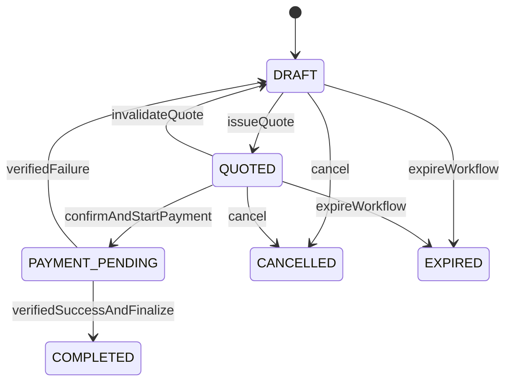

# Workflow resumption: tiếp tục quy trình an toàn sau gián đoạn

## 1. Vì sao tiếp tục workflow là một bài toán bảo mật nghiệp vụ?

Một khách hàng đã nhập địa chỉ, nhận báo giá có mã giảm giá và đi tới bước xác nhận thanh toán. Trình duyệt đóng đột ngột. Khi khách quay lại, ứng dụng muốn mở đúng bước đang làm thay vì bắt nhập lại từ đầu.

Trong khoảng thời gian đó, mã giảm giá có thể hết hạn, quyền mua theo tài khoản doanh nghiệp có thể bị thu hồi, địa chỉ có thể được sửa trên thiết bị khác, hoặc yêu cầu thanh toán trước đó đã thành công dù trình duyệt chưa nhận response.

Nếu máy chủ tin vào dữ liệu như `step=payment`, `completedSteps`, giá tiền trong local storage hoặc một resume token còn hạn rồi thực hiện tiếp, người dùng có thể:

- Bỏ qua bước kiểm tra hoặc phê duyệt bắt buộc.
- Dùng báo giá, hạn mức hoặc bằng chứng xác thực đã mất hiệu lực.
- Tiếp tục workflow thuộc người dùng hoặc tenant khác.
- Sửa đầu vào nhưng giữ kết quả xác minh của đầu vào cũ.
- Tạo hai đơn hàng hoặc hai lần thu tiền khi gửi lại yêu cầu.
- Khôi phục một quy trình đã bị hủy như thể chưa có quyết định kết thúc.

**Workflow resumption** là việc tiếp tục một quy trình từ trạng thái bền vững đã được máy chủ xác nhận, sau khi xác định lại chủ thể, điều kiện hiện hành và những tác động đã thực sự xảy ra.

Trong bảo vệ logic nghiệp vụ, “nhớ đang ở màn hình nào” chỉ là tiện ích giao diện. Điều cần bảo vệ là các bất biến của toàn bộ quy trình khi thời gian đã trôi qua, dữ liệu đã thay đổi và kết quả của một số thao tác có thể chưa rõ.

## 2. Phân biệt tiếp tục, gửi lại và khôi phục

| Khái niệm | Câu hỏi cần trả lời | Ví dụ |
|---|---|---|
| Tiếp tục workflow | Từ trạng thái đã lưu, chủ thể này được làm gì tiếp? | Mở lại checkout đang chờ xác nhận |
| Gửi lại một lệnh | Đây có phải cùng ý định đã được xử lý trước đó không? | Gửi lại lệnh xác nhận vì mất response |
| Khôi phục sau lỗi | Làm thế nào đưa trạng thái và tác động về tình trạng nhất quán? | Đã thu tiền nhưng chưa hoàn tất tạo đơn |
| Phát lại lịch sử xử lý | Dựng lại tiến trình từ các sự kiện đã ghi mà không lặp tác động | Workflow engine đọc lại các bước đã hoàn tất |

Các cơ chế này có thể cùng xuất hiện nhưng không thay thế nhau. Idempotency xử lý lệnh bị gửi lại không tự xác minh người đang mở workflow có quyền. Lưu checkpoint không tự chứng minh tác động bên ngoài đã thất bại. Đọc lại lịch sử không có nghĩa được phép gọi lại tất cả API đã gọi trong lịch sử.

Một quy tắc thiết kế hữu ích là:

```text
Tiếp tục từ sự thật đã được xác nhận,
không tiếp tục từ giả định mà client nhớ lần cuối.
```

### 2.1. Gián đoạn kết nối không phải trạng thái nghiệp vụ

Trình duyệt mất kết nối không chứng minh transaction đã rollback. Worker ngừng gửi heartbeat không chứng minh nó chưa gửi lệnh thanh toán. HTTP timeout cũng không phải bằng chứng giao dịch bên ngoài đã thất bại.

Vì vậy, không nên tự chuyển workflow về bước trước chỉ vì client báo “lần trước lỗi mạng”. Máy chủ cần đọc trạng thái bền vững và, nếu cần, đối soát thao tác bên ngoài trước khi quyết định bước tiếp theo.

## 3. Ranh giới tin cậy và checkpoint có thẩm quyền

Client có thể lưu bản nháp, vị trí màn hình, tab đang mở hoặc workflow ID để cải thiện trải nghiệm. Những dữ liệu này chỉ là gợi ý.

Máy chủ phải quản lý các dữ kiện quyết định nghiệp vụ:

- Workflow thuộc tenant và chủ thể nào.
- Trạng thái hiện tại và phiên bản của workflow.
- Bước nào đã hoàn tất, hoàn tất trên đầu vào nào và còn hiệu lực hay không.
- Báo giá hoặc quyết định đã được chấp nhận là phiên bản nào.
- Thao tác nào đã được yêu cầu, đang xử lý, có kết quả xác nhận hoặc chưa rõ kết quả.
- Workflow đã hoàn tất, bị hủy hoặc hết hạn theo quy tắc nào.

### 3.1. Dữ liệu client không được dùng làm bằng chứng hoàn tất

Ví dụ request sau không đủ cơ sở để cho phép thanh toán:

```json
{
  "workflowId": "wf-42",
  "resumeAt": "payment",
  "completedSteps": ["address", "quote", "stepUp"],
  "amount": 100000,
  "verified": true
}
```

Máy chủ không được suy ra rằng các bước đã hoàn tất vì chúng có tên trong mảng. Workflow ID cũng không phải bằng chứng sở hữu, kể cả khi ID khó đoán.

Một request tiếp tục thường chỉ cần định danh workflow và, nếu thiết kế yêu cầu, credential tiếp tục. Máy chủ tự dựng lại bước có thể thực hiện từ dữ liệu của mình.

### 3.2. Checkpoint không chỉ là con trỏ bước

Một checkpoint chỉ có `lastStep = 3` không cho biết:

- Bước 3 đã commit hay mới bắt đầu chạy.
- Đầu vào được kiểm tra có còn là đầu vào hiện tại không.
- Quyền thực hiện bước kế tiếp có còn hiệu lực không.
- Lời gọi bên ngoài của bước 3 đã tạo tác động chưa.

Nếu dùng số thứ tự bước để điều hướng, hãy coi đó là thông tin dẫn xuất từ các sự thật bền vững. Không dùng nó làm quyền nhảy tới một hành động đặc quyền.

## 4. Mô hình dữ liệu cần hỗ trợ việc tiếp tục

Không phải hệ thống nào cũng cần workflow engine. Một ứng dụng dùng cơ sở dữ liệu quan hệ vẫn có thể thiết kế việc tiếp tục an toàn nếu lưu đủ trạng thái và ràng buộc.

| Nhóm dữ liệu | Trường minh họa | Vai trò |
|---|---|---|
| Định danh và sở hữu | `workflowId`, `tenantId`, `subjectId`, `workflowType` | Ngăn lấy nhầm quy trình hoặc tiếp tục vượt phạm vi |
| Tiến trình | `state`, `version`, `createdAt`, `expiresAt` | Xác định bước hợp lệ, xung đột và thời hạn nghiệp vụ |
| Phiên bản định nghĩa | `definitionVersion`, `checkpointSchemaVersion` | Đọc đúng workflow được tạo trước khi triển khai code mới |
| Căn cứ nghiệp vụ | `inputRevision`, `quoteId`, `quoteVersion`, `acceptedInputRevision` | Liên kết quyết định với dữ liệu đã được chấp nhận |
| Bằng chứng từng bước | `stepType`, `inputRevision`, `result`, `verifiedAt`, `validUntil` | Phát hiện bằng chứng cũ, sai mục đích hoặc sai đầu vào |
| Sổ thao tác | `operationId`, `logicalEffectId`, `attemptId`, `status`, `resultReference` | Phân biệt chưa thực hiện, đã thực hiện và chưa rõ kết quả |
| Chống gửi lại | Phạm vi key, fingerprint, trạng thái xử lý, kết quả | Nhận diện cùng một lệnh và trả kết quả phù hợp |
| Điều phối worker | `leaseOwner`, `leaseUntil`, `fencingToken` nếu cần | Hạn chế xử lý cạnh tranh và chặn ghi kết quả từ worker cũ |

Đây là các khái niệm cần cân nhắc, không phải yêu cầu mọi bảng phải có tất cả các cột trên.

### 4.1. Lưu kết quả đủ để biết điều gì đã xảy ra

Một cờ `paymentDone = false` không phân biệt được “chưa gửi”, “đang gửi”, “timeout nhưng có thể đã thu tiền” và “bên nhận xác nhận thất bại”.

Sổ thao tác nên có ngữ nghĩa rõ, chẳng hạn:

```text
NOT_STARTED
REQUESTED
UNKNOWN
SUCCEEDED
FAILED_CONFIRMED
```

Tên trạng thái có thể khác, nhưng `UNKNOWN` không được coi như `FAILED_CONFIRMED`. Trạng thái workflow và trạng thái operation cần có quy tắc nhất quán với nhau; tránh giữ hai nguồn sự thật có thể được cập nhật độc lập tùy ý.

### 4.2. Không biến checkpoint thành kho bí mật

Checkpoint cần giữ tham chiếu và bằng chứng tối thiểu để tiếp tục, không cần sao chép toàn bộ token đăng nhập, thông tin thanh toán nhạy cảm hoặc credential của hệ thống ngoài. Dữ liệu lưu lâu phải có quyền truy cập, thời hạn lưu và cơ chế bảo vệ tương ứng.

## 5. Ví dụ state machine cho checkout có thể tiếp tục

Xét một luồng đơn giản:



Sơ đồ cố ý không cho `PAYMENT_PENDING → EXPIRED` chỉ vì chờ quá lâu. Khi một lần thanh toán có thể đã được gửi ra ngoài, hệ thống phải giải quyết kết quả của lần đó; không được dùng việc hết thời gian chờ để giả định chưa thu tiền.

Trong mô hình này, `verifiedFailure` là kết quả thất bại cuối cùng đáng tin theo hợp đồng tích hợp, không phải một exception mạng. Nếu cần hủy khi thanh toán đang chờ, phải thiết kế thêm quy trình hủy, đối soát hoặc hoàn tiền tương ứng.

### 5.1. Quyết định khi tiếp tục từng trạng thái

| Trạng thái bền vững | Xử lý khi mở lại | Điều không được tự suy ra |
|---|---|---|
| `DRAFT` | Trả bản nháp được phép xem; yêu cầu hoàn tất các điều kiện còn thiếu | Không coi bước xác minh trong local storage là đã hoàn tất |
| `QUOTED`, căn cứ còn phù hợp | Hiển thị báo giá có thẩm quyền và các hành động hiện được phép | Không tự thu tiền chỉ vì lần trước đã mở màn hình thanh toán |
| `QUOTED`, căn cứ đã thay đổi hoặc mất hiệu lực | Yêu cầu báo giá mới và xác nhận lại phần thay đổi cần thiết | Không âm thầm giữ giá cũ hoặc tự xác nhận giá mới thay người dùng |
| `PAYMENT_PENDING` | Trả trạng thái đang xử lý/chờ đối soát; tiếp tục cùng operation đã lưu | Không tạo payment attempt mới vì client chưa thấy thành công |
| `COMPLETED` | Trả kết quả hoặc biên nhận trong phạm vi quyền hiện tại | Không tạo lại đơn hoặc thu tiền lần nữa |
| `CANCELLED` | Hiển thị trạng thái kết thúc; nếu được phép mua lại thì tạo ý định mới | Không hồi sinh quy trình bằng resume token cũ |
| `EXPIRED` trước tác động thanh toán | Áp dụng quy tắc tạo lại hoặc sao chép bản nháp vào luồng mới | Không kéo dài quyền lợi hoặc thời hạn chỉ vì có người gọi resume |

Việc tạo luồng mới không được xóa dấu vết hay che khuất các nghĩa vụ của luồng cũ. Nếu kết quả thanh toán còn chưa rõ, phải xử lý luồng cũ trước khi cho phép một thao tác có nguy cơ trả tiền thêm cho cùng ý định.

### 5.2. Một bộ bất biến cụ thể

```text
Không bỏ bước:
    startPayment cần quote và các bằng chứng bắt buộc còn phù hợp.

Không đổi căn cứ mà giữ xác nhận cũ:
    acceptedInputRevision phải khớp căn cứ dùng để khởi tạo thanh toán.

Không thu tiền lại khi chưa rõ kết quả:
    một operation chưa được giải quyết không được coi là chưa từng tồn tại.

Không tiếp tục vượt quyền:
    người gọi phải được phép với workflow và hành động ở thời điểm thực hiện.

Không hồi sinh trạng thái kết thúc:
    resume không tự đưa CANCELLED hoặc EXPIRED trở lại trạng thái hoạt động.
```

## 6. Xác thực người tiếp tục và bảo vệ resume token

Một phiên đăng nhập hết hạn không nhất thiết làm workflow hết hạn. Ngược lại, một resume token còn hạn không chứng minh mọi điều kiện nghiệp vụ vẫn hợp lệ.

Với workflow gắn tài khoản, đường tiếp tục thường cần:

1. Xác thực danh tính hiện tại.
2. Xác định tenant đang được phép sử dụng.
3. Nạp workflow trong phạm vi tenant và kiểm tra quyền trên đối tượng.
4. Kiểm tra credential tiếp tục nếu hợp đồng yêu cầu.
5. Xác định các hành động có thể thực hiện theo trạng thái và điều kiện hiện tại.

Không chỉ kiểm tra `workflow.subjectId == token.subjectId` rồi bỏ qua membership đã bị thu hồi hoặc quyền theo đối tượng khác.

### 6.1. Hai dạng token thường gặp

| Dạng | Cách vận hành | Điểm cần bảo vệ |
|---|---|---|
| Token mờ, ngẫu nhiên | Token tham chiếu một grant phía server; lưu giá trị kiểm chứng phù hợp thay vì lưu secret dạng rõ | Entropy, phạm vi grant, thời hạn, thu hồi, chống dò và rò rỉ |
| Token có chữ ký | Máy chủ xác minh chữ ký cùng các claim được quy định | Mục đích, audience, workflow, tenant, subject, thời hạn và cơ chế thu hồi khi cần |

Token có chữ ký bảo vệ tính toàn vẹn của claim, không tự mã hóa nội dung. Nó cũng không chứng minh trạng thái cơ sở dữ liệu vẫn giống lúc token được phát hành. Không đặt dữ liệu nhạy cảm hoặc quyền nghiệp vụ có thể dùng vô thời hạn trong token rồi bỏ qua trạng thái hiện hành.

Một resume grant nên có mục đích và phạm vi rõ. Token dùng để mở bản nháp không tự cấp quyền xác nhận thanh toán, đổi người nhận hoặc vượt qua yêu cầu xác thực bổ sung.

### 6.2. Luồng khách không đăng nhập

Nếu workflow cho khách tiếp tục bằng liên kết, token có thể đóng vai trò bearer credential trong phạm vi được cấp. Khi đó, ai giữ token có thể sử dụng quyền mà grant cho phép; không thể giả định luôn có tài khoản đăng nhập để kiểm tra sở hữu.

Cần thiết kế riêng phạm vi thông tin được xem, hành động được thực hiện và bước xác minh bổ sung trước hành động nhạy cảm. Không dùng cùng một token rộng cho cả xem tiến trình, sửa người nhận và xác nhận thanh toán nếu nghiệp vụ không chủ ý cấp cả ba quyền.

### 6.3. Token một lần và việc người dùng mở lại

Không phải mọi token tiếp tục đều phải dùng một lần. Chính sách cần phù hợp với việc người dùng mở lại trang, có nhiều tab hoặc mất response.

Nếu token chỉ được dùng một lần, thao tác tiêu thụ grant phải gắn với transaction tương ứng hoặc một giao thức nhất quán rõ ràng. Nếu tiêu thụ trước rồi cập nhật workflow thất bại, người dùng có thể mất khả năng tiếp tục; nếu cập nhật trước rồi tiêu thụ sau, hai request có thể cùng sử dụng grant.

Không để một request `GET` được tải tự động bởi trình duyệt hoặc trình quét liên kết thực hiện chuyển trạng thái nghiệp vụ hay tiêu thụ quyền xác nhận nhạy cảm. Có thể dùng một bước đổi credential qua thao tác chủ động phù hợp, rồi tiếp tục bằng phiên được kiểm soát.

Tránh để token xuất hiện trong log, analytics, thông báo lỗi hoặc URL được chuyển tiếp ra nơi khác. Việc có token không loại bỏ yêu cầu kiểm tra phạm vi và trạng thái hiện tại.

## 7. Kiểm tra lại điều gì khi tiếp tục?

Không nên chọn một trong hai cực đoan: tin mọi kết quả cũ hoặc chạy lại mọi bước từ đầu. Cần phân loại dữ kiện theo ý nghĩa của chúng.

| Loại dữ kiện | Cách xử lý khi tiếp tục | Ví dụ |
|---|---|---|
| Quyền hiện hành | Kiểm tra theo cam kết về độ mới và thu hồi quyền | Membership, phạm vi mua hàng, hạn mức hiện tại |
| Điều kiện có thời hạn | Đối chiếu thời hạn và chính sách giữ hiệu lực | Báo giá, ưu đãi, xác thực bổ sung |
| Kết quả gắn với đầu vào | Chỉ dùng khi đầu vào và mục đích vẫn phù hợp | Xác minh địa chỉ, người nhận, xác nhận tổng tiền |
| Sự kiện đã xảy ra | Giữ sự thật lịch sử, không chạy lại như bước chưa làm | Một lần thu tiền đã được xác nhận thành công |
| Kết quả chưa rõ | Đối soát operation cũ trước khi tạo tác động thay thế | Thanh toán timeout sau khi gửi |

### 7.1. Báo giá cũ có được giữ không?

Điều này phụ thuộc hợp đồng nghiệp vụ:

- Nếu hệ thống cam kết giữ một báo giá đến `quoteValidUntil`, có thể tiếp tục dùng snapshot đó trong phạm vi các điều kiện đã quy định.
- Nếu giá phải được tính lại tại thời điểm xác nhận, hệ thống phải tính lại và yêu cầu người dùng chấp nhận thay đổi cần thiết trước khi thanh toán.

Không mặc định rằng luôn phải dùng giá mới hoặc luôn được giữ giá cũ. Cần xác định rõ nguồn giá, thời hạn cam kết, dữ liệu làm mất hiệu lực và thời điểm chốt giá.

Sau khi một lệnh thanh toán đã được khởi tạo với căn cứ được chốt hợp lệ, việc báo giá hết hạn trong lúc chờ kết quả không có nghĩa được thu thêm theo giá mới hoặc bỏ qua khoản tiền đã nhận. Phải hoàn tất hoặc bù trừ operation đã tạo theo quy trình của nó.

### 7.2. Bằng chứng hoàn tất bước phải gắn với đầu vào

Giả sử workflow đã xác minh địa chỉ A, người dùng quay lại và đổi sang địa chỉ B. Cờ `addressVerified = true` không còn đủ ý nghĩa.

Một bằng chứng bước nên gắn với các yếu tố cần thiết như:

```text
workflow + chủ thể + loại bước + mục đích
+ phiên bản đầu vào + kết quả + thời hạn
```

Đối với xác nhận giao dịch nhạy cảm, căn cứ có thể gồm tổng tiền, loại tiền và người nhận. Không tái sử dụng một bước xác minh thành công cho một giao dịch khác chỉ vì cùng người dùng.

Có thể mô hình hóa phụ thuộc như sau:

```text
addressRevision ──> shippingQuote ──┐
                                  ├──> acceptedQuote ──> startPayment
cartRevision ─────> productQuote ───┘
```

Đổi địa chỉ làm mất hiệu lực phần phí giao hàng và xác nhận báo giá phụ thuộc vào nó; không nhất thiết làm mất mọi dữ kiện không liên quan. Quy tắc vô hiệu hóa cần rõ và được áp dụng trên mọi đường sửa dữ liệu.

Nếu dùng `inputRevision` chung cho toàn workflow, cách triển khai đơn giản hơn nhưng có thể bắt làm lại nhiều bước. Nếu dùng revision theo từng phần, cần quản lý đúng đồ thị phụ thuộc để không bỏ sót quan hệ.

### 7.3. Thay đổi policy không xóa sự kiện đã xảy ra

Policy mới có thể yêu cầu xác thực bổ sung cho bước chưa thực hiện. Nó không làm một lần thanh toán đã xác nhận trở thành “chưa thanh toán”.

Ghi phiên bản policy giúp giải thích quyết định cũ. Không mặc định dùng policy cũ để cấp quyền hiện tại chỉ vì workflow được tạo từ trước; nếu nghiệp vụ cho phép bảo lưu một điều kiện, điều đó phải được thiết kế thành quy tắc cụ thể.

## 8. Các loại thời hạn không được đánh đồng

| Thời hạn | Hết hạn có nghĩa gì? | Không tự có nghĩa gì? |
|---|---|---|
| Phiên đăng nhập | Cần xác thực lại trước khi truy cập | Workflow đã bị hủy |
| Resume grant | Credential tiếp tục đó không còn được dùng | Mọi dữ liệu và nghĩa vụ của workflow biến mất |
| Báo giá hoặc ưu đãi | Cần áp dụng quy tắc gia hạn, báo giá lại hoặc từ chối tương ứng | Một khoản thanh toán đã gửi ra ngoài chưa từng xảy ra |
| Xác thực bổ sung | Bằng chứng cũ không còn đủ cho hành động cần nó | Phải thực hiện lại tác động nghiệp vụ đã hoàn tất |
| Workflow | Không còn được bắt đầu các bước mới theo chính sách hết hạn | Có thể bỏ qua operation đang chưa rõ kết quả |
| Lease của worker | Worker không còn quyền độc chiếm xử lý theo lease đó | Worker chắc chắn đã ngừng chạy hoặc chưa gửi tác động |
| Thời gian chờ thanh toán | Cần tra cứu, chờ tiếp hoặc đối soát theo giao thức | Thanh toán chắc chắn thất bại |

Quyết định thời hạn phải dựa trên thời gian phía máy chủ với giả định đồng hồ được xác định rõ. Không dùng giờ do client gửi làm căn cứ kéo dài ưu đãi hoặc chứng minh bằng chứng còn hiệu lực.

Nếu workflow có hạn tuyệt đối, việc mở lại không được tự đặt lại `createdAt` hoặc đẩy hạn đó ra xa. Nếu có hạn theo thời gian không hoạt động, cần định nghĩa thao tác nào được gia hạn, giới hạn tối đa và liệu việc chỉ thăm dò trạng thái có được tính là hoạt động hay không.

## 9. Thiết kế API tiếp tục và thực thi lệnh

Một thiết kế dễ kiểm soát tách việc dựng lại màn hình tiếp tục khỏi hành động tạo tác động:

```http
POST /checkout-workflows/{workflowId}/resume
Content-Type: application/json

{
  "resumeToken": "opaque-credential-if-required"
}
```

Response có thể gồm phiên bản hiện tại, dữ liệu được phép xem, trạng thái xử lý và danh sách hành động phù hợp. Nó không cần chấp nhận `nextStep`, `status`, số tiền hoặc danh sách bước hoàn tất do client quyết định.

Endpoint tiếp tục trong thiết kế này chỉ dựng kế hoạch tiếp tục; việc xác nhận và bắt đầu thanh toán là một lệnh riêng, với ý định rõ ràng từ người dùng. Nếu chỉ đọc trạng thái và không cần body, một API đọc cũng có thể phù hợp.

### 9.1. Minh họa Java: dựng kế hoạch từ trạng thái server

Đoạn mã sau minh họa hợp đồng của lớp ứng dụng. Các dependency là thành phần của ứng dụng, không phải API của một thư viện cụ thể. Ví dụ giả định workflow gắn tài khoản và yêu cầu resume grant bổ sung.

```java
record ResumeRequest(String resumeToken) {}

record ResumePlan(
        UUID workflowId,
        long version,
        String state,
        String nextAction) {}

ResumePlan resume(UUID workflowId, ResumeRequest request) {
    Actor actor = identity.requireAuthenticatedActor();

    return transactions.required(() -> {
        CheckoutWorkflow workflow = workflows
                .findByTenantAndId(actor.tenantId(), workflowId)
                .orElseThrow(NotFound::new);

        resumePolicy.requireCurrentAccess(actor, workflow);
        resumeGrants.requireValid(
                request.resumeToken(), actor, workflow, clock.instant());

        Instant now = clock.instant();
        String nextAction = switch (workflow.state()) {
            case COMPLETED -> "VIEW_RECEIPT";
            case CANCELLED -> "VIEW_CANCELLATION";
            case EXPIRED -> "START_NEW_IF_ALLOWED";
            case PAYMENT_PENDING -> "WAIT_OR_RECONCILE_EXISTING_PAYMENT";
            case DRAFT -> "COMPLETE_REQUIRED_INPUTS";
            case QUOTED -> {
                boolean usable = quotePolicy.isUsable(
                        workflow, now);
                yield usable
                        ? "REVIEW_CURRENT_QUOTE"
                        : "REQUEST_NEW_QUOTE";
            }
        };

        return new ResumePlan(
                workflow.id(), workflow.version(),
                workflow.state().name(), nextAction);
    });
}
```

Các điểm cần hiểu đúng:

- `requireCurrentAccess` kiểm tra phạm vi tenant, quan hệ với workflow và quyền hiện tại theo thiết kế thu hồi quyền.
- `requireValid` xác minh credential cho đúng workflow, chủ thể, tenant, mục đích và thời hạn. Ví dụ này dùng grant có thể đọc lại, không tự tiêu thụ một token một lần.
- `quotePolicy.isUsable` dựa vào báo giá và căn cứ do server quản lý, không tin giá hoặc revision client tự khai.
- Kế hoạch trả về là gợi ý điều hướng trên snapshot đã đọc. Nó không phải một giấy phép bỏ qua kiểm tra ở request sau.
- Ví dụ không gọi cổng thanh toán, không tạo đơn và không tự đánh dấu một bước đã hoàn tất.
- Transaction đọc không tự đóng băng mọi dữ liệu quyền, báo giá hoặc dữ liệu ngoài hệ thống. Lệnh tạo tác động vẫn phải kiểm tra và bảo vệ các điều kiện cần thiết tại thời điểm thực hiện.

Nếu grant hết hạn nhưng workflow vẫn hợp lệ, hệ thống có thể cho người dùng đi qua quy trình xác thực/cấp grant mới để vào lại cùng workflow. Không cần tạo một workflow mới chỉ để vượt lỗi credential, nhất là khi workflow cũ đã có operation thanh toán.

### 9.2. Lệnh tạo tác động phải kiểm tra lại

Một lệnh riêng có thể nhận:

```http
POST /checkout-workflows/{workflowId}/confirm-payment
Content-Type: application/json
Idempotency-Key: client-command-key

{
  "expectedVersion": 8,
  "acceptedQuoteId": "quote-17",
  "acceptedQuoteVersion": 3
}
```

Các định danh báo giá trong body biểu thị điều người dùng chấp nhận, không tự chứng minh báo giá hợp lệ. Máy chủ đối chiếu chúng với báo giá đã lưu, workflow, revision đầu vào, thời hạn và quyền hiện tại; số tiền lấy từ căn cứ có thẩm quyền.

Trong cùng transaction nghiệp vụ, lệnh mới cần:

1. Nhận diện idempotency trong đúng phạm vi và kiểm tra fingerprint.
2. Nạp/khóa workflow hoặc dùng kiểm soát lạc quan tương đương.
3. Kiểm tra quyền thực hiện hành động, trạng thái nguồn, version, báo giá và bằng chứng bắt buộc.
4. Tạo một operation thanh toán với định danh ổn định; chốt căn cứ dùng cho operation đó.
5. Chuyển sang `PAYMENT_PENDING`, ghi outbox và kết quả tiếp nhận lệnh.
6. Commit trước khi worker thực hiện tác động bên ngoài theo giao thức đã thiết kế.

Nếu tìm thấy lệnh cũ đã hoàn tất, nhánh replay kiểm tra quyền hiện tại để nhận kết quả rồi trả kết quả đã lưu. Không thực hiện lại transition hoặc đòi trạng thái nguồn cũ phải còn nguyên như với một lệnh mới.

### 9.3. Cập nhật checkpoint có điều kiện

Một phần của transaction có thể dùng câu lệnh:

```sql
UPDATE checkout_workflow
SET state = 'PAYMENT_PENDING',
    payment_operation_id = :server_operation_id,
    version = version + 1
WHERE tenant_id = :authorized_tenant_id
  AND id = :workflow_id
  AND state = 'QUOTED'
  AND version = :expected_version
  AND quote_id = :accepted_quote_id
  AND quote_version = :accepted_quote_version
  AND input_revision = :checked_input_revision;
```

Số dòng cập nhật phải bằng `1`. Câu SQL này chỉ minh họa phần ràng buộc checkpoint; nó chưa tự kiểm tra tất cả quyền, thời hạn báo giá và bằng chứng. Các điều kiện còn lại phải được bảo vệ bằng khóa, điều kiện cập nhật hoặc cơ chế nhất quán phù hợp trong cùng thiết kế.

Nếu dữ liệu đầu vào hoặc báo giá nằm ở bảng khác, mọi đường sửa chúng phải tham gia giao thức khóa/version tương ứng. Chỉ kiểm tra version của một hàng cha không đủ nếu bảng con có thể đổi mà không ảnh hưởng version đó.

## 10. Không lặp tác động khi kết quả trước chưa rõ

Xét chuỗi sự kiện:

```text
1. Server lưu operation A và trạng thái PAYMENT_PENDING.
2. Worker gửi operation A tới cổng thanh toán.
3. Cổng thanh toán thu tiền thành công.
4. Kết nối đứt trước khi worker nhận response.
5. Người dùng mở lại workflow.
```

Ở bước 5, trạng thái an toàn không phải “thử thanh toán bằng operation B”. Hệ thống cần tiếp tục giải quyết operation A, bằng truy vấn kết quả, callback, đối soát hoặc gửi lại cùng định danh chống trùng nếu giao thức bên nhận hỗ trợ.

### 10.1. Phân biệt lệnh, ý định nghiệp vụ và attempt

- **Client command key** nhận diện một lệnh do client gửi lại. Nó cần được ràng buộc với tenant, chủ thể hoặc phạm vi được quy định, workflow, loại hành động và fingerprint nội dung.
- **Logical effect ID** nhận diện nghĩa vụ nghiệp vụ, chẳng hạn thu tiền cho một lần xác nhận của workflow.
- **Attempt ID** nhận diện một lần tương tác bên ngoài cụ thể. Các lần phát lại cùng attempt phải dùng định danh ổn định phù hợp với cơ chế chống trùng của bên nhận.

Đổi client key không được tạo quyền thu tiền thêm cho cùng nghĩa vụ. Việc tạo attempt mới chỉ được phép khi kết quả attempt cũ đã được giải quyết đủ chắc chắn theo hợp đồng tích hợp và chính sách cho phép thử lại.

Constraint ở cơ sở dữ liệu nên ngăn các bản ghi operation/outbox trùng theo khóa nghiệp vụ thích hợp. Tuy nhiên, một constraint cục bộ không thể tự ngăn hai khoản thu đã xảy ra ở hệ thống ngoài nếu phía gửi tạo hai định danh khác nhau và bên nhận chấp nhận cả hai.

### 10.2. Outbox không đồng nghĩa với tác động đúng một lần

Outbox giúp ghi ý định phát lệnh/sự kiện cùng transaction với thay đổi trạng thái. Worker vẫn có thể gửi một thông điệp nhiều lần nếu nó chết sau khi bên nhận xử lý nhưng trước khi đánh dấu đã gửi.

Vì vậy, cần phối hợp:

- Operation và định danh chống trùng ổn định.
- Bên nhận hỗ trợ idempotency hoặc một cơ chế tương đương nếu có.
- Bộ xử lý callback/inbox chống xử lý lặp và kiểm tra đúng operation.
- Đối soát cho các trường hợp chưa biết kết quả.

Không tuyên bố “exactly once” chỉ vì có transaction hoặc outbox. Cần xét cả ranh giới mạng và khả năng của hệ thống nhận.

### 10.3. Đã thu tiền nhưng chưa tạo xong đơn

Nếu đã có bằng chứng thu tiền thành công nhưng bước hoàn tất đơn thất bại, việc tiếp tục phải nhắm tới hoàn tất cùng kết quả nghiệp vụ hoặc bù trừ theo quy trình. Không quay về bước thu tiền như thể chưa làm.

Tạo đơn có thể dùng ràng buộc duy nhất theo workflow hoặc logical effect phù hợp để callback và tác vụ đối soát không tạo hai đơn. Bước hoàn tất phải đối chiếu số tiền, loại tiền, tài khoản tích hợp và operation đã chốt, không lấy dữ liệu từ request mở lại của người dùng.

Nếu người dùng đã mất quyền trong lúc chờ, backend vẫn cần giải quyết khoản tiền đã phát sinh bằng một service identity được cấp quyền cho nhiệm vụ đó. Việc người dùng không còn được thao tác không xóa nghĩa vụ đối soát; quyền xem kết quả của họ được kiểm tra riêng.

### 10.4. Hủy và bù trừ

Hủy trước khi có tác động và hủy sau khi có thể đã thu tiền là hai luồng khác nhau. Khi chưa biết kết quả, không thể chỉ đặt `CANCELLED` rồi bỏ theo dõi operation cũ.

Nếu nghiệp vụ cần hoàn tiền hoặc giải phóng tài nguyên, hãy mô hình hóa chúng thành operation có quyền, trạng thái và idempotency riêng. Một hành động bù trừ không phải rollback nguyên tử của tác động bên ngoài đã xảy ra.

## 11. Nhiều tab, nhiều worker và checkpoint cũ

### 11.1. Hai tab cùng tiếp tục

Tab A và tab B có thể cùng đọc workflow version 8. Tab A thay địa chỉ làm tăng revision; tab B gửi xác nhận với báo giá cũ.

Lệnh ở tab B phải bị phát hiện xung đột hoặc báo giá không còn phù hợp. Không tự cập nhật sang version mới rồi chấp nhận thay người dùng, vì họ chưa chắc đã thấy và đồng ý với thay đổi.

Việc trả `allowedActions` khi resume không giải quyết cạnh tranh này. Các hành động đó chỉ đúng tại snapshot đã đọc; lệnh thực hiện phải kiểm tra lại trên dữ liệu được bảo vệ.

### 11.2. Lease hết hạn không làm worker cũ biến mất

Một lịch chạy có thể như sau:

```text
Worker A nhận lease với fencing token 41.
A bị treo lâu hơn thời hạn lease.
Worker B nhận lease mới với fencing token 42.
A chạy tiếp và cố lưu checkpoint hoặc gửi tác động.
```

Nếu chỉ kiểm tra “từng nhận lease”, cả A và B có thể cùng tiến workflow. Khi cần điều phối kiểu này, checkpoint có thể yêu cầu đồng thời đúng `leaseOwner`, `fencingToken` hiện hành và version. Worker cũ phải không ghi được kết quả vào thế hệ mới.

Fencing token chỉ có tác dụng ở nơi kiểm tra nó. Một điều kiện SQL chặn A cập nhật cơ sở dữ liệu không tự chặn A gửi tiền ra ngoài. Với tác động bên ngoài, cần bên nhận hiểu fencing hoặc, thường hơn, cùng operation ID/idempotency và cơ chế đối soát đã thiết kế.

Lease là công cụ điều phối, không phải credential phân quyền của người dùng. Cũng không được dùng nó làm lý do bỏ qua kiểm tra phạm vi của service account.

### 11.3. Khóa không bảo vệ mọi dữ liệu một cách tự động

Khóa hàng workflow không tự khóa membership, bảng quote, dòng hàng hay hệ thống thanh toán. Nếu một bất biến phụ thuộc nhiều dữ liệu, cần chỉ rõ giao thức bảo vệ từng phần.

Tương tự, nạp quyền trong transaction không tự bảo đảm thứ tự với giao dịch thu hồi quyền. Nếu cam kết yêu cầu thu hồi có hiệu lực ngay cả với request đang chạy, đường thu hồi và đường thực thi phải có cơ chế đồng bộ hoặc kiểm tra phiên bản quyền đủ mạnh. Nếu chấp nhận độ trễ, độ trễ đó cần được xác định và kiểm thử.

## 12. Tiếp tục sau khi triển khai phiên bản mới

Workflow có thể kéo dài qua nhiều lần triển khai. Bước số 3 trong code mới có thể khác bước số 3 khi workflow được tạo.

Các lỗi dễ gặp gồm:

- Code mới hiểu checkpoint cũ là đã hoàn tất một bước mà trước đây chưa tồn tại.
- Một trạng thái bị đổi tên rồi được rơi vào nhánh mặc định cho phép đi tiếp.
- Bước xác minh mới bị bỏ qua vì chỉ so sánh số thứ tự.
- Khi phát lại lịch sử, code thực hiện lại lời gọi thanh toán vốn đã có kết quả.

Ba hướng xử lý thường dùng là giữ khả năng chạy định nghĩa cũ trong thời gian chuyển tiếp, di trú checkpoint có kiểm soát, hoặc đưa các trường hợp không tương thích vào bước xử lý riêng.

Nếu di trú, cần xác minh trạng thái nguồn, căn cứ và operation đang mở; cập nhật bằng cơ chế chống cạnh tranh và ghi dấu vết phiên bản trước/sau. Không reset workflow về đầu hoặc xóa operation chưa rõ kết quả để “làm sạch dữ liệu”.

Một checkpoint không đọc được nên dẫn tới trạng thái xử lý có kiểm soát, không suy đoán bước kế tiếp. Trong workflow engine có cơ chế replay, tác động ngoài phải được phân biệt với việc dựng lại lịch sử; kết quả đã ghi không được biến thành lệnh thực hiện mới khi replay.

Phiên bản định nghĩa workflow và phiên bản policy phục vụ hai mục đích khác nhau. Giữ định nghĩa cũ để đọc đúng lịch sử không tự cho phép dùng quyền đã bị thu hồi cho hành động mới.

## 13. Kiểm thử tình huống lạm dụng và các điểm gián đoạn

Một kiểm thử “đóng trình duyệt rồi mở lại đúng trang” chưa đủ để đánh giá bảo mật của workflow resumption.

### 13.1. Ma trận kiểm thử nghiệp vụ

| Tình huống | Kỳ vọng |
|---|---|
| Người dùng A đưa workflow ID của B vào request resume | Không xem hoặc tiếp tục được workflow ngoài quyền |
| Tenant A dùng resume token hoặc workflow ID của tenant B | Không vượt ranh giới tenant |
| Token đúng chữ ký nhưng sai mục đích, subject hoặc workflow | Bị từ chối |
| Resume grant hết hạn nhưng workflow còn hoạt động | Cần quy trình cấp quyền tiếp tục mới; không tự tạo tác động thay thế |
| Client khai đã hoàn tất bước chưa được server xác nhận | Không được bỏ qua bước |
| Báo giá hết hạn trước lệnh xác nhận | Áp dụng chính sách báo giá; không thu tiền với căn cứ không hợp lệ |
| Thay địa chỉ hoặc dòng hàng trên tab khác | Phát hiện revision/báo giá cũ; yêu cầu xác nhận phần cần thiết |
| Token đăng nhập còn hạn nhưng quyền mua đã bị thu hồi | Hành vi đúng cam kết thu hồi quyền |
| Workflow đã `CANCELLED` hoặc `EXPIRED` được mở lại | Không tự hồi sinh bằng token cũ |
| Hai tab cùng xác nhận một version | Một ý định hợp lệ được nhận; request còn lại replay hoặc xung đột theo hợp đồng |
| Cùng command key nhưng khác payload | Bị từ chối; không trả nhầm kết quả cho ý định mới |
| Client đổi key liên tục trên cùng nghĩa vụ thu tiền | Không tạo các khoản thu trùng trái bất biến |
| Timeout sau khi gửi lệnh thanh toán | Giữ operation chưa rõ kết quả; đối soát thay vì mặc định thất bại |
| Callback thành công đến sau khi UI báo hết thời gian chờ | Ghi nhận vào đúng operation và hoàn tất/bù trừ theo quy trình |
| Callback lặp hoặc sai số tiền/loại tiền | Không lặp tác động; không hoàn tất trên kết quả không khớp |
| Báo giá hết hạn sau khi đã chốt và gửi thanh toán | Giải quyết operation cũ; không tự tính lại khoản thu |
| Worker cũ quay lại sau khi lease bị cấp cho worker khác | Không ghi đè checkpoint mới; không tạo tác động mới cho cùng operation |
| Workflow cũ được đọc bởi code mới | Diễn giải đúng phiên bản hoặc dừng ở nhánh xử lý tương thích |

### 13.2. Chèn lỗi tại các ranh giới quan trọng

Các điểm cần thử gồm:

1. Trước khi transaction nhận lệnh commit.
2. Sau commit nhưng trước khi trả response cho client.
3. Sau khi ghi outbox nhưng trước khi worker gửi.
4. Sau khi bên ngoài xử lý nhưng trước khi worker lưu kết quả.
5. Sau khi ghi kết quả thanh toán nhưng trước khi hoàn tất đơn.
6. Sau khi đánh dấu workflow hoàn tất nhưng trước khi client nhận response.

Ở mỗi điểm, khởi động lại hoặc gửi lại rồi kiểm tra không bỏ bước, không tạo tác động trùng và không mất khả năng giải quyết operation. Với transaction, constraint và khóa, kiểm thử trên loại cơ sở dữ liệu triển khai có giá trị hơn chỉ mock repository.

Kiểm thử cạnh tranh nên điều khiển thời điểm các transaction đọc và ghi để tái hiện xung đột, thay vì chỉ chạy nhiều request ngẫu nhiên rồi coi không thấy lỗi là an toàn.

### 13.3. Kiểm tra cả tác động, không chỉ response

Sau khi một request bị từ chối, kiểm tra trạng thái, revision, operation, outbox và dữ liệu đơn không bị đổi trái phép. Một response `403` hoặc `409` không chứng minh thao tác thu tiền chưa được gửi ở trước đó.

Sau khi tiếp tục thành công, kiểm tra hệ thống dùng đúng căn cứ đã được chấp nhận, đúng chủ thể và đúng operation. Với replay, xác nhận trả đúng kết quả cũ mà không gọi lại tác động như một ý định mới.

## 14. Quan sát và tự rà soát thiết kế

Log và audit nên giúp nối được chuỗi sự kiện: workflow nào, tenant nào, ai yêu cầu tiếp tục, version trước/sau, bước được phép, căn cứ nào được dùng và operation nào còn chờ xử lý.

Các lý do như `RESUME_GRANT_EXPIRED`, `ACCESS_REVOKED`, `STALE_INPUT_REVISION`, `QUOTE_RECONFIRMATION_REQUIRED` hoặc `PAYMENT_OUTCOME_UNKNOWN` hữu ích hơn một lỗi chung “resume failed”. Response cho client vẫn phải giới hạn chi tiết theo quyền hiện tại; log không được chứa resume secret hay dữ liệu nhạy cảm không cần thiết.

Nên quan sát riêng số workflow đang chờ quá lâu, operation chưa rõ kết quả, xung đột checkpoint, token bị từ chối và callback trùng. Một workflow mắc kẹt trong `PAYMENT_PENDING` cần đường đối soát hoặc xử lý có kiểm toán, không phải một nút quản trị tùy ý đặt lại thành `DRAFT`.

Trước khi cho phép một quy trình tiếp tục sau gián đoạn, hãy trả lời được:

1. Nguồn sự thật về tiến trình và tác động là gì?
2. Chủ thể hiện tại có quyền gì trên workflow này, và credential tiếp tục thực sự cấp quyền đến đâu?
3. Bằng chứng từng bước gắn với đầu vào, mục đích và thời hạn nào?
4. Thay đổi nào bắt buộc tính lại, xác minh lại hoặc yêu cầu người dùng xác nhận lại?
5. Có phân biệt hết phiên, hết grant, hết báo giá, hết workflow và hết thời gian chờ không?
6. Khi không biết kết quả bên ngoài, hệ thống tiếp tục cùng operation bằng cách nào?
7. Hai tab, hai worker hoặc checkpoint cũ có thể cùng tạo một tác động không?
8. Workflow kết thúc và workflow từ phiên bản code cũ được xử lý ra sao?
9. Có thể truy vết và giải quyết trạng thái mắc kẹt mà vẫn giữ các bất biến không?

Tiếp tục an toàn nghĩa là giữ lại sự thật đã hoàn tất, kiểm tra lại điều kiện còn thay đổi và chỉ thực hiện bước kế tiếp khi đủ căn cứ. Mỗi lần quay lại workflow phải bảo toàn cùng các bất biến như khi quy trình được thực hiện liên tục, kể cả khi có timeout, mất quyền hoặc nhiều yêu cầu đồng thời.
