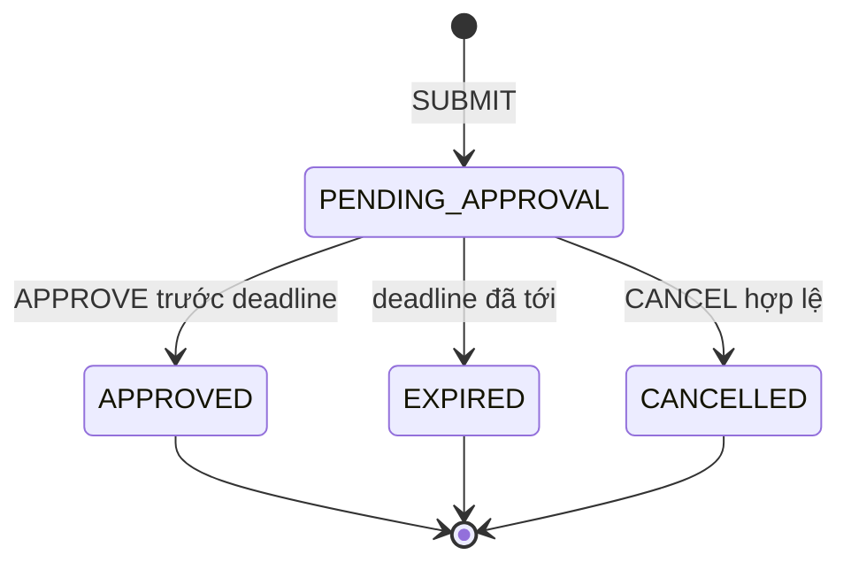

# Workflow timeout — Giới hạn thời gian của quy trình nghiệp vụ

## 1. Timeout là một phần của quy tắc nghiệp vụ

**Workflow timeout** xác định một quy trình, một bước hoặc một quyền thực hiện hành động còn hiệu lực đến khi nào, và hệ thống phải làm gì khi giới hạn đó bị vượt qua. Đây là điều kiện được backend kiểm soát, không chỉ là đồng hồ đếm ngược trên giao diện.

Trong chương **Workflow Security** của module `SECURITY_APPLICATION_SECURITY_BUSINESS_LOGIC_SECURITY`, timeout giúp ngăn việc lợi dụng phê duyệt cũ, giữ giá hoặc tài nguyên quá lâu, tiếp tục quy trình đã hết hạn và gửi lại yêu cầu để tạo thêm tác dụng nghiệp vụ. Nó phải phối hợp với business invariants, state machine, quyền theo đối tượng, transaction và idempotency.

Ví dụ xuyên suốt là đề nghị mua hàng chờ phê duyệt:

- Một lượt workflow chỉ được phê duyệt trong tối đa 30 phút kể từ lúc gửi duyệt.
- Bước phê duyệt hiện tại có thể có thời hạn ngắn hơn thời hạn toàn workflow.
- Người phê duyệt phải có quyền trên đúng đề nghị, đúng tenant và không được tự phê duyệt đề nghị của mình.
- Giá, tổng tiền và phiên bản tài liệu được duyệt phải do server xác định.
- Hết hạn thì không được phê duyệt mới; nếu có giữ tài nguyên, hệ thống phải thu hồi theo chính sách.
- Muốn thực hiện lại sau khi hết hạn phải tạo lượt workflow mới và kiểm tra lại các điều kiện, thay vì hồi sinh lượt cũ bằng cách sửa timestamp.

Một lỗ hổng thường gặp là backend chỉ kiểm tra `state == PENDING_APPROVAL`. Job dọn dẹp chạy mỗi phút, nên một workflow đã quá hạn nhưng chưa được job đổi sang `EXPIRED` vẫn được duyệt. Khi đó lịch chạy job đã vô tình trở thành ranh giới bảo mật.

Mục tiêu của bài là thiết kế deadline có nguồn tin cậy, đặt kiểm tra thời gian đúng điểm ra quyết định, xử lý cuộc đua giữa phê duyệt và hết hạn, đồng thời không đánh đồng timeout với việc hoàn tác tác dụng đã xảy ra.

## 2. Phân biệt các loại timeout

| Loại giới hạn | Câu hỏi nó trả lời | Không tự bảo đảm điều gì? |
| --- | --- | --- |
| HTTP/request timeout | Một bên chờ phản hồi bao lâu? | Server đã dừng xử lý hoặc transaction đã rollback |
| Session timeout | Phiên đăng nhập còn hiệu lực không? | Workflow hoặc quyền phê duyệt cụ thể còn hiệu lực |
| Credential/challenge timeout | Link, mã xác nhận hoặc bằng chứng ủy quyền còn dùng được không? | Đối tượng vẫn ở đúng bước và chưa bị thay đổi |
| Step timeout | Một bước được chờ hoặc xử lý trong bao lâu? | Toàn quy trình chưa vượt giới hạn tổng |
| Absolute workflow timeout | Một lượt workflow tồn tại tối đa bao lâu? | Tài nguyên bên ngoài đã được thu hồi ngay lập tức |
| Inactivity timeout | Đã quá lâu không có hoạt động được chính sách công nhận chưa? | Người dùng không thể giữ sống mãi nếu mọi request đều làm mới hạn |
| Worker lease/heartbeat timeout | Worker có còn quyền thực thi hoặc còn báo tiến độ không? | Worker cũ đã chết và không thể tiếp tục ghi dữ liệu |
| TTL của dữ liệu lưu trữ | Bản ghi được giữ hoặc đủ điều kiện bị xóa đến bao giờ? | Hành động nghiệp vụ sẽ bị chặn đúng thời điểm deadline |

Ví dụ, client timeout sau 5 giây trong khi backend đã phê duyệt và commit. Client không được suy ra đơn chưa duyệt rồi tạo yêu cầu mới với key khác. Ngược lại, một phiên đăng nhập kéo dài nhiều giờ không được làm thời hạn phê duyệt 30 phút tự kéo dài theo.

Giới hạn thời gian của bằng chứng ủy quyền là một lớp bảo vệ hữu ích. OWASP khuyến nghị cửa sổ ủy quyền có giới hạn và kiểm tra quyền thực hiện gắn với bước thực thi giao dịch. Tuy nhiên, thời hạn cụ thể phải phù hợp nghiệp vụ, không có một con số đúng cho mọi workflow. [OWASP Transaction Authorization Cheat Sheet](https://cheatsheetseries.owasp.org/cheatsheets/Transaction_Authorization_Cheat_Sheet.html).

## 3. Định nghĩa deadline trước khi viết code

### 3.1. Chọn mốc bắt đầu và giới hạn áp dụng

Với một workflow có nhiều giới hạn, deadline hiệu lực cho một hành động có thể là:

```text
effective_deadline = min(
    workflow_expires_at,
    step_expires_at,
    authorization_expires_at nếu hành động cần bằng chứng ủy quyền
)
```

Không phải mọi hành động đều có cùng deadline. Ví dụ link xác nhận có thể hết hạn trước workflow; người dùng được xin link mới nếu policy cho phép, nhưng việc cấp link không được tự gia hạn workflow.

Cần xác định rõ:

1. Đồng hồ toàn workflow bắt đầu khi tạo nháp hay khi gửi duyệt?
2. Đồng hồ bước bắt đầu khi vào bước, khi phân công hay khi người duyệt mở màn hình?
3. Retry, đăng nhập lại và heartbeat có được thay đổi deadline không?
4. Timeout chỉ chặn một action, kết thúc một bước hay kết thúc cả lượt workflow?
5. Có được gia hạn không, ai được gia hạn và có giới hạn tổng hay không?
6. Sau timeout cần thu hồi những tài nguyên hoặc bằng chứng ủy quyền nào?

Trong ví dụ của bài, toàn workflow bắt đầu lúc gửi duyệt. Backend lưu deadline tuyệt đối tại lúc đó. Mở trang, kiểm tra trạng thái và gửi lại request không làm mới deadline.

### 3.2. Quy ước chính xác tại thời điểm biên

Dùng khoảng hiệu lực nửa mở:

```text
Được chấp nhận về mặt thời gian khi: decision_at < effective_deadline
Đã hết hạn khi:                     decision_at >= effective_deadline
```

Ví dụ deadline là `2026-11-22T03:30:00Z`:

| Thời điểm quyết định | Kết quả kiểm tra thời gian |
| --- | --- |
| `03:29:59.999999Z` | Chưa hết hạn, nếu độ chính xác lưu trữ biểu diễn được mốc này |
| `03:30:00.000000Z` | Đã hết hạn |
| `03:30:00.000001Z` | Đã hết hạn |

Thống nhất độ chính xác của timestamp giữa Java, driver và database. Tránh một bên làm tròn theo giây, bên khác so sánh theo microsecond rồi cho kết quả khác nhau tại biên.

### 3.3. “Trước hạn” được đo ở đâu?

Các chính sách sau khác nhau:

- Request đến API trước hạn.
- Server giành được quyền xử lý và quyết định hành động trước hạn.
- Transaction phải commit trước hạn.
- Một tác dụng bên ngoài phải hoàn tất trước hạn.

Bài này chọn chính sách thứ hai: **server lấy thời điểm quyết định từ database sau khi đã khóa dữ liệu cần thiết, kiểm tra quyền và các điều kiện nghiệp vụ, ngay trước khi ghi chuyển trạng thái**. Thời điểm đó được lưu cùng kết quả. Nếu transaction rollback thì không có phê duyệt thành công.

Một request vào hàng đợi trước hạn nhưng chỉ giành được khóa sau hạn sẽ bị từ chối. Client tự gửi `requested_at` trước hạn không làm thay đổi kết quả.

Transaction có thể commit sau deadline dù quyết định hợp lệ được đưa ra trước deadline. Điều này phù hợp chính sách đã chọn. Nếu nghiệp vụ yêu cầu commit hoặc tác dụng bên ngoài hoàn tất trước hạn, phải thiết kế cơ chế đáp ứng yêu cầu đó; một phép kiểm tra thời gian trước `COMMIT` không tự chứng minh thời điểm commit thực tế.

## 4. Mô hình trạng thái và các invariant



Đây là mô hình một bước được đơn giản hóa. `EXPIRED`, `APPROVED` và `CANCELLED` là trạng thái kết thúc của lượt workflow này. Quy trình xử lý tiếp theo có thể được mô hình hóa riêng.

Những invariant chính:

```text
APPROVE được commit
    => nguồn là PENDING_APPROVAL
    AND có quyền trên đúng đối tượng
    AND dữ liệu được duyệt đúng phiên bản
    AND decision_at < effective_deadline.

PENDING_APPROVAL và đã đến deadline
    => không chấp nhận APPROVE mới,
       dù state lưu trong database chưa kịp đổi thành EXPIRED.

EXPIRED
    => không quay lại PENDING_APPROVAL trong cùng lượt bằng thao tác thông thường.

Retry cùng một thao tác đã hoàn tất
    => không tạo thêm chuyển trạng thái hoặc tác dụng phụ.
```

### 4.1. Hết hiệu lực logic và cập nhật trạng thái là hai việc

Ở thời điểm deadline, điều kiện thời gian làm workflow mất khả năng được phê duyệt ngay về mặt logic. Job có thể đổi state thành `EXPIRED` muộn hơn vài giây. Hệ thống vẫn an toàn nếu mọi đường chấp nhận hành động đều kiểm tra deadline hiện có thẩm quyền.

Có thể nhìn thiết kế theo hai yêu cầu:

- **An toàn:** không hành động mới nào được chấp nhận sau hạn theo chính sách đã định nghĩa.
- **Tiến triển:** workflow quá hạn cuối cùng được ghi nhận hết hạn, thu hồi tài nguyên và gửi thông báo cần thiết.

Deadline guard ở đường thực thi bảo vệ yêu cầu đầu. Scheduler, xử lý khi có truy cập và cơ chế phục hồi bảo vệ yêu cầu sau. Chỉ có một trong hai là chưa đủ.

### 4.2. Không xóa bản ghi ngay để biểu diễn timeout

Nếu xóa workflow ngay khi hết hạn, callback đến muộn có thể bị hiểu là một yêu cầu mới hoặc không còn dữ liệu để đối soát. Giữ trạng thái kết thúc trong khoảng thời gian phù hợp với retry, điều tra và nghĩa vụ lưu trữ. Chính sách hết hiệu lực nghiệp vụ và chính sách xóa dữ liệu phải được thiết kế riêng.

## 5. Những cách lạm dụng timeout thường gặp

| Cách lạm dụng | Thiết kế yếu | Hướng phòng vệ |
| --- | --- | --- |
| Tắt JavaScript hoặc sửa đồng hồ máy | Chỉ có đồng hồ đếm ngược ở frontend | Server kiểm tra deadline bằng nguồn thời gian tin cậy |
| Gửi `expires_at` xa hơn trong body | Mass assignment vào entity workflow | Deadline là trường do server quản lý |
| Mở trang hoặc gọi API liên tục | Mọi request đều làm mới inactivity timeout | Chỉ hoạt động có ý nghĩa được làm mới; vẫn có giới hạn tuyệt đối |
| Gửi trước hạn rồi cố làm request chờ khóa | Kiểm tra ở đầu request bằng timestamp cũ | Kiểm tra tại điểm quyết định sau khi lấy khóa |
| Chờ job dọn dẹp chậm rồi gọi phê duyệt | Chỉ kiểm tra state đã đổi sang `EXPIRED` chưa | Kiểm tra deadline ở mọi đường chuyển trạng thái được bảo vệ |
| Dùng link cũ sau khi gửi duyệt lại | Token chỉ gắn với ID đơn | Gắn token với lượt workflow, action và phiên bản/ngữ cảnh phù hợp |
| Gửi callback cũ sau khi worker khác tiếp quản | Không kiểm tra attempt hoặc quyền ghi hiện tại | Xác minh nguồn callback và dùng attempt/fencing token |
| Timeout rồi gửi lại để trừ tiền hoặc giữ tài nguyên lần nữa | Retry không có idempotency | Lưu kết quả thao tác và khử trùng ở từng nơi tạo tác dụng phụ |
| Tạo nhiều workflow để chiếm giữ tài nguyên | Chỉ giới hạn thời gian từng workflow | Giới hạn số lượng, quota và ngân sách tài nguyên theo chủ thể/tenant |

Một timeout ngắn làm giảm cửa sổ lạm dụng nhưng không thay thế phân quyền. Người không có quyền không được phê duyệt chỉ vì gửi trước deadline. Tương tự, một link có chữ ký còn hạn không tự chứng minh đơn chưa bị hủy hoặc chưa được duyệt.

## 6. Nguồn thời gian và mô hình dữ liệu

### 6.1. Dùng một nguồn có thẩm quyền cho quyết định

Trong mô hình một database quan hệ, có thể chọn đồng hồ database làm nguồn so sánh deadline. Các node ứng dụng cùng sử dụng nguồn này khi quyết định trên dữ liệu do database quản lý.

Không lấy thời gian quyết định từ client, payload webhook hoặc đồng hồ đếm ngược trên trình duyệt. Timestamp do bên ngoài ký có thể là dữ kiện cần xác minh, nhưng việc có dùng nó để quyết định sự kiện xảy ra trước hạn hay không là một chính sách riêng.

Trong PostgreSQL, `CURRENT_TIMESTAMP` và `now()` phản ánh thời điểm bắt đầu transaction. Nếu transaction bắt đầu trước hạn rồi chờ khóa đến sau hạn, giá trị đó vẫn có thể nằm trước deadline. `clock_timestamp()` phản ánh thời gian tại lúc gọi; trong thiết kế này, gọi nó sau khi đã giành được khóa cần thiết. [Tài liệu PostgreSQL về thời gian hiện tại](https://www.postgresql.org/docs/current/functions-datetime.html#FUNCTIONS-DATETIME-CURRENT).

Một nguồn thời gian chung không tự loại bỏ việc đồng hồ bị điều chỉnh hoặc chuyển primary sang máy lệch giờ. Cần đồng bộ, giám sát độ lệch và có chính sách xử lý bất thường. Với cửa sổ thời gian rất nhạy cảm, phải xác định mức sai số chấp nhận được. Không tự thêm “grace period” ở từng service, vì nó làm deadline thực tế khác chính sách.

Đồng hồ đơn điệu trong một tiến trình hữu ích để đo khoảng thời gian xử lý cục bộ. Nó không thay thế trực tiếp timestamp tuyệt đối cần lưu bền vững và so sánh qua restart hoặc qua nhiều máy.

### 6.2. Schema minh họa

```sql
CREATE TABLE approval_workflow (
    id                    uuid PRIMARY KEY,
    tenant_id             uuid NOT NULL,
    document_id           uuid NOT NULL,
    document_version      bigint NOT NULL,
    state                 varchar(32) NOT NULL,
    version               bigint NOT NULL DEFAULT 0,
    submitted_at          timestamptz NOT NULL,
    workflow_expires_at   timestamptz NOT NULL,
    step_expires_at       timestamptz NOT NULL,
    decision_at           timestamptz,
    decided_by            uuid,
    policy_version        varchar(128) NOT NULL,

    CHECK (state IN (
        'PENDING_APPROVAL', 'APPROVED', 'EXPIRED', 'CANCELLED'
    )),
    CHECK (version >= 0 AND document_version >= 0),
    CHECK (workflow_expires_at > submitted_at),
    CHECK (step_expires_at > submitted_at),
    CHECK (
        state <> 'APPROVED'
        OR (
            decision_at IS NOT NULL
            AND decided_by IS NOT NULL
            AND decision_at < LEAST(workflow_expires_at, step_expires_at)
        )
    ),
    CHECK (
        state <> 'EXPIRED'
        OR (
            decision_at IS NOT NULL
            AND decision_at >= LEAST(workflow_expires_at, step_expires_at)
        )
    )
);
```

Mỗi `id` đại diện một lượt workflow. Lượt mới có ID mới, ngay cả khi cùng `document_id`. `document_version` gắn quyết định với dữ liệu đề nghị cụ thể; chỉnh sửa giá hoặc dữ liệu quan trọng phải làm lượt phê duyệt cũ không còn sử dụng được theo policy.

Schema trên minh họa trường hợp không có thêm challenge. Nếu hành động cần challenge hết hạn sớm hơn, deadline hiệu lực còn phải xét challenge ở đường thực thi. Không để `NULL` vô tình có nghĩa “vô thời hạn” khi nghiệp vụ bắt buộc có deadline.

Các constraint hỗ trợ bảo vệ hình dạng dữ liệu và quan hệ giữa thời điểm đã lưu với deadline. Chúng không chứng minh `decision_at` do nguồn tin cậy sinh ra, không thay thế kiểm tra quyền và không ngăn tài khoản database có quyền quá rộng giả mạo dữ liệu. Backend phải kiểm soát trường nào client được phép gửi.

## 7. Phê duyệt và hết hạn phải tranh chấp cùng dữ liệu

### 7.1. Khóa rồi mới kiểm tra thời gian

Một cách triển khai dễ lý giải là transaction ngắn có khóa hàng:

1. Đọc workflow theo cả tenant và ID bằng `SELECT ... FOR UPDATE`.
2. Xác minh quyền hiện tại trên đối tượng.
3. Xử lý idempotency để nhận biết thao tác đã hoàn tất.
4. Với thao tác mới, kiểm tra state, version và dữ liệu nghiệp vụ; lấy các khóa bổ sung cần cho invariant.
5. Lấy thời gian quyết định từ database sau các bước có thể phải chờ khóa.
6. Nếu đã hết hạn, ghi chuyển sang `EXPIRED`; nếu còn hạn, ghi `APPROVED`.
7. Lưu audit, ý định tác dụng phụ và kết quả idempotency trong cùng transaction.
8. Sau khi transaction hoàn tất, ánh xạ kết quả thành phản hồi API.

Khóa không được giữ trong khi chờ người dùng xác nhận trên giao diện hoặc chờ một dịch vụ mạng phản hồi. Nếu có nhiều tài nguyên cần khóa, các đường phê duyệt, hết hạn và hủy phải tuân theo thứ tự khóa thống nhất.

### 7.2. Khung Java minh họa

Đoạn sau dùng `TransactionTemplate` của Spring. Các repository, policy và kiểu kết quả là hợp đồng minh họa, chưa phải chương trình hoàn chỉnh có thể chép chạy ngay.

```java
public ApprovalOutcome approve(ApproveCommand cmd, TrustedActor actor) {
    return transactions.execute(tx -> {
        ApprovalWorkflow wf = workflows.lockByTenant(
            actor.tenantId(), cmd.workflowId());

        // Kiểm tra quyền trên đối tượng, không gộp điều kiện state vào đây.
        access.requireApprovalScope(actor, wf);

        IdempotencyClaim claim = idempotency.claim(
            actor.tenantId(), actor.subjectId(), "APPROVE_WORKFLOW",
            cmd.idempotencyKey(),
            fingerprints.approval(cmd.workflowId(), cmd.expectedVersion()));

        if (claim.isCompleted()) {
            return claim.originalOutcome();
        }

        if (wf.version() != cmd.expectedVersion()) {
            throw new StaleWorkflowException();
        }
        if (wf.state() != WorkflowState.PENDING_APPROVAL) {
            throw new InvalidWorkflowStateException();
        }

        // Dùng dữ liệu server; khóa hoặc kiểm tra version tài liệu khi cần.
        approvalRules.requireAllowed(actor, wf);

        // SELECT clock_timestamp() trên cùng database/transaction.
        // Lấy sau các bước có thể chờ khóa, ngay trước quyết định ghi.
        Instant decisionAt = databaseClock.currentInstant();

        ApprovalOutcome outcome;
        if (!decisionAt.isBefore(wf.effectiveDeadline())) {
            outcome = expiration.expireLocked(wf, decisionAt);
        } else {
            int changed = workflows.approveIfPending(
                actor.tenantId(), wf.id(), wf.version(),
                actor.subjectId(), decisionAt);

            if (changed != 1) {
                throw new ConcurrentWorkflowChangeException();
            }

            UUID eventId = audit.appendApproved(wf, actor, decisionAt);
            outbox.enqueueApprovalAccepted(eventId, wf.id());
            outcome = ApprovalOutcome.approved(
                wf.id(), wf.version() + 1, eventId);
        }

        idempotency.complete(claim, outcome);
        return outcome;
    });
}
```

Những hợp đồng bắt buộc để hiểu đúng ví dụ:

- `TrustedActor` đến từ xác thực đã kiểm chứng. Truy vấn và kiểm tra quyền phải giới hạn đúng tenant, đúng workflow và đúng tài liệu liên quan.
- `approvalRules` kiểm tra người tạo khác người duyệt, quyền/hạn mức và version dữ liệu có liên quan. Nếu dữ liệu đó nằm ngoài hàng workflow, khóa hàng workflow đơn lẻ không tự bảo vệ nó.
- `IdempotencyClaim` được lưu bền vững, có unique constraint theo phạm vi phù hợp và kiểm tra fingerprint. Cùng key nhưng khác nội dung nghiệp vụ phải bị từ chối. Nếu lệnh có thêm trường có ý nghĩa, fingerprint phải bao gồm chúng.
- `databaseClock` lấy thời gian từ database; không dùng `Instant.now()` của node ứng dụng trong bản triển khai đang chọn database làm nguồn có thẩm quyền.
- `expireLocked` kiểm tra và cập nhật workflow đang khóa sang `EXPIRED`, tăng version, ghi audit và ghi outbox thu hồi tài nguyên nếu cần. Nó trả kết quả đã hết hạn thay vì ném exception làm rollback chính thay đổi hết hạn đó.
- Mọi repository trong callback cùng tham gia một transaction. Lỗi ghi state, audit, outbox hoặc kết quả idempotency phải rollback toàn bộ; không nuốt exception làm transaction commit dở dang.

Phản hồi hết hạn là kết quả nghiệp vụ. Nếu controller cần trả mã HTTP biểu thị không thể tiếp tục, nó thực hiện việc đó sau khi transaction đã commit kết quả hết hạn. Mã trạng thái HTTP cụ thể phải thống nhất với hợp đồng API và không làm lộ workflow mà người gọi không có quyền biết.

### 7.3. Điều kiện cập nhật ở database

SQL phê duyệt có thể có dạng:

```sql
UPDATE approval_workflow
SET state = 'APPROVED',
    version = version + 1,
    decision_at = :decision_at,
    decided_by = :actor_id
WHERE tenant_id = :tenant_id
  AND id = :workflow_id
  AND state = 'PENDING_APPROVAL'
  AND version = :expected_version
  AND :decision_at < LEAST(workflow_expires_at, step_expires_at);
```

SQL hết hạn tương ứng:

```sql
UPDATE approval_workflow
SET state = 'EXPIRED',
    version = version + 1,
    decision_at = :decision_at
WHERE tenant_id = :tenant_id
  AND id = :workflow_id
  AND state = 'PENDING_APPROVAL'
  AND version = :expected_version
  AND :decision_at >= LEAST(workflow_expires_at, step_expires_at);
```

`:decision_at` là giá trị do backend lấy từ database trong khi giữ khóa, không phải tham số được client tùy ý chọn. Phải kiểm tra số hàng thay đổi. Mốc thời gian được dùng nhất quán cho quyết định và audit; không tạo hai kết quả trái nhau bằng hai phép đọc đồng hồ tách rời cho cùng một lần quyết định.

Hai câu SQL này được trình bày trong giao thức khóa đã mô tả. Không tách bước đọc deadline hoặc lấy thời gian ra khỏi transaction rồi giả định điều kiện SQL sẽ tự sửa mọi lỗi tranh chấp còn lại.

### 7.4. Cuộc đua tại deadline

Giả sử deadline là `03:30:00Z`:

| Diễn biến | Kết quả theo chính sách của bài |
| --- | --- |
| Lệnh phê duyệt giữ khóa và quyết định lúc `03:29:59.9Z` | Có thể duyệt; job hết hạn đọc sau thấy `APPROVED` và không ghi đè |
| Request đến lúc `03:29:59Z` nhưng lấy khóa lúc `03:30:01Z` | Không được duyệt; thời gian quyết định đã qua hạn |
| Job hết hạn giữ khóa và ghi `EXPIRED` trước | Request phê duyệt đọc trạng thái kết thúc và bị từ chối |
| Lệnh phê duyệt đã kiểm tra nhưng transaction rollback | Không có phê duyệt có hiệu lực; lần xử lý sau phải đọc lại state và thời gian |

Hạn chế thời gian transaction và lock timeout giúp vận hành ổn định, nhưng lock timeout không thay thế deadline nghiệp vụ. Nếu không lấy được khóa, trả kết quả lỗi hoặc yêu cầu retry phù hợp; không chuyển sang nhánh phê duyệt bỏ kiểm tra khóa.

## 8. Job hết hạn: bảo đảm thu hồi mà không quyết định thay backend

Có thể kết hợp ba cơ chế:

- **Kiểm tra trên đường ghi:** mọi action được bảo vệ đều kiểm tra deadline.
- **Xử lý khi có truy cập:** một thao tác hợp lệ có thể ghi nhận workflow đã hết hạn trong transaction của nó.
- **Job nền hoặc delayed message:** chủ động hoàn tất các workflow không còn ai truy cập.

Job nền có thể lấy một batch ứng viên bằng PostgreSQL:

```sql
SELECT tenant_id, id
FROM approval_workflow
WHERE state = 'PENDING_APPROVAL'
  AND LEAST(workflow_expires_at, step_expires_at) <= clock_timestamp()
ORDER BY LEAST(workflow_expires_at, step_expires_at), id
LIMIT :batch_size
FOR UPDATE SKIP LOCKED;
```

Sau khi giữ khóa, worker lấy thời gian mới và kiểm tra lại điều kiện trước khi chuyển từng workflow sang `EXPIRED`. Các thay đổi trạng thái, audit và outbox được commit cùng transaction. Batch phải đủ nhỏ để không giữ khóa quá lâu; ứng viên đang khóa sẽ được xử lý ở lượt khác.

Có thể tạo index phục vụ tập workflow đang chờ trên biểu thức deadline hiệu lực, phù hợp workload thực tế. Query lấy batch không thay thế việc giám sát bản ghi bị kẹt hoặc liên tục bị bỏ qua vì khóa.

Delayed message chỉ nên mang thông tin định danh và deadline/version mà nó quan sát khi lập lịch. Khi message đến, worker phải đọc lại deadline hiện tại. Message có thể tới sớm, tới trễ, trùng hoặc mang deadline cũ sau một lần gia hạn hợp lệ. Nó không có quyền ép workflow hết hạn chỉ vì timestamp trong payload đã tới.

Nếu scheduler ngừng 10 phút, deadline guard vẫn phải ngăn phê duyệt quá hạn. Tuy nhiên, tài nguyên có thể chưa được thu hồi trong khoảng đó; đây là vấn đề khả dụng và chiếm dụng tài nguyên cần cảnh báo, không phải lý do để mở lại quyền phê duyệt.

## 9. Retry, callback đến muộn và tác dụng bên ngoài

### 9.1. Retry sau deadline không nhất thiết là thao tác mới

Workflow được duyệt hợp lệ lúc `03:29:59Z`, nhưng response bị mất. Client retry cùng key lúc `03:30:05Z`. Nếu kết quả đã commit và người gọi còn đủ quyền đọc kết quả theo policy, backend trả lại kết quả cũ, không duyệt thêm lần nữa và không gia hạn workflow.

Do đó, nhánh nhận diện thao tác đã hoàn tất đứng trước điều kiện thời gian áp dụng cho **thao tác mới**. Đây không phải bỏ qua timeout; hệ thống đang trả bằng chứng cho hành động đã xảy ra hợp lệ.

Phải ràng buộc kết quả idempotency với tenant, chủ thể, action và nội dung lệnh. Không trả kết quả của người khác chỉ vì biết một key. Cũng không dùng hạn lưu key quá ngắn đến mức retry hợp lệ dễ bị hiểu thành thao tác mới. State machine và version vẫn phải bảo vệ hệ thống khi key đã hết hạn lưu.

Nếu backend không biết transaction đã commit hay chưa, giữ nguyên key khi tra cứu/retry. HTTP timeout tự nó không chứng minh nghiệp vụ thất bại.

### 9.2. Callback cũ không được hồi sinh workflow

Callback cần được xác minh nguồn gửi và ràng buộc ít nhất với đúng workflow/lượt xử lý, action và đối tượng liên quan. Chữ ký hợp lệ không có nghĩa callback còn đúng với state hiện tại.

Ví dụ một bước được giao lại cho worker khác. Callback của attempt cũ phải bị từ chối hoặc ghi nhận là đến muộn theo policy. Nếu hệ thống tái sử dụng cùng ID workflow cho nhiều attempt, cần có `step_attempt_id` hoặc generation tăng đơn điệu và kiểm tra nó tại nơi cập nhật. Không chỉ dựa vào chuỗi `PENDING` xuất hiện trở lại để kết luận callback còn hợp lệ.

Nếu callback chỉ xác nhận việc đã xảy ra tại một hệ thống khác, phân biệt:

- **Cấp quyền thực hiện hành động mới sau hạn:** mặc định không cho phép trong mô hình của bài.
- **Ghi nhận sự thật bên ngoài đã xảy ra:** phải lưu và đối soát, không được bỏ đi chỉ vì workflow nội bộ đã hết hạn.

Khi chấp nhận timestamp bên ngoài để xác định sự thật xảy ra trước deadline, cần chính sách rõ về nguồn ký, sai số, chống replay, liên kết giao dịch và trạng thái thực tế. Không dùng thời gian do trình duyệt tự khai làm căn cứ.

### 9.3. Timeout không tự hủy tác dụng đã xảy ra

Một lời gọi sang dịch vụ ngoài bị timeout có thể đã tạo tác dụng ở bên nhận. Đóng kết nối hoặc đánh dấu workflow `EXPIRED` không hoàn tác việc đó.

Nếu timeout cần giải phóng giữ hàng hoặc giữ hạn mức:

1. Ghi nhận hết hạn và ý định thu hồi bền vững cùng transaction.
2. Gửi lệnh thu hồi qua cơ chế có retry; mỗi lệnh gắn với một `reservation_id` cụ thể.
3. Nơi quản lý tài nguyên thực hiện thu hồi idempotent, có điều kiện trên trạng thái giữ hiện tại.
4. Chỉ tăng lại số lượng khả dụng một lần. Không cộng tài nguyên trở lại vô điều kiện ở mỗi lần message được giao.
5. Theo dõi trường hợp chưa thu hồi được và đối soát với hệ thống có thẩm quyền.

Nếu tài nguyên đã được tiêu thụ bởi một hành động hợp lệ, không xử lý thu hồi như thể nó vẫn đang được giữ. Có thể cần bước bù trừ hoặc xử lý ngoại lệ riêng. `EXPIRED` cho biết quyền tiếp tục workflow đã hết; trạng thái thu hồi có thể cần được theo dõi riêng như `RELEASE_PENDING` và `RELEASED`.

## 10. Inactivity timeout, heartbeat và gia hạn

### 10.1. Không để giữ sống workflow vô thời hạn

Nếu có inactivity timeout, giới hạn mới thường phải chịu trần tuyệt đối:

```text
new_step_deadline = min(
    last_qualifying_activity_at + idle_limit,
    workflow_expires_at
)
```

`qualifying activity` phải được định nghĩa bằng hành động có ý nghĩa và được xác thực. Một request đọc trạng thái, tải ảnh hoặc ping tự động không mặc nhiên chứng minh người dùng đang tiến hành nghiệp vụ. Giới hạn tần suất làm mới để tránh ghi database không cần thiết.

Không tính lại `workflow_expires_at = now + 30 phút` ở mỗi request. Cách đó biến giới hạn tuyệt đối thành cửa sổ trượt có thể được kéo dài mãi.

### 10.2. Heartbeat chỉ chứng minh tiến độ theo hợp đồng đã định nghĩa

Heartbeat có thể gia hạn quyền giữ một tác vụ hoặc báo worker còn sống, nhưng không được tự nới thời hạn nghiệp vụ tổng. Một ví dụ là AWS Step Functions: heartbeat làm mới đồng hồ heartbeat, còn timeout tối đa của task vẫn áp dụng bất kể số lần heartbeat. [AWS: SendTaskHeartbeat](https://docs.aws.amazon.com/step-functions/latest/apireference/API_SendTaskHeartbeat.html).

Worker mất lease có thể vẫn đang chạy do network partition hoặc bị tạm dừng rồi tiếp tục. Nếu worker mới đã tiếp quản, dùng fencing token/generation tăng đơn điệu và bắt nơi nhận ghi dữ liệu kiểm tra quyền ghi hiện tại. Một giá trị token trong log mà nơi ghi không xác minh không ngăn được worker cũ gây tác dụng.

### 10.3. Gia hạn là action nghiệp vụ riêng

Gia hạn phải có quyền riêng, lý do, giới hạn số lần và version check. Quyết định gia hạn và quyết định hết hạn phải tranh chấp cùng dữ liệu bằng khóa hoặc cơ chế nguyên tử tương đương.

Trong chính sách ví dụ:

- Chỉ gia hạn bước khi workflow vẫn còn hiệu lực.
- Deadline bước mới không vượt deadline tuyệt đối của lượt workflow.
- Workflow đã `EXPIRED` không được hồi sinh; tạo lượt mới với ID mới nếu được phép.
- Ghi audit deadline cũ/mới, actor, lý do, policy version và thời điểm quyết định.
- Cập nhật hoặc vô hiệu hóa challenge cũ theo version/attempt; cấp challenge mới không tự mở rộng quyền của challenge cũ.

Nếu nghiệp vụ cho phép ngoại lệ với giới hạn tổng, mô hình hóa và phê duyệt ngoại lệ đó rõ ràng. Không để một endpoint cập nhật thông tin chung có thể sửa deadline như thuộc tính thông thường.

## 11. Quan sát và điều tra timeout

Audit của một quyết định timeout nên đủ để phân biệt deadline thực tế với thời điểm worker xử lý:

```text
workflow_id, tenant_id, document_id, workflow_version
action và trạng thái trước/sau
effective_deadline, decision_at, policy_version
actor hoặc service thực hiện
request/command ID và idempotency reference khi cần
reason_code: DEADLINE_EXCEEDED, STALE_ATTEMPT, EXTENSION_DENIED...
```

Không ghi nguyên mã xác nhận, access token hoặc callback secret. Đọc audit cũng phải tuân theo quyền trên dữ liệu và tenant. Một sự kiện bị từ chối không được mô tả như thể workflow đã được phê duyệt thành công.

Những chỉ số vận hành hữu ích:

| Chỉ số | Điều cần tìm hiểu |
| --- | --- |
| Tuổi lớn nhất của workflow quá hạn nhưng chưa ghi `EXPIRED` | Scheduler có bị kẹt hoặc backlog quá lớn không? |
| Số tài nguyên còn giữ sau khi workflow hết hạn | Thu hồi có được retry và đối soát không? |
| Tỷ lệ request bị từ chối vì deadline | UX có gây chậm trễ, hay có hành vi lạm dụng? |
| Số callback cũ hoặc trùng theo attempt | Có retry bất thường, chậm hàng đợi hoặc vấn đề tích hợp không? |
| Thời gian chờ khóa tại điểm quyết định | Tranh chấp có khiến nhiều request mất cửa sổ hợp lệ không? |
| Số lần gia hạn theo actor/tenant | Có dấu hiệu giữ tài nguyên kéo dài hoặc dùng sai quyền không? |
| Độ lệch đồng hồ và sự kiện chuyển nguồn thời gian | Quyết định deadline có chịu rủi ro do hạ tầng thời gian không? |

Khi đối chiếu audit với state hiện tại, tính đến transaction đang diễn ra và độ trễ gửi event. Không lấy độ trễ job hết hạn làm thời gian mà workflow được phép hành động thêm.

## 12. Kiểm thử các ranh giới và tình huống tấn công

Không cần chờ thật 30 phút để kiểm thử. Tách nguồn thời gian để test logic thuần có thể đặt mốc trước, đúng và sau deadline. Với đường thực thi dùng database clock, cần kiểm thử tích hợp riêng để xác minh khóa, transaction và cách lấy thời gian thật sự tương tác đúng.

| Tình huống | Kết quả cần quan sát |
| --- | --- |
| Quyết định trước hạn, đúng hạn và sau hạn | Lần lượt có thể chấp nhận, từ chối và từ chối theo quy ước nửa mở |
| Step deadline sớm hơn workflow deadline | Áp dụng step deadline |
| Challenge hết hạn sớm hơn hai deadline còn lại | Không chấp nhận bằng chứng đã hết hạn |
| Sửa đồng hồ client hoặc gửi `expires_at` tùy ý | Không thay đổi thời hạn có thẩm quyền |
| Tắt job hết hạn | Không phê duyệt quá hạn; khi job phục hồi thì tiếp tục thu hồi |
| Transaction bắt đầu trước hạn, chờ khóa đến sau hạn | Không dùng transaction timestamp cũ để duyệt |
| Phê duyệt và job hết hạn chạy đồng thời | Chỉ một kết quả hợp lệ được commit, không ghi đè trạng thái kết thúc |
| Audit hoặc outbox insert thất bại | State và kết quả idempotency rollback cùng transaction |
| Nhánh hết hạn trả lỗi API | Chuyển sang `EXPIRED` vẫn được commit nếu đó là thiết kế của nhánh này |
| Retry cùng key sau khi phê duyệt hợp lệ và qua deadline | Trả kết quả cũ, không thực hiện lại tác dụng |
| Cùng key nhưng khác workflow hoặc nội dung | Bị từ chối xung đột |
| Message hết hạn cũ đến sau một lần gia hạn hợp lệ | Đọc lại deadline, không hết hạn theo payload cũ |
| Callback của attempt trước hoặc của workflow cũ | Không thay đổi lượt hiện tại |
| Giao trùng lệnh thu hồi tài nguyên | Chỉ thu hồi một lần; không tăng tài nguyên khả dụng nhiều lần |
| Dùng key hoặc ID workflow của tenant khác | Không lộ kết quả, deadline hoặc dữ liệu đối tượng |
| Ping liên tục để giữ sống | Không vượt giới hạn tuyệt đối hoặc chính sách hoạt động hợp lệ |
| Worker cũ ghi sau khi mất lease | Nơi ghi từ chối token/generation không còn quyền |
| Đồng hồ database bị điều chỉnh bất thường | Cảnh báo và hành vi theo chính sách sai số đã định nghĩa |

Để kiểm thử cuộc đua, dùng hai kết nối thật và điều phối việc giữ/nhả khóa quanh deadline, thay vì chỉ gọi hai hàm tuần tự. Đọc kết quả đã commit từ kết nối khác và kiểm tra cả state, version, audit, outbox cùng số lần tác dụng phụ có hiệu lực.

Các tình huống trên là yêu cầu kiểm thử cho hệ thống triển khai thực tế; khung mã trong bài chưa được chạy như một ứng dụng hoàn chỉnh.

## 13. Bài tập thiết kế

Một hệ thống cho phép giữ hàng 10 phút, xác nhận bằng link có hạn 5 phút và thực hiện tác vụ nền với lease 30 giây. Người dùng có thể xin link mới, còn tác vụ nền có heartbeat.

Hãy thiết kế:

1. Deadline nào quyết định quyền xác nhận ở từng thời điểm? Link mới có được kéo dài thời hạn giữ hàng không?
2. State machine nào ngăn xác nhận sau khi giữ hàng hết hạn nhưng job chưa thu hồi?
3. Những trường nào ràng buộc link với đúng lượt workflow và đúng dữ liệu được xác nhận?
4. Request đến trước hạn nhưng chờ khóa đến sau hạn được xử lý thế nào theo chính sách bạn chọn?
5. Khi tác vụ ngoài đã thực hiện nhưng callback đến muộn, làm sao ghi nhận sự thật mà không hồi sinh workflow trái phép?
6. Làm sao để hai lệnh thu hồi giống nhau chỉ trả lại hàng một lần?
7. Cần lưu kết quả idempotency và trạng thái kết thúc bao lâu so với cửa sổ retry/callback?
8. Những kiểm thử nào chứng minh heartbeat và việc xin link mới không tạo workflow tồn tại vô hạn?

Một thiết kế đầy đủ phải chỉ rõ nguồn thời gian, điểm quyết định, điều kiện cập nhật nguyên tử và cách xử lý tác dụng đã xảy ra. Workflow timeout chỉ bảo vệ được quy tắc nghiệp vụ khi deadline được thực thi trên mọi đường hành động, còn việc kết thúc và thu hồi được vận hành bền vững sau đó.
