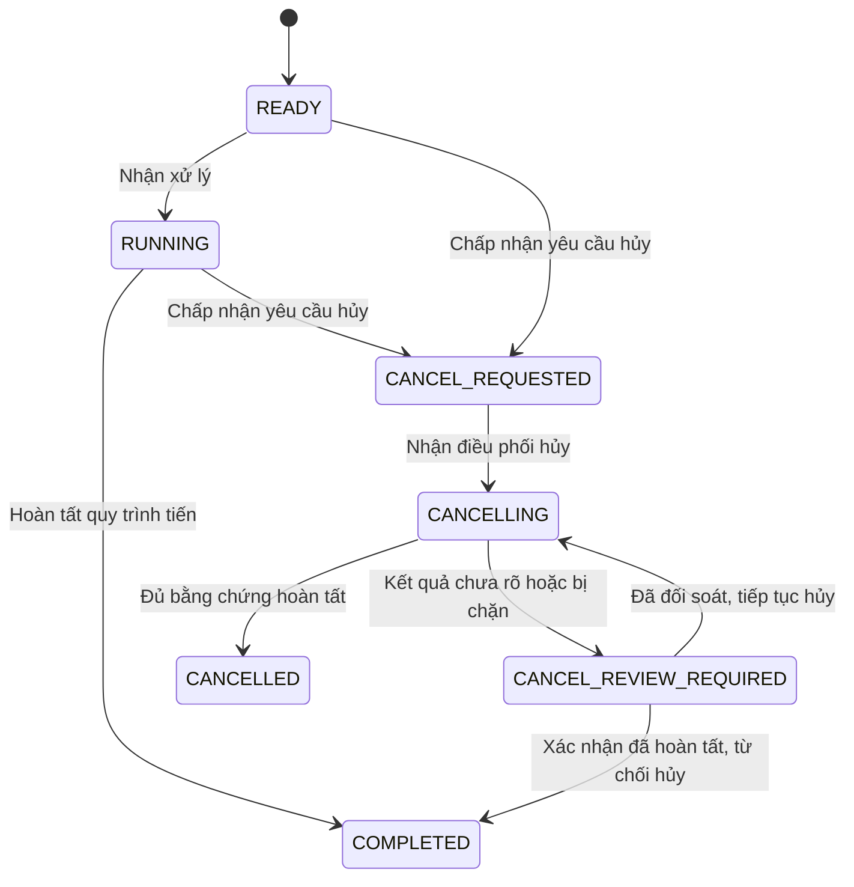

# Workflow cancellation — Hủy quy trình nghiệp vụ an toàn

## 1. Hủy workflow là thay đổi quyền thực thi của cả quy trình

Một workflow có thể điều phối nhiều bước: kiểm tra đơn hàng, giữ tồn kho, giữ hạn mức, thu tiền, chuẩn bị hàng và bàn giao vận chuyển. Khi người dùng bấm “Hủy”, các bước đó có thể đang nằm ở nhiều nơi: trong cơ sở dữ liệu, trong hàng đợi, trong một worker đang chạy hoặc tại dịch vụ bên ngoài.

Vì vậy, hủy workflow không chỉ là cập nhật một cột `status`. Đây là việc **thu hồi quyền thực hiện các bước tiến tiếp theo, xử lý các bước đã nhận chạy và đưa những tác động đã phát sinh về trạng thái được hợp đồng nghiệp vụ cho phép**.

Nếu chỉ đổi trạng thái trên giao diện, hệ thống có thể gặp các lỗi bảo mật logic:

- Đơn đã báo hủy nhưng worker cũ vẫn thu tiền hoặc giao hàng.
- Người dùng hủy đơn của người khác bằng cách thay ID trong request.
- Gửi nhiều yêu cầu hủy làm hoàn tiền hoặc cộng trả tồn kho nhiều lần.
- Hủy rồi tạo lại workflow để né giới hạn khuyến mãi, hạn mức hoặc bước phê duyệt.
- Một callback đến muộn làm sống lại quy trình đã hủy.
- API báo hủy thành công trong khi chưa biết giao dịch bên ngoài có thực hiện hay chưa.

Bài học này tập trung vào quyền hủy theo đối tượng, state machine của việc hủy, ranh giới transaction, phối hợp worker, idempotency và kiểm thử các cuộc đua. Ví dụ xuyên suốt là workflow xử lý đơn hàng có giữ tài nguyên và có bước bàn giao cho bên vận chuyển.

## 2. Phân biệt hủy, tạm dừng, rollback và compensation

| Khái niệm | Mục đích | Điều không được tự suy ra |
| --- | --- | --- |
| Hủy workflow | Chấm dứt hướng xử lý tiến của một lần chạy theo chính sách nghiệp vụ | Không có nghĩa mọi tác động bên ngoài tự biến mất |
| Tạm dừng workflow | Ngừng tiến tạm thời, còn khả năng tiếp tục theo cơ chế được thiết kế | Không tự giải phóng tài nguyên hoặc vô hiệu hóa mọi bằng chứng như một lần hủy |
| Rollback transaction | Hủy các thay đổi chưa commit trong cùng transaction cục bộ | Không dừng được một HTTP request đã gửi hoặc thu hồi thông điệp đã được bên khác xử lý |
| Transition đảo ngược | Thực hiện một bước nghiệp vụ mới để thu hồi hoặc quay lại một giai đoạn được phép | Không đồng nghĩa kết thúc toàn bộ workflow |
| Compensation | Thực hiện hành động bù cho một tác động đã xảy ra | Có thể thất bại, cần đối soát và không nhất thiết khôi phục mọi thứ như ban đầu |
| Chấm dứt tiến trình hoặc ngắt thread | Tác động lên cơ chế chạy chương trình | Không chứng minh nghiệp vụ đã hủy an toàn |

Ví dụ, hủy một workflow có thể cần giải phóng reservation tồn kho và hoàn khoản tiền đã thu. Nếu hàng đã được bàn giao không thể thu hồi theo chính sách, chức năng hủy thông thường có thể không còn áp dụng; khi đó phải mở quy trình trả hàng hoặc xử lý ngoại lệ riêng.

Một hàm tên `cancel()` trong thư viện chỉ cung cấp đúng bảo đảm mà thư viện đó công bố. Hợp đồng hủy nghiệp vụ phải được ứng dụng định nghĩa và kiểm chứng bằng trạng thái bền vững cùng bằng chứng từ các hệ thống liên quan.

## 3. Định nghĩa hợp đồng hủy trước khi viết API

Một thiết kế cần trả lời ít nhất sáu câu hỏi:

1. Ai được hủy, trên đối tượng nào, trong tenant hoặc đơn vị nào?
2. Trước mốc nghiệp vụ nào thì yêu cầu hủy được chấp nhận?
3. Khi chấp nhận yêu cầu, những bước mới nào lập tức mất quyền bắt đầu?
4. Những lệnh đã nhận chạy sẽ được dừng, theo dõi hoặc đối soát như thế nào?
5. Điều kiện nào đủ để công bố hủy hoàn tất?
6. Nếu hủy không thể hoàn tất tự động, ai xử lý và hệ thống thể hiện sự thật ra sao?

Trong ví dụ của bài, ta chọn hợp đồng sau:

- Người có quyền trên đơn được yêu cầu hủy khi workflow chưa hoàn tất và chưa biết chắc đã vượt mốc bàn giao không thể hủy.
- Chấp nhận hủy làm mất quyền bắt đầu các bước tiến mới của lần chạy hiện tại.
- Tác vụ đã nhận chạy phải được xác định kết quả; không coi timeout là đã dừng.
- Các bước giải phóng hoặc bù bắt buộc phải được xác nhận xong trước khi đặt `CANCELLED`.
- Nếu có hiệu ứng chưa rõ kết quả hoặc gặp giới hạn không thể tự xử lý, dùng `CANCEL_REVIEW_REQUIRED`.
- Một workflow đã hủy không được chuyển lại thành đang chạy bằng request hoặc event cũ. Nếu nghiệp vụ cho làm lại, tạo lần xử lý mới và kiểm tra lại toàn bộ điều kiện cần thiết.

Đây là một lựa chọn hợp đồng cho ví dụ. Một hệ thống khác có thể định nghĩa hủy một phần hoặc chấp nhận một số tác động còn lại, nhưng phải thể hiện rõ trong dữ liệu, API và trải nghiệm người dùng.

## 4. State machine của workflow và của yêu cầu hủy

### 4.1. Trạng thái workflow

| Trạng thái | Ý nghĩa trong ví dụ |
| --- | --- |
| `READY` | Được phép chuẩn bị chạy; có thể đã có tài nguyên giữ chỗ |
| `RUNNING` | Đang có các bước nghiệp vụ được điều phối |
| `COMPLETED` | Quy trình tiến đã hoàn tất |
| `CANCEL_REQUESTED` | Ý định hủy đã commit; cấm nhận thêm bước tiến mới |
| `CANCELLING` | Đang đối soát bước đã nhận chạy và thực hiện cleanup hoặc compensation |
| `CANCELLED` | Các điều kiện hoàn tất hủy theo hợp đồng đã được chứng minh |
| `CANCEL_REVIEW_REQUIRED` | Cần đối soát hoặc quyết định xử lý vì chưa thể kết luận hủy an toàn |



Nhánh từ `CANCEL_REVIEW_REQUIRED` về `COMPLETED` chỉ được dùng khi có bằng chứng và quyết định phù hợp, chẳng hạn xác nhận toàn bộ đơn đã hoàn tất và không thể hủy theo chính sách. Nếu chỉ một phần đã vượt mốc, cần giữ quy trình xử lý ngoại lệ phù hợp; không gán `COMPLETED` để che khuất công việc còn dang dở.

Với workflow chưa từng tạo tác vụ hoặc giữ tài nguyên, hệ thống có thể tối ưu thành hủy đồng bộ. Ví dụ triển khai trong bài luôn đi qua `CANCEL_REQUESTED` để làm rõ giao thức bất đồng bộ.

### 4.2. Trạng thái yêu cầu hủy

Yêu cầu hủy nên có định danh và kết quả riêng, chẳng hạn:

```text
REQUESTED → PROCESSING → SUCCEEDED
                      ↘ REQUIRES_REVIEW
REQUIRES_REVIEW → PROCESSING hoặc REJECTED
```

Workflow và yêu cầu hủy trả lời hai câu hỏi khác nhau:

- Workflow đang ở giai đoạn nghiệp vụ nào?
- Ý định hủy cụ thể này đã được xử lý đến đâu?

Trong ví dụ, `CANCELLED` tương ứng với yêu cầu hủy `SUCCEEDED`. Nếu đối soát chứng minh không thể hủy và workflow thực sự đã hoàn tất, yêu cầu hủy có thể là `REJECTED`, còn workflow là `COMPLETED`.

Không để mỗi bảng tự mang một kết luận khác nhau. Những thay đổi kết luận trong cùng cơ sở dữ liệu cần được thực hiện trong cùng transaction.

## 5. Các bất biến bảo mật của chức năng hủy

| Bất biến | Cách vi phạm thường gặp | Kiểm soát cần có |
| --- | --- | --- |
| Chỉ chủ thể được phép mới hủy đúng đối tượng | Chỉ kiểm tra đã đăng nhập rồi cập nhật theo ID | Kiểm tra tenant, quan hệ đối tượng và quyền hành động |
| Sau khi chấp nhận hủy, không nhận bước tiến mới | Worker dùng một bản đọc `RUNNING` từ trước | Giao thức nhận bước nguyên tử với trạng thái và thế hệ thực thi |
| Hủy hoàn tất phải có bằng chứng | Đánh dấu `CANCELLED` ngay sau khi phát event | Kiểm tra kết quả bước đang chạy và các cleanup bắt buộc |
| Không nhân đôi hiệu ứng bù | Nhiều retry cùng hoàn tiền hoặc cộng trả tài nguyên | Idempotency và ràng buộc nghiệp vụ theo hiệu ứng gốc |
| Không làm sống lại lần chạy cũ | Event đến muộn đặt lại `RUNNING` | Guard trạng thái, execution epoch và transition hợp lệ |
| Không mất lịch sử trách nhiệm | Xóa task, approval hoặc log khi hủy | Giữ lịch sử và ghi lý do, actor, command liên quan |
| Hủy không tạo đường vượt giới hạn | Tạo workflow mới để dùng lại quyền lợi đã tiêu thụ | Kiểm tra hạn mức và tính duy nhất ở cấp đối tượng nghiệp vụ |
| Cleanup được phép chạy dù bước tiến bị chặn | Hủy toàn bộ job theo workflow ID, gồm cả job hoàn tiền | Phân biệt mục đích bước tiến và bước xử lý hủy |

Một số điều kiện có thể biểu diễn như sau:

```text
workflow.state thuộc nhóm đang hủy hoặc đã hủy
    ⇒ không nhận thêm forward step mới

workflow.state == CANCELLED
    ⇒ không còn forward command đã nhận chạy nhưng chưa rõ kết quả
       AND mọi cleanup bắt buộc đã được xác nhận hoàn tất
       AND không còn lệnh tiến bền vững được phép phát hiệu ứng mới
```

Đây là các điều kiện logic, chưa phải một truy vấn SQL đầy đủ. Muốn chúng đúng trong thực tế, mọi đường tạo hoặc nhận lệnh đều phải tuân theo cùng giao thức bảo vệ.

## 6. Kiểm tra quyền hủy theo đối tượng

Một endpoint hủy thường nhận `orderId` hoặc `workflowId`. Kẻ tấn công có thể thay các giá trị này, kể cả khi nút hủy không hiện trên giao diện.

Server cần kiểm tra:

- Danh tính người gọi và tenant được phép thao tác.
- Workflow thực sự thuộc đơn hàng được nêu trong URL.
- Người gọi có quan hệ và quyền phù hợp trên đơn hoặc đơn vị sở hữu.
- Thời hạn, trạng thái và các điều kiện hủy theo chính sách hiện tại.
- Nếu cần quyền quản lý, xác thực tăng cường hoặc phê duyệt kép, điều kiện đó cũng áp dụng ở server.

Ví dụ, quyền xem đơn không tự bao gồm quyền hủy. Quyền yêu cầu hủy cũng không tự bao gồm quyền quyết định hoàn tiền thủ công hoặc ghi nhận một lệnh đối soát là đã thành công.

Đối với service account, quyền cleanup nên giới hạn theo loại hành động và phạm vi tài nguyên cần xử lý. Một worker giải phóng reservation không cần một quyền chung cho phép chỉnh tùy ý số dư hoặc trạng thái mọi đơn.

Không lấy `actorId`, quyền hoặc tenant từ body rồi coi là đáng tin. Nếu request có tham số chọn tenant hoặc đơn vị, phải đối chiếu với danh tính đã xác thực.

## 7. API phải phân biệt chấp nhận hủy và hủy hoàn tất

Ví dụ yêu cầu:

```http
POST /orders/ord-123/workflows/wf-456/cancellations
Authorization: Bearer <access-token>
Idempotency-Key: 47b07ced-8f24-4db6-93c3-09d17ab119a6
Content-Type: application/json

{
  "expectedVersion": 18,
  "reason": "Khách hàng yêu cầu đổi phương án nhận hàng"
}
```

Client không được quyết định `targetState`, danh sách bước cần bỏ qua, số tiền hoàn hoặc việc có được miễn cleanup hay không. Các quyết định đó thuộc chính sách và dữ liệu tin cậy ở server.

Sau khi transaction tiếp nhận đã commit, API bất đồng bộ có thể trả:

```http
HTTP/1.1 202 Accepted
Location: /orders/ord-123/workflows/wf-456/cancellations/can-789
Content-Type: application/json

{
  "cancellationId": "can-789",
  "workflowId": "wf-456",
  "workflowStateAtAcceptance": "CANCEL_REQUESTED",
  "workflowVersionAtAcceptance": 19,
  "statusUrl": "/orders/ord-123/workflows/wf-456/cancellations/can-789"
}
```

`202 Accepted` cho biết hệ thống đã chấp nhận xử lý ý định hủy; nó không chứng minh mọi tác vụ đã dừng hoặc tiền đã hoàn. Giao diện nên thể hiện “Đang xử lý hủy” cho đến khi đọc được kết quả cuối phù hợp.

Kết quả của request ban đầu là một biên nhận tại thời điểm chấp nhận. Nếu request được retry cùng key, server có thể trả lại biên nhận đó. Client dùng `statusUrl` để đọc trạng thái hiện tại, với kiểm tra quyền riêng cho lần đọc.

| Tình huống | Hành vi cần định nghĩa |
| --- | --- |
| Không có quyền trên workflow | Từ chối, không thay đổi dữ liệu hoặc tiết lộ ngoài phạm vi |
| `expectedVersion` đã cũ | Báo xung đột để người dùng tải lại thông tin |
| Đã biết vượt mốc không thể hủy | Từ chối hủy thông thường, chỉ rõ quy trình phù hợp trong phạm vi được phép |
| Cùng key và cùng nội dung | Trả biên nhận đã lưu sau khi kiểm tra quyền thích hợp |
| Cùng key nhưng nội dung khác | Xung đột idempotency |
| Đã có yêu cầu hủy nhưng dùng key mới | Trỏ đến yêu cầu hiện có hoặc báo xung đột theo hợp đồng; không khởi tạo cleanup mới |
| Đang cần đối soát | Trả trạng thái xử lý ngoại lệ, không giả lập kết quả hủy thành công |

## 8. Mô hình dữ liệu và tiếp nhận yêu cầu trong transaction

### 8.1. Các bản ghi cần theo dõi

| Nhóm dữ liệu | Vai trò |
| --- | --- |
| `workflow_instance` | Trạng thái, version, execution epoch, đối tượng nghiệp vụ và cancellation ID |
| `cancellation_request` | Ý định hủy được chấp nhận, actor, lý do và kết quả xử lý |
| `workflow_task` | Bước nào đã xếp hàng, nhận chạy, hoàn tất hoặc chưa rõ kết quả |
| `effect_command` | Lệnh tạo hiệu ứng bên ngoài, định danh nghiệp vụ và kết quả quan sát được |
| `cleanup_action` | Hành động giải phóng hoặc bù bắt buộc, trạng thái và lần thử |
| `idempotency_record` | Phạm vi key, fingerprint và biên nhận của command đã commit |
| `workflow_audit` và `outbox` | Lịch sử và sự kiện được phát sau commit |

Trong ví dụ, mỗi workflow chỉ có một ý định hủy được chấp nhận. Đặt ràng buộc duy nhất trên `cancellation_request.workflow_id`, với giả định ID workflow là duy nhất toàn hệ thống; nếu ID chỉ duy nhất trong tenant, khóa phải gồm tenant.

Một phạm vi idempotency phù hợp cho API ví dụ là:

```text
UNIQUE(tenant_id, workflow_id, actor_id, operation, idempotency_key)
```

Quy tắc “một ý định hủy cho một workflow” bảo vệ nghiệp vụ ngay cả khi client đổi key. Idempotency key bảo vệ lần retry của một command cụ thể. Hai lớp này bổ sung cho nhau.

### 8.2. Execution epoch dùng để vô hiệu hóa quyền thực thi cũ

Giả sử task được tạo với `execution_epoch=7`. Khi chấp nhận hủy:

```text
Trước: state=RUNNING,          version=18, execution_epoch=7
Sau:   state=CANCEL_REQUESTED, version=19, execution_epoch=8
```

Worker cũ không được nhận thêm bước tiến bằng quyền của epoch 7. Version và epoch đều tiến tới; không đặt lại chúng về giá trị trước đó.

Epoch chỉ có tác dụng ở những điểm thực sự kiểm tra nó. Một số nguyên trong payload không tự ngăn được dịch vụ bên ngoài thực hiện request đang bay trên mạng. Tác động đã được nhận chạy vẫn phải theo dõi và đối soát.

### 8.3. Trình tự tiếp nhận

```text
BEGIN
  1. Khóa workflow theo tenant, order và workflow ID.
  2. Kiểm tra quyền hiện tại trên đối tượng.
  3. Kiểm tra idempotency; nếu đã thành công thì trả biên nhận cũ.
  4. Kiểm tra chưa có yêu cầu hủy khác, version và điều kiện nghiệp vụ.
  5. Tạo cancellation request.
  6. Chuyển workflow sang CANCEL_REQUESTED, tăng version và epoch.
  7. Hủy các forward task và command chưa được nhận chạy theo giao thức.
  8. Ghi audit, outbox và biên nhận idempotency.
COMMIT
```

Mọi bên nhận task hoặc command của workflow phải khóa cùng bản ghi điều phối trước khi quyết định nhận chạy. Các bản ghi đã `CLAIMED`, `IN_FLIGHT` hoặc `UNKNOWN` không được coi là đã dừng chỉ vì transaction tiếp nhận hủy đã commit.

### 8.4. Ví dụ service Java

Đây là mã minh họa thiết kế theo Spring transaction. Repository, policy và các kiểu dữ liệu cần được triển khai cụ thể; đoạn mã không phải ứng dụng độc lập. Tất cả repository trong ví dụ dùng cùng cơ sở dữ liệu và transaction manager.

```java
@Service
public class WorkflowCancellationService {
    // Constructor injection cho các dependency được lược bỏ.
    private final WorkflowRepository workflows;
    private final CancellationRepository cancellations;
    private final TaskRepository tasks;
    private final EffectCommandRepository effects;
    private final IdempotencyRepository idempotency;
    private final WorkflowAuditRepository audits;
    private final OutboxRepository outbox;
    private final CancellationPolicy policy;
    private final CommandFingerprint fingerprints;

    @Transactional(rollbackFor = Exception.class)
    public CancellationReceipt requestCancellation(
            Actor actor,
            CancelWorkflowCommand command) {

        actor.requireAuthenticated();
        command.validateSyntaxAndLimits();

        Workflow current = workflows.lockForUpdate(
                actor.tenantId(), command.orderId(), command.workflowId())
            .orElseThrow(WorkflowNotFoundException::new);

        // Quyền trên đối tượng được kiểm tra cả khi đọc lại biên nhận.
        // Guard trạng thái và điều kiện chấp nhận được kiểm tra riêng.
        policy.requireCancellationPermission(actor, current);

        CommandScope scope = new CommandScope(
                actor.tenantId(), current.id(), actor.id(),
                "CANCEL_WORKFLOW", command.idempotencyKey());
        String fingerprint = fingerprints.forCancellation(command);

        var previous = idempotency.find(scope);
        if (previous.isPresent()) {
            if (!previous.get().fingerprint().equals(fingerprint)) {
                throw new IdempotencyConflictException();
            }
            return previous.get().receipt();
        }

        if (current.cancellationId() != null) {
            // Không tạo ý định hủy thứ hai hay ghi đè người yêu cầu cũ.
            throw new CancellationAlreadyRequestedException(
                    current.cancellationId());
        }

        if (current.version() != command.expectedVersion()) {
            throw new StaleVersionException();
        }

        if (current.state() != WorkflowState.READY
                && current.state() != WorkflowState.RUNNING) {
            throw new CancellationNotAllowedException();
        }

        // Dựa trên chính sách và bằng chứng nghiệp vụ đã lưu.
        // Không gọi nhà cung cấp bên ngoài ở đây.
        policy.requireCancellationEligible(actor, current);

        UUID cancellationId = UUID.randomUUID();
        long oldVersion = current.version();
        long oldEpoch = current.executionEpoch();

        cancellations.insertRequested(
                cancellationId, current.id(), actor,
                command.reason());

        int changed = workflows.markCancellationRequested(
                actor.tenantId(), current.id(), oldVersion,
                oldEpoch, cancellationId);
        if (changed != 1) {
            throw new ConcurrentWorkflowChangeException();
        }

        // Chỉ xử lý bước tiến CHƯA được nhận chạy.
        // Không đổi command IN_FLIGHT hoặc UNKNOWN thành đã hủy.
        tasks.cancelQueuedForwardTasks(
                actor.tenantId(), current.id(), oldEpoch,
                cancellationId);
        effects.cancelUnclaimedForwardCommands(
                actor.tenantId(), current.id(), oldEpoch,
                cancellationId);

        CancellationReceipt receipt = new CancellationReceipt(
                cancellationId,
                current.id(),
                WorkflowState.CANCEL_REQUESTED,
                oldVersion + 1);

        audits.appendCancellationRequested(
                actor, current, receipt, command.reason());
        outbox.appendCancellationRequested(
                UUID.randomUUID(), cancellationId,
                actor.tenantId(), current.id(), oldEpoch + 1);
        idempotency.insert(scope, fingerprint, receipt);

        return receipt;
    }
}
```

Các dependency `final` phải được khởi tạo bằng constructor trong mã thực tế. Với Spring transaction qua proxy thông thường, service phải được gọi qua bean được quản lý để annotation có hiệu lực. Không nuốt ngoại lệ rồi trả biên nhận thành công khi một phần ghi dữ liệu thất bại.

Fingerprint cần biểu diễn ổn định các trường quyết định ý định: operation, order ID, workflow ID, expected version và lý do theo quy tắc canonical hóa đã công bố. Không dùng chuỗi JSON có thứ tự field tùy ý làm cơ sở so sánh thiếu ổn định.

Một câu SQL cập nhật chính có thể có dạng sau, minh họa theo PostgreSQL:

```sql
UPDATE workflow_instance
SET state = 'CANCEL_REQUESTED',
    cancellation_id = :cancellationId,
    version = version + 1,
    execution_epoch = execution_epoch + 1,
    updated_at = CURRENT_TIMESTAMP
WHERE tenant_id = :tenantId
  AND id = :workflowId
  AND state IN ('READY', 'RUNNING')
  AND version = :expectedVersion
  AND execution_epoch = :expectedEpoch
  AND cancellation_id IS NULL;
```

Các dấu `:` biểu diễn tham số bind của thư viện truy cập dữ liệu. Thành công yêu cầu số dòng cập nhật bằng 1. Việc kiểm tra quyền và quan hệ order–workflow vẫn cần thực hiện, không được coi điều kiện SQL này là toàn bộ chính sách bảo mật.

Đường idempotency được kiểm tra trước guard version để lần retry sau commit không thất bại vì chính command đầu đã tăng version. Tất cả lệnh của cùng workflow trong thiết kế này khóa bản ghi workflow trước khi đọc hoặc ghi idempotency, nhờ đó chúng dùng cùng một điểm tuần tự hóa.

## 9. Cuộc đua giữa hủy và worker nhận bước mới

### 9.1. Kiểm tra rồi mới chạy vẫn có khoảng đua

```text
Worker đọc state=RUNNING, epoch=7.
API chấp nhận hủy, đổi thành CANCEL_REQUESTED, epoch=8.
Worker dùng kết quả đọc cũ để bắt đầu bàn giao hàng.
```

Đọc trạng thái một lần nữa gần HTTP request chỉ làm khoảng đua ngắn hơn. Cần định nghĩa lúc nào worker thực sự nhận trách nhiệm cho một hiệu ứng cụ thể.

### 9.2. Nhận bước bằng giao thức nguyên tử

Trong transaction nhận bước, worker:

1. Khóa bản ghi workflow theo cùng thứ tự khóa với API hủy.
2. Kiểm tra trạng thái cho phép bước tiến và epoch khớp task.
3. Kiểm tra các điều kiện nghiệp vụ của bước.
4. Đổi task từ chờ sang đã nhận chạy bằng cập nhật có điều kiện.
5. Tạo effect command bền vững nếu bước sẽ tác động ra ngoài.
6. Ghi outbox cần thiết và commit.

Từ thời điểm đó, effect command là một công việc đã nhận, phải được tính vào đối soát khi hủy.

| Bên hoàn tất điểm nhận quyền trước | Hệ quả |
| --- | --- |
| Yêu cầu hủy | Worker không nhận được bước tiến mới bằng epoch cũ |
| Worker nhận bước | Hủy phải thấy bước đã nhận chạy và theo dõi kết quả; không được công bố hủy hoàn tất ngay |

Một command chưa gọi HTTP có thể vẫn được dừng an toàn nếu giao thức dispatch cho phép hủy trước khi gửi. Tuy nhiên, dispatcher và bộ xử lý hủy phải phối hợp trên trạng thái bền vững. Không suy ra “chắc chưa gửi” từ việc chưa có response hoặc chưa thấy log.

### 9.3. Fencing có giới hạn

Execution epoch, lease token hoặc fencing token giúp từ chối worker cũ tại điểm chấp nhận có kiểm tra token. Nếu nhà cung cấp không hỗ trợ kiểm tra thế hệ, token trong cơ sở dữ liệu của ứng dụng không tự chặn request đã gửi ra ngoài.

Vì thế cần kết hợp:

- Không cho nhận bước tiến mới sau khi hủy được chấp nhận.
- Theo dõi effect command đã nhận hoặc đang gửi.
- Dùng idempotency của nhà cung cấp nếu có, đúng phạm vi và thời hạn bảo đảm.
- Đối soát bằng định danh hiệu ứng gốc khi kết quả chưa rõ.
- Chỉ kết luận hủy sau khi điều kiện cuối thực sự được xác nhận.

## 10. Dừng hợp tác trong worker và xử lý tác vụ con

### 10.1. Worker cần checkpoint

Với tác vụ dài như chuẩn bị dữ liệu, xuất báo cáo hoặc xử lý nhiều phần, worker nên có điểm kiểm tra tín hiệu hủy giữa các đơn vị công việc có kích thước phù hợp.

```java
for (WorkChunk chunk : plan.chunks()) {
    cancellationControl.requireForwardWorkAllowed(
            workflowId, executionEpoch);

    // Công việc cục bộ có thể dừng ở ranh giới chunk.
    processLocalChunk(chunk);

    progressStore.recordCheckpoint(workflowId, chunk.id());
}
```

Ví dụ trên chỉ minh họa dừng hợp tác đối với công việc cục bộ. `requireForwardWorkAllowed()` rồi gọi một API thu tiền riêng lẻ vẫn có khoảng đua; hiệu ứng bên ngoài phải dùng giao thức nhận lệnh và đối soát ở phần trước.

Trong Java, `Future.cancel(true)` có thể yêu cầu ngắt một tác vụ đang chạy, nhưng không bảo đảm tác vụ đã dừng. Tác vụ có thể chưa nhận interrupt, không hợp tác hoặc đang thực hiện một thao tác mà interrupt không thu hồi được hiệu ứng.

Khi bắt `InterruptedException`, worker cần tuân thủ chính sách ngắt của ứng dụng, thường là truyền lỗi lên hoặc khôi phục cờ interrupt nếu xử lý tại chỗ. Không chỉ bắt lỗi rồi ghi `CANCELLED` cho toàn workflow. Kết quả của các hiệu ứng đã nhận chạy vẫn phải được xác định.

### 10.2. Không bỏ quên workflow con

Nếu workflow cha tạo nhiều workflow hoặc job con, yêu cầu hủy cần theo dõi cả cây công việc:

```text
Workflow đơn hàng
├── Nhánh giữ tồn kho
├── Nhánh kiểm tra thanh toán
└── Nhánh chuẩn bị giao hàng
```

Sau điểm chấp nhận hủy, cha không được tiếp tục sinh nhánh tiến mới. Các nhánh đã tồn tại phải nhận yêu cầu dừng theo giao thức phù hợp và trả bằng chứng kết quả, không chỉ một xác nhận đã nhận thông điệp.

Một bộ điều phối có thể dùng tập task con hoặc bộ đếm bền vững để theo dõi việc hoàn tất. Cơ chế đó phải cập nhật nguyên tử và chống xử lý lặp; một callback bị gửi hai lần không được làm bộ đếm giảm hai lần rồi khiến cha kết luận hủy quá sớm.

### 10.3. Cleanup cũng cần quyền chạy

Không thực hiện một lệnh chung kiểu “hủy mọi job có workflow ID này” mà không phân biệt mục đích. Lệnh đó có thể hủy luôn job giải phóng tồn kho hoặc hoàn tiền.

Task nên phân biệt rõ, ví dụ:

```text
purpose = FORWARD
purpose = CANCELLATION_CLEANUP
```

Forward task cần workflow đang cho phép tiến và đúng execution epoch. Cleanup task cần cancellation ID hợp lệ, quyền thực hiện hành động bù cụ thể và điều kiện tương ứng. Cleanup không được lợi dụng để chạy tùy ý một bước tiến vốn đã bị thu hồi quyền.

## 11. Outbox, event cũ và callback đến muộn

Tiếp nhận hủy và ghi sự kiện phải có cùng ranh giới transaction cục bộ:

```text
Transaction:
  cập nhật workflow
  tạo cancellation request
  ghi audit
  ghi outbox CancellationRequested
COMMIT

Publisher:
  đọc outbox và phát sự kiện theo cơ chế giao nhận của hệ thống
```

Outbox giúp tránh trường hợp trạng thái đã commit nhưng sự kiện cần thiết bị mất giữa hai thao tác ghi độc lập. Nó không tự biến quá trình phát và xử lý thông điệp thành đúng một lần. Consumer vẫn cần xử lý an toàn khi nhận lặp.

### 11.1. Xóa thông điệp trong queue không đủ

Thông điệp có thể đã được worker nhận, được giao lặp hoặc được phát lại từ một bản sao khác. Có thể một publisher đã đọc outbox trước khi bản ghi bị đánh dấu hủy.

Do đó, thông điệp không được tự cấp quyền tạo hiệu ứng. Dispatcher hoặc consumer phải xác minh command hiện còn được phép thực hiện, và dùng giao thức nhận quyền nguyên tử khi cần.

### 11.2. Sự kiện tiến cũ phải mất hiệu lực

```json
{
  "eventId": "evt-123",
  "workflowId": "wf-456",
  "executionEpoch": 7,
  "eventType": "PrepareShipment"
}
```

Khi workflow đã sang epoch 8 và đang hủy, sự kiện này không được tạo tác vụ chuẩn bị giao hàng mới.

Dedupe theo `eventId` chỉ chặn cùng một thông điệp đã từng được xử lý. Một thông điệp cũ chưa từng đến vẫn có thể mới đối với bảng dedupe. Vì vậy cần kiểm tra trạng thái và thế hệ hiện tại, không chỉ event ID hoặc chữ ký nguồn.

### 11.3. Callback phản ánh hiệu ứng thật không được bị bỏ qua

Nếu nhà cung cấp báo đã thu tiền sau khi ứng dụng timeout và nhận yêu cầu hủy, callback cần được xác thực và gắn đúng effect command. Hệ thống có thể phải tạo yêu cầu hoàn tiền hoặc chuyển sang đối soát.

Không để callback tự đặt toàn workflow về `RUNNING`. Đồng thời, không bỏ qua bằng chứng thu tiền chỉ vì workflow đang hủy. Điều cần bảo vệ là sự thật nghiệp vụ của cả hiệu ứng và tiến trình hủy.

## 12. Giải phóng tài nguyên và compensation an toàn

### 12.1. Tham chiếu tài nguyên đã giữ, không cộng trả theo request

Ví dụ có reservation:

```text
reservation_id = stock-res-321
order_id = ord-123
quantity = 2
status = HELD
```

Hành động hủy phải giải phóng reservation này bằng transition có điều kiện, chẳng hạn `HELD → RELEASED`. Không cộng 2 vào tồn kho mỗi khi nhận event `CancellationRequested`.

Khóa nghiệp vụ của việc giải phóng nên gắn với reservation gốc. Nếu chỉ dùng một cancellation ID được sinh mới ở mỗi lần retry, cùng một reservation có thể bị giải phóng nhiều lần qua những yêu cầu khác nhau.

### 12.2. Xử lý thông điệp đảo thứ tự

Một lỗi khó thấy là:

```text
1. Lệnh giữ chỗ bị chậm.
2. Yêu cầu hủy và lệnh giải phóng đến dịch vụ tài nguyên trước.
3. Dịch vụ thấy chưa có reservation, trả lời đã xử lý.
4. Lệnh giữ chỗ cũ đến sau và tạo reservation mới.
```

Muốn tránh khoản giữ chỗ sống lại, dịch vụ tài nguyên cần giao thức phù hợp: lưu dấu hủy theo định danh reservation, kiểm tra generation, bảo đảm thứ tự trong phạm vi cần thiết hoặc có cơ chế tương đương. Không coi “chưa thấy tài nguyên” là bằng chứng mọi lệnh cũ sẽ không thể tạo nó nữa.

### 12.3. Hoàn tiền là nghiệp vụ có quyền và giới hạn riêng

Nếu đã thu tiền, hoàn tiền cần tham chiếu khoản thu gốc, số tiền được phép hoàn và một refund intent bền vững. Retry cùng intent dùng cùng định danh hiệu ứng.

Một bất biến quan trọng là:

```text
tổng đã hoàn thành công
    + tổng đang được nhận xử lý để hoàn
    <= số tiền được phép hoàn
```

Nếu chỉ kiểm tra tổng tiền hoàn thành công, hai worker có thể cùng nhận hoàn phần tiền còn lại rồi vượt giới hạn. Việc nhận quyền hoàn cần được bảo vệ bằng transaction, khóa hoặc cập nhật có điều kiện phù hợp.

### 12.4. Cleanup thất bại không làm mất nghĩa vụ cleanup

Khi giải phóng hoặc bù thất bại:

- Lưu hành động cần làm và kết quả lần thử trong dữ liệu bền vững.
- Phân loại lỗi tạm thời, lỗi nghiệp vụ và kết quả chưa xác định.
- Retry lỗi tạm thời có giới hạn theo chính sách, dùng cùng định danh hiệu ứng.
- Đối soát kết quả chưa rõ trước khi tạo một hiệu ứng mới.
- Chuyển xử lý thủ công khi cần, kèm bằng chứng để người xử lý quyết định.

Không đặt `CANCELLED` chỉ để đóng yêu cầu rồi để tài nguyên treo không được theo dõi. Nếu hợp đồng sản phẩm cho phép hoàn tất hủy trong khi hoàn tiền còn đang xử lý, phải mô hình hóa và công bố rõ sự khác biệt đó; đó không phải hợp đồng ví dụ đang sử dụng trong bài.

## 13. Điều kiện kết thúc hủy phải được kiểm tra nguyên tử

Một bộ điều phối hủy thường thực hiện:

```text
CANCEL_REQUESTED
  → ngăn nhận bước tiến mới
  → kiểm kê task và effect command đã nhận
  → dừng hoặc đối soát các lệnh còn hoạt động
  → lập và thực hiện cleanup bắt buộc
  → kiểm tra điều kiện hoàn tất
  → CANCELLED
```

Trước bước cuối, cần xác nhận:

1. Không còn forward task hoặc command được phép bắt đầu thêm hiệu ứng.
2. Mọi hiệu ứng đã nhận chạy có kết quả đủ chắc chắn để quyết định hủy.
3. Những hiệu ứng cần bù đã được xử lý theo hợp đồng.
4. Reservation, hạn mức và tài nguyên bắt buộc đã được giải phóng hoặc chuyển về trạng thái cuối được cho phép.
5. Không có điều kiện buộc từ chối hủy hoặc cần quyết định ngoại lệ.

Không kiểm tra các điều kiện này bằng nhiều truy vấn rời rạc rồi cập nhật không khóa. Các bên tạo và kết thúc công việc phải cùng tuân theo giao thức đồng bộ, chẳng hạn khóa workflow trước khi cập nhật tập command hoặc các bộ đếm tổng hợp.

Một transaction kết luận có thể làm:

```text
BEGIN
  khóa workflow và cancellation request theo thứ tự cố định
  đọc lại trạng thái task, effect và cleanup cần thiết
  nếu thiếu bằng chứng: giữ CANCELLING hoặc chuyển REVIEW_REQUIRED
  nếu đủ điều kiện:
      workflow → CANCELLED
      cancellation request → SUCCEEDED
      tăng version
      ghi audit và outbox CancellationCompleted
COMMIT
```

Khi tài nguyên thuộc dịch vụ khác, dữ liệu cục bộ phải dựa trên xác nhận phù hợp với giao thức của dịch vụ đó. Một ACK “đã nhận yêu cầu giải phóng” không đồng nghĩa reservation đã giải phóng. Một phản hồi “chưa tìm thấy” cũng chưa chắc đủ nếu lệnh giữ chỗ cũ vẫn có thể đến muộn.

## 14. Hủy không được trở thành đường vượt quy tắc nghiệp vụ

### 14.1. Hủy rồi chạy lại

Tạo workflow mới không được xóa trách nhiệm của đối tượng nghiệp vụ cũ. Nếu đơn hàng chỉ được dùng ưu đãi một lần, kiểm tra đó nên gắn với đơn, người dùng hoặc quyền lợi tương ứng, không chỉ workflow ID.

Ví dụ lỗi:

```text
Workflow A dùng voucher → người dùng yêu cầu hủy
Ứng dụng đánh dấu voucher chưa dùng ngay
Workflow B dùng lại voucher
Workflow A vẫn hoàn tất một hiệu ứng do đang chạy
```

Khôi phục quyền lợi cần dựa vào điều kiện hủy thực tế và chính sách ưu đãi. Không tự phục hồi ngay khi mới tiếp nhận ý định hủy.

Nếu được phép đặt lại đơn, server cần kiểm tra lại giá, tồn kho, thời hạn khuyến mãi, hạn mức và quyền hiện tại. Không tái dùng approval hoặc token của lần chạy bị hủy như một quyền thực thi mới.

### 14.2. Lạm dụng chức năng hủy để gây cạn tài nguyên

Tạo nhiều yêu cầu hủy có thể kéo theo đối soát, hoàn tiền hoặc tải lớn lên hệ thống tài nguyên. Cần ràng buộc một ý định hủy cho workflow, chống retry tạo hiệu ứng mới và giới hạn tần suất ở phạm vi phù hợp.

Rate limit không thay thế quyền theo đối tượng và bất biến dữ liệu. Một yêu cầu trái phép duy nhất vẫn có thể hủy đơn quan trọng; một request được phép nhưng tạo refund trùng vẫn sai dù nằm trong hạn mức tốc độ.

### 14.3. Đường quản trị và xử lý thủ công

Một người hỗ trợ có thể cần can thiệp khi workflow mắc ở `CANCEL_REVIEW_REQUIRED`. Thao tác đó vẫn phải có quyền, bằng chứng, điều kiện chuyển trạng thái và audit.

Không cho phép một nút “force cancel” chỉ cập nhật trạng thái rồi bỏ qua effect command chưa rõ kết quả. Nếu chính sách cho phép chấp nhận một nghĩa vụ còn tồn tại, cần ghi nhận rõ quyết định và cách xử lý nghĩa vụ đó thay vì làm mất nó khỏi dữ liệu.

## 15. Audit và quan sát tiến trình hủy

Một lịch sử đủ dùng nên cho biết:

- Ai yêu cầu hủy, trên đơn và workflow nào, trong tenant nào?
- Trạng thái, version và execution epoch trước và sau khi chấp nhận là gì?
- Cancellation ID, command ID và correlation ID nào liên kết các bước?
- Bước nào đã nhận chạy, có thể dừng hay cần đối soát?
- Những cleanup nào bắt buộc, đã thử bao nhiêu lần và có bằng chứng kết quả nào?
- Ai ra quyết định khi cần xử lý ngoại lệ, dựa trên dữ liệu nào?

Lý do hủy là dữ liệu không đáng tin: giới hạn kích thước, không dùng nó để quyết định quyền và hiển thị bằng cơ chế escaping phù hợp. Không ghi access token, thông tin thanh toán nhạy cảm hoặc bí mật của nhà cung cấp vào log.

| Tín hiệu | Ý nghĩa cần điều tra |
| --- | --- |
| `CANCELLING` kéo dài | Worker mất kết nối, cleanup lỗi hoặc còn hiệu ứng chưa rõ |
| Nhiều event từ epoch cũ | Hàng đợi trễ, producer lỗi hoặc replay |
| Nhiều key cùng fingerprint khác nhau | Client dùng key sai hoặc có thay đổi ý định đáng ngờ |
| Nhiều yêu cầu hủy ngoài phạm vi đối tượng | Có thể đang dò ID hoặc phân quyền chưa đúng |
| Đã `CANCELLED` nhưng phát sinh forward effect mới | Có đường thực thi không tuân thủ giao thức hủy |
| Cleanup thành công nhưng tài nguyên lại bị giữ | Có thể có lệnh giữ chỗ đến muộn hoặc lỗi thứ tự thông điệp |

Thông báo tới người dùng cần phản ánh tiến độ và nghĩa vụ còn lại theo hợp đồng. “Đã nhận yêu cầu hủy”, “Đang đối soát” và “Đã hủy hoàn tất” không nên dùng thay thế cho nhau.

## 16. Kiểm thử tình huống tấn công và lỗi phối hợp

### 16.1. Kiểm thử quyền, trạng thái và idempotency

| Tình huống | Kết quả cần chứng minh |
| --- | --- |
| Người dùng đổi workflow ID sang đơn của người khác | Không đọc hoặc thay đổi ngoài quyền được cấp |
| Workflow không thuộc order ID trong URL | Bị từ chối, không chỉ kiểm tra riêng từng ID |
| Actor tenant A gửi ID tenant B | Không tiếp cận dữ liệu ngoài phạm vi |
| Client gửi `targetState=CANCELLED` hoặc số tiền hoàn | Không điều khiển dữ liệu ngoài hợp đồng API |
| Version cũ gọi hủy | Xung đột, không cập nhật dựa trên dữ liệu lỗi thời |
| Cùng key và nội dung bị gửi đồng thời | Một lần tiếp nhận, một biên nhận bền vững, không tăng epoch nhiều lần |
| Cùng key nhưng nội dung khác | Xung đột idempotency, không thay lý do hoặc ý định gốc |
| Dùng nhiều key khác nhau trên cùng workflow | Không tạo nhiều cancellation request hoặc nhiều hiệu ứng cleanup tương đương |
| Retry sau khi quyền actor bị thu hồi | Áp dụng quyền hiện tại; key không trở thành thông tin xác thực |
| Hủy workflow đã hoàn tất hoặc vượt mốc không thể hủy | Không mở lại quy trình tiến hoặc giả lập thành công |

### 16.2. Kiểm thử cuộc đua có điều khiển

Dùng hai transaction hoặc worker độc lập với barrier hoặc latch để tạo lịch cụ thể. Không dùng `sleep` làm bằng chứng rằng một cuộc đua đã được kiểm tra.

```text
Lịch A — Hủy thắng trước điểm nhận bước:
  T1 khóa workflow và chấp nhận hủy.
  T2 thử nhận forward step của epoch cũ.
  T1 commit.
  T2 không nhận được quyền thực thi.

Lịch B — Worker nhận bước trước:
  T2 khóa workflow, nhận effect command và commit.
  T1 chấp nhận hủy.
  Bộ điều phối hủy phải nhìn thấy command đã nhận chạy.
  Không được kết luận CANCELLED khi command còn chưa rõ kết quả.
```

Nếu bước đã nhận có thể dừng trước khi dispatch, test thêm cuộc đua giữa hủy command và dispatcher. Mỗi kết quả phải có bằng chứng: đã chặn trước gửi, hoặc đã nhận gửi và cần theo dõi. Không chấp nhận trạng thái “có thể đã gửi nhưng được coi là chưa từng tồn tại”.

### 16.3. Kiểm thử bất đồng bộ và hiệu ứng bên ngoài

| Tình huống | Kết quả cần chứng minh |
| --- | --- |
| Event yêu cầu hủy được giao lặp | Không tạo hai lần giải phóng hoặc hoàn tiền |
| Forward event epoch cũ đến sau khi hủy | Không sinh bước tiến mới |
| Callback thu tiền thành công đến sau timeout | Gắn đúng effect command, không mất bằng chứng và không tự khôi phục workflow |
| Lệnh giải phóng đến trước lệnh giữ chỗ | Lệnh giữ chỗ cũ đến muộn không làm sống lại reservation |
| Worker chết sau khi nhận command | Tiến trình hủy chờ phục hồi hoặc đối soát, không kết luận dựa vào việc worker mất lease |
| Cleanup thất bại ở một dịch vụ | Workflow chưa `CANCELLED` theo hợp đồng ví dụ; nghĩa vụ còn được lưu và theo dõi |
| Cleanup callback bị giao lặp | Không làm giảm bộ đếm chờ hai lần |
| Tín hiệu hủy tác động đến mọi job | Cleanup cần thiết vẫn được phép chạy đúng quyền |
| Provider không hỗ trợ fencing | Không tuyên bố đã chặn request đang bay chỉ dựa vào epoch cục bộ |
| Hủy rồi tạo workflow mới cho cùng đơn | Các giới hạn, approval và định danh hiệu ứng vẫn được kiểm tra ở cấp nghiệp vụ |

### 16.4. Kiểm thử ranh giới transaction

Chèn lỗi có kiểm soát sau các điểm:

1. Tạo cancellation request nhưng chưa đổi trạng thái workflow.
2. Đổi trạng thái và epoch nhưng chưa ghi outbox.
3. Ghi outbox nhưng chưa commit.
4. Commit thành công nhưng mất response về client.

Ba điểm đầu phải rollback toàn bộ thay đổi cục bộ bắt buộc. Điểm cuối phải phục hồi bằng cùng idempotency key và trả biên nhận đã lưu.

Ngoài kiểm tra response, hãy kiểm tra workflow, cancellation request, task, effect command, audit, outbox và tài nguyên liên quan. Mock repository không chứng minh được hành vi khóa, commit và rollback của cơ sở dữ liệu triển khai.

### 16.5. Kiểm thử theo chuỗi hành động

Có thể sinh chuỗi như:

```text
start → claim step → request cancel → retry cancel
      → lose provider response → recover worker
      → receive late callback → run cleanup
      → replay old forward event → finalize cancellation
```

Sau mỗi hành động, kiểm tra bất biến: không nhận bước tiến trái phép, không nhân đôi hiệu ứng, không mất nghĩa vụ cleanup và không kết luận hủy khi còn kết quả chưa rõ. Những lỗi này thường chỉ xuất hiện qua nhiều lần giao nhận hoặc phục hồi, không hiện ra trong test chỉ gọi endpoint một lần.

## 17. Các lỗi triển khai cần tránh

| Cách làm | Vì sao sai với hợp đồng hủy | Hướng xử lý |
| --- | --- | --- |
| Chỉ đặt `status=CANCELLED` | Không thu hồi quyền thực thi ở worker hoặc hệ thống khác | Giao thức hủy có trạng thái, epoch và điều kiện kết thúc |
| Xóa message khỏi queue rồi báo hoàn tất | Message có thể đã được nhận hoặc giao lại | Kiểm tra command bền vững và quyền thực thi hiện tại |
| Dùng interrupt làm bằng chứng nghiệp vụ | Thread có thể chưa dừng, hiệu ứng có thể đã xảy ra | Checkpoint, theo dõi command và đối soát |
| Coi timeout là thất bại | Có thể tác động bên ngoài đã thành công | Trạng thái chưa xác định và tra cứu bằng định danh gốc |
| Retry sinh ID hoàn tiền mới | Biến một ý định thành nhiều hiệu ứng | Định danh hiệu ứng bền vững và giới hạn nghiệp vụ |
| Reset version hoặc epoch | Làm quyền hoặc request cũ có thể khớp trở lại | Bộ đếm tiến tới, không tái sử dụng thế hệ cũ |
| Hủy toàn bộ job gồm cả cleanup | Ngăn chính cơ chế hoàn tất hủy | Tách mục đích và quyền thực hiện từng loại task |
| Callback tự đặt lại trạng thái chính | Làm sống lại workflow hoặc ghi đè tiến trình hủy | Xử lý hiệu ứng riêng, chuyển trạng thái qua guard |
| Trả lại mọi quyền lợi ngay khi nhận hủy | Cho phép dùng lại khi hiệu ứng cũ chưa được giải quyết | Chỉ khôi phục khi thỏa điều kiện và chính sách |
| Force cancel bằng sửa tay dữ liệu | Mất bằng chứng và bỏ sót nghĩa vụ | Quy trình ngoại lệ có quyền, bằng chứng và audit |

## 18. Bài tập thiết kế

Thiết kế chức năng hủy workflow đơn hàng với ba dịch vụ: điều phối đơn, tồn kho và thanh toán. Giả sử hệ thống vận chuyển không hỗ trợ dừng request đã được nhận xử lý.

Hãy mô tả:

1. Mốc nào đóng quyền hủy thông thường và ai được yêu cầu hủy trước mốc đó?
2. Transaction tiếp nhận hủy thay đổi dữ liệu gì, và worker nhận bước dùng cùng điểm phân định ra sao?
3. Khi nào giao diện được hiển thị đã hủy hoàn tất?
4. Nếu thu tiền thành công nhưng response bị mất, cơ chế nào ngăn hoàn hoặc thu tiền trùng?
5. Nếu giải phóng tồn kho đến trước giữ chỗ, điều gì ngăn reservation sống lại?
6. Tác vụ cleanup có quyền gì khác với forward task?
7. Nếu có người yêu cầu tạo workflow mới cho cùng đơn, các giới hạn và hiệu ứng gốc được kiểm tra lại ở đâu?
8. Lịch kiểm thử nào chứng minh hủy không thể bỏ sót một effect command đã nhận chạy?

Kết quả thiết kế cần thể hiện được trạng thái hiện tại, quyền bắt đầu công việc mới, bằng chứng về tác động đã xảy ra và nghĩa vụ còn phải xử lý. Đó là cơ sở để quyết định một workflow thực sự đã hủy an toàn hay mới chỉ nhận được yêu cầu hủy.
