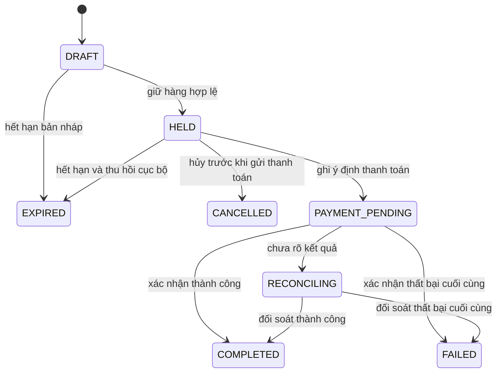

# Workflow abandonment: bảo vệ hệ thống khi quy trình bị bỏ dở

Trong chương **Workflow Security**, workflow abandonment là tình huống một quy trình đã bắt đầu nhưng không được người dùng hoặc một thành phần hệ thống tiếp tục đến kết quả cuối cùng. Người dùng có thể đóng trình duyệt, đổi ý, mất kết nối hoặc không quay lại bước xác minh. Một worker cũng có thể dừng sau khi đã giữ tài nguyên nhưng chưa ghi nhận kết quả.

Với module bảo vệ logic nghiệp vụ, mục tiêu không chỉ là xóa dữ liệu nháp. Một quy trình bỏ dở có thể giữ hàng tồn, mã giảm giá, hạn mức hoặc quyền sử dụng tài nguyên; nó cũng có thể đã gửi một yêu cầu có tác dụng bên ngoài. Kẻ lạm dụng có thể chủ động tạo nhiều quy trình rồi bỏ chúng ở đúng bước để làm cạn tài nguyên hoặc khai thác việc thu hồi sai.

Bài học sử dụng ví dụ checkout có giữ hàng tạm thời. Trọng tâm là phân biệt trạng thái người dùng, thời hạn giữ tài nguyên và kết quả thực tế; từ đó thiết kế hết hạn, tiếp tục, hủy và đối soát mà vẫn giữ các business invariants.

Sau bài này, bạn có thể:

- Xác định tài nguyên và nghĩa vụ còn tồn tại trong một workflow bỏ dở.
- Thiết kế thời hạn, gia hạn và điều kiện tiếp tục do máy chủ kiểm soát.
- Thu hồi tài nguyên mà không tạo tranh chấp với bước thanh toán hoặc hoàn tất.
- Xử lý timeout, worker chạy lại và kết quả bên ngoài đến muộn.
- Kiểm thử hành vi cố ý giữ tài nguyên, gia hạn và lặp thao tác thu hồi.

## 1. Bỏ màn hình không đồng nghĩa quy trình đã thất bại

Xét luồng đặt hàng:

```text
Tạo checkout → Giữ hàng → Khởi tạo thanh toán → Xác nhận kết quả → Hoàn tất
```

Người dùng đóng tab sau bước giữ hàng. Máy chủ không nhận được tín hiệu đáng tin cậy nào cho biết họ sẽ không quay lại. Người dùng có thể mở checkout trên điện thoại hoặc chỉ vừa mất mạng.

Ngược lại, nếu tab bị đóng sau khi yêu cầu thanh toán đã được gửi, giao dịch bên ngoài có thể vẫn thành công. Việc frontend không gọi endpoint cuối không chứng minh tiền chưa được thu.

Cần tách ba khái niệm:

| Khái niệm | Ý nghĩa | Có đủ để giải phóng mọi tài nguyên không? |
| --- | --- | --- |
| Không còn tương tác | Không thấy thao tác mới từ người dùng trong một khoảng thời gian | Không |
| Hết thời hạn giữ chỗ | Đã đến hạn mà chính sách cho phép giữ tài nguyên tạm thời | Chỉ khi thỏa điều kiện thu hồi của tài nguyên và bước hiện tại |
| Đã có kết quả cuối cùng | Biết chắc quy trình hoàn tất, hủy hoặc thất bại theo nguồn có thẩm quyền | Có thể chuyển đổi hoặc giải phóng các tài nguyên tương ứng |

Không dùng sự kiện đóng tab, callback JavaScript khi rời trang hoặc trạng thái mất kết nối làm nguồn quyết định duy nhất. Những tín hiệu đó có thể thiếu, bị gửi lặp hoặc do client cố tình điều khiển.

## 2. Những gì có thể bị giữ lại trong một workflow

Trước khi chọn một con số timeout, hãy lập danh mục tài nguyên và nghĩa vụ của từng bước.

| Tài nguyên hoặc dữ liệu | Rủi ro khi quy trình bị bỏ dở | Điều cần xác định |
| --- | --- | --- |
| Hàng tồn đang giữ | Hàng không bán được cho người khác | Thời hạn giữ, quyền gia hạn và cách thu hồi |
| Lượt sử dụng mã giảm giá | Khách khác không dùng được mã dù chưa có đơn | Khi nào giữ tạm, tiêu thụ thật hoặc trả lại lượt |
| Hạn mức mua hoặc hạn mức nghiệp vụ | Hạn mức bị chiếm bởi yêu cầu không hoàn tất | Phân biệt phần đang giữ và phần đã sử dụng |
| Chỗ ngồi hoặc lịch hẹn | Chiếm chỗ làm giảm khả năng phục vụ | Quy tắc giữ chỗ, hàng chờ và thời điểm xác nhận |
| Yêu cầu thanh toán hoặc ủy quyền bên ngoài | Tiền hoặc hạn mức có thể đã bị tác động | Trạng thái thao tác bên ngoài và quy trình đối soát |
| Tệp tải lên và dữ liệu nháp | Tăng dung lượng và thời gian lưu dữ liệu | Chính sách lưu, truy cập và xóa sau khi hết nghĩa vụ |
| Thông điệp đang chờ xử lý | Worker cũ có thể tiếp tục sau khi quy trình đã đổi | Định danh thao tác, phiên bản và điều kiện thực thi |

Một workflow có thể giữ nhiều tài nguyên với thời hạn khác nhau. Giữ hàng hết hạn không có nghĩa được xóa ngay bằng chứng thanh toán hoặc bản ghi idempotency.

Các thời hạn cụ thể là quyết định của sản phẩm dựa trên đặc điểm tài nguyên, trải nghiệm người dùng và nghĩa vụ đối soát. Không có một giá trị TTL duy nhất an toàn cho mọi quy trình.

## 3. Mô hình lạm dụng: tạo nhiều quy trình rồi dừng đúng lúc

Một kịch bản thường gặp:

1. Chủ thể tạo checkout cho một mặt hàng khan hiếm.
2. Hệ thống giữ số lượng hàng trước khi khách cam kết thanh toán.
3. Chủ thể không hoàn tất, nhưng gọi gia hạn hoặc liên tục tạo checkout mới.
4. Nhiều phần hàng bị giữ, khiến khách hợp lệ thấy hết hàng.

Đây là lạm dụng quy tắc nghiệp vụ ngay cả khi mọi yêu cầu đều có cú pháp hợp lệ và mỗi tài khoản không vượt một giới hạn rất nhỏ.

Các biến thể khác gồm:

- Tạo nhiều bản nháp để chiếm lượt khuyến mãi toàn hệ thống.
- Dùng nhiều tab hoặc nhiều tài khoản để vượt giới hạn giữ chỗ theo một session.
- Giả lập heartbeat để không bao giờ bị coi là không hoạt động.
- Gọi thu hồi nhiều lần để số lượng hàng được cộng trả nhiều lần.
- Tiếp tục một checkout đã hết hạn nhưng vẫn dùng giá hoặc quyền cũ.
- Khiến worker cũ thực hiện thanh toán sau khi người dùng đã tạo quy trình mới.

Vì vậy, bảo vệ abandonment cần đồng thời kiểm soát lúc cấp tài nguyên, lúc gia hạn, lúc thực hiện tác dụng phụ và lúc thu hồi. Một job dọn dữ liệu ban đêm chỉ giải quyết được một phần nhỏ.

## 4. Định nghĩa trạng thái và điều kiện thu hồi

Ví dụ checkout có thể dùng các trạng thái sau:

| Trạng thái | Ý nghĩa | Xử lý khi quá thời hạn tương ứng |
| --- | --- | --- |
| `DRAFT` | Chưa giữ tài nguyên quan trọng | Đóng bản nháp theo chính sách |
| `HELD` | Đang giữ hàng, chưa ghi nhận ý định gửi thanh toán | Có thể hết hạn và trả tài nguyên cục bộ nếu các guard còn đúng |
| `PAYMENT_PENDING` | Đã ghi ý định thanh toán bền vững, có thể đang gửi hoặc chờ kết quả | Đối soát hoặc hủy thao tác theo giao thức; không tự kết luận chưa thanh toán |
| `RECONCILING` | Đang làm rõ kết quả bên ngoài | Tiếp tục đối soát và quản lý tài nguyên liên quan |
| `COMPLETED` | Đơn và thanh toán đã được xác nhận theo quy trình | Không xử lý bằng cơ chế hết hạn giữ chỗ |
| `EXPIRED` | Đã hết hạn theo nhánh cho phép | Thu hồi phải đã hoàn tất hoặc được theo dõi rõ bằng quy trình riêng |
| `CANCELLED` | Đã hủy theo quy tắc của bước tương ứng | Không đồng nghĩa mọi hiệu ứng bên ngoài tự biến mất |
| `FAILED` | Đã xác nhận thất bại cuối cùng | Giải phóng các phần giữ còn lại theo quy tắc |

Vòng đời của phần giữ tài nguyên nên được biểu diễn riêng, chẳng hạn:

```text
HELD → CONSUMED
HELD → RELEASED
```

`CONSUMED` nghĩa là phần giữ đã được chuyển thành nghĩa vụ hoặc phân bổ chính thức của đơn. `RELEASED` nghĩa là phần giữ đã được trả lại. Không được thực hiện cả hai nhánh cho cùng một phần giữ.

Trong ví dụ một cơ sở dữ liệu, việc chuyển checkout từ `HELD` sang `EXPIRED` và giải phóng phần giữ được commit cùng nhau. Nếu tài nguyên nằm ở dịch vụ khác, cần trạng thái hoặc tác vụ thu hồi đang chờ, chẳng hạn `RELEASE_PENDING`; không báo tài nguyên đã trả chỉ vì đã gửi thông điệp.



Sơ đồ chỉ biểu diễn một phạm vi nghiệp vụ. Nếu có hủy ủy quyền, hoàn tiền hoặc hủy đơn đã xác nhận, cần các hành động và bằng chứng riêng thay vì quay thẳng về `DRAFT`.

## 5. Các invariant cần giữ khi quy trình bị bỏ dở

Với một SKU trong ví dụ, có thể mô hình hóa:

```text
sellable = onHand - committed - held

sellable >= 0
held >= 0
committed >= 0
```

Trong đó:

- `onHand`: lượng hàng làm cơ sở phân bổ trong mô hình kho đang dùng.
- `committed`: lượng đã cam kết cho đơn hợp lệ.
- `held`: lượng còn được giữ bởi các reservation chưa tiêu thụ hoặc giải phóng.

Khi một reservation được tiêu thụ, lượng tương ứng chuyển từ `held` sang `committed`, không trở lại lượng có thể bán. Khi được giải phóng, lượng tương ứng rời `held` và có thể trở lại `sellable` theo mô hình kho.

Các invariant bổ sung:

1. Một reservation chỉ được giải phóng hoặc tiêu thụ một lần.
2. Checkout không được hoàn tất bằng một reservation đã được trả lại.
3. Một thao tác thanh toán đang có kết quả chưa rõ không bị coi là chưa từng xảy ra chỉ vì người dùng không tương tác.
4. Thời hạn và quyết định gia hạn do máy chủ kiểm soát.
5. Worker, callback và yêu cầu tiếp tục phải khớp đúng checkout, tổ chức và thế hệ thao tác.
6. Kết quả retry không tạo một checkout hoặc phần giữ mới ngoài ý định ban đầu.

Một reservation đã đến thời hạn nhưng chưa được xử lý thu hồi vẫn cần được biểu diễn nhất quán trong số liệu. Không được loại nó khỏi phép tính `held` ở một chỗ trong khi vẫn cho checkout tiêu thụ nó ở chỗ khác.

## 6. Thiết kế lease: thời hạn giữ quyền sử dụng tạm thời

Lease là quyền giữ tài nguyên trong một khoảng thời gian có giới hạn. Dữ liệu có thể gồm:

```text
reservationId
workflowId, tenantId, resourceId, quantity
state
createdAt
expiresAt
version hoặc generation
releasedAt / consumedAt
```

Máy chủ tính `expiresAt`. Client có thể hiển thị bộ đếm nhưng không được tự kéo dài thời hạn bằng cách gửi một timestamp tương lai.

Một quy tắc rõ ràng là:

```text
còn hiệu lực khi now < expiresAt
hết hạn khi now >= expiresAt
```

Các đường hoàn tất, gia hạn và cleanup phải dùng cùng ý nghĩa ở ranh giới này. Chọn nguồn thời gian có thẩm quyền và ngữ nghĩa timestamp phù hợp với cơ sở dữ liệu; không dựa vào đồng hồ trình duyệt hoặc các phép so sánh lệch nhau giữa nhiều máy.

Phân biệt ba loại thời hạn:

| Thời hạn | Mục đích |
| --- | --- |
| Thời gian không hoạt động | Quyết định có nên nhắc hoặc đóng một bản nháp ít ràng buộc |
| Thời hạn giữ tài nguyên | Giới hạn một phần tài nguyên được giữ tạm |
| Thời hạn chờ kết quả bên ngoài | Kích hoạt kiểm tra hoặc đối soát, không tự chứng minh thất bại |

Không dùng cùng một cột thời gian với ba ý nghĩa khác nhau mà không có quy tắc theo từng trạng thái.

### Gia hạn không được biến thành giữ vô thời hạn

Một chính sách gia hạn có thể yêu cầu:

- Người gọi có quyền trên chính workflow và tài nguyên đó.
- Workflow vẫn ở trạng thái được gia hạn và lease chưa hết hạn.
- Có tiến triển nghiệp vụ được máy chủ xác minh nếu chính sách yêu cầu.
- Không vượt số lần gia hạn hoặc thời gian sống tối đa kể từ lúc cấp ban đầu.
- Không vượt giới hạn giữ tài nguyên của chủ thể và toàn hệ thống.

Ví dụ cách chặn thời gian sống vô hạn:

```text
newExpiresAt = min(now + extension, createdAt + maximumLifetime)
```

Công thức chỉ là một phần của kiểm tra. Nếu `newExpiresAt` không còn sau `now`, hoặc lease đã hết hạn, không được âm thầm hồi sinh reservation cũ. Việc cấp lại phải kiểm tra tồn kho, giá và quyền như một lần cấp mới theo chính sách.

Heartbeat, mở lại màn hình hoặc gọi API đọc không tự chứng minh tiến triển. Nếu mọi request đều làm trượt `expiresAt`, một client tự động có thể giữ tài nguyên mãi.

## 7. Cleanup phải cạnh tranh an toàn với hoàn tất và gia hạn

Giả sử checkout C đang `HELD` và gần hết hạn:

```text
Luồng A: đọc C, thấy được phép bắt đầu thanh toán
Luồng B: đọc C, thấy đã đến hạn thu hồi
Luồng B: trả hàng về kho
Luồng A: gửi yêu cầu thanh toán và ghi nhận đơn
```

Hệ thống có thể nhận tiền cho lượng hàng đã được cấp cho khách khác. Kiểm tra thời gian ở đầu request rồi ghi dữ liệu không điều kiện ở cuối không giải quyết được tranh chấp này.

Cần một ranh giới quyết định duy nhất. Chẳng hạn mọi thao tác trên checkout cùng khóa hàng workflow trước khi quyết định:

```text
bắt đầu thanh toán:
  khóa workflow
  kiểm tra quyền, state = HELD, version và lease còn hiệu lực
  xác minh các reservation còn HELD và thuộc đúng nội dung
  ghi operationId và ý định thanh toán bền vững
  chuyển sang PAYMENT_PENDING
  commit

thu hồi hết hạn:
  khóa workflow
  đọc lại state và thời gian có thẩm quyền
  chỉ thu hồi nhánh HELD nếu đã hết hạn
  và chưa có ý định thanh toán cần xử lý
  giải phóng các reservation đúng một lần
  chuyển sang EXPIRED
  commit
```

Nếu nhánh thanh toán thắng, cleanup không còn được áp dụng quy tắc thu hồi trực tiếp của `HELD`. Nếu cleanup thắng, bước thanh toán không còn có reservation hợp lệ để tiêu thụ.

Gia hạn cũng phải tham gia cùng giao thức. Job có thể tìm thấy checkout đến hạn từ một truy vấn trước đó, nhưng sau khi giành quyền xử lý phải kiểm tra lại vì một yêu cầu hợp lệ có thể đã gia hạn.

Có thể dùng cập nhật có điều kiện theo trạng thái, phiên bản và thời hạn thay cho khóa bi quan. Điều bắt buộc là chỉ một quyết định cạnh tranh được commit, và mọi đường ghi đều tuân thủ cơ chế đã chọn.

## 8. Thu hồi đúng một lần trong cơ sở dữ liệu cục bộ

SQL sau minh họa cấu trúc transaction; cú pháp và cách khóa cụ thể cần phù hợp hệ quản trị cơ sở dữ liệu đang dùng.

```sql
BEGIN;

SELECT id, state, version, expires_at, payment_operation_id
FROM checkout
WHERE id = :checkout_id
  AND tenant_id = :authorized_tenant_id
FOR UPDATE;

-- Ứng dụng kiểm tra lại:
-- state = HELD
-- expires_at <= :authoritative_now
-- không có ý định thanh toán chưa được xử lý
-- rồi khóa và đọc các reservation liên quan.

UPDATE reservation
SET state = 'RELEASED',
    released_at = :authoritative_now,
    version = version + 1
WHERE id = :reservation_id
  AND checkout_id = :checkout_id
  AND tenant_id = :authorized_tenant_id
  AND state = 'HELD';

-- Chỉ điều chỉnh lượng giữ nếu UPDATE reservation tác động đúng một hàng.
UPDATE inventory
SET held_qty = held_qty - :reserved_quantity
WHERE sku_id = :sku_id
  AND tenant_id = :authorized_tenant_id
  AND held_qty >= :reserved_quantity;

-- Yêu cầu đúng một hàng inventory được cập nhật; nếu không thì rollback.

UPDATE checkout
SET state = 'EXPIRED',
    version = version + 1
WHERE id = :checkout_id
  AND tenant_id = :authorized_tenant_id
  AND state = 'HELD'
  AND version = :locked_version;

-- Ghi audit, trạng thái thu hồi và outbox bắt buộc trong cùng transaction.
COMMIT;
```

Ứng dụng phải rẽ nhánh theo số hàng cập nhật của từng câu lệnh. Nếu reservation đã `RELEASED` hoặc `CONSUMED`, không chạy phép trừ `held_qty` lần nữa. Nếu điều kiện inventory không khớp, đó có thể là lỗi nhất quán cần rollback và điều tra, không phải lý do để bỏ qua rồi báo thành công.

Với checkout nhiều reservation, phải xử lý đầy đủ tập tài nguyên theo giao thức khóa thống nhất và chỉ đánh dấu hết hạn khi điều kiện của mô hình cục bộ đã hoàn thành. Các thao tác tạo giữ, tiêu thụ và giải phóng cần cùng bảo vệ số liệu kho.

Không dùng cờ trong bộ nhớ worker để nhớ “đã cộng trả hàng”. Worker có thể restart, có nhiều bản sao hoặc nhận lại cùng công việc. Trạng thái bền vững và cập nhật có điều kiện mới là căn cứ chống thu hồi lặp.

## 9. Minh họa Java: chọn hành động khi đến hạn

Đoạn mã sau phân biệt việc được hết hạn cục bộ với việc cần đối soát. Đây là hàm quyết định trên dữ liệu máy chủ đã tải; nó không thay thế transaction, kiểm tra quyền hoặc thao tác giải phóng. Ví dụ dùng switch expression của Java 14 trở lên.

```java
import java.time.Instant;
import java.util.Objects;

enum CheckoutPhase {
    DRAFT,
    HELD,
    PAYMENT_PENDING,
    RECONCILING,
    COMPLETED,
    EXPIRED,
    CANCELLED,
    FAILED
}

enum DeadlineAction {
    KEEP,
    EXPIRE_LOCAL,
    RECONCILE,
    NO_OP
}

final class AbandonmentPolicy {
    private AbandonmentPolicy() {
    }

    static DeadlineAction decide(
            CheckoutPhase phase,
            Instant deadline,
            Instant authoritativeNow) {
        Objects.requireNonNull(phase);
        Objects.requireNonNull(deadline);
        Objects.requireNonNull(authoritativeNow);

        return switch (phase) {
            case COMPLETED, EXPIRED, CANCELLED, FAILED ->
                    DeadlineAction.NO_OP;
            case DRAFT, HELD ->
                    authoritativeNow.isBefore(deadline)
                            ? DeadlineAction.KEEP
                            : DeadlineAction.EXPIRE_LOCAL;
            case PAYMENT_PENDING, RECONCILING ->
                    authoritativeNow.isBefore(deadline)
                            ? DeadlineAction.KEEP
                            : DeadlineAction.RECONCILE;
        };
    }
}
```

`deadline` có ý nghĩa theo trạng thái: hạn bản nháp, hạn giữ hàng hoặc thời điểm cần đối soát thanh toán. Tầng dữ liệu phải chọn đúng trường tương ứng. Không truyền tùy ý thời hạn giữ hàng cũ làm bằng chứng một thanh toán đang chờ đã thất bại.

Hàm giả định invariant của trạng thái được duy trì: nếu đã ghi ý định thanh toán thì workflow không còn được giữ ở `HELD`. Service thực thi vẫn phải kiểm tra reservation, operation và phiên bản sau khi giành quyền cập nhật. Phát hiện `HELD` nhưng tồn tại một thanh toán chưa rõ kết quả là tình trạng cần xử lý nhất quán, không được dùng kết quả `EXPIRE_LOCAL` để bỏ qua mâu thuẫn.

Các trạng thái cuối trả `NO_OP` đối với tác vụ deadline này. Nếu có tài nguyên chưa thu hồi hoặc nghĩa vụ đối soát sau trạng thái cuối, chúng phải có tiến trình theo dõi riêng; `NO_OP` không chứng minh toàn hệ thống không còn việc phải làm.

## 10. Worker cũ và công việc chạy sau khi lease đã đổi

Một worker có thể đọc một workflow, dừng lâu vì lỗi mạng rồi tiếp tục sau khi workflow đã hết hạn hoặc được cấp lại. Nếu worker chỉ giữ ID, nó có thể áp dụng quyết định cũ lên phiên bản mới.

Ví dụ:

```text
Worker A nhận công việc cho generation 8
Lease của A hết hạn
Worker B nhận generation 9 và xử lý theo dữ liệu mới
Worker A tiếp tục từ dữ liệu generation 8
```

Một cơ chế thường dùng là token thế hệ hoặc fencing token tăng đơn điệu. Khi worker ghi kết quả, bên có thẩm quyền kiểm tra nó vẫn có thế hệ phù hợp. Cập nhật nội bộ có thể kèm điều kiện:

```sql
UPDATE workflow_task
SET state = :next_state,
    version = version + 1
WHERE id = :task_id
  AND generation = :claimed_generation
  AND state = :expected_state;
```

Không cập nhật hàng nào thì worker không còn được coi là chủ sở hữu hợp lệ của quyết định đó. Nó không được lấy phiên bản mới rồi tự thử lại một ý định có thể đã lỗi thời.

Token chỉ có tác dụng tại nơi kiểm tra nó. Nếu worker gọi một API thanh toán bên ngoài không hiểu fencing token, việc kiểm tra thế hệ trong cơ sở dữ liệu sau lời gọi không hoàn tác được tiền đã thu.

Với hiệu ứng bên ngoài, cần định danh thao tác ổn định, cơ chế idempotency của bên nhận nếu có, outbox và đối soát phù hợp. Lease của worker hết hạn không tự chứng minh worker cũ chưa từng gửi yêu cầu.

Phân biệt lease giữ hàng với lease phân công worker. Gia hạn quyền xử lý một tác vụ không được âm thầm gia hạn quyền chiếm hàng của khách hàng.

## 11. Kết quả thanh toán đến sau khi người dùng bỏ dở

Khi có bằng chứng kết quả bên ngoài, cần đối chiếu:

- Tổ chức, checkout và giao dịch liên quan.
- Định danh thao tác đã được tạo trước khi gửi.
- Số tiền, loại tiền và phiên bản nội dung tương ứng.
- Nguồn thông báo, tính xác thực và trạng thái đã xử lý sự kiện.
- Kết quả hiện tại của thao tác và các quyết định đối soát trước đó.

Không chỉ tìm checkout bằng email hoặc giỏ hàng hiện tại rồi đánh dấu thành công. Người dùng có thể đã tạo checkout khác sau khi phiên trước hết hạn.

Một số tình huống cần phân biệt:

| Tình huống | Cách xử lý |
| --- | --- |
| Người dùng đóng tab nhưng thanh toán thành công | Hoàn tất thao tác đúng định danh theo dữ liệu có thẩm quyền; không phụ thuộc frontend quay lại |
| Timeout khi gửi, chưa biết kết quả | Giữ trạng thái chưa rõ và đối soát, không tự trả tài nguyên theo nhánh chưa gửi |
| Xác nhận thất bại cuối cùng | Giải phóng phần giữ theo giao thức và ghi kết quả bền vững |
| Callback thành công gửi lại | Không tiêu thụ reservation hoặc ghi nhận tiền thêm lần nữa |
| Thành công đến cho thao tác cũ trong trạng thái bất thường | Ghi nhận bằng chứng, đối soát và thực hiện quy trình khắc phục phù hợp; không bỏ qua chỉ vì workflow đã đóng |

Nếu hệ thống thực sự nhận tiền sau khi hàng không còn có thể phân bổ, đó là ngoại lệ nghiệp vụ cần xử lý như cấp hàng theo chính sách hoặc hoàn tiền. Không sửa dữ liệu để giả vờ chưa từng nhận tiền và cũng không gán kết quả đó cho checkout mới.

Trước khi giải phóng tài nguyên của một thao tác đã gửi, cần căn cứ rằng hiệu ứng không xảy ra hoặc đã được vô hiệu hóa theo giao thức. “Không nhận callback sau một khoảng thời gian” không phải căn cứ đủ.

## 12. Tiếp tục, hủy và tạo lại là ba ý định khác nhau

### Tiếp tục workflow còn hiệu lực

Khi người dùng mở lại liên kết, máy chủ kiểm tra quyền trên đối tượng, trạng thái, phiên bản và thời hạn. Máy chủ trả trạng thái thật, không tiếp tục dựa trên màn hình cuối mà trình duyệt nhớ.

Nếu vẫn được tiếp tục, chỉ cho phép những hành động hiện tại hợp lệ. Có thể phải kiểm tra lại giá, điều kiện giảm giá hoặc xác minh đã hết hạn theo chính sách; thời hạn giữ tài nguyên không tự bảo đảm mọi dữ liệu khác vẫn hợp lệ.

### Hủy chủ động

Hủy là hành động có xác thực, quyền theo đối tượng và điều kiện theo trạng thái. Hủy một checkout `HELD` trước khi ghi ý định thanh toán khác với yêu cầu hủy khi thanh toán đang chờ.

Với thao tác bên ngoài đang diễn ra, API có thể ghi nhận yêu cầu hủy và chuyển sang quá trình xử lý tương ứng. Không trả thông điệp “đã hủy hoàn toàn” nếu hệ thống mới chỉ bắt đầu xin hủy ở nhà cung cấp.

### Tạo lại sau khi hết hạn

Một checkout mới cần một lần kiểm tra tài nguyên, giá, quyền và khuyến mãi mới. Không hồi sinh reservation đã giải phóng bằng cách đặt lại trạng thái cũ.

Có thể cho người dùng sao chép nội dung giỏ hàng, nhưng dữ liệu đã sao chép là đề xuất đầu vào, không phải quyền tiếp tục sử dụng giá hoặc phần giữ cũ. Quy trình cũ vẫn cần được lưu đủ để xử lý retry và kết quả đến muộn.

## 13. Kiểm soát việc giữ tài nguyên ngay từ lúc cấp

Thu hồi tốt vẫn không đủ nếu một chủ thể có thể liên tục chiếm lại toàn bộ tài nguyên vừa được giải phóng.

Các lớp kiểm soát có thể gồm:

| Kiểm soát | Mục đích |
| --- | --- |
| Giới hạn số workflow hoặc lượng tài nguyên đang giữ | Hạn chế lượng chiếm dụng đồng thời |
| Giới hạn tần suất tạo và gia hạn | Ngăn quay vòng giữ chỗ liên tục |
| Thời gian sống tối đa | Chặn giữ mãi bằng heartbeat hoặc gia hạn |
| Hạn mức theo tài nguyên khan hiếm | Hạn chế một nhóm chủ thể làm cạn một SKU hoặc một lịch hẹn |
| Cấp tài nguyên ở thời điểm cần thiết | Tránh giữ tài nguyên hiếm ngay từ một bước nháp ít cam kết |
| Hàng chờ hoặc cơ chế phân bổ phù hợp | Giảm cạnh tranh giành tài nguyên bằng tốc độ gửi request |
| Kiểm tra rủi ro ở bước cấp hoặc gia hạn | Tăng chi phí lạm dụng theo dấu hiệu thực tế |

Không chỉ đếm theo session nếu người dùng có thể tạo session mới dễ dàng. Tùy mô hình, có thể kết hợp tài khoản, tổ chức, đối tượng nghiệp vụ và tín hiệu rủi ro. IP dùng chung hoặc thiết bị dùng chung không nên bị coi là bằng chứng chắc chắn của cùng một người.

Việc kiểm tra hạn mức rồi cấp reservation cũng cần chống cạnh tranh. Hai request cùng thấy “đang giữ 0” không được cùng vượt mức cho phép. Giới hạn phải dựa trên dữ liệu có thẩm quyền, kể cả phần giữ đang chờ kết quả bên ngoài.

Theo dõi tổng thời gian và lượng tài nguyên bị giữ thường hữu ích hơn chỉ đếm số checkout hết hạn. Một khách hợp lệ có thể bỏ vài bản nháp; một chủ thể khác có thể liên tục giữ lượng tài nguyên lớn mà mỗi lần vẫn trông bình thường.

## 14. Cleanup bền vững: quét lại, retry và theo dõi thu hồi

Job cleanup không nên xem một danh sách ID tìm được ban đầu là quyết định cuối cùng. Danh sách chỉ là ứng viên; mỗi workflow phải được đọc lại và xác minh khi thực thi.

Một thiết kế vận hành có thể có:

- Truy vấn ứng viên theo trạng thái và thời hạn với chỉ mục phù hợp.
- Xử lý theo lô giới hạn, tránh khóa một tập lớn trong thời gian dài.
- Nhận quyền xử lý và kiểm tra lại điều kiện trước khi cập nhật.
- Retry có kiểm soát cho lỗi tạm thời.
- Quét bù định kỳ để tìm đối tượng bị bỏ sót khi worker dừng.
- Theo dõi các thao tác thu hồi liên dịch vụ đến khi có xác nhận.
- Đưa lỗi không thể xử lý tự động vào hàng đợi điều tra hoặc đối soát.

TTL của bộ nhớ đệm không thực hiện các bước này. Một key Redis hoặc bản ghi cache biến mất không đồng nghĩa hàng trong cơ sở dữ liệu đã được trả lại, mã giảm giá đã được phục hồi hoặc thanh toán bên ngoài đã được hủy.

Nếu dịch vụ kho riêng xử lý thông điệp giải phóng, cần định danh reservation ổn định và thao tác giải phóng idempotent ở chính dịch vụ đó. Transaction ghi trạng thái checkout không tự tạo transaction nguyên tử với cơ sở dữ liệu kho.

Không xóa workflow trước rồi mới gửi yêu cầu thu hồi. Nếu mất bằng chứng liên kết, ứng dụng có thể không còn biết phải trả tài nguyên nào hoặc đối chiếu callback nào.

## 15. Idempotency, lưu vết và xóa dữ liệu

Một yêu cầu tạo checkout có thể đã thành công nhưng phản hồi bị mất. Nếu checkout sau đó hết hạn, client retry cùng idempotency key không nên tự động tạo một checkout mới và giữ hàng lần nữa.

Quy tắc cần rõ ràng:

```text
cùng ý định đã định danh → trả kết quả hoặc đối tượng tương ứng đã có
ý định mới → key và kiểm tra cấp tài nguyên mới theo hợp đồng API
```

Khi quy trình đã hết hạn, API có thể cho biết đối tượng cũ đã hết hạn hoặc trả kết quả đã lưu kèm cách truy vấn trạng thái hiện tại. Không dùng kết quả cũ để khẳng định reservation hiện vẫn còn hiệu lực.

Cần giữ đủ dữ liệu hoặc tombstone theo chính sách để:

- Nhận diện thao tác đã tạo hoặc đã giải phóng.
- Chống xử lý lại sự kiện và yêu cầu lặp trong cửa sổ được hỗ trợ.
- Đối chiếu kết quả đến muộn theo định danh cũ.
- Giải thích các quyết định tài nguyên và thanh toán.

Thời gian lưu idempotency, sự kiện đã xử lý, dữ liệu thanh toán và bản nháp có thể khác nhau. Xóa dữ liệu nhạy cảm không cần thiết theo chính sách lưu trữ, đồng thời giữ các định danh và bằng chứng tối thiểu cần cho invariant và nghĩa vụ đối soát.

Một cache idempotency hết hạn không được làm mất các ràng buộc lâu dài như “reservation này chỉ được giải phóng một lần” hoặc “thao tác thanh toán này không tạo thêm đơn”. Những ràng buộc đó cần dữ liệu nghiệp vụ bền vững phù hợp.

## 16. Kiểm thử những tình huống bỏ dở và tranh chấp

### Kiểm thử thời hạn và tiếp tục

| Tình huống | Kết quả cần giữ |
| --- | --- |
| Đóng tab khi đang `HELD` | Không phụ thuộc tín hiệu từ trình duyệt; máy chủ xử lý theo lease |
| Gọi tiếp tục trước hạn | Kiểm tra quyền và điều kiện hiện tại, không tạo reservation trùng |
| Gọi đúng tại `expiresAt` | Hành vi khớp quy tắc `now >= expiresAt` đã công bố |
| Client gửi thời hạn tương lai hoặc đồng hồ giả | Không thay đổi thời hạn có thẩm quyền |
| Gọi gia hạn sau khi đã giải phóng | Không hồi sinh reservation cũ |
| Heartbeat liên tục vượt thời gian sống tối đa | Không giữ tài nguyên vô hạn |
| Mở checkout của người hoặc tổ chức khác | Bị chặn theo quyền đối tượng |

### Kiểm thử tính nguyên tử và xử lý lặp

| Tình huống | Kết quả cần giữ |
| --- | --- |
| Hai worker cùng thu hồi một reservation | Chỉ một lần chuyển sang `RELEASED`, số lượng trả đúng một lần |
| Crash giữa cập nhật reservation và inventory | Transaction rollback hoặc hoàn tất nguyên tử theo thiết kế |
| Cleanup đọc ứng viên rồi người dùng gia hạn hợp lệ | Cleanup kiểm tra lại và không dùng deadline cũ |
| Cleanup chạy đồng thời với bắt đầu thanh toán | Chỉ một nhánh giành quyền quyết định, không vừa trả hàng vừa bắt đầu thanh toán hợp lệ |
| Hoàn tất chạy đồng thời với giải phóng | Không vừa `CONSUMED` vừa `RELEASED` cho cùng reservation |
| Retry tạo checkout bằng key cũ sau hết hạn | Không âm thầm tạo phần giữ mới |
| Thông điệp giải phóng gửi lặp | Dịch vụ giữ tài nguyên không trả thêm lần nữa |

### Kiểm thử hiệu ứng ngoài và worker cũ

- Gửi thanh toán thành công nhưng làm mất phản hồi: không giải phóng chỉ vì timeout.
- Worker generation cũ tiếp tục sau khi worker mới nhận việc: cập nhật lỗi thời bị chặn ở nơi có thẩm quyền.
- Callback thành công đến sau khi người dùng đã tạo checkout mới: chỉ đối chiếu với operation cũ.
- Callback lặp hoặc đến sai thứ tự: không tạo thêm đơn hoặc tiêu thụ tài nguyên lần nữa.
- Dịch vụ kho tạm ngừng khi nhận yêu cầu giải phóng: tiến trình vẫn theo dõi tài nguyên chưa được trả.
- Job cleanup dừng một khoảng thời gian rồi chạy lại: xử lý bù được các phần giữ quá hạn.
- Tạo và gia hạn đồng thời từ nhiều session: vẫn giữ hạn mức tổng của chủ thể và tài nguyên.

Với kiểm thử thời gian, dùng đồng hồ kiểm soát được ở tầng chính sách và kiểm thử tích hợp ranh giới transaction với nguồn thời gian thực tế của hệ thống. Chỉ chờ bằng `sleep` rồi kiểm tra một request tuần tự không chứng minh tranh chấp đã được giải quyết.

Khi thao tác bị từ chối, kiểm tra cả reservation, inventory, outbox, giao dịch thanh toán và audit thành công. HTTP trả lỗi không đủ nếu tác dụng phụ đã được tạo trước đó.

## 17. Quan sát để phân biệt bỏ dở tự nhiên và lạm dụng

Các số liệu nên gắn với tài nguyên và giai đoạn:

| Số liệu | Điều nó giúp phát hiện |
| --- | --- |
| Số lượng và tổng thời gian tài nguyên đang bị giữ | Mức chiếm dụng thực tế |
| Phần giữ quá hạn nhưng chưa thu hồi xong | Độ trễ cleanup hoặc lỗi liên dịch vụ |
| Tỷ lệ tạo, gia hạn và hoàn tất theo nhóm chủ thể | Hành vi giữ tài nguyên nhưng hiếm khi hoàn tất |
| Số lần gia hạn và cấp lại cho cùng tài nguyên | Vòng lặp giữ chỗ liên tục |
| Tuổi của thao tác đang đối soát | Rủi ro kết quả bên ngoài chưa rõ kéo dài |
| Số cập nhật bị chặn vì version hoặc generation cũ | Tranh chấp, worker chậm hoặc thiết kế nhận việc có vấn đề |
| Chênh lệch giữa reservation và số liệu kho | Invariant dữ liệu bị vi phạm |

Audit nên ghi workflow, reservation, operation, chủ thể, trạng thái trước–sau, phiên bản, thời hạn được dùng và lý do quyết định. Ghi rõ “đã yêu cầu thu hồi” khác với “đã xác nhận trả tài nguyên”.

Tỷ lệ bỏ dở cao cũng có thể xuất phát từ trải nghiệm khó dùng hoặc lỗi thanh toán. Dùng các tín hiệu kết hợp để điều tra và điều chỉnh chính sách, thay vì coi mọi checkout hết hạn là hành vi tấn công.

## 18. Cách áp dụng cho một workflow của bạn

1. Liệt kê mọi điểm quy trình tạo tài nguyên tạm, quyền tạm hoặc nghĩa vụ bên ngoài.
2. Với từng điểm, xác định điều kiện hoàn tất, hủy, hết hạn và đối soát.
3. Định nghĩa invariant giữa tài nguyên còn giữ, đã tiêu thụ và đã giải phóng.
4. Chọn thời hạn và giới hạn gia hạn do máy chủ kiểm soát; phân biệt hạn giữ tài nguyên với hạn chờ kết quả.
5. Thiết kế một giao thức nhất quán cho cấp, gia hạn, tiêu thụ và thu hồi.
6. Gắn worker, sự kiện và yêu cầu retry với đúng đối tượng, phiên bản và định danh thao tác.
7. Giữ bằng chứng đủ lâu để tiếp tục, đối soát và chống xử lý lặp; xóa dữ liệu theo chính sách riêng.
8. Kiểm thử bỏ dở ở từng ranh giới, bao gồm trước commit, sau commit và sau khi đã gửi hiệu ứng ra ngoài.

Một workflow an toàn phải giữ được các quy tắc nghiệp vụ cả khi không ai tiếp tục bấm nút. Quyền giữ tài nguyên cần có giới hạn, thu hồi cần được thực thi đúng một lần, và kết quả chưa rõ cần được đối soát thay vì bị biến thành thất bại chỉ bằng một bộ đếm thời gian.
