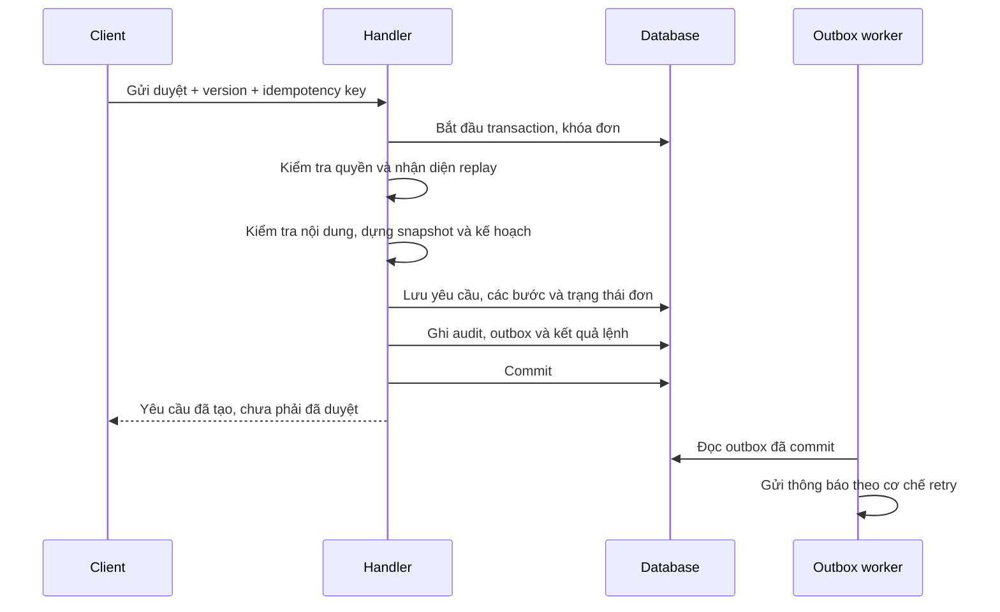

# Tạo yêu cầu phê duyệt an toàn (Approval request creation)

Tạo yêu cầu phê duyệt là thời điểm chuyển một ý định nghiệp vụ thành một hồ sơ để người khác xem xét. Nếu bước này tiếp nhận sai đối tượng, sai giá trị hoặc sai người duyệt, những bước phê duyệt phía sau có thể chạy đúng kỹ thuật nhưng vẫn chấp thuận một giao dịch không đúng ý nghĩa.

Ví dụ, người dùng gửi đơn mua hàng có giá trị 50 triệu nhưng tự khai số tiền cần duyệt là 5 triệu, chỉ định một tài khoản không có thẩm quyền làm người duyệt hoặc gửi đồng thời nhiều yêu cầu để chọn một nhánh thuận lợi. Bảo vệ riêng nút “Đồng ý” không ngăn được các sai lệch đã được đưa vào lúc khởi tạo.

Bài học thuộc chương **Approval Workflows** trong bảo mật logic nghiệp vụ. Trọng tâm là tạo một yêu cầu có đối tượng, nội dung, chủ thể, chính sách và vòng xét duyệt rõ ràng; đồng thời bảo đảm dữ liệu được lưu nhất quán khi có retry hoặc cạnh tranh.

## 1. Phân biệt bản nháp với yêu cầu đã gửi duyệt

Một biểu mẫu đang soạn chưa nhất thiết là một yêu cầu phê duyệt có hiệu lực.

| Khái niệm | Ý nghĩa trong ví dụ |
|---|---|
| Đơn mua hàng nháp | Đối tượng nghiệp vụ mà người dùng đang chuẩn bị |
| Lệnh gửi duyệt | Ý định yêu cầu hệ thống chốt nội dung và mở một vòng xét duyệt |
| Yêu cầu phê duyệt | Hồ sơ phía máy chủ gắn với một phiên bản nội dung và một kế hoạch xét duyệt |
| Quyết định phê duyệt | Hành động của người có thẩm quyền lên yêu cầu đã được tạo |
| Thực thi sau phê duyệt | Mua hàng, giải ngân hoặc một hành động khác theo kết quả được phép |

Trong bài này, “tạo yêu cầu” là thao tác **gửi một đơn nháp vào vòng xét duyệt**, không phải lưu nháp biểu mẫu. Sau khi thành công:

```text
Đơn mua hàng:
    DRAFT → PENDING_APPROVAL

Yêu cầu phê duyệt:
    chưa tồn tại → OPEN
```

Hai thay đổi này phải được ghi nhận nhất quán. Không được để đơn ở trạng thái chờ nhưng không có yêu cầu tương ứng, hoặc có một yêu cầu đang mở trong khi đơn vẫn có thể sửa tùy ý như bản nháp.

Tạo thành công chỉ có nghĩa yêu cầu đã được tiếp nhận vào quy trình. Nó chưa có nghĩa giao dịch đã được duyệt hoặc được phép thực thi.

## 2. Những điều phải đúng sau khi tạo thành công

Một yêu cầu hợp lệ cần bảo vệ các bất biến sau:

1. Đối tượng nguồn tồn tại trong phạm vi mà người gửi được phép truy cập và gửi duyệt.
2. Nội dung cần duyệt được lấy từ dữ liệu phía máy chủ, đã kiểm tra hợp lệ và được gắn với phiên bản cụ thể.
3. Danh tính người tạo yêu cầu và người được đại diện, nếu có, được xác định theo quyền đã kiểm chứng.
4. Chính sách áp dụng, các bước cần duyệt và điều kiện chọn người duyệt do máy chủ xác định.
5. Không có hai yêu cầu đang mở cho cùng phạm vi nghiệp vụ khi chính sách chỉ cho phép một.
6. Yêu cầu, snapshot nội dung, kế hoạch xét duyệt và trạng thái đối tượng nguồn được lưu trong cùng ranh giới nhất quán phù hợp.
7. Retry của cùng lệnh không tạo thêm yêu cầu hoặc thông báo nghiệp vụ độc lập.
8. Không phát sinh hành động sau phê duyệt chỉ vì vừa tạo yêu cầu.

Có thể mô tả điều kiện khởi tạo:

```text
CanCreateApproval(actor, subject, command) =

    subject_in_authorized_scope
    AND actor_can_submit_this_subject
    AND subject_state_allows_submission
    AND expected_version_matches
    AND business_content_is_valid
    AND no_conflicting_active_request
    AND applicable_approval_policy_is_available
    AND approval_plan_is_valid_for_this_content
```

Không điều kiện nào được thỏa chỉ bằng lời khai như `isOwner=true`, `approvalRequired=false` hoặc `role=MANAGER` trong request.

## 3. Thu hẹp đầu vào của lệnh tạo yêu cầu

Một hợp đồng API có thể nhận:

```http
POST /purchase-orders/PO-410/approval-requests
Idempotency-Key: submit-po410-attempt-01
Content-Type: application/json

{
  "expectedVersion": 17,
  "reason": "Đề nghị mua thiết bị cho đợt triển khai tháng tới"
}
```

Định danh đơn nằm trên đường dẫn; `expectedVersion` giúp phát hiện người gửi đang thao tác trên dữ liệu cũ. Lý do là dữ liệu người dùng nhập, cần kiểm tra độ dài, định dạng và được hiển thị an toàn khi đưa vào giao diện.

Máy chủ tự xác định:

- Tenant từ ngữ cảnh xác thực và phạm vi được phép.
- Người tạo yêu cầu từ danh tính đã xác thực.
- Trạng thái ban đầu, thời điểm gửi và mã yêu cầu.
- Số tiền, tiền tệ, mặt hàng, nhà cung cấp và người thụ hưởng từ đối tượng nghiệp vụ được kiểm soát.
- Phiên bản nội dung, phiên bản chính sách và số vòng xét duyệt.
- Các bước phê duyệt, hạn mức, quorum và cách phân công theo chính sách.

### 3.1. Những trường không được tin trực tiếp

```json
{
  "tenantId": "tenant-other",
  "requestedBy": "director-01",
  "amount": 5000000,
  "status": "APPROVED",
  "approverId": "friend-07",
  "approvalRequired": false
}
```

Nếu một cơ chế ánh xạ tự động chép toàn bộ body vào entity, người gọi có thể điều khiển các trường vượt quá ý nghĩa của lệnh gửi duyệt. Nên dùng DTO riêng với danh sách trường được phép và từ chối hoặc bỏ qua trường ngoài hợp đồng theo quy ước API; bất kể cách phản hồi, chúng không được ảnh hưởng dữ liệu có thẩm quyền.

Một số hệ thống cho người dùng đề xuất người duyệt. Đề xuất đó vẫn phải được kiểm tra theo phạm vi, hạn mức, xung đột lợi ích và chính sách phân công. Nó không trở thành quyền chọn tùy ý một người có thể bấm duyệt.

### 3.2. Tạo hộ và tài khoản dịch vụ

Nếu người A gửi hộ người B, cần tách:

```text
createdBy       = danh tính thực sự gọi hệ thống
requestedFor    = chủ thể được đại diện
delegationRef   = căn cứ cho phép đại diện, nếu áp dụng
```

Không thay `createdBy` bằng danh tính được khai trong body. Kiểm tra quyền đại diện theo đúng đối tượng, hành động và thời hạn; lưu đủ dấu vết để biết ai thực sự tạo yêu cầu.

Quy tắc phân tách trách nhiệm có thể phải xét cả người tạo nội dung, người gửi hộ và chủ thể được đại diện. Dùng tài khoản dịch vụ không được trở thành cách che giấu việc một người tự tạo và tự duyệt giao dịch của mình.

## 4. Kiểm tra đối tượng và quyền gửi duyệt

Quyền đọc một đơn hàng không đồng nghĩa quyền gửi duyệt đơn đó. Tương tự, có vai trò nhân viên không có nghĩa được tạo yêu cầu cho mọi đơn trong tenant.

Các kiểm tra thường gồm:

| Nhóm kiểm tra | Ví dụ |
|---|---|
| Phạm vi tenant | Đơn thuộc đúng tổ chức của phiên làm việc hiện tại |
| Quyền trên đối tượng | Người gọi là người tạo, thành viên nhóm được giao hoặc người có quyền đại diện hợp lệ |
| Trạng thái nguồn | Đơn đang ở trạng thái được phép gửi duyệt |
| Phạm vi hành động | Người gọi được gửi loại giao dịch này trong đơn vị hoặc dự án tương ứng |
| Ràng buộc dữ liệu | Không sửa hoặc gửi duyệt đối tượng đã khóa, đã hủy hoặc đã được xử lý theo quy tắc khác |
| Phiên bản | Dữ liệu người gọi xác nhận vẫn tương ứng với dữ liệu đang xử lý |

Nên tải đối tượng bằng truy vấn có tenant và định danh đối tượng, sau đó đánh giá quyền hành động. Tránh tải theo ID toàn cục rồi trả chi tiết về số tiền hoặc trạng thái trước khi kiểm tra người gọi có được biết hay không.

ID khó đoán có thể giảm việc dò tìm, nhưng không thay thế phân quyền đối tượng.

### 4.1. Kiểm tra lại tại điểm xử lý lệnh

Giao diện có thể hiển thị nút “Gửi duyệt” từ dữ liệu vừa tải. Khi người dùng bấm, trạng thái, quyền hoặc nội dung có thể đã thay đổi.

Handler vẫn phải kiểm tra trên dữ liệu hiện tại. Không nhận cờ `canSubmit` mà trình duyệt đã lưu làm bằng chứng cho phép.

Nếu phiên bản đã cũ, yêu cầu tải lại và xác nhận nội dung hiện tại. Không tự đổi version thành bản mới nhất rồi gửi thay người dùng nếu thay đổi có ý nghĩa với quyết định gửi duyệt.

## 5. Chốt nội dung mà người duyệt sẽ xem

Yêu cầu phê duyệt phải trả lời được: người duyệt được yêu cầu chấp thuận **nội dung nào**?

Với đơn mua hàng, snapshot có thể gồm:

- Các dòng hàng, số lượng, đơn giá và đơn vị tính.
- Giảm giá, thuế, tổng tiền và tiền tệ theo cách tính phía máy chủ.
- Nhà cung cấp, người thụ hưởng hoặc tham chiếu tài khoản nhận tiền có liên quan.
- Dự án, đơn vị chịu chi phí và mục đích mua.
- Những điều khoản khác ảnh hưởng thẩm quyền hoặc rủi ro của quyết định.

Snapshot không nhất thiết sao chép mọi cột của đối tượng. Nó cần chứa hoặc tham chiếu bền vững tới đúng các dữ kiện mà quyết định phê duyệt có ý nghĩa dựa trên đó.

### 5.1. Tính số tiền từ nguồn phía máy chủ

Nếu ngưỡng duyệt phụ thuộc giá trị đơn, phải tính theo dữ liệu được kiểm soát, bao gồm các thành phần mà chính sách yêu cầu. Không lấy một trường tổng tiền do client tự gửi để chọn cấp duyệt thấp hơn.

Tiền cần có kiểu dữ liệu, đơn vị và quy tắc làm tròn rõ ràng. Có thể dùng số nguyên theo đơn vị tiền nhỏ nhất hoặc kiểu thập phân với quy ước thích hợp; tránh phép tính nhị phân dấu phẩy động làm sai ngưỡng.

Nếu có quy đổi tiền tệ, cần xác định nguồn tỷ giá, thời điểm chốt, cách làm tròn và giá trị được dùng để so hạn mức. Không so hai con số khác tiền tệ như thể chúng cùng đơn vị.

### 5.2. Liên kết bằng phiên bản nội dung

Phân biệt:

| Giá trị | Mục đích |
|---|---|
| `rowVersion` | Phát hiện các lần ghi cạnh tranh trên đối tượng |
| `contentRevision` | Xác định phiên bản nội dung nghiệp vụ được đem đi duyệt |
| `approvalRound` | Phân biệt các vòng xét duyệt của cùng đối tượng |
| `policyVersion` | Xác định bộ quy tắc được dùng để tạo kế hoạch duyệt |

Một lần gửi lại sau khi bị từ chối có thể là vòng mới dù một số dữ liệu chưa đổi. Vì vậy, không nên dùng một trường version cho tất cả mục đích mà không xác định rõ ý nghĩa.

Có thể lưu hash của snapshot để hỗ trợ kiểm tra thay đổi. Hash không tự chứng minh nguồn có thẩm quyền và không bảo vệ được nếu mọi đường sửa dữ liệu đều có thể thay cả snapshot lẫn hash.

### 5.3. Sửa nội dung sau khi gửi

Hai lựa chọn phổ biến:

- Đóng băng những trường cần duyệt trong khi yêu cầu đang mở.
- Cho phép sửa qua lệnh riêng, đồng thời vô hiệu hóa hoặc kết thúc vòng cũ và tạo vòng mới theo quy tắc.

Không để một yêu cầu tiếp tục trỏ tới “dữ liệu mới nhất” có thể thay đổi âm thầm. Nếu người duyệt mở lại cùng yêu cầu và thấy một người thụ hưởng khác mà không có dấu vết phiên bản, ý nghĩa quyết định đã bị phá vỡ.

## 6. Dựng kế hoạch phê duyệt phía máy chủ

Sau khi có nội dung chuẩn, máy chủ chọn chính sách và dựng kế hoạch xét duyệt. Kế hoạch có thể quy định:

| Thành phần | Ví dụ |
|---|---|
| Điều kiện áp dụng | Loại giao dịch, đơn vị, dự án, tiền tệ hoặc giá trị đơn |
| Các bước | Trưởng bộ phận trước, tài chính sau |
| Hạn mức | Người duyệt phải có thẩm quyền với mức tiền được chốt |
| Quorum | Cần một hoặc nhiều chủ thể độc lập |
| Phân tách trách nhiệm | Không để người có xung đột lợi ích tự duyệt |
| Cách phân công | Cá nhân được chỉ định, nhóm đủ điều kiện hoặc hàng đợi có quy tắc nhận việc |
| Thời hạn | Hạn xử lý và điều kiện hết hiệu lực theo chính sách |
| Chuyển cấp | Điều kiện giao cho cấp khác khi quá hạn hoặc không có người phù hợp |

Kế hoạch cần được kiểm tra về tính khả thi tại thời điểm tạo. Ví dụ, quy tắc đòi hai người độc lập nhưng nhóm chỉ có một người đủ điều kiện không thể được coi là đã có một kế hoạch hợp lệ.

### 6.1. Người được giao không mặc nhiên có quyền duyệt mãi mãi

Có thể lưu người được giao tại lúc tạo để định tuyến và kiểm toán. Đến lúc quyết định, quyền của họ vẫn phải được đánh giá theo chính sách hiệu lực của hệ thống.

Nếu người được giao đã nghỉ việc, hết ủy quyền hoặc không còn hạn mức, việc ID của họ xuất hiện trong yêu cầu không tự tạo ra quyền. Cần định nghĩa cách phân công lại và lưu dấu vết tương ứng.

Bài này tập trung vào khởi tạo: lưu đủ phiên bản chính sách và căn cứ phân công để những bước sau có thể kiểm tra đúng, thay vì chỉ lưu một `approverId` không rõ nguồn.

### 6.2. Không có chính sách hoặc người duyệt phù hợp

Không nên mặc định cho qua khi cấu hình bị thiếu:

```text
Không tìm thấy chính sách
    ≠ không cần phê duyệt

Không tìm được người duyệt
    ≠ người tạo được tự duyệt

Danh sách bước rỗng do lỗi
    ≠ tự động chấp thuận
```

Trong luồng minh họa, thiếu chính sách hoặc kế hoạch không khả thi làm lệnh tạo thất bại mà không thay trạng thái đơn.

Nếu nghiệp vụ có trạng thái chờ phân công riêng, có thể tạo hồ sơ ở trạng thái đó theo hợp đồng rõ ràng; nó chưa phải một kế hoạch xét duyệt đã sẵn sàng. Không gắn nhãn `OPEN` theo nghĩa có thể xử lý ngay nếu các điều kiện cơ bản chưa đạt.

Một giao dịch thật sự không cần phê duyệt phải được xác định bởi chính sách phía máy chủ. Endpoint tạo yêu cầu có thể trả kết quả `APPROVAL_NOT_REQUIRED` hoặc từ chối lệnh không phù hợp theo hợp đồng, thay vì sinh một yêu cầu giả rồi đánh dấu đã duyệt.

### 6.3. Ngăn việc tạo lặp để chọn người duyệt thuận lợi

Nếu mỗi lần tạo lại chọn ngẫu nhiên một người, người gửi có thể gửi nhiều lần cho đến khi gặp người quen hoặc người có kiểm soát yếu hơn.

Cần kết hợp một yêu cầu đang hoạt động trong phạm vi được định nghĩa, quy tắc phân công có thẩm quyền và chính sách gửi lại rõ ràng. Người dùng không được hủy rồi tạo lại tùy ý để làm mất lịch sử hoặc né cấp duyệt.

Khi hạn mức áp dụng cho tổng giá trị theo dự án hoặc khoảng thời gian, kiểm tra riêng từng đơn không ngăn được việc chia nhỏ giao dịch. Loại bất biến tổng hợp đó cần cơ chế kiểm soát bổ sung trên đúng phạm vi dữ liệu.

## 7. Phân biệt retry, yêu cầu trùng và vòng xét duyệt mới

Ba tình huống này không giống nhau:

| Tình huống | Cách xử lý mong muốn |
|---|---|
| Mất phản hồi rồi gửi lại đúng lệnh, cùng idempotency key | Trả lại kết quả đã lưu sau khi kiểm tra truy cập |
| Lệnh khác dùng khóa khác nhưng đơn đã có yêu cầu đang mở | Không tạo yêu cầu đang mở thứ hai nếu chính sách cấm |
| Vòng trước đã kết thúc, người dùng gửi lại hợp lệ | Tạo vòng mới theo quy tắc, giữ lịch sử vòng cũ |

Idempotency chỉ nhận diện cùng một lệnh trong scope và thời gian lưu đã định nghĩa. Nó không thay thế bất biến “mỗi đơn chỉ có một yêu cầu đang mở”.

### 7.1. Scope và fingerprint của idempotency

Một scope có thể gồm tenant, danh tính gọi và loại lệnh. Trong scope đó, fingerprint cần bao phủ:

- Định danh đối tượng nguồn và loại hành động.
- Phiên bản kỳ vọng.
- Lý do và các trường khác ảnh hưởng ngữ nghĩa.
- Chủ thể được đại diện nếu lệnh hỗ trợ gửi hộ.

Không chỉ băm body rồi bỏ qua `orderId` trên đường dẫn. Cùng khóa mà đổi đối tượng phải bị phát hiện là dùng khóa cho một lệnh khác.

Kho idempotency cần có ràng buộc duy nhất và cách xử lý tranh chấp bền vững. Một map trong bộ nhớ của một instance không bảo vệ được khi hai instance nhận cùng lệnh.

Nếu lần đầu còn đang thực thi, lần sau cần chờ có giới hạn hoặc nhận trạng thái đang xử lý theo hợp đồng. Không để cả hai tự tạo yêu cầu rồi hy vọng dọn trùng sau.

### 7.2. Phạm vi của một yêu cầu đang hoạt động

Phạm vi có thể là:

```text
tenant + subjectType + subjectId + approvalAction
```

Một đơn có thể có luồng duyệt mua hàng và luồng duyệt giải ngân riêng nếu mô hình nghiệp vụ cho phép. Khi đó chúng phải được phân biệt bằng hành động có nghĩa, không chỉ bằng hai mã ngẫu nhiên.

Không thêm `contentRevision` vào phạm vi duy nhất một cách máy móc: làm vậy có thể vô tình cho phép hai yêu cầu đang mở cho hai revision của cùng hành động. Nếu chỉ một vòng được hoạt động, quy tắc phải bao phủ tất cả revision trong phạm vi đó.

Trong ví dụ đơn mua hàng chỉ có một loại yêu cầu, có thể dùng tham chiếu `activeApprovalRequestId` trên đơn làm điểm điều phối. Mọi lệnh mở, đóng hoặc thay thế yêu cầu phải tuân thủ cùng giao thức cập nhật.

### 7.3. Không chỉ kiểm tra rồi chèn

```java
// Có thể tạo trùng khi hai transaction chạy đồng thời.
if (!approvalRepository.existsOpenRequest(orderId)) {
    approvalRepository.insert(newRequest);
}
```

Hai transaction có thể cùng thấy chưa tồn tại và cùng chèn.

Cần cơ chế nhất quán như khóa cùng đối tượng gốc, cập nhật có điều kiện hoặc ràng buộc duy nhất phù hợp với mô hình dữ liệu. Chỉ đặt câu kiểm tra và câu chèn vào transaction chưa tự bảo đảm không có cuộc đua ở mọi mức cô lập.

## 8. Ghi nhận nguyên tử và chỉ thông báo sau khi commit

Một lệnh tạo thành công thường ghi:

1. Yêu cầu phê duyệt với định danh và trạng thái ban đầu.
2. Snapshot hoặc tham chiếu phiên bản nội dung không bị sửa âm thầm.
3. Kế hoạch, các bước và căn cứ phân công.
4. Trạng thái đơn `PENDING_APPROVAL`, tham chiếu yêu cầu đang hoạt động và số vòng mới.
5. Audit khởi tạo thành công.
6. Outbox cho sự kiện yêu cầu được tạo.
7. Kết quả idempotency của lệnh.

Nếu cùng nằm trong một cơ sở dữ liệu, các phần này có thể được lưu trong cùng transaction cục bộ.



Không gửi email có nội dung “hãy duyệt yêu cầu” trước khi biết yêu cầu đã được commit. Nếu transaction rollback, người nhận sẽ được dẫn tới một hồ sơ không tồn tại hoặc không có hiệu lực.

Outbox giúp lưu ý định thông báo cùng transaction. Worker vẫn có thể phát lại khi retry, nên khâu nhận hoặc gửi cần khử trùng lặp theo định danh sự kiện phù hợp.

Lỗi gửi thông báo sau commit không được làm client tạo lại một yêu cầu mới. API cần phân biệt việc tạo yêu cầu đã thành công với công việc thông báo đang được retry.

### 8.1. Quy tắc với dữ liệu ngoài transaction

Chính sách và thông tin tổ chức có thể nằm trong dịch vụ khác. Transaction lưu yêu cầu không tự khóa được nguồn bên ngoài.

Cần quyết định nguồn nào có thẩm quyền, phiên bản nào được chốt, dữ liệu đó còn hiệu lực đến mốc nào và cách xử lý khi không thể xác minh. Có thể dùng cấu hình có phiên bản hoặc cơ chế phối hợp phù hợp với yêu cầu nhất quán.

Không giả định rằng một kết quả phân quyền hoặc kế hoạch đã tải từ trước sẽ còn đúng vô thời hạn. Nếu dữ liệu thiết yếu chưa xác định được, cần chặn hoặc đưa vào trạng thái chờ được mô hình hóa rõ ràng.

## 9. Ví dụ Java: handler tạo yêu cầu

Đây là mã giả theo cú pháp Java, dùng các cổng trừu tượng để thể hiện thứ tự xử lý. Nó chưa bao gồm cấu hình framework, repository hay triển khai idempotency đầy đủ.

```java
record CreateApprovalCommand(
        String orderId,
        long expectedVersion,
        String reason,
        String idempotencyKey) {}

ApprovalCreated createApproval(
        CreateApprovalCommand command,
        ActorContext actor) {

    return transactions.required(() -> {
        PurchaseOrder order = orders
                .findForUpdate(actor.tenantId(), command.orderId())
                .orElseThrow(ResourceNotFound::new);

        // Kiểm tra quyền loại hành động, chưa áp guard trạng thái của lệnh mới.
        authorizer.requireSubmitAccess(actor, order);

        CommandClaim claim = commandLog.claimOrReplay(
                actor,
                "CREATE_PURCHASE_APPROVAL",
                command.idempotencyKey(),
                fingerprintOf(command));

        if (claim.isCompletedReplay()) {
            return claim.savedApprovalCreated();
        }

        order.requireVersion(command.expectedVersion());
        order.requireState(OrderState.DRAFT);
        order.requireNoActiveApproval();
        businessValidator.requireSubmittable(order);

        // Nội dung và giá được lấy từ đối tượng máy chủ đã kiểm tra.
        ApprovalSnapshot snapshot = snapshots.freeze(order);

        ApprovalPlan plan = policyEngine.planFor(snapshot, actor);
        plan.requireApplicablePolicy();
        plan.requireNonEmptyAndSatisfiable();
        separationRules.requireValidAtCreation(actor, order, plan);

        String requestId = approvalIds.newId();
        long round = order.lastApprovalRound() + 1;

        ApprovalRequest request = ApprovalRequest.open(
                requestId,
                actor.tenantId(),
                order.id(),
                order.contentRevision(),
                round,
                actor.userId(),
                command.reason(),
                snapshot,
                plan,
                clock.instant());

        approvals.insertWithSnapshotAndSteps(request);

        int changed = orders.bindApprovalIfUnchanged(
                order, requestId, round);

        if (changed != 1) {
            throw new ConcurrentChange();
        }

        audit.appendApprovalCreated(requestId, actor.userId());
        outbox.appendApprovalRequestCreated(requestId, order.id());

        ApprovalCreated result = new ApprovalCreated(
                requestId,
                ApprovalState.OPEN,
                OrderState.PENDING_APPROVAL,
                round);

        commandLog.complete(claim, result);
        return result;
    });
}
```

Hợp đồng cần có:

- `actor` xuất phát từ ngữ cảnh xác thực có thẩm quyền; không tạo từ danh tính do body tự khai.
- `requireSubmitAccess` kiểm tra quyền hiện tại trên đối tượng trước cả việc trả kết quả replay. Kiểm tra trạng thái dành cho một lần tạo mới được đặt sau nhánh replay.
- `businessValidator` kiểm tra các trường bắt buộc, số lượng, dữ liệu tiền và những điều kiện gửi duyệt của nghiệp vụ.
- `snapshots.freeze` chốt đúng nội dung đã kiểm tra; các tham chiếu mà snapshot dùng cũng phải có ngữ nghĩa phiên bản phù hợp.
- `policyEngine` dùng dữ liệu phía máy chủ; trường hợp không cần duyệt được xử lý theo hợp đồng riêng, không đi qua nhánh tạo một kế hoạch rỗng.
- `insertWithSnapshotAndSteps`, cập nhật đơn, audit, outbox và command log cùng tham gia transaction minh họa.
- `transactions.required` chỉ trả kết quả ra ngoài sau khi commit thành công; lỗi phải rollback thay đổi của transaction.
- Mọi đường tạo hoặc đóng yêu cầu liên quan cùng phối hợp trên hàng đơn hoặc cơ chế tương đương; khóa của handler này không tự kiểm soát một đường ghi bỏ qua giao thức.

Mã ví dụ chưa có chức năng gửi hộ. Nếu thêm, phải mở rộng lệnh, phân quyền, fingerprint và dữ liệu audit một cách nhất quán; không chỉ thêm trường `requestedBy` rồi chép vào yêu cầu.

## 10. Củng cố ranh giới dữ liệu khi mở vòng duyệt

Một câu lệnh liên kết yêu cầu với đơn có thể có dạng:

```sql
UPDATE purchase_order
SET state = 'PENDING_APPROVAL',
    active_approval_request_id = :request_id,
    last_approval_round = :new_round,
    row_version = row_version + 1
WHERE tenant_id = :tenant_id
  AND id = :order_id
  AND state = 'DRAFT'
  AND row_version = :expected_row_version
  AND content_revision = :content_revision
  AND active_approval_request_id IS NULL;
```

Các placeholder là tham số bind. Điều kiện cập nhật bảo vệ trạng thái nguồn, version và việc chưa có yêu cầu đang hoạt động.

Handler phải kiểm tra đúng một hàng được cập nhật:

- Nếu không có hàng nào, không tiếp tục như thể đã gửi duyệt; rollback những bản ghi mới trong transaction và xử lý xung đột theo hợp đồng.
- Nếu nhiều hơn một hàng, giả định định danh hoặc câu truy vấn đã sai; rollback và điều tra.
- Nếu đúng một hàng, vẫn chỉ công bố thành công sau khi toàn bộ transaction commit.

Một số ràng buộc dữ liệu hữu ích tùy mô hình:

| Ràng buộc | Mục đích |
|---|---|
| Khóa định danh yêu cầu | Không ghi đè một yêu cầu khác |
| Duy nhất theo đối tượng, loại hành động và số vòng | Không tạo hai hồ sơ cho cùng vòng xét duyệt |
| Tham chiếu tới đúng đối tượng và tenant | Không liên kết yêu cầu của tổ chức khác vào đơn |
| Tính duy nhất cho slot đang hoạt động hoặc cập nhật slot nguyên tử | Bảo vệ số lượng yêu cầu cùng mở theo phạm vi nghiệp vụ |
| Duy nhất cho scope idempotency và khóa | Ngăn hai lần thực thi cùng một lệnh |
| Định danh sự kiện bền vững | Hỗ trợ khử trùng lặp khi thông báo được gửi lại |

Ràng buộc “cùng vòng chỉ có một yêu cầu” không tự thay thế ràng buộc “chỉ một vòng đang hoạt động”. Hai yêu cầu mang hai số vòng khác nhau vẫn có thể cùng mở nếu giao thức chọn và cập nhật vòng không được bảo vệ.

Không cần mọi hệ thống dùng cùng một schema. Điều cần chứng minh là tất cả đường ghi, kể cả công cụ quản trị, consumer và tác vụ nhập dữ liệu, không tạo được một liên kết hoặc số lượng yêu cầu trái bất biến.

### 10.1. Tài liệu đính kèm và tham chiếu nội dung

Nếu hồ sơ dùng tài liệu đính kèm làm căn cứ, cần xác định phiên bản tài liệu và quyền gắn tài liệu đó vào yêu cầu. Một URL trỏ tới tệp có thể bị thay nội dung sau khi gửi không có cùng ý nghĩa với một phiên bản tài liệu được chốt.

Kiểm tra người gửi được phép dùng tài liệu, tài liệu thuộc phạm vi phù hợp và trạng thái tài liệu đáp ứng yêu cầu của quy trình. Nếu phải chờ một bước kiểm tra tài liệu, mô hình hóa rõ trạng thái chờ thay vì giả định việc tải lên đã đủ điều kiện.

Người duyệt chỉ nên nhận quyền truy cập đúng hồ sơ và tài liệu cần thiết. Việc được thêm vào danh sách người nhận thông báo không tự cấp quyền phê duyệt hay quyền đọc mọi tài liệu của người gửi.

## 11. Phản hồi, audit và giới hạn lạm dụng

Một phản hồi tạo thành công có thể là:

```json
{
  "approvalRequestId": "APR-820",
  "approvalStatus": "OPEN",
  "subjectId": "PO-410",
  "subjectStatus": "PENDING_APPROVAL",
  "contentRevision": 9,
  "approvalRound": 2
}
```

Hai trạng thái được tách để tránh client hiểu “đã tạo yêu cầu” thành “đơn đã được duyệt”. Không trả về token truy cập nội bộ hoặc toàn bộ thông tin cá nhân của người được giao chỉ để giao diện biết gửi duyệt thành công.

Các lỗi miền nên phân biệt được:

| Mã lỗi minh họa | Ý nghĩa |
|---|---|
| `SUBMISSION_NOT_ALLOWED` | Người gọi hoặc trạng thái không đáp ứng quyền gửi duyệt theo cách phân loại nội bộ |
| `STALE_VERSION` | Dữ liệu đã thay đổi từ lúc người dùng xác nhận |
| `ACTIVE_APPROVAL_EXISTS` | Đã có yêu cầu đang hoạt động trong phạm vi bị giới hạn |
| `APPROVAL_POLICY_UNAVAILABLE` | Không thể xác định chính sách cần thiết |
| `APPROVAL_PLAN_UNSATISFIABLE` | Chính sách không tạo được kế hoạch khả thi |
| `IDEMPOTENCY_KEY_REUSED` | Cùng khóa nhưng nội dung lệnh khác |

Cách ánh xạ sang HTTP và mức chi tiết công khai phụ thuộc hợp đồng API. Ví dụ, có thể dùng phản hồi xung đột cho version cũ hoặc yêu cầu đang mở, còn đối tượng ngoài phạm vi có thể được che giấu theo chính sách. Không trả mã yêu cầu đang tồn tại cho người không có quyền xem nó.

### 11.1. Dấu vết cần giữ

Audit khởi tạo thành công nên giúp trả lời:

```text
ai thực sự gửi và có gửi hộ ai không
đối tượng nguồn nào, thuộc tenant nào
requestId, approvalRound và contentRevision nào
snapshot và policyVersion nào
kế hoạch được dựng hoặc phân công theo căn cứ nào
tạo lúc nào và liên quan correlationId nào
```

Lý do bị từ chối có thể được ghi vào luồng quan sát riêng. Đừng ghi “đã tạo thành công” trước commit hoặc để rollback xóa toàn bộ dấu vết về một chuỗi yêu cầu trái phép cần điều tra.

Log cần có chính sách truy cập và dữ liệu phù hợp. Tránh sao chép toàn bộ nội dung hợp đồng, số tài khoản hoặc thông tin nhạy cảm vào log và thông báo khi không cần thiết.

### 11.2. Giảm việc tạo yêu cầu để quấy rối hoặc tiêu tốn tài nguyên

Một người có quyền gửi duyệt vẫn có thể lạm dụng bằng cách tạo quá nhiều hồ sơ, gửi lý do quá dài, liên tục hủy và gửi lại hoặc kích hoạt nhiều thông báo.

Có thể áp dụng giới hạn theo người gọi, tenant, đối tượng và loại hành động, cùng các quy tắc vòng duyệt đang hoạt động. Các giới hạn phải phù hợp lưu lượng hợp lệ và không thay thế kiểm tra quyền hay tính đúng đắn của transaction.

Nếu notification được retry, dùng định danh sự kiện để hạn chế gửi trùng ngoài ý muốn. Không giải quyết lỗi thông báo bằng cách tạo một yêu cầu phê duyệt mới.

## 12. Kiểm thử các tình huống tạo yêu cầu sai

### 12.1. Ma trận tình huống

| Tình huống | Kết quả cần kiểm chứng |
|---|---|
| Gửi đơn của tenant khác | Không tạo yêu cầu; không lộ nội dung hoặc người duyệt |
| Có quyền xem nhưng không có quyền gửi | Từ chối theo quyền hành động trên đối tượng |
| Tự khai `requestedBy` là quản lý | Không thay đổi danh tính thực sự tạo yêu cầu |
| Gửi số tiền thấp hơn dữ liệu máy chủ | Không làm giảm cấp duyệt hoặc thay snapshot có thẩm quyền |
| Tự chỉ định người không đủ hạn mức | Không tạo kế hoạch dựa trên lựa chọn trái chính sách |
| Tự khai `approvalRequired=false` hoặc `status=APPROVED` | Không bỏ bước duyệt và không tạo yêu cầu đã duyệt |
| Đơn đã hủy hoặc đang chờ duyệt | Không mở một yêu cầu mới ngoài quy tắc |
| Client dùng version cũ | Không chốt nhầm nội dung vừa thay đổi |
| Thiếu chính sách hoặc không đủ người độc lập | Không tự duyệt hoặc hạ yêu cầu để cho qua |
| Gửi hộ nhưng không có quyền đại diện | Từ chối, giữ dấu vết phù hợp |
| Đổi tài liệu sau khi gửi | Không làm thay đổi âm thầm nội dung của yêu cầu đã tạo |
| Retry cùng key và fingerprint sau khi mất phản hồi | Trả cùng requestId, không thêm vòng hay outbox độc lập |
| Cùng key nhưng khác orderId hoặc lý do có nghĩa | Phát hiện tái sử dụng khóa cho lệnh khác |
| Hai key khác nhau gửi cùng đơn đồng thời | Chỉ một yêu cầu đang mở theo bất biến |
| Gửi lại sau khi vòng trước đóng hợp lệ | Vòng mới có định danh riêng và vẫn giữ lịch sử |

### 12.2. Kiểm thử cạnh tranh và lỗi ghi

Các kiểm thử tích hợp nên bao phủ:

1. **Hai lệnh tạo đồng thời:** dùng điểm đồng bộ để chúng thực sự tranh chấp cùng đối tượng; chỉ một lệnh mở được yêu cầu.
2. **Gửi duyệt cùng lúc sửa giá hoặc người thụ hưởng:** snapshot phải khớp nội dung được bảo vệ bằng version; không chấp nhận dữ liệu ghép từ hai thời điểm.
3. **Gửi duyệt cùng lúc hủy đơn:** không tạo yêu cầu đang mở cho một đơn bị hủy trái quy tắc.
4. **Lỗi khi lưu một bước duyệt:** rollback yêu cầu, snapshot và thay đổi trạng thái đơn.
5. **Lỗi sau cập nhật đơn nhưng trước ghi outbox:** rollback toàn bộ transaction khởi tạo.
6. **Commit thành công nhưng đứt kết nối:** retry đúng lệnh trả về kết quả cũ.
7. **Worker gửi thông báo rồi lỗi trước khi đánh dấu đã gửi:** phát lại không tạo thêm yêu cầu hoặc vòng duyệt.

Khóa và mức cô lập phải được kiểm chứng bằng cơ sở dữ liệu có đặc tính tương ứng môi trường triển khai. Mock repository trả về “chưa có yêu cầu” thường không phát hiện được race condition.

### 12.3. Kiểm tra cả những gì không được xảy ra

Với một lần tạo bị từ chối:

```text
không có yêu cầu OPEN mới
không có snapshot hoặc bước duyệt mồ côi
đơn không bị đổi sang PENDING_APPROVAL bởi lệnh thất bại
activeApprovalRequestId và approvalRound không bị cập nhật dở dang
không phát sự kiện tạo thành công
không gửi thông báo thành công từ transaction bị rollback
không có quyết định APPROVED hoặc hành động mua hàng, giải ngân
```

Các bản ghi hợp lệ đã tồn tại trước đó phải được giữ nguyên. Từ chối yêu cầu thứ hai không được xóa yêu cầu đang mở của lệnh thứ nhất.

Với lần tạo thành công, kiểm tra cả snapshot, phiên bản chính sách, danh tính người gửi, kế hoạch và liên kết về đơn. Chỉ kiểm tra HTTP thành công hoặc có một requestId chưa đủ chứng minh yêu cầu được tạo đúng.

## 13. Bài tập áp dụng

Thiết kế chức năng gửi duyệt đơn mua hàng cho một doanh nghiệp có nhiều tenant, hỗ trợ gửi hộ và yêu cầu hai người độc lập khi giá trị vượt ngưỡng.

1. Xác định DTO của lệnh và những trường phải được máy chủ tự xác định.
2. Viết quy tắc quyền gửi trên đối tượng và quyền đại diện.
3. Liệt kê nội dung phải chốt, các revision cần lưu và trường hợp phải mở vòng duyệt mới.
4. Mô tả cách chọn chính sách, kiểm tra hạn mức và bảo đảm hai người duyệt độc lập.
5. Chọn phạm vi chỉ có một yêu cầu đang hoạt động; giải thích vì sao thêm revision vào khóa có thể chưa bảo vệ đúng quy tắc.
6. Định nghĩa scope, fingerprint và cách trả kết quả replay của idempotency.
7. Chỉ ra transaction bao phủ những bản ghi nào và thời điểm thông báo được phép gửi.
8. Thiết kế một ca cạnh tranh tạo trùng và một ca gửi duyệt đồng thời với sửa người thụ hưởng.

Một yêu cầu được tạo an toàn phải cho biết ai gửi, gửi cho đối tượng nào, nội dung phiên bản nào và vì sao kế hoạch phê duyệt đó được chọn. Những dữ kiện này cần được chốt và lưu nhất quán ngay từ đầu để các quyết định về sau có một nền tảng đáng tin cậy.
