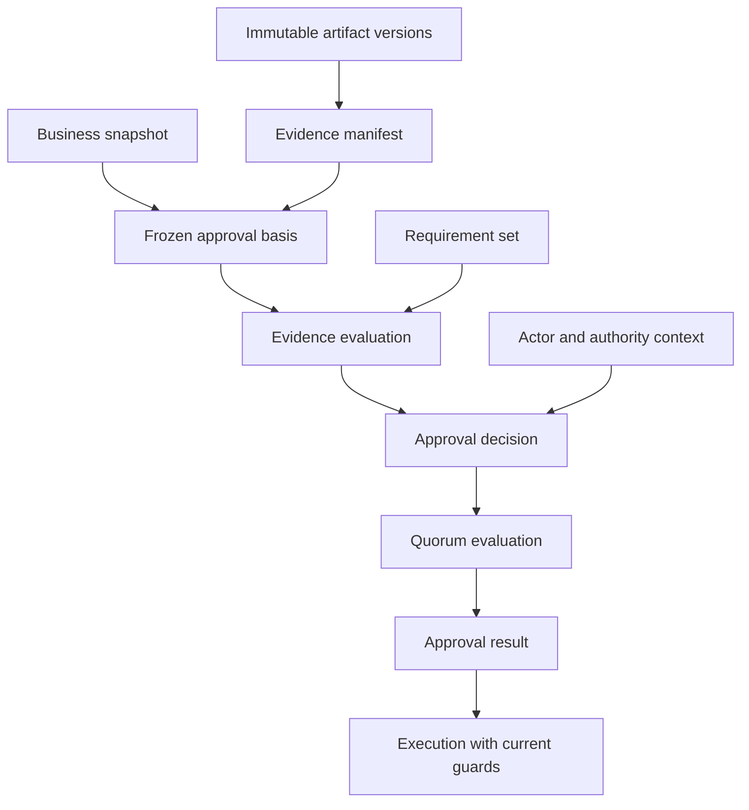

# Approval evidence requirements: yêu cầu bằng chứng cho quyết định phê duyệt

## 1. Quyết định phê duyệt phải chứng minh được điều gì?

Một đề nghị mua hàng có hóa đơn đính kèm, hai lượt nhấn nút duyệt và một dòng log ghi `APPROVED`. Sau đó, tài khoản ngân hàng của nhà cung cấp bị thay đổi. Hệ thống vẫn cho chi trả vì cờ `approved = true` còn nguyên.

Vấn đề không chỉ là thiếu một kiểm tra quyền. Quyết định duyệt đã bị tách khỏi nội dung mà người duyệt thực sự chấp nhận. Nếu tệp hóa đơn cũng có thể bị ghi đè tại cùng đường dẫn, ngay cả việc mở lại hồ sơ sau này cũng không cho biết lúc duyệt đã có bằng chứng gì.

**Approval evidence requirements** là tập yêu cầu quy định bằng chứng nào phải có, từ nguồn nào, cho phiên bản hồ sơ nào, được kiểm tra ra sao và còn có hiệu lực vào thời điểm nào để một quyết định phê duyệt được chấp nhận theo chính sách nghiệp vụ.

Một thiết kế cần trả lời được:

- Ai đã quyết định, với quyền và phạm vi nào?
- Họ quyết định cho đối tượng, phiên bản và vòng duyệt nào?
- Những dữ kiện, tài liệu và kết quả xác minh nào là căn cứ?
- Các bằng chứng đó có đầy đủ, đúng đối tượng, còn hiệu lực và không bị thay thế không?
- Quyết định có đáp ứng yêu cầu về hạn mức, vai trò và người duyệt độc lập không?
- Khi thực thi hành động sau duyệt, căn cứ đang dùng có còn phù hợp với quyết định đó không?

Mục tiêu là bảo vệ các bất biến nghiệp vụ trước hành vi như dùng tài liệu giả, tái sử dụng xác minh cũ, tráo bằng chứng sau duyệt, giả mạo người duyệt hoặc dùng phê duyệt của một hồ sơ cho hồ sơ khác.

## 2. Bằng chứng không chỉ là tệp đính kèm

Bằng chứng có thể là dữ liệu có cấu trúc, kết quả đối chiếu, thông tin xác thực hoặc tài liệu. Giá trị của nó phụ thuộc vào mệnh đề mà nó được dùng để chứng minh.

| Nhóm bằng chứng | Mệnh đề cần hỗ trợ | Ví dụ |
|---|---|---|
| Căn cứ nghiệp vụ | Đang duyệt chính nội dung nào? | Dòng hàng, số lượng, đơn giá, thuế, tổng tiền, loại tiền, người nhận |
| Nguồn và xác minh | Dữ kiện có nguồn đáng tin và đã được kiểm tra theo yêu cầu chưa? | Kết quả đối chiếu đơn mua, biên nhận hàng, thông tin nhà cung cấp |
| Danh tính và quyền | Ai thực hiện và có quyền với hồ sơ này không? | Chủ thể đã xác thực, phân công, hạn mức, căn cứ ủy quyền |
| Ý định quyết định | Chủ thể đã chấp nhận hành động gì trên căn cứ nào? | Lệnh duyệt gắn với phiên bản hồ sơ và nội dung xác nhận |
| Tính đầy đủ của quy trình | Các điều kiện và cấp duyệt bắt buộc đã đủ chưa? | Kết quả kiểm tra yêu cầu bằng chứng, các quyết định của người độc lập |
| Truy vết | Có thể dựng lại quyết định và các thay đổi liên quan không? | Vòng duyệt, version trước/sau, thời điểm server, mã tương quan |

Một hóa đơn có thể hỗ trợ việc đối chiếu chi phí, nhưng không tự chứng minh người bấm nút có quyền duyệt. Một phiên đăng nhập hợp lệ chứng minh danh tính theo cơ chế xác thực đang dùng, nhưng không chứng minh hóa đơn là thật. Hai dòng log không tự chứng minh có hai người độc lập đã duyệt.

### 2.1. Ba khái niệm dễ bị trộn lẫn

**Bằng chứng đầu vào** hỗ trợ việc ra quyết định: hồ sơ, tài liệu, kết quả xác minh và các dữ kiện liên quan.

**Bản ghi quyết định** ghi nhận ai chấp nhận hoặc từ chối, cho căn cứ nào, trong vòng duyệt nào và theo yêu cầu nào.

**Audit trail** ghi lại diễn tiến: tạo hồ sơ, thay căn cứ, bổ sung bằng chứng, duyệt, từ chối, thu hồi và thực thi.

Cả ba bổ sung cho nhau. Không thể chỉ có audit “đã duyệt” mà thiếu căn cứ, hoặc chỉ có tài liệu đính kèm mà thiếu bản ghi quyết định.

### 2.2. Băm, chữ ký và xác thực có giới hạn khác nhau

| Cơ chế | Hỗ trợ điều gì? | Không tự chứng minh điều gì? |
|---|---|---|
| Hash của nội dung | Phát hiện nội dung khác với digest tin cậy đã ghi | Nội dung đúng sự thật hoặc do đúng nhà cung cấp tạo |
| Chữ ký mật mã | Kiểm tra dữ liệu được ký bằng khóa tương ứng và không bị sửa theo cơ chế đó | Người thực tế đã đọc, hiểu và tự nguyện chấp nhận nội dung |
| Xác thực bổ sung | Tăng độ tin cậy về chủ thể thực hiện trong một ngữ cảnh | Hồ sơ đúng nghiệp vụ hoặc chủ thể có đủ quyền trên đối tượng |
| Lưu trữ hạn chế sửa/xóa | Giảm khả năng thay đổi hoặc làm mất dấu vết trong phạm vi bảo vệ | Dữ liệu ban đầu được ghi là đúng |

Không mặc định mọi phê duyệt đều cần chữ ký mật mã. Mức bảo đảm phải phù hợp rủi ro và chính sách. Cũng không nên tuyên bố rằng chỉ thêm hash hoặc OTP là đã có bằng chứng không thể chối bỏ trong mọi hoàn cảnh.

## 3. Định nghĩa yêu cầu bằng chứng bằng chính sách rõ ràng

Trước khi viết code, hãy biến câu “cần đủ chứng từ” thành các điều kiện có thể kiểm tra.

Ví dụ chính sách nội bộ cho đề nghị mua hàng:

| Điều kiện | Bằng chứng hoặc kiểm tra bắt buộc |
|---|---|
| Mọi đề nghị | Căn cứ mua hàng có phiên bản; tổng tiền phía server; nhà cung cấp xác định được |
| Hàng đã được nhận | Tham chiếu biên nhận phù hợp với mặt hàng và số lượng cần đối chiếu |
| Số tiền vượt ngưỡng đã quy định | Đủ các vai trò duyệt và số người độc lập theo chính sách |
| Thay đổi tài khoản nhận tiền | Kết quả xác minh cho đúng tài khoản mới, từ quy trình được phép |
| Có ủy quyền duyệt | Bản ghi ủy quyền đúng hành động, phạm vi, hạn mức và còn hiệu lực |
| Hành động có rủi ro cao | Bằng chứng xác thực bổ sung gắn với ý định cần xác nhận nếu chính sách yêu cầu |

Đây là ví dụ thiết kế, không phải yêu cầu mặc định cho mọi tổ chức.

### 3.1. Mỗi yêu cầu cần đủ ngữ nghĩa

Một requirement nên mô tả được:

1. Khi nào áp dụng: loại hồ sơ, khoảng tiền, nhóm hàng, thay đổi nào hoặc mức rủi ro nào.
2. Mệnh đề cần chứng minh: đã nhận hàng, tài khoản được xác minh, có người duyệt đủ hạn mức.
3. Loại nguồn được chấp nhận và cách gắn nguồn với đối tượng.
4. Điều kiện về tính đầy đủ, đối chiếu và độ mới.
5. Chủ thể hoặc thành phần nào được xác minh requirement.
6. Requirement được kiểm tra ở lúc gửi, lúc duyệt, lúc thực thi hay nhiều thời điểm.
7. Quy tắc khi thiếu, hết hạn, bị thu hồi hoặc không thể kiểm tra.

Ví dụ “có tệp PDF” là yêu cầu quá yếu. “Có hóa đơn thuộc nhà cung cấp của hồ sơ, đã đối chiếu số tham chiếu, loại tiền và tổng tiền theo quy tắc được chọn, tham chiếu đúng phiên bản nội dung lưu trữ” có ý nghĩa nghiệp vụ rõ hơn.

### 3.2. Điều kiện đầy đủ không thay thế quyết định duyệt

Một bộ kiểm tra báo `REQUIREMENTS_MET` chỉ chứng minh các điều kiện đã cấu hình đạt theo dữ liệu đầu vào. Nó không tự cấp quyền duyệt hoặc thay thế sự chấp nhận của người có trách nhiệm.

Ngược lại, việc một người có quyền nhấn nút không cho phép hệ thống bỏ qua requirement bắt buộc. Luồng đúng cần cả quyền, căn cứ đầy đủ, ý định quyết định và điều kiện chuyển trạng thái.

Nếu nghiệp vụ cho phép miễn một requirement, hãy mô hình hóa ngoại lệ: ai được cho phép miễn, phạm vi, lý do, thời hạn và bằng chứng thay thế. Không để người duyệt tự đặt `evidenceRequired = false` trong request hoặc dùng ghi chú tự do để âm thầm vô hiệu hóa kiểm tra.

## 4. Gắn bằng chứng với một gói căn cứ bất biến

Một cách thiết kế là tạo **gói căn cứ duyệt** gồm snapshot nghiệp vụ, danh mục bằng chứng và tham chiếu yêu cầu áp dụng. Sau khi đóng gói để trình duyệt, các thành phần đó không bị ghi đè tại chỗ.



### 4.1. Snapshot nghiệp vụ cần chứa những gì?

Snapshot phải bao phủ dữ liệu mà việc thay đổi có thể làm thay đổi quyết định, chẳng hạn:

- Tenant, định danh hồ sơ, người yêu cầu và đơn vị chịu chi phí.
- Dòng hàng, số lượng, đơn giá, khoản giảm, thuế và tổng tiền.
- Loại tiền và quy tắc tính/rounding liên quan.
- Nhà cung cấp, người nhận và tham chiếu tài khoản nhận tiền khi thuộc căn cứ duyệt.
- Mục đích, loại chi phí hoặc thuộc tính dùng để chọn chính sách.

Không chỉ băm trường `total` rồi cho sửa nhà cung cấp hoặc tài khoản ngân hàng mà vẫn coi căn cứ không đổi.

### 4.2. Manifest phải định danh đúng phiên bản bằng chứng

Một manifest có thể tham chiếu từng artifact bằng:

```json
{
  "basisPackageId": "basis-812",
  "requestId": "purchase-1042",
  "approvalRoundId": "round-4",
  "basisRevision": 7,
  "requirementSetId": "purchase-evidence",
  "requirementSetVersion": 3,
  "artifacts": [
    {
      "evidenceId": "ev-91",
      "objectVersionId": "object-version-6",
      "contentSha256": "<digest-do-server-tinh>",
      "verificationRecordId": "verification-55",
      "purpose": "SUPPLIER_INVOICE"
    }
  ]
}
```

Các giá trị chỉ để minh họa cấu trúc. Một URL tải tệp tạm thời không phải định danh bền vững của bằng chứng. Tên tệp như `invoice.pdf` cũng không bảo đảm lần mở sau có cùng nội dung.

`verificationRecordId` nên trỏ tới một kết quả xác minh xác định được phiên bản, thay vì một hàng có thể bị đổi từ “chưa đạt” sang “đạt” rồi làm thay đổi ý nghĩa của quyết định cũ.

### 4.3. Digest của gói căn cứ

Nếu dùng digest, máy chủ cần tính từ biểu diễn chuẩn hóa đã định nghĩa, bao gồm snapshot và các tham chiếu phiên bản/digest liên quan. Cần quy định cách biểu diễn số tiền, thứ tự phần tử, chuỗi, trường tùy chọn và phiên bản schema.

Chỉ sắp xếp một mảng nếu thứ tự của nó không mang ý nghĩa nghiệp vụ. Không để hai cách serialize tương đương về nghĩa sinh kết quả không kiểm soát, hoặc loại bỏ nhầm trường có ý nghĩa khỏi dữ liệu được băm.

Digest client gửi lên chỉ có thể là giá trị cần đối chiếu với gói phía server. Máy chủ không được nhận một digest bất kỳ rồi coi đó là bằng chứng đã kiểm tra nội dung tương ứng.

## 5. Nguồn gốc, xác minh và độ mới của bằng chứng

### 5.1. Nguồn tải lên không đồng nghĩa nguồn phát hành

Một nhân viên tải lên hóa đơn không chứng minh nhà cung cấp đã phát hành hóa đơn đó. Metadata như `issuer`, `verifiedBy` hoặc `issuedAt` do người tải tự khai cần được phân biệt với dữ liệu do một nguồn được xác thực cung cấp hoặc do quy trình xác minh ghi nhận.

Tùy requirement, hệ thống có thể đối chiếu dữ liệu với hồ sơ nhà cung cấp, đơn mua, biên nhận hoặc kết quả từ tích hợp được phép. Kết quả cần giữ tham chiếu nguồn, phương pháp và phiên bản bộ kiểm tra đủ để giải thích quyết định.

Một tài liệu an toàn để mở chưa chắc đúng nghiệp vụ. Quét nội dung nguy hiểm, đọc OCR thành công và đối chiếu hóa đơn là ba loại kiểm tra khác nhau; không dùng một trạng thái `verified` chung để ngầm khẳng định cả ba.

### 5.2. Bằng chứng phải đúng đối tượng và mục đích

Một kết quả xác minh tài khoản nhà cung cấp A không được dùng cho B. Kết quả cho tài khoản cũ không tự có giá trị với tài khoản mới. Một lần xác thực bổ sung để thay email không tự được dùng làm xác nhận chi trả.

Tối thiểu cần đối chiếu các liên kết mà requirement yêu cầu:

```text
tenant + đối tượng + loại bằng chứng + mục đích
+ phiên bản hoặc thuộc tính được xác minh
```

Đối với dữ liệu dùng chung hợp lệ, phải có mô hình chia sẻ và quyền rõ ràng; không bỏ qua ranh giới tenant chỉ vì evidence ID tồn tại.

### 5.3. Độ mới phụ thuộc loại bằng chứng

Không nên áp một TTL giống nhau cho mọi tài liệu. Một hóa đơn lịch sử và quyền ủy quyền hiện hành có cách đánh giá thời gian khác nhau.

Phân biệt các mốc:

- `sourceOccurredAt` hoặc thời điểm tài liệu được phát hành.
- `receivedAt`: lúc hệ thống nhận dữ liệu.
- `verifiedAt`: lúc thực hiện kiểm tra.
- `validUntil`: giới hạn hiệu lực nếu requirement có quy định.
- `decisionAt`: lúc hệ thống ghi nhận quyết định.

Thời gian client khai không tự chứng minh bằng chứng còn hiệu lực. Cũng không được lấy thời điểm vừa upload một tài liệu cũ làm thời điểm tài liệu đó được phát hành.

Requirement phải nói rõ cần hợp lệ khi duyệt, khi thực thi hay cả hai. Việc một bằng chứng hết hiệu lực sau này không làm mất sự thật rằng nó đã được dùng tại thời điểm trước; nhưng có thể chặn một hành động chưa thực hiện nếu chính sách đòi hỏi kiểm tra lại.

### 5.4. Thiếu khả năng kiểm tra không phải là đã đạt

Khi dịch vụ xác minh lỗi, tài liệu chưa được xử lý hoặc nguồn bị thu hồi, hệ thống cần thể hiện trạng thái chưa đủ căn cứ hay cần xử lý riêng. Không đổi exception thành `true` để tránh chặn người dùng.

Các kiểm tra tốn thời gian nên được xử lý trước transaction ghi quyết định, tạo kết quả có phiên bản và phạm vi rõ. Transaction quyết định sau đó kiểm tra đúng kết quả, thời hạn và trạng thái cần thiết; không giữ khóa cơ sở dữ liệu trong suốt một tác vụ phân tích tệp hoặc lời gọi mạng dài.

## 6. Bằng chứng về người duyệt và tính độc lập

Một quyết định nên liên kết tới chủ thể được xác thực phía server, không lấy `approvedBy`, role hoặc hạn mức từ body.

Ngữ cảnh cần ghi nhận có thể gồm:

- Danh tính thực hiện, tenant và loại chủ thể: người dùng hay service identity.
- Phân công hoặc quan hệ cho phép xử lý hồ sơ.
- Quyền hành động, hạn mức và phạm vi có hiệu lực lúc quyết định.
- Căn cứ ủy quyền nếu có, gồm người thực hiện thực tế và người được đại diện.
- Tham chiếu xác thực bổ sung nếu chính sách yêu cầu, với phạm vi và thời hạn tương ứng.

Ghi lại quyền lúc duyệt phục vụ truy vết. Nó không có nghĩa token hoặc authority snapshot cũ được dùng vô thời hạn để cấp quyền cho hành động mới.

### 6.1. Không tự duyệt và không đếm trùng người

Nếu chính sách cấm tự duyệt, kiểm tra một role chung như `APPROVER` là chưa đủ. Cần xét quan hệ của người thực hiện với hồ sơ và ngữ cảnh đại diện/ủy quyền để không biến ủy quyền thành đường vòng tự duyệt.

Nếu cần hai người độc lập, hai request hoặc hai dòng quyết định không đủ. Hai tài khoản khác nhau cũng chưa chắc là hai người khác nhau. Hệ thống cần một định danh người duyệt đáng tin theo mô hình tổ chức, hoặc phải thừa nhận giới hạn nhận diện của mình.

Trong mô hình có `reviewerIdentityId` được quản lý tập trung, một vòng duyệt có thể cấm đếm hai lần cùng danh tính đó. Các điều kiện khác như vai trò, cấp duyệt và phân tách nhiệm vụ vẫn cần kiểm tra riêng.

Tính độc lập không thể được suy ra chỉ từ hai IP hoặc hai trình duyệt. Những tín hiệu đó có thể phục vụ phát hiện bất thường, không thay thế quy tắc nghiệp vụ và dữ liệu danh tính.

### 6.2. Đủ số lượng chưa chắc đủ quorum

Ví dụ policy yêu cầu một người phụ trách ngân sách và một người thuộc tài chính. Hai người phụ trách ngân sách không thay được hai vai trò đó, dù `COUNT(approvals) = 2`.

Quorum cần xét đồng thời:

```text
đúng vòng duyệt
AND đúng gói căn cứ
AND các quyết định được chấp nhận
AND đủ danh tính độc lập
AND đủ vai trò/cấp/hạn mức theo policy
AND không có điều kiện chặn còn hiệu lực
```

Việc xử lý quyết định từ chối, rút quyết định hoặc yêu cầu bổ sung cũng phải được định nghĩa. Không đếm mọi dòng có chữ `APPROVE` trong lịch sử, kể cả dòng đã bị thay thế hoặc thuộc vòng cũ.

## 7. Vòng đời bằng chứng và hiệu lực quyết định

### 7.1. Từ tiếp nhận đến đủ điều kiện sử dụng

Một vòng đời artifact có thể gồm tiếp nhận, cách ly/xử lý, xác minh, chấp nhận hoặc từ chối. Khi có phát hiện mới, bằng chứng có thể bị đánh dấu thu hồi bằng một sự kiện hoặc bản ghi mới.

Không nên coi upload thành công là đã đủ điều kiện duyệt. Sự hiện diện của file, kiểm tra an toàn nội dung và kiểm tra nghiệp vụ cần có trạng thái rõ nếu cùng tham gia requirement.

Chỉ công bố một artifact để gắn vào gói căn cứ khi nội dung đã được lưu theo cơ chế phù hợp và các thuộc tính cần dùng đã xác định. Với object storage và cơ sở dữ liệu tách rời, phải xử lý upload dở dang, bản ghi mồ côi và đối soát tham chiếu; transaction cơ sở dữ liệu không tự bao trùm object storage.

### 7.2. Thay đổi căn cứ sau khi đã có quyết định

Giả sử người duyệt chấp nhận gói `basis-812`, gồm tổng tiền và manifest phiên bản 3. Nếu bổ sung hóa đơn thay thế hoặc đổi tài khoản nhận tiền, không được sửa gói đó tại chỗ rồi giữ nguyên ý nghĩa của các quyết định đã ghi.

Một mô hình đơn giản là:

1. Tạo revision nghiệp vụ hoặc manifest mới khi nội dung ảnh hưởng căn cứ thay đổi.
2. Đóng gói thành basis mới.
3. Mở vòng duyệt mới khi policy yêu cầu duyệt lại.
4. Giữ quyết định cũ trong lịch sử, đánh dấu chúng không được tính cho vòng mới.

Nếu nghiệp vụ cho phép giữ một phần quyết định sau thay đổi, phải mô hình hóa phạm vi mà từng quyết định bao phủ và quy tắc phụ thuộc. Không suy luận ngầm rằng một thay đổi “có vẻ nhỏ” luôn được thừa hưởng mọi phê duyệt cũ.

### 7.3. Thay đổi policy và thu hồi bằng chứng

Cần ghi phiên bản tập requirement áp dụng cho vòng duyệt. Khi policy đổi giữa chừng, tổ chức có thể cho hoàn tất theo tập cũ, yêu cầu bổ sung hoặc bắt đầu vòng mới, tùy loại thay đổi và chính sách đã định.

Không trộn các phiếu theo requirement cũ và mới mà không xác định chúng có còn đáp ứng cùng một điều kiện chấp nhận hay không. Các điều kiện thu hồi khẩn cấp hoặc quyền hiện hành cũng không được tự bỏ qua chỉ vì đã ghim một phiên bản workflow cũ.

Nếu phát hiện bằng chứng gian lận hoặc không còn đáng tin, hãy ghi nhận thu hồi và xác định các quyết định/hành động bị ảnh hưởng. Với bước chưa thực thi có thể cần chặn và xét lại; với bước đã thực thi có thể cần điều tra hoặc quy trình khắc phục. Không xóa lịch sử để làm như bằng chứng chưa từng được sử dụng.

## 8. Thực thi kiểm tra bằng chứng trong transaction quyết định

Một luồng duyệt mới thường cần:

1. Xác thực người gọi và kiểm tra cấu trúc lệnh.
2. Nạp hồ sơ/vòng duyệt với cơ chế kiểm soát cạnh tranh phù hợp.
3. Kiểm tra quyền hiện tại trên đối tượng.
4. Đối chiếu phiên bản, vòng duyệt và gói căn cứ mà người dùng xác nhận.
5. Đánh giá tập requirement bằng đúng snapshot và các kết quả xác minh được tham chiếu.
6. Ghi báo cáo đánh giá, quyết định và kết quả quorum.
7. Cập nhật tiến trình, audit và sự kiện cần nguyên tử trong cùng transaction.

### 8.1. Minh họa Java ở lớp ứng dụng

Ví dụ dưới đây minh họa các hợp đồng của service, không phải một ứng dụng hoàn chỉnh. Nhánh idempotency đã xác định đây là **lệnh mới**; các dependency là thành phần do ứng dụng triển khai.

```java
record ApproveCommand(
        long expectedVersion,
        UUID basisPackageId,
        String presentedBasisDigest,
        String note) {}

ApprovalResult approve(UUID requestId, ApproveCommand command) {
    Actor actor = identity.requireAuthenticatedActor();
    validateInput(command);

    return transactions.required(() -> {
        PurchaseRequest request = requests
                .lockByTenantAndId(actor.tenantId(), requestId)
                .orElseThrow(NotFound::new);

        ApprovalRound round = rounds.requireOpenFor(request);
        approvalPolicy.requireCurrentPermission(actor, request, round);

        if (request.version() != command.expectedVersion()) {
            throw new Conflict("STALE_REQUEST_VERSION");
        }

        ApprovalBasis basis = bases.requireFrozen(round.basisPackageId());
        if (!basis.id().equals(command.basisPackageId())
                || !basis.digest().equals(command.presentedBasisDigest())) {
            throw new Conflict("APPROVAL_BASIS_CHANGED");
        }

        EffectiveRequirements rules = requirements.resolveFor(round);
        EvidenceReport report = evidence.evaluate(
                basis, rules, clock.instant());

        if (!report.requirementsMet()) {
            throw new RuleViolation("APPROVAL_EVIDENCE_INSUFFICIENT");
        }

        reports.append(report);
        decisions.appendUniqueApproval(
                actor, request, round, basis, report, command.note());

        QuorumResult quorum = quorumPolicy.evaluate(
                round, basis, rules, decisions.acceptedFor(round.id()));

        ApprovalResult result = requests.advanceReview(
                request, round, basis, quorum, command.expectedVersion());

        audit.appendDecision(actor, request, round, basis, report, result);
        outbox.appendReviewProgressed(request, round, result);
        return result;
    });
}
```

Các hợp đồng quan trọng:

- `requireOpenFor` kiểm tra cả trạng thái hồ sơ và vòng duyệt; không mở lại vòng cũ để nhận thêm phiếu.
- `requireCurrentPermission` kiểm tra tenant, phạm vi, phân tách nhiệm vụ, hạn mức và ủy quyền cần thiết.
- `requireFrozen` chỉ trả gói bất biến đã sẵn sàng dùng, thuộc đúng hồ sơ/vòng duyệt.
- `resolveFor` trả tập requirement có phiên bản xác định theo quy tắc chuyển policy của hệ thống; các điều kiện hiện hành bắt buộc không được âm thầm bỏ qua.
- `evaluate` kiểm tra manifest, liên kết đối tượng, kết quả xác minh, thời hạn và các điều kiện của requirement; báo cáo giữ các tham chiếu đã thực sự dùng.
- `appendUniqueApproval` không cho cùng một danh tính được tính nhiều lần trái policy.
- `advanceReview` kiểm tra điều kiện cập nhật và tăng version cả khi mới nhận một phiếu mà chưa đủ quorum; không đánh dấu `APPROVED` nếu còn thiếu điều kiện.
- Các ghi bắt buộc phải cùng transaction và rollback khi thất bại. Nếu outbox chỉ là thông báo tiến trình, không được coi sự kiện đó tự tạo thêm quyền thực thi.

`presentedBasisDigest` giúp phát hiện người dùng xác nhận phiên bản khác với server đang xử lý. Nó không chứng minh họ đã đọc hoặc hiểu nội dung. Ý nghĩa xác nhận đến từ hợp đồng hành động và ngữ cảnh được bảo vệ, không phải chỉ từ một chuỗi hash trong request.

### 8.2. Constraint và cập nhật có điều kiện

Với mô hình một danh tính chỉ được ghi một quyết định có hiệu lực trong một vòng duyệt, có thể dùng ràng buộc tương ứng, chẳng hạn:

```sql
UNIQUE (tenant_id, approval_round_id, reviewer_identity_id)
```

Nếu có nhiều bước hoặc cho phép thay đổi quyết định bằng sự kiện nối tiếp, schema và cách xác định bản ghi hiệu lực cần phù hợp mô hình đó. Dù ràng buộc theo bước, quorum vẫn phải kiểm tra độc lập giữa những vai trò mà policy yêu cầu không cùng người.

Khi đủ điều kiện, phần cập nhật kết quả có thể ràng buộc:

```sql
UPDATE purchase_request
SET state = 'APPROVED',
    approved_basis_package_id = :checked_basis_package_id,
    approved_round_id = :checked_round_id,
    version = version + 1
WHERE tenant_id = :authorized_tenant_id
  AND id = :request_id
  AND state = 'IN_REVIEW'
  AND current_round_id = :checked_round_id
  AND current_basis_package_id = :checked_basis_package_id
  AND version = :expected_version;
```

Phải kiểm tra số dòng cập nhật. Câu lệnh này không tự tính quorum hoặc xác minh bằng chứng; đó là các điều kiện phải được kiểm tra trên dữ liệu được bảo vệ trong cùng thiết kế.

### 8.3. Chống khoảng hở kiểm tra và sử dụng

Đóng băng basis loại bỏ việc nội dung của chính gói đó bị sửa, nhưng không tự bảo vệ mọi dữ liệu khác. Một bằng chứng có thể bị thu hồi hoặc quyền duyệt bị thay đổi trong lúc transaction đang chạy.

Nếu yêu cầu nhất quán đòi hỏi các thay đổi này ngăn commit đang diễn ra, đường thu hồi và đường quyết định cần cùng giao thức khóa hoặc phiên bản được kiểm tra một cách đồng bộ. Chỉ đọc lại trạng thái thêm một lần rồi cập nhật vẫn có thể có khoảng hở.

Với nguồn xác minh bên ngoài, transaction cục bộ không đóng băng nguồn đó. Cần xác định thời điểm kiểm tra, thời hạn chấp nhận và cơ chế thông báo thu hồi/đối soát theo mức bảo đảm thực tế đạt được.

## 9. Trải nghiệm duyệt và bằng chứng về ý định

Giao diện nên giúp người duyệt biết rõ mình chấp nhận điều gì:

- Hồ sơ, tổng tiền, loại tiền, người nhận và thay đổi quan trọng.
- Phiên bản căn cứ/vòng duyệt đang xem.
- Tài liệu và kết quả kiểm tra có liên quan, với dấu hiệu thiếu hoặc chưa hoàn tất.
- Hành động có hiệu lực gì và lý do cần nhập nếu có.

Không dùng giao diện để thay kiểm tra server. Ngược lại, kiểm tra server đúng cũng không bù được một màn hình cố tình che phần thay đổi quan trọng khiến người duyệt dễ chấp nhận nhầm.

### 9.1. Phiên xem phải gắn với phiên bản quyết định

Nếu hồ sơ đổi sau khi người duyệt mở trang, lệnh duyệt phải phát hiện version hoặc digest không còn khớp. Không tự chuyển người duyệt sang gói mới và ghi nhận là họ đã chấp nhận gói đó.

Một log “đã mở tệp” hoặc “đã cuộn đến cuối” chỉ ghi nhận sự kiện giao diện theo cơ chế thu thập. Nó không chứng minh người dùng hiểu tài liệu và không thay thế requirement về chất lượng bằng chứng.

### 9.2. Xác thực bổ sung cần đúng phạm vi

Nếu policy yêu cầu xác thực bổ sung, bằng chứng nên gắn với chủ thể, mục đích, thời hạn và căn cứ giao dịch cần thiết. Không coi cờ `mfaPassed = true` không có ngữ cảnh là đủ cho mọi lần duyệt sau đó.

Một assertion đúng chữ ký nhưng dành cho đối tượng khác, số tiền khác hoặc mục đích khác vẫn không đáp ứng requirement của quyết định hiện tại. Việc tiêu thụ assertion một lần, nếu có, phải tham gia cơ chế nhất quán với việc ghi nhận lệnh và idempotency.

### 9.3. Gửi lại lệnh không tạo thêm bằng chứng độc lập

Client có thể gửi lại khi mất response. Idempotency cần trả đúng kết quả cũ cho cùng lệnh theo chính sách quyền nhận kết quả hiện tại, thay vì tạo một phiếu mới.

Cùng key nhưng khác nội dung phải bị phát hiện. Khác key nhưng cùng người duyệt/vòng duyệt cũng không được tính thêm một người. Idempotency bảo vệ việc gửi lại lệnh; ràng buộc nghiệp vụ và quorum bảo vệ ý nghĩa của quyết định.

## 10. Từ phê duyệt sang thực thi

Một kết quả duyệt không phải quyền chung cho mọi hành động sau đó. Khi tạo đơn, giải ngân hoặc chi trả, hệ thống phải xác định quyết định nào cho phép thực thi và quyết định đó bao phủ căn cứ nào.

Ví dụ trước khi khởi tạo chi trả:

```text
đúng hồ sơ và tenant
AND có kết quả duyệt đáp ứng policy
AND approvedBasisPackageId khớp căn cứ dùng để chi
AND người nhận, số tiền và loại tiền khớp căn cứ được duyệt
AND các điều kiện hiện hành bắt buộc còn đạt
AND chưa có operation xung đột hoặc nghĩa vụ đã thực hiện
```

Đừng chỉ kiểm tra `state == APPROVED`. Nếu đã sửa tài khoản nhận tiền ngoài đường kiểm soát, trạng thái đó có thể không còn chứng minh hành động sắp làm đã được chấp nhận.

### 10.1. Bằng chứng tại lúc duyệt và lúc thực thi

Một số requirement chỉ cần được đáp ứng khi ghi nhận quyết định. Một số khác phải được kiểm tra lại khi hành động được thực hiện, như trạng thái hoạt động của người nhận hoặc hiệu lực một điều kiện được policy quy định.

Phải ghi rõ sự khác biệt để tránh hai lỗi:

- Bỏ qua kiểm tra hiện hành bằng cách viện dẫn approval cũ.
- Tự động hủy ý nghĩa lịch sử của mọi approval chỉ vì thời gian đã trôi qua.

Nếu hành động bên ngoài đã được khởi tạo, việc bằng chứng hết hạn sau đó không cho phép quên operation đang chờ hoặc tạo operation mới tùy ý. Cần giải quyết kết quả và, nếu cần, xử lý bù trừ theo workflow riêng.

### 10.2. Không dùng audit làm lệnh thực thi

Một sự kiện `ApprovalRecorded` hoặc dòng audit không nên tự được mọi consumer hiểu thành “được chi tiền”. Consumer cần hợp đồng sự kiện rõ, nguồn được phép và kiểm tra trạng thái/căn cứ tương ứng.

Đối với tác động bên ngoài, cần operation ổn định, outbox/inbox hoặc cơ chế tương đương và idempotency. Bộ bằng chứng đầy đủ không tự ngăn thanh toán hai lần nếu tầng thực thi không kiểm soát gửi lại và cạnh tranh.

## 11. Lưu trữ, toàn vẹn, truy cập và thời hạn lưu

### 11.1. Không cho thay nội dung dưới cùng định danh

Tệp thuộc manifest đã dùng để duyệt cần được tham chiếu bằng phiên bản nội dung bất biến hoặc cơ chế tương đương. Khi thay tệp, tạo artifact/version mới và áp dụng quy tắc đổi căn cứ, thay vì ghi đè nội dung cũ.

Hash phải được tính hoặc kiểm tra từ nội dung thực tế qua đường xử lý đáng tin. Không chỉ lưu hash client khai rồi coi nội dung đã được xác minh.

Nếu đối tượng lưu trữ bị mất hoặc không khớp digest, cần cảnh báo và xử lý theo policy về khả năng kiểm chứng/khả dụng. Không tự bỏ qua requirement hoặc tạo một tệp mới có cùng tên để giả lập lịch sử.

### 11.2. Bảo vệ cả dữ liệu và tham chiếu toàn vẹn

Lưu hash trong cùng nơi mà người tấn công có thể sửa cả tệp lẫn hash không tạo bảo đảm mạnh trước chính kẻ đó. Nếu mô hình đe dọa bao gồm quản trị viên lưu trữ hoặc người có quyền sửa cơ sở dữ liệu, cần đánh giá lớp bảo vệ độc lập hơn: phân quyền tách biệt, lưu trữ hạn chế sửa/xóa, bản sao kiểm chứng hoặc cơ chế ký/neo phù hợp.

Một chuỗi hash có thể giúp phát hiện thay đổi khi có điểm kiểm chứng đáng tin; nếu toàn bộ chuỗi và điểm gốc đều bị thay mà không ai biết, bản thân cấu trúc chuỗi không giải quyết được vấn đề.

### 11.3. Quyền xem bằng chứng có thể hẹp hơn quyền xem hồ sơ

Tài liệu có thể chứa thông tin nhạy cảm của nhà cung cấp hoặc người lao động. Không mặc định ai thấy dòng tổng tiền cũng được tải mọi tệp gốc.

Tải xuống cần kiểm tra quyền trên bằng chứng và đối tượng liên quan. Nếu dùng URL có thời hạn, giới hạn phạm vi và thời gian phù hợp; không biến bucket công khai hoặc URL khó đoán thành cơ chế phân quyền.

Tách quyền upload, xác minh, duyệt, sửa policy và quản trị lưu trữ khi rủi ro yêu cầu. Người bổ sung chứng từ không nên có thể tự ghi `businessVerified = true` chỉ vì họ có quyền upload.

### 11.4. Lưu đủ để kiểm chứng, không thu thập vô hạn

Thời hạn lưu và cách hủy cần dựa trên chính sách áp dụng cho loại dữ liệu. Không có một thời hạn chung phù hợp mọi loại hồ sơ.

Cần phối hợp việc xóa artifact với các manifest và quyết định còn phải giữ. Dọn tệp “không còn xuất hiện ở màn hình hiện tại” có thể xóa căn cứ của vòng duyệt cũ.

Nếu chủ động không còn giữ một phần dữ liệu theo chính sách, phải thể hiện khả năng kiểm chứng còn lại và dấu vết xử lý. Không tiếp tục khẳng định có thể dựng lại đầy đủ một quyết định khi bằng chứng cần thiết đã bị hủy.

## 12. Báo cáo đánh giá và audit có thể giải thích

Một báo cáo kiểm tra bằng chứng nên trả lời từng requirement được đáp ứng bằng gì, không chỉ có một cờ `complete = true`.

Các trường hữu ích gồm:

- Định danh và phiên bản tập requirement.
- Basis package, manifest/digest và vòng duyệt được đánh giá.
- Requirement nào áp dụng, bằng chứng/kết quả xác minh nào được dùng.
- Kết quả đạt, thiếu, không khớp, hết hạn, bị thu hồi hoặc chưa thể kiểm tra.
- Thời điểm đánh giá, phiên bản bộ kiểm tra và ngoại lệ được cấp phép nếu có.

Giữ bản báo cáo tương ứng với quyết định để thay đổi bộ kiểm tra sau này không âm thầm viết lại lý do của quá khứ. Một lần đánh giá mới có thể cho kết quả khác và cần được ghi như sự kiện mới.

Audit quyết định thành công nên liên kết chủ thể, căn cứ, báo cáo, quorum và version trước/sau. Không log credential, token xác thực hoặc toàn bộ tệp nhạy cảm chỉ để làm “bằng chứng”.

Audit từ chối cần cơ chế riêng phù hợp: nếu chèn nó vào transaction rồi rollback vì thiếu quyền hoặc thiếu bằng chứng, bản ghi từ chối cũng có thể mất. Sự cố ghi log không được trở thành lý do tự cho phép duyệt.

Thông tin lỗi cho người dùng phải đúng phạm vi. Có thể cho người được phép xử lý biết thiếu requirement nào, nhưng không tiết lộ chi tiết tài liệu của hồ sơ tenant khác chỉ để giải thích vì sao họ bị từ chối.

## 13. Kiểm thử các cách lạm dụng bằng chứng

### 13.1. Ma trận tình huống

| Tình huống | Kỳ vọng |
|---|---|
| Body gửi `evidenceComplete = true` hoặc `verifiedBy` giả | Không thay thế kết quả kiểm tra phía server |
| Có đủ số lượng tệp nhưng sai loại hoặc sai đối tượng | Không đáp ứng requirement tương ứng |
| File hợp lệ để mở nhưng chưa đối chiếu nghiệp vụ | Không được coi là đã xác minh nghiệp vụ |
| Hash client khai không khớp nội dung thực tế | Từ chối sử dụng artifact theo policy |
| Thay nội dung tệp tại cùng đường dẫn sau duyệt | Không thay được phiên bản đã dùng hoặc phát hiện sai toàn vẹn |
| Evidence ID thuộc tenant/hồ sơ khác | Không truy cập hoặc dùng làm căn cứ trái phạm vi |
| Bằng chứng tài khoản cũ được dùng cho người nhận mới | Không đạt requirement cho tài khoản mới |
| Tài liệu hết hạn được upload lại để có `receivedAt` mới | Không làm mới hiệu lực nguồn một cách giả tạo |
| Xác thực bổ sung dành cho mục đích khác | Không đáp ứng yêu cầu của hành động duyệt |
| Cùng người gửi hai lệnh hoặc dùng hai tài khoản đã liên kết cùng danh tính | Không được đếm thành hai người độc lập trái policy |
| Hai người cùng vai trò trong khi cần hai vai trò khác nhau | Chưa đủ quorum |
| Người yêu cầu tự duyệt qua đường ủy quyền | Bị chặn theo quy tắc phân tách nhiệm vụ |
| Bổ sung bằng chứng hoặc đổi số tiền sau phiếu đầu tiên | Tạo căn cứ/vòng mới hoặc vô hiệu hóa đúng các quyết định phụ thuộc |
| Trộn phiếu của hai basis hoặc hai vòng | Không đạt quorum cho vòng hiện tại |
| Gửi lại lệnh sau timeout | Trả kết quả phù hợp, không thêm một phiếu độc lập |
| Thu hồi bằng chứng hoặc quyền đồng thời với quyết định | Hành vi đúng cam kết nhất quán và thứ tự thu hồi |
| Policy đổi khi hồ sơ đang chờ | Áp dụng đúng quy tắc chuyển policy; không trộn điều kiện tùy ý |
| Đủ bằng chứng nhưng cập nhật audit/outbox bắt buộc lỗi | Không commit một phần trái hợp đồng transaction |
| Đã duyệt rồi đổi người nhận ở đường admin/import | Không dùng approval cũ để thực thi căn cứ mới |
| Bằng chứng lưu trữ bị mất nhưng manifest còn | Phát hiện/xử lý theo policy; không tự coi là đầy đủ như trước |

### 13.2. Kiểm tra cả dữ liệu và tác động

Với lệnh bị từ chối, xác nhận không có quyết định có hiệu lực mới, không tăng quorum, không đổi trạng thái sang đã duyệt và không phát sinh operation thực thi ngoài ý muốn. Response lỗi không đủ chứng minh transaction chưa commit một phần.

Với lệnh thành công, kiểm tra quyết định tham chiếu đúng gói căn cứ, report, danh tính và vòng duyệt. Sau đó thử thay đổi dữ liệu qua API khác, import, job nền và đường quản trị để xác nhận không có đường sửa làm mất liên kết đó.

### 13.3. Kiểm thử cạnh tranh và vòng đời

Các kiểm thử giá trị cao gồm:

1. Hai người duyệt cùng version, đồng thời thay căn cứ hoặc đóng vòng duyệt.
2. Một người gửi lại cùng lệnh ngay sau commit nhưng trước khi nhận response.
3. Job thu hồi kết quả xác minh chạy trong lúc quyết định đang được kiểm tra.
4. Dọn object storage trong khi artifact vẫn được manifest cũ tham chiếu.
5. Khôi phục dữ liệu từ bản sao lưu rồi kiểm tra liên kết giữa artifact, manifest, report và quyết định.

Với khóa, version và constraint, nên kiểm thử trên loại cơ sở dữ liệu triển khai. Mock repository không chứng minh được ràng buộc duy nhất hoặc thứ tự commit thực tế.

Không cần kiểm thử bằng cách chỉ đếm số lần gọi một hàm mang tên `validateEvidence`. Điều cần chứng minh là không thể ghi nhận hay sử dụng một phê duyệt khi thiếu căn cứ theo chính sách.

## 14. Tự rà soát yêu cầu bằng chứng

Trước khi triển khai một loại phê duyệt, hãy viết câu trả lời rõ cho các điểm sau:

1. Mỗi requirement chứng minh mệnh đề nghiệp vụ nào và áp dụng khi nào?
2. Nguồn, phương pháp xác minh và mức bảo đảm của từng bằng chứng là gì?
3. Snapshot bao phủ đầy đủ số tiền, người nhận và các thuộc tính có thể làm thay đổi quyết định chưa?
4. Manifest tham chiếu phiên bản bất biến hay chỉ một tên tệp/URL có thể đổi?
5. Bằng chứng có gắn đúng tenant, đối tượng, mục đích, revision và thời hạn không?
6. Người duyệt có đúng quyền, hạn mức, vai trò và tính độc lập cần thiết không?
7. Thay căn cứ, đổi policy, thu hồi bằng chứng và gửi lại lệnh được xử lý thế nào?
8. Hành động sau duyệt có đối chiếu căn cứ đã được chấp nhận và kiểm tra điều kiện hiện hành cần thiết không?
9. Có thể dựng lại quyết định từ dữ liệu còn lưu, với quyền truy cập và khả năng kiểm chứng thực tế không?

Một quyết định đáng tin cần nhiều hơn trạng thái `APPROVED` và vài tệp đính kèm. Nó cần liên kết kiểm chứng được giữa người có quyền, ý định quyết định, căn cứ có phiên bản, yêu cầu áp dụng và hành động được phép thực thi. Liên kết đó phải còn đúng khi có chỉnh sửa, gửi lại yêu cầu, thay đổi quyền hoặc xử lý đồng thời.
