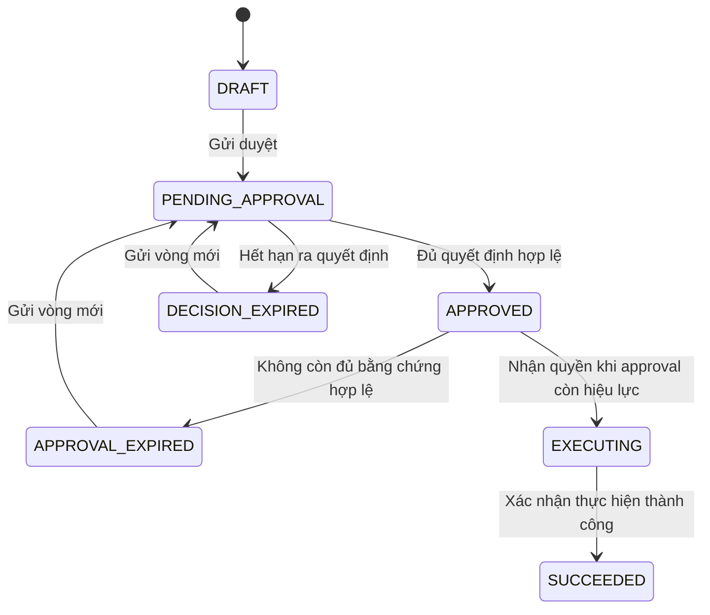

# Approval expiration — Hết hạn phê duyệt và hiệu lực thực thi

## 1. Phê duyệt là quyền có điều kiện và có thời hạn

Một lệnh chi được phê duyệt lúc 09:00 không nhất thiết còn được phép thực hiện vào ngày hôm sau. Giá có thể đã thay đổi, thông tin người nhận có thể đã bị sửa, quyền của người phê duyệt có thể đã bị thu hồi hoặc thời hạn mà chính quyết định đó cho phép đã kết thúc.

Trong bảo vệ logic nghiệp vụ, cần coi phê duyệt là bằng chứng cấp quyền cho **một hành động cụ thể, trên đúng dữ liệu, trong đúng phạm vi và khoảng thời gian được chính sách cho phép**. Nhãn `APPROVED` không phải quyền thực thi vô thời hạn.

Nếu thiết kế hết hạn không chặt chẽ, kẻ tấn công có thể:

- Giữ một approval token rồi dùng sau khi quyết định đã hết hiệu lực.
- Tận dụng độ trễ của scheduler để thực thi hồ sơ vẫn còn nhãn `APPROVED`.
- Gửi yêu cầu ngay trước hạn nhưng để worker thực hiện rất lâu sau đó, vượt hợp đồng hiệu lực thực sự.
- Phát lại quyết định của vòng cũ sau khi hồ sơ được gửi duyệt lại.
- Đổi số tiền hoặc người nhận rồi tái sử dụng phê duyệt chưa hết thời gian.
- Gia hạn bằng cách sửa `expiresAt` thay vì lấy quyết định mới có thẩm quyền.

Bài học này giải thích cách mô hình hóa hạn phê duyệt, kiểm tra thời gian tại điểm cấp quyền, xử lý nhiều người duyệt và kiểm thử các cuộc đua quanh ranh giới hết hạn. Ví dụ xuyên suốt là quy trình phê duyệt lệnh chi.

## 2. Phân biệt những loại thời hạn thường bị gộp chung

| Thời hạn | Câu hỏi cần trả lời | Ví dụ |
| --- | --- | --- |
| Hạn ra quyết định | Người duyệt còn được phép chấp nhận yêu cầu này đến lúc nào? | Hồ sơ gửi lúc 09:00 phải được quyết định trong 48 giờ |
| Thời hạn hiệu lực của quyết định | Quyết định đã chấp nhận còn cấp quyền đến lúc nào? | Sau khi duyệt, được nhận thực thi trong 2 giờ |
| Hạn của dữ liệu hoặc điều kiện nền | Báo giá, hạn mức hoặc ủy quyền liên quan còn hiệu lực không? | Báo giá hết hạn lúc 15:00 |
| Hạn nhận hoặc gửi lệnh thực thi | Lệnh đã được cấp quyền phải bắt đầu giai đoạn thực thi nào trước lúc nào? | Permit gửi lệnh có hiệu lực 30 giây theo hợp đồng riêng |
| Hạn xử lý hoặc đối soát | Khi nào một công việc đang chạy cần cảnh báo hoặc phục hồi? | Lệnh đang xử lý quá 10 phút cần tra cứu trạng thái |
| Hạn lưu dữ liệu | Dữ liệu phê duyệt, audit hoặc idempotency được giữ bao lâu? | Bản ghi lịch sử được lưu theo chính sách của hệ thống |

Không dùng một trường `expiredAt` để biểu diễn tất cả các nghĩa trên. Một quyết định được đưa ra đúng hạn có thể đã hết hiệu lực trước khi thực thi. Ngược lại, hạn xử lý vận hành bị vượt không chứng minh rằng quyết định không hợp lệ tại thời điểm lệnh đã được nhận.

Ví dụ:

```text
09:00  Gửi yêu cầu duyệt.
12:00  Hạn ra quyết định.
11:50  Người có thẩm quyền phê duyệt.
13:50  Hết hiệu lực quyết định nếu TTL là 2 giờ.
13:00  Báo giá liên quan hết hạn.
```

Nếu chính sách yêu cầu báo giá còn hiệu lực tại điểm nhận lệnh, quyền thực thi trong ví dụ không kéo dài đến 13:50. Nó bị giới hạn bởi 13:00.

Một chính sách cụ thể có thể định nghĩa:

```text
approval.not_after = min(
    approval.granted_at + approval_ttl,
    quotation.not_after,
    business_request.execution_deadline,
    các giới hạn khác mà chính sách yêu cầu
)
```

Chỉ đưa một điều kiện vào công thức khi hợp đồng nghiệp vụ thực sự yêu cầu. Chẳng hạn, việc quyền ủy nhiệm phải còn hiệu lực lúc duyệt hay cả lúc thực thi là một quyết định chính sách cần nêu rõ.

## 3. Mô hình bằng chứng phê duyệt

Một bản ghi quyết định có thể chứa:

| Trường | Vai trò |
| --- | --- |
| `approval_id` | Định danh bất biến của quyết định |
| `tenant_id`, `request_id` | Phạm vi đối tượng được phê duyệt |
| `approval_round` | Vòng duyệt mà quyết định thuộc về |
| `content_version`, `content_digest` | Phiên bản và dấu vân tay của dữ liệu đã được duyệt |
| `approver_subject_id` | Chủ thể chịu trách nhiệm ra quyết định |
| `decision` | Chấp nhận hoặc từ chối theo mô hình của hệ thống |
| `granted_at` | Thời điểm server ghi nhận quyết định có hiệu lực theo hợp đồng |
| `not_before`, `not_after` | Khoảng thời gian có thể sử dụng quyết định chấp nhận |
| `policy_revision` | Chính sách dùng để đánh giá quyết định |
| `lifecycle_state` | Chẳng hạn `ACTIVE`, `REVOKED`, `SUPERSEDED`, `EXPIRED` |
| Tham chiếu bằng chứng | Xác thực tăng cường, ủy nhiệm hoặc chữ ký nếu nghiệp vụ cần |

Trong mô hình này, `ACTIVE` chỉ nói rằng quyết định chưa bị thu hồi hoặc thay thế theo vòng đời đã ghi nhận. Nó không đủ để kết luận rằng thời gian hiện tại còn nằm trong khoảng hiệu lực.

Điều kiện có thể sử dụng một quyết định chấp nhận tại thời điểm `t` là:

```text
usable(approval, request, t) =
    approval.decision == APPROVE
    AND approval.lifecycle_state == ACTIVE
    AND approval.tenant_id == request.tenant_id
    AND approval.request_id == request.id
    AND approval.approval_round == request.approval_round
    AND approval.content_version == request.content_version
    AND approval.content_digest == request.content_digest
    AND chính_sách_còn_chấp_nhận_bằng_chứng_này
    AND approval.not_before <= t
    AND t < approval.not_after
```

Ngoài ra còn phải kiểm tra các yêu cầu khác như người duyệt độc lập với người lập, đúng nhóm thẩm quyền và đủ số lượng người duyệt. Một approval chưa hết thời gian vẫn có thể không hợp lệ vì bị thu hồi hoặc vì nội dung đã thay đổi.

### 3.1. Dữ liệu nào phải được ràng buộc với quyết định?

Với lệnh chi, dấu vân tay nội dung thường cần bao phủ những dữ liệu ảnh hưởng đến ý nghĩa quyết định: số tiền, tiền tệ, người nhận, tài khoản đích, mục đích chi và các trường liên quan theo chính sách.

Server tính dấu vân tay từ biểu diễn canonical ổn định của dữ liệu tin cậy. Không nhận một `contentDigest` do client gửi rồi coi đó là bằng chứng dữ liệu thực đã được duyệt. Việc biểu diễn tiền và chuẩn hóa dữ liệu phải thống nhất; dùng số tiền theo đơn vị nhỏ nhất cùng mã tiền tệ là một lựa chọn thường phù hợp hơn số thực nhị phân.

## 4. Khoảng hiệu lực và nguồn thời gian

### 4.1. Dùng khoảng nửa mở

Một quy tắc rõ ràng là khoảng hiệu lực `[not_before, not_after)`:

```text
not_before <= thời_điểm_kiểm_tra < not_after
```

Ví dụ `not_after=2026-12-01T10:00:00Z`:

- Trước 10:00:00Z còn có thể hợp lệ nếu thỏa các điều kiện khác.
- Đúng 10:00:00Z là hết hiệu lực.
- Sau mốc đó không được dùng lại quyết định cho một lần nhận quyền mới.

Không để UI dùng `<=` ở cuối khoảng còn backend dùng `<`, hoặc hai service hiểu khác nhau về giây cuối cùng.

### 4.2. Thời gian kiểm tra phải đến từ nguồn tin cậy

Không cho client quyết định `now`, `grantedAt` hoặc `notAfter`. Đồng hồ đếm ngược trên trình duyệt chỉ phục vụ trải nghiệm.

Với một hệ thống dùng chung cơ sở dữ liệu, có thể chọn đồng hồ cơ sở dữ liệu làm nguồn thời gian cho điểm cấp quyền. Với nhiều dịch vụ, cần xác định nguồn thời gian, cách đồng bộ và mức sai lệch được chấp nhận. Nếu không xác định được hiệu lực trong giới hạn yêu cầu, không nên tự kéo dài quyền để giữ luồng chạy tiếp.

Lưu các thời điểm tuyệt đối bằng kiểu phù hợp, chẳng hạn `Instant` ở Java và kiểu timestamp có ngữ nghĩa múi giờ phù hợp ở cơ sở dữ liệu. Hiển thị theo múi giờ người dùng là một bước riêng.

Nếu quy tắc là “đến 17 giờ ngày làm việc tiếp theo”, đó là quy tắc lịch theo múi giờ và lịch làm việc cụ thể, không phải luôn cộng 24 giờ. Cần tính và lưu deadline theo chính sách lịch được xác định rõ.

### 4.3. Cẩn thận với thời điểm bắt đầu transaction và thời gian chờ khóa

Trong PostgreSQL, `CURRENT_TIMESTAMP` và `now()` phản ánh thời điểm bắt đầu transaction. Một transaction khởi động trước hạn nhưng chờ khóa đến sau hạn có thể vẫn nhìn thấy giá trị thời gian cũ nếu dùng các hàm này làm đồng hồ kiểm tra hiệu lực hiện tại.

`statement_timestamp()` phản ánh thời điểm bắt đầu statement, còn `clock_timestamp()` phản ánh thời gian thực tại lúc được đánh giá. Việc chọn hàm phải phù hợp với điểm cấp quyền đã định nghĩa, đặc biệt khi statement có thể phải chờ khóa.

Trong ví dụ triển khai của bài, service khóa hồ sơ trước, rồi câu lệnh nhận quyền lấy một thời điểm kiểm tra mới từ `clock_timestamp()`. Không lấy thời gian ở controller trước khi chờ khóa rồi truyền xuống như một giá trị vẫn còn mới.

Khóa dữ liệu không khóa thời gian. Trong lúc một transaction đang giữ row lock, approval vẫn có thể đi qua mốc hết hạn.

## 5. Chọn chính xác điểm mà approval phải còn hiệu lực

Xét các thời điểm sau:

```text
t_click   : người dùng bấm thực hiện
t_receive : server nhận request
t_gate    : cơ sở dữ liệu kiểm tra và nhận quyền thực thi
t_commit  : transaction nhận quyền commit
t_send    : worker gửi request tới nhà cung cấp
t_accept  : nhà cung cấp chấp nhận request
t_finish  : hiệu ứng thực tế hoàn tất
```

Không có một quy tắc mặc định rằng hợp lệ ở `t_click` sẽ hợp lệ ở tất cả các mốc sau đó. Hệ thống phải chọn rõ ý nghĩa nghiệp vụ.

### 5.1. Chính sách kiểm tra tại điểm nhận quyền

Ví dụ code trong bài dùng hợp đồng:

> Approval phải hợp lệ tại `t_gate`, là thời điểm kiểm tra trong transaction nhận quyền khi hồ sơ đã được khóa. Chỉ một transaction commit thành công mới tạo ra lệnh được nhận.

Theo hợp đồng này, lệnh đã được nhận hợp lệ có thể tiếp tục sau khi approval hết hiệu lực. Hết hạn không tự hủy lệnh đó hoặc đảo một khoản tiền đã chuyển.

Thời gian `t_gate` không đồng nghĩa chính xác với thời điểm commit. Transaction cần ngắn, không gọi mạng bên ngoài và phải lưu thời điểm kiểm tra làm bằng chứng. Nếu yêu cầu nghiệp vụ thật sự gắn với thời điểm gửi hoặc chấp nhận bên ngoài, không được dùng hợp đồng nhận quyền này rồi tuyên bố đã đáp ứng yêu cầu khác.

### 5.2. Chính sách còn hiệu lực khi gửi hoặc khi bên ngoài nhận

Nếu lệnh phải được gửi trước hạn, cần kiểm tra tại đường dispatch và quản lý permit của chính command đang có. Không tạo command mới mỗi lần kiểm tra lại.

Nếu bên ngoài chỉ được chấp nhận trước deadline, cần cơ chế mà bên ngoài cũng thực thi, chẳng hạn thời hạn trong lệnh được bảo vệ và được nhà cung cấp hỗ trợ. Kiểm tra đồng hồ cục bộ rồi gửi HTTP vẫn có khoảng thời gian truyền và xử lý mạng.

Không thể hứa chặn tuyệt đối việc bên ngoài nhận muộn chỉ bằng một câu `if (now < expiresAt)` ở ứng dụng. Nếu nhà cung cấp không có khả năng tương ứng, phải công bố giới hạn và chọn quy trình nghiệp vụ phù hợp.

### 5.3. Không biến việc xếp hàng thành quyền vô thời hạn ngoài ý muốn

Một workflow có thể cần thêm giới hạn riêng cho command đã nhận, ví dụ permit gửi có TTL ngắn hoặc yêu cầu tái xác nhận nếu đợi quá lâu. Đây là chính sách bổ sung, không phải thay đổi ngầm ý nghĩa của approval.

Khi permit hết hạn mà chưa gửi, phải chứng minh command chưa tạo hiệu ứng trước khi mở lại đường lấy quyền mới. Timeout hoặc việc worker mất lease không đủ chứng minh điều đó.

## 6. State machine: nhãn trạng thái không thay thế điều kiện thời gian



Các nhánh từ chối, thu hồi, thực thi thất bại và đối soát cần được bổ sung khi xây dựng hệ thống thực tế. Sơ đồ chỉ mô tả các cạnh liên quan trực tiếp đến hết hạn.

Nếu scheduler chưa đổi `APPROVED` thành `APPROVAL_EXPIRED`, đường nhận quyền vẫn phải từ chối khi không còn đủ approval hợp lệ tại thời điểm kiểm tra.

Ngược lại, không tự chuyển `EXECUTING` thành `APPROVAL_EXPIRED` rồi mở lại khả năng thực hiện chỉ vì thời gian đã trôi qua. Lệnh đã nhận phải được theo dõi theo trạng thái thực thi và định danh hiệu ứng của nó.

### 6.1. Hết hạn không phải là từ chối

Người duyệt không đưa ra quyết định trước hạn khác với việc người duyệt đã từ chối. Giữ hai nguyên nhân riêng giúp audit, SLA và quy trình gửi lại không bị sai nghĩa.

Tương tự, approval bị thu hồi vì có dấu hiệu gian lận khác với approval tự hết hiệu lực do thời gian. Không để một job hết hạn ghi đè mất lý do `REVOKED` hoặc `SUPERSEDED`.

## 7. Nhiều người duyệt và thời hạn của tập bằng chứng

### 7.1. Đủ số lượng vẫn phải đủ vai trò và tính độc lập

Ví dụ chính sách yêu cầu một người từ tài chính và một người từ quản trị rủi ro. Hai approval của hai người cùng nhóm tài chính không đáp ứng chính sách, dù cả hai còn hạn.

Tương tự, không đếm cùng một con người hai lần chỉ vì họ có hai vai trò hoặc dùng hai tài khoản ủy nhiệm. Cách xác định chủ thể độc lập phải phù hợp mô hình danh tính của tổ chức.

### 7.2. Không luôn lấy hạn sớm nhất của mọi approval

Giả sử chính sách chỉ cần hai trong ba người độc lập và mọi điều kiện khác đều thỏa:

| Approval | Hết hiệu lực |
| --- | --- |
| A | 10:00 |
| B | 10:30 |
| C | 11:00 |

Lúc 09:55, nếu chọn tập `{A, B}`, tập bằng chứng đó chỉ dùng được đến trước 10:00. Nếu chọn `{B, C}`, có thể dùng đến trước 10:30. Approval A hết hạn không nhất thiết làm mất điều kiện hai người duyệt vì B và C vẫn đủ.

Do đó:

- Với một tập bắt buộc đã chọn, giới hạn thời gian của tập là hạn sớm nhất trong tập đó.
- Khi chính sách cho nhiều tập thay thế, cần đánh giá xem còn tập nào đáp ứng yêu cầu hay không.
- Không lấy hạn sớm nhất của mọi approval rồi vô tình làm một approval tùy chọn vô hiệu hóa toàn hồ sơ.
- Cũng không lấy hạn muộn nhất rồi coi toàn bộ yêu cầu nhiều người duyệt còn hiệu lực.

Nếu có vai trò bắt buộc, một người thuộc nhóm bắt buộc hết hạn có thể làm mất điều kiện dù tổng số approval còn hạn vẫn đủ. Việc chọn tập bằng chứng phải áp dụng đầy đủ chính sách, không chỉ `COUNT(*)`.

### 7.3. Ghi lại tập thực sự được dùng

Tại điểm nhận quyền, lưu các approval ID, thời điểm kiểm tra, policy revision và dữ liệu được phê duyệt. Nhờ đó có thể giải thích vì sao một lệnh hợp lệ tại thời điểm được nhận, kể cả sau này các approval đó đã hết hạn.

Nếu chính sách yêu cầu quyền của người duyệt còn hiệu lực lúc thực thi, phải có kiểm tra phù hợp tại thời điểm đó. Nếu chính sách chấp nhận thẩm quyền tại lúc duyệt, cũng cần nêu rõ. Không thay đổi cách hiểu theo từng nhánh code.

## 8. Ví dụ Java: nhận lệnh bằng approval còn hiệu lực

### 8.1. Giả định của ví dụ

Để tập trung vào thời gian, ví dụ chỉ yêu cầu một người duyệt độc lập. Hệ thống thực tế có quorum phải thay phần chọn bằng chứng bằng đánh giá đầy đủ như phần trước.

Các giả định khác:

- Dùng PostgreSQL và một transaction manager cho các repository liên quan.
- Mọi thay đổi dữ liệu lệnh chi, approval, thu hồi và nhận thực thi đều khóa cùng bản ghi lệnh chi trước.
- Client chỉ gửi ID, expected version và idempotency key; không quyết định thời gian hiệu lực.
- `policy_revision` được xử lý theo chính sách yêu cầu phê duyệt theo revision hiện hành của ví dụ.
- Hợp đồng hiệu lực là tại `t_gate`; command đã được nhận hợp lệ không tự mất quyền chỉ do approval hết hạn sau đó.
- Không gọi nhà cung cấp trong transaction nhận quyền.

### 8.2. Dữ liệu và ràng buộc

| Bảng hoặc nhóm dữ liệu | Vai trò |
| --- | --- |
| `payment_request` | Trạng thái, tenant, version, content version, digest, vòng và policy revision |
| `approval_grant` | Quyết định, chủ thể, khoảng hiệu lực và dữ liệu ràng buộc |
| `execution_command` | Lệnh thực thi bền vững và bằng chứng cấp quyền đã dùng |
| `idempotency_record` | Key, fingerprint và kết quả command đã nhận |
| `workflow_audit`, `outbox` | Lịch sử và sự kiện được ghi cùng transaction |

Một ràng buộc quan trọng là định danh hiệu ứng nghiệp vụ không bị tạo lại chỉ vì có approval mới. Chẳng hạn, nếu một payment intent chỉ được chi một lần, ràng buộc duy nhất phải gắn với payment intent và loại hiệu ứng tương ứng, không chỉ approval ID hay approval round.

Tùy mô hình, một intent có thể có nhiều bản ghi lần thử nhưng vẫn chỉ có một hiệu ứng được phép thành công. Thiết kế phải phân biệt lần thử và nghĩa vụ thanh toán để không chặn sai việc phục hồi hoặc cho phép chi hai lần.

### 8.3. Service minh họa

Các repository, policy và kiểu dữ liệu dưới đây là thành phần cần triển khai, không phải một ứng dụng có thể chạy độc lập. Constructor injection được lược bỏ để tập trung vào trình tự bảo vệ bất biến.

```java
@Service
public class ApprovedPaymentExecutionService {
    private final PaymentRequestRepository requests;
    private final ExecutionCommandRepository commands;
    private final IdempotencyRepository idempotency;
    private final WorkflowAuditRepository audits;
    private final OutboxRepository outbox;
    private final ExecutionPolicy policy;
    private final CommandFingerprint fingerprints;

    @Transactional(rollbackFor = Exception.class)
    public ExecutionReceipt requestExecution(
            Actor actor,
            ExecuteApprovedPaymentCommand input) {

        actor.requireAuthenticated();
        input.validateSyntaxAndLimits();

        PaymentRequest current = requests.lockForUpdate(
                actor.tenantId(), input.requestId())
            .orElseThrow(PaymentRequestNotFoundException::new);

        // Kiểm tra quyền hiện tại trên đối tượng, cả khi trả biên nhận cũ.
        // Guard trạng thái và thời gian được kiểm tra riêng.
        policy.requireExecutionPermission(actor, current);

        CommandScope scope = new CommandScope(
                actor.tenantId(), current.id(), actor.id(),
                "EXECUTE_APPROVED_PAYMENT", input.idempotencyKey());
        String fingerprint = fingerprints.forExecution(input);

        var previous = idempotency.find(scope);
        if (previous.isPresent()) {
            if (!previous.get().fingerprint().equals(fingerprint)) {
                throw new IdempotencyConflictException();
            }
            return previous.get().receipt();
        }

        if (current.version() != input.expectedVersion()) {
            throw new StaleVersionException();
        }
        if (current.state() != PaymentState.APPROVED
                || current.executionRef() != null) {
            throw new ExecutionNotAllowedException();
        }

        // Kiểm tra hạn mức, dữ liệu và revision theo chính sách.
        // Không lấy thời gian client làm thời điểm cấp quyền.
        policy.requireRequestEligible(current);

        UUID executionId = UUID.randomUUID();

        // Repository tự lấy thời gian DB mới tại gate, sau khi đã khóa.
        // Chọn approval hợp lệ và đổi trạng thái trong một statement.
        ApprovalClaim claim = requests.claimWithUsableApproval(
                actor.tenantId(), current, executionId)
            .orElseThrow(ApprovalNotUsableException::new);

        commands.insertAccepted(
                executionId, current.paymentIntentId(),
                current, claim);
        audits.appendExecutionAuthorized(
                actor, executionId, current, claim);
        outbox.appendExecutePayment(
                UUID.randomUUID(), executionId,
                actor.tenantId(), current.id());

        ExecutionReceipt receipt = new ExecutionReceipt(
                executionId,
                current.id(),
                claim.requestVersionAfterClaim(),
                claim.checkedAt());
        idempotency.insert(scope, fingerprint, receipt);
        return receipt;
    }
}
```

Các trường `final` phải được khởi tạo bằng constructor trong mã thực tế. Với Spring transaction qua proxy thông thường, lời gọi phải đi qua bean được quản lý để annotation có hiệu lực. Mọi repository trong method phải tham gia đúng transaction đó.

Một retry có cùng key và nội dung trả lại command cũ trước khi kiểm tra version hoặc hiệu lực approval hiện tại. Điều này không cấp một quyền mới sau hết hạn: không có command hoặc hiệu ứng mới được tạo. Nếu hợp đồng có deadline dispatch riêng, đường xử lý command cũ vẫn phải tuân thủ deadline đó.

### 8.4. SQL minh họa điểm kiểm tra thời gian

Giả sử service đã khóa bản ghi `payment_request`. Câu lệnh dưới đây minh họa việc lấy một thời điểm gate, chọn một approval phù hợp và nhận quyền thực thi:

```sql
WITH gate_time AS MATERIALIZED (
    SELECT clock_timestamp() AS checked_at
), usable_grant AS MATERIALIZED (
    SELECT a.id AS approval_id,
           a.not_after,
           g.checked_at
    FROM approval_grant a
    CROSS JOIN gate_time g
    WHERE a.tenant_id = :tenantId
      AND a.request_id = :requestId
      AND a.decision = 'APPROVE'
      AND a.lifecycle_state = 'ACTIVE'
      AND a.approval_round = :approvalRound
      AND a.content_version = :contentVersion
      AND a.content_digest = :contentDigest
      AND a.policy_revision = :policyRevision
      AND a.approver_subject_id <> :requesterSubjectId
      AND a.not_before <= g.checked_at
      AND g.checked_at < a.not_after
    ORDER BY a.not_after DESC, a.id
    LIMIT 1
)
UPDATE payment_request r
SET state = 'EXECUTING',
    execution_ref = :executionId,
    execution_claimed_at = u.checked_at,
    version = r.version + 1,
    updated_at = u.checked_at
FROM usable_grant u
WHERE r.tenant_id = :tenantId
  AND r.id = :requestId
  AND r.state = 'APPROVED'
  AND r.version = :expectedVersion
  AND r.approval_round = :approvalRound
  AND r.content_version = :contentVersion
  AND r.content_digest = :contentDigest
  AND r.policy_revision = :policyRevision
  AND r.execution_ref IS NULL
RETURNING r.id,
          r.version,
          u.approval_id,
          u.checked_at,
          u.not_after;
```

Các dấu `:` là tham số bind của lớp truy cập dữ liệu, không phải chuỗi được nối từ input. Kết quả phải đúng một dòng; không có dòng nghĩa là không nhận được quyền theo điều kiện câu lệnh.

Câu SQL cố ý chỉ xử lý mô hình một người duyệt. Nó không tự triển khai kiểm tra quyền người duyệt theo mọi mô hình tổ chức, quorum nhiều vai trò hoặc giới hạn từ hệ thống ngoài. Những điều kiện đó phải được thực hiện theo chính sách trong cùng giao thức nhất quán, không suy ra từ việc có một dòng trong `approval_grant`.

`MATERIALIZED` ở đây giúp sử dụng một giá trị `checked_at` cho lần kiểm tra. Đây là mốc gate đã chọn, không phải cam kết rằng câu lệnh và commit hoàn tất tức thời. Vì vậy không dùng kết quả này để khẳng định thời điểm nhà cung cấp nhận lệnh cũng trước `not_after`.

## 9. Scheduler chỉ ghi nhận hết hạn, không phải hàng rào cấp quyền

Một job nền có thể quét approval đã qua hạn để cập nhật nhãn và thông báo. Tuy nhiên, job có thể chạy chậm, bị dừng, chia lô hoặc retry.

Thiết kế an toàn phải bảo đảm:

```text
Job hết hạn chưa chạy
    vẫn không sử dụng được approval đã quá not_after
```

Một cập nhật ghi nhận vòng đời có thể dùng điều kiện:

```sql
UPDATE approval_grant
SET lifecycle_state = 'EXPIRED'
WHERE id = :approvalId
  AND tenant_id = :tenantId
  AND lifecycle_state = 'ACTIVE'
  AND not_after <= clock_timestamp();
```

Đây chỉ là ví dụ cập nhật một bản ghi grant. Khi job còn thay đổi trạng thái tổng hợp của hồ sơ, audit hoặc outbox, phải dùng transaction và thứ tự khóa nhất quán với đường nhận thực thi. Không cập nhật nhãn tổng hợp từ một bản đọc cũ.

### 9.1. Sự kiện hết hạn phải chỉ đúng quyết định

Ví dụ sự kiện nên chứa approval ID, request ID, vòng và hạn hiệu lực tương ứng. Consumer không được hiểu một event “approval expired” của vòng 3 thành lệnh hết hạn cho toàn bộ hồ sơ đang ở vòng 4.

Tình huống cần tránh:

```text
Vòng 3 hết hạn, event bị chậm.
Hồ sơ được gửi lại và duyệt vòng 4.
Event vòng 3 đến, consumer đặt toàn hồ sơ thành APPROVAL_EXPIRED.
```

Consumer cần kiểm tra định danh quyết định, vòng và trạng thái hiện tại. Với quorum, phải đánh giá lại còn đủ tập bằng chứng hợp lệ hay không; một grant hết hạn không đồng nghĩa toàn hồ sơ mất quyền.

### 9.2. Thông báo cũng phải chống xử lý lặp

Nếu gửi nhắc duyệt hoặc thông báo hết hạn, dùng định danh phù hợp để tránh gửi vô hạn khi job chạy lại. Việc gửi thông báo không nên là bước bắt buộc nằm giữa kiểm tra bảo mật và nhận lệnh tài chính.

## 10. Hết hạn yêu cầu đang chờ quyết định

Hạn quyết định được kiểm tra trên đường chấp nhận quyết định, không chỉ trên trang hiển thị yêu cầu duyệt.

Một email hoặc màn hình được mở trước hạn không giữ quyền phê duyệt mãi. Khi người duyệt bấm xác nhận, server vẫn phải kiểm tra:

- Đúng người và đúng quyền trên hồ sơ.
- Đúng vòng, phiên bản nội dung và dữ liệu cần duyệt.
- Hồ sơ vẫn đang nhận quyết định.
- Thời điểm ghi nhận theo hợp đồng còn trước `decision_deadline`.
- Chưa có quyết định trùng hoặc xung đột theo quy tắc của người duyệt đó.

Mặc định có thể chọn thời điểm server chấp nhận quyết định làm mốc. Nếu hệ thống tích hợp một cơ quan ký bên ngoài và muốn chấp nhận quyết định đến muộn nhưng đã ký trước hạn, cần giao thức khác: nguồn thời gian đáng tin cậy, chữ ký bao phủ deadline và nội dung, chống replay, cùng giới hạn tiếp nhận muộn rõ ràng.

Không nhận trường `approvedAt` từ trình duyệt để chứng minh đã duyệt trước hạn. Một timestamp trong payload chỉ là dữ liệu nếu chưa có cơ chế xác thực và hợp đồng thời gian phù hợp.

## 11. Gia hạn, gửi duyệt lại và thay đổi nội dung

### 11.1. Gia hạn không phải sửa một timestamp tùy ý

Gia hạn làm tăng khoảng thời gian có thể thực hiện hành động nhạy cảm, vì vậy bản thân nó là thay đổi quyền nghiệp vụ.

Các lựa chọn có thể gồm:

- Yêu cầu một quyết định mới, có người có thẩm quyền xác nhận lại nội dung hiện tại.
- Một hành động gia hạn riêng, nếu chính sách cho phép, với quyền, giới hạn và audit riêng.
- Không cho gia hạn; người dùng phải tạo vòng duyệt mới.

Không cho client gửi `expiresAt` xa hơn và không âm thầm đặt `not_after = now + TTL` mỗi lần đọc hoặc retry. Cách làm đó biến quyền có thời hạn thành quyền tự gia hạn.

### 11.2. Giữ lịch sử các vòng

Ví dụ:

```text
Vòng 3: nội dung V8, approval A hết hiệu lực lúc 10:00.
Vòng 4: nội dung V8 hoặc V9 được xác nhận lại, approval B có hạn mới.
```

Approval A vẫn tồn tại trong lịch sử và không được sửa thành quyết định của vòng 4. Request, token và event của vòng 3 không tự có hiệu lực cho vòng 4 dù nội dung có thể trùng nhau.

Mỗi lần đổi dữ liệu có ảnh hưởng đến quyết định cần vô hiệu hóa bằng chứng liên quan theo chính sách, chẳng hạn tăng vòng, tăng content version và yêu cầu duyệt lại. TTL còn dài không cho phép dùng quyết định cho nội dung khác.

### 11.3. Không mở lại lệnh chưa rõ kết quả

Nếu hồ sơ đang `EXECUTING` mà mất response, việc approval đã hết hạn không chứng minh lệnh thất bại. Trước khi cho gửi lại với approval mới, phải tra cứu hoặc đối soát command gốc.

Nếu không, hệ thống có thể tạo hai lần chi: một lần đã thành công nhưng phản hồi bị mất, một lần được nhận bằng approval mới. Idempotency và ràng buộc hiệu ứng phải gắn với nghiệp vụ chi trả, không chỉ vòng phê duyệt.

## 12. Token, chữ ký, cache và thời gian hiển thị

### 12.1. Token còn hạn không bảo đảm approval còn hiệu lực

Access token trả lời về danh tính hoặc quyền truy cập theo cơ chế xác thực. Approval token biểu diễn một bằng chứng nghiệp vụ khác. Hạn của hai loại token không thay thế nhau.

Một approval token có thể cần ràng buộc tenant, đối tượng, hành động, vòng, content digest, approval ID và khoảng hiệu lực. Chữ ký hợp lệ không chứng minh quyết định chưa bị thu hồi hoặc nội dung vẫn còn khớp tại server.

Nếu việc kiểm tra token có khoảng dung sai đồng hồ, không được tự cộng khoảng đó vào deadline nghiệp vụ mà không có chính sách rõ ràng. Dung sai kỹ thuật của một cơ chế xác thực và thời hạn thực hiện một khoản chi là hai hợp đồng khác nhau.

### 12.2. Cache không được kéo dài quyền

Một cache ghi `approved=true` trong 5 phút có thể cấp quyền sai nếu approval hết hạn sau 30 giây. TTL cache cần bị giới hạn bởi hiệu lực dữ liệu, nhưng chỉ giới hạn TTL vẫn chưa giải quyết thu hồi sớm hoặc thay đổi nội dung.

Đường cấp quyền nhạy cảm nên đọc nguồn trạng thái có bảo đảm nhất quán phù hợp. Nếu dùng cache làm một phần của cơ chế cấp quyền, cần chứng minh cách xử lý hết hạn, thu hồi và cập nhật đồng thời. Cache cho giao diện có thể chậm một chút, nhưng server không được dựa vào nhãn cũ đó để thực thi.

### 12.3. Đếm ngược trên giao diện chỉ là hướng dẫn

Giao diện có thể hiển thị hạn tuyệt đối cùng múi giờ và đồng hồ đếm ngược. Khi gần hạn, nên thông báo rằng server sẽ kiểm tra lại tại điểm thực thi được quy định.

Không đổi đồng hồ máy khách để điều khiển hiệu lực. Không để một modal được mở trước hạn giữ một quyền thực thi không còn được server chấp nhận.

## 13. Tài nguyên giữ chỗ và các tác động khi hết hạn

Hết hạn approval không nhất thiết đồng nghĩa phải hủy toàn bộ hồ sơ. Cần quyết định rõ:

- Hồ sơ giữ nguyên để xin duyệt lại hay bị đóng?
- Reservation tồn kho hoặc hạn mức được giải phóng khi nào?
- Nếu còn khả năng có lệnh thực thi đang chạy, việc giải phóng có an toàn không?
- Nếu giải phóng ở dịch vụ khác thất bại, nghĩa vụ đó được theo dõi ở đâu?

Không cộng trả tài nguyên theo mỗi lần scheduler phát hiện hết hạn. Giải phóng phải tham chiếu đúng reservation và có transition hoặc khóa nghiệp vụ ngăn thực hiện lặp.

Nếu lệnh giữ chỗ và lệnh giải phóng có thể đảo thứ tự, dịch vụ tài nguyên cần cơ chế ngăn lệnh cũ tạo lại reservation đã bị hủy. Một phản hồi “chưa thấy reservation” không luôn chứng minh mọi yêu cầu giữ chỗ cũ đều đã mất khả năng thực hiện.

Đối với lệnh đã được nhận hợp lệ trước hạn, xử lý theo hợp đồng thực thi đã chọn. Không vừa cho worker tiếp tục chi vừa tự giải phóng hạn mức như thể chưa từng có lệnh. Bằng chứng thực thi và bằng chứng giữ tài nguyên phải giải thích được cùng một nghĩa vụ nghiệp vụ.

## 14. Các cuộc đua quan trọng

| Cuộc đua | Điều cần bảo vệ |
| --- | --- |
| Nhận thực thi và thời gian đi qua deadline | Kiểm tra thời gian mới tại gate đã định nghĩa, sau thời gian chờ khóa cần thiết |
| Nhận thực thi và thu hồi approval | Hai đường tuân theo cùng giao thức khóa hoặc cập nhật có điều kiện |
| Nhận thực thi và sửa số tiền | Không nhận quyền bằng approval của content version cũ |
| Job hết hạn và vòng duyệt mới | Job cũ không làm hết hạn quyết định hoặc vòng mới |
| Hai request thực thi đồng thời | Chỉ một hiệu ứng nghiệp vụ được nhận theo ràng buộc của intent |
| Callback thực thi và gửi duyệt lại | Không mở lại khoản chi khi command gốc chưa rõ kết quả |

### 14.1. Chờ khóa qua deadline

```text
09:59:58  T1 bắt đầu transaction.
09:59:59  T1 chờ khóa hồ sơ.
10:00:00  Approval hết hiệu lực.
10:00:02  T1 lấy được khóa và thử nhận quyền.
```

Nếu dùng thời gian lấy lúc 09:59:58, hệ thống có thể cấp quyền sai theo hợp đồng gate sau khóa. Kiểm tra mới ở 10:00:02 phải từ chối.

### 14.2. Nhận quyền trước hạn, commit sau hạn

```text
09:59:59.900  Transaction kiểm tra gate hợp lệ khi đang giữ khóa.
10:00:00.050  Transaction commit thành công.
```

Với hợp đồng gate trong bài, đây có thể là lần nhận hợp lệ. Audit phải ghi đúng thời điểm kiểm tra, không giả rằng commit trước hạn.

Nếu hợp đồng sản phẩm yêu cầu điều khác, phải thay thiết kế và cơ chế thực thi tương ứng. Không giải quyết sự khác biệt bằng cách lùi timestamp hoặc nới deadline trong code.

### 14.3. Ghi nhãn hết hạn rồi ném exception

Một lỗi triển khai dễ gặp:

```text
Trong transaction nhận quyền:
  phát hiện approval hết hạn
  cập nhật request thành APPROVAL_EXPIRED
  ném exception làm rollback transaction
```

Nếu exception làm rollback, nhãn vừa ghi cũng mất. Đường nhận quyền vẫn an toàn nếu từ chối đúng, nhưng không được dựa vào nhãn đó như một thay đổi đã commit.

Có thể dùng job ghi nhận riêng hoặc một luồng trả kết quả được thiết kế để commit trạng thái hết hạn. Không cần tạo transaction phụ phức tạp chỉ để đường bảo vệ phụ thuộc vào việc cập nhật nhãn; kiểm tra hiệu lực tại gate mới là điều kiện bắt buộc.

## 15. Audit và quan sát

Audit cần giải thích được một quyết định cấp quyền theo thời gian:

- Hồ sơ, tenant, payment intent và execution command nào liên quan?
- Ai ra quyết định, thuộc vòng nào và trên content version nào?
- `not_before`, `not_after` và policy revision là gì?
- Thời điểm gate được kiểm tra là lúc nào và dùng những approval ID nào?
- Approval hết hạn tự nhiên, bị thu hồi hay bị thay thế?
- Nếu gia hạn hoặc xin duyệt lại, ai thực hiện và có quyết định mới nào?

Không xóa bằng chứng một lệnh đã hợp lệ chỉ vì approval hiện đã hết hạn. Khi điều tra, cần phân biệt “hợp lệ tại thời điểm nhận” với “có thể cấp quyền mới ở thời điểm hiện tại”.

Không ghi approval token nguyên văn, access token hoặc dữ liệu tài khoản nhạy cảm vào log. Lý do và ghi chú do người dùng nhập cần giới hạn kích thước, kiểm soát truy cập và escaping phù hợp khi hiển thị.

| Tín hiệu | Điều cần kiểm tra |
| --- | --- |
| Nhiều request dùng approval hết hạn | Client giữ dữ liệu cũ, scheduler chậm hay có replay? |
| Nhiều request sát deadline | Độ trễ khóa và xử lý có ảnh hưởng dự đoán được không? |
| Hồ sơ vẫn `APPROVED` nhưng không đủ grant hợp lệ | Nhãn tổng hợp chưa cập nhật; đường cấp quyền có kiểm tra trực tiếp không? |
| Event hết hạn thường xuyên nhắm vòng cũ | Queue trễ hoặc producer/consumer thiếu kiểm tra vòng |
| Nhiều command được xếp hàng quá lâu sau khi nhận | Hợp đồng gate có phù hợp nhu cầu và có cần deadline dispatch không? |
| Gia hạn lặp nhiều lần | Có lạm dụng để giữ quyền hoặc giữ tài nguyên không? |

## 16. Kiểm thử ranh giới và tình huống tấn công logic

### 16.1. Kiểm thử thời gian có điều khiển

Với logic thuần Java, truyền `Clock` hoặc một abstraction thời gian để kiểm tra được mốc cố định. Không viết test phụ thuộc đồng hồ máy chạy hoặc `sleep` để chờ hết hạn.

Một hàm kiểm tra khoảng thời gian đơn giản có thể là:

```java
boolean insideValidityWindow(ApprovalGrant grant, Instant checkedAt) {
    return !checkedAt.isBefore(grant.notBefore())
            && checkedAt.isBefore(grant.notAfter());
}
```

Hàm này chỉ kiểm tra thời gian, không thay toàn bộ điều kiện sử dụng approval. Test cần thêm trạng thái, vòng, dữ liệu và quyền tương ứng.

| Điểm kiểm tra | Kết quả thời gian mong đợi |
| --- | --- |
| Trước `not_before` | Không hợp lệ |
| Đúng `not_before` | Có thể hợp lệ |
| Ngay trước `not_after` | Có thể hợp lệ |
| Đúng `not_after` | Hết hiệu lực |
| Sau `not_after` | Hết hiệu lực |

Ở kiểm thử tích hợp, dùng độ chính xác thực tế của kiểu dữ liệu và driver. Không giả rằng một chênh lệch nano giây trong `Instant` chắc chắn được lưu nguyên vẹn nếu cơ sở dữ liệu chỉ lưu đến đơn vị khác.

### 16.2. Kiểm thử quyền, nội dung và replay

| Tình huống | Kết quả cần chứng minh |
| --- | --- |
| Actor không có quyền trên hồ sơ nhưng có approval ID | Không nhận được quyền thực thi hoặc đọc dữ liệu ngoài phạm vi |
| Tenant A dùng approval của tenant B | Bị từ chối dù ID và chữ ký có thể hợp lệ về mặt cú pháp |
| Thay số tiền, tiền tệ hoặc người nhận sau duyệt | Approval cũ không dùng được cho dữ liệu mới |
| Approval còn thời gian nhưng đã `REVOKED` | Không cấp quyền |
| Approval của vòng cũ chưa hết hạn | Không dùng cho vòng hiện tại |
| Chữ ký hoặc token còn hợp lệ nhưng grant đã hết hiệu lực | Không cấp quyền mới |
| Client gửi `approvedAt` cũ hoặc `notAfter` mới | Không thay đổi thời gian tin cậy ở server |
| Đổi giờ thiết bị hoặc múi giờ trình duyệt | Không thay đổi kết quả cấp quyền |
| Retry request đã nhận thành công sau expiry | Trả command cũ, không tạo hiệu ứng mới |
| Dùng key mới sau expiry | Không vượt guard hoặc ràng buộc hiệu ứng nghiệp vụ |
| Scheduler hết hạn bị dừng hoàn toàn | Approval quá hạn vẫn bị từ chối ở đường nhận quyền |

### 16.3. Kiểm thử nhiều người duyệt

Kiểm tra ít nhất:

1. Hết hạn một approval tùy chọn nhưng vẫn còn đủ tập thay thế hợp lệ.
2. Hết hạn người thuộc vai trò bắt buộc dù tổng số approval còn đủ.
3. Hai tài khoản biểu diễn cùng chủ thể không được đếm thành hai người nếu chính sách yêu cầu độc lập.
4. Approval mới ở vòng sau không bị event hết hạn của vòng trước vô hiệu hóa.
5. Tập bằng chứng ghi trong execution command chính là tập đã qua đánh giá tại gate.

### 16.4. Kiểm thử concurrency và thời gian chờ khóa

Dùng transaction độc lập và barrier hoặc latch để điều khiển thứ tự. Các trường hợp quan trọng gồm:

```text
A. Một transaction giữ khóa đến sau not_after.
   Transaction nhận quyền bắt đầu trước hạn nhưng lấy khóa sau hạn.
   Kết quả: không nhận được quyền theo gate sau khóa.

B. Transaction thu hồi approval và transaction nhận quyền cạnh tranh.
   Kết quả: theo thứ tự hợp lệ của giao thức; không dùng grant đã bị
   thu hồi trước điểm nhận quyền để tạo command mới.

C. Transaction sửa nội dung và transaction nhận quyền cạnh tranh.
   Kết quả: không nhận command trên nội dung mới bằng approval cũ.

D. Job hết hạn vòng cũ chạy sau khi vòng mới đã được duyệt.
   Kết quả: không hạ hiệu lực vòng mới theo event cũ.
```

Với ví dụ dùng PostgreSQL, test thêm transaction bắt đầu trước hạn để phát hiện việc dùng nhầm `now()` hoặc `CURRENT_TIMESTAMP` thay cho mốc gate yêu cầu. Mock thời gian Java không tự kiểm tra được ngữ nghĩa đồng hồ ở SQL.

### 16.5. Kiểm thử lỗi tại ranh giới commit và hệ thống ngoài

- Nếu ghi execution command, audit hoặc outbox thất bại, transaction nhận quyền phải rollback toàn bộ thay đổi bắt buộc.
- Nếu commit thành công nhưng response mất, retry cùng key phải tìm thấy command cũ.
- Nếu lệnh đã gửi nhưng response timeout, approval hết hạn sau đó không được mở đường chi lần hai.
- Nếu hệ thống yêu cầu deadline dispatch, thông điệp ra queue muộn không được bỏ qua deadline của command.
- Nếu hợp đồng yêu cầu hạn tại nhà cung cấp, phải kiểm thử hoặc xác minh cơ chế phía nhà cung cấp thực thi giới hạn đó; chỉ test đồng hồ cục bộ không đủ.

Các kiểm thử này cần kiểm tra bản ghi và hiệu ứng liên quan, không chỉ HTTP status hoặc nhãn `APPROVED`.

## 17. Các lỗi thiết kế cần tránh

| Cách làm | Vì sao tạo lỗ hổng logic | Hướng thay thế |
| --- | --- | --- |
| Chỉ kiểm tra `state == APPROVED` | Nhãn có thể còn nguyên sau deadline | Kiểm tra bằng chứng và thời gian tại gate |
| Trông chờ scheduler chạy đúng giờ | Job có thể trễ hoặc dừng | Đường cấp quyền tự đánh giá hiệu lực |
| Lấy thời gian trước khi chờ khóa | Cho dùng mốc cũ sau khi đã hết hạn | Lấy mốc mới tại điểm kiểm tra được chọn |
| Dùng nhầm thời gian bắt đầu transaction | Transaction dài có thể giữ thời gian trước hạn | Chọn hàm thời gian đúng ngữ nghĩa DB |
| Chỉ kiểm tra token hoặc chữ ký | Không phát hiện thu hồi, vòng cũ hoặc nội dung khác | Đối chiếu trạng thái nghiệp vụ hiện tại |
| Gia hạn khi đọc hoặc retry | Quyền tự kéo dài mà không có quyết định mới | Renewal có quyền, chính sách và audit |
| Lấy hạn muộn nhất của mọi approval | Một phần tập bắt buộc có thể đã hết hạn | Đánh giá tập bằng chứng đáp ứng đầy đủ chính sách |
| Event hết hạn cập nhật hồ sơ theo ID chung | Có thể làm mất hiệu lực vòng mới | Ràng buộc approval ID, vòng và kiểm tra hiện tại |
| Approval mới tạo nghĩa vụ chi mới | Có thể chi hai lần cho cùng intent | Ràng buộc hiệu ứng theo đối tượng nghiệp vụ |
| Hết hạn thì đặt lệnh đang chạy về chờ duyệt | Mất dấu hiệu ứng chưa rõ kết quả | Theo dõi command và đối soát trước khi mở lại |
| Cache `approved=true` để cấp quyền | Có thể kéo dài hoặc hồi sinh quyền | Nguồn nhất quán phù hợp ở đường nhạy cảm |
| Kiểm tra ở server rồi hứa bên ngoài không nhận muộn | Bỏ qua độ trễ mạng và xử lý | Giao thức deadline mà bên ngoài thực sự hỗ trợ |

## 18. Bài tập thiết kế

Thiết kế lệnh chi cần hai người độc lập: một người thuộc tài chính và một người thuộc quản trị rủi ro. Mỗi quyết định có hiệu lực 30 phút; báo giá hết hạn lúc 17:00; việc duyệt lại không được tạo thêm nghĩa vụ thanh toán cho cùng payment intent.

Hãy mô tả:

1. Những deadline nào cần lưu và mốc nào quyết định quyền nhận thực thi?
2. Tập bằng chứng nào được chọn và hạn của tập đó được tính ra sao?
3. Điều gì xảy ra nếu transaction bắt đầu trước 17:00 nhưng lấy khóa sau 17:00?
4. Nếu command đã được nhận hợp lệ nhưng worker chậm, hợp đồng có cho gửi sau hạn không? Nếu không, cơ chế nào bảo vệ tại dispatch hoặc tại nhà cung cấp?
5. Khi approval hết hạn, hồ sơ và tài nguyên giữ chỗ thay đổi như thế nào?
6. Event hết hạn của vòng cũ được xử lý ra sao khi vòng mới đã có đủ người duyệt?
7. Nếu lần chi trước timeout và approval mới đã được cấp, điều gì ngăn chi hai lần?
8. Bằng chứng nào trong audit giúp xác định một lệnh hợp lệ tại thời điểm nhận dù hiện tại approval đã hết hạn?

Một thiết kế đạt yêu cầu cần xác định rõ dữ liệu nào được duyệt, ai có thẩm quyền, thời điểm nào được dùng để cấp quyền và cách bảo vệ cùng một nghĩa vụ nghiệp vụ qua nhiều lần retry hoặc nhiều vòng phê duyệt.
