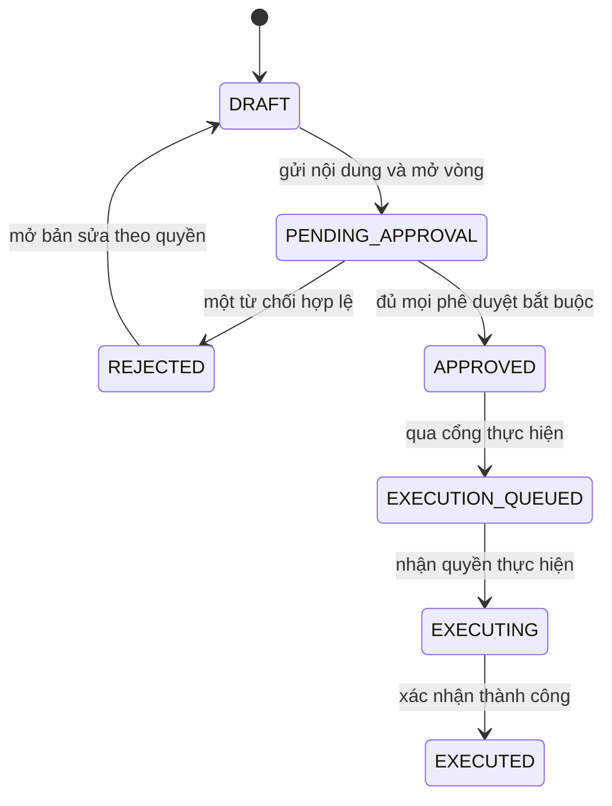

# Approval rejection handling: xử lý từ chối phê duyệt an toàn

Trong chương **Approval Workflows**, xử lý từ chối phê duyệt không chỉ là đặt `status = REJECTED` và gửi một thông báo. Quyết định từ chối phải chặn đúng hành động nghiệp vụ, áp dụng cho đúng vòng duyệt và đúng nội dung, đồng thời không bị một yêu cầu đến muộn hoặc một worker ghi đè.

Trong module bảo vệ logic nghiệp vụ, đây là điểm quan trọng để ngăn bỏ qua phê duyệt, sửa nội dung sau quyết định, thực hiện sai quyền hoặc gửi lặp để tạo kết quả khác. Một hệ thống có thể hiển thị “Đã từ chối” nhưng vẫn thực hiện chi tiền nếu cổng thực thi dựa vào dữ liệu cũ hoặc một thông điệp không được kiểm tra lại.

Bài học dùng đề nghị chi tiền có hai nhóm duyệt bắt buộc. Các mức tiền và quy tắc tổ chức phải do nghiệp vụ thực tế xác định; ví dụ tập trung vào cơ chế thực thi quyết định.

Sau bài này, bạn có thể:

- Phân biệt từ chối nghiệp vụ với lỗi quyền, lỗi kỹ thuật và yêu cầu bổ sung thông tin.
- Xác định hiệu lực của một quyết định từ chối trong quy trình nhiều người duyệt.
- Gắn quyết định với vòng duyệt, bản nội dung và chủ thể có thẩm quyền.
- Thiết kế từ chối, gửi lại và thực hiện trong các ranh giới transaction rõ ràng.
- Kiểm thử thao tác đồng thời, yêu cầu lặp và sự kiện cũ sau khi bị từ chối.

## 1. Từ chối phải tạo ra hệ quả nghiệp vụ xác định

Xét quy trình:

```text
Soạn đề nghị → Gửi duyệt → Duyệt nghiệp vụ và tài chính → Thực hiện chi
```

Giả sử người duyệt tài chính từ chối vì thông tin người nhận không khớp. Những hệ quả cần rõ ràng:

- Đề nghị hiện tại không đủ điều kiện thực hiện chi.
- Những nhiệm vụ duyệt chưa hoàn tất của cùng vòng được đóng theo chính sách.
- Một quyết định đồng ý cũ không thể khôi phục quyền thực hiện.
- Người tạo có thể đọc lý do được phép công bố và biết hành động tiếp theo.
- Nếu được sửa và gửi lại, hệ thống mở một vòng duyệt mới với bằng chứng phù hợp.

Nếu ứng dụng chỉ đổi nhãn trên giao diện nhưng để trường `approved=true`, giữ một lệnh chi đã lên lịch hoặc cho API cập nhật chung đặt lại `APPROVED`, quyết định từ chối chưa được thực thi đầy đủ.

Câu hỏi thiết kế là:

> Sau khi từ chối được commit, điều gì bảo đảm nội dung bị từ chối không thể tiếp tục qua cổng thực hiện của vòng đó?

Câu trả lời phải nằm trong dữ liệu có thẩm quyền, điều kiện thực thi và cơ chế kiểm soát cạnh tranh, không chỉ trong email hoặc màn hình thông báo.

## 2. Phân biệt các kết quả dễ bị gộp chung

| Kết quả | Ý nghĩa | Cách xử lý trạng thái |
| --- | --- | --- |
| Từ chối nghiệp vụ | Người có thẩm quyền quyết định không chấp nhận nội dung đã xét | Ghi quyết định `REJECT` và kết thúc vòng theo chính sách |
| Yêu cầu chỉnh sửa | Chưa chấp nhận; cho phép bổ sung theo một đường đi đã định nghĩa | Dùng trạng thái hoặc hành động riêng như `CHANGES_REQUESTED` |
| Không có quyền từ chối | Người gọi không được đưa ra quyết định trên nhiệm vụ này | Từ chối request; không tạo quyết định nghiệp vụ |
| Xung đột phiên bản | Người gọi đang quyết định trên dữ liệu không còn hiện hành | Không áp dụng quyết định vào bản mới; yêu cầu tải lại |
| Hết hạn hoặc bị hủy | Vòng không còn mở theo một quy tắc khác | Ghi nguyên nhân kết thúc tương ứng, không giả thành người duyệt từ chối |
| Lỗi kỹ thuật | Không xác định hoặc không lưu được kết quả | Rollback hoặc giữ trạng thái an toàn để retry, không bịa ra quyết định |

Ví dụ, dịch vụ kiểm tra hạn mức không phản hồi không có nghĩa người duyệt đã từ chối. Hệ thống có thể chặn việc tiến tới thực hiện trong lúc thiếu dữ liệu, nhưng phải giữ nguyên ý nghĩa rằng kết quả nghiệp vụ chưa được xác lập.

Tương tự, request từ chối thành công có thể nhận HTTP `200` với kết quả nghiệp vụ `REJECTED`. Nó không phải lỗi HTTP `403`: `403` thường biểu diễn người gọi không được phép thực hiện hành động. Cách dùng `404`, `409` hoặc mã lỗi khác cần nhất quán với hợp đồng API và chính sách tiết lộ tài nguyên.

Không biến mọi lỗi thành “Từ chối thành công” để đơn giản hóa giao diện. Người dùng và tiến trình tự động cần phân biệt được quyết định đã commit với một lần thử chưa có hiệu lực.

## 3. Xác định chính sách nhiều người duyệt trước khi viết mã

Trong ví dụ, một đề nghị phải có hai nhiệm vụ:

1. Duyệt nghiệp vụ, ký hiệu `BUSINESS`.
2. Duyệt tài chính, ký hiệu `FINANCE`.

Chính sách áp dụng cho mỗi vòng:

- Cả hai nhiệm vụ đều phải đồng ý thì vòng mới `APPROVED`.
- Một quyết định từ chối hợp lệ là đủ để kết thúc vòng thành `REJECTED`.
- Người tạo không được tự duyệt hoặc tự từ chối với tư cách người duyệt.
- Hai nhiệm vụ phải do hai người khác nhau thực hiện, kể cả khi một người có cả hai vai trò.
- Mỗi nhiệm vụ chỉ có một quyết định có hiệu lực trong vòng đó.
- Chỉ nhận quyết định mới khi vòng còn `OPEN` và nhiệm vụ còn `PENDING`.
- Sau khi vòng kết thúc, không dùng thao tác từ chối thông thường để sửa lại quyết định đã chốt.

Đây là chính sách có quyền phủ quyết trong khi vòng còn mở. Không nên mặc định mọi hệ thống đều như vậy. Quy trình khác có thể dùng số phiếu tối thiểu, thứ tự nhiều cấp hoặc một nhóm có quyền phủ quyết riêng.

| Chính sách | Khi có một phiếu từ chối |
| --- | --- |
| Tất cả nhóm bắt buộc đồng ý, bất kỳ nhóm nào được phủ quyết | Kết thúc từ chối khi phiếu hợp lệ được commit |
| Cần ít nhất một số lượng phiếu đồng ý | Cần quy tắc riêng về phiếu chống và số phiếu còn khả dụng |
| Phải duyệt lần lượt theo cấp | Chỉ nhiệm vụ đang được mở ở cấp phù hợp mới được quyết định |
| Có nhóm phủ quyết đặc biệt | Không thể chỉ đếm tổng số phiếu đồng ý và phiếu chống |

Đặc biệt, “chưa có ai từ chối” không đồng nghĩa “đã được duyệt”. Nếu chưa có bất kỳ quyết định nào hoặc thiếu một nhóm bắt buộc, vòng vẫn chưa đủ điều kiện thực hiện.

## 4. Vòng duyệt và bản nội dung là phạm vi của quyết định

Một đề nghị có thể được gửi duyệt nhiều lần. Cần tách:

- **Đề nghị**: đối tượng nghiệp vụ tồn tại xuyên suốt các lần sửa.
- **Bản nội dung**: dữ liệu bất biến mà người duyệt thực sự đã xem.
- **Vòng duyệt**: lần thu thập quyết định theo một chính sách cụ thể.
- **Nhiệm vụ duyệt**: yêu cầu một nhóm hoặc người có thẩm quyền đưa ra quyết định.
- **Quyết định**: sự kiện đồng ý hoặc từ chối của chủ thể hợp lệ trên nhiệm vụ đó.

Ví dụ:

```text
Đề nghị PR-42
  ├─ Nội dung S3, vòng R8: REJECTED vì sai người nhận
  └─ Nội dung S4, vòng R9: OPEN sau khi sửa và gửi lại
```

Quyết định của R8 vẫn được giữ để giải thích lịch sử. Nó không được tính là phiếu của R9. Ngược lại, một phiếu đồng ý đến muộn từ R8 không được áp dụng cho S4.

Một quyết định cần ràng buộc với:

```text
tenantId
requestId
approvalRoundId
approvalTaskId
contentSnapshotId
reviewerId
outcome
reasonCode và phần lý do phù hợp
decidedAt do máy chủ ghi
```

Bản nội dung phải bao gồm các dữ liệu ảnh hưởng quyết định như số tiền, loại tiền, người nhận, tài khoản nhận, mục đích chi và đơn vị chịu chi theo mô hình của hệ thống. Không được đổi tài khoản nhận sau khi duyệt rồi giữ nguyên quyết định.

ID snapshot chỉ có ý nghĩa nếu nội dung phía sau là bất biến hoặc được bảo vệ bằng cơ chế phiên bản tương đương. Client tự gửi `snapshotId` không chứng minh đã có người duyệt snapshot đó.

## 5. Máy trạng thái cho nhánh từ chối

Một luồng đơn giản:



`REJECTED → DRAFT` ở đây là hành động chuẩn bị bản sửa của đề nghị. Nó không mở lại vòng đã từ chối. Khi gửi tiếp, hệ thống tạo vòng mới và tính lại những nhiệm vụ cần thiết theo chính sách áp dụng.

Những đường đi bị cấm trong mô hình:

- `REJECTED → EXECUTION_QUEUED`: thực hiện nội dung chưa được duyệt lại.
- `REJECTED → APPROVED` qua API sửa trạng thái: bỏ qua vòng duyệt.
- `PENDING_APPROVAL → EXECUTING`: bỏ qua đủ phê duyệt và bước nhận quyền thực hiện.
- Ghi `REJECTED` bằng lệnh từ chối thông thường khi đã `EXECUTING`: tạo một nhãn không phản ánh hiệu ứng đang xảy ra.

Nếu doanh nghiệp cần thu hồi phê duyệt sau `APPROVED`, hãy mô hình hóa `REVOKE_APPROVAL` hoặc yêu cầu dừng riêng, cùng ranh giới có thể dừng và các điều kiện bù trừ. Không âm thầm mở rộng `REJECT` thành hành động có thể đảo ngược mọi trạng thái.

## 6. API từ chối thể hiện ý định, không cấp quyền sửa trạng thái

Ví dụ:

```http
POST /payment-requests/pr-42/approval-rounds/r8/tasks/finance/reject
Idempotency-Key: reject-pr42-r8-finance-01
Content-Type: application/json

{
  "expectedRequestVersion": 17,
  "expectedRoundVersion": 4,
  "reasonCode": "PAYEE_MISMATCH",
  "reviewerNote": "Thông tin người nhận không khớp hồ sơ đã đối chiếu"
}
```

Máy chủ phải kiểm tra:

1. Danh tính lấy từ ngữ cảnh đã xác thực, không lấy `reviewerId` do body khai báo.
2. Đề nghị, vòng và nhiệm vụ thuộc cùng tổ chức và liên kết với nhau.
3. R8 là vòng hiện tại được phép nhận quyết định của PR-42.
4. Người gọi có quyền quyết định nhiệm vụ tài chính này, đủ phạm vi và không vi phạm phân tách trách nhiệm.
5. Nhiệm vụ còn mở; người gọi chưa có quyết định loại trừ việc đưa ra quyết định mới theo chính sách.
6. Bản nội dung gắn với nhiệm vụ khớp bản được xét ở vòng hiện tại.
7. Phiên bản client đã xem còn phù hợp.
8. Mã lý do và ghi chú đạt yêu cầu dữ liệu.

Một người có thể được đọc đề nghị nhưng không được từ chối. Một người có vai trò tài chính cũng không mặc nhiên được xử lý mọi đề nghị ở mọi đơn vị hoặc tenant.

Phản hồi thành công có thể trả:

```json
{
  "requestId": "pr-42",
  "roundId": "r8",
  "decisionId": "d-91",
  "requestState": "REJECTED",
  "roundState": "REJECTED",
  "requestVersion": 18
}
```

Các giá trị này chỉ được trả là thành công sau commit. Nếu quyền bị từ chối, phiên bản xung đột hoặc lưu dữ liệu thất bại, không tạo một quyết định giả để có cùng cấu trúc phản hồi.

## 7. Lưu quyết định và đóng vòng trong một transaction

Một mô hình dữ liệu có thể gồm:

| Thành phần | Trách nhiệm |
| --- | --- |
| `payment_request` | Trạng thái đề nghị, bản nội dung hiện tại, vòng hiện tại và version |
| `approval_round` | Snapshot, phiên bản chính sách, trạng thái và thời điểm đóng vòng |
| `approval_task` | Nhóm bắt buộc, phạm vi người được quyết định và trạng thái nhiệm vụ |
| `approval_decision` | Quyết định đã ghi, chủ thể thực hiện và lý do |
| `outbox` | Ý định phát sự kiện hoặc thông báo gắn với commit |
| Bản ghi idempotency | Nhận diện một lệnh và kết quả đã commit |

Quyết định đã ghi không nên bị sửa qua đường cập nhật thông thường. Nếu cần đính chính thông tin, lưu sự kiện đính chính có thẩm quyền và giữ được lịch sử; không thay trực tiếp người quyết định hoặc kết quả của vòng cũ.

Luồng xử lý từ chối:

```text
BEGIN TRANSACTION
  nhận quyền xử lý idempotency key
  nếu đã hoàn tất cùng lệnh: kiểm tra quyền xem và trả kết quả cũ

  tải và khóa đề nghị trong phạm vi truy cập
  tải và khóa vòng hiện tại, sau đó nhiệm vụ theo thứ tự khóa thống nhất
  kiểm tra quyền theo đối tượng và phân tách trách nhiệm
  kiểm tra version, vòng OPEN, nhiệm vụ PENDING và snapshot
  xác thực mã lý do, độ dài và dữ liệu ghi chú

  ghi quyết định REJECT cho nhiệm vụ
  chuyển nhiệm vụ đó thành REJECTED
  chuyển vòng thành REJECTED theo chính sách phủ quyết
  chuyển đề nghị thành REJECTED nếu vẫn thuộc đúng vòng hiện tại
  đóng các nhiệm vụ còn PENDING của vòng với lý do vòng đã kết thúc
  xử lý phần giữ tài nguyên theo phạm vi và chính sách tương ứng
  ghi audit, outbox và kết quả idempotency
COMMIT
```

Nếu bước bắt buộc nào thất bại, rollback các thay đổi cục bộ. Không được có quyết định từ chối đã lưu nhưng đề nghị vẫn được coi là đủ điều kiện thực hiện vì một nửa cập nhật bị bỏ lại.

Các nhiệm vụ còn lại có thể mang trạng thái `CLOSED_BY_ROUND_REJECTION`. Không gán chúng thành `REJECTED` bởi những người chưa từng đưa ra quyết định. Lịch sử cần phản ánh đúng ai thực sự quyết định và ai chỉ có nhiệm vụ bị đóng.

Ràng buộc duy nhất theo nhiệm vụ trong vòng giúp chặn hai quyết định có hiệu lực cho cùng nhiệm vụ. Các ràng buộc quan hệ cần ngăn liên kết chéo tổ chức, đề nghị hoặc vòng. Chúng bổ sung cho kiểm tra quyền, không thay thế nó.

## 8. Minh họa Java: tổng hợp kết quả của vòng hiện tại

Đoạn mã sau minh họa chính sách hai nhóm bắt buộc, bất kỳ từ chối hợp lệ nào cũng kết thúc vòng. Nó tổng hợp các quyết định đã được xác thực và tải từ dữ liệu máy chủ. Nó không phải API nhận phiếu trực tiếp từ client. Ví dụ dùng record của Java 16 trở lên.

```java
import java.util.HashMap;
import java.util.HashSet;
import java.util.List;
import java.util.Map;
import java.util.Objects;
import java.util.Set;
import java.util.UUID;

record DecisionScope(
        UUID tenantId,
        UUID requestId,
        UUID roundId,
        UUID snapshotId) {
}

enum DecisionOutcome {
    APPROVE, REJECT
}

enum RoundResult {
    OPEN, APPROVED, REJECTED
}

record RecordedDecision(
        DecisionScope scope,
        String taskKey,
        UUID reviewerId,
        DecisionOutcome outcome) {
}

final class RoundDecisionPolicy {
    private RoundDecisionPolicy() {
    }

    static RoundResult resolve(
            DecisionScope current,
            Set<String> requiredTasks,
            List<RecordedDecision> decisions) {
        Objects.requireNonNull(current);
        Set<String> required = Set.copyOf(requiredTasks);
        require(!required.isEmpty(), "REQUIRED_TASKS_EMPTY");

        Map<String, RecordedDecision> byTask = new HashMap<>();
        Set<UUID> reviewers = new HashSet<>();

        for (RecordedDecision decision : List.copyOf(decisions)) {
            require(current.equals(decision.scope()),
                    "DECISION_SCOPE_MISMATCH");
            require(required.contains(decision.taskKey()),
                    "UNEXPECTED_TASK");
            require(decision.reviewerId() != null,
                    "REVIEWER_REQUIRED");
            require(decision.outcome() != null,
                    "OUTCOME_REQUIRED");
            require(byTask.putIfAbsent(decision.taskKey(), decision) == null,
                    "DUPLICATE_TASK_DECISION");
            require(reviewers.add(decision.reviewerId()),
                    "DISTINCT_REVIEWERS_REQUIRED");
        }

        boolean rejected = byTask.values().stream()
                .anyMatch(d -> d.outcome() == DecisionOutcome.REJECT);
        if (rejected) {
            return RoundResult.REJECTED;
        }

        return byTask.keySet().containsAll(required)
                ? RoundResult.APPROVED
                : RoundResult.OPEN;
    }

    private static void require(boolean condition, String code) {
        if (!condition) {
            throw new IllegalStateException(code);
        }
    }
}
```

Trong ví dụ, `requiredTasks` được lấy từ chính sách đã gắn với vòng, chẳng hạn `Set.of("BUSINESS", "FINANCE")`. Không cho client gửi tập nhiệm vụ bắt buộc rỗng để biến một vòng chưa có phiếu thành được duyệt.

Đoạn mã có các giới hạn cần hiểu đúng:

- Nó không tự xác minh người ghi phiếu có quyền với nhóm nhiệm vụ. Việc đó phải được thực hiện trước khi ghi quyết định.
- Nó không kiểm tra người duyệt khác người tạo vì chưa nhận dữ liệu người tạo; quy tắc đó thuộc bước nhận quyết định.
- Nó chỉ tính trên quyết định của đúng vòng và snapshot. Dữ liệu chéo phạm vi gây lỗi thay vì bị tính nhầm.
- Nó phát hiện dữ liệu cấu trúc không hợp lệ; ứng dụng phải rollback hoặc chặn thực hiện, không bắt lỗi rồi mặc định trả `APPROVED`.
- Nó không ngăn cập nhật đồng thời. Việc nhận phiếu và ghi kết quả phải dùng transaction cùng cơ chế kiểm soát cạnh tranh.

Hàm tổng hợp không được dùng để mở lại một vòng đã đóng mỗi khi có sự kiện mới. Trạng thái kết thúc và việc nhận thêm quyết định vẫn do các guard của vòng kiểm soát.

## 9. Cổng thực hiện phải kiểm tra kết quả có thẩm quyền

Một worker không được dựa vào những điều kiện yếu như:

```text
không tìm thấy phiếu REJECT
hoặc đã từng nhận sự kiện Approved
hoặc trường approved trên bản chiếu bằng true
```

Trước khi nhận quyền thực hiện, cần bảo đảm:

```text
đề nghị đang APPROVED theo dữ liệu có thẩm quyền
AND vòng được tham chiếu là vòng hiện tại của đề nghị
AND vòng đó kết thúc APPROVED theo chính sách của nó
AND snapshot thực hiện trùng snapshot đã duyệt
AND đủ các nhiệm vụ bắt buộc, không có quyết định từ chối hiệu lực trong vòng
AND không hết hiệu lực hoặc bị thu hồi theo quy tắc áp dụng
AND chủ thể có quyền thực hiện trên đối tượng này
AND các guard khác như ngân sách và chống thực hiện trùng vẫn đúng
```

Từ chối ở vòng cũ không làm mọi vòng sau vĩnh viễn bị chặn. Ngược lại, đồng ý ở vòng cũ cũng không cấp quyền cho vòng hiện tại. Truy vấn quyết định phải có phạm vi chính xác, không chỉ `WHERE request_id = ...` rồi đếm tất cả lịch sử.

Việc kiểm tra và chuyển sang trạng thái đã nhận quyền thực hiện cần có một ranh giới nguyên tử phù hợp. Kiểm tra từ cache rồi gửi lệnh ra ngoài trước khi ghi nhận quyền thực hiện có thể cho phép một quyết định cũ gây hiệu ứng.

Thông điệp chỉ nên chỉ ra đối tượng và định danh thao tác cần xử lý, không trở thành giấy phép vĩnh viễn để bỏ qua dữ liệu hiện tại. Worker cần xác minh message vẫn áp dụng cho đúng vòng và snapshot trước khi tạo hiệu ứng mới.

## 10. Tranh chấp giữa đồng ý, từ chối và thực hiện

### Hai quyết định cho cùng nhiệm vụ

Người duyệt mở hai tab: một tab đồng ý, tab còn lại từ chối. Cả hai gửi gần như đồng thời. Theo chính sách ví dụ, chỉ một quyết định được commit cho nhiệm vụ đó; yêu cầu còn lại nhận xung đột hoặc kết quả của cùng ý định nếu thật sự là retry.

Không dùng “lần ghi cuối thắng”. Nếu quyết định bị thay thế tùy thứ tự request tới, audit và trạng thái tổng hợp có thể không khớp nhau.

### Từ chối trong khi nhóm khác đồng ý

Nếu vòng còn mở và một từ chối hợp lệ được commit, vòng kết thúc `REJECTED`. Một request đồng ý của nhóm còn lại phải kiểm tra lại vòng sau khi giành quyền cập nhật và không được chuyển nó thành `APPROVED`.

Nếu một quyết định cuối cùng đã chốt vòng trước, request đến sau không tự có quyền thay đổi kết quả. Trong mô hình hai nhiệm vụ, người đã đưa ra phiếu đồng ý không thể gửi một phiếu từ chối mới để thay thế sau khi vòng đóng. Nếu cần quyền thu hồi quyết định, phải có hành động và chính sách riêng.

### Từ chối trong khi worker đang chuẩn bị chi

Theo mô hình này, worker chỉ nhận quyền thực hiện từ một vòng đã `APPROVED`; lệnh từ chối thông thường chỉ nhận khi vòng còn `OPEN`. Các điều kiện trên cùng dữ liệu có thẩm quyền và giao thức transaction phải loại trừ việc cả hai cùng hợp lệ.

Nếu hệ thống mở rộng để cho phép thu hồi sau duyệt, cần xác định điểm không còn có thể dừng. Trước điểm đó có thể chặn hoặc hủy ý định đang chờ bằng cập nhật nguyên tử. Sau khi tác dụng bên ngoài có thể đã xảy ra, phải đối soát hoặc bù trừ; không chỉ đổi nhãn thành `REJECTED`.

Việc gửi thêm một message “đã từ chối” không bảo đảm message chi tiền trước đó chưa được xử lý. Thứ tự hàng đợi và thứ tự đến giữa các dịch vụ không thay thế cơ chế nhận quyền thực hiện.

## 11. Lý do từ chối: đủ giải thích và đúng phạm vi xem

Lý do nên có mã cấu trúc và phần giải thích phù hợp:

| Thành phần | Ví dụ | Mục đích |
| --- | --- | --- |
| Mã lý do | `PAYEE_MISMATCH` | Xử lý nhất quán, thống kê và hướng dẫn sửa |
| Ghi chú được phép chia sẻ | “Kiểm tra lại thông tin người nhận trong hồ sơ” | Giúp người tạo biết phải làm gì tiếp theo |
| Ghi chú nội bộ nếu cần | Chi tiết đối chiếu chỉ nhóm có quyền được xem | Lưu căn cứ mà không công bố quá phạm vi |

Máy chủ cần kiểm tra mã thuộc tập được hỗ trợ, phần giải thích bắt buộc khi chính sách yêu cầu và độ dài nằm trong giới hạn. Không để người gọi tự gán một mã đặc biệt có tác dụng miễn kiểm tra hoặc thay đổi người duyệt vòng sau.

Văn bản tự do là dữ liệu, không phải HTML đáng tin cậy hay chỉ thị cho worker. Khi hiển thị ở web hoặc đưa vào thông báo, xử lý đầu ra theo ngữ cảnh để nội dung ghi chú không trở thành mã thực thi.

Không đưa toàn bộ ghi chú nội bộ, dữ liệu nhạy cảm hoặc tín hiệu phát hiện lạm dụng vào phản hồi cho mọi người xem đề nghị. Quyền xem trạng thái không nhất thiết bao gồm quyền xem mọi căn cứ điều tra.

Tách quyền đọc ghi chú ngay ở API và dữ liệu phản hồi. Chỉ ẩn một khối trên giao diện trong khi API vẫn trả đầy đủ không tạo ra giới hạn truy cập.

## 12. Gửi lại sau từ chối mà không kế thừa sai quyền

Một quy trình sửa và gửi lại có thể làm như sau:

1. Giữ nguyên vòng đã từ chối và quyết định của nó để audit.
2. Cho người có quyền tạo bản sửa nháp của đề nghị.
3. Tính lại giá trị và kiểm tra nội dung phía máy chủ khi gửi.
4. Tạo snapshot mới nếu nội dung thay đổi và mở vòng duyệt mới.
5. Xác định lại nhóm, người duyệt và hạn mức theo chính sách được chọn cho lần gửi này.
6. Tạo các nhiệm vụ mới; không sao chép phiếu đồng ý cũ thành phiếu có hiệu lực.
7. Cập nhật vòng hiện tại cùng dữ liệu đề nghị trong transaction phù hợp.

Ngay cả khi nội dung không đổi, mở một vòng mới không đồng nghĩa tự có phê duyệt. Chính sách phải quy định rõ ai được yêu cầu xem xét lại và có điều kiện gì để tránh gửi lặp nhằm tìm người duyệt dễ chấp nhận hơn.

Nếu nghiệp vụ cho phép kế thừa một phần kiểm tra, phải nêu chính xác bằng chứng nào có thể dùng lại, phụ thuộc dữ liệu gì và còn hiệu lực bao lâu. Không dùng một cờ `keepPreviousApprovals=true` do client gửi để bỏ qua các nhóm bắt buộc.

Những dữ liệu làm đổi tuyến duyệt như đơn vị, người nhận, số tiền hoặc phân loại chi cần được kiểm chứng. Hệ thống cũng nên xét các cách chia nhỏ hoặc liên tục sửa đề nghị nhằm né chính sách khi chúng nằm trong phạm vi quy tắc nghiệp vụ của sản phẩm.

## 13. Idempotency và quyết định đến muộn

Sau khi từ chối đã commit nhưng kết nối bị đứt, người duyệt có thể gửi lại cùng lệnh. Máy chủ cần trả kết quả cũ mà không tạo thêm một quyết định hoặc một lần thông báo thành công mới.

| Tình huống | Xử lý mong muốn |
| --- | --- |
| Cùng key, cùng vòng, nhiệm vụ và payload có ý nghĩa | Trả quyết định đã ghi; không thực thi lại |
| Cùng key nhưng đổi lý do, snapshot hoặc nhiệm vụ | Từ chối tái sử dụng key cho một ý định khác |
| Key khác nhưng nhiệm vụ đã có quyết định | Quy tắc nhiệm vụ và ràng buộc duy nhất ngăn ghi quyết định mới trái chính sách |
| Lệnh từ vòng cũ tới sau khi mở vòng mới | Không áp dụng vào vòng hiện tại; báo trạng thái hoặc xung đột phù hợp |
| Sự kiện từ chối được gửi lại | Consumer không áp dụng hiệu ứng phụ lần nữa |

Phạm vi key có thể gồm tổ chức, chủ thể và loại thao tác. Dấu vân tay phải ràng buộc với đề nghị, vòng, nhiệm vụ và dữ liệu có ý nghĩa. Việc nhận quyền xử lý key phải được bảo vệ bằng ràng buộc bền vững, không chỉ kiểm tra cache rồi chạy.

Nhánh trả kết quả cũ vẫn phải kiểm tra chủ thể có quyền xem kết quả. Key không phải token cấp quyền. Khi bản ghi idempotency hết hạn, ràng buộc một quyết định cho một nhiệm vụ vẫn phải tồn tại theo mô hình dữ liệu và chính sách lưu trữ.

Một sự kiện có thể gồm `decisionId`, `roundId`, `snapshotId`, `requestId` và phiên bản sự kiện. Consumer dùng các định danh đó để khớp phạm vi, chống lặp và phát hiện dữ liệu lỗi thời, không chỉ thấy tên `ApprovalRejected` rồi cập nhật bất kỳ vòng nào của đề nghị.

## 14. Tài nguyên, thông báo và tác dụng phụ sau từ chối

Một đề nghị có thể đã giữ ngân sách, tồn kho hoặc hạn mức trước khi hoàn tất duyệt. Từ chối cần xử lý những phần giữ đó theo quyền sở hữu và trạng thái thực tế.

Nếu phần giữ và vòng duyệt cùng cơ sở dữ liệu, có thể giải phóng nguyên tử khi đóng vòng, với điều kiện chỉ giải phóng phần còn được giữ và thuộc đúng vòng. Nếu ở dịch vụ khác, ghi ý định giải phóng vào outbox và theo dõi đến khi được xác nhận.

Đặc biệt, thông điệp giải phóng của R8 không được làm mất phần giữ mới của R9. Cần tham chiếu reservation hoặc định danh chủ sở hữu cụ thể, không chỉ một lệnh chung “trả toàn bộ tài nguyên của PR-42”.

Thông báo từ chối nên được phát từ ý định đã commit. Nếu gửi trước commit rồi transaction rollback, người tạo có thể nhận email từ chối cho một quyết định chưa từng có hiệu lực. Nếu gửi thông báo thất bại sau commit, retry việc gửi mà không đảo ngược quyết định.

Với inbox/outbox, ghi nhận sự kiện đã xử lý và cập nhật tác dụng phụ cục bộ trong ranh giới nguyên tử phù hợp. Outbox hỗ trợ độ bền của ý định gửi; bên nhận vẫn cần chống lặp cho hiệu ứng của nó.

Nếu đã có tiền được chuyển hoặc một tác dụng không thể đảo ngược tức thời, xử lý bằng quy trình đối soát, hủy hoặc bù trừ riêng. Xóa phiếu duyệt và đặt `REJECTED` không hoàn tác được giao dịch bên ngoài.

## 15. Kiểm thử quyết định từ chối như một ranh giới bảo vệ

### Quyền, phạm vi và nội dung

| Ca kiểm thử | Kết quả cần giữ |
| --- | --- |
| Người duyệt hợp lệ từ chối một nhiệm vụ đang mở | Có một quyết định, vòng và đề nghị kết thúc đúng chính sách |
| Người tạo có thêm vai trò duyệt tự xử lý | Bị chặn theo phân tách trách nhiệm |
| Người duyệt ở đơn vị hoặc tenant khác | Không ghi quyết định và không tiết lộ dữ liệu ngoài phạm vi |
| Dùng task của R8 với route trỏ R9 | Bị từ chối vì quan hệ không khớp |
| Body giả `reviewerId` hoặc trạng thái đích | Không điều khiển danh tính hay kết quả do máy chủ quản lý |
| Đổi người nhận hoặc số tiền sau khi mở vòng | Không dùng snapshot hoặc phiếu cũ cho nội dung mới |
| Thiếu nhóm duyệt bắt buộc nhưng không có phiếu chống | Vẫn chưa đủ điều kiện thực hiện |
| Một người cố quyết định hai nhiệm vụ phải độc lập | Bị chặn, không tính thành hai người duyệt |

### Đồng thời, lỗi và yêu cầu lặp

| Kịch bản | Kết quả cần giữ |
| --- | --- |
| Đồng ý và từ chối cùng nhiệm vụ từ hai tab | Chỉ một quyết định hợp lệ được commit |
| Nhóm A từ chối trong lúc nhóm B đồng ý | Không ghi đè vòng đã từ chối thành được duyệt |
| Lỗi sau insert quyết định nhưng trước đóng đề nghị | Transaction rollback, không để dữ liệu nửa chừng |
| Từ chối đã commit nhưng mất phản hồi | Retry cùng key trả quyết định cũ, không lặp hiệu ứng |
| Cùng key đổi lý do hoặc nhiệm vụ | Không tạo quyết định khác dưới cùng key |
| Đóng các nhiệm vụ còn lại | Không tạo phiếu từ chối giả cho người chưa quyết định |
| Gửi lại sau từ chối | Vòng mới không tự có phiếu đồng ý của vòng cũ |
| Message đồng ý cũ đến sau từ chối | Không mở lại hoặc phê duyệt vòng đã đóng |
| Message giải phóng cũ đến sau vòng mới | Không trả nhầm tài nguyên của vòng mới |

### Cổng thực hiện và hiển thị

- Gọi trực tiếp API thực hiện trên đề nghị `REJECTED`: không có lệnh chi, outbox thực hiện hoặc quyền thực hiện mới được tạo.
- Cho worker nhận message cũ sau khi vòng đã kết thúc: worker kiểm tra lại vòng và snapshot có thẩm quyền.
- Làm chậm bản chiếu trạng thái: cổng thực hiện không dựa vào cờ cũ trong cache để cho qua.
- Mô phỏng dịch vụ phê duyệt hoặc dữ liệu chính sách không khả dụng: không mặc định coi là đã duyệt.
- Gửi callback hoặc kết quả ngoài đến muộn: không gán nhầm cho vòng hiện tại và không che giấu hiệu ứng thật đã xảy ra.
- Xem đề nghị bằng người chỉ có quyền đọc trạng thái: không nhận ghi chú nội bộ ngoài quyền.
- Gửi nội dung ghi chú chứa ký tự đặc biệt: nội dung được hiển thị như dữ liệu trong đúng ngữ cảnh.

Kiểm tra cả dữ liệu phụ, không chỉ mã HTTP: quyết định, nhiệm vụ, trạng thái vòng, phần giữ tài nguyên, audit và outbox. Các ca cạnh tranh và rollback cần kiểm thử tích hợp với cơ sở dữ liệu phù hợp; mock cập nhật thành công không chứng minh ràng buộc hoặc khóa hoạt động.

## 16. Audit và quan sát vận hành

Một audit từ chối nên cho biết:

```text
ai đưa ra quyết định và theo phạm vi quyền nào
đề nghị, vòng, nhiệm vụ và snapshot nào được xét
kết quả, mã lý do, thời điểm máy chủ và định danh quyết định
phiên bản trước và sau của dữ liệu liên quan
những nhiệm vụ nào bị đóng theo hệ quả của vòng
tài nguyên nào đã giải phóng hoặc đang chờ giải phóng
mã tương quan và định danh sự kiện hoặc thao tác liên quan
```

Phân biệt rõ “đã thử từ chối nhưng không có quyền”, “xung đột khi gửi quyết định” và “quyết định từ chối đã commit”. Chỉ loại cuối cùng mới là bằng chứng từ chối nghiệp vụ.

Các tín hiệu đáng quan sát gồm số lần cố thực hiện đề nghị bị từ chối, quyết định cũ đến sai vòng, nhiều lần gửi lại không đổi nội dung và chênh lệch giữa trạng thái đề nghị với trạng thái vòng. Những tín hiệu này phục vụ điều tra; chúng không thay thế điều kiện chặn ngay tại cổng thực hiện.

Không ghi token, bí mật xác thực hoặc toàn bộ thông tin tài khoản nhận vào log chỉ để theo dõi quyết định. Giữ căn cứ cần thiết trong nơi lưu có quyền truy cập phù hợp và trả ra theo phạm vi người xem.

## 17. Cách thiết kế nhánh từ chối cho hệ thống của bạn

1. Xác định từ chối kết thúc nhiệm vụ, cấp duyệt hay toàn bộ vòng; ghi rõ chính sách nhiều người duyệt.
2. Phân biệt từ chối, yêu cầu sửa, hết hạn, hủy và lỗi kỹ thuật.
3. Gắn mỗi quyết định với đúng tổ chức, đối tượng, vòng, nhiệm vụ và nội dung bất biến.
4. Kiểm tra quyền theo đối tượng, phân tách trách nhiệm và trạng thái nhiệm vụ trước khi nhận quyết định.
5. Đóng vòng, cập nhật đề nghị và các dữ liệu bắt buộc trong transaction hoặc quy trình nhất quán được xác định rõ.
6. Thiết kế cổng thực hiện kiểm tra kết quả hiện hành, không dựa vào việc chưa thấy phiếu chống.
7. Mở vòng mới khi gửi lại theo chính sách; giữ lịch sử và không tự kế thừa phê duyệt cũ.
8. Bảo vệ retry, sự kiện muộn, giải phóng tài nguyên và thông báo bằng định danh cùng cơ chế chống lặp.
9. Kiểm thử quyết định đồng thời với thay đổi nội dung, đóng vòng và nhận quyền thực hiện.

Từ chối có hiệu lực khi nó thay đổi được những hành động hệ thống cho phép trên đúng phạm vi đã xét. Lưu đúng quyết định, đóng đúng vòng và kiểm tra đúng bằng chứng tại cổng thực hiện giúp kết quả đó tiếp tục được tôn trọng qua retry, gửi lại và xử lý bất đồng bộ.
