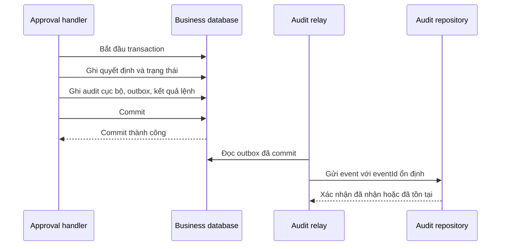

# Kiểm toán quy trình phê duyệt (Approval workflow audit)

Một quy trình phê duyệt cần chứng minh được nhiều hơn việc trường trạng thái hiện tại mang giá trị `APPROVED`. Khi có tranh chấp hoặc dấu hiệu lạm dụng, hệ thống phải giúp trả lời: ai đã yêu cầu, ai quyết định, quyết định áp dụng cho nội dung nào, quyền gì cho phép họ làm vậy và hành động nghiệp vụ nào đã thực sự xảy ra sau đó.

Nếu chỉ lưu `approvedBy` và `approvedAt` trên đối tượng, lần cập nhật tiếp theo có thể làm mất lịch sử. Nếu chỉ ghi log HTTP, việc endpoint trả thành công chưa chứng minh transaction đã commit hoặc tiền đã được giải ngân. Một bản ghi kiểm toán thiếu ngữ cảnh cũng có thể khiến quyết định hợp lệ của phiên bản cũ bị hiểu nhầm là phê duyệt cho nội dung mới.

Bài học thuộc chương **Approval Workflows** trong bảo mật logic nghiệp vụ. Trọng tâm là thiết kế dấu vết kiểm toán phục vụ việc tái dựng, phát hiện lạm dụng và giải thích quyết định, đồng thời bảo vệ chính dữ liệu kiểm toán khỏi sửa đổi hoặc truy cập sai quyền.

## 1. Phân biệt audit, log vận hành và dữ liệu quyết định

Ba loại dữ liệu này có liên hệ nhưng không thay thế nhau.

| Loại dữ liệu | Mục đích chính | Ví dụ |
|---|---|---|
| Dữ liệu nghiệp vụ | Xác định trạng thái và các quyết định có hiệu lực | Hồ sơ phê duyệt, quyết định của từng người, phiên bản nội dung |
| Audit nghiệp vụ | Ghi lại những hành động và thay đổi có ý nghĩa để kiểm chứng | Ai gửi duyệt, ai chấp thuận, chính sách nào áp dụng, thay đổi nào đã commit |
| Log vận hành | Chẩn đoán hoạt động kỹ thuật | Timeout, stack trace, thời gian xử lý, lỗi kết nối |
| Sự kiện tích hợp | Giao tiếp kết quả hoặc lệnh giữa các thành phần | Yêu cầu đã được duyệt, cần thực hiện giải ngân |

Ví dụ, một log `POST /approve -> 200` không tự chứng minh:

- Người gọi có quyền với đúng hồ sơ.
- Quyết định được gắn với đúng revision nội dung.
- Đã đủ các người duyệt độc lập.
- Sự kiện sau phê duyệt đã được xử lý.
- Không có thao tác sửa dữ liệu trực tiếp sau đó.

Ngược lại, audit không nhất thiết chứa mọi chi tiết kỹ thuật của request. Nó cần đủ dữ kiện nghiệp vụ và tham chiếu để liên kết với log vận hành khi cần.

### 1.1. Câu hỏi mà lịch sử cần trả lời

Một lịch sử có ích cần hỗ trợ các câu hỏi:

1. Ai thực sự thực hiện hành động, có đại diện cho ai không?
2. Đối tượng nào, tenant nào, vòng duyệt nào bị tác động?
3. Nội dung, số tiền, người thụ hưởng và phiên bản nào được xét?
4. Chính sách, thẩm quyền và điều kiện phân tách trách nhiệm nào được dùng?
5. Quyết định của một người đã thay đổi bước duyệt và toàn quy trình ra sao?
6. Thay đổi đã commit, bị từ chối, đang chờ hay chưa rõ kết quả?
7. Hành động sau phê duyệt đã được yêu cầu hay đã thực hiện thành công?
8. Có sự kiện sửa nội dung, hủy, chuyển người xử lý hoặc dùng quyền ngoại lệ không?

Không phải mọi câu trả lời đều nằm trong một bản ghi. Các định danh và tham chiếu phải cho phép nối chúng lại mà không dựa vào việc đoán từ chuỗi thông báo.

## 2. Mô hình đe dọa đối với dấu vết phê duyệt

Kiểm toán không chỉ phục vụ việc xem lịch sử thông thường. Nó cần tính đến người dùng và cả tài khoản vận hành có thể cố che giấu hành vi.

| Hành vi | Dấu vết cần có hoặc cơ chế cần bảo vệ |
|---|---|
| Tự phê duyệt qua tài khoản đại diện | Danh tính thực, chủ thể được đại diện và căn cứ ủy quyền |
| Thay giá hoặc người nhận sau khi được duyệt | Revision, snapshot và lịch sử làm mất hiệu lực quyết định |
| Duyệt đối tượng ngoài phạm vi | Kết quả từ chối và ngữ cảnh truy cập được phép ghi |
| Retry để tạo nhiều quyết định | Định danh lệnh, quyết định và lần phát lại |
| Dùng vai trò quản trị sửa trạng thái | Hành động ngoại lệ có căn cứ và thẩm quyền riêng |
| Xóa hoặc chỉnh sửa lịch sử | Phân quyền ghi, lưu nối tiếp và cơ chế phát hiện can thiệp |
| Chèn nội dung giả vào log | Sự kiện có cấu trúc, giới hạn trường do người dùng kiểm soát |
| Đọc hoặc xuất lịch sử tenant khác | Phân quyền truy vấn và audit thao tác xem, xuất nhạy cảm |

Một tài khoản ứng dụng có thể ghi thêm sự kiện không nên mặc nhiên có quyền sửa hoặc xóa toàn bộ lịch sử. Tương tự, quyền đọc audit không đồng nghĩa quyền duyệt giao dịch hoặc sửa chính sách.

## 3. Chọn những sự kiện cần ghi

Audit nên bám vào hành động có nghĩa trong vòng đời. Không chỉ ghi trạng thái cuối.

| Nhóm sự kiện | Dữ kiện chính |
|---|---|
| Tạo và gửi yêu cầu | Người gửi, đối tượng nguồn, vòng duyệt, snapshot, kế hoạch và chính sách |
| Ghi nhận quyết định | Người quyết định, bước, kết quả, căn cứ quyền, nội dung được xét |
| Thay đổi nội dung hoặc vòng duyệt | Revision cũ và mới, quyết định nào bị vô hiệu, lý do |
| Phân công và chuyển cấp | Người hoặc nhóm trước và sau, căn cứ, chủ thể thực hiện |
| Hủy, từ chối, hết hạn | Trạng thái trước và sau, tác nhân hoặc quy tắc kích hoạt |
| Ngoại lệ quản trị | Thẩm quyền ngoại lệ, lý do, tham chiếu phê chuẩn nếu có |
| Hành động sau phê duyệt | Định danh thao tác, liên kết quyết định, đã yêu cầu hay đã xác nhận thực thi |
| Lần thử bị chặn | Loại hành động, mã lý do an toàn, chủ thể và phạm vi được phép ghi |
| Xem hoặc xuất lịch sử nhạy cảm | Người truy cập, phạm vi dữ liệu, mục đích hoặc căn cứ theo chính sách |

Tên sự kiện nên phản ánh đúng điều đã xảy ra. Ví dụ:

```text
APPROVAL_REQUEST_SUBMITTED
APPROVAL_DECISION_RECORDED
APPROVAL_CONTENT_SUPERSEDED
APPROVAL_ASSIGNMENT_CHANGED
APPROVAL_REQUEST_CANCELLED
APPROVAL_EXECUTION_REQUESTED
APPROVAL_EXECUTION_CONFIRMED
APPROVAL_ACTION_REJECTED
APPROVAL_HISTORY_EXPORTED
```

### 3.1. Một quyết định không phải lúc nào cũng kết thúc quy trình

Trong quy trình cần hai người duyệt hoặc nhiều cấp, quyết định `APPROVE` của một người có thể chỉ tăng số quyết định hợp lệ tại một bước. Yêu cầu vẫn ở `OPEN`.

Audit phải phân biệt:

```text
Người A đã chấp thuận một nội dung
    ≠ bước duyệt đã đủ quorum
    ≠ toàn bộ yêu cầu đã được phê duyệt
    ≠ hành động sau phê duyệt đã thực thi
```

Nếu một lệnh tạo ra nhiều thay đổi có nghĩa, có thể ghi nhiều sự kiện liên kết cùng command và transaction nghiệp vụ. Không suy luận mọi cấp đã duyệt chỉ vì tìm thấy một sự kiện quyết định tích cực.

### 3.2. Không biến mọi lần đọc thành quyết định nghiệp vụ

Một người mở trang xem hồ sơ chưa có nghĩa họ đã xem xét hay chấp thuận nội dung. Nếu cần ghi việc truy cập, dùng sự kiện truy cập riêng.

Tương tự, việc hệ thống đã gửi email mời duyệt không chứng minh người nhận đã đọc và không thay thế quyết định có danh tính, quyền và nội dung rõ ràng.

## 4. Thiết kế bản ghi audit có cấu trúc

Một bản ghi thường cần các nhóm trường sau:

| Nhóm | Trường minh họa | Ý nghĩa |
|---|---|---|
| Định danh | `eventId`, `eventType`, `schemaVersion` | Nhận diện và giải mã sự kiện |
| Phạm vi | `tenantId`, `approvalRequestId`, `subjectId` | Gắn với đúng đối tượng và tổ chức |
| Phiên bản | `approvalRound`, `contentRevision`, `policyVersion` | Xác định ngữ cảnh quyết định |
| Chủ thể | `actorId`, `actorType`, `onBehalfOf`, `delegationRef` | Phân biệt người gọi thực và đại diện |
| Thay đổi | `action`, `outcome`, `before`, `after` | Mô tả điều đã xảy ra |
| Thẩm quyền | `authorizationContextRef`, `assignmentRef` | Tham chiếu căn cứ cho phép |
| Liên kết | `commandId`, `decisionId`, `correlationId`, `causationId` | Nối các sự kiện và lần xử lý |
| Thứ tự | `aggregateSequence`, `aggregateVersion` | Tái dựng trong phạm vi đối tượng |
| Thời gian | `occurredAt`, `recordedAt` | Phân biệt thời điểm có ý nghĩa và thời điểm tiếp nhận |

Không phải trường nào cũng bắt buộc với mọi loại sự kiện. Schema cần quy định trường bắt buộc theo loại, tránh việc chấp nhận một bản ghi quyết định không có revision hoặc danh tính.

### 4.1. Ví dụ một quyết định chưa đủ quorum

Ví dụ dưới đây ghi quyết định đầu tiên trong bước cần hai người độc lập:

```json
{
  "schemaVersion": 1,
  "eventId": "AE-9018",
  "eventType": "APPROVAL_DECISION_RECORDED",
  "tenantId": "tenant-A",
  "approvalRequestId": "APR-907",
  "subjectId": "PO-410",
  "approvalRound": 3,
  "contentRevision": 12,
  "snapshotRef": "SNAP-PO410-R12",
  "policyVersion": "purchase-policy-7",
  "actor": {
    "actorId": "user-42",
    "actorType": "HUMAN",
    "onBehalfOf": null,
    "delegationRef": null
  },
  "action": {
    "stageId": "finance-review",
    "decisionId": "DEC-660",
    "decision": "APPROVE"
  },
  "before": {
    "requestState": "OPEN",
    "validApprovalsAtStage": 0
  },
  "after": {
    "requestState": "OPEN",
    "validApprovalsAtStage": 1
  },
  "authorizationContextRef": "AUTHZ-771",
  "commandId": "CMD-553",
  "correlationId": "CORR-18",
  "aggregateSequence": 18,
  "aggregateVersion": 11,
  "occurredAt": "2026-11-22T03:00:00Z"
}
```

Số lượng phê duyệt giúp diễn giải thay đổi nhưng không thay thế danh tính của từng quyết định. Kiểm tra quorum phải dựa trên các quyết định đủ điều kiện, đúng revision và thỏa quy tắc độc lập.

Các định danh trong ví dụ là dữ liệu phía máy chủ. Client không được tự nộp một JSON tương tự để biến nó thành bằng chứng đã được duyệt.

### 4.2. Phân biệt các định danh

- `eventId` nhận diện một sự kiện audit, dùng để khử trùng lặp khi truyền đi.
- `commandId` nhận diện một lần thực thi lệnh có nghĩa.
- `decisionId` nhận diện quyết định nghiệp vụ.
- `correlationId` liên kết các hoạt động phục vụ theo dõi, không tự chứng minh quan hệ nghiệp vụ.
- `causationId` có thể chỉ ra sự kiện hoặc lệnh trực tiếp gây ra sự kiện hiện tại.

Không dùng một correlation ID do client cung cấp làm danh tính người gọi hoặc khóa duy nhất của quyết định. Dữ liệu hỗ trợ truy vết và bằng chứng thẩm quyền có mục đích khác nhau.

## 5. Lấy dữ kiện từ nơi có thẩm quyền

Audit chỉ đáng tin khi các trường quan trọng phản ánh dữ liệu mà hệ thống thực sự dùng để ra quyết định.

| Dữ kiện | Nguồn nên dùng |
|---|---|
| Danh tính thực | Ngữ cảnh xác thực đã được kiểm chứng |
| Tenant và phạm vi đối tượng | Ngữ cảnh được cấp quyền cùng dữ liệu truy vấn có giới hạn |
| Nội dung được duyệt | Snapshot hoặc revision mà policy đã kiểm tra |
| Chính sách áp dụng | Phiên bản chính sách có thẩm quyền tại mốc được quy định |
| Trạng thái trước và sau | Dữ liệu trong transaction xử lý thay đổi |
| Quyết định đã được chấp nhận | Kết quả của handler và policy nghiệp vụ |
| Thời điểm ghi nhận | Đồng hồ phía máy chủ theo quy ước của hệ thống |

Không chép trực tiếp các trường `actorId`, `approvedBy`, `tenantId`, `policyPassed` hoặc `newState` từ body vào bản ghi thành công.

Nội dung như bình luận và lý do vẫn có thể do người dùng nhập. Cần phân biệt nó với dữ kiện do hệ thống xác nhận, giới hạn kích thước và xử lý an toàn khi hiển thị hoặc xuất.

### 5.1. Danh tính đại diện và dịch vụ

Nếu tài khoản dịch vụ thực hiện thay một người, chỉ ghi tên dịch vụ có thể không đủ để phát hiện tự duyệt. Ngược lại, chỉ ghi người được đại diện có thể che khuất tài khoản thực sự gọi.

Nên giữ được danh tính thực, chủ thể được đại diện, chuỗi hoặc tham chiếu ủy quyền có ý nghĩa, cùng loại tác nhân. Không ghi token xác thực hay khóa bí mật để thay cho căn cứ danh tính.

Một tài khoản quản trị cũng cần danh tính riêng. Tránh dùng chung tài khoản “admin” khiến không xác định được ai đã thực hiện ngoại lệ.

### 5.2. Lưu căn cứ quyền, không chỉ tên vai trò hiện tại

Vai trò và hạn mức có thể thay đổi sau quyết định. Khi điều tra, chỉ nhìn cấu hình hiện tại có thể dẫn tới kết luận sai về quyền tại thời điểm trước đó.

Có thể lưu phiên bản chính sách, tham chiếu quyết định phân quyền và các thuộc tính liên quan đã được dùng. Mức chi tiết cần đủ để giải thích nhưng không phải sao chép toàn bộ danh bạ hoặc hồ sơ nhân sự vào mỗi event.

Nếu quyền đến từ nguồn bên ngoài, cần quy định dữ liệu nào được chốt và bằng chứng nào được giữ. Chuỗi chữ “đã kiểm tra quyền” không giúp tái dựng việc một người có hạn mức bao nhiêu trên đối tượng nào.

## 6. Ghi audit thành công cùng transaction nghiệp vụ

Với dữ liệu cùng một cơ sở dữ liệu, một thiết kế thường dùng:

```text
Transaction:
    kiểm tra quyền, trạng thái, revision và guard
    ghi quyết định nghiệp vụ
    cập nhật yêu cầu hoặc bước duyệt
    ghi audit thành công
    ghi outbox nếu cần truyền sự kiện
    lưu kết quả idempotency
Commit
```

Nếu audit thành công là một phần bắt buộc của giao dịch, lỗi ghi audit phải làm rollback các thay đổi nghiệp vụ trong transaction đó. Không được duyệt thành công rồi âm thầm bỏ qua lỗi lưu dấu vết.

Một thông báo log ghi trước commit có thể vẫn tồn tại dù transaction sau đó rollback. Vì vậy, không dùng thông báo đó làm bằng chứng chắc chắn rằng quyết định đã được chấp nhận.

### 6.1. Truyền tới kho audit tập trung

Không nên giả định một lệnh ghi đồng thời vào cơ sở dữ liệu nghiệp vụ và hệ thống log bên ngoài sẽ tự có tính nguyên tử.

Có thể ghi audit cục bộ cùng outbox trong transaction, rồi chuyển tới kho tập trung:



Khi kho tập trung gián đoạn, hệ thống có thể vẫn có dấu vết bền vững cục bộ và hàng đợi chưa chuyển. Cần theo dõi độ trễ, lượng tồn, khả năng lưu và quy tắc dừng tiếp nhận nếu không còn bảo đảm yêu cầu vận hành.

Audit cục bộ và bản sao tập trung có mức bảo vệ khác nhau. Nếu cả dữ liệu nghiệp vụ và audit cục bộ cùng bị kiểm soát bởi một tài khoản mạnh, bản sao hoặc điểm kiểm chứng độc lập trở nên quan trọng để phát hiện can thiệp.

### 6.2. Lần thử bị từ chối không dùng cùng cách rollback

Nếu một lệnh bị chặn và audit từ chối được chèn trong cùng transaction rồi transaction rollback, bản ghi từ chối cũng biến mất.

Cần đường lưu phù hợp sau khi transaction kết thúc hoặc một cơ chế độc lập được thiết kế rõ:

```text
Lệnh bị chặn vì sai trạng thái hoặc quyền
    → rollback thay đổi nghiệp vụ nếu có
    → ghi dấu vết lần thử qua đường quan sát được chọn
    → trả lỗi theo hợp đồng
```

Không ghi một đối tượng ngoài scope như thể người gọi đã có quyền nhìn thấy nó. Với lần thử truy cập trái phép, thông tin mục tiêu được ghi có thể cần giới hạn, bảo vệ hoặc biểu diễn khác so với audit của hành động hợp lệ.

Nếu lưu dấu vết từ chối gặp lỗi, hành động vẫn phải bị từ chối. Chính sách xử lý lỗi ghi, dự phòng và cảnh báo cần được xác định; không biến lỗi telemetry thành lý do cho phép thao tác.

### 6.3. Không gọi kết quả chưa rõ là đã bị từ chối

Nếu mất kết nối ở thời điểm commit, ứng dụng có thể chưa biết transaction đã commit hay chưa. Không nên tự ghi “đã từ chối” chỉ vì client nhận lỗi kỹ thuật.

Cần đối soát bằng định danh lệnh hoặc idempotency. Phân biệt kết quả đã biết bị chặn, lỗi trước khi ghi và kết quả commit chưa rõ để tránh lịch sử mâu thuẫn.

## 7. Ví dụ Java: quyết định và audit trong cùng ranh giới

Đây là mã giả theo cú pháp Java để minh họa hợp đồng. Các cổng transaction, repository, audit và idempotency cần được triển khai tương ứng; đoạn mã chưa phải một ứng dụng chạy độc lập.

```java
DecisionResult decide(DecisionCommand command, ActorContext actor) {
    return transactions.required(() -> {
        ApprovalRequest request = approvalRequests
                .findForUpdate(actor.tenantId(), command.requestId())
                .orElseThrow(ResourceNotFound::new);

        authorizer.requireDecisionAccess(actor, request);

        CommandClaim claim = commandLog.claimOrReplay(
                actor, "RECORD_APPROVAL_DECISION",
                command.idempotencyKey(), fingerprintOf(command));

        if (claim.isCompletedReplay()) {
            return claim.savedDecisionResult();
        }

        request.requireVersion(command.expectedVersion());

        // View phải là dữ liệu bất biến, không giữ tham chiếu mutable.
        AuditView before = request.immutableAuditView();
        long previousVersion = request.version();
        long nextSequence = request.lastAuditSequence() + 1;

        DecisionChange change = decisionPolicy.evaluate(
                request, actor, command.decision(), command.comment());

        request.apply(
                change, previousVersion + 1, nextSequence);

        decisions.insert(change.decision());

        int changed = approvalRequests.saveIfVersion(
                request, previousVersion);

        if (changed != 1) {
            throw new ConcurrentChange();
        }

        AuditEvent event = auditFactory.decisionRecorded(
                eventIds.newId(),
                claim.commandId(),
                actor,
                before,
                request.immutableAuditView(),
                change.authorizationContextRef(),
                clock.instant());

        auditRows.insert(event);
        outbox.appendAuditEvent(event.id());

        DecisionResult result = DecisionResult.from(request, change);
        commandLog.complete(claim, result);
        return result;
    });
}
```

Các điều kiện quan trọng của phần triển khai:

- `actor` lấy từ ngữ cảnh xác thực; quyền được kiểm tra trên đúng đối tượng trước cả nhánh replay.
- `decisionPolicy` kiểm tra nội dung, vòng duyệt, quyền, hạn mức, bước và phân tách trách nhiệm; không chỉ so vai trò.
- `AuditView` là ảnh chụp bất biến của đúng revision và trạng thái. Nếu nó giữ tham chiếu tới entity đang bị sửa, dữ liệu “trước” có thể vô tình biến thành dữ liệu “sau”.
- `saveIfVersion` cập nhật có điều kiện và trả số hàng; quyết định, cập nhật root, audit, outbox và command log cùng transaction.
- `auditFactory` dựng dữ kiện quan trọng từ nguồn phía máy chủ và thay đổi thực tế; bình luận người dùng được lưu như bình luận.
- `transactions.required` chỉ trả kết quả sau khi commit thành công; lỗi làm rollback các thay đổi của transaction.
- Mọi đường ghi liên quan cùng tuân thủ quy tắc khóa hoặc kiểm soát cạnh tranh. Nếu có nhiều event trong một lệnh, phải cấp các sequence riêng theo giao thức nhất quán.

Đường xử lý từ chối cần bao ngoài transaction theo thiết kế đã nêu. Không dùng một khối bắt mọi exception rồi gắn chung nhãn `APPROVAL_ACTION_REJECTED`, vì lỗi sau commit hoặc trạng thái commit chưa rõ có ý nghĩa khác.

### 7.1. Replay không tạo quyết định mới

Retry đúng lệnh đã hoàn tất có thể trả lại kết quả đã lưu. Nó không được tạo thêm `decisionId` hay audit ghi nhận một quyết định nghiệp vụ thứ hai.

Nếu cần theo dõi lần replay để vận hành hoặc phát hiện lạm dụng, dùng sự kiện riêng và liên kết với command ban đầu. Không để chỉ số “số lần chấp thuận” tăng theo số lần client gửi lại request.

Idempotency cần kết hợp các ràng buộc nghiệp vụ đối với quyết định có hiệu lực. Hai lệnh dùng hai khóa khác nhau vẫn phải chịu quy tắc về người duyệt, bước, revision và vòng xét duyệt.

## 8. Thứ tự sự kiện và thời gian

Chỉ sắp xếp theo timestamp có thể không đủ để tái dựng thứ tự quyết định. Hai máy có thể lệch đồng hồ, hai event có cùng độ phân giải thời gian hoặc một thông báo bên ngoài đến muộn.

Nên phân biệt:

| Trường | Ý nghĩa |
|---|---|
| `occurredAt` | Thời điểm hành động hoặc kết quả được nguồn có thẩm quyền ghi nhận theo quy ước |
| `recordedAt` | Thời điểm hệ thống tiếp nhận hoặc lưu sự kiện |
| `aggregateSequence` | Thứ tự trong luồng của một yêu cầu hoặc aggregate được định nghĩa |
| `aggregateVersion` | Phiên bản dữ liệu nghiệp vụ liên quan |
| `sourceEventTime` | Thời gian do nguồn bên ngoài cung cấp, nếu cần lưu riêng |

Trong một thiết kế, bộ đếm sequence được cập nhật cùng hàng gốc và audit trong cùng transaction. Mọi đường ghi phải tuân thủ giao thức này để tránh cấp trùng hoặc làm sai thứ tự.

Version và sequence không nhất thiết bằng nhau. Một lần cập nhật nghiệp vụ có thể tạo nhiều event, còn một thay đổi kỹ thuật có thể có quy tắc audit khác. Cần ghi rõ phạm vi và ý nghĩa thay vì suy ra từ tên cột.

### 8.1. Sự kiện đến muộn hoặc sai thứ tự

Kho audit tập trung có thể nhận event số 21 trước số 20 do relay hoặc retry. Giao diện lịch sử cần dựa trên thứ tự được định nghĩa và biểu thị việc dữ liệu chưa đầy đủ khi có bằng chứng về độ trễ.

Một kết quả bên ngoài đến muộn phải giữ được liên kết với lần thực thi và vòng duyệt của nó. Không đổi thời gian hoặc chèn nó vào lịch sử như thể hệ thống đã biết kết quả đó từ trước.

Sequence trong một workflow không tạo ra tổng thứ tự cho tất cả workflow trên toàn hệ thống. Khi phân tích giữa nhiều dịch vụ, cần kết hợp quan hệ nhân quả, định danh thao tác và các giới hạn đồng bộ thời gian.

### 8.2. Khoảng trống cần được diễn giải đúng

Khoảng trống có thể do event chưa được chuyển, bộ lọc truy vấn, phân trang, chính sách lưu trữ hoặc cách cấp số. Một bộ sinh số ở cơ sở dữ liệu cũng có thể để lại khoảng trống khi transaction rollback tùy cơ chế.

Nếu hệ thống cam kết một luồng đầy đủ với sequence tăng liên tục trong transaction, khoảng trống không giải thích được là tín hiệu cần điều tra. Không kết luận dữ liệu bị xóa chỉ vì nhìn thấy hai ID không liền nhau trong một trang kết quả.

## 9. Bảo vệ lịch sử khỏi sửa đổi

“Có bảng audit” chưa đồng nghĩa “audit không thể bị chỉnh sửa”.

Các lớp bảo vệ có thể gồm:

- Tài khoản ghi chỉ được thực hiện những thao tác cần thiết; tách quyền ghi thêm với quyền sửa hoặc xóa.
- Đường cập nhật ứng dụng không cung cấp chức năng chỉnh lịch sử thành công tùy ý.
- Quản lý riêng quyền vận hành, quyền đọc, quyền xuất và quyền quản trị lưu trữ.
- Có bản sao hoặc điểm kiểm chứng độc lập với cơ sở dữ liệu nghiệp vụ khi mô hình đe dọa yêu cầu.
- Ghi nhận và giám sát các thay đổi cấu hình, thao tác quản trị, xóa theo chính sách hoặc khôi phục dữ liệu.
- Sao lưu và diễn tập phục hồi để tránh mất cả bằng chứng lẫn khả năng kiểm tra.

Khả năng chống sửa còn phụ thuộc quyền quản trị cơ sở dữ liệu, hệ điều hành và hạ tầng. Cần mô tả bảo đảm thực tế thay vì khẳng định một bảng “bất biến” chỉ vì ứng dụng không có nút sửa.

### 9.1. Sửa sai bằng sự kiện bổ sung

Nếu audit ghi nhầm một phân loại hoặc một nghiệp vụ bị đảo ngược hợp lệ, nên ghi sự kiện sửa hoặc bù trừ tham chiếu bản ghi ban đầu.

```text
AE-100: người A ghi quyết định APPROVE cho revision 12
AE-130: quyết định DEC-55 bị vô hiệu theo quy trình, tham chiếu AE-100
AE-141: vòng duyệt mới được mở cho revision 13
```

Lịch sử phải phân biệt “đã từng được chấp thuận”, “quyết định hiện không còn hiệu lực” và “chưa từng được chấp thuận”. Không sửa AE-100 thành một sự kiện khác để làm mất điều đã xảy ra.

Dữ liệu quyết định hiện tại có thể được tính theo trạng thái có hiệu lực của các bản ghi, nhưng lịch sử nguồn vẫn cần giữ mối liên hệ giữa các hành động.

### 9.2. Hash chain không tự tạo ra bằng chứng tuyệt đối

Một chuỗi hash có thể liên kết các event:

```text
digest[n] = Hash(
    deterministicEncode(event[n])
    + digest[n - 1]
)
```

Nếu kẻ tấn công sửa một event, các digest phía sau không còn khớp với giá trị đã được giữ đáng tin cậy.

Tuy nhiên, nếu họ có thể viết lại toàn bộ lịch sử và mọi digest, một chuỗi hash tự lưu trong cùng nơi có thể bị tính lại. Cắt bỏ đoạn cuối cũng khó phát hiện nếu không có mốc độc lập cho biết lịch sử đã tiến tới đâu.

Có thể dùng các điểm kiểm chứng độc lập, cơ chế lưu trữ hạn chế sửa, MAC hoặc chữ ký với quản lý khóa phù hợp. Việc lựa chọn phụ thuộc mô hình đe dọa và yêu cầu vận hành.

Những điều cần xác định nếu triển khai kiểm chứng mật mã:

1. Cách biểu diễn dữ liệu ổn định trước khi tính digest hoặc chữ ký.
2. Phạm vi chuỗi: tenant, workflow hoặc phân vùng cụ thể.
3. Cách sắp thứ tự và xử lý ghi đồng thời.
4. Mốc gốc, các checkpoint và nơi giữ chúng độc lập.
5. Quyền dùng khóa, luân chuyển khóa và khả năng xác minh lịch sử.
6. Cách phát hiện thiếu event, cắt đuôi hoặc thay cả phân vùng.
7. Quy trình xử lý khi kiểm tra không khớp.

Không tự thiết kế một giao thức chữ ký chỉ bằng cách nối chuỗi tùy ý. Một hash đúng hoặc chữ ký hợp lệ chứng minh được một số thuộc tính toàn vẹn và nguồn ký; nó không tự chứng minh rằng người dùng có quyền nghiệp vụ hoặc nội dung được ghi là trung thực.

## 10. Bảo vệ dữ liệu và quyền truy cập audit

Audit có thể chứa danh tính, giá trị giao dịch, căn cứ quyền và nội dung nhạy cảm. Kho audit dễ trở thành đường đọc dữ liệu vượt qua kiểm soát của ứng dụng chính nếu chỉ yêu cầu vai trò “xem log”.

Cần kiểm tra quyền theo tenant, đối tượng và loại dữ liệu. Một người được xem lịch sử yêu cầu của nhóm mình không mặc nhiên được xem lịch sử của toàn công ty.

Truy vấn có thể giới hạn:

```sql
SELECT event_id,
       event_type,
       aggregate_sequence,
       occurred_at,
       actor_id,
       outcome
FROM approval_audit
WHERE tenant_id = :authorized_tenant_id
  AND approval_request_id = :authorized_request_id
  AND aggregate_sequence > :after_sequence
ORDER BY aggregate_sequence;
```

Các giá trị có tiền tố `authorized_` biểu thị phạm vi đã được kiểm tra phía máy chủ. Câu truy vấn không tự thay thế phân quyền xem lịch sử của chính đối tượng đó.

### 10.1. Giữ đủ bằng chứng và hạn chế sao chép dữ liệu

Có thể dùng tham chiếu tới snapshot được bảo vệ thay vì lặp toàn bộ thông tin người thụ hưởng trong mỗi event. Tuy nhiên, tham chiếu chỉ hữu ích nếu snapshot còn truy cập được theo chính sách lưu giữ và không bị sửa âm thầm.

Một thiết kế cần phối hợp thời gian lưu audit, quyết định, snapshot, phiên bản chính sách và căn cứ ủy quyền. Giữ event lâu nhưng xóa mọi dữ liệu cần diễn giải có thể làm lịch sử không còn đủ giá trị điều tra.

Không ghi token, mật khẩu, khóa bí mật hoặc toàn bộ header xác thực. Với địa chỉ mạng, thiết bị và dữ liệu cá nhân, chỉ thu thập những gì phục vụ mục đích đã xác định và bảo vệ theo chính sách áp dụng.

Đây là quyết định thiết kế dữ liệu của hệ thống; thời gian lưu cụ thể phải đến từ yêu cầu của tổ chức và phạm vi áp dụng, không suy ra một con số chung cho mọi quy trình.

### 10.2. Nội dung người dùng và xuất dữ liệu

Bình luận hoặc lý do có thể chứa xuống dòng, ký tự phân cách hay nội dung khiến người đọc hiểu nhầm thành một event khác. Dùng trường có cấu trúc và hiển thị an toàn; không dựng một dòng log bằng cách nối mọi đầu vào không giới hạn.

Khi xuất lịch sử, cần áp dụng cùng phạm vi quyền và cơ chế hiển thị an toàn của định dạng đầu ra. Việc có quyền đọc API không đồng nghĩa được xuất hàng loạt hoặc nhận mọi trường nhạy cảm.

Với tác vụ xuất bất đồng bộ, nên phân biệt yêu cầu xuất, tạo tệp thành công và tải tệp. Không ghi “đã tải lịch sử” chỉ vì người dùng bấm nút tạo báo cáo.

## 11. Đối soát và phát hiện dấu hiệu lạm dụng

Audit cần được kiểm tra và sử dụng, không chỉ được lưu.

Một số kiểm tra đối soát:

| Kiểm tra | Bất thường có thể phát hiện |
|---|---|
| Trạng thái hiện tại so với quyết định có hiệu lực | Đối tượng đã duyệt nhưng không có đủ quyết định phù hợp |
| Revision được duyệt so với nội dung thực thi | Dùng quyết định cũ cho giá hoặc người nhận mới |
| Quyết định so với căn cứ quyền và chính sách | Hạn mức sai, ủy quyền không phù hợp, thiếu phân tách trách nhiệm |
| Audit cục bộ so với bản sao tập trung | Thiếu event, chuyển chậm hoặc bản ghi không khớp |
| Sự kiện yêu cầu thực thi so với kết quả thực thi | Đã gửi lệnh nhưng chưa có kết quả, hoặc có kết quả không có căn cứ |
| Lịch sử quản trị so với thay đổi trạng thái | Sửa trực tiếp hoặc dùng ngoại lệ thiếu dấu vết |

Đối soát cần tính đến độ trễ chuyển dữ liệu và các luồng hợp lệ. Một event chưa xuất hiện ở kho tập trung trong vài thời điểm không tự chứng minh gian lận.

### 11.1. Các tín hiệu đáng xem xét

- Một người liên tục thử duyệt hồ sơ do chính mình tạo.
- Nhiều lần đổi người thụ hưởng hoặc số tiền sát thời điểm duyệt.
- Tạo, hủy rồi gửi lại để thay người được phân công.
- Nhiều quyết định gần như đồng thời qua cùng một tài khoản dùng chung.
- Quyền hoặc hạn mức được thay đổi ngay trước quyết định rồi khôi phục.
- Nhiều thao tác ngoại lệ quản trị trên cùng nhóm đối tượng.
- Có hành động thực thi nhưng không tìm được chuỗi căn cứ phê duyệt tương ứng.
- Có truy cập hoặc xuất lượng lớn lịch sử ngoài mẫu sử dụng thông thường.

Đây là tín hiệu điều tra, không phải kết luận tự động. Cần so với phạm vi công việc, các hoạt động theo đợt và ngữ cảnh được phép.

### 11.2. Tái dựng không đồng nghĩa thực thi lại

Công cụ dựng lại lịch sử có thể đọc event để hiển thị diễn tiến hoặc so sánh trạng thái. Không được gửi lại lệnh thanh toán, cấp quyền hoặc thông báo chỉ vì đang đọc hay phát lại lịch sử để điều tra.

Nếu hệ thống dùng event để tái tạo projection, đường replay cần phân biệt với các consumer thực thi tác dụng nghiệp vụ. Dữ liệu kiểm toán là căn cứ phân tích; quyền thực hiện một hành động mới vẫn phải đi qua quy trình của nó.

## 12. Kiểm thử tính đúng đắn của audit

### 12.1. Ma trận tình huống

| Tình huống | Kết quả cần kiểm chứng |
|---|---|
| Người hợp lệ ghi một quyết định | Có quyết định và audit cùng ngữ cảnh, đúng revision và trạng thái |
| Một quyết định chưa đủ quorum | Không ghi rằng toàn yêu cầu đã được duyệt |
| Người tạo tự duyệt trái chính sách | Không có quyết định thành công; có dấu vết từ chối theo thiết kế |
| Client giả `actorId` hoặc `approvedBy` | Audit vẫn nhận danh tính từ nguồn xác thực có thẩm quyền |
| Duyệt hộ qua ủy quyền | Phân biệt được người thực hiện, người được đại diện và căn cứ |
| Sửa nội dung sau khi duyệt theo luồng hợp lệ | Có revision mới và quan hệ vô hiệu hóa hoặc thay thế quyết định |
| Hai người quyết định đồng thời | Không mất event, không trùng sequence trong phạm vi cam kết |
| Retry đúng lệnh sau khi mất phản hồi | Không tạo thêm quyết định hoặc audit nghiệp vụ trùng |
| Cùng khóa nhưng khác nội dung lệnh | Không nhận nhầm là replay thành công |
| Lỗi ghi audit bắt buộc trong transaction | Rollback thay đổi nghiệp vụ tương ứng |
| Transaction rollback sau khi đã chuẩn bị event | Không xuất hiện audit thành công như một giao dịch đã commit |
| Kho tập trung tạm thời không nhận | Dấu vết cục bộ và hàng đợi còn nguyên, có khả năng theo dõi và chuyển lại |
| Relay gửi lại cùng event | Kho nhận xử lý theo eventId, không nhân đôi lịch sử có nghĩa |
| Người tenant khác truy vấn hoặc xuất lịch sử | Không nhận dữ liệu ngoài quyền |
| Người dùng chèn xuống dòng vào bình luận | Không tạo được event giả hoặc hiển thị sai cấu trúc lịch sử |
| Chỉ có sự kiện đã yêu cầu giải ngân | Không hiển thị như giải ngân đã được xác nhận |

### 12.2. Chèn lỗi tại các ranh giới quan trọng

Nên có kiểm thử tích hợp tại các điểm:

1. Sau khi ghi quyết định nhưng trước khi ghi audit.
2. Sau khi ghi audit nhưng trước khi cập nhật outbox hoặc kết quả idempotency.
3. Sau commit nhưng trước khi trả phản hồi.
4. Sau khi kho tập trung nhận event nhưng trước khi relay ghi nhận đã chuyển.
5. Khi đường ghi dấu vết từ chối gặp lỗi.
6. Khi callback bên ngoài đến muộn hoặc bị phát lại.
7. Khi một bản xuất bị gián đoạn sau khi đã được yêu cầu nhưng chưa tạo xong.

Kết quả mong muốn phải mô tả cả dữ liệu nghiệp vụ, audit cục bộ, bản sao tập trung và phản hồi. Chỉ xác nhận có một dòng log chứa từ “approve” không đủ để kiểm chứng.

Các kiểm thử transaction và cạnh tranh cần môi trường lưu trữ có đặc tính phù hợp. Mock có thể hữu ích cho định dạng event, nhưng thường không chứng minh được tính nguyên tử hoặc thứ tự khi có nhiều transaction.

### 12.3. Kiểm thử khả năng phát hiện can thiệp

Nếu thiết kế có cơ chế kiểm chứng toàn vẹn, hãy kiểm tra đúng phạm vi bảo đảm đã công bố:

- Sửa nội dung một event đã có checkpoint.
- Đổi tenant, requestId, revision hoặc actor trong một event.
- Xóa một event giữa luồng.
- Cắt bỏ phần cuối sau một checkpoint độc lập đã ghi nhận.
- Phát lại event cũ vào một luồng khác.
- Tính lại hash sau khi sửa dữ liệu nhưng không có quyền cập nhật mốc độc lập hoặc dùng khóa bảo vệ.
- Luân chuyển khóa rồi xác minh lại lịch sử cũ theo chính sách.
- Khôi phục từ sao lưu và kiểm tra mối liên hệ với các checkpoint còn giữ.

Một kiểm thử chuỗi hash chỉ chứng minh được phạm vi đã kiểm tra. Nếu kẻ tấn công có thể sửa cả dữ liệu và mọi mốc tin cậy, phải nhìn nhận giới hạn đó trong mô hình đe dọa.

### 12.4. Kiểm thử khả năng tái dựng

Chọn một hồ sơ nhiều vòng và yêu cầu công cụ lịch sử giải thích:

```text
Vòng 1:
    revision 4 được gửi
    người A chấp thuận
    người B từ chối
    vòng kết thúc

Vòng 2:
    revision 5 được gửi theo chính sách đã xác định
    người A và người C chấp thuận đủ điều kiện
    yêu cầu chuyển sang APPROVED
    hành động sau phê duyệt được yêu cầu
    kết quả thực thi được xác nhận
```

Công cụ không được lấy quyết định của vòng 1 để làm đủ số người cho vòng 2. Nó cũng không được gộp “đã yêu cầu thực thi” với “đã thực thi thành công”.

Việc mở lịch sử hoặc chạy lại báo cáo không được tạo thêm tác dụng nghiệp vụ.

## 13. Bài tập áp dụng

Thiết kế audit cho quy trình duyệt thanh toán có hai cấp, hỗ trợ ủy quyền và có thể gửi lại sau khi thay nội dung.

1. Liệt kê các sự kiện cần có từ lúc tạo yêu cầu tới khi xác nhận thực thi.
2. Thiết kế schema tối thiểu cho một quyết định, một lần bị từ chối và một lần chuyển người xử lý.
3. Xác định những trường bắt buộc lấy từ máy chủ và những trường là nội dung do người dùng nhập.
4. Chỉ ra cách liên kết nội dung, vòng duyệt, chính sách, quyết định và hành động sau duyệt.
5. Vẽ ranh giới transaction của audit thành công và đường lưu dấu vết từ chối.
6. Định nghĩa xử lý retry, thứ tự trong một workflow và việc relay giao lại event.
7. Chọn mô hình quyền đọc, ghi, xuất và quản trị dữ liệu audit.
8. Nêu cơ chế phát hiện can thiệp cùng những quyền mà kẻ tấn công vẫn có thể dùng để vượt qua nó.
9. Viết một ca kiểm thử mất phản hồi sau commit và một ca phát hiện phê duyệt cho revision cũ.

Một lịch sử phê duyệt có giá trị phải giúp kiểm chứng cả quyết định hợp lệ lẫn những đường lạm dụng bị chặn. Nó cần gắn đúng chủ thể, nội dung và thẩm quyền với kết quả đã ghi nhận, đồng thời giữ được tính nhất quán và khả năng giải thích qua các lần retry, thay đổi chính sách và xử lý bất đồng bộ.
