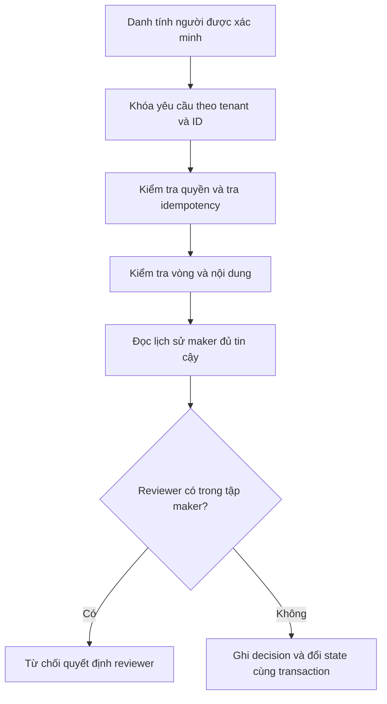

# Requester reviewer separation — Tách người yêu cầu và người xét duyệt

## 1. Quy tắc cần bảo vệ là sự độc lập của người xét duyệt

**Requester reviewer separation** yêu cầu người xét duyệt một yêu cầu phải độc lập với người đứng phía tạo ra yêu cầu đó, theo phạm vi mà chính sách nghiệp vụ xác định. Tên gọi quen thuộc khác là nguyên tắc người lập và người kiểm tra, hay maker–checker.

Trong chương **Separation of Duties** của module `SECURITY_APPLICATION_SECURITY_BUSINESS_LOGIC_SECURITY`, đây là một business invariant: quyền có role `REVIEWER` không đủ để cho phép một người xét duyệt yêu cầu do chính họ tạo ra hoặc chịu trách nhiệm ở phía yêu cầu.

Mục đích là giảm khả năng một chủ thể tự tạo và tự hợp thức hóa một hành động, chẳng hạn đề nghị mua hàng với giá đã sửa, cấp quyền cho chính mình hoặc tự chấp nhận hoàn tiền. NIST mô tả separation of duty như nguyên tắc tránh trao đủ đặc quyền để một người có thể tự lạm dụng hệ thống; kiểm soát có thể dựa trên vai trò hoặc được thực thi tại lúc truy cập. [NIST: Separation of Duty](https://csrc.nist.gov/glossary/term/separation_of_duty).

Ví dụ xuyên suốt là đề nghị mua hàng. Chính sách minh họa trong bài quy định:

- Một yêu cầu đang `PENDING_REVIEW` cần một quyết định của reviewer độc lập để kết thúc vòng xét duyệt.
- Reviewer phải có quyền trên đúng yêu cầu và đúng tenant, tức phạm vi tổ chức sở hữu dữ liệu.
- Người yêu cầu nghiệp vụ, người thực sự tạo, người gửi duyệt và người sửa nội dung quan trọng đều thuộc phía maker.
- Những người đó không được `APPROVE` hoặc `REJECT` bằng chức năng reviewer trong suốt vòng đời của cùng yêu cầu. Người yêu cầu muốn rút yêu cầu dùng action riêng theo policy.
- Lịch sử tham gia không bị xóa khi đổi người được phân công hoặc gửi duyệt lại.
- Mô hình triển khai chính chỉ nhận reviewer là người dùng trực tiếp đã xác minh; ủy quyền được bàn riêng vì cần thêm điều kiện.

Đây là chính sách ví dụ có phạm vi rõ ràng, không phải yêu cầu mọi hệ thống phải coi tất cả người chỉnh sửa là maker. Khi triển khai thực tế, tổ chức cần chọn ai thuộc phạm vi xung đột và trong khoảng thời gian nào.

## 2. Vì sao hai role chưa chắc tạo ra hai người độc lập?

### 2.1. Phân quyền chức năng và phân tách trách nhiệm khác nhau

RBAC có thể trả lời “người này có chức năng xét duyệt hay không?”. Quy tắc đang học còn phải trả lời “người này có được xét duyệt **yêu cầu cụ thể này** hay không?”.

```java
// Chưa đủ: chỉ biết người gọi có chức năng xét duyệt.
if (actor.hasRole("REVIEWER")) {
    approve(requestId);
}
```

Một người có thể hợp lệ khi tạo yêu cầu A và xét duyệt yêu cầu B của đồng nghiệp. Cấm toàn bộ người có role `REQUESTER` nhận role `REVIEWER` có thể quá cứng, trong khi cho cả hai role mà không kiểm tra quan hệ với đối tượng lại cho phép tự duyệt.

| Kiểm soát | Điều nó bảo vệ | Giới hạn |
| --- | --- | --- |
| Role được phép tạo yêu cầu | Quyền sử dụng chức năng tạo | Không xác định ai được duyệt từng yêu cầu |
| Role được phép xét duyệt | Quyền sử dụng chức năng reviewer | Không ngăn requester dùng role reviewer cho chính yêu cầu của mình |
| Hạn chế tổ hợp role | Tách một số trách nhiệm ở mức cấp quyền | Có thể không phù hợp khi cùng người được làm hai việc trên các đối tượng khác nhau |
| Kiểm tra lịch sử và quan hệ đối tượng | Ngăn cùng chủ thể đứng cả hai phía trên yêu cầu được bảo vệ | Phụ thuộc dữ liệu danh tính và lịch sử đầy đủ |

Trong thiết kế requester–reviewer, thường cần kiểm tra động tại thời điểm hành động và dữ liệu lịch sử theo đối tượng. Chỉ đổi role đang kích hoạt trong phiên không làm biến mất việc người đó đã tạo hoặc sửa yêu cầu trước đây.

### 2.2. Thực thi ở backend trên mọi đường gọi

Ẩn nút “Duyệt” là hỗ trợ trải nghiệm. Người dùng vẫn có thể gọi API trực tiếp, dùng ứng dụng di động, gửi batch hoặc đi qua chức năng quản trị.

OWASP nhấn mạnh kiểm tra quyền trên mọi request và quyền đối với đúng đối tượng được truy cập; quan hệ giữa chủ thể và đối tượng là dữ liệu quan trọng ngoài role. [OWASP Authorization Cheat Sheet](https://cheatsheetseries.owasp.org/cheatsheets/Authorization_Cheat_Sheet.html).

Điểm thực thi invariant nên nằm gần application service hoặc domain operation tạo ra quyết định, để các controller, job và adapter đều dùng cùng quy tắc. Kiểm tra ở API gateway không đủ nếu gateway không có lịch sử maker có thẩm quyền.

## 3. Xác định đúng người ở hai phía

### 3.1. Tài khoản khác nhau có thể vẫn là một người

Không nên chỉ so sánh email hiển thị, tên đăng nhập hoặc hai access token. Các giá trị đó có thể đổi, có nhiều alias hoặc thuộc nhiều tài khoản của cùng một người.

Trong bài, `person_id` là danh tính người được chuẩn hóa trong miền danh tính mà hệ thống tin cậy. `account_id` là tài khoản đang được xác thực. Hai tài khoản A1 và A2 ánh xạ cùng `person_id = P` không tạo ra hai người độc lập.

Nguồn ánh xạ cần có quy trình kiểm soát, ví dụ directory nhân sự hoặc dịch vụ danh tính được cấu hình tin cậy. Không nhận `person_id` trong body hoặc header tự khai của client rồi dùng nó để chứng minh sự độc lập.

Nếu hệ thống chỉ biết hai account ID khác nhau mà không có bằng chứng liên kết người thật, kiểm tra chỉ bảo đảm khác tài khoản. Không nên mô tả nó như bảo đảm tuyệt đối về hai con người độc lập.

### 3.2. Người tạo kỹ thuật và người yêu cầu nghiệp vụ

Một trợ lý tạo yêu cầu cho trưởng bộ phận. Lúc đó có thể có:

| Danh tính | Ví dụ | Ý nghĩa |
| --- | --- | --- |
| Người yêu cầu nghiệp vụ | Trưởng bộ phận An | Người đứng tên và chịu trách nhiệm phía yêu cầu |
| Người thực sự tạo | Trợ lý Bình | Người đã nhập/tạo nội dung |
| Người gửi duyệt | Bình hoặc một người được phép khác | Chủ thể đưa yêu cầu vào quy trình xét duyệt |
| Người sửa nội dung quan trọng | Người thay nhà cung cấp hoặc đơn giá | Chủ thể có thể ảnh hưởng kết quả cần kiểm soát |
| Tài khoản thực thi | Tài khoản đăng nhập hoặc service hỗ trợ | Dấu vết kỹ thuật, không mặc nhiên là danh tính người độc lập |

Theo policy ví dụ, cả An và Bình đều không được xét duyệt yêu cầu đó. Chỉ so sánh reviewer với `created_by_account_id` sẽ bỏ sót An; chỉ so với người đứng tên sẽ bỏ sót Bình.

### 3.3. Đổi phân công không đổi lịch sử

Trường “người đang phụ trách” có thể thay đổi để vận hành công việc. Nó không nên được dùng thay cho lịch sử ai đã đứng ở phía maker.

Ví dụ An tạo yêu cầu rồi chuyển người phụ trách sang Chi. Nếu backend chỉ so reviewer với assignee hiện tại, An có thể trở thành reviewer của yêu cầu mình tạo. Cần giữ danh tính maker lịch sử, còn assignee là quan hệ khác.

Trong policy chính của bài, người yêu cầu ban đầu không bị ghi đè như một cách xóa xung đột. Nếu nghiệp vụ cho đổi requester, requester mới được thêm vào tập maker; requester cũ vẫn được giữ trong lịch sử theo phạm vi đã chọn.

### 3.4. Thiếu bằng chứng không đồng nghĩa không có xung đột

Một bản ghi nhập từ hệ thống cũ có `created_by = NULL` không chứng minh reviewer độc lập. Nó chứng minh hệ thống chưa biết đủ.

Với quy trình bắt buộc tách người, yêu cầu thiếu lịch sử cần được chặn đường tự động và chuyển qua bước bổ sung/xác minh có kiểm soát. Không dùng tài khoản service chung hoặc UUID mặc định để biến “không biết ai tạo” thành “khác người duyệt”.

## 4. Biểu diễn invariant bằng tập chủ thể

Gọi `M(request)` là tập người thuộc phía maker theo policy. Trong ví dụ:

```text
M(request) = người yêu cầu nghiệp vụ
             ∪ người tạo thực tế
             ∪ người gửi duyệt
             ∪ người sửa nội dung quan trọng.
```

Với reviewer trực tiếp, `R(decision)` chỉ gồm người reviewer thực sự. Nếu hỗ trợ ủy quyền, tập này có thể còn gồm người được đại diện và các chủ thể phải chịu trách nhiệm theo policy.

Điều kiện tách trách nhiệm:

```text
M(request) ∩ R(decision) = ∅
```

Điều kiện đó phải đi cùng các điều kiện khác:

```text
Cho phép quyết định mới
    = đã xác thực đúng chủ thể
    AND được phép thao tác trên đúng tenant/đối tượng
    AND được phân công hoặc đủ điều kiện reviewer theo policy
    AND vòng và nội dung đang có hiệu lực
    AND dữ liệu maker đủ tin cậy
    AND không có giao giữa phía maker và phía reviewer.
```

`reviewer != requester` chỉ là trường hợp tối thiểu khi nghiệp vụ thật sự chỉ có hai danh tính cần so sánh. Nó không bao quát tạo hộ, sửa nội dung và các quan hệ đại diện phức tạp.

### 4.1. Chọn phạm vi lịch sử có chủ đích

Các hệ thống có thể chọn phạm vi khác nhau:

- Cả vòng đời yêu cầu, như ví dụ của bài.
- Chỉ vòng phê duyệt hoặc content revision hiện tại.
- Một khoảng thời gian xung đột hoặc phạm vi dữ liệu đặc thù.

Không có lựa chọn chung cho mọi nghiệp vụ. Phạm vi hẹp hơn phải giải thích được vì sao đóng vòng và mở lại không giúp maker xóa dấu vết để trở thành reviewer. Phạm vi rộng hơn cũng cần xử lý đúng người chỉ sửa dữ liệu không ảnh hưởng quyết định.

### 4.2. Phân loại chỉnh sửa quan trọng

Trong ví dụ, sửa đơn giá, số lượng, nhà cung cấp, tài khoản nhận hoặc điều kiện chi trả là chỉnh sửa có ý nghĩa nghiệp vụ. Sửa lỗi trình bày có thể được policy xem khác.

Backend quyết định loại chỉnh sửa từ các trường thật sự thay đổi, không tin cờ `is_minor_edit = true` do client gửi. Nếu cho người dùng tự gắn nhãn chỉnh sửa nhẹ, maker có thể sửa giá rồi né việc bị đưa vào tập xung đột.

## 5. Những đường lách cần đưa vào thiết kế

| Cách lách | Vì sao kiểm tra đơn giản thất bại? | Kiểm soát cần có |
| --- | --- | --- |
| Dùng tài khoản thứ hai | Account ID khác nhưng cùng người | Ánh xạ danh tính chuẩn hóa có nguồn tin cậy |
| Tạo hộ người đứng tên | Chỉ so với creator hoặc chỉ với requester | Ghi cả người thực hiện và người yêu cầu nghiệp vụ |
| Chuyển assignee rồi tự duyệt | Trường hiện tại ghi đè lịch sử | Tách assignment với lịch sử maker |
| Sửa giá rồi nhờ đổi người gửi duyệt | Chỉ ghi submitter cuối cùng | Ghi người sửa nội dung quan trọng theo policy |
| Tự phân công mình làm reviewer | Danh sách reviewer được coi là đủ quyền | SoD vẫn phải được kiểm tra tại quyết định cuối |
| Chuyển sang role quản trị | Nhánh `isAdmin` bỏ qua invariant | Quyền quản trị không tự tạo độc lập nghiệp vụ |
| Dùng delegate để duyệt yêu cầu của mình | Chỉ so người bấm nút hoặc chỉ so người được đại diện | Kiểm tra tập chủ thể đại diện theo policy |
| Gọi bulk/import/job | Chỉ controller chính có kiểm tra | Dùng chung operation có thực thi invariant |
| Tạo mới yêu cầu giống hệt bằng service | Lịch sử người thật bị mất khi chuyển hệ thống | Giữ provenance và kiểm soát tạo thay; không coi service là reviewer người độc lập |
| Gửi request trong lúc thay dữ liệu maker | Kiểm tra và ghi ở hai thời điểm không được bảo vệ | Transaction, version và giao thức khóa chung |

Tách requester và reviewer không ngăn hoàn toàn hai người thông đồng. Nó tạo rào cản và khả năng quy trách nhiệm; với rủi ro cao còn có thể cần giới hạn quyền, kiểm tra nhiều bên và giám sát hành vi. Cũng cần bảo vệ tài khoản reviewer trước việc bị chiếm quyền.

## 6. Mô hình dữ liệu giữ được lịch sử xung đột

### 6.1. Dữ liệu hiện tại và dữ liệu tham gia có nhiệm vụ riêng

Mô hình minh họa dùng:

- `purchase_request`: nội dung hiện tại, state, vòng xét duyệt hiện tại và các version.
- `request_maker_participation`: bằng chứng một người đã tham gia phía maker; các quan hệ đã ghi không bị xóa tùy ý.
- `request_review_decision`: quyết định của reviewer gắn với đúng vòng/nội dung và phiên bản tập maker đã kiểm tra.

`content_version` tăng khi dữ liệu ảnh hưởng quyết định thay đổi. `row_version` tăng khi trạng thái hoặc dữ liệu kiểm soát thay đổi. `review_round_no` tăng khi bắt đầu một vòng xét duyệt mới, kể cả trường hợp policy cho gửi lại nội dung chưa đổi.

`maker_set_version` tăng khi tập quan hệ maker được bổ sung. Mỗi quan hệ ghi mốc version mà nó được đưa vào. Nhờ vậy có thể xác định tập maker đã được biết tại lúc một quyết định được chấp nhận, thay vì diễn giải lịch sử chỉ bằng dữ liệu hiện tại.

### 6.2. Schema PostgreSQL minh họa

```sql
CREATE TABLE purchase_request (
    tenant_id                uuid NOT NULL,
    id                       uuid NOT NULL,
    requester_person_id      uuid NOT NULL,
    created_by_account_id    uuid NOT NULL,
    state                    varchar(32) NOT NULL,
    content_version          bigint NOT NULL DEFAULT 1,
    row_version              bigint NOT NULL DEFAULT 0,
    review_round_no          bigint NOT NULL DEFAULT 0,
    review_snapshot_hash     varchar(64),
    review_policy_version    varchar(128),
    maker_set_version        bigint NOT NULL DEFAULT 0,
    maker_history_verified   boolean NOT NULL DEFAULT false,
    PRIMARY KEY (tenant_id, id),
    CHECK (state IN (
        'DRAFT', 'PENDING_REVIEW', 'APPROVED', 'REJECTED'
    )),
    CHECK (content_version > 0 AND row_version >= 0),
    CHECK (review_round_no >= 0 AND maker_set_version >= 0),
    CHECK (
        review_snapshot_hash IS NULL
        OR review_snapshot_hash ~ '^[0-9a-f]{64}$'
    ),
    CHECK (
        state = 'DRAFT'
        OR (
            review_round_no > 0
            AND review_snapshot_hash IS NOT NULL
            AND review_policy_version IS NOT NULL
        )
    )
);

CREATE TABLE request_maker_participation (
    tenant_id                    uuid NOT NULL,
    request_id                   uuid NOT NULL,
    person_id                    uuid NOT NULL,
    participation_kind           varchar(32) NOT NULL,
    added_in_maker_set_version   bigint NOT NULL,
    recorded_by_account_id       uuid NOT NULL,
    recorded_at                  timestamptz NOT NULL,
    PRIMARY KEY (tenant_id, request_id, person_id, participation_kind),
    FOREIGN KEY (tenant_id, request_id)
        REFERENCES purchase_request (tenant_id, id),
    CHECK (added_in_maker_set_version > 0),
    CHECK (participation_kind IN (
        'REQUESTER', 'CREATOR', 'SUBMITTER', 'MATERIAL_EDITOR'
    ))
);

CREATE TABLE request_review_decision (
    tenant_id                  uuid NOT NULL,
    id                         uuid NOT NULL,
    request_id                 uuid NOT NULL,
    review_round_no            bigint NOT NULL,
    content_version            bigint NOT NULL,
    reviewed_snapshot_hash     varchar(64) NOT NULL,
    reviewer_person_id         uuid NOT NULL,
    reviewer_account_id        uuid NOT NULL,
    choice                     varchar(16) NOT NULL,
    maker_set_version          bigint NOT NULL,
    identity_mapping_version   varchar(128) NOT NULL,
    policy_version             varchar(128) NOT NULL,
    decision_at                timestamptz NOT NULL,
    command_id                 uuid NOT NULL,
    PRIMARY KEY (tenant_id, id),
    UNIQUE (tenant_id, request_id, review_round_no),
    UNIQUE (tenant_id, command_id),
    FOREIGN KEY (tenant_id, request_id)
        REFERENCES purchase_request (tenant_id, id),
    CHECK (choice IN ('APPROVE', 'REJECT')),
    CHECK (review_round_no > 0 AND content_version > 0),
    CHECK (maker_set_version > 0),
    CHECK (reviewed_snapshot_hash ~ '^[0-9a-f]{64}$')
);
```

Schema mô tả quy trình có một quyết định kết thúc mỗi vòng. Unique theo request và round không phù hợp nguyên trạng nếu nghiệp vụ cần nhiều reviewer trong cùng vòng; lúc đó phải mô hình hóa nhiều quyết định và kiểm tra tính độc lập/quorum tương ứng.

Cờ `maker_history_verified` không tự chứng minh lịch sử đúng. Nó là trạng thái kiểm soát do quy trình xác minh quản lý. Khi gửi duyệt, backend còn cần kiểm tra có đủ quan hệ bắt buộc, đúng requester và nguồn danh tính phù hợp. Client không được sửa cờ này hoặc các version kiểm soát.

Foreign key có tenant bảo vệ quan hệ dữ liệu, nhưng schema này chưa tự biểu diễn được điều kiện “reviewer không xuất hiện trong bảng maker”. Một `CHECK` chỉ trên hai cột của decision cũng không bao quát toàn bộ tập tham gia. Invariant liên bảng cần được thực thi bằng operation/giao thức database được thiết kế cho nó.

Các binding snapshot, policy và version phải lấy từ dữ liệu server. Kho snapshot cần giữ nội dung hoặc tham chiếu bất biến, không chỉ một hash không còn dữ liệu để đối chiếu.

### 6.3. Mọi thay đổi phía maker phải được ghi nguyên tử

Khi tạo, gửi duyệt hoặc sửa nội dung quan trọng:

1. Khóa hàng `purchase_request` theo tenant và ID.
2. Xác minh quyền của action và các chủ thể thực sự liên quan.
3. Thêm quan hệ maker chưa tồn tại, cấp `maker_set_version` mới khi tập quan hệ thay đổi.
4. Cập nhật nội dung/version và trạng thái phù hợp trong cùng transaction.
5. Ghi audit của thay đổi; không commit nội dung mới mà thiếu danh tính người đã tạo ra thay đổi đó.

Một người sửa nhiều lần không cần bị tính thành nhiều người maker. Quan hệ có thể lưu lần đầu tham gia cho mục đích kiểm tra xung đột; audit thay đổi nội dung vẫn lưu các thao tác cụ thể theo yêu cầu điều tra.

## 7. Kiểm tra và ghi quyết định trong cùng transaction

### 7.1. Giao thức khóa bảo vệ cả phép kiểm tra không tồn tại

Kiểm tra “không tìm thấy reviewer trong tập maker” là kiểm tra trên một tập có thể thay đổi. Chỉ đọc bảng maker rồi cập nhật request ở transaction khác tạo ra cửa sổ dữ liệu bị đổi.

Trong ví dụ, mọi đường thêm maker, đổi nội dung, gửi duyệt và ghi quyết định đều khóa hàng cha `purchase_request` trước. Sau khi giành khóa mới đọc state, binding và tập maker cần kiểm tra.



PostgreSQL giữ row lock của `SELECT ... FOR UPDATE` đến khi transaction kết thúc và chặn writer/locker xung đột trên cùng hàng. Nhưng khóa hàng cha không thay thế việc tất cả writer của bảng con phải tuân thủ giao thức đã quy định. [PostgreSQL: Row-level locks](https://www.postgresql.org/docs/current/explicit-locking.html#LOCKING-ROWS).

Ví dụ dưới giả định isolation `READ COMMITTED`, đọc tập maker sau khi đã lấy khóa cha, và mọi thay đổi liên quan cập nhật `row_version` của cha. Với isolation khác hoặc quy trình retry khi serialization/deadlock, cần kiểm chứng lại cách đọc dữ liệu và luôn chạy lại kiểm tra từ đầu trên lần thử mới.

### 7.2. Khung application service Java

Đây là khung dùng `TransactionTemplate` của Spring. Các repository và kiểu dữ liệu là hợp đồng minh họa, không phải ứng dụng hoàn chỉnh có thể chép chạy ngay.

```java
public ReviewReceipt review(ReviewCommand cmd, TrustedActor actor) {
    // Không nhận person_id tự khai; mô hình chính không cho delegate/service review.
    TrustedHuman reviewer = identities.requireVerifiedDirectHuman(actor);

    return transactions.execute(tx -> {
        PurchaseRequest request = requests.lockByTenant(
            actor.tenantId(), cmd.requestId());

        access.requireCanReadReviewContext(actor, request);

        IdempotencyClaim claim = idempotency.claim(
            actor.tenantId(), actor.accountId(), "REVIEW_REQUEST",
            cmd.idempotencyKey(), fingerprints.review(cmd));

        if (claim.isCompleted()) {
            return claim.originalReceipt();
        }

        access.requireReviewerPermission(actor, request);
        request.requirePendingReview();
        request.requireExpectedReview(
            cmd.reviewRoundNo(),
            cmd.expectedContentVersion(),
            cmd.reviewedSnapshotHash());

        MakerSet makers = participation.readVerifiedForLocked(request);
        makers.requireCompleteFor(request);

        if (makers.personIds().contains(reviewer.personId())) {
            throw new RequesterReviewerConflictException();
        }

        reviewerPolicy.requireAssignedOrEligible(reviewer, actor, request);
        Instant decisionAt = databaseClock.currentInstant();

        ReviewDecision decision = ReviewDecision.accepted(
            UUID.randomUUID(), request,
            reviewer.personId(), actor.accountId(), cmd.choice(),
            makers.version(), reviewer.mappingVersion(),
            decisionAt, claim.commandId());

        decisions.insert(decision);
        requests.applyReviewDecisionOrThrow(
            request, reviewer.personId(), makers.version(), cmd.choice());

        outbox.appendReviewDecisionRecorded(decision);

        ReviewReceipt receipt = ReviewReceipt.from(decision);
        idempotency.complete(claim, receipt);
        return receipt;
    });
}
```

Các hợp đồng quan trọng:

- `TrustedActor` đã được xác thực và gắn đúng tenant. `TrustedHuman` có ánh xạ account–person được nguồn tin cậy xác nhận, kèm version/tham chiếu phù hợp để điều tra.
- `readVerifiedForLocked` không coi danh sách rỗng là bằng chứng không có xung đột. Nó kiểm tra trạng thái xác minh và các quan hệ maker bắt buộc của yêu cầu.
- `requireReviewerPermission` kiểm tra quyền chức năng và đúng đối tượng; `requireAssignedOrEligible` kiểm tra assignment/hạn mức và những điều kiện policy khác. Có role rộng không bỏ qua kiểm tra maker.
- `fingerprints.review` gồm request ID, round, content version, snapshot hash, lựa chọn và các trường nghiệp vụ khác nếu được bổ sung. Cùng key nhưng khác fingerprint bị từ chối; claim có cơ chế cạnh tranh bền vững.
- `ReviewDecision.accepted` lấy binding nội dung, policy và version từ request đang khóa, không lấy reviewer hoặc policy do client tự khai.
- `applyReviewDecisionOrThrow` dùng điều kiện state/version/round phù hợp và yêu cầu đúng một hàng thay đổi. `APPROVE` dẫn đến `APPROVED`; `REJECT` dẫn đến `REJECTED` trong policy ví dụ.
- Decision, state mới, outbox và kết quả idempotency tham gia cùng transaction. Lỗi bất kỳ bước lưu nào phải rollback toàn bộ; không trả thành công trước khi transaction hoàn tất.

Quyền đọc receipt cũ được kiểm tra trước nhánh replay. Kiểm tra điều kiện cho **quyết định mới** nằm sau replay, vì state hoặc quan hệ hiện tại có thể khác lúc quyết định cũ được chấp nhận. Replay chỉ trả bằng chứng cũ, không tạo lần xét duyệt mới.

### 7.3. Điều kiện cập nhật bổ sung tại database

Với reviewer trực tiếp, cập nhật cuối có thể kiểm tra thêm sự vắng mặt của reviewer trong tập maker:

```sql
UPDATE purchase_request p
SET state = :target_state,
    row_version = row_version + 1
WHERE p.tenant_id = :tenant_id
  AND p.id = :request_id
  AND p.state = 'PENDING_REVIEW'
  AND p.row_version = :expected_row_version
  AND p.content_version = :expected_content_version
  AND p.review_round_no = :expected_round_no
  AND p.review_snapshot_hash = :expected_snapshot_hash
  AND p.maker_history_verified = true
  AND p.maker_set_version = :checked_maker_set_version
  AND NOT EXISTS (
      SELECT 1
      FROM request_maker_participation m
      WHERE m.tenant_id = p.tenant_id
        AND m.request_id = p.id
        AND m.person_id = :trusted_reviewer_person_id
  );
```

Các tham số actor và target state do application operation đã kiểm tra tạo ra; không mở câu SQL này thành endpoint cập nhật trạng thái tùy ý. Nếu số hàng thay đổi khác một, rollback cả decision vừa insert.

Đây là lớp bảo vệ bổ sung trong giao thức khóa đã mô tả. Nếu một writer khác tự ý sửa bảng con mà không khóa/cập nhật hàng cha, không được kết luận đoạn `NOT EXISTS` tự giải quyết mọi cuộc đua. Trigger hoặc stored procedure, nếu được dùng để tập trung quy tắc, cũng phải xử lý đúng concurrency và quyền ghi trực tiếp.

## 8. Phân tích các cuộc đua và thay đổi sau quyết định

### 8.1. Reviewer sửa giá đồng thời với xét duyệt

Giả sử Cường chưa thuộc tập maker và gửi quyết định trong lúc một request khác của Cường sửa đơn giá:

- Nếu sửa giá giành khóa và commit trước, Cường được thêm `MATERIAL_EDITOR`, content version thay đổi và vòng cũ không còn được duyệt như trước. Lệnh review sau đó phải bị từ chối hoặc yêu cầu vòng mới theo state.
- Nếu review giành khóa và commit trước, đường sửa nội dung sau đó phải tuân chính sách sau phê duyệt: chặn sửa hoặc mở lại/tạo bản sửa cần xét duyệt mới. Không được sửa giá rồi giữ quyết định cũ như bằng chứng cho giá mới.

Khóa chỉ tuần tự hóa thao tác. Quy tắc chuyển trạng thái sau khi lấy khóa mới quyết định trường hợp nào hợp lệ; không thể dùng khóa để thay cho việc định nghĩa policy.

### 8.2. Đổi người phụ trách hoặc phân công reviewer

Assignment mới không xóa An khỏi tập maker lịch sử. Nếu An tự được đưa vào danh sách reviewer, kiểm tra cuối vẫn từ chối vì có giao giữa hai phía.

Đường phân công nên lọc người xung đột để tránh giao việc không thể hoàn tất. Tuy nhiên, kiểm tra tại lúc phân công không thay thế kiểm tra tại lúc quyết định, vì nội dung và lịch sử có thể thay đổi sau đó.

### 8.3. Hai reviewer cùng quyết định

Ví dụ chính chỉ chấp nhận một quyết định kết thúc mỗi vòng. Hai reviewer độc lập cùng gửi thì transaction lấy khóa sau sẽ thấy vòng đã kết thúc và không được thêm quyết định mới, trừ khi đó là replay đúng thao tác đã lưu của chính người gọi.

Nếu mở rộng sang nhiều phiếu, mỗi reviewer còn phải độc lập với phía maker; đồng thời phải kiểm tra các reviewer có độc lập với nhau hay không. Hai bài toán này khác nhau. “Có hai phiếu” không tự chứng minh không có tự duyệt.

### 8.4. Ánh xạ danh tính được hợp nhất sau này

Hệ thống có thể phát hiện hai account/person record trước đây thật ra cùng một người. Cần có quy trình đối soát các vòng chưa thực thi và xử lý xung đột mới phát hiện theo policy.

Giữ bằng chứng ánh xạ đã dùng tại lúc quyết định, kèm sự kiện sửa/hợp nhất danh tính. Không âm thầm viết lại lịch sử như thể hệ thống luôn biết điều đó. Quy tắc về độ mới của dữ liệu danh tính và thu hồi quyền phải được định nghĩa; khóa một yêu cầu không tạo ra transaction nguyên tử với mọi directory bên ngoài.

## 9. Tạo hộ, delegation, service account và quản trị

### 9.1. Tạo hộ không làm mất maker thực sự

Khi Bình tạo hộ An, server phải xác minh quyền tạo hộ và ghi cả hai danh tính từ nguồn được kiểm soát. Thay `requester_id` trong request body không phải bằng chứng An thực sự ủy quyền.

Một quy trình hợp lệ có thể cho người dùng chọn requester trong danh sách được phép, nhưng backend phải xác minh quan hệ và lưu người thao tác thật. Không nhận `created_by` do client gửi rồi ghi đè chủ thể xác thực.

### 9.2. Delegate phải độc lập theo cả phía thực hiện và đại diện

Giả sử reviewer Dung ủy quyền cho An, trong khi An là requester. Nếu chỉ so requester với Dung, An có thể trực tiếp xét duyệt yêu cầu của mình dưới tên Dung.

Ngược lại, An là requester và ủy quyền quyền reviewer của mình cho Dung. Nếu chỉ so requester với người bấm nút Dung, quyền xét duyệt của An có thể được dùng vòng qua một người khác.

Với policy yêu cầu cả hai phía độc lập, kiểm tra:

```text
M(request) ∩ {người thực hiện thật, người được đại diện cần kiểm tra} = ∅
```

Grant phải đúng tenant, action, đối tượng/phạm vi và thời hạn; chuỗi ủy quyền được phép đến đâu cũng cần định nghĩa. Không nhận `on_behalf_of` tự khai làm danh tính đại diện. Nếu hỗ trợ nhiều slot, còn phải ngăn một slot hoặc một người bị tính lặp qua các grant khác nhau.

Khung Java và SQL ở phần trước chủ động chỉ xử lý người trực tiếp; muốn thêm delegation phải mở rộng tập kiểm tra và dữ liệu bằng chứng, không chỉ thêm một cột tên người đại diện.

### 9.3. Service account không phải người thứ hai

Một service import gửi yêu cầu hoặc bot chuyển tiếp action không trở thành reviewer người độc lập chỉ vì service ID khác requester ID. Phải phân biệt service thực thi kỹ thuật với người chịu trách nhiệm nghiệp vụ.

Nếu policy cần review của con người, một kiểm tra tự động có thể là bước bổ sung nhưng không được âm thầm lấp vào vị trí reviewer độc lập. Nếu nghiệp vụ cho phép auto-approval, mô hình hóa đó là policy riêng với điều kiện, phạm vi và bằng chứng riêng.

Với request chuyển từ hệ thống khác, giữ provenance, chủ thể gốc và mức độ tin cậy của thông tin. Nếu không xác định được maker, dùng đường xử lý thiếu bằng chứng, không cho qua vì actor hiện tại là service.

### 9.4. Quyền quản trị và trường hợp khẩn cấp

Không đặt nhánh kiểu `if (isAdmin) allow()` trước invariant tách trách nhiệm. Khả năng quản lý hệ thống hoặc phân công công việc không tự chứng minh độc lập để phê duyệt nghiệp vụ.

Nếu có quy trình khẩn cấp, nó phải là action được thiết kế riêng với phạm vi, lý do, thời hạn và kiểm soát độc lập theo rủi ro. Không ghi kết quả ngoại lệ như một lần review thông thường đã đáp ứng sự độc lập khi thực tế đã dùng cơ chế khác.

Tài khoản database có thể sửa trực tiếp state hoặc lịch sử maker là một đường vượt kiểm soát. Cần giới hạn quyền ghi, bảo vệ các trường danh tính/bằng chứng và có dấu vết cho thao tác vận hành đặc quyền.

## 10. Idempotency, audit và sử dụng kết quả review

### 10.1. Retry không được tạo người hay quyết định mới

Cùng idempotency key và nội dung phải trả kết quả đã lưu. Cùng key nhưng khác lựa chọn, vòng hoặc snapshot phải bị từ chối xung đột.

Đổi key không làm một maker trở thành reviewer, cũng không cho tạo quyết định thứ hai trong vòng. SoD, unique constraint và idempotency bảo vệ các khía cạnh khác nhau.

Nếu client mất response sau commit, retry cùng key để xác định kết quả. Không suy ra HTTP timeout có nghĩa chưa ghi quyết định.

### 10.2. Ghi cả quyết định hợp lệ và nỗ lực vi phạm

Với quyết định hợp lệ, lưu ít nhất request/tenant, vòng, content version/hash, account và person reviewer, maker set version, policy version, bằng chứng ánh xạ danh tính và thời điểm quyết định.

Với lần tự duyệt bị chặn, ghi security attempt có mã như `REQUESTER_REVIEWER_CONFLICT`. Không insert nó như một quyết định `REJECT` hợp lệ của reviewer.

Nếu transaction nghiệp vụ rollback khi từ chối, log attempt cần đường ghi bền vững phù hợp sau rollback hoặc kênh thu thập độc lập; insert cùng transaction rồi rollback sẽ làm mất bằng chứng. Ngược lại, audit về review thành công phải gắn với transaction đã commit, tránh có dấu vết thành công cho thao tác bị hủy.

Chỉ lộ lý do hoặc danh tính liên quan cho người có quyền đọc. Đặc biệt, không trả toàn bộ tập maker hoặc thông tin tenant khác cho người gọi không được phép biết yêu cầu tồn tại. Audit không chứa token, mật khẩu hoặc bí mật xác thực.

### 10.3. Đối soát một xung đột lịch sử

Với dữ liệu danh tính chuẩn hóa và quan hệ maker bất biến của mô hình, truy vấn sau tìm reviewer đã nằm trong tập maker được ghi nhận tại lúc quyết định:

```sql
SELECT d.id AS decision_id,
       d.request_id, d.review_round_no,
       d.reviewer_person_id,
       m.participation_kind,
       d.maker_set_version
FROM request_review_decision d
JOIN request_maker_participation m
  ON m.tenant_id = d.tenant_id
 AND m.request_id = d.request_id
 AND m.person_id = d.reviewer_person_id
 AND m.added_in_maker_set_version <= d.maker_set_version
WHERE d.tenant_id = :tenant_id;
```

Trong dữ liệu được xử lý đúng, kết quả phải rỗng. Truy vấn không chứng minh mọi danh tính đã được nhận diện đúng hoặc mọi quan hệ maker đều được ghi đầy đủ. Quan hệ bị bỏ sót từ đầu, alias chưa liên kết hoặc lịch sử bị xóa cần cơ chế đối soát và bảo vệ khác.

Nếu một reviewer chỉ trở thành editor sau quyết định, mốc maker set version giúp không diễn giải sai rằng họ đã xung đột từ trước. Tính hợp lệ của việc chỉnh sửa sau đó vẫn phải được xử lý bằng state/version và policy mở lại yêu cầu.

### 10.4. Kết quả review chỉ áp dụng cho đúng nội dung

Bước đặt hàng hoặc tạo tác dụng tiếp theo phải kiểm tra đúng request, vòng, content version/hash và trạng thái có hiệu lực. Không chỉ kiểm tra có một hàng decision `APPROVE` ở đâu đó trong lịch sử.

Nếu gửi sự kiện qua broker, lưu outbox cùng transaction với decision và state. Relay có thể gửi lại nên consumer cần deduplicate theo event ID. Tác dụng nghiệp vụ ở nơi nhận cũng cần idempotency; sự độc lập của reviewer không tự ngăn việc thực thi hai lần.

## 11. Các tình huống kiểm thử cần có

Thiết kế kiểm thử quanh quan hệ người–đối tượng và dữ liệu đã commit, không chỉ quanh role hoặc trạng thái nút trên UI.

| Tình huống | Kết quả mong đợi theo policy ví dụ |
| --- | --- |
| Reviewer độc lập, đủ quyền, đúng nội dung/vòng | Quyết định được ghi và state đổi nguyên tử |
| Requester có cả role reviewer | Vẫn bị từ chối trên yêu cầu của mình |
| Cùng người dùng account thứ hai | Bị từ chối sau ánh xạ person chuẩn hóa |
| Người tạo hộ khác người đứng tên | Cả hai nằm trong tập maker và không được review |
| Người chỉ được chuyển assignee, không có lịch sử maker | Đánh giá theo policy thật, không suy diễn assignee tự động là requester/reviewer |
| Maker cũ chuyển việc hoặc đổi người phụ trách | Lịch sử maker không biến mất |
| Người sửa giá trước khi duyệt | Trở thành maker; không review nội dung đó theo policy |
| Client gắn chỉnh sửa giá là “nhẹ” | Backend vẫn phân loại từ dữ liệu thay đổi |
| Request thiếu danh tính creator hoặc provenance | Không tự coi là không xung đột; đi đường xác minh |
| Người ngoài tenant biết request ID | Không đọc/ghi review hoặc lộ danh sách maker |
| Tự phân công làm reviewer rồi gọi API | Kiểm tra cuối vẫn ngăn xung đột |
| Dùng endpoint batch, mobile, quản trị hoặc job | Cùng invariant được thực thi |
| Gọi `REJECT` thay cho `APPROVE` để tự đóng review | Bị từ chối; action rút yêu cầu được kiểm soát riêng |
| Delegate là requester hoặc đại diện cho requester | Bị chặn theo policy tập chủ thể khi triển khai delegation |
| Service account thay mặt requester | Không được coi là reviewer người độc lập |
| Reviewer sửa giá đồng thời với review | Không commit kết quả review cho nội dung mới chưa được kiểm tra |
| Hai reviewer cùng quyết định một vòng | Chỉ một quyết định kết thúc có hiệu lực trong mô hình một reviewer |
| Retry cùng key sau commit | Trả receipt cũ, không tạo quyết định/state/event nghiệp vụ mới |
| Đổi key hoặc đổi tài khoản của cùng người | Không vượt SoD hoặc constraint của vòng |
| Lỗi insert decision, update state, outbox hoặc idempotency | Không có commit dở dang |
| Thử xóa maker history bằng quyền ứng dụng | Bị kiểm soát quyền/bất biến ngăn chặn |
| Hợp nhất hai identity sau khi vòng đã duyệt | Có quy trình phát hiện và xử lý, giữ được bằng chứng lịch sử |

Với race condition, dùng hai kết nối/transaction thật và điều phối lúc giữ/nhả khóa. Sau khi cả hai kết thúc, đọc bằng kết nối khác để xác minh content version, maker set, decision và state nhất quán.

Với lỗi giữa chừng, chèn lỗi tại các ranh giới ghi quan trọng và xác nhận rollback toàn bộ. Chỉ kiểm tra mock của hàm `isDifferentUser()` không chứng minh operation thật đã bảo vệ invariant.

Khung mã và danh sách trên phục vụ thiết kế; bài học không khẳng định chúng đã được chạy như một ứng dụng hoàn chỉnh.

## 12. Áp dụng vào hệ thống đang có và bài tập

Khi bổ sung requester–reviewer separation vào hệ thống cũ, trước hết xác định đúng nghĩa của các trường như creator, requester, submitter và owner. Không mặc định chúng tương đương chỉ vì một số màn hình hiện cùng tên người.

Sau đó xác định nguồn danh tính, dữ liệu thiếu và mọi đường ghi. Gắn kiểm tra vào operation dùng chung, bảo vệ lịch sử maker và xử lý các yêu cầu cũ theo mức bằng chứng có thật. Không tự bịa creator để làm dữ liệu vượt qua kiểm tra.

Trước khi bật bắt buộc, cần có cách phân công người độc lập và xử lý trường hợp không còn reviewer đủ điều kiện. Quy tắc sẽ khó vận hành nếu chỉ chặn nhưng không có quy trình chuyển việc; giải pháp là điều phối hoặc ngoại lệ được thiết kế rõ, không phải nút bỏ qua không dấu vết.

Bài tập: một trưởng bộ phận nhờ trợ lý tạo yêu cầu cấp quyền, kỹ sư hỗ trợ sửa phạm vi quyền, sau đó trưởng bộ phận được phân công làm reviewer và ủy quyền việc review cho chính trợ lý.

Hãy thiết kế:

1. Ai thuộc tập maker, và bằng chứng nào xác định từng người?
2. Phía reviewer gồm những chủ thể nào khi có ủy quyền?
3. Chỉ so sánh account ID, requester hiện tại hoặc assignee sẽ bỏ sót những trường hợp nào?
4. Sửa phạm vi quyền rồi gửi duyệt lại có làm người sửa được phép review không theo policy đã chọn?
5. Đường chỉnh sửa và đường quyết định khóa/cập nhật dữ liệu ra sao để không có cửa sổ tự duyệt?
6. Khi lịch sử từ hệ thống cũ thiếu creator, cần quy trình nào trước khi cho phép review?
7. Bằng chứng nào phải được giữ để giải thích quyết định sau khi nhân sự đổi vai trò hoặc hai identity được hợp nhất?

Thiết kế đạt yêu cầu phải chỉ rõ phạm vi xung đột, nguồn danh tính, lịch sử tham gia và điểm thực thi invariant. Tách requester và reviewer có hiệu lực khi hệ thống bảo vệ được sự độc lập trên đúng đối tượng, không để đổi tài khoản, phân công, đại diện hoặc dữ liệu đồng thời làm mất dấu người đã đứng ở phía yêu cầu.
