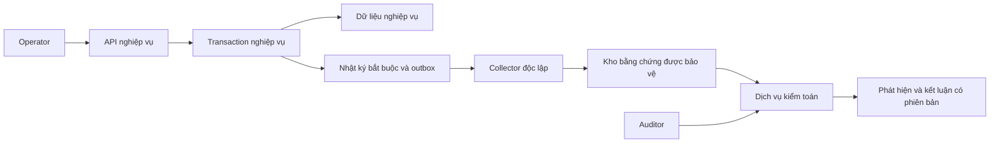
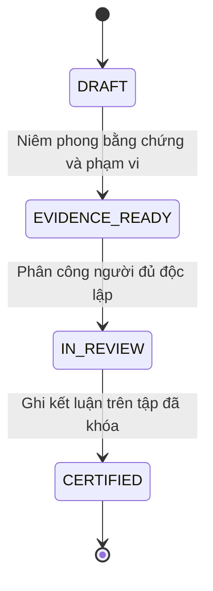

# Operator auditor separation — Tách biệt người vận hành và người kiểm toán

## 1. Vì sao cần tách hai trách nhiệm này?

Người vận hành cần quyền để thực hiện công việc: xử lý hồ sơ, điều chỉnh một giao dịch theo thẩm quyền, chạy lại tác vụ hoặc khắc phục một sự cố. Người kiểm toán cần bằng chứng đủ tin cậy để đánh giá những công việc đó có tuân thủ chính sách hay không.

Nếu cùng một người có thể thực hiện thay đổi, chọn bằng chứng được giữ lại, xóa dấu vết và tự xác nhận rằng mọi thứ hợp lệ, hệ thống mất đi một lớp kiểm soát độc lập. Vấn đề không chỉ là tài khoản có quyền quá rộng; đó là một người có thể kiểm soát cả hành vi lẫn kết luận về chính hành vi ấy.

**Operator auditor separation** là việc tách quyền thực hiện thao tác nghiệp vụ khỏi quyền kiểm tra, kết luận và quản lý bằng chứng kiểm toán trong phạm vi được xác định.

Trong bảo vệ logic nghiệp vụ, sự tách biệt này giúp hạn chế các tình huống như:

- Người xử lý hoàn tiền tự xác nhận đợt hoàn tiền của mình là hợp lệ.
- Người sửa số dư cũng có quyền sửa hoặc xóa sự kiện mô tả việc sửa số dư.
- Người vận hành tự chọn một tập giao dịch bỏ sót các giao dịch bất thường rồi gửi cho kiểm toán.
- Người dùng bỏ vai trò vận hành, nhận vai trò kiểm toán và kiểm tra lại công việc vừa làm.
- Hai tài khoản của cùng một người được hệ thống coi là hai chủ thể độc lập.
- Một tài khoản quản trị tự cấp quyền, thực hiện thao tác rồi xóa bằng chứng thay đổi quyền.

Bài học sử dụng hệ thống xử lý điều chỉnh giao dịch làm ví dụ. Mục tiêu là thiết kế quyền theo đối tượng, bất biến phân tách nhiệm vụ, đường ghi bằng chứng và quy trình kết luận kiểm toán mà người vận hành không thể tự điều khiển.

## 2. Kiểm toán không đồng nghĩa với phê duyệt vận hành

Cần phân biệt ba trách nhiệm:

| Trách nhiệm | Câu hỏi chính | Ví dụ |
| --- | --- | --- |
| Vận hành | Ai được thực hiện hoặc đề xuất thay đổi nghiệp vụ? | Tạo yêu cầu điều chỉnh giao dịch |
| Phê duyệt trước thực hiện | Ai cho phép một thao tác nhạy cảm được thực hiện? | Người duyệt độc lập chấp nhận khoản hoàn tiền lớn |
| Kiểm toán hoặc rà soát độc lập | Bằng chứng cho thấy hoạt động có đúng chính sách không? | Kiểm tra một đợt điều chỉnh và ghi nhận phát hiện |

Kiểm toán sau khi giao dịch đã xảy ra chủ yếu giúp phát hiện, giải trình và thúc đẩy khắc phục. Nó không tự ngăn một khoản chi sai ngay tại thời điểm chi. Với nghiệp vụ cần phòng ngừa trước, vẫn cần maker-checker, hạn mức, state machine và kiểm tra quyền trên đường thực hiện.

Ngược lại, một người đã phê duyệt giao dịch có thể không phù hợp làm người kiểm toán độc lập giao dịch đó. Việc người duyệt không phải người tạo chỉ chứng minh một yêu cầu phân tách cụ thể, không chứng minh toàn bộ chuỗi kiểm soát đã độc lập.

Trong bài này, auditor được phép ghi phát hiện và kết luận kiểm tra. Auditor không mặc nhiên được sửa giao dịch để khắc phục phát hiện, phê duyệt khoản hoàn tiền hoặc thực thi tác vụ vận hành.

## 3. Mô hình đe dọa và ranh giới tin cậy

Một thiết kế có ý nghĩa phải nêu rõ người vận hành có thể làm gì.

Giả sử operator:

- Có quyền vận hành trong một số tenant hoặc đơn vị.
- Có thể gửi request ngoài giao diện, thay ID và phát lại request.
- Có thể cố dùng tài khoản phụ hoặc quyền được ủy nhiệm.
- Có thể biết cấu trúc log và quy trình kiểm tra.
- Không được mặc nhiên có quyền quản trị mọi cơ sở dữ liệu, dịch vụ kiểm toán, khóa ký và bản sao bằng chứng độc lập.

Nếu cùng một chủ thể có toàn quyền trên ứng dụng, cơ sở dữ liệu, nơi thu thập log, khóa ký và hệ thống triển khai, việc tạo thêm hai vai trò trong ứng dụng không tạo ra độc lập thực sự.

Thiết kế cần xác định quyền quản trị nào nằm ngoài phạm vi operator, quyền nào cần phê duyệt độc lập và bằng chứng nào được chuyển sang một miền quản trị khác. Khi không thể ngăn một chủ thể đặc quyền thay đổi dữ liệu, cần mô tả đúng khả năng phát hiện và giới hạn còn lại.

### 3.1. Hai loại bảo đảm khác nhau

| Bảo đảm | Ý nghĩa |
| --- | --- |
| Ngăn sửa trái phép | Operator không có đường được phép để sửa hoặc xóa bằng chứng đã ghi |
| Phát hiện sửa đổi | Bản sao, chữ ký hoặc checkpoint độc lập giúp nhận ra một số thay đổi sau khi bằng chứng đã được chứng thực |

Phát hiện sửa đổi không chứng minh mọi hành vi đều đã được ghi nhận ngay từ đầu. Một chuỗi hash đúng cấu trúc vẫn có thể chứa dữ liệu giả nếu nguồn tạo bằng chứng đã bị kiểm soát trước khi ghi.

## 4. Xác định phạm vi phân tách

Không nên định nghĩa quy tắc chỉ bằng câu “không được có hai role”. Phải nói rõ hai trách nhiệm xung đột trong phạm vi nào.

Những phạm vi thường gặp:

- Cùng tenant hoặc cùng đơn vị kinh doanh.
- Cùng đối tượng nghiệp vụ, chẳng hạn một tài khoản hoặc hồ sơ.
- Cùng loại thao tác, như điều chỉnh số dư hoặc xử lý hoàn tiền.
- Cùng một tập hoạt động hoặc một kỳ kiểm tra được xác định.
- Cùng một phiên bản báo cáo và bằng chứng đã được niêm phong.

Một tổ chức có thể cho phép một người vận hành tại đơn vị A và kiểm toán đơn vị B nếu hai phạm vi thực sự tách biệt. Khi đó quyền đọc, quyền kết luận và tập bằng chứng phải đều giới hạn theo phạm vi, không chỉ lọc danh sách trên giao diện.

Nếu một cuộc kiểm tra bao phủ cả A lẫn B, sự tham gia vận hành ở A có thể làm người đó không đủ độc lập cho toàn cuộc kiểm tra theo chính sách. Không giải quyết bằng cách âm thầm bỏ dữ liệu A khỏi báo cáo mà vẫn giữ tiêu đề như một cuộc kiểm tra đầy đủ.

Một mô hình phạm vi minh họa:

```text
ReviewScope = {
    tenant,
    organizational_units,
    operation_types,
    covered_streams,
    reviewed_bounds,
    policy_revision
}
```

Các thành phần phạm vi được server kiểm tra và lưu lại. Không để client gửi một điều kiện truy vấn tùy ý rồi coi kết quả là toàn bộ bằng chứng cần kiểm toán.

## 5. Phân tách tĩnh và phân tách động

### 5.1. Phân tách tĩnh ở khâu cấp quyền

Phân tách tĩnh cấm một chủ thể giữ đồng thời những quyền xung đột trong cùng phạm vi.

Ví dụ:

```text
Không cấp đồng thời:
  OPERATOR_ADJUSTMENT(scope=S)
  AUDITOR_CERTIFY_ADJUSTMENT(scope=S)
cho cùng canonical_subject_id.
```

Kiểm tra này phải áp dụng cả với role trực tiếp, role kế thừa từ nhóm và quyền được ủy nhiệm. Nếu chỉ kiểm tra tên role được gán trực tiếp, một người có thể nhận cùng quyền qua group khác.

Hai thao tác cấp role đồng thời cũng phải được bảo vệ. Cả hai transaction cùng đọc “chưa có role xung đột” rồi cùng ghi có thể phá chính sách. Cần cơ chế khóa hoặc mô hình ràng buộc phù hợp theo chủ thể và phạm vi; một kiểm tra ở giao diện quản trị là chưa đủ.

### 5.2. Phân tách động tại thời điểm kiểm tra

Phân tách động đánh giá lịch sử tham gia của chủ thể đối với đối tượng hoặc tập hoạt động đang được kiểm tra.

Ví dụ:

```text
auditor_subject không được thuộc tập chủ thể đã thực hiện
các thao tác nằm trong phạm vi kiểm tra mà chính sách coi là xung đột.
```

Lịch sử đó không biến mất khi một role bị thu hồi. Một người đã thực hiện điều chỉnh vào buổi sáng không trở thành người kiểm toán độc lập điều chỉnh đó chỉ vì buổi chiều được đổi role.

Phân tách tĩnh giúp ngăn tổ hợp quyền nguy hiểm. Phân tách động bảo vệ theo dữ liệu và lịch sử cụ thể. Hai cách có thể được dùng cùng nhau.

### 5.3. Chính sách phải xác định những ai được coi là đã tham gia

Tùy nghiệp vụ, tập xung đột có thể gồm người đề xuất, người thực hiện, người phê duyệt, người can thiệp thủ công hoặc người chịu trách nhiệm cho một hành động ủy nhiệm.

Không tự coi mọi người đã xem hồ sơ là người vận hành. Cũng không chỉ lưu tài khoản worker cuối cùng rồi mất danh tính con người đã khởi tạo thao tác. Điều cần giữ là mức quy trách nhiệm phù hợp với chính sách.

## 6. Danh tính chuẩn hóa: hai tài khoản không nhất thiết là hai người

Một bản ghi hoạt động nên phân biệt:

| Thành phần | Ví dụ ý nghĩa |
| --- | --- |
| `actor_account_id` | Tài khoản kỹ thuật trực tiếp gửi request |
| `canonical_subject_id` | Chủ thể chuẩn hóa dùng để đánh giá độc lập |
| `initiated_by_subject_id` | Người khởi tạo ý định nếu worker thực hiện thay |
| `service_principal_id` | Dịch vụ hoặc bot thực hiện bước tự động |
| Thông tin ủy nhiệm | Ai ủy nhiệm, phạm vi và bằng chứng ủy nhiệm |
| Thông tin hỗ trợ hoặc giả lập danh tính | Ai thực sự đang thao tác thay người dùng |

Nếu cùng một người có tài khoản thường và tài khoản quản trị, so sánh `account_id` có thể không phát hiện tự kiểm toán. Cần so sánh chủ thể chuẩn hóa hoặc quan hệ danh tính đáng tin cậy phù hợp.

Với automation, không nên gán mọi hoạt động cho cùng một bot rồi kết luận mất toàn bộ khả năng phân tách. Hãy giữ cả dịch vụ thực thi và người khởi tạo hoặc chủ thể chịu trách nhiệm theo thiết kế. Một job chạy hoàn toàn theo lịch có thể có mô hình quy trách nhiệm riêng, cần được chính sách xác định rõ.

Không nhận `canonicalSubjectId` từ body làm căn cứ kiểm tra. Liên kết danh tính phải do nguồn quản lý danh tính được tin cậy cung cấp và thay đổi liên kết phải được kiểm toán.

Nếu việc hợp nhất danh tính sau này cho thấy người kết luận từng là người vận hành, cần ghi nhận tác động và thực hiện đánh giá bổ sung theo chính sách. Không sửa lịch sử cũ để làm như xung đột chưa từng tồn tại.

## 7. Ma trận quyền tối thiểu

Ma trận sau là một lựa chọn cho ví dụ, không phải bộ role bắt buộc cho mọi tổ chức.

| Hành động | Operator | Auditor | Quản trị quyền | Dịch vụ thu thập bằng chứng |
| --- | --- | --- | --- | --- |
| Đề xuất hoặc thực hiện nghiệp vụ trong thẩm quyền | Có | Không | Không mặc định | Không |
| Đọc bằng chứng trong phạm vi | Theo nhu cầu hỗ trợ | Có | Không mặc định | Theo nhiệm vụ thu thập |
| Sửa hoặc xóa sự kiện đã ghi | Không | Không | Không qua quyền quản trị ứng dụng | Không qua đường xử lý thông thường |
| Ghi phát hiện kiểm toán | Không | Có | Không mặc định | Không |
| Kết luận một phiên kiểm tra | Không | Có nếu đủ độc lập | Không mặc định | Không |
| Thực hiện nghiệp vụ khắc phục | Có qua workflow phù hợp | Không mặc định | Không mặc định | Không |
| Cấp hoặc thu hồi role | Không | Không | Có với kiểm soát phân tách | Không |
| Ghi nhận sự kiện mới theo giao thức | Qua ứng dụng | Qua ứng dụng kiểm toán | Qua đường quản trị được ghi nhận | Có theo nhiệm vụ |

Auditor có thể ghi thêm nhận xét hoặc kết luận, nhưng không sửa bản ghi vận hành gốc. Sửa lỗi trong báo cáo kiểm toán nên tạo phiên bản hoặc phụ lục mới có liên kết, không ghi đè kết luận đã được chứng thực.

Operator có thể cần xem lịch sử của hồ sơ để hỗ trợ khách hàng. Quyền đọc đó không đồng nghĩa được thay bằng chứng, bỏ phát hiện khỏi báo cáo hoặc tự đóng kết luận kiểm toán.

## 8. Kiến trúc bằng chứng độc lập



Mỗi mũi tên cần có kiểm tra nguồn và phạm vi. Sơ đồ không tự bảo đảm rằng operator không có một tài khoản cơ sở dữ liệu hoặc quyền triển khai để đi vòng.

### 8.1. Bằng chứng cục bộ và nghiệp vụ phải commit cùng nhau

Với một thao tác thành công bắt buộc có audit, transaction cục bộ nên bao gồm:

```text
BEGIN
  kiểm tra quyền và bất biến nghiệp vụ
  cập nhật dữ liệu nghiệp vụ
  ghi nhật ký hoạt động bắt buộc
  ghi outbox chuyển bằng chứng sang collector
COMMIT
```

Nếu ghi nhật ký hoặc outbox bắt buộc thất bại, không trả thành công cho thao tác nghiệp vụ. Nếu commit thành công nhưng response bị mất, idempotency phải giúp retry không tạo thêm hiệu ứng nghiệp vụ hoặc bản ghi thành công tương đương ngoài ý muốn.

Đây là tính nguyên tử trong một cơ sở dữ liệu. Nó không có nghĩa bản sao độc lập đã nhận được bằng chứng tại đúng thời điểm commit.

### 8.2. Lỗi và lần thử bị từ chối có đường ghi khác

Nếu thao tác nghiệp vụ bị rollback, sự kiện ghi cùng transaction đó cũng có thể bị rollback. Muốn ghi các lần thử bị từ chối hoặc lỗi xác thực, cần đường ghi phù hợp riêng và phân biệt rõ với thao tác đã thành công.

Không gửi một sự kiện “điều chỉnh thành công” ra hệ thống ngoài trước commit rồi để transaction nghiệp vụ thất bại. Collector khi đó có thể nhận một khẳng định thành công không đúng sự thật.

### 8.3. Đường ghi phải được bảo vệ thực sự

Một method Java kiểm tra role không ngăn được người có quyền SQL trực tiếp sửa dữ liệu. Quyền cơ sở dữ liệu, tài khoản hỗ trợ, procedure hoặc API quản trị phải được thiết kế để không tạo đường bỏ qua nhật ký bắt buộc.

Tương tự, nếu operator có thể tự triển khai mã mới để bỏ audit, cần kiểm soát triển khai và bằng chứng triển khai độc lập. Phân tách ở tầng ứng dụng không thay thế phân tách ở hạ tầng.

## 9. Chỉ ghi thêm, chữ ký và giới hạn chống sửa đổi

### 9.1. Không sửa được bằng API chưa có nghĩa không sửa được dữ liệu

Một bảng chỉ có endpoint `POST` vẫn có thể bị thay đổi bằng tài khoản cơ sở dữ liệu có quyền `UPDATE`, `DELETE` hoặc thay đổi schema. Một bucket lưu trữ cũng không độc lập nếu operator có thể xóa đối tượng, thay retention hoặc đổi khóa ký.

Các lớp bảo vệ có thể gồm:

- Tài khoản ứng dụng chỉ có quyền cần thiết; đường ghi bằng chứng không cho cập nhật tùy ý.
- Kho bằng chứng và chính sách lưu giữ thuộc miền quản trị tách biệt.
- Quản lý khóa ký tách khỏi người có quyền vận hành nghiệp vụ.
- Bản sao hoặc checkpoint được chứng thực bởi hệ thống độc lập.
- Audit thay đổi quyền, schema, cấu hình collector và cấu hình lưu giữ.

Các lớp này cần được triển khai theo khả năng của hệ thống cụ thể. Không coi tên một công nghệ hoặc nhãn “immutable” là bằng chứng mọi quản trị viên đều mất khả năng can thiệp.

### 9.2. Hash chain phát hiện được gì?

Một chuỗi có thể ghi:

```text
H[i] = Hash(stream_id || position || H[i-1] || canonical_event[i])
```

Nếu checkpoint đã được lưu ở nơi độc lập, thay nội dung một sự kiện trong prefix đã chứng thực có thể bị phát hiện khi đối chiếu lại.

Tuy nhiên:

- Nếu kẻ tấn công kiểm soát cả chuỗi lẫn checkpoint, họ có thể thay cả hai.
- Nếu một hành vi chưa bao giờ được ghi vào chuỗi, hash chain tự nó không chứng minh hành vi đó đã bị bỏ sót.
- Nếu cắt đuôi chưa được checkpoint độc lập, khả năng phát hiện phụ thuộc chứng cứ khác.
- Nếu nguồn ghi nói sai về actor hoặc nội dung, chuỗi bảo vệ tính toàn vẹn của lời ghi đó, không biến lời ghi thành sự thật.

Vì vậy cần bảo vệ cả nguồn tạo sự kiện, quyền quản trị, độ đầy đủ và quá trình chứng thực.

## 10. Độ đầy đủ của bằng chứng và phạm vi kiểm tra

Operator không nhất thiết phải sửa log để che giấu hành vi. Chỉ cần kiểm soát bộ lọc báo cáo hoặc bỏ một nguồn dữ liệu khỏi cuộc kiểm tra cũng có thể tạo kết luận sai.

Một cuộc kiểm tra nên dùng một manifest được bảo vệ, mô tả chính xác tập bằng chứng:

```text
EvidenceManifest = {
    manifest_id,
    review_scope,
    source_streams,
    source_bounds,
    event_set_digest,
    accountable_subjects,
    coverage_status,
    coverage_exceptions,
    sealed_at,
    policy_revision
}
```

Manifest không phải danh sách event ID do operator tự chọn rồi gửi cho auditor. Nó phải được tạo theo phạm vi được ủy quyền và bằng chứng từ những nguồn mà chính sách yêu cầu.

### 10.1. Không dùng khoảng thời gian nhận log như bằng chứng đầy đủ

Một sự kiện xảy ra lúc 10:00 nhưng đến collector lúc 10:05 có thể bị bỏ qua nếu báo cáo đóng lúc 10:01 chỉ dựa trên thời gian nhận.

Tập đã nhận đến một thời điểm không tự chứng minh đã nhận mọi hoạt động thuộc kỳ đó. Cần thông tin về phạm vi nguồn, mốc dữ liệu nguồn và các khoảng chưa đủ bằng chứng.

### 10.2. ID tăng dần không tự là bộ đếm không có khoảng trống

Một sequence thông thường của cơ sở dữ liệu có thể có khoảng trống do rollback hoặc cơ chế cấp số; thứ tự cấp số cũng không nhất thiết là thứ tự commit. Vì vậy không được mặc định mọi ID thiếu đều là log bị xóa, hoặc thấy ID lớn nhất là đã có mọi sự kiện trước đó.

Một thiết kế có thể dùng vị trí stream được quản lý riêng: cập nhật bộ đếm của stream trong cùng transaction với nghiệp vụ và nhật ký, với khóa tuần tự hóa thích hợp. Nếu transaction rollback, cả bộ đếm và sự kiện cùng rollback. Collector xác nhận các vị trí theo đúng giao thức đó.

Cách này có chi phí khóa và thông lượng; có thể cần chia stream theo phạm vi. Tính đầy đủ chỉ được khẳng định trong những giả định mà giao thức thực sự bảo đảm, đặc biệt khi tồn tại đường ghi ngoài ứng dụng.

### 10.3. Niêm phong tập đã kiểm tra

Kết luận cần gắn với manifest bất biến, chính sách và ảnh chụp phát hiện tương ứng. Nếu có sự kiện đến muộn hoặc phát hiện mới, tạo đánh giá bổ sung hoặc phiên bản tiếp theo, không sửa manifest cũ mà giữ nguyên chữ ký kết luận.

Một chứng nhận cho một tập bằng chứng cụ thể không tự chứng minh không có hoạt động ngoài tập đó. Nếu phạm vi còn thiếu dữ liệu, kết luận phải nêu giới hạn hoặc bị chặn theo chính sách, thay vì gắn nhãn đầy đủ.

## 11. Workflow kiểm toán và khắc phục

Một vòng đời minh họa:



Nếu cần thay phạm vi hoặc bổ sung bằng chứng trước khi kết luận, phải làm mất hiệu lực phiên bản phân công hoặc snapshot cũ theo mô hình, rồi kiểm tra lại tính độc lập. Không thay tập đang được kiểm tra trong nền mà để auditor ký trên một digest khác với nội dung đã xem.

Sau kết luận, phát hiện có thể mở workflow khắc phục riêng:

```text
Phát hiện → Kế hoạch khắc phục → Thao tác vận hành được phép
         → Bằng chứng kết quả → Kiểm tra xác nhận khắc phục
```

Auditor có thể xác nhận đã kiểm tra bằng chứng khắc phục, nhưng không tự sửa giao dịch để làm mất phát hiện. Operator thực hiện khắc phục qua workflow nghiệp vụ phù hợp, có phê duyệt nếu cần.

Kết luận “đã hoàn tất kiểm tra, có phát hiện” khác với “mọi phát hiện đã được khắc phục”. Không đóng đồng loạt các phát hiện chỉ vì báo cáo đã được ký.

## 12. Ví dụ Java: chặn operator tự chứng nhận kiểm toán

### 12.1. Giả định

Ví dụ nằm trong dịch vụ kiểm toán, không phải service cập nhật giao dịch. Service này không có repository hoặc credential để điều chỉnh dữ liệu nghiệp vụ.

Các giả định quan trọng:

- Manifest đã được niêm phong bởi đường tạo bằng chứng được bảo vệ.
- Tập chủ thể tham gia được suy ra từ dữ liệu danh tính và lịch sử đáng tin cậy, không do client khai báo.
- Quyền hiện tại và xung đột role được kiểm tra theo nguồn có độ nhất quán phù hợp.
- Review, certification, audit và outbox của ví dụ dùng cùng transaction manager.
- Thay đổi phát hiện, phạm vi và kết luận tuân theo cùng giao thức khóa review.
- Mỗi phiên bản review chỉ có một certification cuối; sửa đổi tạo phiên bản hoặc phụ lục riêng.

### 12.2. Các điều kiện bảo vệ

```text
được_chứng_nhận =
    có_quyền_certify_trên_phạm_vi
    AND không_có_xung_đột_role_theo_chính_sách
    AND không_tham_gia_vận_hành_trong_phạm_vi_xung_đột
    AND manifest_đúng_và_được_bảo_vệ
    AND kết_luận_khớp_với_snapshot_phát_hiện
    AND review_đúng_phiên_bản_và_trạng_thái
```

### 12.3. Service minh họa

Các kiểu dữ liệu và repository cần được triển khai cho hệ thống cụ thể. Constructor injection được lược bỏ để tập trung vào trình tự xử lý.

```java
@Service
public class AuditCertificationService {
    private final AuditReviewRepository reviews;
    private final EvidenceManifestRepository manifests;
    private final CertificationRepository certifications;
    private final IdempotencyRepository idempotency;
    private final AuditEventRepository auditEvents;
    private final OutboxRepository outbox;
    private final AuditAuthorization authorization;
    private final SeparationPolicy separation;
    private final ManifestVerifier manifestVerifier;
    private final CommandFingerprint fingerprints;

    @Transactional(rollbackFor = Exception.class)
    public CertificationReceipt certify(
            Actor actor,
            CertifyReviewCommand command) {

        actor.requireAuthenticated();
        command.validateSyntaxAndLimits();

        AuditReview review = reviews.lockForUpdate(
                actor.tenantId(), command.reviewId())
            .orElseThrow(AuditReviewNotFoundException::new);

        // Quyền trên đối tượng, không chỉ role AUDITOR chung.
        authorization.requireCertificationPermission(actor, review.scope());

        CommandScope scope = new CommandScope(
                actor.tenantId(), review.id(),
                actor.canonicalSubjectId(),
                "CERTIFY_REVIEW", command.idempotencyKey());
        String fingerprint = fingerprints.forCertification(command);

        var previous = idempotency.find(scope);
        if (previous.isPresent()) {
            if (!previous.get().fingerprint().equals(fingerprint)) {
                throw new IdempotencyConflictException();
            }
            return previous.get().receipt();
        }

        if (review.version() != command.expectedVersion()) {
            throw new StaleReviewVersionException();
        }
        if (review.state() != ReviewState.IN_REVIEW) {
            throw new ReviewNotCertifiableException();
        }

        EvidenceManifest manifest = manifests.loadImmutable(
                review.manifestId());

        manifestVerifier.requireAuthenticAndSealed(manifest);
        manifestVerifier.requireMatchesReview(review, manifest);
        manifestVerifier.requireCoverageAllowedForConclusion(
                manifest, command.conclusion());

        separation.requireNoCurrentRoleConflict(
                actor.canonicalSubjectId(), review.scope());
        separation.requireNoHistoricalOperatorParticipation(
                actor.canonicalSubjectId(), manifest);

        review.requireConclusionMatchesFindingsSnapshot(
                command.conclusion(), command.findingsSnapshotId());

        UUID certificationId = UUID.randomUUID();

        Certification certification = certifications.append(
                certificationId,
                review.id(),
                manifest.id(),
                manifest.digest(),
                command.findingsSnapshotId(),
                command.conclusion(),
                actor.canonicalSubjectId(),
                separation.policyRevision());

        int changed = reviews.markCertified(
                actor.tenantId(), review.id(), review.version(),
                certification.id());
        if (changed != 1) {
            throw new ConcurrentReviewChangeException();
        }

        auditEvents.appendReviewCertified(actor, review, certification);
        outbox.appendReviewCertified(
                UUID.randomUUID(), actor.tenantId(), certification);

        CertificationReceipt receipt = new CertificationReceipt(
                certification.id(), review.id(),
                manifest.digest(), review.version() + 1);
        idempotency.insert(scope, fingerprint, receipt);
        return receipt;
    }
}
```

Các trường `final` cần được khởi tạo qua constructor trong mã thực tế. Với Spring transaction qua proxy thông thường, lời gọi phải đi qua bean được quản lý để annotation có hiệu lực.

Một ràng buộc duy nhất trên review hoặc review revision trong bảng certification giúp ngăn hai key khác nhau tạo hai kết luận cuối cạnh tranh. Phạm vi idempotency phải được xác định và có ràng buộc unique tương ứng; mọi command của cùng review trong thiết kế này khóa review trước khi đọc hoặc ghi idempotency.

Các lần retry cùng key trả certification cũ sau kiểm tra quyền hiện tại. Chúng không tạo một lần chứng nhận mới hoặc thay nội dung đã ký. Nếu kết luận hoặc findings snapshot khác, cùng key phải bị từ chối.

### 12.4. Những điều annotation transaction không tự giải quyết

Annotation không làm nguồn IAM bên ngoài, kho manifest bên ngoài và cơ sở dữ liệu review trở thành một transaction chung.

Nếu quyền được kiểm tra từ dữ liệu cục bộ, các đường cấp và thu hồi quyền cần cơ chế nhất quán phù hợp với điểm chứng nhận. Nếu dùng token hoặc bản sao quyền có độ trễ, phải xác định rõ giới hạn thu hồi quyền; không khẳng định thay đổi ở IAM có hiệu lực tức thời tại mọi service.

Tương tự, manifest phải là phiên bản bất biến đã được xác thực, không phải một URL mà operator có thể thay nội dung sau khi kiểm tra. Có thể kiểm tra chữ ký hoặc digest cục bộ trong transaction; không cần giữ khóa cơ sở dữ liệu trong lúc gọi một hệ thống mạng không có giới hạn thời gian phù hợp.

## 13. Các đường vượt phân tách thường gặp

### 13.1. Bỏ role vận hành rồi nhận role kiểm toán

Chỉ kiểm tra role hiện tại sẽ bỏ qua lịch sử. Quyết định đủ độc lập phải xét những hoạt động đã thực hiện trong phạm vi review, theo chủ thể chuẩn hóa và chính sách liên quan.

### 13.2. Dùng tài khoản thứ hai hoặc tài khoản được ủy nhiệm

So sánh account ID khác nhau là chưa đủ. Kiểm tra danh tính quy trách nhiệm và nguồn ủy nhiệm; một request chạy qua worker không tự làm biến mất người khởi tạo.

### 13.3. Chọn bộ lọc để bỏ hoạt động của chính mình

Nếu auditor được tự thu hẹp phạm vi, hệ thống phải lưu phạm vi thực và diễn đạt kết luận đúng phạm vi đó. Không cho một bộ lọc ẩn hoặc tham số truy vấn biến báo cáo toàn đơn vị thành báo cáo chỉ gồm các dòng thuận lợi.

### 13.4. Chỉnh dữ liệu gốc thay vì chỉnh log

Ngay cả khi log không sửa được, operator có thể sửa trạng thái nghiệp vụ rồi yêu cầu auditor chỉ xem trạng thái hiện tại. Review cần nhìn lịch sử và bằng chứng của thao tác, không chỉ snapshot cuối cùng do người vận hành trình bày.

### 13.5. Dùng quyền quản trị để cấp quyền tạm thời

Tự cấp quyền, thực hiện thao tác và thu hồi quyền vẫn để lại một xung đột trách nhiệm. Bằng chứng cần gồm cả thay đổi role, cấp ủy nhiệm, triển khai và thao tác đặc quyền có liên quan.

### 13.6. Lợi dụng log thiếu actor con người

Nếu mọi sự kiện chỉ ghi `system`, auditor có thể không biết người yêu cầu thao tác là ai. Cần giữ chuỗi quy trách nhiệm phù hợp từ người khởi tạo đến dịch vụ thực hiện. Không cho client tùy ý sửa chuỗi đó để chuyển trách nhiệm sang người khác.

## 14. Tài khoản khẩn cấp và xử lý ngoại lệ

Quyền khẩn cấp có thể cần thiết để phục hồi hệ thống, nhưng không nên biến thành đường vận hành thường xuyên bỏ qua phân tách.

Một quy trình có thể yêu cầu:

- Phạm vi và thời hạn quyền khẩn cấp cụ thể.
- Lý do, người kích hoạt và bằng chứng phê duyệt theo chính sách.
- Ghi nhận việc dùng quyền sang nơi độc lập mà người kích hoạt không quản lý.
- Rà soát sau sự cố bởi người không tham gia các thao tác cần kiểm tra.
- Thu hồi quyền và theo dõi các nghĩa vụ khắc phục còn lại.

Nếu người dùng khẩn cấp đã thực hiện thao tác, họ không được tự chứng nhận độc lập rằng thao tác đó hoàn toàn phù hợp. Họ có thể cung cấp giải trình và bằng chứng; kết luận độc lập là trách nhiệm khác.

Khi không đủ người độc lập trong một nhóm nhỏ, cần một ngoại lệ được quản trị rõ ràng và một cơ chế rà soát phù hợp từ phạm vi khác. Không tạo tài khoản thứ hai cho cùng một người để làm như đã có hai chủ thể độc lập.

## 15. Quan sát và phục hồi khi hệ thống audit gặp lỗi

### 15.1. Collector mất kết nối

Nếu nhật ký và outbox đã commit cùng nghiệp vụ, ứng dụng có thể còn bằng chứng cục bộ nhưng bản sao độc lập chưa nhận được. Hệ thống cần theo dõi độ trễ và lượng dữ liệu chưa được xác nhận.

Chính sách có thể cho tiếp tục trong giới hạn nhất định hoặc chặn một số thao tác nhạy cảm khi không còn đạt yêu cầu lưu bằng chứng. Dù chọn cách nào, không tuyên bố dữ liệu đã được collector bảo vệ khi mới chỉ nằm trong outbox.

Một kiểm tra sức khỏe có thể bị cũ; nó không tạo ra commit nguyên tử với collector. Nếu yêu cầu bắt buộc xác nhận từ bên độc lập trước một hành động, cần giao thức cấp quyền hoặc xác nhận riêng phù hợp với yêu cầu đó.

### 15.2. Dữ liệu kiểm toán không đầy đủ

Không để người vận hành tự xóa trạng thái thiếu dữ liệu hoặc đổi kết quả thành sạch. Review cần bị chặn hoặc ghi giới hạn rõ ràng theo chính sách, với nghĩa vụ bổ sung bằng chứng được theo dõi.

### 15.3. Phát hiện dữ liệu đã bị sửa

Khi digest, chữ ký hoặc checkpoint không khớp, giữ lại bằng chứng đối chiếu và mở quy trình điều tra. Không tự tính lại toàn bộ hash rồi ghi đè checkpoint để làm hệ thống trở lại màu xanh.

### 15.4. Các tín hiệu nên theo dõi

| Tín hiệu | Câu hỏi cần điều tra |
| --- | --- |
| Operator gọi endpoint chứng nhận | Có nhầm quyền hay đang thử vượt phân tách? |
| Role xung đột xuất hiện qua group hoặc ủy nhiệm | Bộ tính quyền hiệu lực có bỏ sót đường cấp quyền không? |
| Nhiều lần kết luận bị từ chối vì trùng chủ thể vận hành | Có vấn đề phân công hoặc liên kết danh tính không? |
| Outbox audit tồn đọng hoặc collector thiếu nguồn | Có khoảng bằng chứng chưa được bảo vệ độc lập không? |
| Truy cập sửa, xóa hoặc đổi chính sách lưu bằng chứng | Có quyền quản trị nào đang vượt mô hình tin cậy không? |
| Manifest hoặc findings snapshot thay đổi sau khi kết luận | Có đường ghi phá tính bất biến hoặc lỗi quản lý phiên bản không? |
| Tăng sử dụng quyền khẩn cấp | Ngoại lệ có đang trở thành quy trình thường xuyên không? |

Log và báo cáo cũng có dữ liệu nhạy cảm. Auditor cần đủ thông tin thực hiện nhiệm vụ, nhưng quyền audit không nên tự mở toàn bộ bí mật ứng dụng, token hoặc dữ liệu cá nhân không liên quan.

## 16. Kiểm thử các bất biến phân tách

### 16.1. Kiểm thử quyền và danh tính

| Tình huống | Kết quả cần chứng minh |
| --- | --- |
| Operator gọi API chứng nhận trực tiếp | Không tạo certification hoặc thay đổi review |
| Auditor gọi API điều chỉnh giao dịch | Bị từ chối nếu không có một quyền nghiệp vụ riêng hợp lệ; không mặc định được phép nhờ role audit |
| Auditor tenant A dùng review ID tenant B | Không đọc hoặc kết luận ngoài phạm vi |
| Auditor chỉ có quyền đơn vị A, review bao phủ A và B | Không được ký toàn phạm vi nếu thiếu quyền |
| Hai tài khoản cùng canonical subject | Không được coi là hai người độc lập |
| Worker thực hiện thay operator | Lịch sử vẫn giữ người khởi tạo hoặc chủ thể quy trách nhiệm |
| Bỏ role operator rồi nhận role auditor | Lịch sử tham gia vẫn làm phát sinh xung đột động |
| Role xung đột đến từ group hoặc ủy nhiệm | Vẫn bị phát hiện theo quyền hiệu lực |
| Client giả actor hoặc canonical subject trong body | Không thay danh tính dùng để cấp quyền và đánh giá độc lập |

### 16.2. Kiểm thử bằng chứng và kết luận

| Tình huống | Kết quả cần chứng minh |
| --- | --- |
| Operator thử sửa hoặc xóa sự kiện | Bị chặn ở các đường quyền đã xác định, không chỉ ở UI |
| Operator gửi manifest bỏ các giao dịch của mình | Không được dùng làm bằng chứng đầy đủ theo phạm vi được yêu cầu |
| Manifest đúng định dạng nhưng sai chữ ký hoặc digest | Không được chứng nhận |
| Một nguồn bắt buộc chưa đồng bộ đủ | Không có kết luận đầy đủ trái chính sách |
| Findings snapshot đổi sau khi auditor xem | Không ký nhầm một snapshot khác với phiên bản được xác nhận |
| Kết luận có phát hiện được ghi | Không tự đóng workflow khắc phục hoặc sửa giao dịch |
| Sự kiện đến muộn sau khi đã chứng nhận | Tạo đánh giá bổ sung phù hợp, không sửa âm thầm manifest cũ |
| Hai key chứng nhận khác nhau gửi đồng thời | Chỉ có một kết luận cuối cho cùng review revision |
| Retry cùng key và nội dung | Trả certification cũ, không thêm kết luận mới |
| Cùng key nhưng kết luận khác | Xung đột idempotency |

### 16.3. Kiểm thử transaction và concurrency

Các kiểm thử có ý nghĩa cần kiểm soát lịch thực thi bằng transaction độc lập và barrier hoặc latch. Không dùng `sleep` làm bằng chứng rằng cuộc đua đã được tái hiện.

Một số lịch cần kiểm tra:

```text
A. Hai quản trị viên đồng thời cấp hai role xung đột
   cho cùng chủ thể và phạm vi.
   Kết quả: không commit được tổ hợp quyền trái chính sách.

B. Một transaction đổi findings snapshot trong khi transaction khác
   chứng nhận review.
   Kết quả: certification gắn đúng snapshot đã được bảo vệ,
   hoặc thao tác cạnh tranh bị từ chối theo version.

C. Hai request chứng nhận cùng review bằng key khác nhau.
   Kết quả: không có hai kết luận cuối cạnh tranh.
```

Chèn lỗi sau khi cập nhật nghiệp vụ nhưng trước khi ghi nhật ký bắt buộc để kiểm tra rollback toàn bộ. Chèn lỗi sau commit nhưng trước response để kiểm tra retry không nhân đôi nghiệp vụ. Thực hiện tương tự cho transaction kết luận kiểm toán.

Mock repository không chứng minh được quyền cơ sở dữ liệu, hành vi khóa, ràng buộc unique hoặc ranh giới commit thực tế. Những bảo đảm đó cần kiểm thử ở tầng phù hợp với hệ thống triển khai.

### 16.4. Kiểm thử đường quản trị và giới hạn đặc quyền

Thử các đường không đi qua giao diện nghiệp vụ: tài khoản hỗ trợ, công cụ SQL được cấp quyền, script vận hành, quyền sửa schema, quản lý khóa và cấu hình collector.

Kết quả cần đối chiếu với mô hình đe dọa: quyền nào bị chặn, quyền nào cần phê duyệt độc lập, quyền nào có thể thay đổi dữ liệu nhưng phải để lại bằng chứng bên ngoài. Không ghi một test “không sửa được bằng API” rồi kết luận rằng người có toàn quyền hạ tầng không thể can thiệp.

## 17. Các lỗi thiết kế cần tránh

| Cách làm | Vì sao không đủ | Hướng thay thế |
| --- | --- | --- |
| Tạo hai role nhưng một người giữ cả hai | Không có độc lập trong cùng phạm vi | Chính sách xung đột quyền và kiểm tra lịch sử |
| Chỉ so sánh account ID | Một người có thể có nhiều tài khoản | Danh tính chuẩn hóa và chuỗi quy trách nhiệm |
| Chỉ kiểm tra role hiện tại | Bỏ sót công việc đã làm trước khi đổi role | Phân tách động theo lịch sử và phạm vi |
| Cho operator tự xuất bộ dữ liệu kiểm toán | Có thể bỏ các bằng chứng bất lợi | Manifest có phạm vi và độ đầy đủ được bảo vệ |
| Auditor có quyền sửa dữ liệu để đóng phát hiện | Kết luận và khắc phục không còn tách biệt | Workflow khắc phục riêng và xác nhận độc lập |
| Log chỉ ghi thêm nhưng cùng người quản trị mọi bản sao | Có thể thay dữ liệu, cấu hình hoặc khóa chứng thực | Miền quản trị và bằng chứng độc lập phù hợp |
| Có hash chain nên cho rằng không thể bỏ sót | Hash không chứng minh hành vi chưa từng được ghi | Bảo vệ nguồn ghi và giao thức kiểm tra độ đầy đủ |
| ID log có khoảng trống là chắc chắn bị xóa | Sequence có thể có khoảng trống hợp lệ | Hiểu đúng giao thức vị trí và commit |
| Đổi nội dung manifest sau khi ký | Chứng nhận không còn ràng buộc đúng tập đã xem | Phiên bản bất biến và đánh giá bổ sung |
| Gửi log thành công trước commit | Có thể ghi nhận một nghiệp vụ thực tế thất bại | Nhật ký bắt buộc và outbox cùng transaction |
| Quyền khẩn cấp được tự kiểm toán | Ngoại lệ làm mất kiểm soát độc lập | Rà soát bởi chủ thể không tham gia thao tác |

## 18. Bài tập thiết kế

Thiết kế hệ thống cho phép operator đề xuất điều chỉnh giao dịch trong đơn vị được giao, một vai trò duyệt độc lập cho phép thực hiện khi cần, và auditor kiểm tra một kỳ hoạt động theo phạm vi đã niêm phong.

Hãy mô tả:

1. Quyền vận hành, phê duyệt và kiểm toán xung đột trong những phạm vi nào?
2. Hai tài khoản của cùng một người và thao tác qua worker được quy trách nhiệm ra sao?
3. Điều gì ngăn người đã vận hành đổi role rồi tự kiểm toán kỳ đó?
4. Transaction nghiệp vụ bảo đảm ghi nhật ký như thế nào, và bằng chứng nào xác nhận collector đã nhận đủ dữ liệu cần thiết?
5. Ai được tạo manifest, thay phạm vi và niêm phong tập bằng chứng?
6. Certification ràng buộc với phiên bản manifest, findings snapshot và chính sách nào?
7. Nếu có bằng chứng đến muộn hoặc phát hiện sai phạm trong certification cũ, hệ thống bổ sung lịch sử như thế nào?
8. Nếu operator được quyền khẩn cấp sửa dữ liệu trực tiếp, giới hạn bảo đảm còn lại là gì và ai thực hiện rà soát độc lập?

Một thiết kế đạt yêu cầu phải giải thích được ai được thay đổi nghiệp vụ, ai được đánh giá thay đổi đó, bằng chứng đến từ đâu và điều gì ngăn một chủ thể tự kiểm soát toàn bộ chuỗi hành động đến kết luận.
