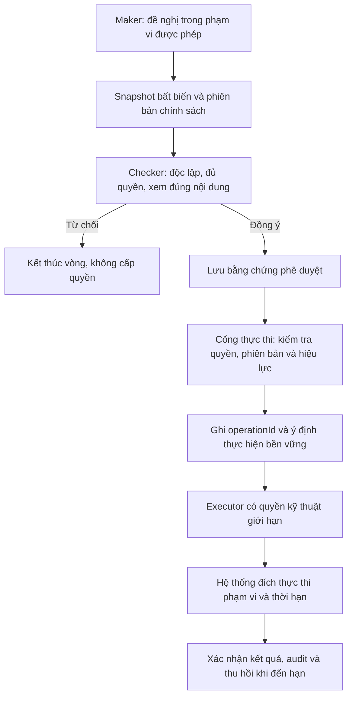

# Privileged action dual control: kiểm soát kép cho hành động đặc quyền

Trong chương **Separation of Duties**, dual control là cơ chế buộc một hành động nhạy cảm phải có sự tham gia hợp lệ của ít nhất hai người độc lập theo chính sách trước khi được thực hiện. Với hành động đặc quyền, mục tiêu là ngăn một cá nhân dùng quyền của mình để tự tạo, tự chấp thuận và hoàn tất một thay đổi có hậu quả lớn.

Trong module bảo vệ logic nghiệp vụ, kiểm soát kép cần được thực thi bằng business invariants, trạng thái, quyền theo đối tượng và transaction. Hai nút trên giao diện hoặc hai tài khoản khác tên không tự tạo thành hai bên kiểm soát độc lập. Quyết định còn phải gắn với đúng nội dung và tiếp tục có hiệu lực khi hệ thống thực hiện thay đổi.

Bài học sử dụng ví dụ cấp vai trò triển khai lên môi trường sản xuất trong thời gian giới hạn. Cùng cách tiếp cận có thể áp dụng cho thay đổi cấu hình bảo mật, xuất dữ liệu nhạy cảm, thay tài khoản nhận tiền hoặc thao tác quản trị có rủi ro cao.

Sau bài này, bạn có thể:

- Phân biệt kiểm soát kép với xác thực nhiều yếu tố và việc có nhiều vai trò.
- Xác định ai được tính là người yêu cầu, người duyệt và người hưởng quyền.
- Ràng buộc quyết định với đúng hành động đặc quyền và phiên bản nội dung.
- Thiết kế cổng thực thi, retry và thu hồi mà không làm mất tính độc lập.
- Kiểm thử việc tự duyệt bằng tài khoản khác, sửa nội dung và gọi đường quản trị trực tiếp.

## 1. Một người có nhiều quyền có thể tạo ra đường vòng

Giả sử một quản trị viên được phép tạo yêu cầu cấp quyền và cũng thuộc nhóm duyệt. Nếu hệ thống chỉ kiểm tra từng endpoint độc lập:

```text
POST /privileged-grants             → có quyền tạo: cho phép
POST /privileged-grants/g-17/approve → có quyền duyệt: cho phép
POST /privileged-grants/g-17/execute → có quyền thực hiện: cho phép
```

Cả ba kiểm tra vai trò đều có thể đúng, nhưng toàn bộ quy trình vẫn do một người kiểm soát. Người đó có thể tự cấp quyền đặc quyền cho mình hoặc cho một tài khoản mình quản lý.

Ngay cả điều kiện `requesterAccountId != approverAccountId` cũng chưa đủ nếu một nhân sự có hai tài khoản: tài khoản vận hành và tài khoản quản trị. Đổi tài khoản không làm xuất hiện người kiểm soát thứ hai.

Câu hỏi cần trả lời ở mức nghiệp vụ là:

> Có đủ sự tham gia độc lập theo chính sách cho đúng thay đổi sắp thực hiện, và còn đường nào cho một cá nhân tự tạo ra toàn bộ bằng chứng đó không?

Kiểm soát kép làm giảm khả năng một cá nhân tự ý hành động hoặc một tài khoản bị chiếm dụng đơn lẻ gây hậu quả. Nó không tự ngăn thông đồng giữa hai người, hai danh tính cùng bị chiếm dụng hoặc việc người duyệt chỉ bấm đồng ý mà không xem nội dung.

## 2. Dual control khác với những cơ chế gần giống

| Cơ chế | Điều nó chứng minh | Giới hạn đối với kiểm soát kép |
| --- | --- | --- |
| Xác thực nhiều yếu tố | Một chủ thể đáp ứng nhiều yếu tố xác thực | Vẫn có thể chỉ là một người |
| Hai tài khoản | Có hai định danh đăng nhập | Có thể cùng thuộc một cá nhân |
| Hai vai trò | Có hai tập quyền khác nhau | Một người có thể giữ cả hai vai trò |
| Đăng nhập lại trước thao tác | Phiên thao tác có mức bảo đảm phù hợp hơn | Không tạo ra một người duyệt độc lập |
| Người yêu cầu và người duyệt độc lập | Có sự phân tách trách nhiệm theo chính sách | Cần ràng buộc đúng hành động và chặn đường đi vòng |
| Hai người duyệt ngoài người yêu cầu | Có thêm một mức đồng thuận nếu đúng chính sách | Đây là yêu cầu mạnh hơn mô hình hai người cơ bản |

Trong ví dụ của bài, hai vai trò kiểm soát là:

- **Maker**: người tạo và gửi đề nghị cấp quyền.
- **Checker**: người độc lập xét duyệt đúng đề nghị đó.

Dịch vụ thực thi cấp quyền sau khi đủ điều kiện. Dịch vụ này không được tính là một người thứ hai chỉ vì nó có một service account riêng.

Nếu một hệ thống yêu cầu người tạo, hai người duyệt và một người vận hành khác nhau, phải mô hình hóa đủ các điều kiện đó. Không dùng cùng nhãn “hai người” cho những quy tắc có số lượng và quan hệ độc lập khác nhau.

## 3. Ví dụ: cấp quyền triển khai sản xuất tạm thời

Giả sử ứng dụng quản lý các đề nghị cấp `PROD_DEPLOYER` cho một tài khoản nhân sự trong một dự án và môi trường cụ thể. Vai trò này cho phép thực hiện một nhóm thao tác triển khai đã xác định, không được tùy ý hiểu là mọi quyền quản trị sản xuất.

Chính sách ví dụ:

1. Maker phải là người dùng cá nhân đã xác thực và có quyền yêu cầu trong phạm vi dự án.
2. Checker phải có quyền phê duyệt loại cấp quyền này trên đúng dự án và môi trường.
3. Checker không được là maker hoặc người đã sửa nội dung quan trọng của đề nghị.
4. Checker không được là người hưởng quyền, kể cả dùng tài khoản khác để duyệt.
5. Một người có thể đề nghị cấp quyền cho chính mình nếu chính sách cho phép, nhưng vẫn cần checker độc lập.
6. Nội dung phải xác định chính xác tài khoản nhận, vai trò, định nghĩa vai trò và thời gian được cấp.
7. Phê duyệt có thời hạn riêng; việc cấp quyền chỉ được bắt đầu trong cửa sổ được phép.
8. Mỗi đề nghị và phiên bản nội dung chỉ tạo một thao tác cấp quyền có định danh ổn định.
9. Quyền được cấp phải có thời điểm kết thúc và cơ chế thực thi hết hạn phù hợp ở hệ thống đích.

Đường đi này dành cho tài khoản nhân sự. Nếu cấp cho service principal, cần chính sách riêng xác định người kiểm soát hoặc chủ sở hữu của principal đó; không dùng một `personId` rỗng để vượt điều kiện người hưởng quyền.

Các invariant chính:

```text
checker.personId != maker.personId
checker.personId không thuộc tập người đã sửa nội dung quan trọng
checker.personId != beneficiary.personId

approvedSpec == executedSpec
approval còn hiệu lực tại ranh giới nhận quyền thực hiện
thao tác thực hiện không vượt phạm vi hoặc thời gian đã được duyệt
```

Đây là các điều kiện bổ sung cho quyền theo đối tượng. Hai người khác nhau nhưng đều không có quyền trên môi trường đích không tạo thành một thay đổi hợp lệ.

## 4. Danh tính độc lập phải đến từ nguồn đáng tin cậy

Một mô hình danh tính có thể phân biệt:

| Trường | Ý nghĩa |
| --- | --- |
| `accountId` | Tài khoản hoặc principal dùng để xác thực |
| `personId` | Cá nhân mà tổ chức xác định tài khoản thuộc về |
| `tenantId` | Phạm vi tổ chức của quan hệ danh tính |
| `principalType` | Người dùng cá nhân, dịch vụ hoặc loại principal khác |
| Ngữ cảnh ủy quyền | Ai thực sự thao tác và đang đại diện cho ai nếu có |

Máy chủ phải lấy quan hệ tài khoản–cá nhân từ nguồn danh tính được quản lý, không lấy `personId` trong request body. ID cần ổn định trong phạm vi chính sách; không dùng email có thể đổi hoặc tên hiển thị để quyết định hai người có khác nhau không.

Ví dụ:

```text
person-21
  ├─ account-ops-21
  └─ account-admin-21

Hai tài khoản trên vẫn là một cá nhân cho kiểm soát kép.
```

Tài khoản dùng chung làm mất khả năng chứng minh người nào đã thực hiện một vai trò kiểm soát. Một bot nhận lệnh từ maker rồi gọi API duyệt cũng không tự tạo ra checker độc lập.

Với ủy quyền hoặc thao tác thay mặt, cần lưu cả người thực sự thao tác và người được đại diện. Chính sách phải xác định các quan hệ nào làm mất tính độc lập; không chỉ so sánh một trường `effectiveUserId` rồi bỏ qua người điều khiển phiên.

Nếu không xác định được một danh tính cần thiết hoặc quan hệ danh tính có mâu thuẫn, không tự coi hai tài khoản là hai người khác nhau để cho qua. Chặn thao tác theo hợp đồng lỗi phù hợp và xử lý dữ liệu danh tính trước.

## 5. Nội dung được duyệt phải mô tả chính xác quyền sẽ cấp

Một đề nghị chỉ ghi “cấp quyền triển khai” là quá mơ hồ nếu worker có thể tự chọn môi trường hoặc vai trò lúc thực hiện.

Snapshot cần bao phủ các trường quyết định phạm vi:

| Nội dung | Rủi ro nếu không ràng buộc |
| --- | --- |
| Tenant, dự án và môi trường bằng ID chuẩn | Duyệt ở môi trường thử nghiệm nhưng thực hiện ở sản xuất |
| Tài khoản đích và cá nhân hưởng quyền | Đổi người nhận sau khi được duyệt |
| ID vai trò và phiên bản định nghĩa quyền | Giữ tên vai trò nhưng mở rộng các quyền bên trong |
| Thời điểm bắt đầu và kết thúc | Cấp lâu hơn hoặc gia hạn mỗi khi retry |
| Loại hành động | Dùng bằng chứng cấp một quyền để xóa hoặc thay chính sách khác |
| Lý do và phạm vi công việc khi chính sách yêu cầu | Người duyệt không có căn cứ đánh giá hành động |
| Phiên bản chính sách áp dụng | Không giải thích được điều kiện và tuyến duyệt đã dùng |

Máy chủ chuẩn hóa và kiểm chứng các dữ liệu được đề xuất trước khi chốt snapshot. Checker phải xem đúng bản này; executor phải thực hiện đúng bản đã duyệt.

Nếu định nghĩa `PROD_DEPLOYER` thay đổi sau duyệt, hệ thống phải có quy tắc rõ: thực thi một phiên bản quyền bất biến còn được hỗ trợ, hoặc yêu cầu xem xét lại. Không mặc định rằng cùng một tên vai trò đồng nghĩa cùng phạm vi quyền.

Hash có thể hỗ trợ so khớp nội dung chuẩn hóa. Một hash client tự gửi không chứng minh đã có phê duyệt. ID snapshot cũng chỉ đáng tin khi nội dung phía sau không bị sửa âm thầm.

Phân biệt ba thời hạn:

```text
approvalValidUntil: quyết định duyệt còn có thể được sử dụng đến lúc nào
executionDeadline: được nhận quyền thực hiện thao tác đến lúc nào
grantEndsAt: quyền được cấp hết hiệu lực lúc nào
```

Không suy rằng phê duyệt còn hạn thì được kéo dài quyền đích. Khi retry, giữ thời điểm kết thúc tuyệt đối đã được duyệt, không tính lại “thêm 30 phút kể từ lần thử mới nhất”.

## 6. Luồng và ranh giới tin cậy



Các trạng thái có thể gồm:

| Trạng thái | Ý nghĩa bảo vệ |
| --- | --- |
| `DRAFT` | Còn được sửa theo quyền; chưa có bằng chứng cấp quyền |
| `PENDING_APPROVAL` | Snapshot đã chốt, chờ checker hợp lệ |
| `APPROVED` | Có quyết định cho snapshot cụ thể, chưa đồng nghĩa đã cấp quyền |
| `EXECUTION_QUEUED` | Đã nhận quyền thực hiện và ghi ý định bền vững |
| `EXECUTING` | Đang gọi hoặc chờ kết quả từ hệ thống đích |
| `APPLIED` | Có bằng chứng thay đổi đã áp dụng |
| `REJECTED`, `EXPIRED`, `REVOKED` | Không được tạo lần thực hiện mới theo đường thông thường |
| `RECONCILING` | Kết quả bên ngoài chưa rõ, cần đối soát |

Sửa nội dung quan trọng sau khi gửi duyệt phải tạo phiên bản mới và làm mất hiệu lực bằng chứng phụ thuộc theo chính sách. Nếu chỉ đổi `targetAccountId` nhưng giữ `APPROVED`, kiểm soát kép đã bị vô hiệu hóa về ý nghĩa.

Giao diện có thể gợi ý người duyệt, nhưng máy chủ phải kiểm tra người được chọn có đủ quyền và độc lập. Client không được tự chọn một tuyến duyệt yếu hơn bằng cách đổi `approverGroupId`.

## 7. API không được cho ghi trực tiếp bằng chứng phê duyệt

Ví dụ tạo đề nghị:

```http
POST /privileged-grants
Content-Type: application/json

{
  "projectId": "project-7",
  "environmentId": "env-prod-2",
  "targetAccountId": "account-ops-21",
  "roleId": "PROD_DEPLOYER",
  "requestedStartsAt": "2026-11-22T03:00:00Z",
  "requestedEndsAt": "2026-11-22T03:30:00Z",
  "justification": "Triển khai bản sửa đã được lên kế hoạch"
}
```

Đây là đề xuất của maker. Máy chủ xác minh phạm vi, tra tài khoản đích, xác định cá nhân hưởng quyền, giới hạn thời gian và chốt phiên bản vai trò. Không nhận `makerPersonId`, `beneficiaryPersonId` hoặc `approved=true` làm sự thật từ body.

Checker gửi một lệnh riêng:

```http
POST /privileged-grants/g-17/approve
Idempotency-Key: approve-g17-revision3-01
Content-Type: application/json

{
  "expectedRequestVersion": 8,
  "expectedSpecRevision": 3,
  "comment": "Đã đối chiếu phạm vi công việc và thời gian cấp"
}
```

Máy chủ lấy danh tính checker từ phiên đã xác thực và kiểm tra quyền theo đối tượng. Nếu cần xác thực lại hoặc mức bảo đảm cao hơn, đó là điều kiện bổ sung, không thay cho kiểm tra checker khác maker và người hưởng quyền.

Lệnh duyệt không được nhận kèm thay đổi vai trò, tài khoản đích hoặc thời hạn. Nếu checker muốn sửa các trường quan trọng, hệ thống phải xử lý như thay đổi nội dung và đánh giá lại tính độc lập cùng vòng duyệt, không vừa sửa vừa duyệt một bản khác.

## 8. Minh họa Java: kiểm tra tính độc lập và ràng buộc nội dung

Đoạn mã sau kiểm tra một phần invariant trên dữ liệu máy chủ đã tải và xác minh. Các record là mô hình nội bộ, không phải DTO để client tự tạo bằng chứng. Ví dụ dùng record của Java 16 trở lên.

```java
import java.time.Instant;
import java.util.Objects;
import java.util.Set;
import java.util.UUID;

record GrantSpec(
        UUID requestId,
        UUID tenantId,
        UUID projectId,
        UUID environmentId,
        long revision,
        UUID targetAccountId,
        UUID beneficiaryPersonId,
        String roleId,
        long roleDefinitionVersion,
        Instant startsAt,
        Instant endsAt) {
}

record ApprovalWitness(
        UUID checkerPersonId,
        GrantSpec approvedSpec,
        Instant validUntil) {
}

final class DualControlPolicy {
    private DualControlPolicy() {
    }

    static void requireIndependentApproval(
            GrantSpec current,
            UUID makerPersonId,
            Set<UUID> materialEditorPersonIds,
            ApprovalWitness witness,
            Instant now) {
        Objects.requireNonNull(current);
        Objects.requireNonNull(makerPersonId);
        Objects.requireNonNull(witness);
        Objects.requireNonNull(now);

        Set<UUID> editors = Set.copyOf(materialEditorPersonIds);
        UUID checker = Objects.requireNonNull(witness.checkerPersonId());
        UUID beneficiary = Objects.requireNonNull(
                current.beneficiaryPersonId());

        require(!checker.equals(makerPersonId),
                "MAKER_CANNOT_CHECK");
        require(!editors.contains(checker),
                "MATERIAL_EDITOR_CANNOT_CHECK");
        require(!checker.equals(beneficiary),
                "BENEFICIARY_CANNOT_CHECK");
        require(current.equals(witness.approvedSpec()),
                "APPROVED_SPEC_MISMATCH");
        require(current.startsAt().isBefore(current.endsAt()),
                "INVALID_GRANT_WINDOW");
        require(now.isBefore(witness.validUntil()),
                "APPROVAL_EXPIRED");
        require(now.isBefore(current.endsAt()),
                "GRANT_WINDOW_ENDED");
    }

    private static void require(boolean condition, String code) {
        if (!condition) {
            throw new IllegalStateException(code);
        }
    }
}
```

`GrantSpec` là bất biến trong mô hình này. So sánh toàn bộ record giúp minh họa rằng phê duyệt cho tài khoản, môi trường, vai trò hoặc thời hạn khác không được dùng cho nội dung hiện tại. Trong triển khai thực tế, có thể đối chiếu ID snapshot được cơ sở dữ liệu bảo vệ thay vì lặp toàn bộ nội dung.

Hàm không tự xác minh quyền checker, nguồn quan hệ danh tính, trạng thái vòng duyệt, `executionDeadline` hoặc quyền kỹ thuật của executor. Nó cũng không quyết định có được bắt đầu trước `startsAt` để lên lịch hay chỉ được thực thi trong khoảng thời gian đó; quy tắc này phải được cổng thực thi và hệ thống đích áp dụng rõ ràng.

Các trường bắt buộc cần được xác thực khi dựng dữ liệu miền. Nếu thiếu bằng chứng hoặc dữ liệu có mâu thuẫn, chặn thao tác; không bắt mọi ngoại lệ rồi mặc định coi là được duyệt.

## 9. Nhận phê duyệt trong transaction

Luồng nhận quyết định có thể thực hiện:

```text
BEGIN TRANSACTION
  nhận quyền xử lý idempotency key
  tải và bảo vệ đề nghị, snapshot và vòng duyệt hiện tại
  kiểm tra expectedRequestVersion và expectedSpecRevision
  kiểm tra trạng thái vẫn PENDING_APPROVAL
  kiểm tra checker có quyền trên đúng dự án và môi trường
  lấy danh tính cá nhân và các quan hệ đại diện từ nguồn tin cậy
  kiểm tra độc lập với maker, người sửa và người hưởng quyền
  kiểm tra mức bảo đảm xác thực và guard khác theo chính sách
  ghi quyết định gắn với snapshot và phiên bản chính sách
  chuyển trạng thái sang APPROVED, tăng version
  ghi audit, outbox nếu cần và kết quả idempotency
COMMIT
```

Ràng buộc duy nhất giúp chặn ghi lặp quyết định cho cùng nhiệm vụ. Cập nhật có điều kiện hoặc khóa giúp ngăn một request sửa nội dung đồng thời với request duyệt tạo ra một bản đã sửa nhưng vẫn mang quyết định cũ.

Một phê duyệt đã commit chưa phải bằng chứng rằng hành động đã áp dụng. Nếu gửi email thông báo thất bại, retry thông báo từ ý định đã lưu; không đưa đề nghị trở lại chưa duyệt chỉ vì lỗi gửi email.

Chính sách ví dụ yêu cầu checker vẫn đủ quyền khi nhận quyền thực hiện. Vì vậy, cổng thực thi cần kiểm tra lại hiệu lực quyền theo nguồn có thẩm quyền và một ranh giới nhất quán đã xác định. Một bản sao membership cũ trong cache có thể không đủ nếu hệ thống yêu cầu thu hồi quyền có hiệu lực ngay tại ranh giới đó.

## 10. Cổng thực thi là nơi tiêu thụ quyền thực hiện

Trước khi cấp quyền đặc quyền, cần kiểm tra nhiều hơn `status == APPROVED`:

```text
snapshot hiện tại đúng snapshot đã duyệt
AND vòng và quyết định vẫn có hiệu lực
AND maker, checker và người hưởng quyền thỏa điều kiện độc lập
AND checker và chủ thể thực hiện có phạm vi quyền còn phù hợp
AND chưa quá thời hạn nhận quyền thực hiện
AND định nghĩa vai trò chưa thay đổi trái chính sách
AND tài khoản đích và môi trường vẫn hợp lệ
AND chưa có thao tác thực hiện loại trừ lần cấp mới
AND trạng thái quyền hiện tại không tạo tổ hợp quyền bị cấm
```

Điều kiện cuối quan trọng khi hai đề nghị riêng lẻ có thể tạo một tổ hợp nguy hiểm. Chẳng hạn cùng một người nhận hai vai trò xung đột qua hai yêu cầu chạy đồng thời. Kiểm tra mỗi đề nghị độc lập không tự bảo vệ trạng thái quyền tổng hợp của người nhận.

Cổng thực thi có thể cần bảo vệ phiên bản tập quyền hoặc tài nguyên dùng chung của đối tượng đích. Cách dùng khóa, cập nhật có điều kiện hoặc nguồn quyết định quyền phải phù hợp với nơi thực sự lưu và áp dụng quyền.

Trong transaction cục bộ, hệ thống nhận quyền thực hiện bằng cách tạo một `operationId` duy nhất cho đề nghị và revision, chuyển trạng thái phù hợp, rồi ghi outbox. Đó là lúc ý định thực hiện trở nên bền vững.

```text
APPROVED
  → ghi operationId và ý định thực hiện cùng transaction
  → EXECUTION_QUEUED
  → worker thực hiện cùng operationId
```

Không đánh dấu một token là đã dùng rồi mới ghi ý định thực hiện ở một transaction không liên kết. Crash ở giữa có thể làm mất thao tác hợp lệ. Ngược lại, không cho phép nhiều worker tạo nhiều operation mới từ cùng phê duyệt.

## 11. Thực hiện bên ngoài, retry và kết quả chưa rõ

Khi hệ thống đích là dịch vụ quản lý danh tính hoặc nền tảng triển khai khác, transaction trong ứng dụng không bao trùm thay đổi bên ngoài.

Một giao thức cần xác định:

- Định danh thao tác ổn định để nhận diện cùng một lần cấp quyền.
- Payload bất biến, gồm tài khoản, phạm vi, vai trò và thời điểm kết thúc đã duyệt.
- Thời hạn mà hệ thống đích còn được phép chấp nhận thao tác, nếu giao thức hỗ trợ.
- Cơ chế idempotency hoặc đối soát để không tạo quyền hoặc gia hạn trùng.
- Bằng chứng áp dụng và cách xử lý khi kết quả không rõ.

Ví dụ, timeout sau khi gửi yêu cầu không chứng minh quyền chưa được cấp. Retry phải tiếp tục cùng operation, giữ cùng `grantEndsAt` và kiểm tra kết quả thực tế; không tạo một đề nghị kỹ thuật mới có thời gian sống bắt đầu lại.

Một message cũ đến sau deadline không được tự cấp quyền chỉ vì từng được xếp hàng hợp lệ. Executor và điểm thực thi cần có quy tắc xử lý thao tác trễ. Nếu không bảo đảm được giới hạn thời gian tại hệ thống đích, phải đánh giá và xử lý khoảng trễ đó trong thiết kế thay vì coi thời hạn cục bộ là bảo đảm đầy đủ.

Khi nhận callback, đối chiếu operation, snapshot, tài khoản, phạm vi và kết quả. Callback đã áp dụng phải được xử lý idempotent. Một bằng chứng thành công thực sự đến muộn cần được ghi nhận và đối soát; không bỏ qua để giữ một nhãn trạng thái đẹp nhưng sai thực tế.

## 12. Thu hồi trước và sau khi đã nhận quyền thực hiện

Phải xác định điểm thu hồi còn có thể chặn tác dụng phụ:

| Thời điểm | Ý nghĩa xử lý |
| --- | --- |
| Còn chờ duyệt | Hủy hoặc từ chối vòng theo chính sách, không tạo operation |
| Đã duyệt nhưng chưa nhận quyền thực hiện | Có thể thu hồi phê duyệt bằng cập nhật loại trừ việc xếp hàng |
| Đã xếp hàng hoặc đang gửi | Cần giao thức dừng, kiểm tra operation và đối soát; không giả định chưa có hiệu ứng |
| Đã áp dụng | Thu hồi quyền đã cấp là hành động nghiệp vụ mới |

Thu hồi và nhận quyền thực hiện phải cạnh tranh qua dữ liệu có thẩm quyền. Nếu thu hồi thắng, không được tạo operation mới từ phê duyệt đó. Nếu operation đã đi qua ranh giới không thể dừng tức thời, trả trạng thái phản ánh việc đang xử lý và theo dõi đến kết quả.

Việc hết `grantEndsAt` cũng cần được thực thi tại nơi kiểm tra quyền. Một job đặt trạng thái trong ứng dụng thành “hết hạn” không đủ nếu hệ thống đích tiếp tục chấp nhận vai trò hoặc token cũ.

Thiết kế phải xét session, token, cache quyền và các tác vụ đang chạy theo ngữ nghĩa của hệ thống đích. Có thể cần ràng buộc thời hạn trong entitlement, kiểm tra quyền trực tiếp hoặc quy trình thu hồi bổ sung; không suy rằng xóa một dòng membership luôn vô hiệu hóa ngay mọi credential đã phát hành.

## 13. Chặn đường đi vòng và bảo vệ chính cơ chế phê duyệt

Dual control mất tác dụng nếu vẫn tồn tại một đường cấp quyền trực tiếp cho cùng người vận hành:

- API quản trị nhận `approved=true` hoặc cho sửa tùy ý `status`.
- CLI, script, công cụ xử lý hàng loạt hoặc pipeline dùng credential có thể tự cấp quyền.
- Worker tin message mà không kiểm tra snapshot và operation.
- Quản trị viên có thể đổi nhóm checker thành chính mình rồi duyệt ngay.
- Một người có thể sửa mapping `personId` để hai tài khoản của mình trông như hai người.
- Một thay đổi định nghĩa vai trò làm quyền đã duyệt trở nên rộng hơn.

Các đường thực thi phải dùng cùng cơ chế bảo vệ hoặc được giới hạn tại một điểm thực thi có thẩm quyền. Executor cần quyền kỹ thuật đủ hẹp để thực hiện loại thay đổi được giao, thay vì một khóa quản trị toàn năng có thể dùng cho mọi hành động.

Chính sách phê duyệt, nhóm người duyệt, mapping danh tính và credential của executor là phần của ranh giới tin cậy. Những thay đổi nhạy cảm lên chúng cần kiểm soát tương xứng; nếu maker có thể tự tắt chính sách rồi thực hiện, invariant không còn được bảo đảm.

Ứng dụng cũng phải nêu rõ phạm vi bảo đảm. Nếu một tài khoản quản trị nền tảng bên ngoài có quyền bỏ qua toàn bộ dịch vụ, chỉ thêm workflow trong ứng dụng không thể kiểm soát đường đó. Cần áp dụng giới hạn và quy trình tại đúng tầng nắm quyền thực thi, đồng thời theo dõi các ngoại lệ.

## 14. Khẩn cấp và ủy quyền không được trở thành tự duyệt ngầm

Khi checker vắng mặt, một số hệ thống tự chọn maker làm người thay thế hoặc tự đồng ý sau timeout. Cách này phá vỡ ngay điều kiện độc lập mà kiểm soát kép đặt ra.

Một chính sách thay thế có thể chuyển nhiệm vụ tới người có thẩm quyền khác nhưng vẫn phải kiểm tra đầy đủ:

- Người thực sự đưa ra quyết định là ai.
- Người đó có quyền cho phạm vi và loại hành động này không.
- Có quan hệ xung đột với maker, người sửa hoặc người hưởng quyền không.
- Việc ủy quyền còn hiệu lực và có được dùng cho hành động đặc quyền không.

Nếu có đường khẩn cấp, hãy mô hình hóa rõ phạm vi, điều kiện kích hoạt, thời gian, quyền cần thiết, audit và việc xem xét sau sự kiện. Ưu tiên giữ yêu cầu hai người khi quy trình khẩn cấp được thiết kế như vậy.

Nếu doanh nghiệp chủ động cho phép một cá nhân thực hiện trong một tình huống đặc biệt, đó là ngoại lệ ngoài bảo đảm kiểm soát kép của đường thông thường. Ngoại lệ phải được nhận diện và theo dõi; không báo cáo rằng điều kiện hai người vẫn được đáp ứng chỉ vì có một service account tham gia.

Timeout chờ duyệt phải dẫn tới trạng thái còn chờ, hết hạn hoặc chuyển người theo chính sách. Nó không tự tạo ra một quyết định đồng ý.

## 15. Kiểm thử độc lập, nội dung và quyền theo đối tượng

| Ca kiểm thử | Kết quả cần giữ |
| --- | --- |
| Hai người hợp lệ xử lý đúng đề nghị | Chỉ tạo operation cho đúng snapshot và phạm vi |
| Maker có thêm vai trò checker | Vẫn không tự duyệt được đề nghị của mình |
| Maker dùng tài khoản quản trị khác cùng `personId` | Bị chặn vì vẫn là cùng cá nhân |
| Checker là người hưởng quyền qua tài khoản khác | Bị chặn theo danh tính người hưởng quyền |
| Người sửa nội dung quan trọng chuyển sang duyệt | Không được dùng làm checker độc lập theo chính sách ví dụ |
| Hai người khác nhau nhưng checker ngoài dự án hoặc tenant | Bị từ chối quyền, không tạo bằng chứng hợp lệ |
| Body tự khai `personId` khác | Không thay đổi danh tính do máy chủ xác định |
| Tài khoản dịch vụ tự gửi lệnh duyệt | Không được tính là checker cá nhân trong đường này |
| Thiếu mapping danh tính | Không mặc định coi là người độc lập |
| Người gọi chọn nhóm duyệt yếu hơn | Không thay đổi tuyến duyệt có thẩm quyền |

Các ca sửa nội dung cần bao gồm:

- Đổi tài khoản đích, dự án hoặc môi trường sau khi đã duyệt.
- Giữ tên vai trò nhưng đổi phiên bản hoặc nội dung quyền bên trong.
- Kéo dài `endsAt` hoặc thay thời điểm bắt đầu trong một lần retry.
- Dùng phê duyệt của revision cũ cho revision mới.
- Dùng bằng chứng cấp vai trò này để yêu cầu một loại hành động khác.
- Tạo hai đề nghị riêng tạo tổ hợp quyền bị cấm cho cùng người nhận.

Không chỉ khẳng định API trả lỗi. Kiểm tra không có operation, outbox cấp quyền hoặc thay đổi quyền đích phát sinh ngoài ý định hợp lệ.

## 16. Kiểm thử tranh chấp, retry và đường quản trị

| Kịch bản | Kết quả cần giữ |
| --- | --- |
| Sửa nội dung đồng thời với duyệt | Không có snapshot mới mang phê duyệt của bản cũ |
| Hai worker cùng nhận đề nghị đã duyệt | Chỉ một logical operation cho đề nghị và revision |
| Retry duyệt cùng key sau khi mất phản hồi | Trả kết quả cũ, không tạo quyết định mới |
| Cùng key nhưng đổi revision hoặc payload có ý nghĩa | Từ chối tái sử dụng key cho ý định khác |
| Thu hồi đồng thời với xếp hàng thực hiện | Kết quả tuân theo ranh giới quyết định đã định nghĩa |
| Checker mất quyền trước khi nhận quyền thực hiện | Chặn theo chính sách kiểm tra hiệu lực tại thời điểm đó |
| Crash sau commit outbox nhưng trước gọi hệ thống đích | Tiếp tục cùng operation, không tạo lần cấp mới |
| Hệ thống đích đã cấp nhưng phản hồi timeout | Đối soát hoặc retry idempotent, không gia hạn lại quyền |
| Message cũ tới sau cửa sổ thực thi | Không cấp mới trái thời hạn đã duyệt |
| Callback lặp hoặc sai operation | Không áp dụng trùng hoặc gán cho đề nghị khác |
| Credential hoặc cấu hình chính sách bị sửa qua đường khác | Kiểm soát tại tầng tương ứng phát hiện hoặc chặn theo thiết kế |
| Quyền đã đến hạn nhưng session cũ còn tồn tại | Hành vi thực tế khớp bảo đảm hết hạn mà hệ thống công bố |

Các kiểm thử transaction và tranh chấp cần chạy với cơ chế lưu trữ và kiểm tra quyền phù hợp. Mock repository trả thành công không chứng minh việc nhận quyền thực hiện, kiểm soát version hoặc ràng buộc duy nhất hoạt động khi chạy đồng thời.

Phạm vi kiểm thử phải bao phủ API, CLI, pipeline, thao tác hàng loạt, worker và callback có thể tạo cùng quyền. Nếu chỉ kiểm tra màn hình phê duyệt, đường quản trị trực tiếp vẫn có thể là nơi bỏ qua cơ chế.

## 17. Audit để chứng minh hai bên đã kiểm soát điều gì

Một audit hữu ích cần liên kết được:

```text
requestId, snapshotId hoặc revision, phiên bản chính sách
makerAccountId và makerPersonId
người đã sửa nội dung quan trọng
checkerAccountId và checkerPersonId
quan hệ ủy quyền nếu có, thời điểm và bằng chứng xác thực phù hợp
tài khoản hưởng quyền, dự án, môi trường và vai trò cùng phiên bản
approvalValidUntil, executionDeadline và grantEndsAt
operationId, trạng thái trước–sau và bằng chứng kết quả hệ thống đích
lý do, mã tương quan và sự kiện thu hồi hoặc hết hạn liên quan
```

Không ghi “đã đủ hai người” bằng một cờ không thể truy ra danh tính và nội dung đã xét. Cần phân biệt lần cố tự duyệt bị chặn, quyết định đã commit, ý định đã xếp hàng và quyền thực sự đã áp dụng.

Thông tin quyền và danh tính có thể nhạy cảm. Giới hạn người xem audit, giữ dữ liệu cần thiết và không ghi token, credential hoặc bí mật của executor vào log.

Các tín hiệu đáng quan sát gồm nhiều lần dùng tài khoản khác để tự duyệt, sửa nội dung sau duyệt, message quá hạn, operation bị lặp và thay đổi nhóm checker trước một hành động đặc quyền. Chúng hỗ trợ điều tra; cổng thực thi vẫn phải chặn vi phạm ngay khi xử lý.

## 18. Cách áp dụng kiểm soát kép vào một hành động đặc quyền

1. Xác định hành động, hậu quả và nơi thực sự nắm quyền áp dụng thay đổi.
2. Ghi rõ ai được tính là maker, checker, người hưởng quyền và executor; định nghĩa quan hệ độc lập bằng danh tính đáng tin cậy.
3. Mô tả đầy đủ snapshot của hành động, gồm đối tượng, phạm vi, quyền và thời hạn.
4. Xác định quyền theo đối tượng, mức bảo đảm xác thực và hiệu lực cần kiểm tra tại lúc duyệt và lúc thực hiện.
5. Thiết kế transaction nhận quyết định và transaction nhận quyền thực hiện, cùng ràng buộc chống trùng.
6. Gắn mọi retry và kết quả ngoài với cùng operation, giữ nguyên nội dung và thời hạn đã duyệt.
7. Chặn các đường cấp trực tiếp và bảo vệ cấu hình, danh tính cùng credential có thể vô hiệu hóa chính sách.
8. Thiết kế thu hồi, hết hạn và ngoại lệ khẩn cấp bằng những hành động có điều kiện rõ ràng.
9. Kiểm thử một người dùng nhiều tài khoản, thay nội dung, tranh chấp và thao tác qua mọi đường quản trị.

Kiểm soát kép có giá trị khi hai người độc lập cùng kiểm soát một thay đổi được xác định chính xác, và hệ thống chỉ thực hiện thay đổi đó trong phạm vi đã duyệt. Danh tính, bằng chứng phê duyệt và điểm thực thi cần liên kết thành cùng một chuỗi quyết định có thể kiểm chứng.
