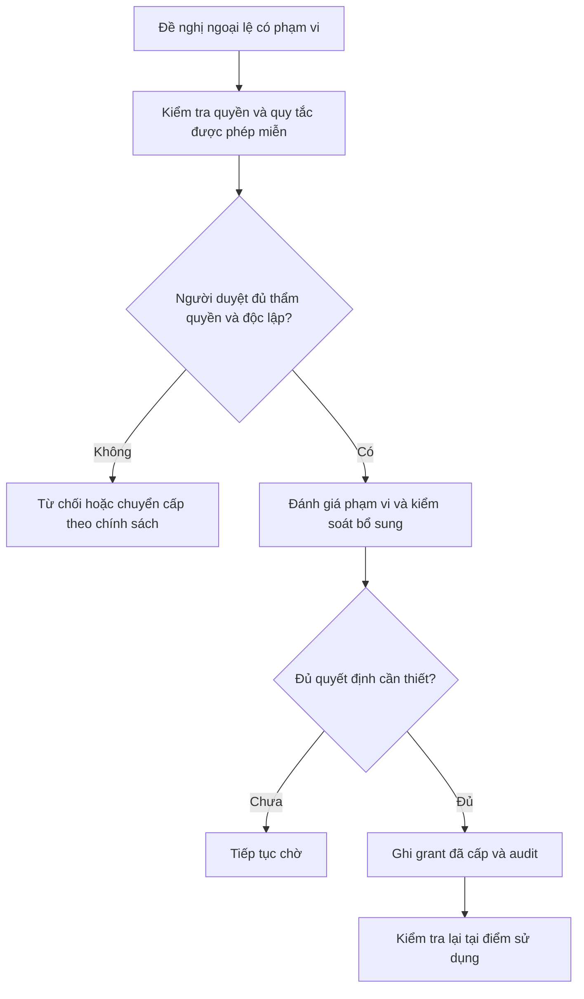

# Phê duyệt ngoại lệ phân tách nhiệm vụ (Duty exception approval)

Phân tách nhiệm vụ yêu cầu những hành động xung đột không do cùng một chủ thể kiểm soát. Ví dụ, người lập lệnh thanh toán không được tự phê duyệt lệnh của mình; hoặc người chuẩn bị giao dịch không đồng thời là người phát hành giao dịch ra hệ thống bên ngoài.

Trong thực tế, một người phụ trách có thể vắng mặt hoặc một quy trình cần được xử lý trong điều kiện đặc biệt. Nếu hệ thống giải quyết bằng cách bật cờ bỏ qua kiểm tra cho tài khoản quản trị, ngoại lệ sẽ trở thành đường vòng thường trực qua quy tắc nghiệp vụ.

Một ngoại lệ an toàn phải là một quyết định có thẩm quyền: miễn **quy tắc nào**, cho **ai**, trên **đối tượng và nội dung nào**, trong **thời gian và số lần nào**, với **điều kiện bổ sung nào**. Các kiểm tra còn lại vẫn được thực thi.

Bài học thuộc chương **Separation of Duties** trong bảo mật logic nghiệp vụ. Trọng tâm là yêu cầu, phê duyệt và sử dụng ngoại lệ có kiểm soát; không coi lý do khẩn cấp hay dấu vết audit là bằng chứng tự động cho phép vi phạm.

## 1. Xác định chính xác quy tắc cần được ngoại lệ

Có thể gặp hai dạng phân tách:

| Dạng | Điều đang được kiểm soát | Ví dụ |
|---|---|---|
| Theo phân công quyền | Không cấp đồng thời những khả năng xung đột cho một chủ thể theo chính sách | Không cùng giữ quyền quản trị chính sách và phê chuẩn thay đổi chính sách đó |
| Theo hành động trên đối tượng | Một người có thể có nhiều quyền nhưng không được thực hiện một tổ hợp hành động trên cùng giao dịch | Người lập lệnh không tự duyệt chính lệnh đó |

Ngoại lệ cho một hành động trên một giao dịch không nên được triển khai bằng việc cấp thêm một vai trò rộng cho mọi giao dịch. Ngược lại, ngoại lệ về phân công quyền có thể cần một quy trình quản trị danh tính riêng; không giải quyết chỉ bằng việc bỏ qua kiểm tra ở một endpoint.

### 1.1. Ví dụ xuyên suốt

Quy trình thanh toán có các kiểm soát độc lập:

1. Người lập chuẩn bị nội dung thanh toán.
2. Một người đủ thẩm quyền khác phê duyệt nội dung đó.
3. Người phát hành gửi lệnh đã được duyệt sang hệ thống thanh toán.
4. Chính sách thông thường yêu cầu người lập và người phát hành là hai người khác nhau.

Nhân viên H là người lập và có quyền nền phát hành trong phạm vi được giao, nhưng quy tắc theo đối tượng ngăn H phát hành lệnh do chính H lập. Lệnh đã được một người độc lập phê duyệt, còn người phát hành thông thường đang vắng mặt. H đề nghị được phát hành đúng một lệnh cụ thể.

Ngoại lệ minh họa chỉ miễn quy tắc:

```text
PAYMENT_MAKER_CANNOT_RELEASE
```

Nó không miễn quy tắc người lập không tự phê duyệt nội dung. Một người D có thẩm quyền, độc lập với H và các chủ thể xung đột theo chính sách, xem xét ngoại lệ.

```text
Phê duyệt nội dung thanh toán
    + phê duyệt ngoại lệ người lập được phát hành
    + các kiểm tra thực thi còn lại
    → mới có thể chấp nhận lệnh phát hành
```

Đây là hai quyết định khác nhau. Có ngoại lệ phân tách nhiệm vụ chưa đồng nghĩa khoản thanh toán đã được duyệt, đã được phát hành hay đã được thực hiện thành công.

## 2. Phân loại điều kiện được miễn và không được miễn

Không nên để một bản ghi ngoại lệ có nghĩa là “bỏ qua mọi guard”. Chính sách phải chỉ rõ điều kiện nào có thể được miễn và điều kiện nào vẫn bắt buộc.

| Điều kiện | Trong ví dụ có được ngoại lệ miễn không? |
|---|---|
| Người lập và người phát hành phải khác nhau | Có, nếu đúng quy tắc được chính sách cho phép xét ngoại lệ |
| Người gọi phải được xác thực | Không |
| Đúng tenant và đúng đối tượng được phép truy cập | Không |
| Người gọi có quyền nền để yêu cầu phát hành | Không |
| Nội dung đã được phê duyệt hợp lệ | Không |
| Revision, số tiền, tiền tệ và người thụ hưởng phải khớp | Không |
| Không phát hành trùng một thao tác nghiệp vụ | Không |
| Trạng thái hiện tại cho phép phát hành | Không |
| Transaction và dữ liệu phải nhất quán | Không |

Bảng này là chính sách của ví dụ, không phải danh sách cố định cho mọi tổ chức. Điều quan trọng là việc được miễn phải tường minh, có kiểu và được kiểm tra phía máy chủ.

### 2.1. Các bất biến của cơ chế ngoại lệ

1. Không ai tự phê duyệt ngoại lệ mà chính họ được hưởng lợi hoặc kiểm soát trái quy tắc độc lập đã định nghĩa.
2. Ngoại lệ chỉ áp dụng cho quy tắc nằm trong danh sách được phép miễn.
3. Đối tượng, phiên bản nội dung, chủ thể và hành động phải khớp phạm vi đã duyệt.
4. Hiệu lực thời gian và số lần sử dụng được kiểm tra ngay tại điểm dùng.
5. Phê duyệt ngoại lệ không tạo tác dụng nghiệp vụ ngoài phạm vi quyết định.
6. Yêu cầu bị từ chối, hết hạn hoặc bị thu hồi không được dùng như một quyền còn hiệu lực.
7. Cạnh tranh và retry không làm tăng số lần được phép sử dụng.
8. Mọi thay đổi có ý nghĩa đều có dấu vết gắn với người thực hiện và căn cứ.

Ngoại lệ không thể bảo đảm chống lại mọi hình thức thông đồng. Nó tạo ra một ranh giới thẩm quyền rõ hơn và bằng chứng để kiểm tra, thay vì cho một người tự bỏ qua quy tắc mà không có giới hạn.

## 3. Thiết kế yêu cầu ngoại lệ

Yêu cầu ngoại lệ cần đủ thông tin để người duyệt hiểu rủi ro và để hệ thống kiểm tra lại sau này.

| Nhóm | Dữ kiện cần xác định |
|---|---|
| Quy tắc | Mã quy tắc phân tách nhiệm vụ cần được miễn |
| Đối tượng | Tenant, loại đối tượng, ID và phiên bản nội dung |
| Chủ thể | Người yêu cầu, người được hưởng ngoại lệ và người được đại diện nếu có |
| Hành động | Thao tác cụ thể, ví dụ phát hành lệnh thanh toán |
| Giới hạn nghiệp vụ | Số tiền, tiền tệ, người thụ hưởng hoặc điều kiện liên quan |
| Thời gian | Mốc bắt đầu, mốc hết hiệu lực và mốc mà giới hạn đó áp dụng |
| Sử dụng | Số lần tối đa, cách nhận diện một lần dùng |
| Lý do | Tình huống, phương án thông thường không thực hiện được và căn cứ bổ sung |
| Kiểm soát bổ sung | Giám sát, đối soát hoặc điều kiện độc lập cần có |

Một phạm vi đã được máy chủ chốt có thể được diễn giải:

```text
Người được hưởng: H
Đối tượng: payment PAY-410 của tenant A
Nội dung: revision 12
Hành động: RELEASE_PAYMENT
Quy tắc được miễn: PAYMENT_MAKER_CANNOT_RELEASE
Số tiền và tiền tệ: đúng nội dung đã được duyệt
Người thụ hưởng: đúng snapshot revision 12
Số lần dùng tối đa: 1
Hiệu lực: trong khoảng đã được chính sách chấp nhận
```

Không dùng phạm vi “mọi thanh toán trong tương lai” nếu người duyệt chỉ có ý định giải quyết một giao dịch.

### 3.1. Đầu vào đề nghị không phải phạm vi có thẩm quyền

Client có thể đề nghị một thời hạn hoặc nêu người cần xử lý. Máy chủ phải giới hạn theo chính sách và lấy dữ liệu nghiệp vụ có thẩm quyền để chốt quyết định.

Những trường sau không tự tạo ra quyền:

```json
{
  "ruleId": "ALL_RULES",
  "status": "APPROVED",
  "approvedBy": "director-01",
  "skipAuthorization": true,
  "maxUses": 999999
}
```

Nên dùng DTO riêng cho lệnh đề nghị, lệnh phê duyệt và lệnh sử dụng. Không ánh xạ toàn bộ body vào entity có thể ghi các trường trạng thái, người duyệt hoặc giới hạn đã được cấp.

### 3.2. Lý do phải phục vụ quyết định, không thay thế quyết định

Các câu như “gấp”, “quản lý đã đồng ý qua điện thoại” hoặc “khách hàng đang chờ” có thể là thông tin xem xét. Chúng không tự đáp ứng quyền phê duyệt.

Tham chiếu trao đổi hoặc tài liệu có thể được lưu làm căn cứ theo chính sách, nhưng phải xác định nguồn và phiên bản cần thiết. Không coi một chuỗi văn bản do người xin ngoại lệ nhập là bằng chứng người quản lý đã thực sự phê chuẩn.

## 4. Ai có quyền phê duyệt ngoại lệ?

Quyền này nên là khả năng riêng trong mô hình phân quyền. Người có quyền duyệt giao dịch thông thường chưa chắc được phép nới quy tắc phân tách nhiệm vụ.

Hệ thống cần kiểm tra:

- Thẩm quyền trên đúng loại ngoại lệ và phạm vi tenant, đơn vị, dự án hoặc giao dịch.
- Hạn mức hoặc mức rủi ro mà người duyệt được xử lý.
- Tính độc lập với người xin và người được hưởng ngoại lệ.
- Quan hệ ủy quyền, người đại diện và xung đột lợi ích được chính sách định nghĩa.
- Số người độc lập cần thiết nếu ngoại lệ yêu cầu quorum.
- Quyền có hiệu lực tại mốc quyết định, theo nguồn chính sách có thẩm quyền.

### 4.1. Độc lập theo chủ thể, không chỉ theo tài khoản

Hai account có thể thuộc cùng một người. Một dịch vụ có thể thực hiện thay người dùng. So sánh chuỗi username khác nhau chưa chắc chứng minh đã có hai chủ thể độc lập.

Khi chính sách yêu cầu độc lập theo con người hoặc chủ thể tổ chức, hệ thống cần ánh xạ danh tính theo nguồn đáng tin cậy và xét quan hệ đại diện tương ứng. Không dựa vào `personId` do client tự khai.

Với người xin A và người được hưởng H khác nhau, cả hai mối quan hệ đều có thể quan trọng. Chỉ chặn H tự duyệt nhưng cho A tự duyệt đề nghị mình gửi có thể chưa đáp ứng chính sách.

### 4.2. Người quản trị không tự động được miễn tính độc lập

Nếu vai trò quản trị vừa sửa được chính sách, vừa cấp quyền ngoại lệ, vừa sử dụng và xóa dấu vết, cơ chế phê duyệt có thể mất ý nghĩa.

Cần xác định các quyền quản trị xung đột, đường thay đổi chính sách và cách xử lý quyền đặc biệt. Không mặc định thêm điều kiện `isAdmin` để bỏ qua mọi kiểm tra độc lập.

## 5. Vòng đời và hiệu lực của ngoại lệ

Một mô hình tối giản có thể có:

| Trạng thái | Ý nghĩa |
|---|---|
| `PENDING` | Đang chờ xem xét, chưa cấp quyền ngoại lệ |
| `APPROVED` | Quyết định cấp đã được ghi nhận; còn phải kiểm tra điều kiện sử dụng |
| `REJECTED` | Đề nghị đã bị từ chối |
| `CANCELLED` | Đề nghị bị rút hoặc kết thúc trước khi cấp |
| `REVOKED` | Quyền đã được cấp nhưng bị thu hồi theo thẩm quyền |
| `EXHAUSTED` | Đã dùng hết số lần được phép |

Hết hạn có thể được thể hiện bằng trạng thái `EXPIRED` hoặc được tính từ thời gian. Dù lưu theo cách nào, không được chờ tác vụ nền đổi trạng thái rồi mới ngừng chấp nhận.

Một grant đang có nhãn `APPROVED` chưa chắc đang dùng được:

```text
Usable(grant, action, actor, subject, T) =

    grant đã được phê duyệt hợp lệ
    AND chưa bị thu hồi hoặc vô hiệu theo chính sách
    AND validFrom <= T < expiresAt
    AND usedCount < maxUses
    AND actor và subject khớp phạm vi
    AND action và rule khớp phạm vi
    AND nội dung cùng các giới hạn nghiệp vụ vẫn khớp
    AND chính sách hiện hành còn chấp nhận grant đó
```

### 5.1. Giới hạn đã duyệt không được sửa trực tiếp

Sau khi phê duyệt, việc đổi người được hưởng, đối tượng, quy tắc, thời hạn hoặc số lần dùng là thay đổi ý nghĩa của quyền được cấp. Nó cần quy trình sửa hoặc cấp lại có thẩm quyền, không phải một thao tác cập nhật tùy ý.

Nếu đề nghị đang chờ được sửa nội dung, các quyết định đã thu thập phải được xử lý theo revision của đề nghị. Không lấy chữ ký hoặc quyết định cho một phạm vi hẹp rồi gắn vào phạm vi rộng hơn.

Người duyệt có thể được phép thu hẹp phạm vi theo chính sách. Phạm vi đã cấp phải được lưu rõ và thông báo chính xác; không suy ra từ những trường đề nghị ban đầu đã bị thay đổi sau đó.

### 5.2. Chính sách thay đổi sau khi cấp

Cần phân biệt phiên bản chính sách đã dùng để cấp và quy tắc chấp nhận tại lúc dùng.

Ví dụ, grant được cấp theo chính sách cho phép ngoại lệ với một loại lệnh. Sau đó tổ chức tạm dừng toàn bộ ngoại lệ cho loại lệnh đó. Chỉ lưu `policyVersion` cũ không tự cho phép tiếp tục sử dụng.

Hệ thống cần quy định cách giữ hiệu lực, đánh giá lại hoặc vô hiệu grant khi chính sách đổi. Không trộn một phần điều kiện cũ với một phần điều kiện mới ngoài ý muốn.

## 6. Luồng xét duyệt ngoại lệ

Một luồng xử lý có thể gồm:

1. Xác thực và kiểm tra quyền xem xét đúng đề nghị.
2. Tải đề nghị, nội dung nguồn và dữ liệu chính sách trong phạm vi nhất quán phù hợp.
3. Kiểm tra đề nghị còn chờ, revision còn khớp và chưa bị rút hoặc hết mốc xem xét.
4. Xác định quy tắc cần miễn có nằm trong danh sách được phép.
5. Kiểm tra người duyệt đủ thẩm quyền và độc lập với các chủ thể xung đột.
6. Đánh giá lý do, phạm vi, thời hạn, hạn mức và kiểm soát bổ sung.
7. Ghi quyết định; chỉ tạo grant khi đủ các quyết định độc lập bắt buộc.
8. Lưu audit, thông tin chính sách và kết quả idempotency cùng transaction.
9. Thông báo sau commit; không tự thực hiện thanh toán chỉ vì grant vừa được cấp.



### 6.1. Phê duyệt nhiều người và quyết định trùng

Nếu ngoại lệ cần hai người độc lập, hai lần bấm của cùng một người không tạo thành hai phê duyệt. Hai tài khoản liên kết với cùng chủ thể cũng không mặc nhiên thỏa điều kiện.

Cần gắn quyết định với đúng revision đề nghị và kiểm tra tập chủ thể đủ điều kiện. Hai người xử lý đồng thời không được tạo hai grant riêng cho cùng một đề nghị nếu mô hình chỉ cho phép một.

Khóa hoặc version của đề nghị, ràng buộc định danh grant và transaction là những phần cần phối hợp. Idempotency của một request không tự giải quyết hai request khác khóa cùng tranh chấp.

### 6.2. Không tìm được người độc lập

Trong một nhóm nhỏ, có thể không có người đang trực đủ điều kiện. Đây là vấn đề của chính sách và phương án vận hành, không phải lý do để code tự cho người xin phê duyệt.

Có thể chuyển cấp sang một chủ thể khác theo quy tắc được định nghĩa, trì hoãn thao tác hoặc dùng một cơ chế khẩn cấp đã được tổ chức cho phép trước. Không dùng hành vi dự phòng mặc định “không có ai thì admin duyệt hết”.

## 7. Kiểm tra tại đúng điểm sử dụng

Chỉ kiểm tra khi cấp grant là chưa đủ. Giữa lúc cấp và lúc sử dụng, nội dung giao dịch, quyền nền, chính sách hoặc trạng thái grant có thể đã thay đổi.

Một cách phân lớp:

```text
Kiểm tra bắt buộc không được miễn
    → đánh giá các xung đột phân tách nhiệm vụ còn lại
    → nếu cần, tìm grant khớp chính xác từng xung đột được phép miễn
    → kiểm tra thời gian, số lần và chính sách
    → chấp nhận thao tác cùng việc tiêu thụ grant một cách nguyên tử
```

Không dùng logic:

```java
// Nguy hiểm: sự tồn tại của grant làm mất mọi điều kiện còn lại.
if (hasAnyApprovedException(actor)) {
    releasePayment(payment);
}
```

Một grant chỉ cho phép miễn những vi phạm được định danh trong phạm vi đã duyệt. Nếu còn bất kỳ điều kiện bắt buộc hoặc xung đột chưa được bao phủ, hành động phải bị chặn.

### 7.1. Ví dụ Java ở nhánh cần ngoại lệ

Đoạn mã là mã giả theo cú pháp Java, minh họa ranh giới thực thi. Các cổng dữ liệu, transaction và policy chưa phải triển khai chạy độc lập.

```java
ReleaseAccepted releaseWithException(
        ReleaseCommand command,
        ActorContext actor) {

    return transactions.required(() -> {
        // Quy ước khóa khi chạm cả hai: payment trước, grant sau.
        Payment payment = payments
                .findForUpdate(actor.tenantId(), command.paymentId())
                .orElseThrow(ResourceNotFound::new);

        authorizer.requireReleaseAccess(actor, payment);

        CommandClaim claim = commandLog.claimOrReplay(
                actor, "RELEASE_PAYMENT",
                command.idempotencyKey(), fingerprintOf(command));

        if (claim.isCompletedReplay()) {
            return claim.savedReleaseAccepted();
        }

        payment.requireVersion(command.expectedVersion());

        // Bao gồm trạng thái, nội dung được duyệt, tiền, người nhận,
        // và các điều kiện mà ngoại lệ không được phép miễn.
        basePolicy.requireNonWaivableConditions(payment, actor);

        DutyAssessment assessment = dutyPolicy.evaluate(payment, actor);

        DutyExceptionGrant grant = exceptionGrants
                .findForUpdate(actor.tenantId(), command.exceptionGrantId())
                .orElseThrow(ExceptionGrantNotFound::new);

        Instant decisionTime = decisionClock.nowAfterLocks();

        exceptionPolicy.requireUsableFor(
                grant, assessment, payment, actor,
                Action.RELEASE_PAYMENT, decisionTime);

        String executionId = executionIds.newId();

        int consumed = exceptionGrants.consumeIfAvailable(
                grant, decisionTime);

        if (consumed != 1) {
            throw new ExceptionGrantUnavailable();
        }

        int changed = payments.markReleaseRequestedIfUnchanged(
                payment, executionId);

        if (changed != 1) {
            throw new ConcurrentChange();
        }

        executions.insert(
                executionId, payment, grant.id(), claim.commandId());

        audit.appendExceptionUsed(
                grant.id(), payment.id(), executionId, actor.userId());

        outbox.appendReleaseRequested(executionId);

        ReleaseAccepted result = new ReleaseAccepted(executionId);
        commandLog.complete(claim, result);
        return result;
    });
}
```

Các hợp đồng cần có:

- Đây là nhánh dành cho hành động thực sự cần ngoại lệ. Hành động không có xung đột có thể đi qua nhánh thông thường, không tự tiêu thụ một grant không cần thiết.
- `assessment` xuất phát từ dữ liệu và chính sách có thẩm quyền, không phải danh sách lỗi do client gửi.
- `requireUsableFor` chỉ chấp nhận khi mọi xung đột cần miễn đều được grant bao phủ và không có quy tắc không được miễn; đồng thời kiểm tra tenant, người được hưởng, hành động, đối tượng, revision, giới hạn và hiệu lực.
- Mọi đường ghi cùng tuân thủ giao thức khóa hoặc cơ chế kiểm soát cạnh tranh tương ứng. Khóa hàng payment không tự khóa một nguồn chính sách bên ngoài.
- `decisionClock` biểu diễn nguồn thời gian có thẩm quyền ở mốc kiểm tra sau khi lấy khóa; không dùng giờ client hoặc mặc nhiên dùng một thời điểm cũ từ trước khi chờ khóa.
- Tiêu thụ grant, trạng thái phát hành, bản ghi execution, audit, outbox và kết quả lệnh nằm trong cùng transaction của thiết kế này.
- `transactions.required` chỉ trả kết quả ra ngoài sau commit; lỗi phải rollback các thay đổi trong transaction.
- `ReleaseAccepted` chứng minh lệnh phát hành được chấp nhận theo hợp đồng, chưa chứng minh hệ thống thanh toán đã thực hiện thành công.

Fingerprint của lệnh phải bao phủ payment, grant được yêu cầu, version và các trường ảnh hưởng ngữ nghĩa. Cùng khóa nhưng đổi grant hoặc đổi đối tượng không được nhận kết quả replay của một lệnh khác.

## 8. Thời gian, thu hồi và số lần dùng trước cạnh tranh

### 8.1. Không chờ tác vụ hết hạn

Giả sử grant hết hiệu lực lúc 10:30 nhưng job đánh dấu hết hạn chạy lúc 10:35. Một lệnh mới lúc 10:32 vẫn phải bị chặn.

Điểm kiểm tra phải so thời gian có thẩm quyền với khoảng hiệu lực:

```text
validFrom <= decisionTime < expiresAt
```

Cần chọn rõ ý nghĩa của thời hạn:

| Mốc | Câu hỏi chính sách cần trả lời |
|---|---|
| Phê duyệt đề nghị | Người duyệt có được chấp thuận đề nghị tại thời điểm này không? |
| Chấp nhận lệnh sử dụng | Grant còn cho phép mở một thao tác mới không? |
| Bắt đầu thực thi bên ngoài | Lệnh đã xếp hàng có được bắt đầu sau thời hạn không? |
| Hoàn tất thực thi | Công việc đã bắt đầu hợp lệ có cần dừng khi hết hạn không, và có thể dừng được không? |

Ví dụ mã ở trên kiểm tra hiệu lực tại mốc chấp nhận lệnh phát hành cục bộ. Nếu chính sách yêu cầu lệnh phải bắt đầu ở hệ thống ngoài trước hạn, worker cần kiểm tra deadline và điều kiện của execution tương ứng trước điểm không thể thu hồi.

Không để việc vào hàng đợi vô tình biến một ngoại lệ ngắn hạn thành quyền chờ vô thời hạn. Ngược lại, worker không nên tiêu thụ grant lần hai cho cùng execution chỉ vì đang retry giao lệnh.

### 8.2. Tiêu thụ có điều kiện

Một phép ghi minh họa:

```sql
UPDATE duty_exception_grant
SET used_count = used_count + 1,
    state = CASE
        WHEN used_count + 1 >= max_uses THEN 'EXHAUSTED'
        ELSE state
    END,
    version = version + 1
WHERE tenant_id = :tenant_id
  AND id = :grant_id
  AND state = 'APPROVED'
  AND version = :expected_grant_version
  AND valid_from <= :decision_time
  AND expires_at > :decision_time
  AND used_count < max_uses;
```

Các placeholder là tham số bind. Câu lệnh chỉ củng cố hiệu lực và số lần dùng; việc khớp chủ thể, đối tượng, quy tắc và nội dung vẫn phải được kiểm tra đúng trong ranh giới nhất quán.

- Đúng một hàng: grant được tiêu thụ trong transaction; vẫn phải chờ commit toàn bộ thao tác.
- Không có hàng: không chấp nhận lệnh mới dựa trên grant đó; không tiếp tục phát hành.
- Nhiều hơn một hàng: giả định định danh hoặc truy vấn sai; rollback và điều tra.

Nếu thao tác nghiệp vụ phía sau thất bại trước commit, việc tăng số lần dùng cũng phải rollback. Không để grant bị mất lượt dù không có execution được chấp nhận, hoặc có execution nhưng grant chưa được ghi nhận sử dụng.

### 8.3. Thu hồi đồng thời với sử dụng

Thu hồi phải phối hợp với thao tác dùng grant. Nếu đã thu hồi và commit trước khi lệnh sử dụng đọc trạng thái được bảo vệ, lệnh mới phải bị chặn.

Nếu lệnh sử dụng đã commit trước, thu hồi sau đó không tự xóa một giao dịch đang thực thi hoặc đã có tác dụng bên ngoài. Cần chính sách cho execution đang chờ, điểm hủy được và quy trình bù trừ nếu có.

Không mô tả chức năng “thu hồi” như thể có thể đảo ngược mọi hiệu ứng đã xảy ra. Hợp đồng phải nói rõ nó chặn lệnh mới, có chặn lệnh đã xếp hàng hay không và thành phần nào thực thi điều đó.

### 8.4. Retry và lỗi kết quả chưa rõ

Sau commit, client có thể mất phản hồi. Retry cùng lệnh cần được nhận diện trước các guard dành cho lần dùng mới.

Một grant đã thành `EXHAUSTED` vẫn có thể liên quan tới replay hợp lệ của execution đã được chấp nhận. Trả kết quả cũ không phải cấp thêm một lần dùng. Người gọi vẫn cần quyền truy cập kết quả theo chính sách hiện tại.

Nếu hệ thống bên ngoài timeout, không tự giảm `usedCount` rồi cho tạo execution khác. Lệnh đầu có thể đã thực hiện. Cần đối soát bằng định danh thao tác ổn định và retry theo hợp đồng giao nhận.

Idempotency của lệnh cần đi cùng bất biến phát hành của payment. Hai grant khác nhau hoặc hai idempotency key khác nhau không được phát hành trùng cùng một giao dịch chỉ vì mỗi grant riêng lẻ vẫn còn lượt.

## 9. Kiểm soát bổ sung phải gắn với rủi ro được chấp nhận

Ngoại lệ làm thay đổi một lớp phòng vệ. Các kiểm soát bổ sung cần được xác định trong quyết định và có thành phần thực thi cụ thể.

| Kiểm soát minh họa | Mục đích |
|---|---|
| Chỉ một đối tượng và một revision | Không mở rộng sang giao dịch khác hoặc nội dung mới |
| Số lần dùng nhỏ theo nhu cầu đã được duyệt | Giới hạn việc tái sử dụng |
| Khoảng hiệu lực có ý nghĩa | Giảm thời gian quyền ngoại lệ tồn tại |
| Giữ nguyên người thụ hưởng đã được xét | Chặn đổi người nhận sau khi có ngoại lệ |
| Hạn mức được hệ thống kiểm tra | Ngăn sử dụng ngoài giá trị được cấp |
| Thông báo tới chủ thể giám sát độc lập | Tạo khả năng phát hiện và xử lý kịp thời |
| Đối soát sau thực thi | Kiểm tra kết quả thực tế có đúng execution được phép |
| Theo dõi tần suất xin ngoại lệ | Phát hiện một quy trình bất thường đang trở thành thông lệ |

Không mặc định mọi ngoại lệ có cùng thời hạn hoặc hạn mức. Các con số cần xuất phát từ nhu cầu, rủi ro và chính sách của tổ chức.

Một kiểm soát chỉ được ghi trong ô lý do nhưng không có cơ chế thực thi không bảo đảm tác dụng. Ví dụ, nếu yêu cầu phải có người giám sát xác nhận trước phát hành, đó là một điều kiện bắt buộc của workflow; không chỉ là một email tùy chọn.

### 9.1. Tránh tích lũy quyền từ nhiều ngoại lệ

Nhiều grant nhỏ có thể kết hợp thành quyền rộng nếu hệ thống không xét mối quan hệ giữa chúng. Ví dụ, một người xin ngoại lệ sửa chính sách rồi xin ngoại lệ tự dùng chính sách đó.

Cần xác định các tổ hợp ngoại lệ bị cấm hoặc cần cấp duyệt cao hơn. Khi giới hạn áp dụng trên tổng giá trị hay số lần theo một khoảng thời gian, phải kiểm soát trên đúng phạm vi tổng hợp; khóa từng grant riêng không tự bảo vệ tổng mức sử dụng.

### 9.2. Ngoại lệ lặp lại là thông tin quản trị quy trình

Nếu cùng một tình huống liên tục cần ngoại lệ, cần xem xét lại phân công, năng lực trực hoặc thiết kế quy trình. Không tự động gia hạn vì “lần trước đã được duyệt”.

Quyết định cũ chỉ là lịch sử tham khảo. Lần cấp mới vẫn phải kiểm tra nội dung, quyền và chính sách hiện tại theo hợp đồng.

## 10. Xử lý tình huống khẩn cấp

Một cơ chế khẩn cấp có thể tồn tại nếu tổ chức đã cho phép và định nghĩa trước. Nó cần chỉ rõ loại sự cố, đối tượng được dùng, quy tắc có thể miễn, giới hạn và những điều kiện luôn bắt buộc.

Cần phân biệt:

| Cơ chế | Bản chất |
|---|---|
| Ngoại lệ xét duyệt trước khi dùng | Có quyết định độc lập cấp phạm vi cụ thể trước thao tác |
| Kích hoạt khẩn cấp theo chính sách định trước | Dùng một quyền đặc biệt đã được giới hạn và cho phép trước, với điều kiện kích hoạt rõ ràng |
| Rà soát sau sự cố | Đánh giá việc dùng quyền có phù hợp và cần xử lý tiếp hay không |

Nếu cơ chế khẩn cấp cho phép hành động trước khi có phê duyệt độc lập của từng trường hợp, audit cần ghi đúng rằng đã dùng cơ chế đó. Không ghi như thể đã có một người khác phê duyệt trước.

Rà soát sau có thể chấp nhận việc sử dụng theo chính sách hoặc kết luận có vi phạm. Nó không làm thay đổi thời điểm mà bằng chứng phê duyệt thực sự tồn tại.

Các điều kiện không được miễn trong mô hình vẫn phải được giữ. Một API có cờ `emergency=true` do client gửi không tự trở thành cơ chế khẩn cấp có thẩm quyền.

Nếu không có chính sách phù hợp cho tình huống, hệ thống không nên tự tạo đường dự phòng cho phép mọi thao tác. Cách xử lý cần đi theo thẩm quyền và phương án vận hành đã được tổ chức xác định.

## 11. Audit và khả năng giải thích ngoại lệ

Lịch sử cần liên kết được ít nhất ba đối tượng:

```text
đề nghị và các quyết định ngoại lệ
    → grant với phạm vi đã cấp
    → execution thực tế đã dùng grant
```

Các nhóm sự kiện quan trọng gồm đề nghị, sửa phạm vi, phê duyệt hoặc từ chối, cấp, thu hồi, hết hiệu lực theo mô hình, sử dụng và kết quả thực thi.

Một bản ghi sử dụng có thể chứa:

```json
{
  "eventType": "DUTY_EXCEPTION_USED",
  "tenantId": "tenant-A",
  "exceptionRequestId": "DER-220",
  "grantId": "DEG-221",
  "ruleId": "PAYMENT_MAKER_CANNOT_RELEASE",
  "beneficiaryId": "person-H",
  "actorId": "account-H1",
  "paymentId": "PAY-410",
  "contentRevision": 12,
  "executionId": "EXE-330",
  "usageOrdinal": 1,
  "grantPolicyVersion": "duty-exception-policy-4"
}
```

Các giá trị có thẩm quyền phải do máy chủ xác định. Nếu có đại diện hoặc tài khoản dịch vụ, cần lưu được danh tính thực và quan hệ đại diện thích hợp.

### 11.1. Quyết định cấp và việc dùng là hai dấu mốc

Grant được cấp nhưng chưa dùng không giống grant đã dùng. Grant đã dùng cũng không chứng minh hệ thống thanh toán đã hoàn tất.

Cần ghi riêng kết quả thực thi để tránh hiểu nhầm số lượng ngoại lệ được phê duyệt là số giao dịch đã thực hiện.

Audit thành công phải nhất quán với transaction nghiệp vụ. Các lần bị chặn cần đường ghi phù hợp để không biến mất cùng rollback; thông tin được ghi và được trả về phải tuân thủ phạm vi quyền.

### 11.2. Các câu hỏi điều tra cần trả lời

- Ai xin, ai được hưởng và ai thực sự sử dụng?
- Ai phê duyệt, căn cứ nào cho thấy họ đủ thẩm quyền và độc lập?
- Quy tắc nào được miễn, những điều kiện nào vẫn bắt buộc?
- Phạm vi đã cấp có bị thay đổi sau quyết định không?
- Khi dùng, grant còn hiệu lực, còn lượt và khớp nội dung không?
- Có execution nào dùng trùng hoặc không có grant thích hợp không?
- Việc thu hồi xảy ra trước hay sau mốc chấp nhận execution?
- Kết quả thực tế và các kiểm soát bổ sung đã được xác nhận ra sao?

Log truy cập, quyền đọc và xuất lịch sử cũng cần được bảo vệ. Không để người có quyền dùng ngoại lệ đồng thời có thể sửa hoặc xóa dấu vết để che giấu việc sử dụng.

## 12. Kiểm thử các đường lạm dụng ngoại lệ

### 12.1. Ma trận tình huống

| Tình huống | Kết quả cần kiểm chứng |
|---|---|
| Người xin tự phê duyệt ngoại lệ của mình | Từ chối theo quy tắc độc lập |
| Người được hưởng dùng account khác để duyệt | Đánh giá theo chủ thể và quan hệ danh tính đáng tin cậy |
| Người có quyền duyệt giao dịch nhưng không có quyền duyệt ngoại lệ | Không cấp grant |
| Đề nghị miễn quy tắc không được phép miễn | Từ chối, không tự hạ điều kiện |
| Grant chỉ cho phát hành nhưng caller muốn tự duyệt nội dung | Không áp dụng grant sang hành động khác |
| Grant đúng đối tượng nhưng sai revision hoặc người thụ hưởng | Không chấp nhận sử dụng |
| Grant thuộc tenant hoặc người khác | Không dùng được và không lộ dữ liệu ngoài quyền |
| Đề nghị được sửa phạm vi sau một quyết định | Không tái dùng quyết định cũ cho nội dung mới trái chính sách |
| Chưa đến giờ hiệu lực hoặc đã hết hạn | Chặn ngay tại điểm dùng, dù job nền chưa chạy |
| Grant đã bị thu hồi | Chặn lần dùng mới theo ranh giới nhất quán đã định nghĩa |
| Hai người duyệt là cùng một chủ thể | Không tính thành quorum độc lập |
| Có grant nhưng thiếu quyền nền hoặc phê duyệt nội dung | Các điều kiện không được miễn vẫn chặn thao tác |
| Hai lệnh khác khóa dùng grant một lượt đồng thời | Tối đa một execution được chấp nhận bằng lượt đó |
| Retry đúng lệnh đã commit khi grant đã dùng hết | Trả execution cũ sau kiểm tra truy cập, không tiêu thụ thêm |
| Hai grant khác nhau nhằm phát hành cùng payment | Bất biến của payment vẫn ngăn phát hành trùng |
| Client tự đặt cờ khẩn cấp | Không thay thế căn cứ kích hoạt theo chính sách |

### 12.2. Cạnh tranh và điểm chèn lỗi

Các ca tích hợp quan trọng:

1. **Phê duyệt đối đầu với sửa đề nghị:** quyết định chỉ được gắn với revision thực sự đã xem xét.
2. **Sử dụng đối đầu với thu hồi:** kết quả phản ánh đúng thứ tự nhất quán, không tạo một lần dùng mới sau thu hồi đã có hiệu lực.
3. **Hai lần sử dụng đồng thời:** chỉ một phép tiêu thụ thắng khi còn một lượt.
4. **Sử dụng đối đầu với sửa payment:** không phát hành nội dung mới bằng grant cho revision cũ.
5. **Lỗi sau tăng số lần dùng nhưng trước ghi execution:** rollback cả việc tiêu thụ.
6. **Lỗi sau ghi execution nhưng trước audit hoặc outbox:** rollback transaction cục bộ, không để tác dụng được công bố dở dang.
7. **Commit thành công rồi mất phản hồi:** retry trả lại execution đã được lưu.
8. **Timeout ở hệ thống ngoài:** đối soát cùng execution, không tự hoàn lượt và tạo thao tác thứ hai.
9. **Chờ khóa qua mốc hết hạn:** mốc thời gian kiểm tra phải tuân thủ đúng ngữ nghĩa đã chọn.

Các kiểm thử khóa và transaction cần dùng môi trường lưu trữ có đặc tính tương ứng triển khai. Mock trả về một grant còn hiệu lực không chứng minh được khả năng bảo vệ trước hai transaction.

### 12.3. Kiểm tra điều không được thay đổi khi từ chối

Với một lệnh sử dụng bị chặn:

```text
không tăng usedCount như một lần chấp nhận thành công
không tạo execution phát hành mới
không đổi payment sang trạng thái phát hành bởi lệnh thất bại
không tạo outbox yêu cầu phát hành
không ghi audit thành công giả
không gọi hệ thống ngoài từ nhánh bị từ chối
không sửa phạm vi grant để làm cho lệnh có vẻ hợp lệ
```

Grant hoặc execution hợp lệ đã tồn tại từ lệnh trước phải được giữ nguyên. Từ chối lần thứ hai không được xóa lịch sử lần thứ nhất.

Với lệnh cấp bị từ chối, cần kiểm tra không có grant hiệu lực mới, không tăng quyền người xin và không làm yêu cầu trở thành `APPROVED` dở dang.

### 12.4. Kiểm thử ý nghĩa của thời hạn

Đặt một grant có thời hạn ngắn trong môi trường kiểm thử và kiểm chứng riêng:

- Lệnh được chấp nhận trước hạn.
- Lệnh mới đến đúng biên hết hạn.
- Lệnh lấy được khóa sau hạn dù đã bắt đầu chờ từ trước.
- Execution đã được chấp nhận nhưng worker xử lý sau hạn.
- Thu hồi khi execution đang chờ và khi execution đã bắt đầu.

Kỳ vọng phải bám theo mốc hiệu lực mà chính sách công bố. Nếu không xác định được kỳ vọng cho hai tình huống cuối, hợp đồng của cơ chế ngoại lệ vẫn còn thiếu.

## 13. Bài tập áp dụng

Thiết kế ngoại lệ cho tình huống người lập cần phát hành một lệnh thanh toán đã được người khác phê duyệt.

1. Định danh quy tắc được miễn và liệt kê các điều kiện không được miễn.
2. Thiết kế đề nghị, quyết định và grant thành các dữ liệu có phạm vi rõ ràng.
3. Xác định người được quyền phê duyệt và các quan hệ khiến họ không đủ độc lập.
4. Chọn giới hạn đối tượng, revision, hành động, người hưởng, thời gian và số lần dùng.
5. Mô tả cách chính sách mới hoặc việc sửa người thụ hưởng ảnh hưởng grant đã cấp.
6. Vẽ transaction tiêu thụ grant và chấp nhận execution; chỉ ra thứ tự khóa.
7. Định nghĩa xử lý replay, thu hồi, timeout và lệnh đã vào hàng đợi.
8. Chọn các kiểm soát bổ sung có thể thực thi và dữ liệu audit cần giữ.
9. Viết một ca tự duyệt qua đại diện và một ca hai lệnh đồng thời dùng lượt cuối.

Một ngoại lệ được kiểm soát phải giải thích được vì sao một quy tắc cụ thể được nới trong một tình huống cụ thể, ai có thẩm quyền chấp nhận việc đó và hệ thống đã giới hạn việc sử dụng ra sao. Quyền được cấp cần đủ để xử lý nhu cầu đã được xét, trong khi những bất biến còn lại tiếp tục được bảo vệ tại điểm thực thi.
