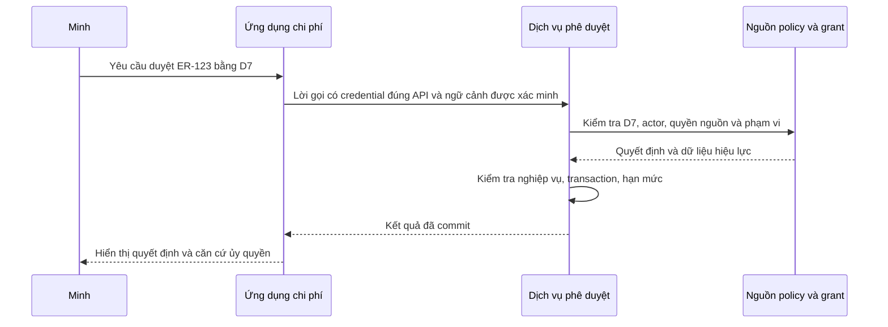

# Delegated authorization: ủy quyền có phạm vi và có thể kiểm chứng

Trong chương **Authorization Rules**, delegated authorization là việc cho phép một chủ thể thực hiện một số hành động bằng thẩm quyền được một chủ thể khác ủy quyền, trong phạm vi và điều kiện xác định. Người được ủy quyền không mặc nhiên trở thành người ủy quyền, cũng không được nhận toàn bộ quyền của người đó.

Trong module bảo vệ logic nghiệp vụ, cơ chế này cần ngăn các tình huống dùng ủy quyền để tự duyệt, vượt hạn mức, truy cập sai đối tượng hoặc tiếp tục thao tác sau khi quyền đã bị thu hồi. Các quyết định phải kết hợp danh tính thật, quyền theo đối tượng, trạng thái nghiệp vụ, transaction và idempotency.

Bài học dùng ví dụ trưởng bộ phận ủy quyền duyệt đề nghị chi cho một nhân sự khác. Các con số chỉ minh họa chính sách của hệ thống; phần quan trọng là cách ràng buộc và thực thi giới hạn.

Sau bài này, bạn có thể:

- Phân biệt người thao tác, người cấp thẩm quyền, đối tượng tài nguyên và ứng dụng gọi API.
- Thiết kế một bản ghi ủy quyền có phạm vi, hành động, hạn mức và thời hạn rõ ràng.
- Kiểm tra quyền được sử dụng mà không bỏ qua quyền theo đối tượng hoặc phân tách trách nhiệm.
- Xử lý thu hồi, ủy quyền tiếp, nhiều dịch vụ và tác vụ bất đồng bộ.
- Kiểm thử quyền bị mở rộng, dùng sai đối tượng, yêu cầu lặp và tranh chấp hạn mức.

## 1. Vì sao chỉ thêm trường onBehalfOf là nguy hiểm?

Giả sử Minh đăng nhập bằng tài khoản của mình rồi gửi:

```http
POST /expense-requests/er-123/approve
Content-Type: application/json

{
  "onBehalfOf": "lan",
  "approvedBy": "lan"
}
```

Nếu máy chủ đổi danh tính người xử lý thành Lan rồi chạy kiểm tra quyền thông thường của Lan, Minh có thể tự chọn người nhiều quyền hơn để hành động. Trường hợp có một bản ghi ủy quyền thật nhưng máy chủ bỏ qua phạm vi của bản ghi đó cũng nguy hiểm tương tự.

Ví dụ Lan chỉ ủy quyền duyệt tối đa 20 triệu đồng trong bộ phận A, nhưng API lại cho Minh dùng mọi quyền của Lan trên toàn tổ chức. Một cơ chế ban đầu phục vụ bàn giao công việc đã trở thành đường nâng quyền.

Không nhận `onBehalfOf`, `X-Act-As-User` hoặc một ID người dùng từ client làm bằng chứng thẩm quyền. Client có thể chọn một bản ủy quyền để yêu cầu sử dụng, nhưng máy chủ phải xác minh bản ghi, các quan hệ và điều kiện áp dụng.

Việc chia sẻ mật khẩu của Lan cũng không tạo ra một thiết kế ủy quyền có thể kiểm chứng. Nó làm mất khả năng biết ai thực sự thao tác, khó thu hồi riêng và khó giới hạn hành động của Minh.

## 2. Bốn vai trò cần tách biệt

| Vai trò | Ý nghĩa | Ví dụ |
| --- | --- | --- |
| Người thực sự thao tác | Chủ thể được xác thực đang yêu cầu hành động | Minh |
| Người cấp thẩm quyền | Chủ thể có quyền và đã cho phép sử dụng một phần quyền theo chính sách | Lan |
| Chủ thể hoặc đối tượng tài nguyên | Người, tổ chức hoặc đối tượng mà hành động tác động tới | Đề nghị chi ER-123 của bộ phận A |
| Ứng dụng hoặc dịch vụ gọi | Thành phần kỹ thuật chuyển hoặc thực hiện lời gọi | Web quản lý chi phí, dịch vụ phê duyệt |

Không nhất thiết bốn vai trò là bốn tài khoản. Điều cần thiết là hệ thống không làm mất các quan hệ này khi đi qua API, hàng đợi hoặc dịch vụ khác.

Trong bài, dùng các tên nội bộ:

```text
actorPersonId      = người thực sự ra quyết định
delegatorPersonId  = người cấp thẩm quyền
delegationId       = bản ủy quyền được sử dụng
clientId           = ứng dụng hoặc dịch vụ gửi yêu cầu
resourceId         = đối tượng nghiệp vụ bị tác động
```

Đây là mô hình của ứng dụng, không phải khẳng định mọi giao thức token dùng cùng tên trường. Ý nghĩa của `subject` hoặc `sub` phải được hiểu theo loại token và hợp đồng của bên phát hành; không tự suy rằng nó luôn là người thao tác hoặc luôn là người được đại diện.

Danh tính cá nhân cần được xác định từ nguồn tin cậy. Một người có tài khoản thường và tài khoản quản trị vẫn có thể là cùng một người khi kiểm tra tự duyệt hoặc phân tách trách nhiệm.

## 3. Chính sách ví dụ: ủy quyền duyệt chi có giới hạn

Giả sử Lan có quyền duyệt đề nghị chi trong bộ phận A với hạn mức hiện tại 100 triệu VND. Hệ thống cho phép Lan tạo bản ủy quyền D7 cho Minh:

- Chỉ hành động `APPROVE_EXPENSE`.
- Chỉ tenant T1 và bộ phận A.
- Tối đa 20 triệu VND cho một quyết định duyệt.
- Tổng giá trị được duyệt bằng D7 không vượt 50 triệu VND.
- Có thời điểm bắt đầu và kết thúc cụ thể.
- Không được ủy quyền tiếp.
- Minh phải là nhân sự đủ điều kiện sử dụng ủy quyền trong tổ chức.
- Không được dùng D7 để duyệt đề nghị do Minh hoặc Lan tạo, hoặc đề nghị mà một trong hai là người hưởng chi theo chính sách ví dụ.

Chính sách của ví dụ còn yêu cầu Lan vẫn có thẩm quyền tương ứng tại thời điểm một quyết định mới được chấp nhận. Nếu hạn mức hiện tại của Lan giảm xuống 15 triệu, D7 không cho Minh tiếp tục duyệt một đề nghị 18 triệu chỉ vì bản ghi vẫn ghi 20 triệu.

Không phải mọi mô hình ủy quyền đều chọn quy tắc hiệu lực như vậy. Một số hệ thống có hợp đồng ủy quyền độc lập hoặc quy tắc giữ hiệu lực khác. Điều bắt buộc là định nghĩa rõ cách quyền nguồn thay đổi ảnh hưởng đến quyền đã cấp, rồi thực thi nhất quán.

Minh không cần vốn có đầy đủ quyền duyệt như Lan, vì mục đích của ủy quyền là cấp khả năng hành động có giới hạn. Tuy nhiên, Minh vẫn phải thỏa các điều kiện nền như tài khoản hoạt động, thuộc phạm vi được nhận ủy quyền và không vi phạm các chính sách bắt buộc.

## 4. Quyền sử dụng là phần giao của các giới hạn

Với chính sách trên, một hành động chỉ được chấp nhận khi:

```text
danh tính actor và ứng dụng gọi đã được xác minh
AND actor đủ điều kiện sử dụng ủy quyền
AND bản ủy quyền đúng actor, đúng tenant, còn hiệu lực và chưa bị thu hồi
AND hành động nằm trong tập được ủy quyền
AND đối tượng nằm trong phạm vi được ủy quyền
AND người cấp thẩm quyền hiện vẫn được phép với hành động và đối tượng đó
AND không vi phạm phân tách trách nhiệm
AND trạng thái và nội dung nghiệp vụ phù hợp
AND hạn mức từng lần và hạn mức tích lũy còn đủ
AND kiểm tra và ghi nhận được bảo vệ trước cập nhật đồng thời
```

Có thể hình dung quyền sử dụng D7 là phần giao giữa quyền nguồn còn hiệu lực, phạm vi của D7 và các chính sách bắt buộc của hệ thống. Không cộng dồn mọi quyền của Minh với mọi quyền của Lan rồi cho request chọn tổ hợp thuận lợi nhất.

Ví dụ:

| Yêu cầu | Kết quả theo D7 |
| --- | --- |
| Duyệt 12 triệu VND, bộ phận A, người khác tạo, còn đủ tổng hạn mức | Có thể được phép sau các kiểm tra còn lại |
| Duyệt 25 triệu VND, bộ phận A | Vượt hạn mức mỗi lần |
| Duyệt 10 triệu VND, bộ phận B | Ngoài phạm vi đối tượng |
| Sửa tài khoản nhận tiền của ER-123 | Không thuộc hành động được ủy quyền |
| Từ chối đề nghị khi D7 chỉ cho `APPROVE_EXPENSE` | Không tự được phép chỉ vì cùng thuộc nghiệp vụ duyệt |
| Duyệt đề nghị do Minh tạo | Vi phạm phân tách trách nhiệm |
| Duyệt sau khi Lan mất quyền nguồn | Bị chặn theo chính sách hiệu lực đã chọn |

Nếu Minh có một quyền độc lập khác, hệ thống có thể cung cấp đường hành động bằng quyền riêng theo chính sách. Không âm thầm chuyển từ một lệnh sử dụng D7 đã bị từ chối sang quyền khác, làm audit ghi sai căn cứ quyết định.

## 5. Thiết kế bản ghi ủy quyền

Một mô hình có thể gồm:

| Dữ liệu | Mục đích |
| --- | --- |
| `delegationId`, `tenantId` | Định danh và giới hạn phạm vi tổ chức |
| `delegatorPersonId`, `delegatePersonId` | Xác định người cấp và người nhận thẩm quyền |
| `allowedActions` | Tập hành động cụ thể, không mặc định là toàn bộ quyền |
| Phạm vi tài nguyên | Chẳng hạn tập bộ phận, dự án hoặc nhóm đối tượng được phép |
| Hạn mức và loại tiền | Giới hạn mỗi hành động và tổng tích lũy nếu có |
| `startsAt`, `endsAt` | Khoảng thời gian sử dụng |
| `state`, `revokedAt` | Hiệu lực và thu hồi |
| `canRedelegate`, `parentDelegationId` | Quy tắc và liên kết ủy quyền tiếp nếu hỗ trợ |
| `version`, phiên bản chính sách | Chống cập nhật cũ và giải thích quyết định |
| Người tạo, lý do và audit | Truy vết nguồn gốc thay đổi |

Phạm vi nên dùng định danh chuẩn hoặc điều kiện do máy chủ quản lý. Không lưu một chuỗi điều kiện tùy ý mà client có thể biến thành truy vấn rộng hơn, hoặc dựa vào `departmentId` trong body của lệnh duyệt để chứng minh đối tượng thuộc bộ phận A.

Một thay đổi làm rộng quyền cần được xử lý như thay đổi chính sách có thẩm quyền: tăng hạn mức, kéo dài thời gian, thêm bộ phận hoặc cho phép ủy quyền tiếp. Không coi đó là sửa ghi chú thông thường.

Với hạn mức tích lũy, nên có dữ liệu sử dụng hoặc sổ ghi nhận đủ để giải thích từng khoản đã tiêu thụ. Chỉ có một trường tổng mà không liên kết được với quyết định sẽ khó xử lý retry, đối soát và đính chính.

## 6. Cấp ủy quyền cũng là một hành động cần phân quyền

Người có quyền duyệt không nhất thiết có quyền ủy quyền. Hệ thống cần một chính sách riêng quyết định ai được cấp loại quyền nào cho ai.

Ví dụ khi Lan tạo D7, máy chủ kiểm tra:

1. Lan được phép cấp ủy quyền duyệt chi trong phạm vi này.
2. Phạm vi và hạn mức đề xuất không vượt phần quyền được phép chuyển giao.
3. Minh là người nhận hợp lệ và không bị khóa hoặc loại khỏi phạm vi tổ chức.
4. Khoảng thời gian hợp lệ, không vượt thời gian tối đa của chính sách.
5. Không bật ủy quyền tiếp nếu Lan hoặc loại grant không cho phép.
6. Không có quan hệ bị cấm theo chính sách phân tách trách nhiệm.
7. Những thay đổi cần phê duyệt bổ sung đã đi qua quy trình tương ứng.

```http
POST /delegations
Content-Type: application/json

{
  "delegatePersonId": "minh",
  "allowedActions": ["APPROVE_EXPENSE"],
  "departmentIds": ["department-a"],
  "perApprovalLimitVnd": 20000000,
  "totalLimitVnd": 50000000,
  "startsAt": "2026-11-22T03:00:00Z",
  "endsAt": "2026-11-25T03:00:00Z",
  "canRedelegate": false
}
```

Các trường này là đề xuất. Máy chủ lấy người cấp từ ngữ cảnh xác thực, xác minh từng giới hạn và lưu bản ghi có thẩm quyền. Nếu một quản trị viên tạo thay Lan, phải kiểm tra quyền tạo thay và lưu cả người thực sự thao tác lẫn người cấp thẩm quyền theo chính sách; không để body tự chọn một người có quyền cao hơn.

## 7. Sử dụng ủy quyền trên một đối tượng cụ thể

Minh có thể gửi:

```http
POST /expense-requests/er-123/approve
Idempotency-Key: approve-er123-d7-round2-01
Content-Type: application/json

{
  "delegationId": "d7",
  "expectedRequestVersion": 11,
  "expectedContentRevision": 2
}
```

Máy chủ không đổi Minh thành Lan. Nó dựng ngữ cảnh gồm actor Minh, grant D7, người cấp Lan và ứng dụng gọi đã được xác minh.

Luồng tải dữ liệu cần kiểm tra:

- D7 thuộc tenant đang xử lý và được cấp cho Minh.
- ER-123 được tải trong phạm vi phù hợp, không dựa vào tổ chức client tự khai.
- Bộ phận, người tạo, người hưởng chi, số tiền và trạng thái lấy từ dữ liệu lưu trữ.
- Nội dung đang xét khớp revision mà người dùng định duyệt.
- Lan có thẩm quyền hiện tại đối với ER-123 và D7 không mở rộng thẩm quyền đó.
- Các guard không tự duyệt áp dụng cho cả actor thực tế lẫn người được đại diện theo chính sách.

Nếu chỉ kiểm tra `createdBy != delegatorPersonId`, Minh có thể duyệt đề nghị của chính mình bằng danh nghĩa Lan. Nếu chỉ kiểm tra `createdBy != actorPersonId`, Lan có thể nhờ Minh duyệt đề nghị do Lan tạo. Ví dụ này cố ý chặn cả hai.

Quyết định lưu phải phản ánh “Minh thực hiện bằng D7 do Lan cấp”, thay vì chỉ ghi `approvedBy = Lan` và làm mất người ra quyết định thực tế.

## 8. Minh họa Java: kiểm tra một ủy quyền duyệt chi

Đoạn mã dưới đây chỉ mô hình hóa hành động duyệt bằng VND. Các record được dựng từ dữ liệu đã xác thực phía máy chủ, không phải bằng chứng do client tự gửi. Ví dụ dùng record của Java 16 trở lên.

```java
import java.time.Instant;
import java.util.Objects;
import java.util.UUID;

enum ExpenseState {
    DRAFT, PENDING_APPROVAL, APPROVED, REJECTED
}

record DelegatedActor(
        UUID tenantId,
        UUID personId,
        boolean eligibleToUseDelegation) {
}

record ApprovalDelegation(
        UUID tenantId,
        UUID delegatorPersonId,
        UUID delegatePersonId,
        UUID departmentId,
        long perApprovalLimitVnd,
        Instant startsAt,
        Instant endsAt,
        boolean active) {
}

record ExpenseView(
        UUID tenantId,
        UUID departmentId,
        UUID requestedByPersonId,
        UUID beneficiaryPersonId,
        long amountVnd,
        ExpenseState state) {
}

final class DelegatedApprovalPolicy {
    private DelegatedApprovalPolicy() {
    }

    static void requireAllowed(
            DelegatedActor actor,
            ApprovalDelegation grant,
            ExpenseView expense,
            Instant now,
            boolean delegatorMayApproveThisExpense) {
        Objects.requireNonNull(actor);
        Objects.requireNonNull(grant);
        Objects.requireNonNull(expense);
        Objects.requireNonNull(now);

        UUID actual = Objects.requireNonNull(actor.personId());
        UUID owner = Objects.requireNonNull(grant.delegatorPersonId());

        require(actor.eligibleToUseDelegation(), "ACTOR_NOT_ELIGIBLE");
        require(Objects.requireNonNull(actor.tenantId())
                .equals(grant.tenantId()), "ACTOR_TENANT_MISMATCH");
        require(Objects.requireNonNull(grant.tenantId())
                .equals(expense.tenantId()), "RESOURCE_TENANT_MISMATCH");
        require(actual.equals(grant.delegatePersonId()),
                "WRONG_DELEGATE");
        require(!actual.equals(owner), "SELF_DELEGATION_NOT_SUPPORTED");
        require(grant.active(), "DELEGATION_INACTIVE");
        require(!now.isBefore(grant.startsAt()), "NOT_STARTED");
        require(now.isBefore(grant.endsAt()), "DELEGATION_EXPIRED");
        require(Objects.requireNonNull(grant.departmentId())
                .equals(expense.departmentId()), "OUT_OF_SCOPE");
        require(expense.state() == ExpenseState.PENDING_APPROVAL,
                "WRONG_STATE");
        require(expense.amountVnd() > 0
                && expense.amountVnd() <= grant.perApprovalLimitVnd(),
                "AMOUNT_NOT_ALLOWED");
        require(delegatorMayApproveThisExpense,
                "DELEGATOR_AUTHORITY_MISSING");

        require(!actual.equals(expense.requestedByPersonId())
                && !owner.equals(expense.requestedByPersonId()),
                "REQUESTER_CONFLICT");
        require(!actual.equals(expense.beneficiaryPersonId())
                && !owner.equals(expense.beneficiaryPersonId()),
                "BENEFICIARY_CONFLICT");
    }

    private static void require(boolean condition, String code) {
        if (!condition) {
            throw new SecurityException(code);
        }
    }
}
```

`ApprovalDelegation` là kiểu đã được tầng tải dữ liệu xác định chỉ dành cho `APPROVE_EXPENSE`. Nếu dùng một grant tổng quát, phải kiểm tra tập hành động trước khi dựng hoặc dùng mô hình tương ứng. Không diễn giải mọi bản ủy quyền thành quyền duyệt.

Biến `delegatorMayApproveThisExpense` là kết quả kiểm tra quyền có thẩm quyền của máy chủ cho chính đối tượng, không phải cờ nhận từ body. Kiểm tra đó phải xét hạn mức hiện tại và các điều kiện quyền nguồn cần thiết.

Đoạn mã chưa kiểm tra hạn mức tích lũy, version, revocation đồng thời hoặc nguồn danh tính. Các trường bắt buộc và dữ liệu VND phải được xác thực khi dựng mô hình; không đưa một số tiền loại tiền khác vào `amountVnd`. Service còn phải bảo vệ việc kiểm tra và ghi nhận bằng transaction phù hợp.

## 9. Transaction bảo vệ hạn mức và quyết định

Giả sử D7 còn tổng hạn mức 15 triệu, nhưng hai request cùng duyệt hai đề nghị 10 triệu. Nếu cả hai đọc hạn mức trước rồi cập nhật sau, tổng được duyệt có thể vượt giới hạn dù từng request đều dưới 20 triệu.

Luồng xử lý có thể là:

```text
BEGIN TRANSACTION
  nhận quyền xử lý idempotency key
  nếu là cùng lệnh đã commit: kiểm tra quyền xem và trả kết quả cũ

  bảo vệ grant và dữ liệu hạn mức bằng giao thức khóa hoặc version
  tải và bảo vệ đề nghị, vòng duyệt, snapshot liên quan
  kiểm tra danh tính, quyền nguồn, hiệu lực và phạm vi grant
  kiểm tra quyền trên đối tượng và phân tách trách nhiệm
  kiểm tra version, revision, trạng thái và hạn mức từng lần
  tiêu thụ hạn mức tổng nếu còn đủ
  ghi quyết định cùng actor, delegator, grant và snapshot
  cập nhật vòng duyệt và trạng thái đề nghị theo chính sách
  ghi audit, outbox và kết quả idempotency
COMMIT
```

Các đường thu hồi hoặc thay đổi grant phải tham gia cùng cơ chế nhất quán. Nếu chọn khóa, quy định thứ tự khóa thống nhất cho grant, hạn mức và đối tượng để hạn chế deadlock. Với nguồn quyền ở dịch vụ khác, cần xác định bằng chứng hiệu lực và ranh giới quyết định thay vì giả định một transaction cục bộ khóa được toàn hệ thống.

Ví dụ cập nhật hạn mức có điều kiện:

```sql
UPDATE delegation_budget
SET used_vnd = used_vnd + :amount_vnd,
    version = version + 1
WHERE tenant_id = :authorized_tenant_id
  AND delegation_id = :delegation_id
  AND version = :expected_budget_version
  AND :amount_vnd > 0
  AND :amount_vnd <= total_limit_vnd - used_vnd;
```

Phải có ràng buộc miền bảo đảm các giá trị tiền và hạn mức nằm trong khoảng hợp lệ. Chỉ khi cập nhật đúng một hàng mới tiếp tục; không có hàng bị cập nhật không phải duyệt thành công.

Việc tiêu thụ hạn mức, ghi sổ sử dụng và ghi quyết định nằm cùng transaction nếu cùng cơ sở dữ liệu. Nếu quyết định không ghi được, không để hạn mức bị trừ riêng. Mỗi lần sử dụng cần định danh để retry không bị tính thêm.

Theo chính sách ví dụ, tổng hạn mức đếm giá trị các quyết định duyệt đã commit. Việc đề nghị bị xử lý lại hoặc một bước sau thất bại không tự hoàn lại hạn mức. Nếu doanh nghiệp cho phép hoàn hạn mức, đó phải là một quy tắc và bút toán có căn cứ, không xóa dấu vết sử dụng cũ.

## 10. Token, scope và lời gọi giữa các dịch vụ

Token hợp lệ có thể mang hoặc tham chiếu tới thông tin ủy quyền, nhưng chữ ký hợp lệ không thay thế toàn bộ quyết định nghiệp vụ.

Điểm nhận cần kiểm chứng theo cơ chế của nền tảng:

- Nguồn phát hành và tính xác thực của credential.
- Đối tượng nhận hoặc API mà credential được dùng cho.
- Thời hạn, loại token và các điều kiện hiệu lực cần thiết.
- Danh tính actor, ứng dụng gọi và ngữ cảnh ủy quyền được tin cậy.
- Scope hoặc quyền kỹ thuật cần thiết, kết hợp với bản ghi và policy nghiệp vụ.

Một scope như `expense:approve` không tự cho biết có được duyệt ER-123 của tenant T1, số tiền bao nhiêu và có xung đột lợi ích hay không. Những điều kiện đó vẫn phải được đánh giá.

Ứng dụng hoặc dịch vụ cũng có quyền riêng. Việc một client được đăng ký hoặc được phép gọi API không có nghĩa nó có thể sử dụng mọi quyền của mọi người dùng. Trường hợp dịch vụ hành động bằng quyền riêng và trường hợp hành động theo ủy quyền của người dùng cần được phân biệt trong policy và audit.

Ví dụ nhiều chặng:



Không chuyển tiếp vô điều kiện một token dành cho dịch vụ A sang dịch vụ B. Nếu nền tảng có cơ chế chuyển đổi token hoặc truyền thẩm quyền giữa các dịch vụ, việc đó phải được cấp phép, giới hạn đúng đối tượng nhận và giữ được nguồn gốc actor cùng phạm vi cần thiết.

Dịch vụ nhận không được tin header danh tính tùy ý từ một caller không có quyền xác nhận danh tính đó. Ranh giới xác thực giữa proxy, ứng dụng và API cần rõ ràng.

## 11. Ủy quyền tiếp phải làm hẹp quyền

Ví dụ D7 không cho ủy quyền tiếp, nên Minh không được tạo D8 dựa trên quyền nhận từ Lan. Việc có thể duyệt bằng D7 không tự cấp quyền tạo một grant khác.

Nếu sản phẩm hỗ trợ chuỗi ủy quyền, mỗi grant con phải bị ràng buộc bởi grant cha:

```text
hành động con không rộng hơn hành động cha
phạm vi đối tượng con không rộng hơn phạm vi cha
thời hạn con không vượt thời hạn cha
hạn mức con không tạo thêm quyền vượt phần được cha cấp
độ sâu và quan hệ ủy quyền tiếp tuân thủ chính sách
```

Hệ thống cần phát hiện chu trình, giới hạn độ sâu và kiểm tra các liên kết có thẩm quyền. Không nhận một danh sách ID do client gửi rồi coi đó là chuỗi quyền hợp lệ.

Hạn mức tổng đặc biệt dễ bị nhân lên. Một grant cha có tổng hạn mức 50 triệu không thể tạo hai grant con rồi cho mỗi grant tiêu thụ độc lập 50 triệu nếu invariant của grant cha vẫn là 50 triệu. Phải tính hoặc dành phần quyền sử dụng ở các cấp liên quan bằng cơ chế nhất quán.

Thu hồi grant cha hoặc mất thẩm quyền ở một liên kết phải có quy tắc ảnh hưởng đến grant con. Nếu yêu cầu thu hồi toàn chuỗi có hiệu lực tại quyết định mới, chỉ kiểm tra grant lá là không đủ.

Không tự gom quyền từ nhiều nhánh không tương thích để thực hiện một hành động không grant nào thực sự cho phép. Nếu có chính sách phối hợp nhiều căn cứ quyền, cần định nghĩa rõ cách kết hợp và kiểm thử riêng.

## 12. Thu hồi và các loại thời hạn có ý nghĩa khác nhau

Cần phân biệt:

| Đối tượng có thời hạn | Điều gì hết hiệu lực? |
| --- | --- |
| Credential hoặc access token | Khả năng dùng credential đó để gọi API theo giao thức |
| Grant ủy quyền | Khả năng tạo hành động mới dựa trên grant theo chính sách |
| Quyết định duyệt | Hiệu lực của một quyết định đã ghi theo quy trình nghiệp vụ |
| Thao tác đang thực hiện | Quyền và nghĩa vụ xử lý một operation đã được nhận |

Trong ví dụ, D7 hết hạn chặn việc nhận quyết định duyệt mới. Nó không tự xóa các quyết định hợp lệ đã commit trước đó. Việc những quyết định cũ còn đủ điều kiện cho bước chi tiền hay bị thu hồi cần do chính sách phê duyệt và cổng thực hiện xác định riêng.

Tương tự, Lan mất quyền sau một quyết định đã commit không tự biến lịch sử thành chưa từng được duyệt. Muốn thu hồi các quyết định đang có hiệu lực phải có quy tắc và hành động tương ứng.

Khi thu hồi D7 đồng thời với một quyết định mới, cần một ranh giới có thẩm quyền xác định bên nào được chấp nhận trước. Kiểm tra grant rồi ghi quyết định ở một thời điểm không được bảo vệ có thể cho phép quyết định mới sau khi việc thu hồi đã có hiệu lực theo hợp đồng.

Token hoặc cache chứa thông tin D7 có thể vẫn tồn tại sau thu hồi. Nếu API chỉ xác thực token ngoại tuyến và không có cơ chế kiểm tra trạng thái hoặc vô hiệu hóa tương ứng, không thể mặc định có thu hồi tức thời. Hệ thống phải chọn và công bố đúng ngữ nghĩa hiệu lực, đồng thời thiết kế cache, version hoặc kiểm tra nguồn có thẩm quyền cho phù hợp.

Nếu không lấy được dữ liệu bắt buộc để xác lập thẩm quyền, chặn hành động mới hoặc trả lỗi có thể retry theo hợp đồng. Không dùng việc dịch vụ policy tạm ngừng làm lý do mặc định cho phép mọi grant đã từng thấy.

## 13. Tác vụ chạy nền không được làm mất actor ban đầu

Giả sử Minh gửi lệnh duyệt lúc D7 còn hạn nhưng ứng dụng chỉ ghi một message để worker xử lý sau. Có hai thiết kế khác nhau:

1. Transaction tiếp nhận đã xác lập và commit quyết định duyệt. Worker chỉ làm hiệu ứng tiếp theo như gửi thông báo.
2. Transaction chỉ lưu ý định cần duyệt. Worker sau đó mới kiểm tra và tạo quyết định.

Ở thiết kế thứ hai, việc message được tạo trước hạn không tự chứng minh worker được phép duyệt sau hạn. Cần kiểm tra tại ranh giới nhận quyết định theo chính sách, hoặc có một cơ chế nhận quyền thực hiện trước đó được định nghĩa rõ và giới hạn.

Message nên tham chiếu actor, grant, đối tượng, snapshot hoặc revision và operation tương ứng qua dữ liệu bền vững. Không chỉ lưu `executeAs = Lan` rồi để worker dùng credential toàn quyền của dịch vụ để quyết định thay.

Worker phải phân biệt quyền kỹ thuật của chính nó với thẩm quyền nghiệp vụ cần cho lệnh. Service account có thể được phép cập nhật bảng nhưng vẫn không có quyền bỏ qua grant hoặc phân tách trách nhiệm.

Nếu thao tác có tác dụng ngoài cơ sở dữ liệu, ghi ý định và operation ổn định, rồi xử lý kết quả chưa rõ bằng đối soát. Thu hồi grant không tự hoàn tác một khoản tiền hoặc thay đổi đã được hệ thống ngoài áp dụng.

## 14. Ngăn confused deputy và các đường mở rộng quyền

Confused deputy xảy ra khi một thành phần có quyền mạnh thực hiện giúp caller một hành động mà caller không được phép yêu cầu trong ngữ cảnh đó.

Ví dụ dịch vụ phê duyệt có credential quản trị, nhận `expenseId` và `onBehalfOf` từ client rồi gọi backend như Lan. Nếu nó không kiểm tra D7 trên ER-123, quyền của dịch vụ đang che lấp việc Minh không có thẩm quyền phù hợp.

Các điểm cần bảo vệ:

- API trực tiếp, API hàng loạt và công cụ quản trị đều kiểm tra cùng phạm vi ủy quyền.
- Caller không được tự chọn danh tính nguồn hoặc tạo bằng chứng grant hợp lệ.
- Các trường số tiền, bộ phận, người tạo và người hưởng chi lấy từ đối tượng có thẩm quyền.
- API sửa grant không cho người nhận tự tăng hạn mức, kéo dài hạn hoặc bật ủy quyền tiếp.
- Quyền tạo và sửa policy, mapping danh tính hoặc nhóm duyệt được kiểm soát tương xứng.
- Một grant đọc dữ liệu không tự được dùng để ghi; một grant duyệt không tự được dùng để sửa nội dung đã duyệt.

Ủy quyền cũng không tự cấp quyền đọc mọi trường của người ủy quyền. Minh có thể cần xem dữ liệu để xét ER-123, nhưng không vì vậy được xem lương, ghi chú điều tra hoặc dữ liệu khác mà Lan có quyền truy cập. Tập trường và tài liệu được đọc cần chính sách phù hợp với nhiệm vụ đã cấp.

Lọc danh sách tài nguyên hoặc hiển thị “các đề nghị có thể xử lý bằng D7” hữu ích cho giao diện, nhưng API hành động vẫn phải kiểm tra lại từng đối tượng. Danh sách có thể cũ và caller có thể gửi ID không xuất hiện trong danh sách.

## 15. Idempotency và audit của quyết định ủy quyền

Retry cùng một lệnh không được trừ hạn mức hoặc ghi phiếu nhiều lần. Dấu vân tay của lệnh nên ràng buộc với các dữ liệu có ý nghĩa:

```text
tenant và actor
delegationId
hành động
đối tượng, vòng duyệt và snapshot hoặc revision
nội dung quyết định cùng các điều kiện phiên bản của lệnh
```

Cùng key nhưng đổi grant hoặc đối tượng là một ý định khác và phải bị từ chối theo hợp đồng idempotency. Key khác cũng không được giúp vượt invariant “một quyết định cho nhiệm vụ hiện tại” hoặc làm tiêu thụ hạn mức trùng.

Khi trả kết quả đã commit, xác thực lại và kiểm tra quyền xem kết quả hiện tại. Không cần thực hiện lại thao tác duyệt chỉ vì grant đã hết hạn sau lần thành công; nhưng bản ghi idempotency cũng không phải quyền đọc công khai.

Audit nên trả lời được:

| Thông tin | Ý nghĩa |
| --- | --- |
| Actor thực tế và tài khoản sử dụng | Ai thật sự gửi quyết định |
| Delegator và delegation ID/version | Dựa trên thẩm quyền nào |
| Ứng dụng hoặc chuỗi dịch vụ | Qua thành phần nào |
| Đối tượng, snapshot, hành động và kết quả | Đã quyết định điều gì trên nội dung nào |
| Giới hạn áp dụng và lượng đã tiêu thụ | Vì sao quyết định nằm trong phạm vi |
| Phiên bản policy và thời điểm có thẩm quyền | Quy tắc nào được dùng |
| Operation, idempotency và mã tương quan | Liên kết retry, sự kiện và hiệu ứng liên quan |

Phân biệt lần cố dùng D7 bị từ chối với quyết định đã được chấp nhận. Không ghi `approvedBy = Lan` như thể Lan trực tiếp bấm duyệt. Không đưa token hoặc bí mật credential vào log để bù cho việc thiếu ngữ cảnh actor.

## 16. Kiểm thử phạm vi, phân tách trách nhiệm và thời gian

| Ca kiểm thử | Kết quả cần giữ |
| --- | --- |
| Minh dùng D7 đúng hành động, bộ phận và hạn mức | Chỉ chấp nhận sau mọi guard còn lại |
| Người khác biết ID D7 | Không sử dụng được grant của Minh |
| Dùng D7 trên tenant hoặc bộ phận khác | Không ghi quyết định và không trừ hạn mức |
| Đổi `onBehalfOf`, `approvedBy` hoặc bộ phận trong body | Không thay nguồn thẩm quyền hoặc dữ liệu đối tượng |
| Lan có quyền nhưng không được phép chuyển giao | Không tạo grant hợp lệ |
| Minh không đủ quyền duyệt riêng nhưng đủ điều kiện nhận D7 | Được xét theo grant, không đòi phải có toàn bộ quyền của Lan |
| Minh hoặc Lan là người tạo hoặc người hưởng chi | Bị chặn theo chính sách phân tách trách nhiệm của ví dụ |
| Cùng người dùng tài khoản khác để tránh tự duyệt | Vẫn bị phát hiện khi quan hệ danh tính thuộc phạm vi chính sách |
| Hành động sửa nội dung hoặc từ chối bằng grant chỉ cho đồng ý | Không được mở rộng tập hành động |
| Chưa tới `startsAt`, đúng tại `endsAt` hoặc đã thu hồi | Hành vi khớp quy tắc thời gian và hiệu lực đã định |
| Lan giảm hạn mức xuống dưới số tiền cần duyệt | Chặn quyết định mới theo chính sách quyền nguồn hiện tại |
| Minh tự bật `canRedelegate` hoặc tạo grant con trái phép | Không hình thành quyền ủy quyền tiếp |

Các ca chuỗi và token cần kiểm tra sai đối tượng nhận, nguồn phát hành không được tin cậy, chuỗi có vòng lặp, grant cha đã thu hồi và phạm vi con rộng hơn cha. Token hợp lệ về hình thức không được bỏ qua các lỗi nghiệp vụ đó.

## 17. Kiểm thử cạnh tranh, tác vụ nền và sự cố

| Kịch bản | Invariant hoặc hành vi cần giữ |
| --- | --- |
| Hai quyết định cùng dùng phần tổng hạn mức còn lại | Tổng đã tiêu thụ không vượt giới hạn |
| Thu hồi đồng thời với nhận quyết định | Kết quả tuân theo ranh giới hiệu lực đã thiết kế |
| Giảm hạn mức đồng thời với sử dụng grant | Không cập nhật dựa trên một giới hạn cũ ngoài hợp đồng |
| Crash sau tiêu thụ hạn mức nhưng trước ghi quyết định | Transaction không để lại việc trừ riêng |
| Mất phản hồi sau commit rồi retry cùng key | Không trừ thêm hoặc ghi thêm phiếu |
| Dùng key khác cho cùng nhiệm vụ đã quyết định | Không tạo tác dụng nghiệp vụ trùng |
| Sửa snapshot đồng thời với duyệt | Không gắn quyết định vào nội dung mới chưa xét |
| Worker xử lý ý định sau khi grant hết hạn | Kiểm tra theo ranh giới tạo quyết định, không chỉ thời gian enqueue |
| Cache còn grant cũ sau thu hồi | Hành vi đúng bảo đảm thu hồi mà hệ thống công bố |
| Dịch vụ policy không khả dụng | Không mặc định chuyển sang toàn quyền của delegator hoặc service |
| Hai grant con cùng tiêu thụ hạn mức cha | Không nhân lên tổng quyền sử dụng |
| Sự kiện cũ đến sau khi grant thay đổi | Không áp dụng nhầm vào phiên bản hoặc quyết định mới |

Kiểm tra cả dữ liệu đề nghị, quyết định, sổ sử dụng, hạn mức, audit và outbox. Một phản hồi lỗi không chứng minh an toàn nếu số tiền đã được tính vào hạn mức hoặc một lệnh thực hiện đã được tạo trước đó.

Các kiểm thử transaction và tranh chấp cần sử dụng cơ chế lưu trữ, khóa hoặc version thực tế. Mock một kết quả “được phép” rồi gọi hai hàm tuần tự không chứng minh hệ thống giữ được giới hạn khi chạy đồng thời.

Vận hành nên quan sát số lần dùng grant ngoài phạm vi, grant hết hạn còn được gọi, thay đổi hạn mức bất thường, retry xung đột và chênh lệch giữa sổ sử dụng với tổng đã tiêu thụ. Các tín hiệu phục vụ điều tra; quyết định cho phép vẫn phải được thực thi ngay trên đường xử lý.

## 18. Cách áp dụng delegated authorization vào hệ thống của bạn

1. Xác định actor thực tế, người cấp thẩm quyền, ứng dụng gọi và đối tượng tài nguyên bằng dữ liệu đáng tin cậy.
2. Định nghĩa ai được chuyển giao loại quyền nào, cho ai và có được ủy quyền tiếp hay không.
3. Lưu grant với hành động, phạm vi, hạn mức, loại tiền, thời gian và phiên bản rõ ràng.
4. Chọn ngữ nghĩa quyền nguồn thay đổi, thu hồi và quyết định đã commit; tránh trộn chúng thành một cờ hiệu lực chung.
5. Kiểm tra từng đối tượng, trạng thái, nội dung và xung đột trách nhiệm cho cả actor lẫn người được đại diện theo chính sách.
6. Bảo vệ hạn mức và nhận quyết định bằng transaction, cập nhật có điều kiện cùng dữ liệu chống trùng.
7. Giữ ngữ cảnh ủy quyền qua dịch vụ và tác vụ nền mà không dùng quyền kỹ thuật rộng để bỏ qua quyền nghiệp vụ.
8. Thiết kế token, cache, retry, chuỗi ủy quyền và audit theo đúng bảo đảm hiệu lực đã chọn.
9. Kiểm thử sai người, sai phạm vi, hết hạn, thu hồi, request đồng thời và lỗi giữa các bước ghi.

Ủy quyền an toàn cho phép một người làm việc bằng một phần thẩm quyền được giao mà vẫn giữ được danh tính thực tế và giới hạn nghiệp vụ. Mỗi quyết định cần chứng minh ai đã hành động, dựa vào grant nào, trên đối tượng nào và vì sao các điều kiện của grant còn đúng tại ranh giới được hệ thống chấp nhận.
