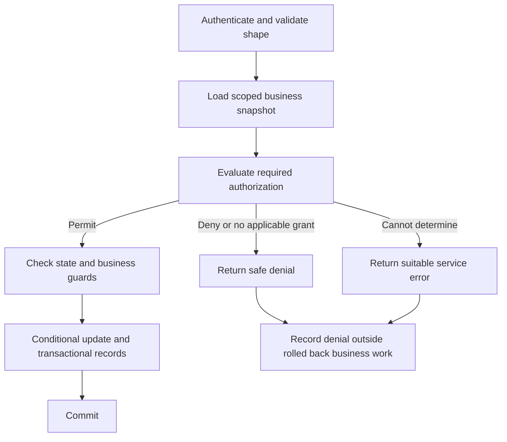

# Authorization denial behavior: hành vi khi từ chối phân quyền

## 1. Từ chối phải là một kết quả nghiệp vụ rõ ràng

Một người không có quyền duyệt gửi yêu cầu phê duyệt đề nghị chi trả. API trả `403`, nhưng trước khi kiểm tra quyền, ứng dụng đã lưu trạng thái `APPROVED` hoặc phát một thông điệp để worker chi tiền.

Về giao diện, request đã thất bại. Về nghiệp vụ, hành động trái phép vẫn xảy ra. Đây không phải là một lần từ chối thành công.

**Authorization denial behavior** là tập hành vi mà hệ thống phải thực hiện khi chủ thể không được phép làm một hành động, hoặc khi hệ thống chưa thể xác lập đủ điều kiện để cho phép hành động đó.

Một hợp đồng từ chối cần bao phủ ít nhất:

- Không ghi nhận chuyển trạng thái hoặc quyết định nghiệp vụ trái phép.
- Không phát sinh tác động bên ngoài hay thông điệp cho phép tác động đó.
- Không tiết lộ dữ liệu mà người gọi chưa được quyền biết.
- Không tự chuyển sang đường thực thi có quyền rộng hơn để hoàn thành request.
- Trả kết quả phù hợp để client biết có cần đăng nhập, sửa yêu cầu, chờ dịch vụ hay dừng thao tác.
- Ghi nhận đủ dấu vết để vận hành và điều tra theo chính sách của hệ thống.

Trong bảo vệ logic nghiệp vụ, kiểm tra quyền và hành vi sau khi kiểm tra phải được xem là một cơ chế thống nhất. Một biểu thức phân quyền đúng vẫn có thể bị vô hiệu nếu nhánh từ chối lưu dữ liệu một phần, nuốt exception hoặc tiếp tục xử lý ở background.

## 2. Phân biệt bị từ chối với chưa đánh giá được

Không phải mọi kết quả khác `PERMIT` đều có cùng nguyên nhân.

| Kết quả đánh giá | Ý nghĩa | Hành vi với hành động đang xin phép |
|---|---|---|
| `PERMIT` | Các điều kiện phân quyền bắt buộc đã được xác lập theo policy | Có thể tiếp tục kiểm tra và thực hiện nghiệp vụ |
| `DENY` | Có căn cứ xác định chủ thể không được phép | Không thực hiện hành động |
| `NOT_APPLICABLE` | Không có quy tắc áp dụng hoặc không tìm được đường cho phép theo thiết kế | Mặc định không thực hiện; ghi nhận vấn đề cấu hình nếu cần |
| `INDETERMINATE` | Không thể kết luận vì thiếu thuộc tính bắt buộc, lỗi nguồn quyền hoặc lỗi đánh giá | Không thực hiện; xử lý như trạng thái chưa đủ căn cứ cho phép |

Tên enum có thể khác. Điều quan trọng là không biến “không thấy lý do cấm” thành “được phép”.

### 2.1. Fail closed là không cho hành động đi qua khi chưa đủ căn cứ

Ví dụ kho quyền timeout trong lúc duyệt:

```text
Sai:
    không đọc được role → dùng role mặc định APPROVER → tiếp tục

Đúng:
    không đọc được điều kiện bắt buộc → không duyệt
    → trả lỗi dịch vụ phù hợp và ghi nhận nguyên nhân
```

Fail closed không có nghĩa mọi lỗi đều trả `403`. Người thực sự không có quyền và người chưa được đánh giá vì dependency lỗi cần được phân biệt trong vận hành và thường cả ở hợp đồng API.

Một lỗi lập trình ngoài dự kiến cũng phải không dẫn tới hành động trái phép, nhưng không nên được ghi giả thành một quyết định policy bình thường. Hệ thống có thể trả lỗi nội bộ, rollback và cảnh báo theo cơ chế xử lý lỗi của mình.

### 2.2. Quy tắc kết hợp policy phải được định nghĩa rõ

Giả sử một rule cho người quản lý duyệt, trong khi rule khác cấm tự duyệt. Nếu ghép bằng `isManager || isOwner`, người lập có thể vượt điều kiện cấm bằng một nhánh cho phép quá rộng.

Cần định nghĩa cách kết hợp: quyền hành động, phạm vi đối tượng và các điều kiện cấm bắt buộc phải cùng được tôn trọng. Nếu chọn cơ chế ưu tiên deny, hãy thực thi và kiểm thử đúng cơ chế đó.

Ngoại lệ nghiệp vụ, nếu có, phải là quy tắc có điều kiện và dấu vết riêng. Không coi lỗi tải policy, không có rule hoặc timeout là một loại ngoại lệ cho phép mặc định.

## 3. Từ chối trên đúng danh tính, đối tượng và snapshot

Một quyết định phân quyền thường phụ thuộc:

```text
chủ thể + tenant + hành động + đối tượng
+ trạng thái + thuộc tính nghiệp vụ + ngữ cảnh quyền
```

Nếu dữ liệu đầu vào không đáng tin, cả nhánh allow lẫn deny đều có thể sai. Máy chủ cần tự xác định danh tính từ cơ chế xác thực, kiểm tra tenant được sử dụng và nạp đối tượng từ nguồn có thẩm quyền.

Không lấy `role`, `actorId`, `approvedBy`, `fromState` hoặc `tenantId` tự khai trong body làm bằng chứng cho phép. Một ID xuất hiện trong URL cũng chỉ xác định mục tiêu request, không chứng minh quyền trên mục tiêu đó.

### 3.1. Không đủ dữ liệu không được hiểu là không có xung đột

Các ví dụ nguy hiểm:

- Không tải được người khởi xướng nên kết luận người gọi không phải người lập.
- Không phân giải được danh tính tài khoản phụ nên coi hai account là hai người độc lập.
- Không đọc được quan hệ ủy quyền nên dùng quyền của service gọi thay.
- Không tìm thấy cấu hình hạn mức nên đặt hạn mức vô hạn.

Nếu thuộc tính là điều kiện bắt buộc, thiếu nó phải chặn hành động hoặc đi vào quy trình xử lý riêng được cấp quyền. Không dùng giá trị mặc định làm mở rộng quyền.

### 3.2. Kiểm tra cấu trúc khác với tiết lộ quy tắc của đối tượng

Có thể từ chối JSON sai cú pháp hoặc request quá lớn trước khi nạp đối tượng. Nhưng các thông báo như “hồ sơ đã được giám đốc X duyệt”, “tổng tiền vượt hạn mức Y” hoặc “đang ở trạng thái chờ thanh toán” có thể làm lộ dữ liệu.

Chỉ trả các chi tiết gắn với đối tượng sau khi đã xác lập người gọi được quyền nhận thông tin tương ứng. Việc một request không hợp lệ không tự cho phép tiết lộ nội dung của mục tiêu.

## 4. Hợp đồng HTTP và thông báo cho client

Mã HTTP cần phản ánh loại kết quả, đồng thời không thay thế kiểm soát nghiệp vụ.

| Tình huống | Mã thường dùng | Ý nghĩa đối với client |
|---|---|---|
| Chưa có danh tính hợp lệ hoặc credential không hợp lệ | `401` | Cần xác thực theo cơ chế được API hỗ trợ |
| Đã xác thực nhưng thiếu quyền cho hành động/đối tượng | `403` | Không tự động tiếp tục hành động bằng request hiện tại |
| Không tồn tại, hoặc ứng dụng chọn che sự tồn tại ngoài phạm vi | `404` | Không cung cấp thông tin về đối tượng cho người gọi đó |
| Có quyền nhưng trạng thái hoặc version không còn phù hợp | `409` | Cần xử lý xung đột theo hợp đồng; có thể phải đọc lại dữ liệu |
| Đầu vào sai cấu trúc hoặc không đạt quy tắc dữ liệu | `400` hoặc `422` | Sửa nội dung theo hợp đồng API |
| Nguồn phân quyền bắt buộc tạm thời không khả dụng | `503` hoặc mã lỗi dependency phù hợp thiết kế | Chưa thể xử lý; không có nghĩa được phép bỏ kiểm tra |

Với `401`, phản hồi cần phù hợp cơ chế xác thực đang dùng, bao gồm challenge cần thiết của giao thức. Không dùng việc đổi sang `401` như cách khiến client đăng nhập lại vô hạn khi nguyên nhân thực tế là thiếu phạm vi quyền.

### 4.1. Thông báo ổn định nhưng không làm lộ policy nội bộ

Một response cho người được phép biết sự tồn tại của hồ sơ có thể là:

```http
HTTP/1.1 403 Forbidden
Content-Type: application/json
Cache-Control: no-store

{
  "code": "ACTION_NOT_ALLOWED",
  "message": "Bạn không được phép thực hiện thao tác này.",
  "correlationId": "req-8f21"
}
```

Log nội bộ có thể ghi nguyên nhân cụ thể như không tự duyệt, ngoài phòng ban hoặc quyền đã bị thu hồi. Client chỉ nhận mức chi tiết mà chính sách tiết lộ cho phép.

Không trả stack trace, truy vấn, biểu thức policy, danh sách role nội bộ, token hoặc thông tin người khác để giải thích một lần từ chối.

### 4.2. Không báo thành công giả cho lệnh bị cấm

Với một lệnh duyệt đơn lẻ, trả `200` cùng dữ liệu trống rồi âm thầm không làm gì thường khiến client hiểu sai là đã thành công. Cũng không trả “đã đưa vào hàng đợi” nếu hệ thống đã biết người gọi không được phép và không có hành động xếp hàng hợp lệ nào theo hợp đồng.

Điều này khác với API danh sách chỉ trả các đối tượng người gọi được xem: một danh sách rỗng có thể là kết quả thành công đúng nghĩa. Batch có kết quả từng phần cũng có thể dùng envelope thành công với outcome từng phần tử rõ ràng. Hợp đồng phải phân biệt truy vấn hợp lệ với hành động bị từ chối.

## 5. Không làm lộ sự tồn tại hoặc dữ liệu qua nhánh từ chối

### 5.1. Chọn nhất quán giữa 403 và 404

Nếu người gọi được biết hồ sơ tồn tại nhưng không được duyệt, `403` có thể phù hợp. Nếu họ không được biết sự tồn tại, ứng dụng có thể trả `404` giống trường hợp không tìm thấy trong phạm vi được phép.

Khi chọn che sự tồn tại, cần xem cả:

- Mã lỗi và cấu trúc body.
- Tên, số tiền, owner hoặc trạng thái vô tình xuất hiện trong message.
- Header, link và dữ liệu debug.
- Endpoint khác như tìm kiếm, đếm số lượng, tải tệp hoặc truy vấn trạng thái.
- Khác biệt về thời gian hoặc kích thước phản hồi có thể bị khai thác trong phạm vi thực tế.

Đổi riêng status thành `404` không bảo đảm loại bỏ mọi kênh suy đoán. Hãy giảm khác biệt không cần thiết và kiểm thử các đường rò rỉ có ý nghĩa; không mặc định cần thêm độ trễ cố định vào mọi request.

### 5.2. Cache phản hồi và cache quyết định

Response có nội dung nhạy cảm hoặc phụ thuộc người gọi không được vô tình dùng chung giữa các chủ thể. `Cache-Control: no-store` là một lựa chọn phù hợp cho nhiều phản hồi nhạy cảm; nếu chủ động cache, phải có phân vùng và cơ chế vô hiệu hóa đúng hợp đồng.

Một `404` được tạo để che hồ sơ với người A cũng không nên trở thành câu trả lời dùng chung cho người B vốn có quyền xem. Tương tự, không dùng response thành công cũ của B để trả cho A.

Cache quyết định phân quyền là vấn đề khác. Key chỉ có `resourceId` là không đủ: thường còn cần chủ thể, tenant, hành động và các phiên bản/thuộc tính liên quan. Cache deny quá lâu có thể tiếp tục chặn sau khi đã cấp quyền; cache permit quá lâu có thể cho phép sau khi thu hồi.

Nếu dùng cache, cần xác định độ trễ chấp nhận, điều kiện hết hiệu lực và các hành động không được dùng quyết định cũ. Không dùng cache như fallback cho phép không giới hạn khi nguồn quyền lỗi.

## 6. Bảo đảm không có thay đổi nghiệp vụ trái phép

### 6.1. Kiểm tra trước tác động, bảo vệ đến lúc commit

Trình tự cơ bản của một lệnh mới là:



Sơ đồ nhấn mạnh quan hệ logic. Cách triển khai audit có thể khác, nhưng nhánh không cho phép không được rơi tiếp vào cập nhật.

### 6.2. Minh họa Java cho lệnh duyệt

Ví dụ sau dùng các dependency do ứng dụng triển khai và giả định transaction rollback khi callback kết thúc bằng exception. Đây là mã minh họa hợp đồng, không phải ứng dụng hoàn chỉnh.

```java
enum DecisionKind {
    PERMIT, DENY, NOT_APPLICABLE, INDETERMINATE
}

record AuthorizationDecision(
        DecisionKind kind,
        String internalReason,
        String policyVersion) {}

ApprovalReceipt approve(UUID requestId, ApproveCommand command) {
    Actor actor = identity.requireAuthenticatedActor();
    validateShape(command);

    return transactions.required(() -> {
        PaymentRequest request = requests
                .lockByTenantAndId(actor.tenantId(), requestId)
                .orElseThrow(NotFound::new);

        AuthorizationDecision decision = authorization.evaluate(
                actor, "APPROVE", request);

        switch (decision.kind()) {
            case PERMIT -> { }
            case DENY, NOT_APPLICABLE ->
                    throw new AccessDenied(decision.internalReason());
            case INDETERMINATE ->
                    throw new AuthorizationUnavailable();
        }

        request.requireExpectedVersion(command.expectedVersion());
        request.requireState(RequestState.IN_REVIEW);
        businessRules.requireApprovalReady(request);

        int changed = requests.markApproved(
                actor.tenantId(), request.id(), request.version(),
                request.basisPackageId(), actor.userId());
        if (changed != 1) {
            throw new Conflict("CONCURRENT_MODIFICATION");
        }

        ApprovalReceipt result = new ApprovalReceipt(
                request.id(), request.version() + 1, "APPROVED");

        audit.appendSuccessfulApproval(actor, request, decision, result);
        outbox.appendRequestApproved(request, result);
        return result;
    });
}
```

Các điều kiện của ví dụ:

- `actor.tenantId()` thuộc ngữ cảnh tenant đã được xác minh.
- `authorization.evaluate` dùng dữ liệu quyền và quan hệ đối tượng đáng tin; lỗi dependency dự kiến có thể được biểu diễn bằng `INDETERMINATE`.
- Exception ngoài dự kiến vẫn làm transaction thất bại; không có nhánh bắt lỗi rồi trả permit.
- `markApproved` ràng buộc trạng thái nguồn, version và basis đã kiểm tra, đồng thời phải kiểm tra số dòng cập nhật.
- Các ghi thành công bắt buộc ở cùng transaction; không có ghi `APPROVED` trong transaction riêng trước bước phân quyền.
- Lớp xử lý lỗi phía ngoài transaction chuyển `AccessDenied` hoặc lỗi dịch vụ thành response phù hợp và ghi nhận từ chối theo cơ chế riêng.

Không đưa nguyên `internalReason` ra client nếu nó vượt mức thông tin được phép tiết lộ.

### 6.3. Rollback phải thực sự có hiệu lực

Các lỗi thường gặp là catch exception rồi vẫn commit, cập nhật trong transaction riêng đã commit, hoặc ORM đã theo dõi thay đổi và request vẫn kết thúc theo nhánh thành công.

Không dựa vào việc “đã throw một exception” mà chưa kiểm tra hợp đồng rollback. Với transaction manager cụ thể, cần cấu hình loại lỗi và ranh giới transaction đúng thiết kế.

Một lần từ chối vẫn có thể ghi audit, bộ đếm rate limit hoặc trạng thái xử lý kỹ thuật hợp lệ. Bất biến là **không có thay đổi nghiệp vụ trái phép**, không phải toàn bộ hệ thống không được ghi byte nào.

## 7. Tác động bên ngoài và xử lý bất đồng bộ

### 7.1. Không thực hiện rồi mới kiểm tra quyền

Gửi email xác nhận duyệt, gọi cổng thanh toán hoặc cấp quyền ở hệ thống khác trước khi đánh giá authorization là sai thứ tự. Transaction cục bộ rollback không thu hồi được mọi tác động đã gửi ra ngoài.

Nếu dùng outbox, thông điệp cho phép tác động phải được ghi cùng quyết định nghiệp vụ đã được chấp nhận. Nhánh deny có thể ghi sự kiện quan sát an ninh theo chính sách, nhưng không được phát sự kiện mà consumer hiểu là đã được phép chi trả.

Không chỉ đổi tên event rồi mặc định mọi consumer sẽ hiểu đúng. Cần hợp đồng rõ giữa sự kiện “có người thử thao tác” và “nghiệp vụ đã được chấp nhận”.

### 7.2. Kiểm tra ở lúc nhận hay lúc worker chạy?

Phải xác định điều kiện quyền có hiệu lực ở thời điểm nào:

| Thiết kế | Điều cần bảo đảm |
|---|---|
| Quyền phải còn hiệu lực khi worker thực hiện | Kiểm tra phù hợp ở lúc xử lý; quyền bị thu hồi có thể chặn bước chưa thực hiện |
| Lệnh được chấp nhận tạo một ủy nhiệm thực thi có giới hạn | Lưu căn cứ ủy nhiệm đáng tin, đúng phạm vi và thời hạn; worker không tự mở rộng nó |
| Service tự thực hiện một nghĩa vụ hệ thống | Service có quyền riêng cho nhiệm vụ đó; không giả làm người dùng hoặc bỏ kiểm soát đối tượng |

Không ngầm chuyển từ quyền người dùng sang quyền service rộng hơn khi người dùng bị deny. Nếu worker được phép tiếp tục theo một ủy nhiệm đã chốt, đó phải là thiết kế có chủ ý, không phải fallback do thiếu thông tin.

`202 Accepted` có thể chỉ xác nhận đã tiếp nhận công việc theo hợp đồng, không nhất thiết công việc đã hoàn tất. Nếu việc phân quyền được quyết định ở background, phải có trạng thái thất bại/từ chối rõ ràng và không để tác động chạy trước quyết định đó.

### 7.3. Deny không nên trở thành vòng retry vô hạn

Thiếu quyền xác định được thường không tự hết nhờ retry liên tục. Worker cần phân biệt lỗi quyền, lỗi tạm thời và trạng thái cần can thiệp.

Lỗi dependency có thể được retry với giới hạn và backoff phù hợp. Mỗi lần xử lý vẫn phải giữ điều kiện phân quyền bắt buộc; không được sau vài lần lỗi thì tự bỏ kiểm tra.

### 7.4. Từ chối hành động mới không xóa tác động đã xảy ra

Nếu thanh toán đã thành công rồi quyền người dùng bị thu hồi, việc họ không được gọi lệnh mới không làm khoản tiền biến thành chưa chuyển. Hệ thống vẫn cần đối soát hoặc hoàn tất nghĩa vụ qua một chủ thể được cấp quyền phù hợp.

Không tự hoàn tiền, hủy đơn hoặc xóa lịch sử chỉ vì một request sau đó bị deny. Hành động bù trừ là workflow riêng có điều kiện, thẩm quyền và idempotency tương ứng.

## 8. Cạnh tranh và thời điểm thu hồi quyền

Một quyết định allow hoặc deny chỉ có ý nghĩa khi biết nó dựa trên snapshot nào và được bảo vệ tới đâu.

Ví dụ:

```text
T1: Đọc người gọi còn quyền duyệt.
T2: Thu hồi quyền và commit.
T1: Ghi APPROVED dựa trên quyền đã đọc.
```

Hệ thống phải xác định đây có phải lịch chạy bị cấm theo cam kết của mình hay không. Nếu yêu cầu sau commit thu hồi không còn giao dịch duyệt nào được commit dựa trên quyền cũ, cần giao thức đồng bộ đủ mạnh giữa đường thu hồi và đường duyệt.

Đọc quyền trong transaction không tự tạo bảo đảm đó. Có thể cần khóa các bản ghi liên quan, kiểm tra phiên bản quyền bằng cơ chế nguyên tử hoặc thiết kế nhất quán khác. Khi kho quyền ở ngoài cơ sở dữ liệu nghiệp vụ, cần thừa nhận ranh giới của transaction cục bộ.

### 8.1. Snapshot nghiệp vụ cũng có thể thay đổi

Người duyệt được phép với hồ sơ một triệu nhưng không được phép với một trăm triệu. Nếu số tiền đổi sau kiểm tra mà cập nhật chỉ theo ID, hệ thống có thể thực thi hành động đáng lẽ phải bị từ chối.

Khóa hoặc cập nhật có điều kiện cần bao phủ dữ liệu ảnh hưởng quyết định. Nếu dữ liệu nằm ở bảng con, mọi đường sửa phải tham gia cùng quy tắc revision/version hoặc khóa tương ứng.

### 8.2. Xung đột khác với thiếu quyền

Khi version thay đổi, có thể trả lỗi xung đột cho người được phép biết thông tin đó. Sau khi client đọc lại và gửi một lệnh mới, server đánh giá quyền trên căn cứ mới.

Không tự retry bằng cách chấp nhận mọi dữ liệu mới thay người dùng. Một thay đổi về số tiền hoặc người nhận có thể cần họ xem và xác nhận lại.

## 9. Retry, idempotency và kết quả đã lưu

### 9.1. Deny không được kích hoạt thử lại bằng quyền cao hơn

Một client hoặc gateway không nên thấy `403` rồi tự thay token quản trị, đổi tenant, dùng tài khoản service hoặc gọi endpoint khác để hoàn thành cùng ý định.

Nếu người dùng được cấp quyền sau đó, họ có thể thực hiện lại theo luồng hợp lệ. Điều đó khác với tự động nâng quyền để vượt quyết định hiện tại.

Với lỗi tạm thời, client có thể retry theo hợp đồng và dùng idempotency key phù hợp nếu lệnh có nguy cơ lặp. Server vẫn phải đánh giá đầy đủ trước tác động mới.

### 9.2. Không trả response idempotency trước kiểm tra quyền nhận kết quả

Giả sử một lệnh đã thành công, kết quả được lưu theo key. Người gọi khác hoặc người đã mất quyền không được nhận toàn bộ kết quả chỉ vì biết chuỗi key đó.

Phạm vi và fingerprint cần ngăn dùng nhầm giữa tenant, chủ thể, hành động, đối tượng và nội dung lệnh theo thiết kế. Trước khi trả kết quả cũ, kiểm tra quyền hiện tại cần thiết để nhận kết quả.

Nhánh replay không phải lệnh mới: nó không thực hiện lại chuyển trạng thái hoặc yêu cầu trạng thái nguồn cũ vẫn còn. Nhưng nó cũng không phải đường bỏ qua kiểm tra truy cập.

### 9.3. Lưu kết quả từ chối cần chính sách rõ

Không để một request bị cấm giữ chỗ key trong phạm vi chung rồi ngăn chủ thể hợp lệ dùng lệnh của họ. Cũng không để response deny chứa dữ liệu nhạy cảm được trả lại nhầm ngữ cảnh.

Có thể có API lưu một số kết quả lỗi theo hợp đồng idempotency. Nếu làm vậy, phải phân biệt lịch sử một lần xử lý với quyền hiện tại và quy tắc cho lần thử mới. Không mặc định cache deny vô thời hạn khiến người vừa được cấp quyền vẫn không thể thao tác.

Kết quả idempotency của lệnh thành công, cache policy và audit của lần từ chối là ba loại dữ liệu khác nhau. Chúng có mục đích và điều kiện sử dụng lại khác nhau.

## 10. Batch, API danh sách và hành động thay thế

### 10.1. Batch nguyên tử

Nếu hợp đồng là toàn bộ hoặc không phần nào, một phần tử bị deny phải dẫn tới không có thay đổi nghiệp vụ nào của batch được commit. Không thực hiện từng phần tử bằng transaction riêng rồi chỉ trả lỗi ở cuối như thể toàn bộ đã rollback.

Kiểm tra từng đối tượng và giữ tính nhất quán đến lúc ghi. Một lần kiểm tra role chung không đủ khi batch có thể chứa hồ sơ của người gọi, hồ sơ ngoài tenant hoặc các trạng thái khác nhau.

### 10.2. Batch có kết quả từng phần

Nếu hợp đồng cho phép xử lý từng phần, outcome phải rõ cho từng phần tử: thành công, bị từ chối, xung đột hoặc lỗi tạm thời theo phạm vi thông tin được tiết lộ.

Client cần có cách retry phần chưa hoàn tất mà không lặp tác động ở phần đã thành công. Không trả một cờ chung `success = true` làm người dùng tưởng mọi yêu cầu đã được chấp nhận.

### 10.3. Truy vấn và lọc kết quả

Một API tìm kiếm có thể trả danh sách chỉ gồm tài nguyên được phép xem. Điều này là hành vi thành công của truy vấn theo hợp đồng, không phải che một lệnh bị cấm bằng response trống.

Cần kiểm tra cả số lượng tổng, phân trang, bộ lọc, gợi ý tìm kiếm và thông báo lỗi để không tiết lộ dữ liệu ngoài phạm vi. Quyền xem danh sách không tự tạo quyền thực hiện hành động trên từng đối tượng.

### 10.4. Không tự đổi ý định sau deny

Ví dụ người dùng không được duyệt nhưng có thể yêu cầu một người khác duyệt. Đây là hai lệnh khác nhau. Ứng dụng có thể hướng dẫn hành động hợp lệ tiếp theo, nhưng không được ghi giả rằng lần duyệt đã thành công.

Nếu thiết kế có hành động thay thế tự động, nó phải nằm trong hợp đồng rõ ràng và tự được phân quyền. Từ chối không phải giấy phép để hạ cấp sang một đường nghiệp vụ ít kiểm soát hơn hoặc tạo thêm tác động mà người dùng chưa chấp nhận.

## 11. Audit, quan sát và vận hành

Một bản ghi từ chối hữu ích thường gồm:

- Thời điểm server và correlation/request ID đã được kiểm tra phù hợp.
- Chủ thể, tenant và hành động được yêu cầu.
- Tham chiếu đối tượng trong phạm vi dữ liệu được phép ghi.
- Kết quả `DENY`, không có rule hay chưa thể đánh giá.
- Mã lý do nội bộ, phiên bản policy và nguồn thuộc tính liên quan khi cần.
- Bước thực thi đã dừng ở đâu và có operation đã tồn tại từ trước hay không.

Không ghi token, secret, credential hoặc toàn bộ hồ sơ vào log chỉ để giải thích lỗi quyền. Với nguồn request không tin cậy, không đưa nguyên chuỗi có thể làm hỏng cấu trúc log mà chưa xử lý.

### 11.1. Ghi nhận sau rollback

Nếu audit từ chối được chèn trong transaction rồi transaction rollback do `AccessDenied`, bản ghi đó cũng có thể mất. Cần cơ chế quan sát phù hợp như xử lý ở ngoài ranh giới transaction nghiệp vụ hoặc một kênh ghi riêng được thiết kế cho mục đích này.

Nếu cơ chế audit gặp lỗi, không được chuyển deny thành allow. Cách báo lỗi hoặc xử lý thiếu audit phụ thuộc yêu cầu vận hành, nhưng hành động bị cấm vẫn phải không được thực hiện.

### 11.2. Phân biệt tấn công với sự cố cấu hình

Nhiều lần deny trên các ID liên tiếp có thể là dò tài nguyên. Một đợt `NOT_APPLICABLE` sau triển khai có thể là thiếu policy. Tỷ lệ `INDETERMINATE` tăng có thể do kho quyền lỗi.

Gộp mọi trường hợp thành “forbidden” làm mất khả năng chẩn đoán. Ngược lại, thông tin chi tiết phục vụ vận hành không cần phải xuất hiện trong response công khai.

### 11.3. Không để log bị dùng làm nguồn gây quá tải

Request bị từ chối có thể rất nhiều. Áp dụng giới hạn tần suất, tổng hợp hoặc cơ chế bảo vệ kênh quan sát theo nhu cầu, đồng thời giữ dữ liệu bắt buộc để truy vết.

Một cơ chế chống quá tải log không được thay đổi quyết định phân quyền hoặc làm mất khả năng phát hiện những nhóm sự kiện quan trọng mà không có chủ ý. Cần tách bảo vệ tài nguyên vận hành khỏi logic cho phép hành động.

## 12. Những hành vi từ chối dễ sai

| Cách triển khai | Rủi ro | Hướng sửa |
|---|---|---|
| Lưu trạng thái rồi mới kiểm tra quyền | Trả lỗi nhưng nghiệp vụ đã đổi | Kiểm tra trước tác động và bảo vệ điều kiện tới commit |
| Bắt mọi exception rồi cho phép | Lỗi dependency trở thành đường nâng quyền | Không thực hiện khi thiếu căn cứ; phân loại lỗi rõ |
| Trả `403` cho cả kho quyền đang sập | Che sự cố, client không biết cách xử lý | Phân biệt deny với chưa đánh giá được |
| Đổi sang service token sau deny | Hệ thống thực hiện hộ hành động người gọi không được phép | Giữ đúng thẩm quyền hoặc dùng ủy nhiệm rõ ràng |
| Trả `404` nhưng message chứa tên và số tiền | Vẫn lộ sự tồn tại và dữ liệu | Thiết kế đồng bộ status, body và các endpoint liên quan |
| Cache theo resource ID đơn lẻ | Trả nhầm kết quả giữa người dùng | Phạm vi cache và invalidation theo đầy đủ ngữ cảnh |
| Trả kết quả idempotency chỉ dựa vào key | Lộ dữ liệu hoặc dùng kết quả ngữ cảnh khác | Ràng buộc key/fingerprint và kiểm tra quyền nhận kết quả |
| Từ chối API nhưng job vẫn chạy | Tác động trái phép xảy ra muộn hơn | Hợp đồng queue và kiểm tra lúc thực thi rõ ràng |
| Batch commit một phần rồi báo rollback toàn bộ | Client hiểu sai, dễ gửi lại gây lặp | Chọn và thực thi đúng chế độ nguyên tử hoặc từng phần |
| Log deny trong transaction sẽ rollback | Mất dấu vết điều tra | Cơ chế ghi nhận phù hợp ngoài phần bị rollback |
| Deny mới làm xóa operation đã gửi | Quên tác động chưa rõ kết quả | Giữ lịch sử, đối soát bằng chủ thể được cấp quyền |
| Chỉ kiểm tra có trả lỗi | Không phát hiện dữ liệu/sự kiện đã thay đổi | Assertion về trạng thái, quyết định và tác động |

## 13. Kiểm thử hành vi từ chối

### 13.1. Tình huống tối thiểu

| Tình huống | Điều cần xác nhận |
|---|---|
| Không có credential hợp lệ | Không truy cập/tác động; response đúng hợp đồng xác thực |
| Có danh tính nhưng thiếu quyền hành động | Deny rõ ràng, không thay đổi nghiệp vụ |
| Có role nhưng ngoài tenant/phòng ban | Không dùng role chung để vượt quyền đối tượng |
| Người lập đủ quyền nền tự duyệt | Bị chặn bởi bất biến không tự duyệt |
| Không có rule cho action hợp lệ của ứng dụng | Không mặc định permit; có dấu vết cấu hình phù hợp |
| Policy hoặc kho danh tính timeout | Không có tác động; lỗi được phân loại đúng |
| Body giả role, actor, tenant hoặc trạng thái nguồn | Không làm thay đổi căn cứ quyết định |
| Người ngoài phạm vi gọi nhiều endpoint của cùng đối tượng | Không lộ dữ liệu qua message, đếm, tệp hoặc trạng thái |
| Thất bại sau một ghi bắt buộc nhưng trước commit | Rollback đúng các dữ liệu nghiệp vụ cần nguyên tử |
| Worker nhận công việc rồi mất quyền theo semantics đã chọn | Không thực hiện trái cam kết lúc thực thi |
| Cùng key được replay bởi người không được xem kết quả | Không trả response cũ vượt quyền |
| Batch chứa phần tử bị cấm | Đúng chế độ toàn bộ hoặc từng phần đã công bố |
| Quyền hoặc dữ liệu thay đổi đồng thời | Hành vi đúng cam kết nhất quán, không dùng snapshot cũ trái phép |
| Audit từ chối không khả dụng | Không vì lỗi audit mà cho hành động đi qua |

### 13.2. Kiểm tra dữ liệu và tác động sau response

Với một lệnh bị deny, so sánh projection nghiệp vụ trước/sau: trạng thái, basis, người duyệt, tập phiếu được tính và operation thực thi. Kiểm tra không có sự kiện cho phép hành động được ghi ngoài ý muốn.

Không đòi toàn bộ cơ sở dữ liệu bất biến nếu audit, rate limit hoặc dấu vết request được ghi hợp lệ. Phân biệt rõ bản ghi quan sát với kết quả nghiệp vụ.

Ở ranh giới bên ngoài, dùng fake hoặc cơ chế quan sát phù hợp để xác nhận không có lệnh bị cấm được gửi. Mock rằng một hàm policy được gọi chưa đủ chứng minh không có tác động chạy trước hoặc sau nhánh deny.

### 13.3. Positive test và cô lập nguyên nhân

Thêm trường hợp người đủ quyền thực hiện thành công, để phát hiện implementation luôn từ chối. Khi kiểm thử không tự duyệt, cấp đủ role và hạn mức cho maker để nguyên nhân thất bại thực sự là bất biến đó.

Khi kiểm thử lỗi policy, giữ các điều kiện khác hợp lệ và mô phỏng đúng điểm lỗi. Không chấp nhận một lỗi ngẫu nhiên ở fixture như bằng chứng fail closed của production path.

### 13.4. Cạnh tranh, rollback và cache

Điều khiển thời điểm hai transaction đọc quyền, sửa căn cứ, thu hồi và commit để tái hiện lịch chạy nguy hiểm. Không chỉ dùng nhiều request ngẫu nhiên rồi kết luận an toàn vì chưa thấy lỗi.

Thử response cache giữa hai người, permit cache sau thu hồi, deny cache sau cấp quyền và key idempotency trùng giữa các ngữ cảnh. Kiểm tra các giới hạn thời gian theo cam kết thực tế của hệ thống.

Với transaction, khóa và constraint, dùng integration test trên loại cơ sở dữ liệu triển khai khi cần. Với ranh giới danh tính và error mapping, cần kiểm thử API qua đường xác thực phù hợp, không chỉ dựng sẵn ngữ cảnh trong unit test.

## 14. Tự rà soát hợp đồng từ chối

Trước khi hoàn tất một hành động nhạy cảm, hãy trả lời được:

1. Hệ thống phân biệt thiếu danh tính, thiếu quyền, không có rule và không đánh giá được ra sao?
2. Khi chưa có permit, có đường nào vẫn lưu kết quả hoặc phát tác động không?
3. Exception có thực sự rollback các ghi bắt buộc không, và có transaction riêng nào đã commit trước đó không?
4. Response có đúng hợp đồng và chỉ chứa thông tin người gọi được phép biết không?
5. Cache, idempotency và retry có thể trả kết quả hoặc mở rộng quyền sai ngữ cảnh không?
6. Công việc bất đồng bộ được cấp quyền theo thời điểm và phạm vi nào?
7. Quyền bị thu hồi và dữ liệu đổi giữa kiểm tra–cập nhật được bảo vệ theo cam kết nào?
8. Batch và các đường quản trị có giữ cùng bất biến không?
9. Audit từ chối có tồn tại khi nghiệp vụ rollback mà không chứa bí mật không cần thiết không?
10. Kiểm thử có xác nhận trạng thái và tác động, thay vì chỉ kiểm tra mã lỗi không?

Một lần từ chối đúng phải dừng được hành động chưa được cấp quyền, giữ nguyên các bất biến nghiệp vụ và cung cấp phản hồi phù hợp với phạm vi thông tin được phép. Điều đó phải còn đúng khi có lỗi dependency, gửi lại yêu cầu, thay đổi quyền hoặc xử lý bất đồng bộ.
