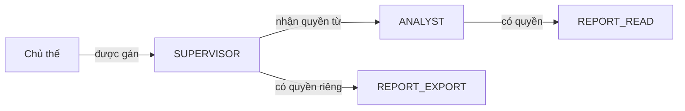

# Permission inheritance — Kế thừa quyền và ngữ nghĩa quyền hiệu lực

## 1. Kế thừa quyền giải quyết vấn đề gì?

Một hệ thống có nhiều vai trò, nhóm và tài nguyên sẽ khó quản lý nếu mọi quyền đều phải gán trực tiếp cho từng người trên từng đối tượng. Kế thừa cho phép tái sử dụng chính sách: một vai trò nhận các quyền của vai trò khác, thành viên nhóm con được hưởng một số quyền của nhóm cha hoặc một tài nguyên con nhận quyền từ tài nguyên tổ tiên.

Tuy nhiên, kế thừa cũng tạo ra các đường cấp quyền gián tiếp mà người quản trị dễ bỏ sót. Một thay đổi nhỏ ở nhóm, vai trò hoặc vị trí tài nguyên có thể mở rộng quyền của rất nhiều chủ thể mà không cần thêm một bản ghi cấp quyền trực tiếp nào.

Trong bảo vệ logic nghiệp vụ, câu hỏi quan trọng là:

> Chủ thể có quyền thực hiện hành động này trên đối tượng này vì những đường cấp quyền nào, với những điều kiện nào còn hiệu lực?

Nếu không trả lời rõ, hệ thống dễ mắc các lỗi:

- Đảo chiều kế thừa khiến vai trò cơ bản nhận quyền quản lý.
- Mất phạm vi tenant hoặc đơn vị khi mở rộng vai trò.
- Thu hồi một nguồn nhưng quyền vẫn còn qua nhóm khác.
- Ghép hạn mức của một nguồn với phạm vi của nguồn khác để tạo quyền chưa từng được cấp.
- Cho phép di chuyển tài nguyên để tự nhận quyền từ thư mục đích.
- Dùng một role cha để vô tình vượt phân tách nhiệm vụ hoặc các bước phê duyệt.

Bài học này mô hình hóa các loại kế thừa, cách tính quyền hiệu lực, xử lý từ chối, thu hồi và kiểm thử những đường cấp quyền gián tiếp.

## 2. Phân biệt các loại quan hệ

Không nên dùng một trường `parentId` hoặc một hàm `inherits()` cho mọi loại quan hệ mà không nêu ngữ nghĩa.

| Loại quan hệ | Điều được truyền | Ví dụ |
| --- | --- | --- |
| Kế thừa vai trò | Tập quyền hoặc năng lực mà vai trò được nhận | Vai trò giám sát nhận quyền xem của vai trò phân tích |
| Nhóm lồng nhau | Tư cách thành viên dùng để nhận những grant liên quan | Người trong nhóm con nhận quyền được gán cho nhóm cha theo chính sách |
| Kế thừa tài nguyên | Một grant ở tổ tiên áp dụng xuống tài nguyên con | Quyền xem một tập hồ sơ được truyền xuống các hồ sơ bên trong |
| Quan hệ suy ra giữa hành động | Một quyền kéo theo quyền khác nếu được định nghĩa rõ | Quyền chỉnh bản nháp có thể kéo theo quyền đọc bản nháp |
| Ủy nhiệm | Một chủ thể cấp quyền thực hiện có giới hạn cho chủ thể khác | Người quản lý ủy nhiệm quyền xử lý trong thời gian nghỉ |

Ủy nhiệm không đồng nghĩa kế thừa vai trò. Nó có người cấp, người nhận, giới hạn, thời hạn và khả năng thu hồi riêng. Quan hệ suy ra giữa hành động cũng không tự tồn tại chỉ vì tên quyền có vẻ liên quan.

Ví dụ, `EDIT_REQUEST` không mặc nhiên bao gồm `APPROVE_REQUEST`, `CHANGE_OWNER` hoặc `CHANGE_PERMISSION`. Đây là các hành động nghiệp vụ cần được định nghĩa riêng.

## 3. Định nghĩa chiều kế thừa thật rõ

### 3.1. Vai trò nhận quyền từ vai trò khác

Trong bài này, quy ước:

```text
SUPERVISOR → ANALYST
```

nghĩa là `SUPERVISOR` nhận quyền của `ANALYST`.

Khi một người được gán `SUPERVISOR`, bộ phân giải đi theo cạnh sang `ANALYST` để tìm quyền bổ sung. Người chỉ có `ANALYST` không đi ngược cạnh để nhận quyền của `SUPERVISOR`.



Trong sơ đồ, người có `SUPERVISOR` có thể nhận cả đọc và xuất báo cáo theo phạm vi grant. Người có `ANALYST` chỉ nhận quyền đọc nếu không có nguồn cấp khác.

Tên gọi “senior”, “manager” hoặc chức danh cao hơn không tự quyết định cạnh kế thừa. Một người quản lý nhân sự không vì chức danh mà cần mọi quyền thao tác tài chính của nhân viên.

### 3.2. Nhóm con là thành viên của nhóm cha

Giả sử:

```text
Người dùng là thành viên TEAM_A.
TEAM_A là thành viên FINANCE_ALL.
FINANCE_ALL được cấp REPORT_READ trong đơn vị X.
```

Nếu hệ thống hỗ trợ ngữ nghĩa nhóm lồng nhau này, người dùng có thể nhận quyền đọc trong X. Một người chỉ thuộc `FINANCE_ALL` không tự trở thành thành viên `TEAM_A`.

Không suy đoán mọi nền tảng đều hỗ trợ nhóm lồng nhau hoặc cùng chiều truyền quyền. Phải xác định ngữ nghĩa trong mô hình đang triển khai.

### 3.3. Quyền tài nguyên truyền từ tổ tiên xuống con

Với cây tài nguyên, bộ phân giải thường đi từ tài nguyên đích lên các tổ tiên để tìm grant, còn phạm vi áp dụng của grant truyền từ tổ tiên xuống dưới.

```text
Đơn vị X
└── Tập hồ sơ tháng 11
    └── Hồ sơ P-123
```

Quyền trên hồ sơ P-123 không tự cấp quyền cho mọi hồ sơ cùng cấp hoặc cho tập hồ sơ cha. Quyền trên tổ tiên cũng chỉ truyền xuống khi grant và chính sách cho phép, không phải cứ có quan hệ cha con là mọi hành động đều được truyền.

## 4. Một grant phải giữ nguyên ý nghĩa khi đi qua kế thừa

Một bản ghi cấp quyền nên được hiểu như một cấu trúc đầy đủ:

```text
Grant = {
    grant_id,
    subject_or_role,
    effect,
    action,
    resource_type,
    scope,
    conditions,
    not_before,
    not_after,
    propagation_rule,
    policy_revision
}
```

Kế thừa không được làm rơi tenant, phạm vi đơn vị, hạn mức hoặc thời hạn của grant gốc.

Ví dụ:

```text
Nhân viên có SUPERVISOR trong đơn vị A.
SUPERVISOR nhận REPORT_READ từ ANALYST.
```

Kết quả là quyền đọc theo phạm vi A, không phải quyền đọc mọi báo cáo trên toàn hệ thống chỉ vì định nghĩa `ANALYST` là một role template dùng chung.

Nếu dùng template vai trò toàn cục, template phải được áp dụng trong phạm vi grant được ràng buộc. Không biến việc tái sử dụng định nghĩa vai trò thành một cạnh mở rộng sang tenant khác.

### 4.1. Điều kiện của một đường cấp quyền

Một đường cấp quyền có thể gồm:

```text
chủ thể → nhóm con → nhóm cha → vai trò → vai trò kế thừa → grant
```

Đường đó chỉ hỗ trợ quyền khi mọi thành phần cần thiết đều còn hợp lệ:

```text
valid(path, request) =
    tư_cách_thành_viên_còn_hiệu_lực
    AND các_cạnh_kế_thừa_được_phép
    AND grant_còn_hiệu_lực
    AND đúng_action_và_loại_tài_nguyên
    AND đối_tượng_nằm_trong_phạm_vi
    AND thỏa_mọi_điều_kiện_trên_đường
```

Nếu các thành phần có khoảng thời gian, khoảng hiệu lực của đường là giao của các khoảng đó:

```text
effective_not_before = max(các not_before)
effective_not_after  = min(các not_after)
```

Nếu khoảng giao rỗng, đường không tạo quyền. Grant còn hạn không giữ quyền sống khi tư cách thành viên hoặc ủy nhiệm cần thiết đã hết hạn.

### 4.2. Không mở rộng điều kiện khi truyền quyền

Với một đường cấp quyền thông thường, phạm vi và điều kiện được kết hợp theo nghĩa phải cùng thỏa. Chẳng hạn, grant áp dụng cho A và cạnh cấp quyền chỉ cho một tập con của A thì kết quả không vượt tập con đó.

Nếu có hạn mức tiền cùng loại và cùng đơn vị đo trên một đường, mức được phép không thể vượt giới hạn chặt nhất áp dụng trên đường đó. Không so sánh các hạn mức khác tiền tệ hoặc khác loại hành động như những con số cùng nghĩa.

Một quyền mở rộng có chủ ý cần được thể hiện bằng grant hoặc chính sách riêng, không ẩn dưới tên “kế thừa”.

## 5. Nhiều đường cấp quyền: không trộn điều kiện thành quyền mới

Một chủ thể có thể nhận cùng action từ nhiều nguồn:

```text
Nguồn 1: được xử lý ở đơn vị A, tối đa 1 triệu mỗi lệnh.
Nguồn 2: được xử lý ở đơn vị B, tối đa 100 triệu mỗi lệnh.
```

Một lỗi nguy hiểm là tính:

```text
scope = A hoặc B
limit = max(1 triệu, 100 triệu)
```

rồi cho phép xử lý 100 triệu ở A. Không nguồn nào đã cấp quyền đó.

Đúng hơn, mỗi nguồn phải giữ nguyên một gói điều kiện:

```text
cho_phép =
    (đối_tượng_ở_A AND số_tiền <= 1_triệu)
    OR
    (đối_tượng_ở_B AND số_tiền <= 100_triệu)
```

Khi chọn một nguồn cho phép, cần chọn toàn bộ bằng chứng và điều kiện của nguồn đó. Không lấy phạm vi từ một đường, thời hạn từ đường khác và mức xác thực từ đường thứ ba để tạo ra quyền chưa từng được cấp.

### 5.1. Có nhiều nguồn không nhất thiết là có nhiều quyền độc lập để cộng dồn

Hai grant cùng cho phép hoàn tối đa 10 triệu không tự tạo thành hạn mức 20 triệu. Việc cộng hạn mức, chọn mức cao nhất hoặc yêu cầu đồng thời nhiều điều kiện phải do chính sách định nghĩa.

Tương tự, một người có hai role duyệt không được đếm thành hai người phê duyệt độc lập. Kế thừa quyền không tạo thêm một chủ thể.

### 5.2. Nghĩa vụ cũng thuộc đúng đường hỗ trợ

Nếu một đường yêu cầu phê duyệt bổ sung hoặc audit bắt buộc, không được bỏ nghĩa vụ đó khi dùng quyền của đường ấy.

Nếu có một đường khác thực sự cấp quyền với điều kiện khác, hệ thống phải áp dụng đúng chính sách chọn đường. Nếu một yêu cầu như xác thực tăng cường phải áp dụng cho mọi nguồn, hãy đặt nó thành điều kiện bắt buộc chung thay vì chỉ gắn vào một role rồi để role khác vô tình đi vòng.

## 6. Quyền cho phép và quyền từ chối

Không có một quy tắc phổ quát rằng quyền trực tiếp luôn thắng quyền kế thừa, hoặc tài nguyên cụ thể luôn thắng tổ tiên. Cần công bố cách kết hợp mà hệ thống sử dụng.

Trong mô hình của bài, chọn ngữ nghĩa:

1. Điều kiện bảo vệ bắt buộc như tenant, trạng thái nghiệp vụ và phân tách nhiệm vụ phải thỏa.
2. Nếu có một `DENY` áp dụng hợp lệ thì từ chối.
3. Nếu không có `DENY` và có ít nhất một đường `ALLOW` đầy đủ thì có thể cho phép cùng nghĩa vụ tương ứng.
4. Nếu không có đường cho phép thì từ chối.
5. Nếu dữ liệu cần thiết chưa xác định hoặc phân giải không đầy đủ thì không thực thi hành động cần quyết định đó.

| Tình huống | Kết quả theo mô hình này |
| --- | --- |
| Chỉ có `ALLOW` từ vai trò cha và đường hợp lệ | Có thể cho phép |
| Không có grant nào áp dụng | Từ chối do thiếu quyền |
| Có `ALLOW` trực tiếp và `DENY` kế thừa đang áp dụng | Từ chối |
| Có `ALLOW` kế thừa và `DENY` trực tiếp đang áp dụng | Từ chối |
| Có `DENY` nhưng không đúng action hoặc scope | Không coi đó là từ chối cho yêu cầu này |
| Có `ALLOW` nhưng không phân giải được một phần chính sách bắt buộc | Chưa đủ điều kiện để thực thi |

Một hệ thống có thể dùng ngữ nghĩa khác, chẳng hạn ưu tiên rule gần tài nguyên nhất. Khi đó cần mô tả và kiểm thử riêng các trường hợp xung đột; không vay tên `ALLOW`, `DENY` rồi mặc định cùng hành vi với mô hình trên.

### 6.1. Thiếu quyền khác với từ chối rõ ràng

Không có `ALLOW` có thể được khắc phục bằng một grant hợp lệ mới. Một `DENY` đang áp dụng có thể vẫn chặn dù thêm grant cho phép.

Sự khác biệt quan trọng khi giải thích vì sao thêm role chưa mở được quyền, hoặc vì sao một quyền quản lý không được dùng để vượt chính sách cấm.

## 7. Kế thừa trên cây tài nguyên và ranh giới truyền quyền

### 7.1. Grant cần nêu có truyền xuống hay không

Ví dụ các cách truyền quyền:

```text
SELF_ONLY
DIRECT_CHILDREN
DESCENDANTS_OF_ALLOWED_TYPE
```

Tên cụ thể tùy mô hình, nhưng cần biết quyền áp dụng cho chính nút, con trực tiếp hay toàn bộ hậu duệ và những loại tài nguyên nào.

Quyền xem một thư mục không nhất thiết là quyền tải mọi tài liệu bên trong. Quyền quản lý hồ sơ cũng không mặc nhiên là quyền quản lý ACL của hồ sơ đó.

### 7.2. Ngắt kế thừa phải có ngữ nghĩa chính xác

Một chức năng “ngắt kế thừa” có thể thay đổi mạnh tập người được truy cập. Vì vậy đây là thao tác quản lý quyền, không phải một thuộc tính mà người chỉ có quyền sửa nội dung được tự do thay đổi.

Trong mô hình ví dụ, ranh giới tài nguyên chặn các `ALLOW` kế thừa tùy chọn từ tổ tiên. Các `DENY` vẫn được đánh giá theo phạm vi áp dụng đã quy định; ranh giới này không tự làm mất một điều kiện cấm đang có hiệu lực.

Các điều kiện bảo vệ bắt buộc cấp tenant hoặc cấp nghiệp vụ nằm ngoài cơ chế mở quyền tùy chọn này. Chủ sở hữu hồ sơ không thể ngắt kế thừa để tắt phân tách nhiệm vụ hoặc cho phép xử lý hồ sơ đã khóa.

Nếu sản phẩm chọn cách ngắt cả một số rule từ chối tùy chọn, phải phân loại rõ rule nào được cắt và ai được làm. Không để một nút giao diện mơ hồ vô tình bỏ luôn chính sách bảo vệ bắt buộc.

### 7.3. Di chuyển tài nguyên là thay đổi quyền

Khi hồ sơ chuyển từ tập A sang tập B:

- Các grant từ tổ tiên A có thể không còn áp dụng.
- Các grant từ tổ tiên B có thể bắt đầu áp dụng.
- Hậu duệ của hồ sơ cũng có thể chịu thay đổi nếu còn kế thừa qua nó.
- Cache và bản sao quyền tổng hợp có thể trở nên cũ.

Thao tác di chuyển cần kiểm tra quyền trên đối tượng, nơi nguồn và nơi đích theo chính sách. Không cho một người có quyền sửa hồ sơ đặt `parentId` sang nơi họ tự quản để giành quyền quản lý ACL hoặc đưa hồ sơ ra khỏi phạm vi bị hạn chế.

Chuyển sang tenant khác thường cần một quy trình chuyển giao riêng, không phải chỉ sửa một cạnh cha con. Vòng tham chiếu trong cây tài nguyên cũng phải bị chặn.

## 8. Kế thừa không thay thế quy tắc nghiệp vụ

Giả sử `PAYMENT_SUPERVISOR` nhận quyền tạo yêu cầu từ `PAYMENT_REQUESTER` và có quyền phê duyệt riêng. Điều đó không có nghĩa một chủ thể được tự phê duyệt yêu cầu do mình tạo.

Cần giữ hai lớp điều kiện:

```text
có_quyền_APPROVE_PAYMENT_từ_một_nguồn_hợp_lệ
AND người_duyệt_không_xung_đột_với_người_tạo
AND yêu_cầu_ở_đúng_trạng_thái
AND approval_round_và_nội_dung_khớp
AND các_điều_kiện_nghiệp_vụ_khác
```

Một role nhận quyền qua nhiều tầng vẫn phải tuân theo trạng thái, hạn mức, hiệu lực phê duyệt và bất biến tài chính. Không tạo nhánh `if ADMIN then skip all checks` chỉ để đơn giản hóa xử lý kế thừa.

### 8.1. Xung đột quyền phải tính trên quyền hiệu lực

Kiểm tra chỉ các role được gán trực tiếp có thể bỏ sót xung đột:

```text
Người dùng có ROLE_X.
ROLE_X nhận MAKER qua một nhánh.
ROLE_X nhận AUDITOR qua nhánh khác.
```

Nếu MAKER và AUDITOR xung đột trong phạm vi đó, role tổng hợp vẫn gây xung đột dù tên của nó không nằm trong danh sách cấm trực tiếp.

Khi thay cạnh kế thừa hoặc thêm permission vào role, phải đánh giá tác động đến những chủ thể nhận quyền gián tiếp, không chỉ người đang giữ role vừa sửa.

## 9. Mô hình đồ thị và kiểm tra cấu hình

### 9.1. Định danh phải có kiểu và phạm vi

Một nút nên được định danh bằng thông tin đủ phân biệt, chẳng hạn:

```text
(tenant_id, node_type, node_id)
```

Không để ID của một nhóm vô tình trùng với ID vai trò rồi bị xử lý như cùng loại nút. Cạnh giữa các tenant không được xuất hiện chỉ vì một truy vấn mở rộng quên điều kiện tenant.

Role template dùng chung có thể là một loại nút chính sách riêng, nhưng việc áp dụng template vẫn phải giữ phạm vi cấp quyền của tenant. Đây phải là quan hệ được thiết kế rõ ràng, không phải ngoại lệ suy đoán khi phân giải.

### 9.2. Chặn chu trình

```text
ROLE_A → ROLE_B → ROLE_C → ROLE_A
```

Với một mô hình chỉ hợp tập quyền đơn giản, có thể định nghĩa một kết quả cố định cho chu trình. Tuy nhiên, chu trình làm khó giải thích nguồn quyền, thời hạn, thu hồi và kiểm soát độ phức tạp.

Mô hình trong bài yêu cầu đồ thị kế thừa vai trò không có chu trình. Cần kiểm tra khi thêm cạnh và vẫn có bảo vệ khi đọc dữ liệu lỗi hoặc dữ liệu được import.

Không chỉ chống chu trình bằng cách bỏ nút đã thăm rồi coi phần quyền thu được là kết quả đầy đủ. Nếu cấu hình không hợp lệ hoặc quá trình phân giải bị dừng, đường thực thi cần biết rằng kết quả chưa đủ tin cậy.

### 9.3. Giới hạn độ sâu và số nút

Nhóm hoặc vai trò lồng quá sâu có thể làm tăng tải và tạo lỗi khó điều tra. Có thể giới hạn độ sâu, số cạnh và kích thước bằng chứng theo chính sách cấu hình.

Nếu vượt giới hạn lúc đánh giá, không trả `PERMIT` từ một phần đồ thị đã duyệt. Một nhánh chưa đọc có thể chứa điều kiện cấm hoặc làm thay đổi ngữ nghĩa nguồn quyền. Trả kết quả không thể đánh giá đầy đủ và ghi nhận lỗi phù hợp.

### 9.4. Một tập nút đã thăm chưa chắc đủ

Cùng một vai trò có thể được tới qua hai đường với phạm vi hoặc thời hạn khác nhau. Nếu thuật toán đánh dấu “đã xử lý role này” và bỏ mọi đường còn lại, nó có thể làm mất một nguồn hợp lệ hoặc trộn điều kiện.

Bộ phân giải cần giữ những trạng thái ngữ nghĩa cần thiết của đường đi, hoặc dùng biểu diễn chính sách đã biên dịch bảo toàn các điều kiện. Không sao chép một thuật toán tìm đường đơn thuần rồi mặc định nó đã tính đúng quyền hiệu lực.

## 10. Cách tính quyền hiệu lực theo từng bước

Một quy trình tổng quát:

1. Xác thực chủ thể và xác định tenant tin cậy.
2. Tải đối tượng cùng thông tin sở hữu và tổ tiên từ nguồn có thẩm quyền.
3. Lấy snapshot nhất quán của assignment, nhóm, vai trò, grant và policy revision cần thiết.
4. Kiểm tra cấu hình, kiểu cạnh, chu trình và độ đầy đủ của snapshot.
5. Phân giải các đường nguồn, giữ nguyên scope, thời hạn, điều kiện và provenance.
6. Kiểm tra những điều kiện bảo vệ bắt buộc không được bỏ qua bằng kế thừa.
7. Đánh giá các rule từ chối và các nguồn cho phép theo ngữ nghĩa đã chọn.
8. Nếu cho phép, chọn nguồn hỗ trợ đầy đủ và xác định nghĩa vụ cần thực hiện.
9. Áp dụng quyết định tại điểm nhận hành động còn được bảo vệ bởi transaction hoặc phiên bản phù hợp.
10. Ghi bằng chứng đủ để giải thích quyết định.

`provenance` ở đây là thông tin truy nguyên: grant gốc, assignment, nhóm, cạnh vai trò hoặc tổ tiên tài nguyên nào đã góp phần tạo quyền. Không nhất thiết trả toàn bộ thông tin này cho client; nó có thể chỉ phục vụ audit và công cụ quản trị được phép.

## 11. Ví dụ Java: đánh giá nguồn quyền mà không làm mất điều kiện

### 11.1. Phạm vi ví dụ

Đoạn mã dưới đây minh họa một bộ đánh giá thuần logic. Nó không tự tải dữ liệu từ IAM, không quản lý transaction và không cập nhật nghiệp vụ.

Các thành phần giả định:

- `PolicySnapshot` là snapshot bất biến, đầy đủ cho yêu cầu và đã có phiên bản.
- `PermissionPathResolver` bảo toàn điều kiện của từng đường, không chỉ trả tập tên quyền.
- `FrozenAuthorizationContext` chứa ngữ cảnh từ nguồn tin cậy và thời điểm gate đã chọn.
- `RequiredGuards` kiểm tra điều kiện bắt buộc như tenant, trạng thái hoặc phân tách nhiệm vụ.
- `PathEvaluator` đánh giá toàn bộ đường, trả `MATCH`, `NO_MATCH` hoặc `INDETERMINATE`.
- `SupportSelector` chọn một nguồn cho phép đầy đủ cùng các nghĩa vụ tương ứng.

Đây là mã thiết kế; các kiểu dữ liệu và dependency cần được triển khai cho hệ thống cụ thể.

```java
public final class InheritedPermissionEvaluator {
    private final PermissionPathResolver resolver;
    private final RequiredGuards requiredGuards;
    private final PathEvaluator pathEvaluator;
    private final SupportSelector supportSelector;

    // Constructor khởi tạo các dependency được lược bỏ.

    public AuthorizationDecision evaluate(
            VerifiedActor actor,
            BusinessAction action,
            ResourceSnapshot resource,
            FrozenAuthorizationContext context,
            PolicySnapshot snapshot) {

        actor.requireAuthenticated();

        if (!snapshot.isCompleteFor(actor, action, resource)
                || !snapshot.isStructurallyValid()) {
            return AuthorizationDecision.indeterminate(
                    "POLICY_SNAPSHOT_UNUSABLE");
        }

        GuardResult guard = requiredGuards.evaluate(
                actor, action, resource, context, snapshot);
        if (guard.isDenied()) {
            return AuthorizationDecision.deny(guard.safeReasonCode());
        }
        if (guard.isIndeterminate()) {
            return AuthorizationDecision.indeterminate(
                    "REQUIRED_GUARD_UNRESOLVED");
        }

        Resolution resolution = resolver.resolve(
                actor, action, resource, snapshot);
        if (!resolution.isComplete()) {
            return AuthorizationDecision.indeterminate(
                    "INHERITANCE_RESOLUTION_INCOMPLETE");
        }

        List<GrantSupport> allows = new ArrayList<>();
        boolean unresolved = false;

        for (PermissionPath path : resolution.paths()) {
            PathEvaluation evaluation = pathEvaluator.evaluate(
                    path, actor, action, resource, context);

            if (evaluation.outcome() == PathOutcome.INDETERMINATE) {
                unresolved = true;
                continue;
            }
            if (evaluation.outcome() == PathOutcome.NO_MATCH) {
                continue;
            }

            if (path.effect() == GrantEffect.DENY) {
                return AuthorizationDecision.deny(
                        "APPLICABLE_DENY", evaluation.proof());
            }

            allows.add(evaluation.wholeGrantSupport());
        }

        if (unresolved) {
            return AuthorizationDecision.indeterminate(
                    "REQUIRED_PATH_EVALUATION_UNRESOLVED");
        }

        var selected = supportSelector.selectWholeSupport(
                allows, context, snapshot.requiredObligations());

        if (selected.isEmpty()) {
            return AuthorizationDecision.deny(
                    "NO_ENFORCEABLE_ALLOW_SUPPORT");
        }

        return AuthorizationDecision.permit(
                selected.get(), snapshot.revision());
    }
}
```

Đối với mô hình này, một rule từ chối đã khớp đủ để từ chối ngay. Nếu chưa có từ chối chắc chắn nhưng có phần đánh giá bắt buộc chưa xác định, kết quả không được nâng thành cho phép chỉ vì đã tìm thấy một `ALLOW` ở nhánh khác.

`wholeGrantSupport()` phải giữ đúng gói điều kiện và bằng chứng của đường vừa đánh giá. `selectWholeSupport()` không được tạo một grant mới bằng cách ghép các phần thuận lợi từ nhiều nguồn.

Nếu một hành động cần nhiều quyền đồng thời, chẳng hạn vừa đọc nguồn vừa ghi đích, lớp chính sách cho hành động đó phải yêu cầu đủ các quyết định tương ứng. Ví dụ trên chỉ minh họa chọn một nguồn hỗ trợ đầy đủ cho một yêu cầu quyền, không tự giải quyết mọi tổ hợp nghiệp vụ.

### 11.2. Điểm áp dụng quyết định vẫn phải có bảo vệ concurrency

Một service nghiệp vụ có thể tổ chức:

```text
BEGIN
  lấy snapshot quyền theo giao thức có phiên bản hoặc khóa phù hợp
  khóa đối tượng và những dữ liệu nghiệp vụ cần thiết
  dựng ngữ cảnh hiện tại
  đánh giá quyền kế thừa
  thực hiện đủ nghĩa vụ và cập nhật nghiệp vụ có điều kiện
  ghi audit và outbox bắt buộc
COMMIT
```

Thứ tự khóa và cách giữ snapshot phụ thuộc thiết kế. Mọi đường thay đổi quyền và dữ liệu liên quan phải có giao thức tương thích; việc chỉ đặt `@Transactional` quanh một lần gọi IAM bên ngoài không tạo ra snapshot nhất quán xuyên hệ thống.

## 12. Thu hồi quyền khi có nhiều nguồn

Giả sử một người nhận quyền xem báo cáo qua:

```text
Đường 1: gán trực tiếp vai trò ANALYST.
Đường 2: thành viên TEAM_A → FINANCE_ALL → ANALYST.
```

Xóa assignment trực tiếp chỉ loại bỏ đường 1. Quyền vẫn còn nếu đường 2 hợp lệ.

Vì vậy, “đã xóa grant” và “chủ thể đã mất quyền hiệu lực” là hai kết luận khác nhau. Công cụ quản trị cần cho biết các nguồn còn lại để người thu hồi không hiểu sai.

### 12.1. Thu hồi một nguồn hay thu hồi toàn bộ quyền?

Hai ý định cần được phân biệt:

- Gỡ một assignment hoặc tư cách thành viên cụ thể.
- Bảo đảm chủ thể không còn thực hiện được action trong phạm vi xác định.

Ý định thứ hai có thể cần gỡ nhiều nguồn hoặc thêm một rule từ chối phù hợp nếu mô hình cho phép. Rule từ chối cũng cần quyền quản trị, phạm vi, lý do và khả năng thu hồi rõ ràng; không dùng một deny quá rộng để chữa vội một nguồn quyền chưa hiểu.

### 12.2. Bảng quyền tổng hợp cần theo dõi nguồn

Nếu hệ thống lưu `effective_permission` để tăng tốc, cần biết kết quả đó phụ thuộc assignment, nhóm, cạnh vai trò, grant, tổ tiên tài nguyên và policy revision nào.

Một cờ `has_permission=true` không đủ để xử lý đúng khi một nguồn hết hạn nhưng nguồn khác còn sống. Đếm số đường cũng chưa đủ nếu các đường có scope hoặc điều kiện khác nhau, có chu trình hoặc có thời hạn.

### 12.3. Token cũ có thể còn mang role hoặc permission cũ

Thu hồi trong cơ sở dữ liệu không tự sửa các token đã phát hành. Nếu đường thực thi tin trực tiếp danh sách quyền trong token đến hết TTL, việc thu hồi có độ trễ tương ứng với hợp đồng đó.

Cần chọn cơ chế phù hợp: kiểm tra phiên bản quyền, tra cứu trạng thái hiện tại hoặc một cơ chế thu hồi khác mà hệ thống thực sự hỗ trợ. Không tuyên bố thu hồi tức thời nếu vẫn chấp nhận một bản sao quyền cũ không được kiểm tra lại.

## 13. Cache và phiên bản đồ thị

### 13.1. Những thay đổi có thể làm cache cũ

- Thêm hoặc gỡ membership.
- Thay cạnh kế thừa vai trò hoặc nhóm.
- Sửa permission của một role nền.
- Grant hoặc cạnh có điều kiện hết hạn.
- Thêm `DENY` hoặc thay ranh giới kế thừa tài nguyên.
- Di chuyển tài nguyên sang tổ tiên khác.
- Thay policy revision hoặc liên kết danh tính dùng cho phân tách nhiệm vụ.

Không chỉ xóa cache của người được gán trực tiếp role vừa sửa. Các role nhận kế thừa, nhóm lồng nhau và chủ thể gián tiếp cũng có thể chịu ảnh hưởng.

### 13.2. Không trộn các phiên bản

Một kết quả có thể sai nếu dùng membership trước thay đổi, role graph sau thay đổi và cây tài nguyên ở phiên bản khác. Cần định nghĩa snapshot hoặc cơ chế kiểm tra version đủ để biết quyết định dựa trên tổ hợp hợp lệ.

Có thể dùng version hoặc epoch theo phạm vi để vô hiệu hóa kết quả tổng hợp. Cơ chế cụ thể cần cân bằng chi phí cập nhật và yêu cầu thu hồi, nhưng phải bao phủ toàn bộ phụ thuộc có thể thay đổi quyền.

### 13.3. TTL không thay thế xử lý thu hồi

Cache không nên sống lâu hơn giới hạn thời gian của nguồn hỗ trợ đang dùng. Tuy nhiên, TTL đúng vẫn không giải quyết việc thu hồi trước hạn hoặc thêm deny mới nếu không có cơ chế kiểm tra phù hợp.

Cache để hiển thị có thể có yêu cầu khác cache dùng cho quyết định ghi dữ liệu nhạy cảm. Nút trên giao diện còn hiện không phải bằng chứng rằng server phải cho thực hiện.

## 14. Quản lý thay đổi đồ thị như thay đổi quyền

### 14.1. Thêm quyền vào role nền có thể mở rộng hàng loạt

Giả sử nhiều role quản lý nhận quyền từ `ANALYST`. Thêm `EXPORT_SENSITIVE_DATA` vào `ANALYST` có thể mở quyền xuất dữ liệu cho mọi role nhận kế thừa từ nó và mọi chủ thể liên quan.

Không chỉ kiểm tra danh sách thành viên trực tiếp của `ANALYST`. Cần xem tác động quyền hiệu lực trước và sau thay đổi theo các phạm vi cần bảo vệ.

### 14.2. Quyền sửa đồ thị không phải quyền sửa nội dung

Các hành động như thay parent role, đổi group nesting, ngắt kế thừa hoặc di chuyển vào một vùng cấp quyền rộng phải có quyền quản trị tương ứng.

Nếu người chỉ được sửa hồ sơ có thể thay các cạnh quyết định quyền của chính hồ sơ đó, họ có thể tự nâng quyền dù không có endpoint `grantPermission` trực tiếp.

### 14.3. Audit cần giữ được phiên bản cũ

Để giải thích một quyết định trong quá khứ, cần biết đồ thị và policy revision lúc đó. Nếu chỉ giữ cấu hình hiện tại, sau khi đổi role sẽ khó chứng minh vì sao một thao tác từng được phép.

Audit thay đổi nên bao gồm người thực hiện, phạm vi, cạnh hoặc grant trước và sau, lý do, revision và thông tin phê duyệt nếu quy trình yêu cầu.

Không gửi toàn bộ đồ thị quyền nhạy cảm cho mọi người dùng chỉ để giải thích một lỗi. Công cụ truy nguyên cần quyền đọc phù hợp và dữ liệu trả về theo phạm vi.

## 15. Các tình huống lạm dụng điển hình

### 15.1. Vai trò cha nhận quá nhiều quyền

Một role tổng hợp được tạo để thuận tiện nhưng nhận cả quyền lập, duyệt và đối soát trên cùng phạm vi. Nếu ứng dụng chỉ tin tên role quản lý, người dùng có thể đi qua cả chuỗi kiểm soát.

Cần kiểm tra các tổ hợp quyền hiệu lực và các điều kiện phân tách theo chủ thể, không chỉ tên role cấp trực tiếp.

### 15.2. Nhóm được phép tự quản thành viên

Nếu người dùng có thể thêm mình vào một nhóm con nhận quyền tài chính từ nhóm cha, chức năng quản lý membership đã trở thành đường nâng quyền.

Quyền quản lý nhóm phải xem xét những quyền hiệu lực mà thành viên sẽ nhận, đặc biệt khi nhóm được dùng đồng thời cho cộng tác thông thường và cấp quyền nhạy cảm.

### 15.3. Di chuyển đối tượng để đổi người được phép

Người dùng đưa hồ sơ sang một nhánh có grant thuận lợi, chỉnh quyền rồi chuyển lại. Hệ thống chỉ kiểm tra quyền sửa hồ sơ nên bỏ qua tác động cấp quyền của việc đổi parent.

Cần bảo vệ thay đổi quan hệ tài nguyên và giữ audit trước, sau. Các quyền sinh ra trong khoảng chuyển cũng cần được xem xét theo đúng snapshot và đối tượng.

### 15.4. Lợi dụng alias hoặc liên kết thay vì quan hệ cha thật

Một lối tắt hoặc liên kết hiển thị không nhất thiết là cạnh kế thừa quyền. Nếu hệ thống nhầm mọi liên kết thành parent, người dùng có thể tạo một shortcut dưới thư mục mình quản lý để truy cập đối tượng ở nơi khác.

Chỉ các quan hệ được mô hình quyền xác định mới được tham gia tính quyền. Quyền trên liên kết và quyền trên đích cần được kiểm tra theo ngữ nghĩa đã chọn.

### 15.5. Dùng bản sao quyền sau thu hồi

Worker hoặc API phụ sử dụng permission đã được tính từ trước, trong khi đường chính đã thu hồi. Cùng một hành động nghiệp vụ khi đó có hai mức bảo vệ khác nhau.

Cần bao phủ cả HTTP, queue, import, batch và công cụ quản trị. Nếu command đã được nhận hợp lệ trước thu hồi có hợp đồng tiếp tục riêng, phải phân biệt nó với một request mới dùng quyền cũ.

## 16. Kiểm thử ngữ nghĩa và tình huống tấn công

### 16.1. Kiểm thử chiều và phạm vi

| Tình huống | Kết quả cần chứng minh |
| --- | --- |
| Gán role nhận kế thừa | Nhận đúng quyền của role nguồn theo phạm vi |
| Chỉ gán role nguồn cơ bản | Không nhận ngược quyền riêng của role quản lý |
| Thành viên nhóm con | Chỉ nhận quyền nhóm cha theo quan hệ được hỗ trợ |
| Chỉ là thành viên nhóm cha | Không tự có tư cách của mọi nhóm con |
| Grant ở tenant A mở rộng qua role template | Không làm rơi tenant và không cấp quyền sang B |
| Grant trên tài nguyên con | Không tự cấp quyền trên cha hoặc tài nguyên cùng cấp |
| Grant `SELF_ONLY` ở tổ tiên | Không áp dụng xuống hậu duệ |
| Cùng ID nhưng khác loại nút hoặc tenant | Không bị hợp nhất trong đồ thị |

### 16.2. Kiểm thử kết hợp nguồn

| Tình huống | Kết quả cần chứng minh |
| --- | --- |
| A có hạn mức nhỏ, B có hạn mức lớn | Không dùng hạn mức B cho đối tượng ở A |
| Hai nguồn cùng cấp một action | Không cộng hạn mức hoặc đếm thành hai người duyệt nếu chính sách không cho |
| Một đường hết hạn, đường khác còn hợp lệ | Quyền còn hoặc mất đúng theo tập nguồn còn lại |
| Gỡ grant trực tiếp nhưng còn membership gián tiếp | Công cụ thu hồi và quyết định phản ánh quyền vẫn còn |
| `ALLOW` trực tiếp gặp `DENY` kế thừa áp dụng | Từ chối theo mô hình bài |
| `DENY` khác scope | Không vô tình cấm đối tượng ngoài phạm vi deny |
| Một nhánh policy chưa phân giải đủ | Không cho phép từ phần kết quả thuận lợi đã có |
| Nghĩa vụ bắt buộc không hỗ trợ hoặc thực hiện thất bại | Không tạo hiệu ứng dựa trên permit chưa đủ điều kiện |

### 16.3. Kiểm thử trạng thái, SoD và cây tài nguyên

1. Một role tổng hợp nhận cả quyền tạo và duyệt nhưng không được tự duyệt hồ sơ của cùng chủ thể khi chính sách cấm.
2. Người có quyền sửa nội dung không tự có quyền sửa ACL hoặc ngắt kế thừa.
3. Di chuyển tài nguyên kiểm tra đúng quyền nguồn, đích và đối tượng.
4. Di chuyển không làm mất điều kiện cấm bắt buộc hoặc vượt tenant.
5. Shortcut không tự trở thành cạnh cấp quyền cho tài nguyên đích.
6. Tài nguyên đã khóa không được sửa chỉ vì có quyền edit kế thừa.
7. Thay parent hoặc thêm role permission làm vô hiệu hóa đúng cache chịu ảnh hưởng.

### 16.4. Kiểm thử đồ thị lỗi và giới hạn tài nguyên

Tạo các cấu hình có chu trình, cạnh khác kiểu không hợp lệ, độ sâu vượt giới hạn và nhiều đường đến cùng role với điều kiện khác nhau.

Kết quả phải phân biệt cấu hình không thể đánh giá với một quyết định thiếu quyền thông thường theo cách vận hành đã chọn. Trong mọi trường hợp, không thực thi chỉ vì traversal đã tìm được một grant cho phép trước khi gặp lỗi.

Cũng cần kiểm tra rằng thay đổi đồ thị trái phép bị chặn ở API, import và công cụ quản trị, không chỉ ở giao diện.

### 16.5. Kiểm thử concurrency, cache và thu hồi

Dùng transaction hoặc worker độc lập với barrier hoặc latch để điều khiển lịch, thay vì dựa vào `sleep`.

```text
A. Request đang tính quyền thì membership bị thu hồi.
   Kết quả: tuân theo snapshot hoặc gate có thẩm quyền đã định nghĩa,
   không dùng tổ hợp dữ liệu trộn phiên bản ngoài hợp đồng.

B. Tài nguyên đổi parent trong lúc một request ghi dữ liệu chờ khóa.
   Kết quả: quyền được kiểm tra với quan hệ tài nguyên phù hợp
   tại điểm nhận thay đổi, hoặc request bị từ chối do version cũ.

C. Role nền nhận một DENY mới trong khi cache còn ALLOW.
   Kết quả: cơ chế thu hồi và version đáp ứng độ trễ đã cam kết.

D. Hai đường quyền cùng bị gỡ theo các transaction khác nhau.
   Kết quả: bảng tổng hợp và cache không giữ một quyền không còn nguồn.
```

Kiểm tra thêm token cũ, consumer queue và batch job. Không kết luận thu hồi đã hoàn tất chỉ vì một endpoint HTTP chính trả lỗi.

### 16.6. Kiểm thử thuộc tính của mô hình

Với một bộ dữ liệu nhỏ có thể kiểm tra thủ công, xác nhận:

- Thêm một đường `ALLOW` giống hệt không tạo hạn mức lớn hơn.
- Thêm một đường không áp dụng cho request không đổi kết quả.
- Gỡ một đường không làm mất quyền nếu vẫn còn một nguồn hỗ trợ đầy đủ khác và không có yếu tố cấm.
- Một `DENY` đang áp dụng không bị vượt bằng cách thêm `ALLOW` trực tiếp trong mô hình đã chọn.
- Kế thừa không mở rộng tenant, loại hành động hoặc phạm vi của grant gốc.
- Bằng chứng giải thích quyết định khớp revision thực sự được dùng.

Những thuộc tính này phải theo ngữ nghĩa đã công bố. Nếu hệ thống chọn quy tắc kết hợp khác, cần sửa kỳ vọng tương ứng thay vì dùng test của mô hình này như một chuẩn chung.

## 17. Các lỗi thiết kế cần tránh

| Cách làm | Vì sao gây lỗ hổng logic | Hướng thay thế |
| --- | --- | --- |
| Không ghi rõ chiều cạnh | Dễ cấp ngược quyền quản lý | Quy ước cạnh và test từng chiều |
| Mở rộng role rồi bỏ scope assignment | Quyền cục bộ biến thành toàn cục | Giữ scope và điều kiện trên toàn đường |
| Hợp scope và chọn hạn mức lớn nhất riêng rẽ | Tạo tổ hợp chưa được cấp | Đánh giá các gói điều kiện đầy đủ |
| Quyền trực tiếp luôn thắng mọi thứ | Có thể vô hiệu hóa deny hoặc bảo vệ bắt buộc | Ngữ nghĩa kết hợp rõ ràng và nhất quán |
| Xóa một grant là coi đã mất quyền | Còn nguồn qua nhóm hoặc role khác | Truy nguyên mọi nguồn hỗ trợ còn lại |
| Chỉ kiểm tra role gán trực tiếp để phát hiện SoD | Bỏ sót quyền gián tiếp | Kiểm tra quyền hiệu lực theo phạm vi và chủ thể |
| Đánh dấu role đã thăm rồi bỏ mọi đường khác | Có thể mất hoặc trộn điều kiện | Bộ phân giải bảo toàn trạng thái ngữ nghĩa |
| Traversal lỗi nhưng dùng kết quả một phần | Có thể bỏ sót deny hoặc điều kiện bắt buộc | Không thực thi khi phân giải chưa đầy đủ |
| Cho edit nội dung bao gồm sửa parent và ACL | Tạo đường tự nâng quyền | Hành động quản lý quyền và di chuyển riêng |
| TTL cache được coi là thu hồi tức thời | Bản sao cũ vẫn còn dùng được | Version, invalidation và hợp đồng thu hồi phù hợp |
| Đồ thị mới thay hoàn toàn lịch sử | Không giải thích được quyết định cũ | Revision và provenance có thể đối chiếu |
| Một service nội bộ bỏ kiểm tra kế thừa | Tạo đường nghiệp vụ yếu hơn | Cùng ngữ nghĩa ở mọi điểm thực thi |

## 18. Bài tập thiết kế

Thiết kế hệ thống nhiều tenant có nhóm lồng nhau, role template dùng chung và cây hồ sơ. Một nhân viên nhận quyền xử lý hồ sơ ở đơn vị A qua nhóm, đồng thời nhận quyền hạn mức cao hơn tại B qua assignment trực tiếp. Một số hồ sơ có ranh giới chặn `ALLOW` từ tổ tiên.

Hãy mô tả:

1. Chiều và kiểu của từng cạnh trong mô hình là gì?
2. Scope, hạn mức và thời hạn được giữ qua các tầng như thế nào?
3. Vì sao quyền hạn mức cao ở B không áp dụng được cho A?
4. `DENY`, quyền trực tiếp và quyền kế thừa được kết hợp ra sao?
5. Khi gỡ một membership, hệ thống chứng minh còn hay mất quyền bằng cách nào?
6. Di chuyển hồ sơ hoặc ngắt kế thừa yêu cầu những quyền nào và ảnh hưởng cache nào?
7. Thêm permission vào một role nền tác động đến các chủ thể gián tiếp ra sao?
8. Những test nào chứng minh không có đường nâng quyền qua chu trình, shortcut, nhiều tài khoản hoặc consumer dùng cache cũ?

Một thiết kế đạt yêu cầu phải truy nguyên được nguồn quyền, giữ đúng điều kiện của từng nguồn và giải thích được tại sao một hành động được phép hoặc bị từ chối trên đúng đối tượng tại điểm thực thi.
