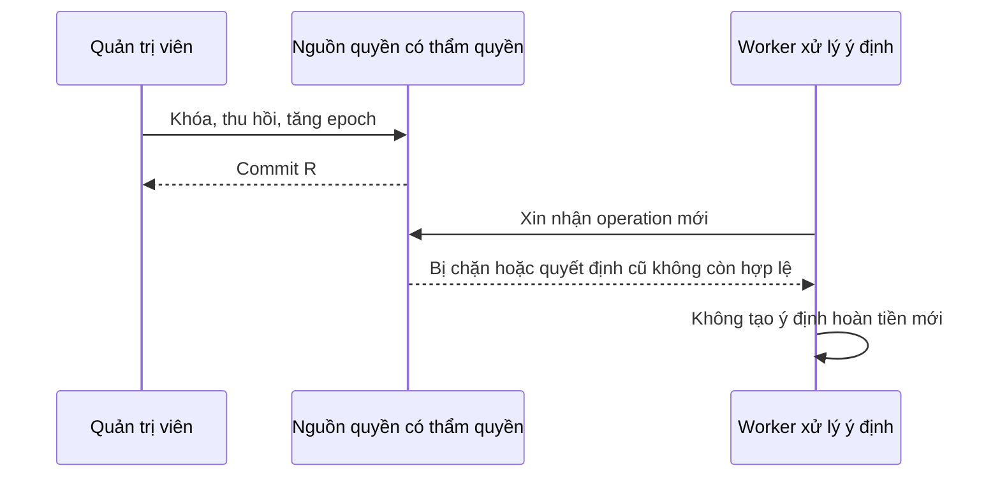

# Permission revocation: thu hồi quyền với ngữ nghĩa hiệu lực rõ ràng

Trong chương **Permission Semantics**, permission revocation là việc làm mất hiệu lực một quyền, một nguồn cấp quyền hoặc khả năng sử dụng quyền theo chính sách. Xóa một dòng phân quyền chưa chứng minh mọi API, token, cache và tác vụ nền đã ngừng chấp nhận hành động liên quan.

Trong module bảo vệ logic nghiệp vụ, thu hồi quyền phải ngăn hành động mới vượt qua ranh giới cho phép, đồng thời xử lý đúng những quyết định hoặc hiệu ứng đã xảy ra. Nó liên quan trực tiếp tới quyền theo đối tượng, state machine, transaction, idempotency và kiểm thử các lịch thực thi có cạnh tranh.

Bài học sử dụng ví dụ nhân viên hỗ trợ mất quyền thực hiện hoàn tiền. Mục tiêu là xác định hệ thống cam kết chặn điều gì, kể từ thời điểm nào và tại điểm thực thi nào.

Sau bài này, bạn có thể:

- Phân biệt thu hồi một grant với việc chủ thể thực sự không còn quyền.
- Định nghĩa ranh giới hiệu lực thay vì dùng một lời hứa mơ hồ về “thu hồi ngay”.
- Xử lý token, phiên đăng nhập, cache và quyền dẫn xuất sau thu hồi.
- Ngăn tác vụ chờ hoặc kết quả kiểm tra cũ tạo hành động mới trái chính sách.
- Kiểm thử thu hồi đồng thời với thực hiện, cấp lại và xử lý bất đồng bộ.

## 1. Xóa quyền ở màn hình quản trị có thể chưa chặn được hành động

Giả sử Mai có quyền `REFUND_EXECUTE`. Lúc 10:00, hệ thống đưa yêu cầu hoàn tiền vào hàng đợi. Lúc 10:01, quản trị viên thu hồi quyền của Mai. Lúc 10:02, worker bắt đầu xử lý message.

Có ít nhất ba thiết kế có thể tạo ra kết quả khác nhau:

1. Worker chỉ tin cờ `authorized=true` đã ghi lúc enqueue và tiếp tục hoàn tiền.
2. Worker kiểm tra lại nhưng đọc cache quyền cũ nên vẫn cho phép.
3. Worker kiểm tra dữ liệu có thẩm quyền tại ranh giới nhận quyền thực hiện và chặn thao tác mới.

Không thể đánh giá thiết kế chỉ bằng câu “quyền đã bị xóa”. Cần biết lúc enqueue hệ thống đã nhận thực hiện một operation hay mới lưu ý định, và chính sách yêu cầu kiểm tra quyền ở bước nào.

Tương tự, một API có thể từ chối request mới nhưng một đường tải tệp đã ký, một kết nối dài hoặc một dịch vụ khác vẫn chấp nhận credential cũ. Thu hồi cần được xem trên toàn bộ đường sử dụng quyền đã cam kết bảo vệ.

## 2. Thu hồi nguồn quyền và thu hồi quyền hiệu lực

Một người có thể nhận cùng khả năng từ nhiều nguồn:

```text
Mai
  ├─ grant trực tiếp: REFUND_EXECUTE trong bộ phận A
  ├─ nhóm hỗ trợ cấp cao: REFUND_EXECUTE trong bộ phận A
  └─ ủy quyền D7: REFUND_EXECUTE với giới hạn riêng
```

Xóa grant trực tiếp không tự loại bỏ quyền đến từ nhóm hoặc D7. Nếu hệ thống cần chặn mọi lần thực hiện hoàn tiền của Mai trong bộ phận A, phải xác định đúng các nguồn có thể cho phép hoặc có một điều kiện chặn bắt buộc phù hợp.

| Thao tác quản trị | Điều nó thực sự thay đổi |
| --- | --- |
| Xóa một grant | Mất một căn cứ cấp quyền cụ thể |
| Gỡ khỏi nhóm | Mất các quyền dẫn xuất từ quan hệ nhóm đó theo chính sách |
| Thu hồi bản ủy quyền | Mất khả năng sử dụng grant ủy quyền tương ứng |
| Khóa tài khoản | Chặn các hành động thuộc phạm vi chính sách khóa tài khoản |
| Chặn một capability trong một phạm vi | Có thể phủ định nhiều nguồn cho phép nếu policy định nghĩa như vậy |
| Thu hồi credential | Không tiếp tục dùng được credential đó theo cơ chế xác minh |

Quy tắc hợp nhất quyền phải rõ ràng. Một hệ thống có thể chọn điều kiện “tài khoản bị khóa” luôn chặn trước mọi grant, nhưng không nên mặc định mọi ngôn ngữ policy đều có cùng thứ tự ưu tiên giữa cho phép và từ chối.

Khi người dùng vẫn có quyền sau khi một grant bị xóa, hệ thống cần giải thích được nguồn còn lại. Nếu mục tiêu là chặn toàn bộ hành động mà giao diện chỉ thao tác một nguồn, kết quả có thể đúng theo mã nhưng sai kỳ vọng quản trị.

## 3. Xác định đúng đối tượng và phạm vi cần thu hồi

Một yêu cầu thu hồi cần trả lời:

- Thu hồi quyền của principal, tài khoản, cá nhân hay một client cụ thể?
- Trong tenant, bộ phận, dự án hoặc đối tượng nào?
- Với hành động nào: đọc, duyệt, thực hiện hay xuất dữ liệu?
- Áp dụng cho quyền trực tiếp, quyền kế thừa, quyền ủy quyền hay mọi căn cứ trong phạm vi?
- Có cần vô hiệu hóa credential hoặc phiên liên quan không?
- Có tác động đến các quyết định và operation đã được chấp nhận trước đó không?

Ví dụ “thu hồi quyền của Mai” quá rộng nếu Mai có nhiều tài khoản và nhiều vai trò. Ngược lại, chỉ chặn tài khoản web có thể chưa đủ nếu một tài khoản quản trị khác của cùng cá nhân vẫn được dùng để thực hiện cùng hành động.

Phạm vi nên dùng định danh ổn định đã được xác minh. Không dùng tên hiển thị hoặc email có thể đổi làm khóa duy nhất của một quyết định thu hồi lâu dài.

Bản thân endpoint thu hồi cũng cần quyền theo đối tượng và phạm vi quản trị. Người được quản lý quyền ở tenant T1 không được dùng cùng API để thu hồi hoặc sửa grant của T2. Client không được tự đặt version hay epoch để tạo bằng chứng rằng việc thu hồi đã được áp dụng.

## 4. Định nghĩa ranh giới hiệu lực

Có thể mô tả một thao tác bằng các mốc:

```text
T0: request được nhận
T1: quyền được kiểm tra
T2: operation được nhận thực hiện bền vững
T3: yêu cầu có tác dụng phụ được gửi ra ngoài
T4: kết quả được xác nhận
```

Thu hồi có thể cạnh tranh ở giữa bất kỳ hai mốc nào. Vì vậy, cần chọn một hợp đồng có thể kiểm chứng.

Trong ví dụ của bài, hợp đồng là:

> Sau khi transaction thu hồi đã commit tại nguồn có thẩm quyền, không được chấp nhận một operation hoàn tiền mới bằng quyền bị chặn. Operation đã được nhận trước ranh giới đó được xử lý theo chính sách dừng và đối soát riêng.

Ở đây, message chờ chỉ là ý định. Worker phải đi qua T2 để nhận quyền thực hiện; việc enqueue trước thu hồi không tự vượt qua ranh giới đó.

Hợp đồng này không đồng nghĩa mọi lời gọi mạng phải ngừng ngay tại thời điểm commit thu hồi. Một operation đã qua T2 có thể chưa tới T3. Nếu sản phẩm yêu cầu chặn cả những lời gọi chưa gửi, phải có thêm giao thức hủy hoặc kiểm tra tại điểm gửi và định nghĩa rõ tranh chấp với việc gửi.

| Mức cam kết | Điều cần thiết kế |
| --- | --- |
| Có hiệu lực sau một độ trễ cho phép | Giới hạn độ trễ, nguồn gây trễ và cách phát hiện vượt giới hạn |
| Chặn operation mới sau commit thu hồi | Một ranh giới quyết định có thẩm quyền và cơ chế loại trừ cập nhật cũ |
| Dừng cả operation đang chờ gửi | Giao thức hủy và nhận quyền gửi với trạng thái có thẩm quyền |
| Dừng hiệu ứng đã xảy ra bên ngoài | Có thể không dừng được; cần thu hồi tài nguyên hoặc bù trừ theo nghiệp vụ |

Không gọi mọi mức trên là “ngay lập tức”. Mỗi mức có giới hạn kỹ thuật và hệ quả sản phẩm khác nhau.

## 5. Epoch hoặc version để nhận diện quyết định cũ

Một cơ chế thường dùng là gắn phiên bản với trạng thái quyền:

```text
permission state của Mai trong phạm vi X
  authzEpoch = 41

sau thay đổi quyền có liên quan
  authzEpoch = 42
```

Một quyết định cho phép được tạo từ epoch 41 không được tự sử dụng như quyết định hiện hành khi nguồn có thẩm quyền đã ở epoch 42.

Epoch chỉ là dấu hiệu thay đổi, không phải bản thân quyền. Epoch bằng nhau vẫn cần một quyết định policy hợp lệ cho đúng chủ thể, hành động và đối tượng. Epoch khác nhau yêu cầu xử lý lại theo chính sách, không nhất thiết chứng minh chủ thể đã mất mọi quyền.

Phạm vi version phải bao phủ đúng dữ liệu quyết định quyền. Một user epoch riêng không tự phát hiện việc policy toàn tenant thay đổi hoặc vai trò được sửa nếu các thay đổi đó không tác động tới epoch hay một version bổ sung được kiểm tra.

Có thể dùng version theo principal, membership, nhóm, policy hoặc tenant. Khi kết hợp nhiều version, cần đọc và so sánh theo một cơ chế nhất quán. So sánh một version token cũ với một bản cache cũng cũ không tạo ra hiệu lực thu hồi tại nguồn.

Quyền theo đối tượng còn phụ thuộc dữ liệu như chủ sở hữu, đơn vị, trạng thái hoặc số tiền. Những dữ liệu đó cần version hoặc kiểm tra riêng; một epoch quyền không thay thế version của đối tượng nghiệp vụ.

## 6. Thu hồi và nhận quyền thực hiện trong một cơ chế nhất quán

Xét một thiết kế cục bộ dùng hàng kiểm soát cho chủ thể, phạm vi và capability:

```text
permission_gate
  tenantId, principalId, capability
  blocked
  authzEpoch
```

`blocked` là điều kiện chặn bắt buộc mà policy của ví dụ quy định. Đặt nó về false không tự cấp quyền; các grant và điều kiện khác vẫn phải cho phép.

Cả thao tác thu hồi và nhận quyền thực hiện cùng khóa hàng kiểm soát phù hợp. Mọi thay đổi quyền liên quan phải tham gia giao thức version hoặc khóa đã chọn.

```text
thu hồi:
  BEGIN
    khóa permission_gate
    cập nhật điều kiện chặn hoặc nguồn quyền đúng mục tiêu
    tăng authzEpoch
    ghi audit và sự kiện thu hồi vào outbox
  COMMIT  ← mốc R

nhận quyền thực hiện:
  BEGIN
    khóa cùng permission_gate
    đọc trạng thái quyền có thẩm quyền và kiểm tra blocked
    tải và bảo vệ đối tượng nghiệp vụ
    kiểm tra policy, phạm vi, trạng thái và bằng chứng bắt buộc
    kiểm tra version của quyết định nếu sử dụng quyết định đã tạo trước
    tạo operationId và ghi ý định thực hiện bền vững
    ghi audit, outbox và kết quả idempotency
  COMMIT  ← mốc X
```

Nếu R đã commit trước khi bên thực hiện giành quyền quyết định, bên thực hiện phải thấy điều kiện chặn hoặc quyền đã mất. Nếu X commit trước, operation thuộc phần đã được nhận trước ranh giới thu hồi.



Không giữ khóa này trong khi gọi nhà cung cấp hoặc chờ người dùng. Critical section cần ngắn; nếu một operation giữ khóa trong thời gian dài, việc thu hồi có thể bị chờ và chưa commit được.

Đây là một chiến lược minh họa. Hệ thống có thể dùng cập nhật có điều kiện, phiên bản quyết định hoặc cơ chế nhất quán khác. Một transaction ở ứng dụng không tự khóa được quyền nằm ở một dịch vụ ngoài; ranh giới đó cần giao thức và bảo đảm riêng.

## 7. Minh họa Java: không dùng lại một quyết định đã lỗi thời

Đoạn mã dưới đây kiểm tra một quyết định cho phép gắn với đúng actor, hành động, đối tượng và version. Mọi record là dữ liệu nội bộ từ nguồn tin cậy; client không được tự gửi `allowed = true` để dựng bằng chứng. Ví dụ dùng record của Java 16 trở lên.

```java
import java.time.Instant;
import java.util.Objects;
import java.util.UUID;

enum Action {
    EXECUTE_REFUND
}

record Actor(UUID tenantId, UUID principalId) {
}

record ResourceSnapshot(UUID tenantId, UUID id, long version) {
}

record PermissionGate(
        UUID tenantId,
        UUID principalId,
        Action action,
        long authzEpoch,
        boolean blocked) {
}

record BoundDecision(
        UUID tenantId,
        UUID principalId,
        Action action,
        UUID resourceId,
        long resourceVersion,
        long authzEpoch,
        Instant validUntil,
        boolean allowed) {
}

final class RevocationGuard {
    private RevocationGuard() {
    }

    static void requireCurrent(
            Actor actor,
            Action expectedAction,
            ResourceSnapshot resource,
            PermissionGate gate,
            BoundDecision decision,
            Instant now) {
        Objects.requireNonNull(actor);
        Objects.requireNonNull(expectedAction);
        Objects.requireNonNull(resource);
        Objects.requireNonNull(gate);
        Objects.requireNonNull(decision);
        Objects.requireNonNull(now);

        UUID tenant = Objects.requireNonNull(actor.tenantId());
        UUID principal = Objects.requireNonNull(actor.principalId());

        require(tenant.equals(gate.tenantId())
                && tenant.equals(decision.tenantId())
                && tenant.equals(resource.tenantId()), "TENANT_MISMATCH");
        require(principal.equals(gate.principalId())
                && principal.equals(decision.principalId()),
                "PRINCIPAL_MISMATCH");
        require(expectedAction == gate.action()
                && expectedAction == decision.action(), "ACTION_MISMATCH");
        require(Objects.requireNonNull(resource.id())
                .equals(decision.resourceId()), "RESOURCE_MISMATCH");
        require(!gate.blocked(), "PERMISSION_BLOCKED");
        require(decision.allowed(), "NOT_ALLOWED");
        require(decision.authzEpoch() == gate.authzEpoch(),
                "STALE_AUTHORIZATION");
        require(decision.resourceVersion() == resource.version(),
                "STALE_RESOURCE");
        require(now.isBefore(decision.validUntil()), "DECISION_EXPIRED");
    }

    private static void require(boolean condition, String code) {
        if (!condition) {
            throw new SecurityException(code);
        }
    }
}
```

Hàm không tạo ra bảo đảm thu hồi nếu `gate` lấy từ cache cũ hoặc bị thay đổi sau kiểm tra mà không có cơ chế bảo vệ. Nó phải được dùng trong giao thức nhận quyền thực hiện phù hợp.

Trong mô hình này, epoch đại diện cho các thay đổi quyền liên quan tới quyết định. Nếu hệ thống có version policy hoặc nguồn quyền khác chưa được bao phủ, cần kiểm tra thêm. Tính đúng đắn không đến từ việc đặt tên trường là `authzEpoch`.

Khi quyết định cũ không còn phù hợp, có thể yêu cầu đánh giá lại bằng nguồn hiện tại. Không chỉ chép epoch mới vào quyết định cũ rồi giữ nguyên `allowed`, vì đó là thay nhãn phiên bản mà không kiểm tra lại thẩm quyền.

## 8. Token còn hạn không có nghĩa quyền vẫn còn

Một access token có thể chứa role hoặc scope tại lúc phát hành. Nếu API chỉ kiểm tra chữ ký, đối tượng nhận và thời hạn, việc xóa role ở nguồn danh tính có thể chưa làm token đó bị từ chối.

Các cơ chế có ý nghĩa khác nhau:

| Cơ chế | Điều cần hiểu đúng |
| --- | --- |
| Access token sống ngắn | Có thể giảm cửa sổ dùng quyền cũ, nhưng không tự tạo thu hồi tức thời |
| Thu hồi refresh token | Chặn khả năng lấy token mới theo cơ chế tương ứng; token truy cập đã phát hành cần được xét riêng |
| Danh sách token bị thu hồi | Chặn các token được nhận diện khi điểm nhận thực sự kiểm tra danh sách |
| Kiểm tra trạng thái token qua nguồn có thẩm quyền | Hiệu lực phụ thuộc thông tin nguồn trả và quy tắc cache |
| So sánh version quyền | Phát hiện bằng chứng quyền cũ khi version hiện tại được lấy đúng cách |
| Kiểm tra policy cho hành động | Xác định quyền theo đối tượng và điều kiện nghiệp vụ hiện tại |

Đăng xuất trên một trình duyệt không mặc nhiên vô hiệu hóa một bearer token đã bị sao chép hoặc một phiên khác. Việc thu hồi credential và việc thu hồi permission cần được phối hợp theo mô hình phiên của hệ thống.

Thay khóa ký có thể ảnh hưởng một tập token rộng. Nó không nên bị nhầm thành cơ chế thu hồi chính xác quyền của một người chỉ vì các token đều dùng cùng khóa.

Credential của dịch vụ cũng cần chính sách riêng. Người vận hành bị thu hồi quyền không được tiếp tục điều khiển hành động bằng một API key dùng chung mà hệ thống không còn liên kết được với actor hoặc phạm vi công việc phù hợp.

## 9. Cache và sự kiện thu hồi có thể bị chậm hoặc sai thứ tự

Sự kiện thu hồi giúp các điểm kiểm tra loại bỏ dữ liệu cũ, nhưng một message có thể đến chậm, bị gửi lại hoặc bị bỏ lỡ nếu cơ chế giao nhận không bảo đảm như kỳ vọng.

Ví dụ:

```text
nguồn quyền: epoch 41 → epoch 42, quyền bị chặn
điểm kiểm tra A: đã biết epoch 42
điểm kiểm tra B: vẫn giữ kết quả cho phép của epoch 41
```

Nếu điểm B vẫn nhận operation mới, hệ thống chưa đáp ứng hợp đồng thu hồi tại mọi điểm đó. Việc A đã áp dụng không đủ để tuyên bố toàn hệ thống được bảo vệ.

Các biện pháp thiết kế có thể gồm:

- Cache có phạm vi tenant, principal, hành động và ngữ cảnh quyết định phù hợp.
- Version tăng đơn điệu để sự kiện cũ không ghi đè trạng thái mới.
- Đọc lại nguồn khi phát hiện khoảng trống version hoặc dữ liệu không xác định.
- Quét bù hoặc đồng bộ lại để khắc phục sự kiện bỏ lỡ.
- Giới hạn thời gian sử dụng quyết định cũ theo hợp đồng đã chọn.
- Điểm kiểm tra có thẩm quyền cho hành động cần bảo đảm mạnh hơn cache.

Một race khác xảy ra khi request đọc epoch 41 trước thu hồi, tạm dừng, rồi ghi kết quả cho phép vào cache sau khi sự kiện đã xóa cache. Cần cơ chế kiểm tra version khi nạp hoặc ghi cache, hoặc bảo đảm khác để kết quả cũ không sống lại.

TTL chỉ tạo được giới hạn độ trễ khi các giả định về nguồn dữ liệu, cách refresh, đồng hồ và đường lỗi đều đúng. Một cache được làm mới từ nguồn cũng cũ có thể kéo dài quyền quá thời gian TTL dự kiến.

Khi nguồn quyền không khả dụng, cần chính sách lỗi theo loại hành động. Với thao tác nhạy cảm cần bằng chứng quyền hiện hành, không được âm thầm cho phép vô thời hạn bằng cache cũ. Trả lỗi có thể retry hoặc chặn theo hợp đồng, đồng thời giữ được ý nghĩa rằng chưa có operation được nhận.

## 10. Quyền kế thừa, nhóm và ủy quyền dẫn xuất

Thu hồi cần xét đồ thị nguồn quyền. Một thay đổi ở nhóm hoặc policy có thể tác động nhiều người mà không sửa trực tiếp từng bản ghi cá nhân.

Nếu yêu cầu là mọi quyết định mới phải phản ánh thay đổi đó, cơ chế version và kiểm tra phải bao phủ nhóm hoặc policy liên quan. Chỉ tăng epoch khi sửa grant trực tiếp sẽ bỏ sót các thay đổi dẫn xuất.

Với ủy quyền, cần xác định ngữ nghĩa:

- Grant ủy quyền có phụ thuộc quyền nguồn hiện tại không?
- Thu hồi grant cha có chặn grant con không?
- Hệ thống có cho một hợp đồng ủy quyền tiếp tục tồn tại độc lập không?
- Các token hoặc quyết định đã phát hành dựa trên chuỗi đó được kiểm tra thế nào?

Nếu chính sách chọn hiệu lực dẫn xuất liên tục, một grant lá còn `ACTIVE` không đủ khi grant cha hoặc quyền nguồn đã mất. Mỗi liên kết cần được xác minh theo cơ chế phù hợp.

Ngược lại, không nên mặc định một thay đổi quyền tự động hủy mọi quyết định nghiệp vụ lịch sử. Grant cho phép tạo quyết định và quyết định đã được tạo là hai loại bằng chứng khác nhau; quan hệ thu hồi giữa chúng phải do chính sách quy định.

## 11. Tác vụ đang chờ và operation đã được nhận

Phân biệt các loại dữ liệu trong hàng đợi:

| Dữ liệu | Đã đủ căn cứ thực hiện chưa? |
| --- | --- |
| Ý định của người dùng | Chưa; phải kiểm tra tại ranh giới nhận operation |
| Tham chiếu tới operation đã được nhận bền vững | Có thể tiếp tục theo hợp đồng của operation và các guard liên quan |
| Thông báo về một kết quả đã commit | Chỉ phản ánh kết quả đó, không cấp quyền tạo một kết quả mới |

Trong ví dụ, ý định hoàn tiền của Mai được enqueue trước thu hồi nhưng chưa qua cổng nhận quyền thực hiện. Worker phải tải ngữ cảnh actor, quyền và đối tượng hiện tại; không dùng quyền kỹ thuật rộng của service để thay thế phần quyền đã mất của Mai.

Nếu operation đã được nhận trước R, hệ thống phải biết chính sách dành cho nó: tiếp tục, cố dừng nếu chưa gửi hoặc chuyển sang đối soát. Thay đổi chính sách cần được biểu diễn bằng trạng thái và hành động rõ ràng.

Worker giữ dữ liệu lâu hoặc được phân công lại có thể tiếp tục với version cũ. Generation hoặc fencing token giúp chặn cập nhật lỗi thời tại nơi kiểm tra nó. Nó không tự chặn một API ngoài không hiểu token đó.

Message nên tham chiếu operation, actor, đối tượng, snapshot và căn cứ quyền cần thiết qua dữ liệu bền vững. Không truyền một cờ `authorized=true` không có phạm vi hoặc thời hạn rồi coi đó là giấy phép vĩnh viễn.

## 12. Tác dụng bên ngoài không bị hoàn tác bằng cách xóa permission

Nếu nhà cung cấp đã thực hiện hoàn tiền, thu hồi quyền của Mai không làm tiền tự quay về. Tương tự, quyền triển khai đã được dùng để khởi chạy một job có thể để lại tác vụ đang hoạt động sau khi tài khoản bị khóa.

Cần phân biệt:

```text
thu hồi quyền tạo hành động mới
yêu cầu hủy một operation chưa hoàn tất
thu hồi tài nguyên hoặc quyền đã được tạo
bù trừ một kết quả đã xảy ra
```

Mỗi hành động có đối tượng, quyền và guard riêng. Không cập nhật operation thành “không được phép” rồi bỏ qua kết quả thật bên ngoài.

Timeout không chứng minh tác dụng phụ chưa xảy ra. Khi kết quả chưa rõ, giữ operation và định danh ổn định để đối soát hoặc retry idempotent theo giao thức. Thu hồi không phải lý do tạo một operation mới dưới tên tài khoản dịch vụ để tiếp tục mà không có căn cứ nghiệp vụ.

Nếu cần chặn lời gọi bên ngoài sau một mốc, điểm có quyền nhận hoặc thực thi lời gọi phải tham gia bảo đảm đó. Chỉ kiểm tra một lần trong ứng dụng rồi trì hoãn gửi không loại bỏ được cửa sổ giữa kiểm tra và tác dụng phụ.

## 13. Đường đọc dữ liệu và phiên kết nối dài

Permission revocation áp dụng cả với dữ liệu, không chỉ hành động ghi.

| Đường sử dụng | Rủi ro sau thu hồi |
| --- | --- |
| Kết nối dài hoặc subscription | Kết nối được xác thực một lần vẫn tiếp tục nhận dữ liệu mới |
| Tệp xuất đã tạo | Người dùng mất quyền trên ứng dụng nhưng vẫn tải được tệp |
| URL ký sẵn | URL có thể là một capability riêng còn được bên lưu trữ chấp nhận |
| Cache phản hồi hoặc CDN | Nội dung riêng tư có thể tiếp tục được trả theo cấu hình cũ |
| Phiên đăng nhập khác | Một phiên bị hủy nhưng các phiên còn lại vẫn có quyền |

Với kết nối dài, có thể cần kiểm tra quyền cho các thông điệp hoặc chu kỳ phù hợp, giới hạn thời gian sống quyền nhận dữ liệu và chủ động đóng kết nối theo sự kiện. Cách chọn phải đáp ứng ngữ nghĩa hiệu lực đã cam kết.

Với tệp xuất, kiểm tra quyền lúc yêu cầu tạo chưa chắc đủ cho lần tải sau. Có thể cần cổng tải kiểm tra quyền hiện tại hoặc cơ chế capability có thời hạn và khả năng vô hiệu hóa phù hợp. URL đã ký không tự bị thu hồi chỉ vì bảng quyền của ứng dụng thay đổi.

Dữ liệu người dùng đã tải và lưu cục bộ không thể bị lấy lại chỉ bằng một thay đổi permission phía máy chủ. Thiết kế cần giới hạn dữ liệu được cấp ban đầu và phân biệt rõ ngăn truy cập mới với thu hồi các bản sao đã rời hệ thống.

## 14. Cấp lại quyền, retry và sự kiện cũ

Một chuỗi thay đổi có thể là:

```text
epoch 41: được phép
epoch 42: thu hồi
epoch 43: cấp lại theo phạm vi mới
```

Sự kiện epoch 42 đến muộn không được ghi đè trạng thái epoch 43 bằng một bản snapshot cũ. Ngược lại, một message cho phép ở epoch 41 không được phục hồi quyền sau thu hồi.

Cấp lại quyền không làm mọi token hoặc quyết định cũ trở nên hợp lệ. Phạm vi mới có thể hẹp hơn và đối tượng có thể đã thay đổi. Cần quyết định mới theo nguồn hiện tại nếu hợp đồng yêu cầu.

Với lệnh thu hồi retry, xác định rõ đích là một grant cụ thể hay một điều kiện chặn toàn bộ capability. Xóa grant G1 không được vô tình xóa grant G2 vừa được cấp mới chỉ vì chúng cùng loại quyền. Một điều kiện chặn toàn capability lại có thể được thiết kế để tiếp tục chặn cho tới khi có hành động gỡ chặn rõ ràng.

Các bản ghi version, sự kiện và định danh grant cũ cần được giữ đủ theo chính sách để xử lý message muộn và audit. Không xóa sạch lịch sử rồi để một sự kiện cấp quyền cũ được diễn giải như cấp mới.

Idempotency của operation cũng phải đúng phạm vi. Retry cùng operation đã được nhận không được tạo thêm tác dụng phụ; một key cũ không được dùng để tạo operation mới sau thu hồi. Nhánh xem kết quả đã commit vẫn phải kiểm tra quyền đọc kết quả hiện tại.

## 15. Báo cáo kết quả thu hồi đúng mức bảo đảm

Kết quả quản trị cần phân biệt:

- Nguồn quyền đã commit thay đổi.
- Các điểm thực thi bắt buộc đã áp dụng hay còn đang đồng bộ.
- Các operation trước ranh giới còn chạy hoặc đang đối soát.
- Các credential, phiên hoặc capability riêng đã được xử lý theo yêu cầu hay chưa.

Nếu hệ thống dùng sự kiện và chấp nhận một khoảng lan truyền, thông báo không nên khẳng định mọi điểm thực thi đã chặn khi mới ghi một message. Cần trạng thái hoặc thông tin vận hành đủ để biết giới hạn nào đã đạt được.

Audit nên ghi:

```text
người yêu cầu thu hồi và phạm vi quyền quản trị
principal, grant hoặc capability bị tác động
phạm vi tài nguyên, lý do và chính sách áp dụng
version hoặc epoch trước và sau
thời điểm commit ở nguồn có thẩm quyền
sự kiện lan truyền, điểm áp dụng và lỗi liên quan nếu cần
operation trước ranh giới còn tồn tại cùng kết quả xử lý
```

Không ghi access token, khóa bí mật hoặc credential đầy đủ vào audit. Cần định danh có thể đối chiếu mà không biến nhật ký thành nguồn cấp khả năng truy cập.

Theo dõi độ trễ áp dụng, điểm thực thi giữ epoch cũ, operation mới bị chặn và operation còn đối soát. Những số liệu này giúp kiểm chứng hợp đồng thu hồi thay vì chỉ đếm số dòng quyền đã bị xóa.

## 16. Kiểm thử quyền hiệu lực và các đường truy cập

| Ca kiểm thử | Kết quả cần giữ |
| --- | --- |
| Xóa grant trực tiếp khi vẫn còn quyền từ nhóm | Quyền hiệu lực phản ánh nguồn còn lại; kết quả quản trị không báo sai phạm vi |
| Chặn capability bắt buộc trong phạm vi đã chọn | Các grant cho phép không vượt qua điều kiện chặn theo policy |
| Thu hồi ở tenant T1 | Không làm lẫn dữ liệu hoặc quyền của T2 |
| Thu hồi một hành động | Các hành động khác không bị thay đổi ngoài chính sách |
| Token cũ vẫn còn hạn | Hành vi khớp cơ chế thu hồi token và permission đã thiết kế |
| Thu hồi refresh token | Không mặc định coi mọi access token cũ đã mất hiệu lực |
| Quyền thay đổi qua nhóm hoặc policy | Version và điểm kiểm tra không bỏ sót nguồn dẫn xuất |
| Grant cha bị thu hồi | Grant con phản ánh đúng chính sách hiệu lực của chuỗi |
| URL tải hoặc kết nối dài đã được tạo | Không tiếp tục cung cấp dữ liệu mới trái hợp đồng thu hồi |
| Gọi bằng CLI, API hàng loạt hoặc service khác | Cùng tôn trọng điểm thực thi và phạm vi bảo vệ |

Cần kiểm tra cả trường hợp người không có quyền quản trị cố thu hồi, sửa epoch hoặc chặn người ngoài phạm vi. Không được để cơ chế thu hồi trở thành một chức năng tùy ý làm mất quyền của người khác.

## 17. Kiểm thử tranh chấp, lỗi và tính bền vững

| Lịch thực thi hoặc sự cố | Điều phải xác minh |
| --- | --- |
| R commit trước khi operation nhận quyền thực hiện | Operation mới bị chặn theo hợp đồng ví dụ |
| X commit trước R | Operation được nhận trước ranh giới và được xử lý theo chính sách đã định |
| Quyền được kiểm tra trước R nhưng operation cố commit sau R | Không dùng quyết định cũ để vượt cơ chế loại trừ cập nhật |
| Nạp cache cũ hoàn tất sau sự kiện invalidation | Kết quả cũ không sống lại ngoài hợp đồng |
| Sự kiện cấp lại đến trước sự kiện thu hồi cũ | Không ghi đè version mới bằng trạng thái cũ |
| Điểm kiểm tra bị tách mạng khỏi nguồn quyền | Không mở quyền vượt chính sách lỗi và giới hạn độ trễ |
| Worker bắt đầu sau khi actor mất quyền | Phân biệt ý định chờ với operation đã được nhận |
| Worker cũ chạy lại sau thay đổi version | Không nhận thêm operation bằng căn cứ cũ |
| Callback thành công đến sau thu hồi | Ghi nhận đúng operation và hiệu ứng thật, không tạo thêm hành động |
| Retry một lệnh thu hồi hoặc thực hiện | Không tạo hiệu ứng lặp hoặc tác động nhầm grant mới |
| Nguồn quyền đã commit nhưng phát sự kiện tạm lỗi | Có đường phục hồi, phát lại hoặc đồng bộ bù theo thiết kế |
| Thu hồi trong lúc đối tượng đổi chủ sở hữu hoặc trạng thái | Cả quyền và dữ liệu đối tượng được kiểm tra ở version phù hợp |

Với cơ chế khóa, dùng các điểm đồng bộ trong kiểm thử để tạo đúng lịch thực thi. Nếu chỉ gọi thu hồi xong rồi mới gọi API thực hiện một cách tuần tự, chưa kiểm chứng được cửa sổ giữa kiểm tra và commit.

Kiểm tra dữ liệu bền vững: operation, outbox, quyết định quyền đã tiêu thụ, trạng thái đối tượng và audit. Một response bị từ chối không đủ nếu tác vụ đã được xếp lịch có hiệu lực trước đó.

Các bài kiểm thử cần đối chiếu với hợp đồng được chọn. Không đánh dấu hệ thống sai chỉ vì một operation hợp lệ trước R tiếp tục khi chính sách cho phép; cũng không bỏ qua operation mới sau R chỉ vì request của nó bắt đầu sớm hơn.

## 18. Cách thiết kế permission revocation cho hệ thống của bạn

1. Liệt kê nguồn quyền trực tiếp, kế thừa, ủy quyền và credential có thể dẫn tới hành động cần chặn.
2. Xác định principal, hành động và phạm vi tài nguyên của yêu cầu thu hồi.
3. Định nghĩa mốc hiệu lực và cách xử lý operation trước mốc đó bằng ngôn ngữ có thể kiểm thử.
4. Chọn nguồn quyết định có thẩm quyền cùng cơ chế version, khóa hoặc giao thức nhất quán phù hợp.
5. Bao phủ token, cache, kết nối dài, tệp xuất và các capability phát sinh riêng.
6. Phân biệt ý định chờ, operation đã được nhận và hiệu ứng đã xảy ra; thiết kế hủy hoặc đối soát riêng.
7. Xử lý cấp lại, retry và sự kiện muộn bằng version và định danh bền vững.
8. Ghi audit và quan sát độ trễ thực thi theo đúng bảo đảm đã công bố.
9. Kiểm thử tranh chấp thu hồi–thực hiện, sự cố đồng bộ và mọi đường truy cập liên quan.

Thu hồi quyền có ý nghĩa khi hệ thống chặn đúng hành động tại đúng ranh giới đã cam kết. Nguồn quyền, bằng chứng đã phát hành và điểm thực thi cần cùng tuân thủ một ngữ nghĩa hiệu lực, trong khi các kết quả đã xảy ra được xử lý bằng quy trình nghiệp vụ riêng.
