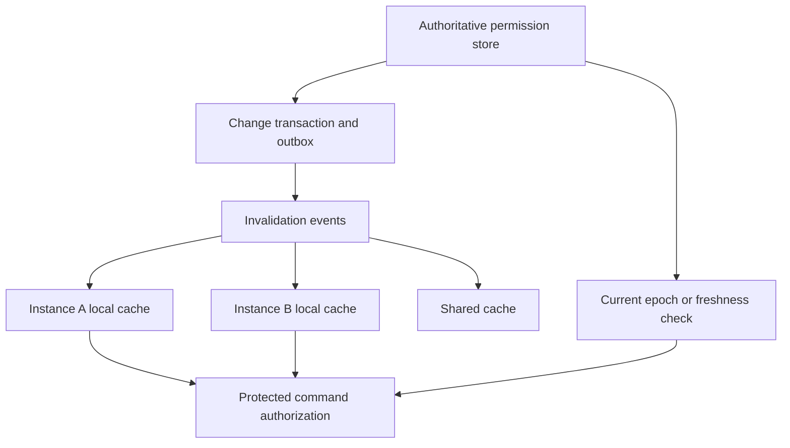

# Permission cache invalidation: làm mất hiệu lực cache quyền đúng cách

## 1. Quyền đã thu hồi nhưng hành động vẫn được cho phép

An có quyền duyệt đề nghị chi trả trong phòng kế toán. Một instance ứng dụng đã cache kết quả `canApprove(An, P-100) = true`. Quản trị viên thu hồi quyền của An, cơ sở dữ liệu cập nhật thành công, nhưng instance vẫn dùng kết quả cũ để duyệt hồ sơ.

Việc thu hồi đã hoàn tất ở nguồn dữ liệu nhưng chưa có hiệu lực ở đường thực thi. Nếu hệ thống cam kết không cho duyệt sau khi thu hồi, đây là lỗi bảo vệ nghiệp vụ.

**Permission cache invalidation** là việc ngăn dữ liệu quyền hoặc quyết định phân quyền đã không còn hợp lệ tiếp tục được sử dụng, sau khi các yếu tố tạo nên quyết định thay đổi hoặc hết hiệu lực.

Vấn đề không chỉ là xóa một key. Cần trả lời:

- Đang cache dữ liệu gì và dữ liệu đó phụ thuộc vào đâu?
- Điều gì làm nó không còn đúng?
- Mọi instance, tầng cache và worker biết thay đổi bằng cách nào?
- Có thể có reader ghi dữ liệu cũ trở lại sau khi xóa không?
- Khi nguồn quyền hoặc kênh invalidation lỗi, hành động nhạy cảm được xử lý ra sao?
- Cam kết thu hồi có hiệu lực ở lúc kiểm tra quyền, commit nghiệp vụ hay thực hiện tác động bên ngoài?

Trong module bảo vệ logic nghiệp vụ, mục tiêu là giữ các bất biến như không duyệt sai phạm vi, không tự duyệt, không dùng ủy quyền hết hạn và không thực thi một lệnh chỉ vì cache còn ghi rằng được phép.

## 2. Xác định chính xác thứ đang được cache

Các loại cache liên quan đến quyền có ngữ nghĩa và điều kiện mất hiệu lực khác nhau.

| Loại dữ liệu | Ví dụ | Điều cần chú ý |
|---|---|---|
| Policy hoặc biểu diễn đã biên dịch | Quy tắc duyệt theo vai trò, hạn mức | Đổi policy hoặc code đánh giá có thể làm kết quả cũ sai |
| Thuộc tính quyền | Membership, role hiệu lực, phạm vi phòng ban | Cần xét thay đổi trực tiếp lẫn kế thừa qua group/role |
| Quan hệ đối tượng | Chủ sở hữu, người lập, người được phân công | Có thể đổi mà role của người dùng không đổi |
| Quyết định cụ thể | Người A được duyệt hồ sơ B | Phụ thuộc cả chủ thể, hành động, đối tượng và ngữ cảnh |
| Credential hoặc claim | Role chứa trong token được cấp trước đó | Xóa cache ứng dụng không tự sửa hoặc thu hồi token |
| Response theo quyền | Danh sách hồ sơ được xem, kết quả API | Có thể làm lộ dữ liệu nếu dùng sai ngữ cảnh hoặc quá hạn |

Không nên gọi tất cả là “permission cache” rồi dùng một cơ chế xóa chung mà không xác định phạm vi.

### 2.1. Cache dữ liệu nền khác với cache kết luận cuối cùng

Cache tập role có thể giảm chi phí dựng đồ thị quyền nhưng vẫn để policy kiểm tra đối tượng hiện tại. Cache `canApprove = true` bỏ qua nhiều bước hơn, nên thường có nhiều phụ thuộc cần ràng buộc hơn.

Ví dụ kết quả duyệt có thể phụ thuộc số tiền, người lập, vòng duyệt và hạn mức. Nếu chỉ cache theo user và role, thay số tiền hoặc thay căn cứ có thể khiến permit cũ bị dùng cho một hành động đáng lẽ phải bị từ chối.

Một lựa chọn là chỉ cache phần policy/thuộc tính có phạm vi rõ, còn state machine và bất biến nghiệp vụ luôn được kiểm tra trên snapshot hiện tại. Điều đó giảm phạm vi invalidation, nhưng vẫn phải bảo vệ dữ liệu quyền được cache khỏi dùng quá hạn.

## 3. Liệt kê phụ thuộc và các sự kiện làm mất hiệu lực

### 3.1. Quyết định quyền thường có nhiều đầu vào

```text
decision = f(
    chủ thể, tenant, membership,
    role và quan hệ kế thừa,
    policy, phân công, ủy quyền,
    đối tượng và trạng thái nghiệp vụ,
    ngữ cảnh xác thực, thời gian
)
```

Cache chỉ đúng khi các đầu vào có ý nghĩa vẫn phù hợp với căn cứ đã dùng.

| Thay đổi | Những kết quả có thể bị ảnh hưởng |
|---|---|
| Thu hồi membership hoặc khóa tenant | Mọi hành động dựa trên membership/tenant đó |
| Sửa quyền của role | Người dùng nhận role trực tiếp hoặc gián tiếp |
| Xóa người khỏi group | Quyền được nhận qua group, kể cả các nhánh kế thừa |
| Giảm hạn mức hoặc đổi phòng phụ trách | Quyết định trên những đối tượng liên quan |
| Thu hồi/hết hạn ủy quyền | Quyết định dùng căn cứ ủy quyền đó |
| Đổi owner, maker hoặc người được giao | Quyền theo quan hệ với đối tượng |
| Sửa số tiền, người nhận, basis hoặc vòng duyệt | Quyền hành động và guards phụ thuộc dữ liệu nghiệp vụ |
| Liên kết hai account về cùng một người | Quyết định về không tự duyệt và người duyệt độc lập |
| Đổi policy hoặc bộ đánh giá | Quyết định được tính theo ngữ nghĩa cũ |
| Bằng chứng xác thực bổ sung hết hạn | Hành động yêu cầu mức xác thực đó |

Một thay đổi có vẻ là “cấp thêm quyền” cũng có thể tạo xung đột nhiệm vụ hoặc làm áp dụng một rule hạn chế khác. Chỉ phân loại tăng/giảm quyền là chưa đủ nếu policy có điều kiện kết hợp phức tạp.

### 3.2. Chọn phạm vi phiên bản

Có thể dùng phiên bản ở nhiều mức:

- Một `tenantAuthzEpoch` chung, tăng khi dữ liệu phân quyền liên quan trong tenant đổi.
- Phiên bản theo người dùng, membership hoặc danh tính.
- Phiên bản role graph, policy, phân công hoặc delegation.
- `resourceVersion` hay `basisRevision` cho dữ liệu nghiệp vụ.

Epoch chung dễ suy luận nhưng làm mất hiệu lực nhiều entry và có thể tạo điểm tranh chấp. Phiên bản chi tiết giảm phạm vi ảnh hưởng nhưng khó bảo đảm không bỏ sót phụ thuộc.

Nếu dùng vector nhiều phiên bản, mọi thành phần cần thiết phải tham gia key hoặc điều kiện hợp lệ. Có một phiên bản policy nhưng bỏ phiên bản membership không giải quyết được thu hồi membership.

## 4. Định nghĩa cam kết nhất quán trước khi chọn TTL

“Xóa cache ngay khi đổi quyền” không mô tả đủ hành vi mà người dùng và nghiệp vụ cần.

| Mức cam kết | Ý nghĩa minh họa | Yêu cầu thiết kế |
|---|---|---|
| Hội tụ dần | Các node cuối cùng sẽ bỏ dữ liệu cũ | Chấp nhận một khoảng tiếp tục dùng quyền cũ; cần cơ chế hội tụ đáng tin |
| Độ trễ bị giới hạn | Quyền cũ chỉ có thể dùng trong giới hạn đã xác định theo các giả định rõ ràng | Phải chặn refill cũ và xét mọi tầng cache, nguồn thời gian, nguồn thuộc tính |
| Kiểm tra nguồn hiện hành cho hành động nhạy cảm | Không dùng permit cache nếu không xác nhận được phiên bản cần thiết | Có bước kiểm tra nguồn đáng tin ở đường thực thi |
| Đồng bộ với commit thu hồi | Không có commit nghiệp vụ mới dựa trên quyền cũ sau khi thu hồi đã commit, theo phạm vi được cam kết | Cần giao thức đồng bộ giữa đường thu hồi và đường nghiệp vụ |

Không phải mọi hành động đều cần mức mạnh nhất. Xem một trang tổng quan và phát lệnh chi trả có thể có yêu cầu khác nhau. Phân loại phải có chủ ý, không để TTL mặc định của thư viện quyết định mức bảo vệ.

### 4.1. Tách các mốc thời gian

Một cam kết cần phân biệt:

```text
T1: cập nhật quyền bắt đầu
T2: thay đổi quyền commit ở nguồn
T3: sự kiện invalidation được phát
T4: từng node xử lý sự kiện
T5: request nghiệp vụ commit
T6: tác động bên ngoài được gửi/thực hiện
```

Đã tới T4 ở một node không chứng minh mọi node đã tới T4. Ngăn commit trái quyền ở T5 cũng không tự định nghĩa phải làm gì với một operation đã được chấp nhận trước đó nhưng đến T6 mới chạy.

### 4.2. Không hứa thu hồi tức thời bằng cơ chế bất đồng bộ đơn thuần

Nếu một vùng mạng không nhận được event và vẫn dùng cache, hệ thống chưa có bảo đảm thu hồi tức thời toàn cục. Muốn bảo đảm mạnh hơn phải kiểm tra nguồn đồng bộ, từ chối khi không xác lập được quyền hoặc có cơ chế phối hợp tương ứng.

Không thể vừa cho mọi node tiếp tục dùng quyền cũ khi mất liên lạc vô hạn, vừa khẳng định mọi thay đổi thu hồi đều có hiệu lực ngay tại các node đó.

## 5. Thiết kế cache key và điều kiện sử dụng entry

Một key cho quyết định cụ thể có thể cần các thành phần:

```text
cacheNamespace
+ tenantId
+ principalId hoặc danh tính theo mô hình quyền
+ ngữ cảnh đại diện/xác thực có ý nghĩa
+ action
+ resourceId
+ resourceVersion
+ authzEpoch
+ evaluatorVersion
```

Đây là danh sách để suy xét, không phải yêu cầu ghép mọi trường cho mọi loại cache. Nếu cache chỉ chứa policy đã biên dịch, key khác với cache quyết định trên một hồ sơ.

### 5.1. Không lấy phiên bản từ client làm nguồn hiện hành

Token hoặc header có thể mang `authzVersion = 10`, nhưng nguồn đã ở version 11. Nếu ứng dụng dùng luôn version 10 để tra cache và thấy permit cũ, việc thêm version vào key không ngăn được sử dụng quyền cũ.

**Key có version chỉ hiệu quả khi đường thực thi biết version nào hiện được phép dùng từ một nguồn đáng tin với mức nhất quán phù hợp.**

Nếu version hiện hành cũng bị cache, cần xác định cơ chế làm mới và giới hạn cũ của chính cache version đó. Không đẩy bài toán sang một lớp khác rồi coi đã giải quyết.

### 5.2. Entry nên giữ căn cứ và hạn kiểm tra lại

Một entry có thể giữ:

```text
decision
policy/evaluator version
dependency versions hoặc snapshot reference
evaluatedAt
validUntil
internal reason phục vụ chẩn đoán có kiểm soát
```

`validUntil` cần không vượt các ranh giới thời gian liên quan, như delegation hoặc bằng chứng xác thực bổ sung hết hạn. Nếu policy không cung cấp được một khoảng tái sử dụng an toàn cho ngữ cảnh đó, không nên cache quyết định cuối cùng.

Không cần đưa thời điểm hiện tại chính xác đến từng mili giây vào key rồi coi đó là giải pháp; cách đó gần như triệt tiêu cache. Cần mô hình điều kiện thời gian và hạn kiểm tra lại có ý nghĩa.

## 6. Invalidation theo sự kiện và transaction nguồn

### 6.1. Ghi thay đổi và ý định phát sự kiện cùng nhau

Một trình tự thường dùng:

1. Trong transaction, cập nhật quyền và tăng epoch phù hợp.
2. Ghi sự kiện thay đổi vào outbox của cùng transaction.
3. Commit.
4. Relay phát event; consumer cập nhật phiên bản tối thiểu đã biết và loại entry liên quan.

Ví dụ cấu trúc sự kiện:

```json
{
  "eventId": "evt-920",
  "tenantId": "T1",
  "newAuthzEpoch": 42,
  "changeType": "ROLE_MEMBERSHIP_REVOKED",
  "scope": "TENANT"
}
```

Không cần đưa toàn bộ dữ liệu quyền hoặc thông tin cá nhân vào event nếu mục đích chỉ là báo thay đổi.

### 6.2. Vì sao không chỉ xóa trước commit?

Nếu xóa cache rồi transaction quyền chưa commit, reader có thể đọc lại quyền cũ và điền cache. Nếu transaction rollback, hệ thống còn tạo invalidation không tương ứng thay đổi thực tế.

Phát sau commit tránh thông báo một thay đổi chưa được xác nhận, nhưng nếu cập nhật nguồn và phát message là hai thao tác rời rạc, process có thể chết ở giữa. Outbox hoặc cơ chế tương đương giúp không mất ý định phát sau commit.

Outbox không làm cửa sổ T2–T4 biến mất. Nó cải thiện độ tin cậy phát sự kiện, không tự tạo bảo đảm thu hồi đồng bộ.

### 6.3. Sự kiện lặp, đảo thứ tự và mất kết nối

Consumer cần xử lý idempotent và không hạ epoch đã biết. Nhận epoch 42 rồi 41 không được làm hệ thống quay lại dùng phiên bản 41.

Có thể duy trì mốc tối thiểu đã biết theo scope và áp dụng `max` với các thay đổi đơn điệu phù hợp. Event không nên tái cài một permit cũ chỉ vì nó đến muộn.

Consumer cần có cách bắt kịp sau restart hoặc mất kết nối, cùng cơ chế đối soát với nguồn khi cần. TTL là lớp giới hạn bổ sung nếu được thiết kế đúng, không phải bằng chứng rằng event chắc chắn đã được xử lý.

Kênh phát và cập nhật cache phải có quyền ghi phù hợp. Một bên không được phép phát epoch hoặc snapshot giả có thể gây mất dịch vụ, hoặc nghiêm trọng hơn là làm sai căn cứ quyền nếu dữ liệu cache bị tin trực tiếp.

## 7. Race condition: dữ liệu cũ quay lại sau khi đã xóa

### 7.1. Stale refill

Một lịch chạy điển hình:

```text
Reader R: cache miss, bắt đầu đọc quyền ở epoch 10.
Admin:    thu hồi quyền, nguồn commit epoch 11.
Consumer: xóa key cache theo sự kiện epoch 11.
Reader R: đọc xong snapshot cũ, ghi PERMIT epoch 10 vào key vừa xóa.
Request:  hit key đó và được phép theo dữ liệu cũ.
```

Xóa đã chạy đúng nhưng cache vẫn bị làm bẩn lại. Xóa hai lần có thể thu hẹp một số lịch chạy, không chứng minh đã loại bỏ mọi reader cũ đang chờ.

### 7.2. Những cơ chế giúp kiểm soát refill cũ

| Cơ chế | Giải quyết phần nào? | Giới hạn cần biết |
|---|---|---|
| Key có epoch | Snapshot cũ không ghi đè entry của epoch mới | Reader phải biết epoch hiện được phép dùng |
| Mốc epoch tối thiểu đã biết | Sau khi biết epoch mới, node không nhận kết quả fill cũ hơn | Trước khi biết thay đổi vẫn có cửa sổ trễ |
| Ghi có điều kiện dưới cùng cơ chế đồng bộ | Tránh kiểm tra mốc xong rồi vẫn ghi cũ do race cục bộ | Cần thao tác kiểm tra–ghi thực sự nguyên tử trong phạm vi đó |
| Kiểm tra nguồn hiện hành | Không dựa riêng vào event đã tới node hay chưa | Có thêm chi phí và cần xác định ranh giới nhất quán |

Một phép so sánh version ở ứng dụng rồi `put` sau đó vẫn có thể bị xen ngang. Nếu dùng mốc cục bộ để chặn refill, việc nhận epoch mới và công bố kết quả cũ cần tuân theo cùng quy ước đồng bộ hoặc thao tác có điều kiện tương đương.

### 7.3. Không hồi sinh entry đã quá hạn từ nguồn trung gian cũ

L1 hết hạn, đọc L2 vẫn chứa snapshot cũ rồi đặt TTL mới có thể kéo dài quyền cũ. Nếu mỗi tầng đều tính lại TTL từ thời điểm nhận mà không giữ hạn hiệu lực gốc, thời gian cũ có thể vượt xa một TTL được quảng bá.

Giữ deadline hoặc thông tin độ mới có nguồn gốc đáng tin, và không cho lớp sau kéo dài quá hạn mà nguồn trước đã bảo đảm. Cũng phải xét một loader đọc từ replica đang trễ, không chỉ từ nguồn chính.

## 8. Ví dụ mô hình epoch cho lệnh nhạy cảm

Phần này minh họa một mô hình đơn giản ưu tiên khả năng suy luận: mỗi tenant có một hàng epoch; các thay đổi phân quyền liên quan và lệnh nhạy cảm cùng tham gia giao thức khóa hàng đó.

Đây là lựa chọn có chi phí: nếu dùng khóa độc quyền chung, các lệnh nhạy cảm trong tenant có thể bị tuần tự hóa. Nó không phải thiết kế tối ưu mặc định cho mọi tải.

### 8.1. Hợp đồng của giao thức

Trong transaction thu hồi quyền:

```text
khóa tenant authorization epoch
→ cập nhật quyền
→ tăng epoch
→ ghi outbox
→ commit
```

Trong transaction nghiệp vụ nhạy cảm:

```text
khóa tenant authorization epoch theo cùng quy ước
→ đọc epoch hiện hành
→ khóa/nạp snapshot nghiệp vụ
→ tra cache theo epoch và snapshot đó
→ đánh giá nếu miss, kiểm tra guards
→ cập nhật và commit trong khi vẫn giữ bảo vệ cần thiết
```

Các đường phải có thứ tự khóa nhất quán. Mô hình giả định những dữ liệu quyền được bảo vệ thực sự tham gia giao thức trong cùng phạm vi transaction; nó không tự bao trùm kho danh tính bên ngoài.

### 8.2. Minh họa Java cho phần tra quyết định

Các kiểu và dependency dưới đây là hợp đồng minh họa của ứng dụng. `EpochGuard` đại diện cho một cơ chế bảo vệ **còn đang được giữ trong transaction**, không phải một số epoch đã đọc rồi thả khóa.

```java
record PermissionKey(
        String namespace,
        UUID tenantId,
        UUID principalId,
        String verifiedContextFingerprint,
        String action,
        UUID resourceId,
        long resourceVersion,
        long authzEpoch,
        String evaluatorVersion) {}

record CachedDecision(
        Decision decision,
        Instant validUntil) {}

Decision decisionForProtectedCommand(
        Actor actor,
        String action,
        RequestSnapshot resource,
        EpochGuard guard) {

    guard.requireActiveFor(actor.tenantId());
    Instant now = clock.instant();

    PermissionKey key = new PermissionKey(
            cacheNamespace,
            actor.tenantId(),
            actor.principalId(),
            contexts.verifiedFingerprint(actor),
            action,
            resource.id(),
            resource.version(),
            guard.currentEpoch(),
            evaluatorVersion);

    CachedDecision cached = cache.get(key);
    if (cached != null && now.isBefore(cached.validUntil())) {
        return cached.decision();
    }

    AuthoritySnapshot source = authorities.loadConsistentWith(guard, actor);
    Evaluation evaluation = policy.evaluate(actor, action, resource, source, now);

    Instant validUntil = deadlines.earliest(
            now.plus(cacheTtl),
            evaluation.nextRequiredCheckAt(),
            source.freshnessDeadline());

    if (validUntil.isAfter(now) && evaluation.cacheable()) {
        cache.put(key, new CachedDecision(evaluation.decision(), validUntil));
    }
    return evaluation.decision();
}
```

Các điều kiện để ví dụ có ý nghĩa:

- `resource` được nạp và bảo vệ trong transaction đang giữ guard; mọi sửa dữ liệu ảnh hưởng quyết định phải làm đổi version hoặc có cơ chế tương đương.
- Fingerprint ngữ cảnh được dựng từ dữ liệu đã xác minh, gồm các yếu tố như đại diện hoặc xác thực bổ sung nếu chúng ảnh hưởng quyết định.
- Nguồn authority và mọi thay đổi thuộc phạm vi epoch tuân thủ cùng giao thức. Không dùng role cũ trong token thay cho nguồn này mà không có thiết kế hiệu lực tương ứng.
- Deadline không được kéo dài delegation, bằng chứng hoặc thuộc tính có thời hạn.
- Kết quả chưa thể đánh giá không được cache như `PERMIT`.
- Sau hàm này, service vẫn phải chặn nếu không permit, kiểm tra business guards và cập nhật có điều kiện; cache hit không tự thực hiện nghiệp vụ.
- Guard được giữ theo hợp đồng đến commit; không trả permit ra khỏi transaction rồi dùng nó tùy ý ở request sau.

Ở đây vẫn có truy cập nguồn epoch cho mỗi lệnh nhạy cảm. Cache tiết kiệm việc tải và đánh giá đồ thị quyền, không loại bỏ mọi lượt đọc có thẩm quyền.

### 8.3. Vì sao mô hình này ràng buộc được với thu hồi?

Nếu lệnh nghiệp vụ giữ guard trước, giao dịch thu hồi phải chờ theo giao thức; nó không thể commit thu hồi rồi để lệnh cũ commit sau dưới cùng bảo đảm đó. Nếu thu hồi commit trước, lệnh nghiệp vụ đọc epoch mới và không dùng key của epoch cũ.

Lập luận chỉ đúng khi mọi đường thay đổi liên quan đều tuân thủ giao thức. Một job sửa role trực tiếp hoặc kho quyền ngoài hệ thống không tham gia sẽ phá giả định.

Ngoài ra, bảo đảm này nói về commit nghiệp vụ cục bộ. Tác động mạng được gửi sau commit cần ngữ nghĩa ủy nhiệm/thực thi riêng, không được tự gộp vào lời hứa của khóa cơ sở dữ liệu.

## 9. TTL, thời gian và fallback khi lỗi

### 9.1. TTL là giới hạn tái sử dụng, không phải cơ chế hiểu policy

TTL ngắn làm giảm một số khoảng cũ nhưng không tự biết membership đã bị thu hồi. Nếu loader tiếp tục lấy dữ liệu trễ rồi đặt TTL mới, chỉ nhìn TTL của entry hiện tại không chứng minh được giới hạn kể từ lúc nguồn thay đổi.

Muốn tuyên bố một độ trễ tối đa, cần xét thời điểm snapshot được xác nhận, nguồn đọc, refill, mọi tầng cache, thời gian và hành vi khi dependency lỗi.

Không có một giá trị TTL phù hợp mọi hành động. Quyết định cho hành động không thể đảo ngược thường cần bảo đảm mạnh hơn một màn hình ít nhạy cảm.

### 9.2. Điều kiện thời gian phải làm entry mất hiệu lực

Một delegation có thể hết hạn mà không có transaction nào tăng epoch đúng thời điểm đó. Vì vậy, version không thay thế kiểm tra deadline.

Cần giới hạn entry bởi ranh giới kiểm tra lại sớm nhất mà policy biết, như thời hạn ủy quyền, mức xác thực bổ sung hoặc cửa sổ nghiệp vụ. Không cho access biến thành sliding TTL kéo dài vô hạn chỉ vì liên tục có request.

Với TTL cục bộ có thể dùng nguồn thời gian thích hợp để tránh ảnh hưởng của bước nhảy đồng hồ; với deadline chia sẻ giữa hệ thống cần có giả định đồng hồ và sai số rõ. Thời gian do client khai không phải nguồn cho phép kéo dài hiệu lực quyền.

### 9.3. Stale-while-revalidate và stale-if-error

Trả dữ liệu cũ trong lúc làm mới có thể phù hợp một số nội dung, nhưng không được mặc định áp dụng cho permit đã hết phạm vi hiệu lực. Tương tự, lỗi nguồn không phải lý do tự động dùng quyền cũ vô hạn.

Nếu một loại thao tác cho phép dùng snapshot trong khoảng độ mới xác định, snapshot còn trong khoảng đó có thể được xử lý theo chính sách đã chọn. Khi không còn đủ căn cứ, hành động nhạy cảm phải dừng hoặc vào quy trình khác được cấp quyền rõ ràng.

### 9.4. Negative cache cũng cần invalidation

Cache deny cũ có thể chặn người vừa được cấp quyền hoặc vừa hoàn tất một điều kiện bắt buộc. Đây là lỗi chức năng và có thể ảnh hưởng vận hành nghiêm trọng.

Không chỉ phát event cho thu hồi mà bỏ qua thay đổi cấp quyền. Cần invalidation phù hợp cả hai hướng, đồng thời không suy luận rằng mọi thay đổi “grant” đều không thể làm sai một permit khác trong policy có điều kiện.

## 10. Nhiều tầng cache, nhiều instance và phân vùng mạng

### 10.1. Xóa L2 không xóa L1

Một instance có thể giữ cache trong bộ nhớ, còn các instance chia sẻ một cache trung tâm. Xóa entry trung tâm không làm các bản sao cục bộ biến mất.



Mỗi tầng cần hiểu namespace, version và hạn hiệu lực; không chỉ một tầng làm đúng rồi giả định cả đường đọc đã an toàn.

### 10.2. Node mất event hoặc khởi động lại

Node quay lại cần biết nó đã bỏ lỡ thay đổi hay chưa. Có thể bắt kịp từ vị trí tiêu thụ bền vững, đọc epoch nguồn trước khi phục vụ hành động nhạy cảm, hoặc bỏ cache cục bộ và làm ấm lại theo cơ chế đúng.

Không phục hồi một snapshot cache lâu ngày rồi mặc định nó còn hợp lệ. Cache rỗng cũng không có nghĩa mọi người được phép; nó chỉ là miss cần xử lý theo chính sách.

### 10.3. Multi-region và replica trễ

Một khu vực đọc replica cũ có thể điền lại quyền đã thu hồi ở nguồn chính. Key có version lấy từ chính replica đó vẫn có thể cũ.

Cần quyết định hành động nào phải đọc nguồn/điểm kiểm tra đủ mới, hành động nào chấp nhận giới hạn trễ và khi mất liên lạc thì làm gì. Event bất đồng bộ xuyên vùng không tự tạo bảo đảm tức thời.

### 10.4. Stampede và gộp tải

Invalidation phạm vi tenant có thể làm nhiều request cùng miss. Có thể gộp tác vụ nạp theo đầy đủ key, giới hạn tải và làm ấm có chọn lọc.

Không gộp loader chỉ theo action hoặc resource rồi trả chung kết quả cho nhiều tenant/chủ thể. Cũng không dùng permit hết hạn làm giải pháp chống stampede nếu chính sách không cho phép.

Tối ưu hiệu năng phải giữ nguyên phạm vi và độ mới của quyết định. Hệ thống có thể chậm hoặc trả lỗi dịch vụ khi không xác lập được quyền; không vì áp lực tải mà tự mở quyền.

## 11. Token, worker, triển khai mới và khôi phục dữ liệu

### 11.1. Token có claim quyền là một bản sao khác

Xóa permission cache không sửa role đã ghi trong token được cấp trước đó. Cần xác định đường thực thi có tin claim đó đến hết hạn hay có cơ chế kiểm tra trạng thái/phiên bản hiện hành.

Token còn hạn không tự chứng minh membership, phiên hoặc delegation chưa bị thu hồi. Ngược lại, một phiên hết hạn và một permission cache entry hết hạn là hai điều kiện khác nhau, cần được xử lý ở đúng lớp.

Nếu dùng version trong token, vẫn phải biết version hiện hành từ nguồn đủ tin cậy. So sánh hai bản sao cùng cũ không tạo kiểm tra thu hồi thực tế.

### 11.2. Worker có cache và thời điểm quyền riêng

Một job được nhận lúc người dùng có quyền nhưng chạy sau khi thu hồi cần semantics rõ: quyền phải còn khi thực hiện, hay lúc nhận đã tạo một ủy nhiệm có giới hạn?

Worker không được dùng permit cache cũ như giấy phép vô thời hạn. Nếu phải kiểm tra lại, cần cùng cơ chế độ mới. Nếu thực hiện theo ủy nhiệm, phải kiểm tra đúng phạm vi, căn cứ và thời hạn ủy nhiệm đó.

Invalidation cũng không xóa operation đã gửi ra ngoài. Khi kết quả chưa rõ, service được cấp quyền vẫn phải đối soát; không tự coi thao tác chưa từng xảy ra rồi tạo lại.

### 11.3. Đổi code đánh giá hoặc schema cache

Policy không đổi nhưng code evaluator đổi vẫn có thể làm ý nghĩa quyết định khác đi. Dùng phiên bản evaluator/schema hoặc namespace để không tái sử dụng entry theo cách diễn giải cũ.

Trong rolling deployment, các instance cũ có thể vẫn chạy code không hỗ trợ policy mới. Tăng epoch không tự sửa code đó. Cần quy tắc tương thích, kiểm soát triển khai hoặc chặn luồng nhạy cảm ở phiên bản không đủ khả năng thực thi.

### 11.4. Restore và tái sử dụng epoch

Nếu phục hồi cơ sở dữ liệu về trạng thái cũ trong khi cache vẫn giữ dữ liệu của một dòng thời gian khác, chỉ so số epoch có thể không còn đủ. Không nên tái sử dụng cùng namespace/version cho những trạng thái không còn cùng nguồn gốc.

Quy trình khôi phục cần xử lý cache và thế hệ dữ liệu: xóa/bỏ qua entry không còn tin cậy, đổi namespace khi cần và xác nhận lại các phiên bản nguồn. Không reset một counter rồi giả định mọi entry trùng số đều tương ứng cùng policy.

## 12. Kiểm thử invalidation theo bất biến

### 12.1. Các tình huống cần bao phủ

| Tình huống | Kỳ vọng |
|---|---|
| Thu hồi role sau khi đã cache permit | Không tiếp tục dùng permit ngoài cam kết độ mới |
| Cấp quyền sau khi đã cache deny | Quyền mới có hiệu lực theo cam kết; không bị chặn vô hạn |
| Role nhận qua group/role kế thừa bị đổi | Invalidation bao phủ người nhận gián tiếp |
| Giảm hạn mức hoặc đổi phòng phụ trách | Quyết định trên đối tượng liên quan được đánh giá lại đúng |
| Đổi owner, maker, số tiền hoặc basis | Không dùng key/snapshot nghiệp vụ cũ cho nội dung mới |
| Delegation hết hạn mà epoch không đổi | Deadline chặn tái sử dụng entry |
| Hai account được liên kết cùng một người | Quy tắc không tự duyệt/quorum dùng danh tính đúng |
| Event lặp hoặc đảo thứ tự | Không hạ epoch hoặc hồi sinh quyết định cũ |
| Node bỏ lỡ event rồi quay lại | Bắt kịp hoặc kiểm tra nguồn trước khi dùng quyền cũ trái cam kết |
| Reader cũ hoàn tất sau invalidation | Không công bố/dùng refill cũ như quyền hiện hành |
| L1 đọc L2 cũ sau khi hết hạn | Không kéo dài hạn cũ một cách không kiểm soát |
| Đọc từ replica trễ | Không tuyên bố độ mới vượt khả năng của nguồn đọc |
| Nguồn quyền hoặc cache mất kết nối | Không fallback permit ngoài chính sách |
| Key trùng resource nhưng khác tenant/chủ thể/ngữ cảnh | Không trả quyết định nhầm phạm vi |
| Triển khai evaluator mới hoặc restore nguồn | Không tái dùng entry có ngữ nghĩa/nguồn gốc không phù hợp |

### 12.2. Kiểm thử race có điều khiển

Dùng điểm đồng bộ để giữ reader sau khi nó đọc epoch 10 nhưng trước khi điền cache. Cho thu hồi commit epoch 11 và consumer xử lý invalidation, rồi mới giải phóng reader.

Kiểm tra request sau đó không dùng permit epoch 10 trái thiết kế. Chỉ thử “xóa key rồi đọc lại” trong một thread sẽ không tái hiện stale refill.

Với mô hình guard ở phần 8, dùng hai transaction riêng để chứng minh thứ tự commit thỏa cam kết: đường thu hồi không thể commit trước rồi để một lệnh còn giữ quyền cũ commit sau trong phạm vi được bảo vệ.

### 12.3. Kiểm tra tác động, không chỉ trạng thái cache

Cache đã trống không chứng minh request đang chạy chưa giữ một permit cũ trong biến cục bộ. Assertion cần bao gồm trạng thái hồ sơ, quyết định được tính và operation/sự kiện có thể gây tác động.

Ngược lại, entry cũ còn nằm dưới key epoch cũ chưa chắc là lỗi bảo mật nếu không đường hợp lệ nào còn chọn được nó. Cần kiểm tra khả năng sử dụng entry, đồng thời có cơ chế dọn bộ nhớ phù hợp.

### 12.4. Không phụ thuộc sleep ngẫu nhiên

Dùng đồng hồ kiểm thử để kiểm tra deadline và TTL ở ranh giới. Dùng barrier/latch hoặc hook thích hợp cho race. Giới hạn thời gian chờ để test không treo vô hạn.

Các giả định về khóa, transaction và constraint cần integration test trên loại cơ sở dữ liệu triển khai khi có ý nghĩa. Mock trả về epoch mới không chứng minh được giao thức thu hồi và commit thực tế.

## 13. Quan sát và vận hành cache quyền

Hit rate cao không chứng minh cache quyền đúng. Cần quan sát thêm:

- Độ trễ từ commit thay đổi tới các consumer, trong phạm vi đo được.
- Epoch nguồn và mốc đã biết ở node, cùng các khoảng không xác định khi mất kết nối.
- Số entry hoặc refill bị loại vì version cũ.
- Tỷ lệ deny cũ sau cấp quyền và permit bị chặn sau kiểm tra hiện hành.
- Lỗi nạp nguồn, event backlog, reconnect và tác động của invalidation diện rộng.
- Hành động nhạy cảm bị dừng vì không xác lập được độ mới.

Log nên có tenant, chủ thể, action, resource/basis, cache namespace, epoch và evaluator version trong phạm vi dữ liệu được phép. Không ghi token, secret hoặc toàn bộ thuộc tính nhạy cảm chỉ để chẩn đoán cache miss.

### 13.1. Lý do miss cần đủ để giải thích

Phân biệt không có entry, entry hết hạn, epoch không khớp, ngữ cảnh khác và schema/evaluator khác giúp phát hiện sai key hoặc một đợt invalidation bất thường.

Một endpoint xem hoặc xóa cache quản trị cũng cần quyền và audit phù hợp. Không để giao diện debug công khai liệt kê quyết định quyền của người khác hoặc cho ghi permit tùy ý.

### 13.2. Runbook phải giữ nguyên bất biến

Khi event backlog tăng hoặc nguồn quyền lỗi, hướng xử lý có thể là phục hồi consumer, làm mới từ nguồn đáng tin, đổi namespace có kiểm soát hoặc giảm tải. Không dùng việc tắt kiểm tra quyền làm cách khôi phục hit rate.

Nếu cần cơ chế ngoại lệ nghiệp vụ, nó phải có thẩm quyền, phạm vi và audit riêng; sự cố cache không tự tạo ngoại lệ.

### 13.3. Tối ưu sau khi đã xác định được độ mới

Có thể chuyển từ epoch tenant sang dependency version chi tiết, giảm phạm vi invalidation hoặc cache biểu diễn policy thay vì quyết định cuối. Mỗi tối ưu cần giữ được lập luận về các thay đổi làm mất hiệu lực.

Đừng xóa một lượt đọc epoch chỉ vì nó làm giảm lợi ích cache mà chưa xác định bảo đảm nào sẽ thay thế. Chi phí đó có thể chính là phần đang bảo vệ cam kết thu hồi của lệnh nhạy cảm.

## 14. Tự rà soát thiết kế

Trước khi cho phép một kết quả quyền được tái sử dụng, hãy trả lời được:

1. Entry chứa dữ liệu nguồn hay quyết định cuối, và phụ thuộc vào những yếu tố nào?
2. Mỗi thay đổi membership, role kế thừa, policy, delegation, danh tính và đối tượng làm mất hiệu lực bằng cách nào?
3. Đường thực thi lấy version hiện hành từ đâu, và chính nguồn version đó có thể cũ bao lâu?
4. Key có cách ly tenant, chủ thể, action, resource và ngữ cảnh cần thiết không?
5. Stale refill, event đảo thứ tự và node bỏ lỡ invalidation được xử lý ra sao?
6. Deadline gốc có bị kéo dài qua L1, L2, replica hoặc sliding TTL không?
7. Khi không xác lập được độ mới, hành động nhạy cảm có dừng đúng chính sách không?
8. Cam kết áp dụng tới lúc kiểm tra, commit nghiệp vụ hay tác động bên ngoài?
9. Token, worker, rolling deployment và restore có tạo một nguồn quyền cũ ngoài cơ chế cache hiện tại không?
10. Kiểm thử có xác nhận hành động và tác động thực tế, thay vì chỉ kiểm tra key đã bị xóa không?

Cache quyền chỉ là một bản sao có điều kiện sử dụng. Làm mất hiệu lực đúng nghĩa là ngăn bản sao không còn hợp lệ tiếp tục cấp phép cho hành động, kể cả khi có reader chậm, sự kiện trễ, nhiều tầng cache hoặc thay đổi đồng thời.
