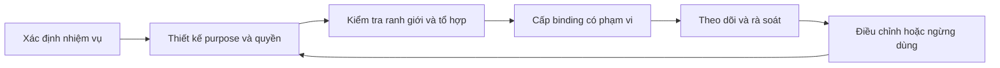

# Role purpose — Xác định mục đích của một vai trò

## 1. Một role cần trả lời “được giao trách nhiệm gì?”

**Role purpose** là lý do nghiệp vụ khiến một tập quyền được gom thành một vai trò để cấp, thu hồi và kiểm soát cùng nhau. Một role tốt diễn đạt được trách nhiệm cần hoàn thành và ranh giới của trách nhiệm đó.

Ví dụ, “xét duyệt các đề nghị mua hàng được giao trong phạm vi cho phép” là một mục đích cụ thể. “Có nhiều quyền hơn người dùng thường” chưa phải mô tả đủ để thiết kế một role an toàn.

Trong RBAC, role là một tập permission được gán cho người dùng; role giúp quản lý quyền thông qua trách nhiệm tương đối ổn định thay vì xử lý rời rạc mọi quan hệ người–quyền. Mô hình còn có thể có kích hoạt role, kế thừa và các ràng buộc. [NIST: Role Based Access Control FAQs](https://csrc.nist.gov/projects/role-based-access-control/faqs).

Bài thuộc chương **Role Design** của module `SECURITY_APPLICATION_SECURITY_BUSINESS_LOGIC_SECURITY`. Mục đích của thiết kế role ở đây là hỗ trợ bảo vệ business invariants trước bỏ qua phê duyệt, sửa giá, thao tác sai quyền và thực hiện yêu cầu trùng.

Role không thay thế quyền trên đối tượng, state machine, transaction hoặc idempotency. Nó giúp trả lời một phần của quyết định: người này được giao loại khả năng nào, dựa trên trách nhiệm nào? Backend vẫn phải kiểm tra người đó được dùng khả năng ấy trên tài nguyên hiện tại hay không.

Một câu mô tả mục đích hữu ích thường theo dạng:

```text
Role này giúp [nhóm chủ thể đủ điều kiện]
thực hiện [trách nhiệm/kết quả nghiệp vụ]
trên [loại tài nguyên và phạm vi được cấp],
với [giới hạn và điều kiện quan trọng].
```

Ví dụ:

> PURCHASE_REVIEWER giúp người được giao trách nhiệm xét duyệt đọc và ghi quyết định trên đơn mua hàng trong scope của binding, với hạn mức áp dụng và yêu cầu độc lập với phía tạo yêu cầu.

Nếu không viết được mục đích rõ ràng, việc thêm permission vào role rất dễ trở thành quá trình gom mọi quyền đang thiếu để giải quyết từng yêu cầu hỗ trợ.

## 2. Phân biệt role với những khái niệm dễ bị trộn lẫn

| Khái niệm | Ví dụ | Câu hỏi được trả lời |
| --- | --- | --- |
| Role definition | `PURCHASE_REVIEWER` phiên bản 3 | Nhóm trách nhiệm này gồm những capability nào? |
| Permission | `procurement.purchase_order.approve` | Có thể yêu cầu thực hiện loại action nào? |
| Role binding | Gán reviewer cho An tại project P1 đến hết tháng | Ai được dùng role, trong phạm vi và thời gian nào? |
| Group | Nhóm nhân viên bộ phận mua sắm | Những danh tính nào được tập hợp để quản trị? |
| Chức danh nhân sự | Trưởng bộ phận | Người đó giữ vị trí gì trong tổ chức? |
| Quan hệ với đối tượng | Requester hoặc assigned reviewer của đơn O1 | Người đó liên quan thế nào tới tài nguyên cụ thể? |
| Trạng thái workflow | `PENDING_APPROVAL`, `APPROVED` | Đối tượng đang ở bước nghiệp vụ nào? |

### 2.1. Role không phải bản sao trực tiếp của sơ đồ tổ chức

Một trưởng bộ phận có thể cần duyệt trong hạn mức, nhưng không cần cấu hình identity provider hoặc xóa audit. Một nhân viên vận hành có thể cần phát hành đơn đã được duyệt, nhưng không cần quyền phê duyệt chính đơn đó.

Chức danh hoặc group có thể là đầu vào để gán role theo quy trình được kiểm soát. Chúng không tự xác định đầy đủ action, scope và điều kiện của quyền ứng dụng.

### 2.2. Có role chưa chắc có quan hệ phù hợp với đối tượng

Người có role reviewer ở project A chưa chắc được duyệt đơn project B. Ngay trong A, policy có thể chỉ cho reviewer được phân công duyệt một đơn, hoặc cấm người đó duyệt đơn do mình tạo.

Ngược lại, là requester của một object không tự cho phép thực hiện mọi chức năng ứng dụng. Quan hệ đối tượng và role/capability phải được kết hợp theo policy rõ ràng.

### 2.3. Role không phải trạng thái của một lần xử lý

Không đổi role của người dùng thành `APPROVED` khi họ duyệt một đơn. Trạng thái đó thuộc đối tượng hoặc quyết định, không mô tả trách nhiệm ổn định của chủ thể.

Tương tự, tên `reviewer` không chứng minh người dùng đã hoàn thành việc xem xét nội dung. Bằng chứng quyết định và version nội dung phải nằm trong dữ liệu nghiệp vụ.

## 3. Đi từ quy trình công việc đến role

### 3.1. Liệt kê nhiệm vụ và tác dụng trước

Ví dụ quy trình đơn mua hàng có các hoạt động:

1. Tạo và sửa đề nghị ở trạng thái nháp.
2. Gửi đề nghị vào vòng xét duyệt.
3. Đọc nội dung được xét và ghi quyết định chấp thuận/từ chối.
4. Phát hành đơn đã được duyệt cho bên cung cấp theo quy trình.
5. Kiểm tra lịch sử và điều tra sai lệch.
6. Quản lý việc phân công quyền trong phạm vi được giao.

Mỗi hoạt động có tác dụng và trách nhiệm khác nhau. Không nên bắt đầu bằng ba cấp `USER`, `MANAGER`, `ADMIN` rồi tìm chỗ nhét mọi nhiệm vụ vào đó.

### 3.2. Một bộ role minh họa

| Role | Mục đích | Capability điển hình | Role này không tự cấp |
| --- | --- | --- | --- |
| `PURCHASE_REQUESTER` | Chuẩn bị và gửi đề nghị mua hàng | Đọc dữ liệu phù hợp, tạo, sửa nháp, submit | Approve, sửa nội dung đã duyệt, quản trị role |
| `PURCHASE_REVIEWER` | Đưa ra quyết định xét duyệt độc lập | Đọc bản cần duyệt, approve, reject | Sửa giá của bản đang duyệt, phát hành đơn, cấp role |
| `PURCHASE_ISSUER` | Phát hành đơn đã có phê duyệt hợp lệ | Đọc dữ liệu cần thiết, issue | Tự tạo phê duyệt hoặc đổi nội dung để dùng lại phê duyệt cũ |
| `PURCHASE_AUDITOR` | Đối chiếu quyết định và lịch sử | Đọc dữ liệu/audit theo phạm vi và projection được cấp | Thay đổi quyết định, xóa lịch sử, mặc nhiên export mọi dữ liệu |
| `PROJECT_ACCESS_COORDINATOR` | Điều phối binding được phép trong project | Đề nghị hoặc quản lý những role binding cụ thể | Sửa catalog role, cấp mọi đặc quyền, tự phê duyệt nghiệp vụ |

Đây là thiết kế ví dụ, không phải danh sách role bắt buộc cho mọi hệ thống. Một tổ chức nhỏ có thể kết hợp một số trách nhiệm; tổ chức khác cần tách thêm. Quyết định kết hợp phải có lý do và ràng buộc phù hợp, không dựa vào sự tiện lợi của một endpoint chung.

### 3.3. Kiểm tra từng permission có phục vụ mục đích không

Với mỗi permission định thêm, đặt câu hỏi: nếu bỏ permission này, người giữ role còn hoàn thành trách nhiệm đã mô tả không?

- Reviewer cần đọc nội dung để quyết định: quyền đọc phù hợp có lý do.
- Reviewer cần sửa giá trực tiếp để “đỡ trả lại requester”: mục đích đã bắt đầu trộn người tạo nội dung với người kiểm tra.
- Auditor cần xem audit: phù hợp.
- Auditor cần xóa audit vì đang xem màn hình audit: không suy ra được từ mục đích kiểm tra.

Nếu nhu cầu mới thuộc trách nhiệm khác, có thể cần role riêng, binding bổ sung có giới hạn hoặc một workflow riêng. Không tự mở rộng role hiện có chỉ vì người dùng đã quen giữ role đó.

## 4. Viết hợp đồng mục đích cho một role

### 4.1. Mẫu role charter

Một định nghĩa có thể được mô tả bằng cấu trúc sau:

```yaml
code: PURCHASE_REVIEWER
definitionVersion: 3
displayNameVi: Người xét duyệt mua hàng
purpose: >-
  Cho phép người được giao trách nhiệm đọc và ghi quyết định xét duyệt
  trên đơn mua hàng trong phạm vi binding và hạn mức được áp dụng.
businessOwner: procurement_control
eligibleSubjects:
  - verified_human_reviewer
permissions:
  - procurement.purchase_order.read
  - procurement.purchase_order.approve
  - procurement.purchase_order.reject
notGrantedByThisRole:
  - procurement.purchase_order.edit_draft
  - procurement.purchase_order.amend_approved
  - procurement.purchase_order.issue
  - identity.role_binding.create
supportedBindingScopes:
  - PROJECT
  - RESOURCE
supportedConstraints:
  - approval_amount_limit
  - currency
  - validity_window
mandatoryPolicies:
  - active_tenant_membership
  - resource_scope_match
  - assigned_or_eligible_reviewer
  - requester_reviewer_separation
  - current_reviewed_content
  - valid_workflow_state
reviewTriggers:
  - permission_set_changed
  - business_responsibility_changed
  - new_delegation_path
  - security_incident_or_unexpected_use
```

Đây là hợp đồng minh họa. Ghi tên một policy vào metadata không tự làm policy đó được thực thi. Registry, engine và đường xử lý phải có implementation và kiểm tra tương ứng.

`businessOwner` là bên chịu trách nhiệm giải thích vì sao role cần tồn tại và quyền nào phù hợp. Nhóm kỹ thuật duy trì code có trách nhiệm triển khai, nhưng không nên tự quyết định ý nghĩa nghiệp vụ bằng cách thêm quyền tùy nhu cầu sửa lỗi.

### 4.2. Phân biệt “role này không cấp” và “người này bị cấm”

`notGrantedByThisRole` có nghĩa những capability đó không đến từ role đang mô tả. Nó không phải một explicit deny toàn cục.

Trong mô hình role cộng dồn, một người vừa có `PURCHASE_AUDITOR` vừa có `PURCHASE_REQUESTER` có thể được sửa nháp nhờ role requester, nếu các policy khác cho phép. Việc role auditor không chứa quyền sửa không tự vô hiệu quyền từ role khác.

Nếu tổ chức yêu cầu auditor của một phạm vi không được đồng thời tạo hoặc duyệt trong phạm vi đó, phải có ràng buộc assignment/activation hoặc policy xung đột được thực thi. Không chỉ ghi “read only” trong phần mô tả rồi kỳ vọng mọi role khác tự bị trừ đi.

### 4.3. Mục đích cần chuyển được thành bằng chứng kiểm tra

Một mô tả tốt cho phép kiểm chứng:

```text
Mục đích
  -> nhiệm vụ cần hoàn thành
  -> permission được chọn
  -> scope/constraint của binding
  -> policy theo đối tượng
  -> hành vi cho phép và bị từ chối trong kiểm thử.
```

Nếu một permission không truy vết được về nhiệm vụ, hoặc một ranh giới quan trọng không có điểm thực thi/kiểm thử, role còn thiếu cơ sở để cấp rộng.

## 5. Tách role definition khỏi role binding

### 5.1. Cùng trách nhiệm có thể có nhiều phạm vi

Không cần tạo `REVIEWER_PROJECT_A_FOR_AN` và `REVIEWER_PROJECT_B_FOR_BINH` nếu hai role có cùng trách nhiệm và permission. Dùng một role definition với các binding có scope khác nhau.

Ví dụ:

```json
{
  "binding_id": "binding-reviewer-an-p1",
  "principal_id": "person-an",
  "role_code": "PURCHASE_REVIEWER",
  "definition_version": 3,
  "scope": {
    "type": "PROJECT",
    "tenant_id": "tenant-t1",
    "project_id": "project-p1"
  },
  "constraints": {
    "max_approval_amount_minor_units": 100000000,
    "currency": "VND"
  },
  "valid_from": "2026-11-22T00:00:00Z",
  "valid_until": "2026-12-01T00:00:00Z",
  "granted_by": "authorized-access-coordinator",
  "reason": "Thực hiện trách nhiệm reviewer tại project P1"
}
```

Đây là dữ liệu ví dụ, không phải đầu vào client được tự ghi để cấp role cho mình. Danh tính, quyền của người cấp, scope và giới hạn phải được server xác minh.

### 5.2. Hạn mức khác nhau chưa chắc cần role khác

Reviewer hạn mức 50 triệu và reviewer hạn mức 100 triệu có thể có cùng loại nhiệm vụ, chỉ khác constraint. Khi đó có thể dùng cùng role với hạn mức có kiểu dữ liệu và đơn vị rõ ràng ở binding/policy.

Nếu người thứ hai có thêm trách nhiệm độc lập như phê duyệt ngoại lệ hoặc thay đổi policy, đó có thể là capability/role khác. Không dùng tên `SENIOR_REVIEWER` như một lý do mặc định để cấp mọi quyền liên quan mua sắm.

### 5.3. Scope và constraint không được mất khi cộng quyền

Một người có reviewer ở P1 với hạn mức cao và requester ở P2 không được ghép quyền approve của P1 với scope P2. Hai binding reviewer ở hai project có hạn mức khác nhau cũng không cho phép lấy scope của binding này kết hợp hạn mức của binding kia.

Khi mở rộng role thành các grant hiệu lực, giữ provenance của binding, role definition version, scope, constraint và thời hạn. Chỉ flatten thành `Set<String> permissions` sẽ làm mất dữ liệu quan trọng nếu quyết định sau đó không còn biết quyền đến từ đâu.

## 6. Kết hợp role, kế thừa và phân tách trách nhiệm

### 6.1. Nhiều role có thể hợp lệ trên các đối tượng khác nhau

Một người có thể vừa là requester của đơn A, vừa là reviewer của đơn B. Điều cần cấm theo policy ví dụ là tự xét duyệt đơn mà người đó đứng phía maker, không nhất thiết cấm người đó giữ hai role trên mọi tài nguyên.

Có ba loại kiểm soát cần phân biệt:

| Cơ chế | Ví dụ | Điều cần lưu ý |
| --- | --- | --- |
| Ràng buộc cấp role | Không cho cùng chủ thể giữ một tổ hợp role nhạy cảm trong cùng phạm vi | Cần xét scope, role kế thừa và các đường cấp gián tiếp |
| Ràng buộc kích hoạt | Chỉ cho dùng một tập role phù hợp trong phiên/ngữ cảnh hiện tại | Server phải xác minh tập role được kích hoạt đã được cấp |
| Policy theo lịch sử đối tượng | Người đã tạo/sửa yêu cầu không được duyệt yêu cầu đó | Đổi role hoặc mở phiên khác không xóa lịch sử maker |

NIST phân biệt các thành phần RBAC như ràng buộc gán role và ràng buộc role được kích hoạt trong phiên. Trong hệ thống nghiệp vụ, điều kiện theo lịch sử/quan hệ đối tượng cần được mô hình hóa và thực thi phù hợp, không chỉ dựa vào tên role. [NIST: RBAC FAQs](https://csrc.nist.gov/projects/role-based-access-control/faqs).

### 6.2. Role cấp cao không đồng nghĩa được bỏ invariant

Giả sử An có cả quyền quản trị project và reviewer. Điều đó không làm An độc lập với đề nghị do chính An tạo. Một role bổ sung cũng không làm dữ liệu đã sửa sau duyệt trở thành dữ liệu từng được phê duyệt.

Những invariant bắt buộc phải được kiểm tra sau khi tìm thấy capability phù hợp, hoặc được đưa vào policy quyết định cuối. Nhánh `if (isAdmin) return true` rất dễ biến role quản trị thành lối tắt qua toàn bộ quy trình.

### 6.3. Chỉ dùng inheritance khi ý nghĩa thật sự bao hàm

Quan hệ “role X kế thừa role Y” nghĩa là X nhận thêm quyền từ Y theo semantics của hệ thống. Nó không nên được tạo chỉ vì chức danh X nằm cao hơn Y trong sơ đồ nhân sự.

Trưởng bộ phận mua sắm không mặc nhiên cần quyền sửa catalog role hoặc phát hành mọi đơn. Reviewer nhiều kinh nghiệm cũng chưa chắc phải có quyền sửa nội dung mà mình sẽ duyệt.

Nếu dùng hierarchy, cần làm rõ hướng kế thừa, tránh chu trình và đánh giá ảnh hưởng khi thêm quyền vào role được kế thừa. Thêm capability vào `BASE_REVIEWER` có thể làm nhiều role khác cùng tăng quyền.

Với một mô hình trách nhiệm nhỏ, danh sách permission tường minh thường dễ rà soát hơn một cây role phức tạp. Việc chọn hierarchy phải có lợi ích quản trị cụ thể, không phải mục tiêu tự thân.

## 7. Tách quản trị quyền khỏi quyền nghiệp vụ

### 7.1. Ba khả năng khác nhau

| Khả năng quản trị | Tác dụng | Rủi ro cần kiểm soát |
| --- | --- | --- |
| Sửa role definition | Thay permission mà mọi holder liên quan có thể nhận | Người sửa thêm approve/issue vào role của chính mình |
| Tạo/sửa role binding | Gán role cho chủ thể trong phạm vi cụ thể | Tự gán role cao hoặc mở scope sang tenant/project khác |
| Xét duyệt yêu cầu cấp quyền | Chấp thuận việc một chủ thể nhận role | Người đề nghị tự xét cấp quyền hoặc cấp vượt phạm vi được ủy quyền |

Một `PROJECT_ACCESS_COORDINATOR` có thể chỉ được gán một số role có sẵn trong project của họ, với hạn mức và thời hạn tối đa. Nó không phải role sửa catalog, cũng không tự có quyền approve đơn mua hàng.

### 7.2. Kiểm tra đường nâng quyền gián tiếp

Không chỉ xem role có chứa `approve` hay không. Cần xem holder có thể:

- Sửa định nghĩa một role mà họ đang giữ.
- Tự thêm mình vào group được đồng bộ thành role nhạy cảm.
- Gán role cho account/service mà họ kiểm soát.
- Đổi requester, assignment hoặc policy để tự trở thành người đủ điều kiện.
- Mở scope hoặc hạn mức của một binding hiện có.

Các đường này có thể tạo ra quyền nghiệp vụ dù role ban đầu không liệt kê trực tiếp capability đó.

Một ví dụ ở nền tảng khác là Kubernetes phân biệt các quyền có khả năng vượt bảo vệ khi sửa role hoặc bind role như `escalate` và `bind`. Bài học áp dụng cho thiết kế ứng dụng là quản lý definition và quản lý assignment đều có thể tạo đường nâng đặc quyền; không mặc định chúng là tác vụ quản trị vô hại. [Kubernetes: RBAC good practices](https://kubernetes.io/docs/concepts/security/rbac-good-practices/).

### 7.3. Role cho service account cũng cần purpose cụ thể

Ví dụ `APPROVAL_OUTBOX_PUBLISHER` có thể chỉ đọc event đã commit và cập nhật trạng thái giao trong outbox. Nó không cần sửa quyết định của con người hoặc tự tạo phê duyệt.

Bot/importer không trở thành reviewer độc lập chỉ vì có ID khác requester. Nếu nghiệp vụ cho auto-approval, cần policy riêng, điều kiện riêng và bằng chứng phù hợp. Không dùng một role `SYSTEM_ADMIN` cho mọi workload để tránh phải xác định trách nhiệm của từng service.

## 8. Biểu diễn role trong code mà vẫn giữ ý nghĩa cấp quyền

### 8.1. Role definition là dữ liệu capability, không phải quyết định cuối

Ví dụ Java sau dùng các kiểu minh họa:

```java
public record RoleDefinition(
    String code,
    int version,
    Set<Permission> permissions
) {
    public RoleDefinition {
        permissions = Set.copyOf(permissions);
    }
}

public record EffectiveGrant(
    Permission permission,
    ResourceScope scope,
    GrantConstraints constraints,
    UUID bindingId,
    String sourceRoleCode,
    int sourceRoleVersion
) {}
```

`Permission`, `ResourceScope` và `GrantConstraints` là hợp đồng kiểu dữ liệu của hệ thống ví dụ. Định nghĩa purpose, eligibility và vòng đời role còn phải được quản lý trong catalog; hai record này không tự bao quát mọi dữ kiện đó.

### 8.2. Mở rộng binding đã xác minh thành grant có provenance

```java
public List<EffectiveGrant> materialize(
        VerifiedRoleBinding binding, RoleDefinition definition) {

    if (!binding.roleCode().equals(definition.code())
            || binding.definitionVersion() != definition.version()) {
        throw new InvalidRoleBindingException();
    }

    return definition.permissions().stream()
        .map(permission -> new EffectiveGrant(
            permission,
            binding.scope(),
            binding.effectiveConstraints(),
            binding.id(),
            definition.code(),
            definition.version()))
        .toList();
}
```

`VerifiedRoleBinding` ở đây biểu diễn binding đã qua kiểm tra nguồn cấp, chủ thể, tenant, hiệu lực, điều kiện eligibility và role version được phép sử dụng. Nó không được dựng từ role name hoặc JSON mà client tự khai. Metadata thời hạn phải được kiểm tra khi tạo ngữ cảnh hiệu lực và xử lý theo yêu cầu về độ mới ở điểm sử dụng.

Khung này giữ cùng scope/constraint và nguồn binding cho từng permission. Nó chưa thực hiện toàn bộ authorization, chưa xử lý hierarchy và không phải chương trình hoàn chỉnh có thể chép chạy ngay.

Nếu một constraint chỉ áp dụng cho một nhóm action, mô hình constraint cần có ngữ nghĩa có kiểu và được evaluator hiểu đúng. Không diễn giải một map khóa–giá trị tùy ý theo cách khác nhau giữa các service.

### 8.3. Đường nghiệp vụ yêu cầu capability và kiểm tra object

```java
public ApprovalReceipt approve(ApproveCommand cmd, TrustedActor actor) {
    return transactions.execute(tx -> {
        PurchaseOrder order = orders.lockByTenant(
            actor.tenantId(), cmd.orderId());

        authorization.require(
            actor, Permission.PURCHASE_ORDER_APPROVE, order);

        approvalRules.requireIndependentAndCurrent(actor, order, cmd);
        return approvals.applyWithAuditAndIdempotency(actor, order, cmd);
    });
}
```

Trong khung này, `authorization.require` tìm grant phù hợp từ các binding có hiệu lực và kiểm tra scope/constraint trên đúng đơn. Nó không chỉ tìm chuỗi `PURCHASE_REVIEWER` rồi cho phép mọi tài nguyên.

Đường lưu còn phải bảo vệ state/version, kết quả idempotency và audit trong cùng transaction theo thiết kế. Nếu code chỉ gọi một annotation role ở controller, các đường job hoặc service khác có thể bỏ qua invariant.

## 9. Role purpose và các ranh giới thực thi quan trọng

### 9.1. State machine và nội dung được duyệt

Role issuer phục vụ phát hành đơn đã được duyệt. Vì vậy capability `issue` phải đi cùng kiểm tra rằng phê duyệt thuộc đúng đơn, vòng và content version, không chỉ kiểm tra trong lịch sử từng có một decision `APPROVE`.

Role reviewer không được cho phép nhảy từ nháp sang kết quả cuối nếu policy yêu cầu submit trước. Trạng thái nằm ở dữ liệu nghiệp vụ và phải được kiểm tra tại lần ghi.

### 9.2. Concurrency và việc thu hồi binding

Một role hợp lệ lúc mở màn hình có thể không còn hiệu lực lúc nhấn nút. Backend phải xác định policy về thời điểm và độ mới của quyền: kiểm tra nguồn quyền hiện tại, dùng snapshot có thời hạn hay yêu cầu thu hồi có hiệu lực nguyên tử.

Khóa hàng đơn không tự khóa directory hoặc mọi bảng role binding. Nếu cần đồng bộ thu hồi quyền với hành động, cần giao thức chung trên dữ liệu quyền/version hoặc cơ chế tương đương. Nếu chấp nhận độ trễ, phải biết cửa sổ đó là bao nhiêu và action nào được phép dùng nó.

Không lưu một role label trong session rất lâu rồi coi đó là nguồn chân lý cho mọi lần thực thi. Role đã retired, binding hết hạn hoặc membership bị thu hồi cần được đường kiểm tra xử lý theo chính sách đã chọn.

### 9.3. Retry và tác vụ nền

Role trả lời loại trách nhiệm, không bảo đảm “chỉ làm một lần”. Người có role issuer retry sau khi mất response không được phát hành thêm đơn hoặc gửi thêm tác dụng nghiệp vụ ngoài hợp đồng.

Dùng idempotency, unique constraint và cập nhật có điều kiện phù hợp. Mã role `ISSUER_ONCE` không thay thế các cơ chế đó.

Với job chạy sau khi người dùng gửi yêu cầu, xác định rõ job dùng role service hay quyền được ủy nhiệm từ người dùng. Kiểm tra lúc enqueue không mặc nhiên đủ cho lúc thực thi sau đó. Quy trình phải giữ principal gốc, mục đích và phạm vi ủy quyền cần thiết, không dùng quyền service rộng để làm mọi việc client đề nghị.

## 10. Vòng đời role và kiểm soát thay đổi

### 10.1. Một role cần có người chịu trách nhiệm và điều kiện kết thúc

Vòng đời điển hình:



Trigger rà soát có thể là đổi nhiệm vụ, chuyển project, hết hợp đồng/thời hạn, thêm permission, mở scope, thay hierarchy hoặc một sự cố cho thấy role đang bị dùng ngoài mục đích.

OWASP khuyến nghị cấp quyền tối thiểu cần cho công việc và rà soát quyền để tránh privilege creep, tức quyền tích lũy dần vượt nhu cầu hiện tại. [OWASP Authorization Cheat Sheet](https://cheatsheetseries.owasp.org/cheatsheets/Authorization_Cheat_Sheet.html).

### 10.2. Thêm permission vào role là thay đổi quyền thực tế

Giả sử `PURCHASE_REVIEWER` phiên bản hiện tại chỉ có read/approve/reject. Thêm `amend_approved` có thể trao cho toàn bộ holder khả năng thay nội dung sau duyệt, trái purpose đã được cấp trước đây.

Trước khi thay, cần biết những binding nào bị ảnh hưởng, có những tổ hợp role nào và ai có quyền sửa definition. Không đánh giá thay đổi chỉ bằng việc code mới vẫn biên dịch hoặc tên role không đổi.

Có hai mô hình thường gặp:

- Binding theo role definition hiện hành: sửa definition tác động tới holder đang dùng role; phải quản lý phạm vi ảnh hưởng và cache/token.
- Binding trỏ một version cụ thể: có thể kiểm soát migration theo version, nhưng phải quản lý version cũ, trạng thái retired và việc thu hồi chính sách. Không để version cũ tồn tại vô hạn như lối né quy định mới.

Chọn và ghi rõ mô hình. Trường `definition_version` trong ví dụ biểu diễn cách thứ hai; đặt version vào JSON mà evaluator không kiểm tra thì không tạo ra bảo đảm nào.

### 10.3. Đổi tên không phải đổi purpose

Sửa label hoặc tên hiển thị không cần tự động thay quyền. Ngược lại, giữ nguyên code nhưng đổi purpose từ “review độc lập” sang “quản lý toàn bộ mua sắm” là thay đổi lớn dù không có migration tên.

Không tái sử dụng code role đã bỏ cho trách nhiệm khác. Audit, token hoặc hệ thống tích hợp còn tham chiếu mã cũ có thể diễn giải sai quyền.

### 10.4. Thiết kế lại role cũ từ bằng chứng có kiểm soát

Khi phân tích role hiện tại, dữ liệu quyền đang dùng giúp tìm nhiệm vụ thường gặp nhưng không chứng minh mọi quyền hiện có đều cần thiết. Sao chép toàn bộ quyền tích lũy của một nhân viên lâu năm thành role chuẩn có thể hợp thức hóa privilege creep.

Kết hợp yêu cầu công việc với quan sát sử dụng, lý do cấp và trường hợp hiếm nhưng hợp lệ. Không thấy một quyền được dùng trong thời gian ngắn cũng chưa đủ kết luận quyền đó không phục vụ trách nhiệm.

Với role `ADMIN` cũ mơ hồ, tách trách nhiệm, xác định entitlement có bằng chứng và migration theo phạm vi. Không chuyển mọi holder sang toàn bộ role mới chỉ để tránh phát sinh thiếu quyền.

## 11. Kiểm chứng một role có đúng mục đích không

### 11.1. Ma trận tác vụ và ranh giới

| Tình huống | Kết quả mong đợi trong thiết kế ví dụ |
| --- | --- |
| Requester tạo/sửa nháp trong phạm vi được cấp | Được phép khi các điều kiện đối tượng đạt |
| Requester gọi approve mà không có capability | Bị từ chối |
| Người có cả requester và reviewer tự duyệt đơn mình | Bị policy độc lập theo đối tượng từ chối |
| Reviewer đủ điều kiện duyệt đơn được giao | Được phép với nội dung/version/hạn mức phù hợp |
| Reviewer sửa giá trực tiếp trong bản đang duyệt | Không được cho phép chỉ từ role reviewer |
| Reviewer project P1 tác động đơn P2 | Không được mở scope chỉ vì cùng role code |
| Issuer phát hành đơn chưa được duyệt | Bị chặn bởi workflow/invariant |
| Issuer dùng phê duyệt cho content version khác | Bị chặn |
| Auditor chỉ có role kiểm tra muốn đổi quyết định | Không có capability cho phép |
| Người có auditor và requester sửa nháp hợp lệ | Đánh giá theo tổng quyền và policy thật, không suy ra deny từ mô tả auditor |
| Access coordinator tự gán role ngoài danh sách được cấp | Bị chặn bởi policy quản trị quyền |
| Người sửa role definition thêm quyền vào role mình giữ | Có kiểm soát ngăn nâng đặc quyền ngoài thẩm quyền |
| Binding hết hạn, bị thu hồi hoặc role retired | Hành vi đúng cam kết về độ mới và trạng thái vòng đời |
| Service phát event cố ghi quyết định người dùng | Bị chặn vì khác purpose/capability |
| Thêm permission mới vào catalog | Role nghiệp vụ không tự nhận do wildcard hoặc toàn bộ enum |
| Retry action đã commit | Không tạo tác dụng nghiệp vụ mới |
| Token/client tự khai active role chưa được cấp | Không được coi là role có hiệu lực |
| Job thực thi sau khi quyền nguồn thay đổi | Xử lý đúng mô hình service/ủy nhiệm và policy thực thi đã chọn |

Với tổ hợp role, kiểm tra quyền hiệu lực cùng scope và constraint, không chỉ kiểm tra từng role riêng lẻ. Nếu có hierarchy, xem cả quyền được kế thừa.

### 11.2. Bằng chứng cần quan sát

Audit của hành động nhạy cảm nên giúp truy vết principal, role definition/version và binding đã đóng góp quyền, permission được yêu cầu, tài nguyên/scope, policy version, kết quả và lý do.

Quyết định nghiệp vụ và audit thành công phải nhất quán với transaction đã commit. Attempt bị từ chối cần đường ghi phù hợp để không mất dấu khi transaction rollback. Không ghi nguyên access token hoặc bí mật chỉ để nhớ role của chủ thể.

Với action bị từ chối, kiểm tra state, decision, outbox và tác dụng phụ không thay đổi trái phép. Với concurrency hoặc lỗi giữa chừng, dùng transaction/kết nối thật trong kiểm thử tích hợp của hệ thống triển khai, không chỉ mock `hasRole()`.

Các cấu trúc và khung Java trong bài là minh họa thiết kế, chưa được chạy như một ứng dụng hoàn chỉnh.

## 12. Bài tập thiết kế role theo mục đích

Một hệ thống hiện có `USER`, `MANAGER`, `ADMIN`. `MANAGER` vừa sửa đề nghị, duyệt đề nghị, đổi người được phân công, xuất dữ liệu và cấp quyền cho nhân viên. Một số người còn giữ quyền từ project đã rời đi.

Hãy thiết kế lại:

1. Liệt kê các trách nhiệm nghiệp vụ thật sự và viết một câu purpose cho từng role đề xuất.
2. Chọn capability tối thiểu cho từng role, ghi rõ capability nào không đến từ role đó.
3. Tách scope, hạn mức và thời hạn vào binding hoặc policy, tránh tạo role riêng cho từng người/project nếu purpose không đổi.
4. Xác định tổ hợp nào được phép, tổ hợp nào bị hạn chế và trường hợp nào phải kiểm tra lịch sử requester–reviewer trên từng đối tượng.
5. Tách quyền sửa role definition, cấp binding và quyền thực thi mua sắm; chỉ ra các đường tự nâng đặc quyền cần ngăn.
6. Chọn semantics thay đổi definition/version và cách xử lý token, cache, binding cũ.
7. Lập kế hoạch migration từ role cũ dựa trên entitlement có bằng chứng, không tự cấp mọi role mới cho holder cũ.
8. Đưa ra các trường hợp kiểm thử chứng minh mỗi role hoàn thành được purpose mà không vượt ranh giới.

Một role có purpose rõ giúp việc cấp quyền có lý do, việc thu hồi có tiêu chí và việc rà soát có bằng chứng. Thiết kế chỉ bảo vệ được nghiệp vụ khi tập capability, binding có phạm vi và các policy theo đối tượng cùng giữ đúng trách nhiệm đã định nghĩa, kể cả khi người dùng có nhiều role hoặc hệ thống thay đổi theo thời gian.
