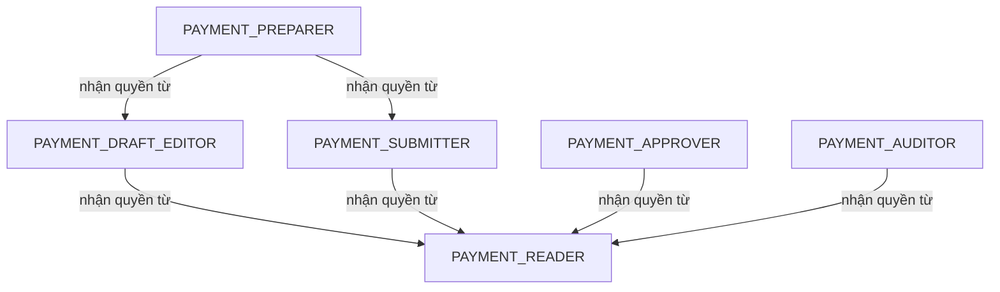

# Role hierarchy — Thiết kế phân cấp vai trò an toàn

## 1. Phân cấp vai trò là mô hình năng lực, không phải sơ đồ chức danh

Một hệ thống có thể có nhiều vai trò cần chung một phần quyền. Người lập lệnh chi và người duyệt lệnh chi đều cần đọc hồ sơ, nhưng trách nhiệm tạo và trách nhiệm phê duyệt phải được kiểm soát độc lập. Phân cấp vai trò giúp tái sử dụng phần quyền chung mà không phải lặp lại toàn bộ cấu hình.

**Role hierarchy** là quan hệ khai báo một vai trò được nhận các quyền của vai trò khác theo ngữ nghĩa được hệ thống xác định.

Nó không mặc nhiên là sơ đồ tổ chức. Một trưởng phòng không nhất thiết cần quyền sửa mọi giao dịch của nhân viên. Người quản trị tài khoản cũng không tự cần quyền duyệt hoặc thực hiện thanh toán.

Trong bảo vệ logic nghiệp vụ, một hierarchy tốt phải giúp trả lời:

- Vai trò này có những năng lực nào, kể cả quyền nhận gián tiếp?
- Năng lực đó được cấp trong phạm vi đối tượng nào?
- Có làm một chủ thể kiểm soát nhiều bước xung đột trong cùng quy trình không?
- Thay một cạnh kế thừa sẽ mở hoặc thu hồi quyền của những ai?
- Điều gì ngăn người được sửa hierarchy dùng nó để tự nâng quyền?

Nếu chỉ sắp role thành các mức `USER < MANAGER < ADMIN`, hệ thống dễ biến một mô hình thuận tiện thành đường bỏ qua quyền theo đối tượng, bước phê duyệt và các bất biến nghiệp vụ.

## 2. Ngữ nghĩa của một quan hệ phân cấp

### 2.1. Quy ước chiều

Trong bài này:

```text
ROLE_SENIOR → ROLE_BASE
```

nghĩa là `ROLE_SENIOR` nhận quyền của `ROLE_BASE`.

Ví dụ:

```text
REPORT_EXPORTER → REPORT_READER
```

Người được gán `REPORT_EXPORTER` có thể nhận quyền đọc từ `REPORT_READER` cùng quyền xuất báo cáo được khai báo riêng. Người chỉ có `REPORT_READER` không đi ngược quan hệ để nhận quyền xuất.

Từ “senior” ở đây mô tả quan hệ năng lực trong mô hình, không khẳng định người có vai trò đó có chức danh cao hơn hoặc được quản lý mọi người giữ vai trò nền.

### 2.2. Quyền hiệu lực của một vai trò

Với đồ thị vai trò không chứa điều kiện trên cạnh, có thể biểu diễn:

```text
EffectivePermissions(role) =
    DirectPermissions(role)
    hợp với quyền trực tiếp của mọi role mà role đó nhận kế thừa
```

Quan hệ có tính bắc cầu: nếu A nhận từ B và B nhận từ C thì A có thể nhận quyền của C. Một vai trò luôn có quyền trực tiếp của chính nó; không cần lưu một cạnh tự trỏ để thể hiện điều đó.

Quan hệ phân cấp được thiết kế như một thứ tự bộ phận: không phải mọi cặp vai trò đều phải so sánh được. Vai trò lập lệnh và vai trò kiểm toán có thể cùng nhận quyền đọc nhưng không vai trò nào cần bao trùm vai trò kia.

Hai vai trò tình cờ có cùng tập permission không tự trở thành cùng một vai trò hoặc tự tạo quan hệ hai chiều. Chúng có thể khác mục đích quản trị, người sở hữu hoặc quy trình cấp quyền.

### 2.3. Hierarchy có thể là DAG

Một vai trò có thể nhận quyền từ nhiều vai trò nền. Do đó mô hình phù hợp thường là đồ thị có hướng không chu trình, không nhất thiết là một cây chỉ có một cha cho mỗi nút.



Ở nhánh hình thoi, `PAYMENT_PREPARER` tới `PAYMENT_READER` qua hai đường. Điều này không tạo hai lần quyền đọc, hai hạn mức hoặc hai người độc lập.

## 3. Tách bốn mô hình dễ bị trộn lẫn

| Mô hình | Điều nó biểu diễn | Điều không tự suy ra |
| --- | --- | --- |
| Cấu trúc tổ chức | Đơn vị, người quản lý, quan hệ báo cáo | Quản lý tổ chức được dùng mọi quyền vận hành của cấp dưới |
| Phân cấp vai trò | Vai trò nào nhận năng lực từ vai trò nào | Vai trò bao trùm được bỏ qua điều kiện nghiệp vụ |
| Cây tài nguyên hoặc phạm vi | Đối tượng thuộc tenant, đơn vị hoặc vùng dữ liệu nào | Có quyền ở một vùng đồng nghĩa có quyền ở vùng khác |
| Quản trị cấp quyền | Ai được gán role, sửa role hoặc sửa hierarchy | Người cấp role được tự dùng quyền nghiệp vụ của role đó |

Một người quản trị quyền có thể được phép cấp `PAYMENT_APPROVER` cho người khác theo quy trình, nhưng không được tự duyệt lệnh chi. Đây là lý do không nên bắt mọi quyền quản trị phải nằm ở một role “cao nhất” nhận toàn bộ quyền vận hành.

Tương tự, quản lý đơn vị A có thể cần quyền tổng hợp báo cáo của A mà không cần quyền chỉnh sửa từng giao dịch. Cần thiết kế theo nhiệm vụ thực tế, không sao chép nguyên sơ đồ tổ chức thành cạnh kế thừa.

## 4. Bắt đầu từ hành động nghiệp vụ

Trước khi tạo role, hãy liệt kê những hành động có ý nghĩa trong state machine.

Với lệnh chi:

```text
DRAFT → PENDING_APPROVAL → APPROVED → EXECUTING → PAID
```

Những permission có thể gồm:

| Permission | Ý định nghiệp vụ |
| --- | --- |
| `PAYMENT_READ_SUMMARY` | Đọc thông tin tóm tắt trong phạm vi được phép |
| `PAYMENT_CREATE_DRAFT` | Tạo bản nháp |
| `PAYMENT_EDIT_DRAFT` | Chỉnh nội dung được phép sửa của bản nháp |
| `PAYMENT_SUBMIT` | Gửi đúng phiên bản nội dung để duyệt |
| `PAYMENT_APPROVE` | Ra quyết định chấp nhận theo điều kiện phê duyệt |
| `PAYMENT_REJECT` | Ra quyết định từ chối |
| `PAYMENT_REQUEST_EXECUTION` | Yêu cầu nhận thực thi một lệnh đã đủ điều kiện |
| `PAYMENT_EXECUTE_ACCEPTED_COMMAND` | Dịch vụ xử lý đúng command đã được nhận hợp lệ |
| `PAYMENT_AUDIT_READ` | Đọc bằng chứng kiểm tra trong phạm vi |
| `PAYMENT_RECORD_FINDING` | Ghi phát hiện kiểm tra |
| `ROLE_ASSIGN`, `ROLE_REVOKE`, `ROLE_HIERARCHY_CHANGE` | Những hành động quản trị quyền riêng biệt |

Không dùng một permission `PAYMENT_UPDATE` cho cả sửa số tiền, phê duyệt, bỏ khóa, đổi người nhận và đánh dấu đã thanh toán. Các hành động đó có điều kiện, thẩm quyền và tác động khác nhau.

Hierarchy chỉ có thể tái sử dụng một mô hình permission đã có nghĩa rõ ràng. Nếu permission nền quá rộng, thêm nhiều tầng role không làm nó an toàn hơn.

## 5. Xây vai trò theo trách nhiệm có thể giải thích

Một bộ vai trò minh họa:

| Vai trò | Quyền trực tiếp đáng chú ý | Nhận quyền từ |
| --- | --- | --- |
| `PAYMENT_READER` | Đọc tóm tắt | Không |
| `PAYMENT_DRAFT_EDITOR` | Tạo và sửa bản nháp | `PAYMENT_READER` |
| `PAYMENT_SUBMITTER` | Gửi duyệt | `PAYMENT_READER` |
| `PAYMENT_PREPARER` | Không nhất thiết có quyền trực tiếp bổ sung | Draft editor và submitter |
| `PAYMENT_APPROVER` | Duyệt và từ chối | `PAYMENT_READER` |
| `PAYMENT_RELEASER` | Yêu cầu thực thi | `PAYMENT_READER` |
| `PAYMENT_AUDITOR` | Đọc bằng chứng, ghi phát hiện | `PAYMENT_READER` |
| `PAYMENT_EXECUTION_WORKER` | Xử lý command đã nhận | Không mặc định nhận role của con người |
| `ROLE_ADMINISTRATOR` | Những hành động quản trị quyền được giới hạn | Không mặc định nhận quyền thanh toán |

Việc tách draft editor và submitter chỉ hữu ích nếu chúng có nhu cầu phân công hoặc tái sử dụng thực tế. Không tạo thêm role chỉ để đồ thị trông cân đối.

Vai trò nên có người sở hữu, mô tả nhiệm vụ, phạm vi sử dụng dự kiến và quy trình cấp hoặc thu hồi. Một tên như `POWER_USER` hoặc `SUPER_FINANCE` không đủ để người rà soát hiểu mức rủi ro.

### 5.1. Vai trò nền nên ổn định và hẹp

Nếu nhiều vai trò cần đọc tóm tắt, dùng một role đọc làm nền có thể hợp lý. Không đưa quyền phê duyệt hoặc thay đổi người nhận vào role đọc chỉ để giảm số cấu hình lặp.

Quyền được đặt càng thấp trong hierarchy càng có nhiều khả năng lan tới các vai trò nhận kế thừa. Vì vậy thay đổi role nền cần được coi là thay đổi quyền của toàn bộ tập người chịu ảnh hưởng.

### 5.2. Không cần một role bao trùm mọi nhánh

Một hierarchy có nhiều đỉnh độc lập là bình thường. Không phải lúc nào cũng cần `SUPER_ADMIN` nằm trên vận hành, kiểm toán, quản trị quyền và quản lý khóa.

Nếu có quyền khẩn cấp, nên quản lý như một cơ chế đặc biệt với phạm vi, thời hạn, bằng chứng sử dụng và kiểm tra độc lập phù hợp. Không biến nó thành role mặc định để mọi tính năng đều có một đường bỏ qua kiểm tra.

## 6. Scope thuộc assignment, không được đánh rơi khi kế thừa

Một assignment thường cần nhiều hơn `user_id` và `role_id`:

```text
RoleAssignment = {
    canonical_subject_id,
    role_id,
    tenant_id,
    scope,
    not_before,
    not_after,
    assignment_conditions,
    granted_by,
    grant_reference
}
```

Người có `PAYMENT_APPROVER` ở đơn vị A nhận quyền đọc và duyệt theo phạm vi A. Vai trò nền `PAYMENT_READER` không làm quyền đọc trở thành toàn tenant nếu assignment không cho phép.

Nếu người đó có thêm một assignment ở B với hạn mức khác, hai nguồn cần giữ nguyên gói điều kiện riêng. Không lấy phạm vi A từ một nguồn rồi ghép với hạn mức cao của nguồn B.

### 6.1. Tránh role explosion

Nếu mỗi đơn vị, hạn mức, ca làm và khoảng ngày đều tạo một role riêng, số role sẽ tăng nhanh:

```text
APPROVER_A_10M_MORNING
APPROVER_A_20M_MORNING
APPROVER_B_10M_TEMPORARY
...
```

Một cách thiết kế rõ hơn là giữ role theo năng lực nghiệp vụ, còn đơn vị, hạn mức hoặc thời hạn là thuộc tính assignment và policy ngữ cảnh. Cần giới hạn những thuộc tính có thể cấu hình và nguồn được phép cấp chúng.

Không đi sang cực ngược lại bằng một role `EMPLOYEE` với hàng trăm ngoại lệ ẩn. Role vẫn cần mô tả được trách nhiệm có ý nghĩa.

### 6.2. Scope chồng lấn phải được hiểu đúng

Hai assignment không chỉ xung đột khi chuỗi `scope_id` bằng nhau. Quyền trên toàn đơn vị A có thể bao phủ một nhóm con A1. Kiểm tra phân tách cần xét phạm vi giao nhau theo mô hình tài nguyên, không chỉ so sánh hai ID.

## 7. Phân tách nhiệm vụ phải được kiểm tra trên quyền hiệu lực

### 7.1. Không giấu quyền xung đột trong một role tổng hợp

Giả sử có:

```text
PAYMENT_MANAGER → PAYMENT_PREPARER
PAYMENT_MANAGER → PAYMENT_APPROVER
```

Nếu chính sách cấm một chủ thể giữ năng lực lập và duyệt trong cùng phạm vi, việc chỉ gán một role `PAYMENT_MANAGER` không làm hết xung đột.

Phải kiểm tra quyền hoặc nhóm nhiệm vụ hiệu lực sau khi mở rộng hierarchy. Kiểm tra tên role gán trực tiếp sẽ bỏ sót trường hợp này.

Các nhóm nhiệm vụ như maker, checker và auditor cần được định nghĩa từ những hành động có nghĩa rõ ràng. Không để một role mới vượt kiểm tra chỉ vì người tạo quên gắn một nhãn mô tả tùy ý.

### 7.2. Phân tách tĩnh và động

| Cách kiểm soát | Đánh giá điều gì? | Ví dụ |
| --- | --- | --- |
| Phân tách tĩnh | Tổ hợp năng lực không được cùng cấp trong phạm vi | Không cấp đồng thời maker và checker ở cùng đơn vị |
| Phân tách động | Chủ thể có được làm hành động trên đối tượng cụ thể không? | Người tạo lệnh không được duyệt chính lệnh đó |
| Giới hạn kích hoạt phiên | Những role nào được dùng trong một phiên theo chính sách | Chỉ kích hoạt một trong hai năng lực xung đột |

Giới hạn phiên không tạo thêm một con người độc lập. Dùng hai phiên hoặc hai tài khoản của cùng chủ thể không được vượt quy tắc không tự phê duyệt.

Một chính sách phân tách tĩnh có thể đánh giá bảo thủ trên các năng lực có thể nhận từ hierarchy, thay vì dựa vào một deny tạm thời để chấp nhận cấu trúc xung đột. Cần nêu rõ chính sách đó để người quản trị hiểu vì sao một thay đổi bị chặn.

### 7.3. Role cao không bỏ qua state machine

Có quyền `PAYMENT_APPROVE` vẫn phải kiểm tra hồ sơ đang chờ duyệt, đúng vòng, đúng nội dung, còn thời hạn và không có xung đột chủ thể.

Có quyền yêu cầu thực thi vẫn phải bảo đảm phê duyệt còn dùng được và cùng payment intent không tạo hai lần chi. Hierarchy quyết định nguồn năng lực; transaction, idempotency và bất biến nghiệp vụ bảo vệ việc sử dụng năng lực đó.

## 8. Quyền dùng role khác với quyền quản lý role

Không suy ra các điều sau nếu chưa có rule quản trị riêng:

- Có role A thì được gán A cho người khác.
- Nhận quyền từ role B thì được sửa B.
- Được gán các role cơ bản thì được gán mọi role nhận kế thừa từ chúng.
- Được sửa một role cục bộ thì được nối nó với bất kỳ role quản trị nào.

Quản trị quyền cần một phạm vi cho phép riêng, chẳng hạn:

```text
Được gán những role nào?
Cho chủ thể nào?
Trong đơn vị nào?
Với hạn mức và thời hạn tối đa nào?
Có được tự gán không?
Thay đổi nào cần người phê duyệt độc lập?
```

Người cấp quyền không nhất thiết phải có quyền sử dụng mọi năng lực được cấp. Điều quan trọng là họ có quyền quản trị trong một phạm vi được kiểm soát, không phải lấy toàn bộ quyền sử dụng của mình làm khuôn duy nhất cho việc cấp quyền.

### 8.1. Sửa hierarchy là một đường cấp quyền

Một người không được gán `ROLE_ADMINISTRATOR` nhưng có thể sửa role đang giữ để nhận quyền từ nó vẫn có thể tự nâng quyền.

Cần bảo vệ cả tập role được phép sửa, tập role được phép tham chiếu và mức mở rộng quyền hiệu lực. Kiểm tra tên role ở một đầu cạnh là chưa đủ.

Với role template dùng chung nhiều tenant, quyền sửa template phải được tách khỏi quyền quản trị role cục bộ. Một quản trị viên của tenant A không được dùng thay đổi template để ảnh hưởng tenant B.

## 9. Đồ thị hợp lệ cần những ràng buộc nào?

### 9.1. Không có chu trình

```text
ROLE_A → ROLE_B → ROLE_C → ROLE_A
```

Mô hình trong bài từ chối chu trình và cạnh tự trỏ. Chu trình làm mất ý nghĩa phân cấp, gây khó truy nguyên và có thể làm thuật toán mở rộng quyền lặp vô hạn hoặc trả kết quả không đầy đủ.

Ngay cả khi có thể định nghĩa phép hợp tập quyền cho một đồ thị có chu trình, đó không phải lý do để âm thầm chấp nhận một cấu hình trái mô hình quản trị đã công bố.

### 9.2. Cạnh phải ở đúng catalog và đúng loại nút

Một cạnh role không được trỏ sang một nhóm, tài nguyên hoặc role ở tenant khác chỉ vì ID có cùng định dạng.

Cơ sở dữ liệu nên có ràng buộc tham chiếu và duy nhất phù hợp, chẳng hạn không lưu trùng cùng cạnh trong một catalog. Kiểm tra ứng dụng và ràng buộc dữ liệu cần cùng diễn đạt một mô hình.

### 9.3. Đồ thị phải có giới hạn vận hành

Giới hạn số role, cạnh hoặc độ sâu có thể giúp kiểm soát thời gian phân giải và khả năng rà soát. Nếu vượt giới hạn hoặc dữ liệu lỗi, không trả quyền từ một phần đồ thị đã duyệt như một kết quả đầy đủ.

Với catalog thuần về tập permission, có thể kiểm tra và biên dịch đồ thị theo revision trước khi dùng. Đường nhận hành động vẫn phải biết snapshot đang dùng có hiệu lực theo hợp đồng thu hồi hay không.

### 9.4. Cạnh dư thừa và đường thay thế

Nếu A nhận B, B nhận C và A cũng nhận C trực tiếp, cạnh A → C có thể không thêm permission mới nhưng vẫn là một đường quản trị tồn tại.

Gỡ cạnh trực tiếp A → C không làm mất quyền C nếu còn đường qua B. Công cụ phân tích thay đổi cần phân biệt thay đổi cấu trúc với thay đổi quyền hiệu lực.

## 10. Tính tập permission của một role: ví dụ Java

Đoạn mã sau chỉ dành cho catalog mà các cạnh role không mang scope, thời hạn hoặc điều kiện theo đường. Scope và điều kiện assignment được áp dụng riêng khi cấp quyền trên đối tượng.

```java
public Set<Permission> permissionsForOneRole(
        RoleId assignedRole,
        CompiledRoleGraph graph) {

    graph.requireValidAndComplete();
    graph.requireContainsActiveRole(assignedRole);

    Set<RoleId> visited = new HashSet<>();
    Set<Permission> permissions = new HashSet<>();
    Deque<RoleId> pending = new ArrayDeque<>();
    pending.push(assignedRole);

    while (!pending.isEmpty()) {
        RoleId role = pending.pop();
        if (!visited.add(role)) {
            continue;
        }

        permissions.addAll(graph.directPermissions(role));
        for (RoleId inherited : graph.inheritedRoles(role)) {
            pending.push(inherited);
        }
    }

    return Set.copyOf(permissions);
}
```

Các kiểu dữ liệu và import cần được triển khai trong ứng dụng cụ thể. `requireValidAndComplete()` giả định kiểm tra được catalog đúng phạm vi, không chu trình và không có tham chiếu lỗi; tập `visited` không thay thế việc xác nhận dữ liệu hợp lệ.

Trong mô hình thuần này, đi tới cùng role qua hai đường cho cùng permission và không tạo thêm điều kiện theo đường, nên có thể khử trùng theo role ID.

Nếu cạnh hoặc đường mang giới hạn khác nhau, thuật toán chỉ đánh dấu role đã thăm có thể làm mất ngữ nghĩa. Khi đó cần bộ phân giải giữ các gói điều kiện và nguồn quyền, không tái sử dụng hàm này như một bộ cấp quyền hoàn chỉnh.

Kết quả của hàm cũng không phải câu trả lời cuối cho “người này được duyệt lệnh này không”. Vẫn phải kiểm tra assignment còn hiệu lực, tenant, scope, đối tượng, điều kiện ngữ cảnh và bất biến của action.

## 11. Phân tích tác động trước khi sửa hierarchy

Giả sử thêm cạnh:

```text
ROLE_X → PAYMENT_APPROVER
```

Tập chịu ảnh hưởng không chỉ gồm người được gán `ROLE_X`. Mọi role nhận kế thừa từ `ROLE_X`, cùng những người nhận các role đó qua assignment hoặc nhóm, đều có thể được thêm quyền phê duyệt.

Một bản phân tích nên chỉ ra:

- Quyền hiệu lực nào được thêm hoặc gỡ trên từng role chịu ảnh hưởng.
- Những nhóm nhiệm vụ xung đột nào mới xuất hiện.
- Assignment và phạm vi chủ thể nào chịu tác động.
- Có quyền nhạy cảm hoặc quyền quản trị được đưa vào role thường không.
- Các role bảo vệ hoặc ranh giới catalog có bị vượt không.
- Cache, token hoặc bản tổng hợp nào có thể còn quyền cũ.

Nếu thay đổi cần phê duyệt, bằng chứng phê duyệt phải gắn với nội dung thay đổi và revision nền. Không dùng một quyết định duyệt thay đổi cũ cho một bản đồ thị mới đã khác.

### 11.1. Refactor role có thể vô tình cấp thêm quyền

Ví dụ trước thay đổi:

```text
PAYMENT_READER: READ
PAYMENT_APPROVER: APPROVE, nhận READ từ PAYMENT_READER
```

Nếu chuyển `APPROVE` xuống `PAYMENT_READER` để giảm cấu hình lặp, mọi người đọc đều trở thành người có năng lực duyệt. Đây là mở quyền, dù người sửa mô tả thay đổi là “dọn cấu hình”.

Khi refactor, so sánh quyền hiệu lực trước và sau, không chỉ kiểm tra tên role hoặc số cạnh còn tương tự.

## 12. Cập nhật hierarchy trong transaction

### 12.1. Cuộc đua tạo chu trình

```text
Ban đầu chưa có cạnh giữa A và B.
T1 kiểm tra thêm A → B là hợp lệ.
T2 kiểm tra thêm B → A là hợp lệ.
T1 và T2 cùng commit.
```

Nếu hai transaction chỉ đọc đồ thị rồi ghi cạnh riêng mà không có giao thức đồng bộ, kết quả có thể chứa chu trình dù từng lần kiểm tra đều thấy an toàn.

Một thiết kế đơn giản là khóa bản ghi đầu catalog trước khi sửa graph. Mọi thay đổi graph, permission và assignment cục bộ ảnh hưởng đến các bất biến được kiểm tra phải tuân theo giao thức tương ứng.

Đây là cách đồng bộ thô, có chi phí thông lượng. Nó hữu ích để làm rõ tính đúng đắn; hệ thống lớn có thể chọn cơ chế khác nhưng vẫn phải bảo vệ cùng bất biến.

### 12.2. Ví dụ service Java

Ví dụ dưới đây quản lý một catalog cục bộ của tenant. Nó không tự cập nhật role template toàn cục và không tạo transaction chung với IAM bên ngoài.

Các repository, bộ phân tích và kiểu dữ liệu là thành phần minh họa cần triển khai. Constructor injection được lược bỏ.

```java
@Service
public class RoleHierarchyManagementService {
    private final RoleCatalogRepository catalogs;
    private final RoleGraphRepository graphs;
    private final AssignmentRepository assignments;
    private final HierarchyImpactAnalyzer impactAnalyzer;
    private final HierarchyAdministrationPolicy administration;
    private final HierarchyChangeApproval changeApprovals;
    private final IdempotencyRepository idempotency;
    private final SecurityAuditRepository audits;
    private final OutboxRepository outbox;
    private final CommandFingerprint fingerprints;

    @Transactional(rollbackFor = Exception.class)
    public HierarchyChangeReceipt addInheritance(
            VerifiedActor actor,
            AddRoleInheritanceCommand command) {

        actor.requireAuthenticated();
        command.validateSyntaxAndLimits();

        RoleCatalogHead head = catalogs.lockForUpdate(actor.tenantId());
        administration.requireHierarchyManagement(actor, head);

        CommandScope scope = new CommandScope(
                actor.tenantId(), head.catalogId(),
                actor.canonicalSubjectId(),
                "ADD_ROLE_INHERITANCE", command.idempotencyKey());
        String fingerprint = fingerprints.forHierarchyChange(command);

        var previous = idempotency.find(scope);
        if (previous.isPresent()) {
            if (!previous.get().fingerprint().equals(fingerprint)) {
                throw new IdempotencyConflictException();
            }
            return previous.get().receipt();
        }

        if (head.revision() != command.expectedRevision()) {
            throw new StaleRoleCatalogException();
        }

        RoleGraph before = graphs.loadCurrentGraph(head.catalogId());
        before.requireValidAndComplete();
        before.requireActiveRolesInCatalog(
                command.receivingRoleId(), command.inheritedRoleId());

        if (command.receivingRoleId().equals(command.inheritedRoleId())) {
            throw new SelfInheritanceNotAllowedException();
        }
        if (before.hasDirectEdge(
                command.receivingRoleId(), command.inheritedRoleId())) {
            throw new InheritanceEdgeAlreadyExistsException();
        }

        RoleGraph after = before.withInheritance(
                command.receivingRoleId(), command.inheritedRoleId());
        after.requireAcyclicAndWithinLimits();

        var assignmentSnapshot = assignments.loadUnderCatalogGuard(
                head.catalogId());
        HierarchyImpact impact = impactAnalyzer.analyze(
                before, after, assignmentSnapshot);

        administration.requireChangeWithinDelegatedAuthority(
                actor, command, impact);
        administration.requireNoForbiddenDutyCombinations(impact);
        changeApprovals.requireSatisfiedWhenNeeded(
                actor, command.approvalReference(),
                head.revision(), impact.digest());

        graphs.insertInheritance(
                head.catalogId(),
                command.receivingRoleId(), command.inheritedRoleId());

        long newRevision = Math.addExact(head.revision(), 1);
        int changed = catalogs.advanceRevision(
                head.catalogId(), head.revision(), newRevision);
        if (changed != 1) {
            throw new ConcurrentRoleCatalogChangeException();
        }

        audits.appendHierarchyChanged(
                actor, command, impact, head.revision(), newRevision);
        outbox.appendRoleCatalogChanged(
                UUID.randomUUID(), actor.tenantId(),
                head.catalogId(), newRevision);

        HierarchyChangeReceipt receipt = new HierarchyChangeReceipt(
                head.catalogId(), newRevision, impact.digest());
        idempotency.insert(scope, fingerprint, receipt);
        return receipt;
    }
}
```

Các dependency `final` phải được khởi tạo bằng constructor. Với Spring transaction qua proxy thông thường, lời gọi phải đi qua bean được quản lý để annotation có hiệu lực. Các repository liên quan phải dùng đúng transaction manager của ví dụ.

Khóa đầu catalog chỉ có ý nghĩa nếu mọi đường thay đổi dữ liệu mà bất biến phụ thuộc tuân thủ giao thức đã chọn. Một công cụ SQL quản trị hoặc một đường import bỏ khóa có thể phá bảo đảm này.

Ví dụ thực hiện phân tích tác động trong vùng được bảo vệ để giữ mô hình dễ hiểu. Nếu dữ liệu lớn, có thể chuẩn bị kế hoạch ngoài transaction rồi xác minh revision và các phụ thuộc trước commit; khi có thay đổi cạnh tranh, phải phân tích lại thay vì dùng một kế hoạch cũ.

### 12.3. Vai trò của outbox và audit

Audit, thay cạnh, tăng revision và outbox bắt buộc được ghi cùng transaction cục bộ. Nếu ghi một thành phần bắt buộc thất bại, không coi thay đổi hierarchy là đã hoàn tất.

Outbox có thể thông báo cho cache hoặc bộ biên dịch policy, nhưng event đến muộn không tự đáp ứng yêu cầu thu hồi tức thời. Đường cấp quyền phải có hợp đồng phiên bản hoặc độ trễ rõ ràng.

Lần thử bị từ chối có thể cần audit riêng vì transaction thay đổi bị rollback sẽ không giữ các bản ghi nằm trong chính transaction đó.

## 13. Thu hồi, xóa role và các đường kế thừa thay thế

### 13.1. Gỡ cạnh không đồng nghĩa mất permission

Nếu A nhận C qua cả B và D, gỡ A → B vẫn để đường A → D → C. Công cụ quản trị nên hiển thị nguồn quyền còn lại thay vì chỉ báo đã xóa một cạnh.

Tương tự, gỡ assignment trực tiếp không làm mất quyền nếu chủ thể còn nhận role qua nhóm hoặc assignment khác.

### 13.2. Xóa role cần xử lý tham chiếu

Trước khi xóa hoặc ngừng dùng một role, cần biết:

- Role nào đang nhận kế thừa từ nó.
- Những assignment, nhóm và quy trình nào đang tham chiếu nó.
- Các command đã được nhận có phụ thuộc vào bằng chứng cấp quyền cũ không.
- Lịch sử quyết định sẽ được giải thích bằng revision nào.

Không tái sử dụng ID role cũ cho một nhiệm vụ khác rồi diễn giải lại lịch sử. Có thể giữ trạng thái ngừng sử dụng hoặc lịch sử revision phù hợp thay vì xóa mất ngữ nghĩa đã dùng.

### 13.3. Role hết hiệu lực và command đã nhận

Một request mới sau thu hồi cần được đánh giá theo quyền hiện tại. Một command đã được nhận hợp lệ trước đó có thể có hợp đồng tiếp tục, hủy hoặc đánh giá lại riêng.

Không dùng token role cũ để cấp quyền mới; cũng không tự đưa một khoản thanh toán đang chưa rõ kết quả về trạng thái cho phép chi lại chỉ vì role đã bị thu hồi.

## 14. Token, cache và rollout hierarchy

### 14.1. Tập role trong token là một snapshot

Thêm hoặc gỡ cạnh không làm token đã phát hành tự thay đổi. Nếu service tự mở rộng role theo catalog mới, hành vi có thể khác service đang tin một tập permission đã được đóng gói từ trước.

Cần xác định nguồn có thẩm quyền cho role assignment, hierarchy revision và thời điểm kiểm tra. Nếu dùng bản sao quyền, giới hạn độ trễ thu hồi phải được nêu đúng với cơ chế thực tế.

### 14.2. Cache cần bao phủ phụ thuộc gián tiếp

Thay quyền của role nền có thể ảnh hưởng nhiều role phía trên. Invalidation chỉ theo người được gán trực tiếp role nền sẽ bỏ sót người nhận gián tiếp.

Có thể dùng revision của catalog, theo dõi quan hệ phụ thuộc hoặc một cơ chế khác. TTL ngắn giúp giảm thời gian cũ nhưng không phải bằng chứng thu hồi tức thời.

### 14.3. Triển khai thay đổi an toàn

Một quy trình có thể gồm:

1. Kiểm tra cấu trúc graph, quyền nhạy cảm và xung đột nhiệm vụ.
2. So sánh quyền hiệu lực trước và sau trên các assignment chịu ảnh hưởng.
3. Xác nhận phê duyệt thay đổi gắn với đúng revision và nội dung.
4. Ghi thay đổi và revision nguyên tử.
5. Cập nhật bộ biên dịch hoặc cache, theo dõi việc dùng revision cũ.
6. Kiểm tra các quyết định thực tế và chuẩn bị phương án khôi phục cấu hình.

Có thể chạy bộ đánh giá mới song song để so sánh quyết định, nhưng không thực hiện nghiệp vụ hai lần. Nếu cần khôi phục cấu hình, đó là một thay đổi quyền mới có audit; không xóa dấu vết revision đã được áp dụng.

## 15. Các lỗi thiết kế điển hình

### 15.1. Dùng số thứ tự role làm mức quyền

```java
// Mô hình nguy hiểm nếu coi mọi role nằm trên cùng một trục.
if (userRole.ordinal() >= Role.MANAGER.ordinal()) {
    approvePayment();
}
```

Vai trò kiểm toán, vận hành và quản trị quyền thường không so sánh được trên một trục cao thấp duy nhất. Thứ tự enum là chi tiết chương trình, không phải chính sách nghiệp vụ.

Hãy yêu cầu action cụ thể rồi đánh giá các role hỗ trợ, scope và điều kiện cần thiết.

### 15.2. Role quản lý tự nhận mọi quyền của cấp dưới

Một người quản lý có thể cần xem tổng hợp hoặc phân công công việc nhưng không cần trực tiếp thực hiện toàn bộ các thao tác nhạy cảm. Tự động kế thừa theo quan hệ nhân sự có thể phá phân tách nhiệm vụ.

### 15.3. Dùng một role gộp để né kiểm tra tổ hợp

Nếu hệ thống chỉ cấm gán đồng thời hai tên role, người quản trị có thể tạo role mới nhận cả hai rồi gán một lần. Chính sách cần đánh giá năng lực hiệu lực và phạm vi chịu tác động.

### 15.4. Sửa role nền để mở quyền hàng loạt

Người có quyền sửa một role phổ biến thêm permission nhạy cảm vào đó, khiến nhiều chủ thể nhận quyền gián tiếp. Cần bảo vệ quyền sửa role nền và phân tích tác động trước khi áp dụng.

### 15.5. Phụ thuộc vào tên hoặc prefix role

Quy tắc như “mọi role bắt đầu bằng `ADMIN_` được làm tất cả” tạo ra ngữ nghĩa ẩn. Nếu người dùng có thể đặt tên hoặc import role, tên trở thành một đường nâng quyền.

Role cần ID ổn định và permission được khai báo rõ; chuỗi tên chỉ nên phục vụ định danh quản trị hoặc hiển thị theo thiết kế.

### 15.6. Chỉ bảo vệ giao diện cấp quyền

Import, API quản trị, job đồng bộ IAM và script vận hành đều có thể thay role hoặc assignment. Mọi đường thay đổi phải tuân thủ cùng bất biến về catalog, chu trình, phạm vi và phân tách nhiệm vụ.

## 16. Kiểm thử hierarchy và các đường lạm dụng

### 16.1. Kiểm thử cấu trúc và quyền hiệu lực

| Tình huống | Kết quả cần chứng minh |
| --- | --- |
| Role nhận quyền từ một role nền | Có đúng quyền nền theo chiều đã khai báo |
| Chỉ được gán role nền | Không nhận ngược quyền riêng của role phía trên |
| Nhận quyền qua nhiều tầng | Đủ quyền bắc cầu, không làm rơi scope assignment |
| Đồ thị hình thoi có hai đường đến role đọc | Một permission đọc, không cộng hạn mức hoặc số chủ thể |
| Hai role độc lập cùng nhận quyền đọc | Không tự có quan hệ bao trùm giữa hai role |
| Thêm cạnh tự trỏ hoặc chu trình | Bị từ chối, graph và revision không thay đổi |
| Tham chiếu role khác tenant hoặc catalog | Không tạo cạnh vượt ranh giới |
| Cạnh trùng | Hành vi nhất quán, không tạo bản ghi hoặc quyền nhân đôi |
| Graph vượt giới hạn hoặc không đầy đủ | Không cấp quyền từ kết quả phân giải một phần |

### 16.2. Kiểm thử phạm vi và phân tách nhiệm vụ

1. Người có role duyệt tại A không duyệt payment tại B.
2. Hạn mức từ assignment ở B không được ghép với scope A.
3. Role tổng hợp nhận maker và checker bị xử lý đúng theo chính sách xung đột tĩnh.
4. Người có cả năng lực tạo và duyệt không tự duyệt hồ sơ của mình khi chính sách động cấm.
5. Hai tài khoản hoặc hai phiên của cùng chủ thể không tạo hai người độc lập.
6. Role auditor không tự có quyền sửa giao dịch để đóng phát hiện.
7. Role quản trị quyền không tự có quyền vận hành thanh toán.
8. Trạng thái sai, approval hết hiệu lực hoặc command trùng vẫn bị chặn dù chủ thể có role nhận nhiều quyền.

### 16.3. Kiểm thử quyền quản trị hierarchy

| Tình huống | Kết quả cần chứng minh |
| --- | --- |
| Người chỉ được gán role thử sửa cạnh | Không có quyền quản trị tương ứng |
| Quản trị viên cục bộ nối role thường với role hệ thống được bảo vệ | Không mở rộng quyền ngoài phạm vi được ủy nhiệm |
| Tự thêm cạnh khiến role đang giữ nhận quyền quản trị | Bị chặn hoặc yêu cầu quy trình độc lập đúng chính sách |
| Phê duyệt thay đổi dựa trên revision cũ | Không áp dụng cho impact mới chưa được duyệt |
| Thêm permission nhạy cảm vào role nền | Tác động gián tiếp được phát hiện và kiểm soát |
| Đổi tên role thành prefix quản trị | Không tự sinh quyền mới |

### 16.4. Kiểm thử concurrency

Dùng hai transaction độc lập và barrier hoặc latch, không dựa vào `sleep` để hy vọng tái hiện cuộc đua.

```text
A. T1 thêm A → B, T2 đồng thời thêm B → A.
   Kết quả: không thể commit một chu trình; bên đi sau phải kiểm tra
   trên revision hợp lệ sau thay đổi cạnh tranh.

B. T1 sửa hierarchy để thêm năng lực checker cho role X.
   T2 đồng thời gán X cho người đang có năng lực maker ở cùng scope.
   Kết quả: giao thức đồng bộ không để tổ hợp bị cấm cùng commit.

C. T1 gỡ một đường nhận quyền, T2 dùng đường thay thế còn hợp lệ.
   Kết quả: quyết định phản ánh đúng nguồn quyền thực sự còn lại.
```

Nếu membership từ nguồn ngoài không tham gia giao thức khóa cục bộ, test và mô tả phải phản ánh giới hạn nhất quán đó. Không dùng mô hình transaction một cơ sở dữ liệu để khẳng định bảo đảm tức thời trên IAM bên ngoài.

### 16.5. Kiểm thử lỗi, retry và cache

- Ghi cạnh xong nhưng audit hoặc outbox bắt buộc lỗi: toàn bộ transaction rollback.
- Commit thành công nhưng response mất: cùng key trả receipt cũ, không tăng revision thêm.
- Cùng key nhưng đổi role nguồn, role nhận hoặc approval reference: xung đột theo fingerprint.
- Gỡ một cạnh nhưng còn đường gián tiếp: quyền còn đúng theo mô hình, công cụ không báo nhầm đã thu hồi hoàn toàn.
- Thêm deny hoặc thu hồi permission trong khi cache cũ còn tồn tại: hệ thống đáp ứng đúng hợp đồng version và độ trễ thu hồi.
- Consumer hoặc batch dùng token cũ: không tạo quyền mới ngoài hợp đồng đã định nghĩa.

Kiểm tra cả dữ liệu graph, revision, assignment chịu ảnh hưởng, audit và quyết định thực tế. Mock repository không chứng minh được hành vi khóa, unique constraint hoặc ranh giới commit của cơ sở dữ liệu thật.

## 17. Checklist quyết định thiết kế

| Câu hỏi | Dấu hiệu thiết kế rõ ràng |
| --- | --- |
| Cạnh role có nghĩa gì? | Chiều nhận quyền được mô tả và test nhất quán |
| Role mô tả trách nhiệm gì? | Có danh sách action và người sở hữu cụ thể |
| Vì sao cần quan hệ kế thừa này? | Tái sử dụng năng lực hợp lý, không chỉ vì chức danh |
| Scope được giữ ở đâu? | Assignment và policy không làm rơi tenant hoặc giới hạn |
| Quyền xung đột được tìm thế nào? | Tính trên năng lực hiệu lực và scope giao nhau |
| Ai được sửa hierarchy? | Quyền quản trị và phạm vi tham chiếu role được giới hạn |
| Thay đổi ảnh hưởng ai? | Có phân tích các role và chủ thể nhận quyền gián tiếp |
| Điều gì giữ graph hợp lệ khi có concurrency? | Có giao thức khóa, version hoặc cơ chế tương đương |
| Thu hồi có hiệu lực khi nào? | Token, cache và command đã nhận có hợp đồng rõ ràng |
| Có giải thích được quyết định cũ không? | Giữ revision, nguồn quyền và audit cần thiết |

## 18. Bài tập thiết kế

Thiết kế role hierarchy cho quy trình lệnh chi nhiều đơn vị với các trách nhiệm đọc, chuẩn bị, duyệt, yêu cầu thực thi, xử lý command và kiểm toán. Có một nhóm quản trị quyền riêng, không được mặc nhiên dùng quyền thanh toán.

Hãy mô tả:

1. Role nào nhận quyền từ role nào và vì sao quan hệ đó phục vụ một nhu cầu thực tế?
2. Những role nào không nên có quan hệ bao trùm, dù chức danh ngoài đời có cấp cao thấp?
3. Assignment giới hạn tenant, đơn vị, hạn mức và thời hạn như thế nào?
4. Xung đột maker-checker được phát hiện ra sao nếu xuất hiện qua một role tổng hợp?
5. Ai được sửa cạnh và cơ chế nào chặn tự nâng quyền bằng hierarchy?
6. Khi thêm một permission vào role nền, cách xác định toàn bộ chủ thể chịu ảnh hưởng là gì?
7. Hai thay đổi cạnh tranh được ngăn tạo chu trình hoặc tổ hợp nhiệm vụ bị cấm như thế nào?
8. Token, cache và lệnh đã nhận được xử lý ra sao sau khi gỡ một cạnh hoặc thu hồi role?

Một thiết kế đạt yêu cầu phải cho thấy hierarchy giúp tái sử dụng năng lực mà vẫn giữ rõ phạm vi, trách nhiệm độc lập và những điều kiện nghiệp vụ bắt buộc tại điểm sử dụng quyền.
