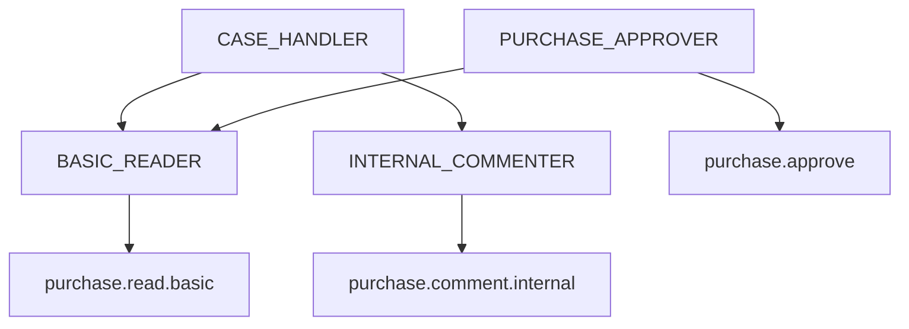

# Role composition: kết hợp vai trò mà vẫn giữ đúng giới hạn quyền

Trong chương **Role Design**, role composition là cách kết hợp các vai trò hoặc tập khả năng để đáp ứng một công việc, thay vì tạo một vai trò lớn chứa mọi quyền. Sự kết hợp có thể nằm trong định nghĩa một vai trò tổng hợp hoặc xuất hiện khi một chủ thể được gán nhiều vai trò.

Trong module bảo vệ logic nghiệp vụ, vấn đề quan trọng là quyền nào thực sự có hiệu lực trên một đối tượng, trong phạm vi và điều kiện nào. Nếu hệ thống gom tên vai trò, bộ phận và hạn mức thành các tập rời nhau, người dùng có thể nhận một tổ hợp quyền mà không nguồn cấp nào thực sự cho phép.

Bài học sử dụng quy trình đề nghị mua hàng để giải thích cách kết hợp vai trò với quyền theo đối tượng, state machine, business invariants, transaction và kiểm thử hành vi đi vòng quy trình.

Sau bài này, bạn có thể:

- Phân biệt vai trò tổng hợp, kế thừa vai trò và nhiều lần gán vai trò.
- Kết hợp quyền mà vẫn giữ phạm vi, hạn mức, thời hạn và nguồn cấp tương ứng.
- Ngăn các tổ hợp quyền gây tự duyệt hoặc tự thực hiện toàn bộ quy trình.
- Kiểm soát thay đổi định nghĩa vai trò và tác động tới người đã được gán.
- Kiểm thử quyền phát sinh ngoài ý muốn khi nhiều vai trò cùng tồn tại.

## 1. Nhiều vai trò có thể tạo ra quyền ngoài dự kiến

Giả sử An có hai lần gán vai trò:

```text
G1: người duyệt ở bộ phận A, tối đa 20 triệu VND mỗi đề nghị
G2: người duyệt ở bộ phận B, tối đa 100 triệu VND mỗi đề nghị
```

Một cách triển khai sai có thể gom dữ liệu thành:

```text
roles       = {APPROVER}
departments = {A, B}
maxLimit    = 100 triệu
```

Sau đó, mã chỉ kiểm tra có vai trò duyệt, đề nghị thuộc một bộ phận trong tập và số tiền không vượt `maxLimit`. An sẽ được duyệt 80 triệu ở bộ phận A, dù G1 chỉ cho phép 20 triệu.

Lỗi không nằm ở việc An có nhiều vai trò. Lỗi nằm ở việc tách các điều kiện khỏi nguồn cấp đã ràng buộc chúng.

Một tình huống khác là vai trò tạo đề nghị và vai trò duyệt cùng được gán cho một người. Hệ thống vẫn phải chặn người đó duyệt đề nghị mình đã tạo nếu quy tắc phân tách trách nhiệm yêu cầu. Hai vai trò không biến thành hai người độc lập.

## 2. Các khái niệm cần phân biệt

| Khái niệm | Ý nghĩa | Ví dụ |
| --- | --- | --- |
| Permission hoặc capability | Một loại hành động được hệ thống nhận diện | `purchase.approve` |
| Vai trò | Tập khả năng phục vụ một trách nhiệm | `PURCHASE_APPROVER` |
| Vai trò tổng hợp | Vai trò tham chiếu nhiều thành phần để tạo một tập khả năng | Vai trò xử lý hồ sơ gồm đọc cơ bản và ghi chú |
| Kế thừa vai trò | Quan hệ cấu hình cho phép vai trò nhận khả năng từ vai trò khác | Vai trò giám sát kế thừa quyền xem hồ sơ |
| Lần gán vai trò | Quan hệ giữa principal và vai trò, kèm phạm vi hoặc điều kiện | An là người duyệt tại bộ phận A đến ngày xác định |
| Quyền hiệu lực | Kết quả đánh giá các nguồn cấp và chính sách trên hành động cụ thể | An được duyệt đề nghị X trị giá 15 triệu ở A |

Tên chức danh không tự xác định quan hệ kế thừa. Một vai trò tên `MANAGER` không mặc nhiên kế thừa mọi vai trò có vẻ thấp hơn. Các quan hệ phải được định nghĩa và kiểm tra trong hệ thống.

Vai trò cũng không nhất thiết tương ứng một endpoint. Một permission nên biểu diễn hành động có ý nghĩa nghiệp vụ; nhiều đường gọi cùng hành động phải thực thi cùng các điều kiện cần thiết.

## 3. Thiết kế các thành phần theo trách nhiệm nghiệp vụ

Trong ví dụ mua hàng, có thể bắt đầu từ các permission:

```text
purchase.read.basic
purchase.edit_draft
purchase.submit
purchase.comment.internal
purchase.approve
purchase.issue_order
purchase.read.audit
identity.assign_role
```

Sau đó nhóm chúng thành các vai trò:

| Vai trò | Khả năng chính | Điều vẫn phải kiểm tra khi dùng |
| --- | --- | --- |
| `BASIC_READER` | Đọc thông tin cơ bản | Tenant, phạm vi đối tượng và trường được đọc |
| `REQUEST_AUTHOR` | Đọc, sửa nháp, gửi duyệt | Quan hệ người tạo, trạng thái và nội dung hợp lệ |
| `INTERNAL_COMMENTER` | Ghi chú nội bộ | Phạm vi hồ sơ và quyền trên trường ghi chú |
| `PURCHASE_APPROVER` | Đọc và duyệt | Bộ phận, hạn mức, nội dung và không tự duyệt |
| `ORDER_ISSUER` | Đọc và phát hành đơn | Đúng phê duyệt, snapshot và chưa phát hành trùng |
| `AUDIT_READER` | Đọc dữ liệu audit theo phạm vi | Quyền xem dữ liệu nhạy cảm và giới hạn xuất dữ liệu |
| `ROLE_ASSIGNMENT_ADMIN` | Quản lý các lần gán được cho phép | Tenant, danh mục vai trò được quản lý và ràng buộc xung đột |

Ví dụ vai trò tổng hợp phục vụ xử lý hồ sơ:

```text
CASE_HANDLER
  ├─ BASIC_READER
  └─ INTERNAL_COMMENTER
```

Tổng hợp này giúp cấp đúng hai nhóm khả năng cần thiết mà không phải thêm quyền duyệt hoặc phát hành đơn. Nếu công việc thay đổi, điều chỉnh thành phần có kiểm soát thay vì biến `CASE_HANDLER` thành vai trò toàn năng.

Quyền quản lý gán vai trò không tự bao gồm quyền duyệt mua hàng. Đây là trách nhiệm quản trị khác và phải có giới hạn riêng.

## 4. Kết hợp tập quyền nhưng giữ nguyên ngữ cảnh cấp quyền

Trong mô hình chỉ có các quyền cho phép và cùng một phạm vi, việc kết hợp có thể dùng phép hợp tập permission:

```text
permissions(CASE_HANDLER)
  = permissions(BASIC_READER) ∪ permissions(INTERNAL_COMMENTER)
```

Một permission xuất hiện qua hai thành phần vẫn chỉ là cùng một khả năng. Nó không được tính thành hai phiếu duyệt, hai lần thực hiện hoặc hai phần hạn mức mới.

Khi có các lần gán khác phạm vi, cần giữ các bộ dữ liệu đi cùng nhau:

```text
nguồn cấp = (
  principal,
  vai trò và phiên bản,
  permission,
  tenant và phạm vi đối tượng,
  hạn mức,
  thời hạn,
  nguồn gốc kế thừa hoặc tổng hợp
)
```

Với một hành động dùng một căn cứ cấp quyền, điều kiện cho phép thường có dạng:

```text
tồn tại một đường cấp quyền hợp lệ G sao cho:
  G thuộc principal và ngữ cảnh đang dùng
  AND G cung cấp permission cần thiết
  AND đối tượng thuộc phạm vi của G
  AND các điều kiện của chính G đều đúng

đồng thời mọi chính sách bắt buộc của hành động vẫn phải đúng
```

Không thay điều kiện này bằng ba kiểm tra độc lập “có permission ở đâu đó”, “có bộ phận này ở đâu đó” và “có một hạn mức đủ lớn ở đâu đó”. Chúng có thể đến từ ba nguồn không cùng cấp phép cho hành động.

Nếu nghiệp vụ cần kết hợp nhiều căn cứ theo phép AND, phải nêu rõ từng căn cứ cần quyền gì và áp dụng cho đối tượng nào. Không mặc định mọi permission đều có thể ghép lại tự do để vượt điều kiện của nhau.

## 5. Phạm vi và hạn mức được kết hợp như thế nào?

Xét các lần gán của An:

| Nguồn | Permission | Bộ phận | Hạn mức mỗi lần |
| --- | --- | --- | --- |
| G1 | `purchase.approve` | A | 20 triệu VND |
| G2 | `purchase.approve` | B | 100 triệu VND |
| G3 | `purchase.read.basic` | C | Không phải quyền duyệt |

Kết quả:

- Duyệt 15 triệu ở A: có thể dùng G1 nếu các guard khác đúng.
- Duyệt 80 triệu ở A: không có căn cứ phù hợp trong ba nguồn.
- Duyệt 80 triệu ở B: có thể dùng G2 nếu các guard khác đúng.
- Duyệt 5 triệu ở C: G3 chỉ cho đọc, không cho duyệt.

Nếu An có thêm một grant cho duyệt 30 triệu ở A, một đề nghị 25 triệu có thể hợp lệ theo grant đó trong mô hình cho phép thông thường. Không tự chọn hạn mức nhỏ nhất của mọi grant nếu policy không quy định như vậy.

Ngược lại, hai grant giới hạn 20 triệu và 30 triệu không tự trở thành quyền duyệt 50 triệu một lần. Cộng hạn mức chỉ hợp lệ khi nghiệp vụ định nghĩa rõ một cơ chế phân bổ cộng dồn và có dữ liệu bảo vệ invariant tương ứng.

Trong một đường kế thừa có nhiều giới hạn, phạm vi hiệu lực không được rộng hơn phần được phép qua các liên kết. Chẳng hạn lần gán giới hạn bộ phận A không biến thành quyền toàn tenant chỉ vì vai trò thành phần được tái sử dụng ở nơi khác.

Một permission quản trị toàn hệ thống có thể không tương thích với một lần gán giới hạn ở bộ phận. Hệ thống cần kiểm tra loại phạm vi mà permission hỗ trợ; không bỏ qua phạm vi chỉ vì tên role chứa chữ `ADMIN`.

## 6. Vai trò tổng hợp không thay thế máy trạng thái

Giả sử một người có cả `purchase.submit` và `purchase.issue_order`. Điều đó không cho phép họ phát hành đơn từ một bản nháp chưa được duyệt.

```text
có permission cần thiết
AND có quyền trên đối tượng
AND đúng trạng thái và đúng cạnh chuyển trạng thái
AND có bằng chứng phê duyệt cho nội dung hiện tại
AND không vi phạm phân tách trách nhiệm
AND không tạo tác dụng phụ trùng
```

Những điều kiện này cùng tham gia quyết định. Role composition chỉ giải quyết một phần là nguồn khả năng; nó không xác lập việc các bước nghiệp vụ trước đó đã hoàn tất.

Người phát hành đơn không cần mang vai trò người duyệt để chứng minh đơn đã được duyệt. Bằng chứng đó đến từ quyết định của người có thẩm quyền trên đúng snapshot, không phải từ việc executor có thêm permission duyệt.

Tương tự, vai trò chỉ đọc không tự là một điều kiện cấm ghi khi người dùng đồng thời có vai trò được ghi. Nếu sản phẩm cần một chế độ khóa bắt buộc hoặc cấm toàn bộ thao tác ghi, hãy mô hình hóa điều kiện đó riêng và định nghĩa thứ tự ưu tiên của policy.

## 7. Phân tách trách nhiệm phải xét cả tổ hợp và lịch sử thao tác

Trong ví dụ, hệ thống chọn hai quy tắc:

1. Có thể gán vai trò tạo và duyệt cho cùng một người, nhưng không được duyệt đề nghị do chính người đó tạo.
2. Không gán vai trò duyệt và phát hành đơn cho cùng một cá nhân trong các phạm vi bộ phận giao nhau.

Quy tắc thứ nhất cần đánh giá lúc thao tác trên đối tượng. Quy tắc thứ hai có thể được chặn ngay lúc gán vai trò hoặc thay đổi định nghĩa tổng hợp.

| Loại ràng buộc | Điểm kiểm tra | Ví dụ |
| --- | --- | --- |
| Xung đột khi gán | Khi tạo hoặc sửa assignment và role liên quan | Không đồng thời là approver và issuer trong cùng phạm vi |
| Xung đột khi kích hoạt | Khi chọn tập vai trò hoạt động của phiên | Không kích hoạt một cặp vai trò mà chính sách cấm dùng cùng phiên |
| Xung đột theo giao dịch | Khi thực hiện hành động trên đối tượng | Không tự duyệt đề nghị đã tạo |
| Xung đột theo người tham gia | Khi kiểm tra bằng chứng các bước | Người thực hiện phải khác người duyệt nếu quy trình yêu cầu |

Chuyển session hoặc đổi vai trò đang kích hoạt không làm mất lịch sử đã tạo hoặc đã duyệt một đề nghị. Kiểm tra theo giao dịch phải dựa trên danh tính và bằng chứng được lưu.

Hai tài khoản của cùng một cá nhân cũng không nhất thiết đáp ứng yêu cầu độc lập. Cần quan hệ danh tính đáng tin cậy và chính sách nêu rõ ai được tính là cùng một người.

Nếu có đường ủy quyền hoặc ngoại lệ, cổng thực thi vẫn phải kiểm tra các ràng buộc độc lập cần thiết. Một quy tắc chặn assignment thông thường không chứng minh mọi đường khác đều không tạo xung đột.

## 8. Biểu diễn vai trò tổng hợp bằng đồ thị có kiểm soát

Có thể mô hình hóa định nghĩa vai trò thành đồ thị có hướng:



Trong mô hình kế thừa của bài, đồ thị không có chu trình. Một quan hệ như `A → B → C → A` phải bị từ chối khi xuất bản định nghĩa, thay vì chờ request thực tế gặp lỗi.

Một thuật toán mở rộng khả năng cơ bản:

```text
expand(roleRef, visiting, memo):
  nếu roleRef đang nằm trong visiting: báo lỗi chu trình
  nếu đã có kết quả đúng version trong memo: trả kết quả đó
  tải chính xác định nghĩa roleRef
  đánh dấu roleRef đang được duyệt
  result = tập permission trực tiếp
  với mỗi vai trò thành phần:
    result = result hợp expand(thành phần, visiting, memo)
  bỏ đánh dấu đang duyệt
  lưu kết quả cùng version và nguồn gốc
  trả result
```

Thuật toán hợp tập trên chỉ đủ cho phần liệt kê khả năng khi các thành phần không mang các giới hạn riêng bị bỏ mất. Nếu cạnh hoặc vai trò con có điều kiện, cần giữ các đường suy diễn và điều kiện tương ứng trong kết quả đánh giá.

Định nghĩa không tồn tại, version không hợp lệ hoặc đồ thị không hợp lệ không được biến thành “cho mọi quyền để tránh gián đoạn”. Chặn việc xuất bản hoặc chặn hành động bị ảnh hưởng theo chính sách lỗi của hệ thống.

## 9. Minh họa Java: giữ điều kiện của từng đường cấp quyền

Đoạn mã sau kiểm tra quyền duyệt đề nghị bằng VND. `GrantPath` là kết quả phía máy chủ sau khi mở rộng role và giữ các giới hạn áp dụng cho một đường cấp quyền. Client không được tự gửi tập permission hoặc hạn mức này. Ví dụ dùng record của Java 16 trở lên.

```java
import java.time.Instant;
import java.util.List;
import java.util.Objects;
import java.util.Set;
import java.util.UUID;

enum Permission {
    READ_BASIC, EDIT_DRAFT, SUBMIT, APPROVE, ISSUE_ORDER
}

enum RequestState {
    DRAFT, PENDING_APPROVAL, APPROVED, REJECTED, ORDERED
}

record Actor(
        UUID tenantId,
        UUID principalId,
        UUID personId,
        boolean enabled) {
}

record PurchaseRequestView(
        UUID tenantId,
        UUID departmentId,
        UUID createdByPersonId,
        long amountVnd,
        RequestState state) {
}

record GrantPath(
        UUID assignmentId,
        UUID principalId,
        UUID tenantId,
        UUID departmentId,
        Set<Permission> permissions,
        long approvalLimitVnd,
        Instant startsAt,
        Instant endsAt,
        boolean active) {
}

final class ComposedRolePolicy {
    private ComposedRolePolicy() {
    }

    static boolean canApprove(
            Actor actor,
            PurchaseRequestView request,
            List<GrantPath> paths,
            Instant now) {
        Objects.requireNonNull(actor);
        Objects.requireNonNull(request);
        Objects.requireNonNull(now);

        UUID tenant = Objects.requireNonNull(actor.tenantId());
        UUID principal = Objects.requireNonNull(actor.principalId());
        UUID person = Objects.requireNonNull(actor.personId());

        if (!actor.enabled()
                || !tenant.equals(request.tenantId())
                || request.state() != RequestState.PENDING_APPROVAL
                || request.amountVnd() <= 0
                || person.equals(request.createdByPersonId())) {
            return false;
        }

        for (GrantPath path : List.copyOf(paths)) {
            if (path.active()
                    && principal.equals(path.principalId())
                    && tenant.equals(path.tenantId())
                    && Objects.requireNonNull(path.departmentId())
                            .equals(request.departmentId())
                    && !now.isBefore(path.startsAt())
                    && now.isBefore(path.endsAt())
                    && path.permissions().contains(Permission.APPROVE)
                    && request.amountVnd() <= path.approvalLimitVnd()) {
                return true;
            }
        }
        return false;
    }
}
```

Các điều kiện permission, bộ phận và hạn mức được kiểm tra trên cùng `path`. Không có bước lấy bộ phận từ G1 rồi hạn mức từ G2.

Mã phân biệt `principalId` dùng để xác định tài khoản được gán quyền với `personId` dùng cho quy tắc không tự duyệt. Không tự hợp mọi quyền của các tài khoản cùng người nếu chính sách chỉ cho phép dùng quyền của principal đang đăng nhập.

Ví dụ lược bỏ validation đầy đủ của các record, version, giao thức thu hồi và transaction. Các `path` phải đến từ assignment và định nghĩa role còn hiệu lực, đã áp dụng quy tắc vai trò được kích hoạt trong ngữ cảnh nếu hệ thống hỗ trợ. Kết quả `true` vẫn cần các guard nghiệp vụ còn lại trước khi ghi quyết định.

Trong triển khai thực tế, nên trả được căn cứ cho phép như assignment và đường role đã dùng để phục vụ audit. Nếu không có căn cứ hợp lệ hoặc dữ liệu cấu hình không xác định, không mặc định trả `true`.

## 10. Gán vai trò và sửa tổ hợp đều có thể gây nâng quyền

Một người chỉ được gán `BASIC_READER` có thể nhận quyền quản trị nếu ai đó sửa vai trò tổng hợp đang chứa nó theo một đường không được kiểm soát. Vì vậy, cần bảo vệ cả:

- Ai được gán hoặc gỡ vai trò cho principal nào.
- Những vai trò nào người quản trị được phép gán.
- Phạm vi và thời hạn assignment tối đa.
- Ai được tạo role, sửa permission hoặc thêm thành phần kế thừa.
- Ai được xuất bản hoặc nâng version role đang được dùng.

Người quản trị assignment có thể được phép gán một role mà chính họ không trực tiếp sử dụng. Quyền đó phải đến từ chính sách quản trị rõ ràng, không suy đơn giản rằng người gán bắt buộc phải sở hữu mọi permission của role.

Ngược lại, chỉ kiểm tra `canAssignRole` chung chung mà không kiểm tra role đích và phần mở rộng bắc cầu có thể cho phép người quản trị tự gán một composite chứa quyền mạnh hơn giới hạn được giao.

Một tổ hợp nguy hiểm còn có thể nằm ở quyền quản trị: vừa sửa định nghĩa role, vừa gán role cho chính mình hoặc sửa nhóm kiểm soát. Phân tích xung đột cần bao gồm các khả năng làm thay đổi chính cơ chế phân quyền.

Những thay đổi rủi ro cao có thể cần người độc lập duyệt, tùy chính sách sản phẩm. Sự độc lập phải xét trên cá nhân và thay đổi cụ thể; không chỉ yêu cầu người thao tác chuyển sang một tài khoản khác.

## 11. Kiểm tra xung đột theo phạm vi và các lần gán đồng thời

Với quy tắc cấm cùng người vừa duyệt vừa phát hành trong phạm vi giao nhau, cần xét:

```text
person có khả năng APPROVE qua các assignment và role đã mở rộng
person có khả năng ISSUE_ORDER qua các assignment và role đã mở rộng
hai phạm vi có giao nhau trong thời gian hiệu lực hay không
```

Chỉ so sánh tên role trực tiếp sẽ bỏ sót `CUSTOM_MANAGER` đang chứa `PURCHASE_APPROVER`. Chỉ so sánh department ID bằng nhau cũng có thể thiếu nếu một grant bao phủ toàn tenant còn grant kia bao phủ một bộ phận.

Hai request gán role chạy đồng thời có thể cùng kiểm tra “chưa có role xung đột” rồi đều commit. Cần bảo vệ tập assignment liên quan bằng khóa, version hoặc cơ chế nhất quán phù hợp khi nhận thay đổi.

Một luồng quản trị có thể thực hiện:

```text
BEGIN TRANSACTION
  bảo vệ principal hoặc tập assignment theo giao thức đã chọn
  tải các role version và phạm vi có liên quan
  kiểm tra quyền quản trị đối với principal và role đích
  mở rộng các khả năng và đánh giá xung đột trên tổ hợp sau thay đổi
  kiểm tra khoảng thời gian và phạm vi giao nhau
  ghi assignment, version, audit và sự kiện cập nhật quyền
COMMIT
```

Nếu các tài khoản khác nhau của cùng cá nhân cũng thuộc phạm vi quy tắc, cơ chế đồng thời phải bảo vệ quan hệ ở cấp thích hợp. Khóa một tài khoản riêng lẻ không tự ngăn cấp hai vai trò xung đột qua hai tài khoản.

## 12. Thay đổi role cần đánh giá tác động bắc cầu

Giả sử:

```text
OPERATIONS_STAFF → CASE_HANDLER → BASIC_READER
```

Nếu thêm `purchase.approve` vào `BASIC_READER`, mọi vai trò cha tham chiếu nó có thể bị ảnh hưởng theo mô hình version đang dùng. Một chỉnh sửa tưởng nhỏ có thể cấp quyền duyệt cho nhiều người vốn chỉ được đọc.

Hai chiến lược version thường gặp:

| Chiến lược | Điều phải quản lý |
| --- | --- |
| Assignment và thành phần ghim version | Nâng version là thay đổi rõ ràng; bản cũ không tự nhận bản sửa |
| Tham chiếu định nghĩa hiện hành | Mỗi thay đổi có thể ảnh hưởng rộng; cần đánh giá và cập nhật quyền hiệu lực tương ứng |

Với version ghim, một bản sửa bảo mật ở v2 không tự bảo vệ người vẫn dùng v1. Cần chính sách ngừng hỗ trợ, thu hồi hoặc di chuyển assignment cũ khi cần. Với định nghĩa hiện hành, không được bỏ qua ảnh hưởng chỉ vì không sửa assignment trực tiếp.

Trước khi xuất bản, nên xác định:

- Những vai trò cha bị ảnh hưởng qua mọi đường tham chiếu.
- Những principal, phạm vi và thời hạn assignment bị tác động.
- Permission mới, quyền bị mất và giới hạn thay đổi.
- Tổ hợp xung đột mới xuất hiện.
- Cache, token hoặc quyết định đã tạo từ version cũ cần xử lý thế nào.

Tránh wildcard mở như `purchase.*` nếu việc thêm một permission tương lai sẽ vô tình cấp nó cho mọi role cũ. Nếu sản phẩm chọn wildcard, ý nghĩa với permission mới phải là quyết định chính sách có chủ đích và được kiểm thử.

## 13. Thu hồi và ngữ cảnh kích hoạt vai trò

Gỡ một assignment không bảo đảm quyền mất hiệu lực nếu còn đường khác cung cấp cùng khả năng. Cần giải thích được nguồn còn lại và phân biệt “gỡ role này” với “chặn capability này trong phạm vi”.

Ví dụ:

```text
G1: An → PURCHASE_APPROVER tại A
G2: An → COMPOSITE_REVIEW_TEAM tại A → PURCHASE_APPROVER
```

Gỡ G1 vẫn để lại quyền từ G2 nếu policy không có điều kiện chặn khác. Audit quyền hiệu lực nên chỉ ra điều đó thay vì kết luận thu hồi thất bại mà không biết nguồn.

Nếu phiên cho phép chọn role đang hoạt động, chỉ các role được kích hoạt hợp lệ mới được dùng theo chính sách. Nhưng giới hạn tập kích hoạt không tự đáp ứng một quy tắc cấm gán role trên toàn bộ cá nhân, cũng không xóa lịch sử tham gia giao dịch.

Token hoặc cache lưu tập role cũ cần version và quy tắc hiệu lực phù hợp. Thay đổi vai trò thành phần cũng là thay đổi quyền, dù danh sách role trực tiếp của người dùng không đổi.

Với ủy quyền, phần quyền được dùng phải tiếp tục bị giới hạn bởi grant, nguồn thẩm quyền và các ràng buộc bắt buộc. Không cộng vai trò kỹ thuật của worker vào role người dùng để bù cho một permission đã mất.

## 14. Nhiều vai trò không nhân số lần thực hiện hoặc hạn mức

Giả sử cùng một người có quyền phát hành đơn qua hai composite khác nhau. Một lần gọi hợp lệ vẫn chỉ tạo một đơn theo invariant của đề nghị.

Idempotency và ràng buộc nghiệp vụ cần dựa trên ý định, đối tượng và operation phù hợp, không dựa riêng vào tên role đã được chọn. Nếu role thay đổi giữa hai lần retry, điều đó không tự biến cùng ý định thành một lần phát hành mới.

Tương tự:

- Một permission xuất hiện hai lần không phải hai phiếu đồng ý.
- Một người mang hai vai trò duyệt không thay thế hai cá nhân khi quy trình yêu cầu hai người độc lập.
- Chuyển role không tự đặt lại hạn mức tổng của cá nhân hoặc đối tượng.
- Hai đường cấp cùng một hành động không cho phép chạy tác dụng phụ hai lần.

Nếu hạn mức gắn với từng grant, hệ thống cần chính sách rõ về việc chọn nguồn, phân bổ và ghi nhận sử dụng. Nếu mục tiêu là hạn mức tổng cho một người hoặc tổ chức, đặt hạn mức chỉ ở từng role sẽ dễ bị vượt bằng nhiều assignment.

Việc chọn đường cấp quyền nên được lưu cùng quyết định khi cần giải thích quota hoặc căn cứ phê duyệt. Không trừ quota của một grant rồi ghi audit như đã dùng một grant khác.

## 15. Ma trận kiểm thử role composition

| Ca kiểm thử | Kết quả cần giữ |
| --- | --- |
| Role tổng hợp có đọc và ghi chú | Chỉ có khả năng được định nghĩa và đúng phạm vi assignment |
| Hai thành phần lặp cùng permission | Không nhân phiếu, quota hoặc tác dụng phụ |
| Permission ở A, hạn mức cao ở B | Không ghép thành quyền hạn mức cao ở A |
| Đọc ở C, duyệt ở A | Không duyệt ở C chỉ vì có thể đọc đối tượng |
| Hai grant cùng phạm vi với mức 20 và 30 triệu | Không tự cộng thành 50 triệu một lần |
| Role được gán ở tenant khác | Không cung cấp permission cho tenant hiện tại |
| Assignment hết hạn hoặc chưa bắt đầu | Không dùng làm đường cấp hợp lệ |
| Role bị tắt trong ngữ cảnh kích hoạt | Không được dùng nếu policy yêu cầu kích hoạt |
| Có role tạo và duyệt, thao tác trên đề nghị tự tạo | Bị chặn theo danh tính người tham gia |
| Có role phát hành nhưng đề nghị chưa duyệt | Không bỏ qua trạng thái và bằng chứng nghiệp vụ |
| Composite gián tiếp chứa cặp role bị cấm | Bị phát hiện khi gán hoặc sửa định nghĩa theo chính sách |
| Đồ thị role có chu trình hoặc thiếu version | Không được mở rộng thành một tập cho phép tùy ý |

Ngoài ca thành công, hãy chủ động tạo các tổ hợp mà từng dữ liệu riêng lẻ đều trông hợp lệ nhưng không có cùng một đường cấp quyền cho phép toàn bộ hành động.

Đối chiếu với bảng nghiệp vụ độc lập. Nếu kiểm thử chỉ đọc chính cấu hình role rồi khẳng định các permission trong cấu hình có tồn tại, một quyền bị thêm nhầm vẫn có thể khiến toàn bộ kiểm thử xanh.

## 16. Kiểm thử thay đổi, cạnh tranh và mọi đường thực thi

| Kịch bản | Điều cần xác minh |
| --- | --- |
| Hai request cùng gán hai role xung đột | Không cùng vượt kiểm tra bằng một ảnh chụp assignment cũ |
| Sửa role con tạo xung đột cho người giữ role cha | Bị chặn hoặc xử lý qua quy trình thay đổi đã định |
| Gỡ một role nhưng còn đường kế thừa khác | Quyền hiệu lực và báo cáo nguồn đúng theo policy |
| Token còn role cũ sau thu hồi | Hành vi khớp ngữ nghĩa hiệu lực mà hệ thống công bố |
| Đối tượng đổi bộ phận trong lúc duyệt | Không áp dụng scope của bản cũ lên đối tượng mới ngoài hợp đồng |
| Retry qua một role khác | Không tạo thêm quyết định hoặc tác dụng phụ cho cùng operation |
| API hàng loạt trộn nhiều bộ phận | Mỗi đối tượng được xét theo đúng grant và điều kiện của nó |
| Worker có role mạnh hơn caller | Không dùng quyền kỹ thuật để bỏ qua quyền nghiệp vụ của lệnh |
| Import hoặc CLI cấp composite trực tiếp | Không bỏ qua kiểm tra xung đột và phạm vi quản trị |
| Người quản trị chỉ được gán một tập role | Không vượt giới hạn bằng composite chứa role ngoài tập được phép |

Kiểm tra cả dữ liệu bền vững: quyết định, assignment, version, operation, audit và outbox. Một response lỗi không đủ nếu quyền hoặc tác dụng phụ đã được ghi trước đó.

Các kiểm thử concurrency và transaction cần dùng cơ chế lưu trữ phù hợp. Mock một danh sách role hoặc gọi hai request tuần tự không chứng minh giao thức chống gán xung đột chạy đồng thời là đúng.

## 17. Audit và giải thích quyền hiệu lực

Một quyết định cho phép nên có khả năng truy ra:

```text
actor và principal thực sự sử dụng quyền
hành động, đối tượng, tenant và phạm vi
assignmentId và thời hạn áp dụng
role cùng version và chuỗi thành phần đã cung cấp permission
các giới hạn như bộ phận, hạn mức và ngữ cảnh kích hoạt
version của đối tượng và policy liên quan
kết quả các ràng buộc bắt buộc, định danh quyết định hoặc operation
```

Với hành động bị từ chối, lý do có thể là thiếu capability, sai phạm vi, vượt hạn mức, role hết hạn hoặc xung đột trách nhiệm. Audit nội bộ cần đủ để phân biệt; phản hồi ra ngoài chỉ tiết lộ thông tin phù hợp với người gọi.

Theo dõi role tổng hợp tăng quyền bất thường, số người bị ảnh hưởng bởi một thay đổi, nhiều đường cấp trùng và các lần cố tự duyệt. Đừng ghi token hoặc bí mật credential chỉ để chứng minh người dùng có một role.

## 18. Cách áp dụng role composition vào hệ thống của bạn

1. Liệt kê hành động nghiệp vụ và permission cần thiết; tách khỏi trạng thái và bằng chứng quy trình.
2. Tạo các vai trò theo trách nhiệm rõ ràng, rồi dùng thành phần tổng hợp khi việc tái sử dụng có ý nghĩa.
3. Giữ assignment cùng tenant, phạm vi, hạn mức, thời hạn và nguồn gốc của nó.
4. Định nghĩa cách hợp quyền cho phép, các điều kiện chặn bắt buộc và những trường hợp cần nhiều căn cứ đồng thời.
5. Kiểm tra xung đột cả trên đồ thị role đã mở rộng lẫn lịch sử người tham gia giao dịch.
6. Bảo vệ thao tác gán và sửa role bằng quyền quản trị, version và transaction phù hợp.
7. Chọn chiến lược version, đánh giá tác động bắc cầu và cập nhật cache hoặc token theo chính sách hiệu lực.
8. Giữ invariant chống thực hiện trùng và quota độc lập với số role hoặc số đường cấp.
9. Kiểm thử quyền phát sinh do ghép sai phạm vi, sửa thành phần, cạnh tranh và các đường quản trị trực tiếp.

Role composition có giá trị khi giúp tái sử dụng trách nhiệm mà vẫn giải thích được từng quyền hiệu lực. Mỗi hành động cần một căn cứ cấp quyền phù hợp với chính đối tượng và điều kiện đang xét, cùng các ràng buộc nghiệp vụ không bị vô hiệu hóa bởi việc người dùng có thêm vai trò.
