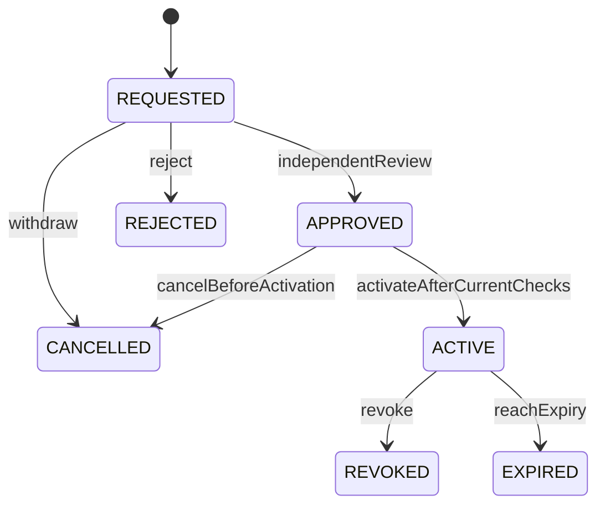

# Role assignment policy: chính sách gán vai trò

## 1. Gán role là thay đổi quyền, không phải sửa hồ sơ thông thường

Một nhân viên hỗ trợ có quyền cập nhật tài khoản người dùng. API dùng chung một DTO cho tên hiển thị, phòng ban và danh sách role. Nhân viên gửi thêm `roles = ["FINANCE_APPROVER"]` cho chính mình, sau đó duyệt các đề nghị mà trước đó họ không được phép duyệt.

Lỗ hổng nằm ở việc coi gán role như một thao tác cập nhật dữ liệu thông thường. Khi một assignment có thể tạo quyền duyệt, chi trả hoặc quản trị, chính thao tác tạo assignment là một hành động nghiệp vụ nhạy cảm.

**Role assignment policy** quy định ai được yêu cầu, phê duyệt, kích hoạt, thay đổi hoặc thu hồi một vai trò cho chủ thể nào, trong phạm vi nào, với điều kiện và thời hạn nào.

Trong bảo vệ logic nghiệp vụ, chính sách này cần ngăn các đường như:

- Tự cấp hoặc cấp chéo quyền đặc biệt để bỏ qua phê duyệt.
- Gán role đúng tên nhưng mở rộng tenant, phòng ban, hạn mức hoặc thời hạn.
- Cấp quyền gián tiếp qua group, role kế thừa hoặc chỉnh sửa định nghĩa role.
- Dùng yêu cầu đã duyệt cho một assignment có nội dung khác.
- Tạo tổ hợp quyền xung đột qua hai request đồng thời.
- Thu hồi một assignment nhưng nhầm tưởng mọi quyền hiệu lực đã biến mất.

Một thiết kế đầy đủ phải kiểm soát cả lúc cấp quyền và lúc quyền đó được sử dụng. Gán đúng role không tự bảo đảm mọi hành động trên mọi đối tượng đều được phép.

## 2. Phân biệt quyền sử dụng role và quyền quản trị assignment

### 2.1. Có role không đồng nghĩa được cấp role đó

Người có `EXPENSE_APPROVER` được thực hiện một số hành động duyệt theo policy. Điều đó không tự cho phép họ gán `EXPENSE_APPROVER` cho người khác.

Ngược lại, một người được giao quản trị assignment có thể được phép cấp role duyệt trong phạm vi cụ thể mà bản thân họ không được dùng quyền duyệt. Đây là cách tách mặt quản trị quyền khỏi mặt thực hiện nghiệp vụ.

Không nên dùng quy tắc đơn giản “chỉ được cấp role mình đang có” làm toàn bộ chính sách. Nó có thể vừa chặn quản trị hợp lệ, vừa cho người giữ role nhạy cảm tùy tiện nhân rộng quyền của mình.

| Khả năng | Câu hỏi cần trả lời |
|---|---|
| Dùng quyền nghiệp vụ | Chủ thể có được duyệt hồ sơ này không? |
| Yêu cầu role | Chủ thể có được gửi đề nghị cấp role này cho đối tượng đó không? |
| Phê duyệt cấp role | Ai độc lập và có thẩm quyền chấp nhận assignment này? |
| Kích hoạt assignment | Ai hoặc service nào được đưa đề nghị đã duyệt vào hiệu lực? |
| Sửa/thu hồi | Ai được đổi phạm vi, gia hạn, đình chỉ hoặc thu hồi? |
| Sửa định nghĩa role | Ai được thay các permission mà role mang theo? |

Các quyền trên không tự suy ra lẫn nhau.

### 2.2. Không suy quyền quản trị từ tên hoặc thứ bậc hiển thị

Tên như `ADMIN`, `MANAGER`, `SENIOR_APPROVER` không phải bằng chứng rằng role này được gán mọi role khác. Cần cấu hình hoặc policy quản trị rõ ràng.

Một role kế thừa permission nghiệp vụ cũng không mặc định kế thừa quyền gán role. Nếu hệ thống cho phép kế thừa quyền quản trị, phải mô tả và rà soát phần đó như một khả năng đặc quyền.

## 3. Định nghĩa một assignment có đủ ngữ nghĩa

Một assignment không nên chỉ là cặp `userId → roleName` nếu quyền phụ thuộc tenant, phạm vi và thời gian.

| Thành phần | Ý nghĩa minh họa |
|---|---|
| Chủ thể nhận | Tài khoản người dùng, service identity hoặc nguồn kế thừa được hỗ trợ |
| Tenant | Không gian tổ chức mà assignment có hiệu lực |
| Role | Định danh ổn định và ngữ nghĩa role được áp dụng |
| Phạm vi | Phòng ban, đơn vị, dự án hoặc nhóm tài nguyên được phép |
| Ràng buộc | Hạn mức, loại tiền, loại hồ sơ hoặc điều kiện bổ sung |
| Thời gian | Bắt đầu, kết thúc và các giới hạn gia hạn |
| Nguồn | Gán trực tiếp, group, ủy quyền hoặc quy trình provisioning |
| Căn cứ | Yêu cầu nghiệp vụ, quyết định duyệt và phiên bản policy liên quan |
| Trạng thái | Đang xin, đã duyệt, có hiệu lực, bị đình chỉ, hết hạn hoặc thu hồi |

Không diễn giải một scope thiếu hoặc `null` thành toàn hệ thống trừ khi đó là hành vi được định nghĩa rõ và được cấp quyền tương ứng. Mặc định mở rộng phạm vi là một đường leo thang phổ biến.

### 3.1. Giữ các ràng buộc theo từng assignment

Giả sử cùng một người có:

```text
Assignment A: APPROVER, phòng A, tối đa 10 triệu VND
Assignment B: APPROVER, phòng B, tối đa 1 triệu VND
```

Nếu ứng dụng gộp thành `departments = {A, B}` và `maxLimit = 10 triệu`, người đó có thể được duyệt 10 triệu ở phòng B, vượt nội dung đã cấp.

Cần giữ các điều kiện đi cùng nhau:

```text
(phòng A AND số tiền <= 10 triệu)
OR
(phòng B AND số tiền <= 1 triệu)
```

Sau đó vẫn áp dụng các điều kiện bắt buộc chung như không tự duyệt. Không tách các thuộc tính của nhiều assignment rồi kết hợp lại thành một quyền rộng hơn từng assignment ban đầu.

### 3.2. Định danh role và ngữ nghĩa phiên bản

Cần biết assignment theo định nghĩa role hiện hành hay ghim vào một phiên bản được duyệt:

- Nếu theo định nghĩa hiện hành, sửa role có thể mở rộng quyền của toàn bộ người đang giữ role đó.
- Nếu ghim phiên bản, việc chuyển sang định nghĩa mới cần luồng cập nhật rõ ràng; các điều kiện thu hồi hoặc hạn chế hiện hành cũng không được vô tình bỏ qua.

Không có một lựa chọn đúng cho mọi hệ thống. Điều quan trọng là không để hai phần ứng dụng hiểu assignment theo hai cách khác nhau.

## 4. Các điều kiện của chính sách gán role

Một quyết định gán role mới thường cần:

```text
người thực hiện đã được xác thực
AND có quyền quản trị assignment cụ thể
AND role thuộc danh mục được phép cấp
AND đối tượng nhận đủ điều kiện trong đúng tenant
AND scope và constraints nằm trong phạm vi quản trị
AND thời hạn đáp ứng giới hạn
AND không vi phạm xung đột nhiệm vụ
AND có đủ phê duyệt theo mức rủi ro
AND nội dung kích hoạt khớp nội dung đã duyệt
```

### 4.1. Ai được cấp role nào cho ai?

Một ma trận minh họa:

| Chủ thể quản trị | Role có thể quản trị | Đối tượng/phạm vi | Điều kiện |
|---|---|---|---|
| Quản trị phòng ban | Role tác nghiệp được liệt kê | Thành viên hợp lệ của phòng được giao | Không vượt phạm vi phòng; giới hạn thời hạn |
| Quản trị quyền cấp tenant | Role trong catalog của tenant | Chủ thể thuộc tenant | Role nhạy cảm cần quy trình duyệt độc lập |
| Service provisioning | Những assignment được hợp đồng tích hợp cho phép | Chủ thể và nguồn dữ liệu đã xác minh | Không tự mở rộng catalog, scope hoặc thời hạn |
| Người dùng tự phục vụ | Role rủi ro thấp được công bố | Chính mình theo điều kiện đã định | Không có nghĩa được tự kích hoạt role đặc quyền |

Đây là ví dụ chính sách, không phải đặc quyền mặc định của các chức danh trên.

### 4.2. Điều kiện của người nhận

Cần xét membership, loại chủ thể, trạng thái tài khoản và các điều kiện cần thiết của role. Một tài khoản tồn tại không có nghĩa được nhận mọi vai trò trong mọi tenant.

Nếu role dành cho người chịu trách nhiệm phê duyệt, không tự gán nó cho một service account rồi tính service đó như một người duyệt độc lập. Nếu có role cho tự động hóa, định nghĩa riêng khả năng và phạm vi của nó.

Nếu chính sách xung đột áp dụng theo người, cần liên kết các tài khoản cùng danh tính. Kiểm tra từng account riêng có thể để một người giữ hai vai trò bị cấm qua hai tài khoản.

### 4.3. Cấp đúng scope và hạn mức

Quản trị viên của phòng A không được gán role phòng B chỉ vì cả hai phòng cùng tenant. Mọi định danh trong scope phải tồn tại, thuộc phạm vi phù hợp và được quyền quản trị.

Nếu có hạn mức theo tiền tệ, phải giữ loại tiền cùng hạn mức. Không coi một con số không có đơn vị là hạn mức chung cho mọi loại tiền.

Các scope động như “mọi phòng hiện tại và tương lai” có tác động khác danh sách phòng cụ thể. Nếu hỗ trợ, phải định nghĩa rõ và yêu cầu thẩm quyền tương ứng; không để wildcard xuất hiện như giá trị mặc định tiện lợi.

## 5. Vòng đời yêu cầu và kích hoạt assignment

Một quy trình có duyệt có thể dùng:



Sơ đồ chỉ minh họa các trạng thái chính. Nếu có lịch bắt đầu trong tương lai hoặc đình chỉ tạm thời, cần thêm ngữ nghĩa phù hợp thay vì ép vào một cờ `enabled` mơ hồ.

### 5.1. Phê duyệt một đặc tả xác định

Quyết định duyệt phải gắn với nội dung cụ thể:

```text
tenant + chủ thể nhận + role và phiên bản liên quan
+ scope + constraints + thời gian
+ loại nguồn/ủy quyền nếu có
```

Có thể đóng băng đặc tả và tính digest phía server từ biểu diễn chuẩn hóa. Quyết định tham chiếu đúng đặc tả đó.

Không cho đổi người nhận, mở scope, bỏ `expiresAt` hoặc nâng hạn mức sau khi đã được duyệt mà vẫn dùng approval cũ. Chỉnh sửa làm thay đổi nội dung cần duyệt phải đi qua luồng sửa/duyệt lại theo policy.

### 5.2. Đã duyệt chưa có nghĩa được kích hoạt vô điều kiện

Giữa phê duyệt và kích hoạt, người nhận có thể rời tenant, role có thể thay đổi hoặc xuất hiện xung đột với assignment khác.

Trong ví dụ của bài, kích hoạt phải kiểm tra lại điều kiện hiện hành bắt buộc và xác nhận định nghĩa role vẫn phù hợp với nội dung đã duyệt. Nếu không, dừng hoặc yêu cầu đánh giá lại theo quy tắc chuyển phiên bản.

Nếu một hệ thống coi phê duyệt là ủy nhiệm kích hoạt có thời hạn, cần mô tả phạm vi và điều kiện bảo lưu của ủy nhiệm đó. Không ngầm coi mọi approval là quyền cấp role vĩnh viễn.

### 5.3. Tự yêu cầu khác với tự phê duyệt

Người dùng có thể được gửi đề nghị cấp quyền cho chính mình. Điều đó không tự cho phép họ chấp nhận đề nghị của mình.

Với role nhạy cảm cần độc lập, kiểm tra danh tính người yêu cầu và người duyệt theo policy, kể cả tài khoản phụ hoặc ủy quyền. Service kích hoạt sau duyệt phải giữ được nguồn yêu cầu và quyết định, không ghi giả rằng service là bên duy nhất liên quan.

## 6. Thiết kế API và ranh giới đầu vào

Một API yêu cầu gán role có thể nhận:

```http
POST /tenants/{tenantId}/role-assignment-requests
Content-Type: application/json

{
  "subjectId": "user-27",
  "roleId": "expense-approver",
  "scope": {
    "departmentIds": ["department-A"]
  },
  "constraints": {
    "approvalLimit": "10000000",
    "currency": "VND"
  },
  "requestedDurationHours": 8,
  "reason": "Thay thế người phụ trách trong ca làm việc"
}
```

Body thể hiện điều được đề nghị, không phải nội dung máy chủ bắt buộc chấp nhận. Server xác minh tenant, chủ thể, role, scope, hạn mức và giới hạn thời gian; sau đó chốt đặc tả có phiên bản.

Nếu dùng khoảng thời gian tương đối, cần quy định mốc tính và chốt thời gian tương ứng trong đặc tả. Không tính lại một cách tùy tiện ở mỗi lần retry làm hạn cuối liên tục bị đẩy ra xa.

### 6.1. Không dùng endpoint cập nhật người dùng để gán đặc quyền

Các trường như role, scope quản trị, trạng thái duyệt, người cấp và căn cứ ủy quyền cần được bảo vệ bằng hợp đồng lệnh riêng.

```text
updateUserProfile
requestRoleAssignment
approveRoleAssignment
activateRoleAssignment
extendRoleAssignment
revokeRoleAssignment
```

Tên hàm chỉ giúp biểu đạt ý định. Bảo vệ thực tế vẫn nằm ở policy phía server và việc không có đường ghi khác bỏ qua policy đó.

### 6.2. Chỉnh assignment là một hành động quản trị mới

Mở thêm phòng ban, tăng hạn mức, đổi người nhận, cho phép ủy quyền tiếp hoặc gia hạn đều có thể mở rộng quyền. Không cho sửa chúng bằng một permission chung như `assignment:write` mà không kiểm tra ý nghĩa thay đổi.

Một lần sửa để giảm scope có thể có yêu cầu khác lần mở rộng scope, nhưng cả hai cần thẩm quyền và dấu vết đúng thiết kế. Không suy rằng mọi thay đổi field đều có cùng mức rủi ro.

### 6.3. Định danh từ client không phải bằng chứng quản trị

`grantorId`, `approvedBy`, `status = ACTIVE` hoặc `policyVersion` client gửi không tự xác lập quyền. Máy chủ xác định người thực hiện từ ngữ cảnh đã xác thực, kiểm tra quyết định lưu phía server và nạp policy có thẩm quyền.

Một header người dùng được service chuyển tiếp cũng phải có cơ chế xác minh nguồn và phạm vi. Không cho service có quyền rộng trở thành đường cấp role hộ mọi danh tính do request tùy ý khai.

## 7. Role kế thừa, group và các đường mở rộng quyền gián tiếp

### 7.1. Gán group có thể tương đương gán role

Nếu group `finance-reviewers` mang role duyệt, thêm một người vào group là một hành động làm thay đổi quyền hiệu lực. Không thể chỉ bảo vệ API gán role trực tiếp rồi để API quản lý group mở rộng quyền không kiểm soát.

Cần xét:

- Ai được thêm/xóa thành viên group có đặc quyền.
- Group nào được mang role nào.
- Điều kiện eligibility và xung đột của thành viên hiện tại và thành viên mới.
- Quyền kế thừa qua group lồng nhau nếu được hỗ trợ.
- Phạm vi, thời hạn và nguồn provisioning của membership.

Nếu gán role cho một group lớn, phải biết thay đổi sẽ cấp quyền cho những ai theo ngữ nghĩa hệ thống. Không coi group là một chủ thể đơn giản để bỏ qua kiểm tra các ảnh hưởng bắt buộc.

### 7.2. Sửa định nghĩa role cũng là thay đổi quyền hiệu lực

Một quản trị viên không thể gán `PAYMENT_APPROVER` cho mình, nhưng có thể thêm permission duyệt vào role `REPORT_VIEWER` mà họ đang giữ. Nếu chỉ kiểm soát assignment, họ vẫn leo thang được.

Vì vậy, quản trị định nghĩa role, quyền gán role và quyền sửa membership cần được xem trong cùng mô hình đe dọa. Thay role hiện hành có thể ảnh hưởng tất cả người đang giữ, làm phát sinh quyền nhạy cảm hoặc xung đột nhiệm vụ mới.

Quy trình thay đổi cần đánh giá tác động theo ngữ nghĩa phiên bản đã chọn. Không chỉ kiểm tra eligibility ở ngày đầu gán role rồi bỏ qua mọi thay đổi sau đó.

### 7.3. Không dùng role hierarchy như đường vòng quản trị

Nếu role A kế thừa B, thêm cạnh kế thừa có thể cấp toàn bộ quyền của B cho người giữ A. Cần kiểm soát người sửa quan hệ và kiểm tra các giới hạn liên quan.

Nếu cấu trúc được thiết kế là đồ thị không chu trình, phải chặn chu trình và xử lý dữ liệu hỏng đúng cách. Quan trọng hơn, kiểm tra quyền hiệu lực sau thay đổi, không chỉ xem tên role trực tiếp được ghi trên user.

### 7.4. Ủy quyền tiếp phải có giới hạn

Không mặc định một người nhận role được phép cấp hoặc ủy quyền tiếp role đó. Khả năng ủy quyền phải được cấp rõ.

Nếu hỗ trợ chuỗi ủy quyền, quyền con không được vượt phạm vi, ràng buộc và thời hạn mà chuỗi cho phép. Cần định nghĩa thu hồi quyền cha ảnh hưởng quyền con ra sao; không để chuỗi tạo quyền tồn tại độc lập ngoài ý định ban đầu.

Điều này khác với một quản trị viên được giao quyền cấp role bằng chính sách quản trị riêng. Hai nguồn thẩm quyền không nên bị trộn thành một cơ chế “có quyền là được truyền quyền”.

## 8. Phân tách nhiệm vụ trong việc gán role

### 8.1. Tổ hợp role bị cấm

Một chính sách có thể cấm cùng một người giữ đồng thời quyền sửa policy và quyền phê duyệt ngoại lệ của chính policy đó. Kiểm tra phải xét quyền hiệu lực, gồm gán trực tiếp, group, kế thừa và các nguồn được hỗ trợ.

Nếu chỉ kiểm tra danh sách role trực tiếp của account đích, một người có thể nhận role xung đột qua account khác hoặc qua group.

Phạm vi xung đột phải rõ: cùng tenant, cùng đơn vị hay toàn tổ chức. Không biến một quy tắc chỉ áp dụng trong một phạm vi thành lệnh cấm quá rộng, hoặc dùng việc đổi tenant để vượt một quy tắc vốn toàn cục.

### 8.2. Quy tắc gán role không thay thế maker–checker theo hồ sơ

Một người có thể được giữ cả role lập và role duyệt để làm việc trên hồ sơ khác nhau. Hệ thống vẫn phải cấm họ tự duyệt hồ sơ của mình nếu đó là bất biến nghiệp vụ.

Không cố mã hóa mọi quan hệ theo từng hồ sơ thành hàng nghìn role tĩnh. Gán role cung cấp khả năng nền; quyền theo đối tượng và trạng thái quyết định có được thực hiện một hành động cụ thể hay không.

### 8.3. Người quản trị không mặc định được tự cấp quyền nhạy cảm

Nếu policy yêu cầu độc lập, quyền quản trị assignment cũng phải chịu điều kiện chống tự cấp hoặc tự duyệt yêu cầu của mình. Tài khoản quản trị và tài khoản tác nghiệp cùng người không tự tạo thành hai chủ thể độc lập.

Ngoại lệ, nếu có, phải được định nghĩa riêng với phạm vi và audit rõ ràng. Không dùng `force = true`, lỗi tải policy hoặc một service account chung để âm thầm bỏ qua điều kiện.

## 9. Transaction và minh họa kích hoạt bằng Java

### 9.1. Bảo vệ quyết định tới lúc ghi assignment

Một lỗi cạnh tranh có thể xảy ra khi hai transaction đều thấy người dùng chưa có role xung đột, rồi mỗi transaction cấp một role khác nhau. Hai hàng mới có thể không vi phạm ràng buộc duy nhất đơn giản nhưng tổng quyền sau commit lại bị cấm.

Cần cơ chế bảo vệ phạm vi quyền hiệu lực đang được kiểm tra, như khóa bản ghi điều phối theo danh tính/tenant, kiểm soát phiên bản hoặc thiết kế đồng bộ phù hợp. Các đường sửa group, role graph và policy liên quan cũng phải được xét trong giao thức đó.

Khóa một hàng assignment chưa tồn tại không tự giải quyết bất biến trên nhiều nguồn quyền. Transaction đọc thông thường cũng không tự bảo đảm không có thay đổi xen vào.

### 9.2. Ví dụ service xử lý kích hoạt mới

Mã sau minh họa các hợp đồng tích hợp, không phải ứng dụng hoàn chỉnh. Nhánh idempotency đã xác định đây là lệnh kích hoạt mới.

```java
record ActivateAssignmentCommand(
        long expectedRequestVersion,
        String expectedSpecDigest) {}

AssignmentReceipt activate(
        UUID assignmentRequestId,
        ActivateAssignmentCommand command) {

    Actor actor = identity.requireAuthenticatedActor();
    validateInput(command);

    return transactions.required(() -> {
        AssignmentContext context = assignmentContexts
                .lockForActivation(actor.tenantId(), assignmentRequestId);

        grantPolicy.requireActivationAuthority(actor, context);

        AssignmentRequest request = context.request();
        request.requireState(AssignmentRequestState.APPROVED);
        request.requireVersion(command.expectedRequestVersion());

        ApprovedAssignmentSpec spec = context.approvedSpec();
        if (!spec.digest().equals(command.expectedSpecDigest())) {
            throw new Conflict("ASSIGNMENT_SPEC_CHANGED");
        }

        approvals.requireBoundApproval(request, spec);
        grantPolicy.requireCurrentEligibility(context, spec, clock.instant());
        grantPolicy.requireAllowedScopeAndConstraints(actor, context, spec);
        separationPolicy.requireNoForbiddenCombination(context, spec);

        RoleAssignment assignment = assignments.insertFromApprovedSpec(
                spec, actor.principalId(), request.id());

        requestProgress.markActivated(request, assignment);
        long newEpoch = authorityVersions.advanceFor(context, assignment);

        audit.appendAssignmentActivated(actor, context, assignment, newEpoch);
        outbox.appendAuthorityChanged(context.tenantId(), newEpoch);

        return AssignmentReceipt.from(assignment);
    });
}
```

Các hợp đồng quan trọng:

- `lockForActivation` nạp yêu cầu đúng tenant và giữ các bảo vệ cần thiết cho nguồn quyền/phiên bản theo giao thức của ứng dụng. Tên hàm không tự bảo đảm mọi bảng và hệ thống ngoài đều được khóa.
- `requireActivationAuthority` không chỉ kiểm tra người gọi có role đích; nó xác minh quyền quản trị hoặc ủy nhiệm kích hoạt cụ thể.
- `approvedSpec` là dữ liệu đã đóng băng phía server. Digest client chỉ được đối chiếu, không dùng làm nội dung có thẩm quyền.
- `requireCurrentEligibility` kiểm tra membership, loại chủ thể, thời gian và các điều kiện hiện hành bắt buộc.
- Scope và constraints được kiểm tra theo thẩm quyền cấp đã xác định; không mở rộng chúng khi ánh xạ DTO.
- Kiểm tra xung đột dựa trên quyền hiệu lực và danh tính theo policy, không chỉ một bảng role trực tiếp.
- Assignment, tiến trình yêu cầu, phiên bản quyền, audit thành công và outbox bắt buộc cùng transaction nếu muốn có tính nguyên tử như mô tả.
- Lỗi ghi hoặc vi phạm điều kiện phải rollback theo hợp đồng transaction manager.

Nếu không thể xác lập một điều kiện phân quyền bắt buộc, không được cấp role mặc định. Lỗi dependency cần được phân biệt với từ chối chính sách nhưng cả hai đều không cho kích hoạt trái phép.

### 9.3. Ràng buộc và gửi lại lệnh

Có thể dùng ràng buộc duy nhất theo tenant và yêu cầu nguồn để ngăn một yêu cầu kích hoạt thành nhiều assignment trái ý định:

```sql
UNIQUE (tenant_id, source_assignment_request_id)
```

Đây không phải ràng buộc đầy đủ cho mọi mô hình. Nó không tự kiểm tra xung đột role, scope hoặc khoảng thời gian chồng lấn.

Khi mất response sau commit, gửi lại cùng lệnh cần trả kết quả theo hợp đồng, không tạo thêm assignment. Nhánh replay vẫn kiểm tra quyền nhận kết quả hiện tại và không chạy lại transition như một lệnh mới.

## 10. Thời hạn, gia hạn, thu hồi và quyền hiệu lực còn lại

### 10.1. Hết hạn phải được thực thi ở đường sử dụng

Job nền có thể cập nhật trạng thái từ `ACTIVE` sang `EXPIRED` để phục vụ quản trị. Nhưng nếu job chạy trễ, quyền không được tiếp tục dùng chỉ vì cột trạng thái vẫn là `ACTIVE`.

Quyết định sử dụng assignment cần đối chiếu thời gian hiệu lực theo đồng hồ và giả định thời gian đã chọn. Không dùng thời gian client khai để kéo dài quyền.

### 10.2. Gia hạn là một lần mở rộng thẩm quyền

Gia hạn cần kiểm tra lại ai được cho phép, người nhận còn đủ điều kiện không, scope/hạn mức có đổi không và có cần phê duyệt mới không.

Không để mỗi lần refresh hoặc retry tự đặt lại thời hạn. Với quyền tạm thời, có thể cần giới hạn tổng thời gian và số lần gia hạn theo chính sách; nếu có, phải kiểm tra trên lịch sử phù hợp.

### 10.3. Thu hồi assignment khác với thu hồi mọi quyền của chủ thể

Một người có role trực tiếp và qua group. Xóa assignment trực tiếp không làm nguồn group biến mất.

Response và giao diện quản trị cần diễn đạt đúng: “assignment đã thu hồi” không nhất thiết là “người dùng không còn khả năng này”. Cần khả năng giải thích các nguồn quyền còn hiệu lực khi người quản trị có quyền xem.

Nếu mục tiêu là chặn mọi hoạt động trong tenant, có thể cần cơ chế membership hoặc trạng thái chủ thể áp dụng lên tất cả nguồn theo policy. Không thực hiện việc đó bằng giả định rằng chỉ tồn tại một hàng role.

### 10.4. Token và cache phải phản ánh thay đổi

Thu hồi trong cơ sở dữ liệu nhưng cache hoặc token còn được tin vô hạn sẽ khiến assignment tiếp tục có tác dụng. Cần tăng phiên bản quyền, invalidation và kiểm tra độ mới theo mức cam kết của hành động.

TTL và event bất đồng bộ không tự bảo đảm thu hồi tức thời. Nếu nghiệp vụ yêu cầu ngăn commit sau khi thu hồi đã commit, đường quản trị và đường thực thi cần giao thức nhất quán đủ mạnh.

### 10.5. Quyết định lịch sử không biến mất

Người duyệt bị thu hồi role không làm một quyết định đã xảy ra tự biến thành chưa từng tồn tại. Các hành động chưa thực thi cần xử lý theo policy hiện hành; operation đã gửi ra ngoài cần đối soát hoặc bù trừ phù hợp.

Không xóa lịch sử assignment/approval để che nguồn quyền đã dùng. Lưu các sự kiện thay đổi giúp giải thích ai đã có quyền gì tại thời điểm quyết định.

## 11. Policy thay đổi, provisioning và các đường đặc quyền

### 11.1. Mọi đường thay đổi quyền phải có cùng ngữ nghĩa

Cổng quản trị, API nội bộ, import, đồng bộ danh tính và job sửa dữ liệu đều có thể thay quyền hiệu lực. Không bảo vệ một giao diện rồi mặc định các nguồn còn lại đáng tin tuyệt đối.

Một nguồn provisioning cần hợp đồng rõ về tenant, loại chủ thể, role, scope và quyền sửa/thu hồi. Không nhận tên group bên ngoài rồi tự ánh xạ thành quyền quản trị toàn hệ thống mà không kiểm tra.

### 11.2. Thay policy trong khi yêu cầu đang chờ

Cần xác định yêu cầu cũ được xét theo policy nào, điều kiện nào phải kiểm tra hiện tại và thay đổi nào bắt buộc duyệt lại.

Ví dụ role được bổ sung quyền chi trả sau khi một yêu cầu gán role đã được duyệt. Không tự kích hoạt theo nội dung rộng hơn nếu approval chỉ bao phủ định nghĩa trước đó. Cần quy tắc phiên bản hoặc đánh giá lại rõ ràng.

Ghim policy cũ để giải thích lịch sử không đồng nghĩa cho phép bỏ qua một lệnh thu hồi hoặc điều kiện bảo vệ hiện hành.

### 11.3. Khả năng quản trị role là một đường leo thang cần đánh giá

Một người có thể không trực tiếp duyệt được hồ sơ nhưng có thể cấp role cho đồng minh, sửa role đang giữ hoặc đổi membership để nhận quyền gián tiếp. Đánh giá rủi ro phải xét tổ hợp khả năng, không chỉ từng endpoint độc lập.

Với role rất nhạy cảm, có thể cần phê duyệt độc lập, thời hạn ngắn hoặc cơ chế kích hoạt theo nhu cầu. Các lựa chọn này cần được thiết kế theo rủi ro, không coi một nhãn `admin` là lý do miễn mọi điều kiện.

### 11.4. Sửa trực tiếp cơ sở dữ liệu

Policy ứng dụng không tự ngăn người có thể tùy ý sửa dữ liệu quyền bên dưới. Nếu đây là mối đe dọa cần bảo vệ, phải xét quyền ghi dữ liệu, công cụ vận hành, phân tách quản trị và dấu vết kiểm chứng tương ứng.

Một đường khẩn cấp cũng cần thẩm quyền, phạm vi và audit riêng. Không biến sự cố provisioning hoặc cache thành lý do cấp role rộng tạm thời mà không có điểm kết thúc được kiểm soát.

## 12. Audit và khả năng giải thích assignment

Một bản ghi thay đổi nên cho biết:

- Ai yêu cầu, ai phê duyệt, ai hoặc service nào kích hoạt.
- Chủ thể nào nhận role, thuộc tenant nào.
- Role/định nghĩa, scope, constraints và thời gian trước/sau.
- Đặc tả và quyết định duyệt được dùng.
- Nguồn trực tiếp, group, ủy quyền hay provisioning.
- Phiên bản policy, quyền và request/correlation ID liên quan.
- Lý do cấp, gia hạn, sửa hoặc thu hồi theo mức dữ liệu cần thiết.

Không chỉ lưu `user X updated`. Một người điều tra cần phân biệt đổi tên hiển thị với cấp quyền duyệt toàn tenant.

### 12.1. Giải thích nguồn quyền hiệu lực

Khi chủ thể có một khả năng, hệ thống nên có cách truy ra assignment hoặc đường kế thừa tương ứng cho người quản trị được phép. Điều này giúp phát hiện role thừa, scope bị gộp sai và thu hồi không hết nguồn.

Thông tin đó cũng nhạy cảm. Không công khai toàn bộ cấu trúc role, group và người quản trị cho mọi người dùng chỉ để hỗ trợ debug.

### 12.2. Ghi nhận từ chối

Các lần tự cấp role bị chặn, gán vượt scope, xung đột nhiệm vụ hoặc dùng đặc tả cũ cần được ghi nhận theo yêu cầu quan sát của hệ thống.

Nếu ghi audit từ chối trong transaction sẽ rollback, phải có cơ chế phù hợp để không mất dấu vết. Lỗi audit không được trở thành lý do cho phép cấp role.

Không ghi token, secret hay dữ liệu cá nhân thừa vào log. Dùng tham chiếu và mã lý do đủ để chẩn đoán, giới hạn chi tiết response theo quyền người gọi.

### 12.3. Rà soát định kỳ dựa trên nhu cầu còn tồn tại

Assignment dài hạn cần có chủ thể chịu trách nhiệm và cách xác nhận nhu cầu còn phù hợp theo chính sách tổ chức. Dọn role không dùng, kiểm tra nguồn kế thừa và xử lý nhân sự thay đổi giúp giảm quyền tích lũy.

Việc rà soát không thay thế kiểm tra realtime khi thực hiện hành động. Một quyền vừa bị thu hồi vẫn cần ngừng có tác dụng theo cam kết, không chờ kỳ rà soát tiếp theo.

## 13. Kiểm thử các đường gán role sai

| Tình huống | Kỳ vọng |
|---|---|
| Người giữ role nghiệp vụ tự gán role đó cho người khác nhưng không có quyền quản trị | Bị từ chối |
| Người quản trị assignment được phép cấp role mà bản thân không được dùng | Luồng hợp lệ hoạt động theo policy quản trị |
| Quản trị phòng A cấp scope phòng B hoặc wildcard | Không mở rộng ngoài phạm vi được phép |
| Gán role cho chủ thể ngoài tenant hoặc membership không còn hiệu lực | Không kích hoạt trái điều kiện |
| Người yêu cầu tự duyệt role nhạy cảm qua account khác cùng người | Không vượt điều kiện độc lập |
| Body giả `approvedBy`, `status`, `grantorId` | Không thay thế dữ liệu có thẩm quyền |
| Sửa scope, hạn mức hoặc thời hạn sau approval | Approval cũ không cấp quyền cho đặc tả mới |
| Hai assignment khác scope/hạn mức | Không ghép thành quyền chéo rộng hơn từng assignment |
| Role xung đột nhận gián tiếp qua group hoặc role kế thừa | Được xét trong quyền hiệu lực và bị chặn theo policy |
| Hai transaction cùng cấp hai role xung đột | Không commit tổ hợp bị cấm do cùng đọc snapshot cũ |
| Sửa định nghĩa role đã có người giữ | Đánh giá tác động và hiệu lực theo ngữ nghĩa phiên bản đã chọn |
| Thêm người vào group có đặc quyền | Không là đường bỏ qua eligibility, scope hoặc phân tách nhiệm vụ |
| Ủy quyền con vượt scope/thời hạn cha | Không được tạo ngoài giới hạn chuỗi cho phép |
| Job hết hạn chạy chậm | Assignment không được dùng sau hạn chỉ vì status chưa đổi |
| Thu hồi trực tiếp nhưng còn nguồn group | Hệ thống phản ánh đúng quyền còn lại, không báo sai đã mất hết quyền |
| Mất response sau khi kích hoạt commit | Gửi lại không tạo assignment mới cho cùng ý định |
| Cache hoặc token còn dữ liệu cũ sau thu hồi | Hành vi đúng cam kết độ mới, không tiếp tục cho phép vô hạn |
| Import/provisioning thiếu nguồn hoặc xin role ngoài hợp đồng | Không fallback sang cấp role rộng hơn |

### 13.1. Kiểm tra dữ liệu và quyền thực tế

Sau lệnh bị từ chối, xác nhận không có assignment có hiệu lực mới, không đổi nguồn quyền gián tiếp và không phát sự kiện làm hệ thống khác cấp quyền ngoài ý muốn.

Sau lệnh thành công, kiểm tra chủ thể, role, scope, constraints và thời gian đúng đặc tả; thử thực hiện một hành động trong scope và một hành động ngoài scope. Chỉ thấy một hàng assignment tồn tại chưa chứng minh ngữ nghĩa quyền đã đúng.

### 13.2. Kiểm thử cạnh tranh và thời gian

Điều khiển lịch chạy để hai giao dịch cùng đọc chưa có xung đột rồi cùng xin cấp. Thử đồng thời role definition đổi, membership bị thu hồi hoặc yêu cầu bị hủy trong lúc kích hoạt.

Dùng đồng hồ kiểm thử cho bắt đầu, hết hạn và gia hạn. Không chỉ chờ job chạy rồi kết luận thời hạn được bảo vệ.

Với khóa, transaction và constraint, cần kiểm thử phù hợp trên loại cơ sở dữ liệu triển khai. Với DTO và nguồn danh tính, cần kiểm thử qua ranh giới API thực sự được ứng dụng sử dụng.

### 13.3. Positive test để tránh chặn quá mức

Cần có quản trị viên hợp lệ cấp đúng role/scope cho người đủ điều kiện, yêu cầu hợp lệ đi qua phê duyệt độc lập và thu hồi/gia hạn hợp lệ theo policy.

Không viết test chỉ kiểm tra hệ thống trả lỗi. Một policy từ chối mọi assignment cũng không đáp ứng nghiệp vụ.

## 14. Tự rà soát chính sách gán role

Trước khi triển khai hoặc mở rộng một loại role, hãy trả lời được:

1. Ai được dùng role và ai được quản trị assignment của role đó?
2. Chủ thể nào đủ điều kiện nhận, trong tenant và scope nào?
3. Các constraints có được giữ theo từng assignment hay bị gộp thành quyền rộng hơn?
4. Điều kiện về thời hạn, gia hạn, ủy quyền tiếp và thu hồi là gì?
5. Role nhạy cảm cần ai phê duyệt và làm sao tránh tự cấp qua tài khoản phụ?
6. Quyết định duyệt gắn với đặc tả nào, và thay đổi nào buộc duyệt lại?
7. Group, role kế thừa, role definition và provisioning có tạo đường cấp quyền gián tiếp không được kiểm soát không?
8. Transaction bảo vệ xung đột quyền hiệu lực trước các thay đổi đồng thời như thế nào?
9. Thu hồi một assignment còn để lại nguồn quyền nào, và cache/token cập nhật ra sao?
10. Có thể giải thích ai cấp quyền gì cho ai, vì sao và đến khi nào không?

Một chính sách gán role tốt kiểm soát toàn bộ đường tạo và thay đổi quyền hiệu lực, thay vì chỉ bảo vệ một nút quản trị. Mỗi assignment phải có đúng chủ thể, phạm vi, ràng buộc và thời hạn, với thẩm quyền cấp được kiểm chứng và các bất biến nghiệp vụ vẫn được kiểm tra khi sử dụng.
