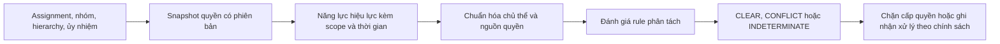

# Role conflict detection — Phát hiện xung đột vai trò

## 1. Xung đột vai trò là xung đột trách nhiệm trong một phạm vi

Một người có nhiều vai trò không tự động là một vấn đề. Nhân viên có thể vừa đọc báo cáo, vừa chuẩn bị hồ sơ, hoặc vận hành đơn vị A nhưng kiểm tra đơn vị B nếu chính sách cho phép.

Rủi ro xuất hiện khi tổ hợp quyền giúp cùng một chủ thể kiểm soát những bước cần độc lập: tạo rồi tự duyệt khoản chi, sửa dữ liệu rồi tự chứng nhận kết quả, hoặc tự cấp quyền rồi dùng quyền ấy để xóa dấu vết.

**Role conflict detection** là việc phát hiện những tổ hợp vai trò hoặc năng lực hiệu lực vi phạm một quy tắc phân tách nhiệm vụ trong phạm vi và khoảng thời gian đã xác định.

Một bộ phát hiện tốt không chỉ hỏi “người này có hai tên role bị cấm không”. Nó cần xem:

- Quyền đến từ assignment trực tiếp, nhóm, ủy nhiệm hay hierarchy nào?
- Các quyền có cùng áp dụng lên một miền nghiệp vụ không?
- Chúng có hiệu lực đồng thời không?
- Hai tài khoản có thực sự là hai chủ thể độc lập không?
- Quy tắc cấm giữ quyền đồng thời hay chỉ cấm dùng quyền trên cùng hồ sơ?
- Có một role tổng hợp đã chứa toàn bộ tổ hợp nguy hiểm hay không?

Trong module bảo vệ logic nghiệp vụ, phát hiện xung đột giúp chặn đường vượt phê duyệt, tự xử lý giao dịch, thao túng audit và lạm dụng các bước cấp quyền.

## 2. Phân biệt xung đột, dư thừa và rule cho phép hoặc từ chối

| Hiện tượng | Ý nghĩa | Ví dụ |
| --- | --- | --- |
| Xung đột trách nhiệm | Một tổ hợp năng lực bị chính sách cấm hoặc cần kiểm soát thêm | Cùng chủ thể giữ quyền lập và duyệt trong cùng phạm vi bị cấm |
| Quyền dư thừa | Có nhiều nguồn cấp một năng lực hoặc quyền không còn cần thiết | Nhận quyền đọc trực tiếp và qua nhóm |
| Mâu thuẫn rule cấp quyền | Các rule áp dụng có kết quả hoặc nghĩa vụ khác nhau | Có cả `ALLOW` và `DENY` cho cùng action và đối tượng |
| Thiếu quyền | Không có nguồn hợp lệ cho một action | Không có quyền duyệt khoản chi |
| Phân công không phù hợp | Người có quyền nhưng không đủ độc lập cho công việc cụ thể | Auditor được giao kiểm tra chính giao dịch mình đã xử lý |

Quyền dư thừa đáng rà soát nhưng không nhất thiết là một vi phạm phân tách nhiệm vụ. Một rule `DENY` tạm thời cũng không mặc nhiên làm một tổ hợp quyền nguy hiểm trở thành hợp lệ về mặt quản trị.

Ví dụ, chính sách tĩnh có thể cấm cấp đồng thời năng lực maker và checker dù hiện có một deny ngắn hạn chặn checker. Khi deny hết hạn, tổ hợp quyền vẫn tồn tại. Không dựa vào một điều kiện tạm thời để bỏ qua một quy tắc cấm giữ quyền đã được xác định rõ.

## 3. Xác định loại xung đột cần phát hiện

### 3.1. Xung đột tĩnh khi cấp quyền

Quy tắc tĩnh cấm một chủ thể giữ đồng thời một tổ hợp năng lực trong phạm vi quy định.

```text
Không cấp đồng thời:
  PAYMENT_MAKER
  PAYMENT_CHECKER
cho cùng chủ thể trong những scope giao nhau.
```

Đây là kiểm soát phòng ngừa ở tầng quản lý quyền. Nó cần xét cả cấp mới, thay hierarchy và thay membership có thể làm xuất hiện năng lực gián tiếp.

### 3.2. Xung đột động khi sử dụng quyền

Một chính sách khác có thể cho một người giữ cả hai năng lực nhưng cấm tự duyệt hồ sơ mình đã tạo hoặc sửa nội dung trọng yếu.

```text
có_quyền_duyệt(payment)
AND auditor_or_approver_subject không thuộc tập chủ thể xung đột của payment
```

Trong trường hợp này, kiểm tra assignment thôi chưa đủ. Đường thực hiện action phải kiểm tra lịch sử của chính đối tượng và đúng phiên bản nội dung theo chính sách.

### 3.3. Xung đột trong phiên kích hoạt

Một hệ thống có thể giới hạn những role được kích hoạt cùng phiên. Điều đó giúp giảm tổ hợp năng lực đang dùng, nhưng không biến cùng một người thành hai người độc lập khi họ đổi phiên.

Nếu quy tắc cấm tự duyệt theo hồ sơ, người tạo hồ sơ không được đăng xuất rồi đăng nhập bằng phiên khác để duyệt nó.

### 3.4. Xung đột dựa trên lịch sử

Quyền hiện tại không xóa trách nhiệm quá khứ. Một người đã vận hành giao dịch rồi bị gỡ role vẫn có thể không đủ độc lập để kiểm toán giao dịch đó.

Do đó cần phân biệt:

- Ai đang có quyền?
- Ai đã tham gia vào những bước mà chính sách xem là xung đột?

Lịch sử tham gia phải là dữ liệu có thẩm quyền, không phải một danh sách do client gửi để hệ thống tự loại trừ thuận lợi.

## 4. Định nghĩa quy tắc bằng hành động và trách nhiệm

Tên role chỉ là một lớp tổ chức. Chính sách cần xác định năng lực hoặc nhiệm vụ nào thực sự xung đột.

| Nhóm nhiệm vụ | Những hành động minh họa |
| --- | --- |
| Maker | Tạo, sửa nội dung trọng yếu, gửi hồ sơ |
| Checker | Phê duyệt hoặc từ chối theo thẩm quyền |
| Releaser | Cho phép nhận thực thi một giao dịch đã được duyệt |
| Operator | Can thiệp, xử lý lại hoặc điều chỉnh nghiệp vụ |
| Auditor | Kiểm tra bằng chứng, ghi phát hiện, kết luận rà soát |
| Access administrator | Gán role, sửa hierarchy, cấp ngoại lệ hoặc ủy nhiệm |

Các nhóm này là ví dụ. Một tổ chức phải xác định nhóm nhiệm vụ và tổ hợp cấm theo quy trình thực tế, không dùng bảng trên như một yêu cầu phổ quát.

Không phân loại role bằng prefix như `ADMIN_` hoặc từ “manager” trong tên. Một role tên vô hại vẫn có thể nhận quyền phê duyệt qua nhiều tầng hierarchy.

Nếu dùng nhãn nhiệm vụ, cần quản trị quan hệ giữa nhãn và action chuẩn hóa. Không để role mới tránh kiểm tra chỉ vì người tạo quên gắn nhãn.

### 4.1. Xung đột nằm trong một role duy nhất

```text
PAYMENT_MANAGER
  → PAYMENT_PREPARER
  → PAYMENT_APPROVER
```

Người dùng chỉ được gán một role trực tiếp nhưng có thể nhận cả maker và checker. Một bộ phát hiện chỉ đếm số role trực tiếp sẽ bỏ sót trường hợp này.

### 4.2. Xung đột từ nhiều nguồn khác nhau

```text
Nguồn 1: assignment trực tiếp cấp maker.
Nguồn 2: nhóm con → nhóm cha → role tổng hợp cấp checker.
```

Việc hai năng lực đến từ các hệ thống quản trị khác nhau không làm chúng trở nên độc lập. Cần tính quyền hiệu lực và giữ thông tin truy nguyên của từng nguồn.

## 5. Phạm vi: khác ID chưa chắc tách biệt, cùng tên chưa chắc xung đột

Một rule có thể áp dụng trên cùng tenant, đơn vị, tài khoản, payment hoặc một miền rủi ro rộng hơn.

Ví dụ:

| Assignment thứ nhất | Assignment thứ hai | Nhận định theo rule cùng phạm vi |
| --- | --- | --- |
| Maker tại A | Checker tại B, hai đơn vị tách biệt | Có thể không xung đột nếu chính sách cho phép |
| Maker toàn A | Checker tại nhóm con A1 | Có scope giao nhau |
| Maker toàn tenant | Checker trên một payment thuộc tenant | Có thể giao nhau |
| Maker tại tenant A | Checker tại tenant B | Phụ thuộc rule có giới hạn theo tenant hay xuyên tenant |

Không chỉ so sánh `scope_id` bằng nhau. Cần biết quan hệ bao chứa, tập đối tượng và loại tài nguyên.

Một bộ kiểm tra scope có thể trả:

```text
EMPTY                  : chứng minh không có phần giao cần xét
NON_EMPTY(witness)     : có miền hoặc đối tượng chứng minh phần giao
UNKNOWN                : chưa thể xác định đủ theo mô hình hiện tại
```

Với một điều kiện phân tách bắt buộc, `UNKNOWN` không nên bị diễn giải thành không xung đột để tiếp tục cấp quyền.

### 5.1. Xung đột có thể đi qua các loại đối tượng khác nhau

Quyền sửa tài khoản nhận của nhà cung cấp và quyền duyệt khoản chi cho nhà cung cấp đó có thể tạo một tổ hợp nguy hiểm. Hai quyền không cùng loại tài nguyên nên phép so sánh scope đơn giản có thể bỏ sót.

Cần mô hình hóa quan hệ nghiệp vụ giữa nhà cung cấp và khoản chi, hoặc đặt rule ở một miền trách nhiệm chung. Một số quan hệ chỉ xác định được khi có đối tượng cụ thể, vì vậy còn cần guard động tại action.

### 5.2. Phạm vi tiềm năng và dữ liệu đang tồn tại

Một grant áp dụng cho mọi hồ sơ tương lai của đơn vị không trở nên vô hại chỉ vì hôm nay đơn vị chưa có hồ sơ. Phát hiện tĩnh thường cần xét khả năng áp dụng theo scope, không chỉ join vào những dòng dữ liệu đang tồn tại.

## 6. Thời gian: hai quyền phải cùng có hiệu lực khi nào?

Với rule cấm giữ năng lực đồng thời, cần tìm phần giao thời gian của các nguồn quyền liên quan.

Giả sử dùng khoảng nửa mở `[not_before, not_after)`:

```text
overlap_start = max(các not_before)
overlap_end   = min(các not_after)

có_thời_gian_giao_nhau khi overlap_start < overlap_end
```

Ví dụ:

```text
Maker:   [09:00, 12:00)
Checker: [12:00, 15:00)
```

Hai khoảng không chồng nhau theo quy ước này. Nếu checker bắt đầu lúc 11:59 thì có một khoảng xung đột.

Tuy nhiên, hai assignment không chồng thời gian vẫn có thể vi phạm rule động hoặc lịch sử: người tạo hồ sơ buổi sáng không được tự duyệt chính hồ sơ đó buổi chiều nếu chính sách cấm.

### 6.1. Kiểm tra cả assignment tương lai

Một quyền mới có hiệu lực tuần sau có thể xung đột với một quyền đã được lên lịch. Chỉ kiểm tra `now` sẽ để một tổ hợp bị cấm tự xuất hiện sau này mà không có thêm thao tác cấp quyền.

Thời hạn của đường cấp quyền còn phụ thuộc membership, ủy nhiệm và các điều kiện cần thiết trên đường. Grant gốc sống đến cuối tháng không giữ quyền sống nếu membership bắt buộc hết hiệu lực sớm hơn.

### 6.2. Không dùng thời gian client làm nguồn quyết định

Server xác thực các thời điểm và tính hiệu lực theo nguồn thời gian đã chọn. Không để người dùng tự lùi `grantedAt`, thay `now` hoặc khai một khoảng giả để qua kiểm tra rồi được thực thi theo khoảng khác.

Nếu nguồn ngoài có thông tin tương lai hoặc độ trễ đồng bộ không xác định, cần thể hiện giới hạn đó trong kết quả đánh giá, thay vì giả định dữ liệu luôn đầy đủ.

## 7. Những quy tắc không chỉ là cặp role

### 7.1. Loại trừ theo cặp

Ví dụ:

```text
Không cùng có MAKER và CHECKER trên cùng miền áp dụng.
```

Có thể biểu diễn bằng một tập cặp không tương thích. Nhưng không phải mọi chính sách đều thu gọn được thành các cặp.

### 7.2. Giới hạn số nhóm nhiệm vụ

Ví dụ chính sách cho phép một người giữ tối đa hai trong ba năng lực:

```text
{MAKER, CHECKER, RELEASER}
```

Mỗi cặp đều có thể được phép, nhưng nhận đủ ba thì bị cấm. Một bộ phát hiện chỉ có danh sách cặp sẽ không thấy vi phạm này.

Rule cần xác định tập nhiệm vụ, số tối đa được giữ, phạm vi và điều kiện thời gian. Một nhiệm vụ nhận từ hai đường không được đếm thành hai nhiệm vụ khác nhau.

### 7.3. Nhiều scope cần có phần giao chung

Nếu rule giới hạn tổ hợp trên cùng một tài nguyên, không đủ để biết các scope giao nhau từng cặp.

```text
S1 = {A, B}
S2 = {B, C}
S3 = {A, C}
```

Mọi cặp đều có phần giao, nhưng không có tài nguyên thuộc cả ba. Với rule cấm đủ ba nhiệm vụ trên cùng một tài nguyên, ví dụ này không tự tạo vi phạm ba chiều.

Ngược lại, một chính sách cấm giữ ba nhiệm vụ ở cấp toàn đơn vị có thể có kết quả khác. Phải kiểm tra đúng miền mà rule định nghĩa, không thay rule nhiều chiều bằng một suy luận từng cặp không tương đương.

### 7.4. Tính độc lập của người phê duyệt là một ràng buộc khác

Một người có hai role không tạo hai người duyệt. Nếu một hồ sơ cần tài chính và quản trị rủi ro, đồng thời cần hai chủ thể độc lập, cần chọn người cho từng vị trí sao cho đáp ứng cả vai trò lẫn số chủ thể phân biệt.

Ví dụ người A đủ cả hai vai trò, người B chỉ đủ tài chính. Có thể phân A cho vị trí rủi ro và B cho tài chính. Cách chọn vội A vào tài chính rồi kết luận thiếu rủi ro có thể từ chối sai một phân công hợp lệ.

Phát hiện role conflict và kiểm tra quorum liên quan nhau nhưng không phải cùng một bài toán. Một bên kiểm tra tổ hợp năng lực bị cấm; bên kia kiểm tra tập người thực sự tham gia có đáp ứng yêu cầu độc lập hay không.

## 8. Chuẩn hóa danh tính và lịch sử quy trách nhiệm

Một cấu trúc cần giữ được:

```text
tài khoản trực tiếp
chủ thể chuẩn hóa
người khởi tạo nếu dịch vụ làm thay
service principal thực thi
bằng chứng và phạm vi ủy nhiệm
```

Các tài khoản cùng thuộc một con người cần được xử lý theo nguồn liên kết danh tính đáng tin cậy khi chính sách yêu cầu người độc lập. Không lấy `canonicalSubjectId` từ body làm bằng chứng.

Đối với ủy nhiệm, chính sách phải xác định trách nhiệm nào của người cấp và người nhận làm phát sinh xung đột. Không tự cho rằng chuyển qua một người hoặc một bot trung gian sẽ xóa trách nhiệm của người khởi tạo.

Nếu một liên kết danh tính mới cho thấy hai người được coi là độc lập trước đó thực ra là cùng chủ thể, hệ thống cần đánh giá tác động và lưu kết quả xử lý. Không sửa lịch sử để làm như các hành động cũ do người khác thực hiện.

Tài khoản dùng chung làm suy yếu khả năng xác định độc lập. Với những hành động đòi hỏi quy trách nhiệm theo người, cần một cơ chế danh tính đủ phân biệt trước khi có thể khẳng định phân tách đã được bảo đảm.

## 9. Pipeline phát hiện xung đột



Một quy trình điển hình:

1. Xác định rule và revision áp dụng cho miền đang kiểm tra.
2. Lấy snapshot đầy đủ của các nguồn quyền cần thiết.
3. Mở rộng nhóm và hierarchy, giữ nguồn, scope, thời hạn và điều kiện.
4. Chuẩn hóa chủ thể để không tách cùng một người thành nhiều tài khoản độc lập.
5. Tạo trạng thái giả định sau thay đổi đề xuất.
6. Đánh giá các rule theo cặp, theo tập nhiệm vụ và những điều kiện được hỗ trợ.
7. Trả kết quả có bằng chứng nguồn và miền xung đột.
8. Chỉ commit thay đổi nếu kết quả đáp ứng chính sách và snapshot vẫn có thẩm quyền.

`CLEAR` có nghĩa không phát hiện vi phạm đối với bộ rule và snapshot đã đánh giá. Nó không chứng minh mọi hành động tương lai đều hợp lệ; guard động và các bất biến giao dịch vẫn phải tồn tại.

### 9.1. Mô hình năng lực hiệu lực

Một phần tử sau mở rộng có thể là:

```text
EffectiveDuty = {
    canonical_subject_id,
    duty,
    action_set,
    resource_scope,
    validity_interval,
    source_paths,
    policy_revision
}
```

Không hợp nhất các phần tử bằng cách lấy scope rộng nhất và hạn mức lớn nhất từ các nguồn khác nhau. Giữ nguyên điều kiện của từng nguồn để phép kiểm tra không tạo ra hoặc che khuất một tổ hợp chưa từng tồn tại.

### 9.2. Kết quả ba trạng thái

| Kết quả | Ý nghĩa | Hành vi với rule bắt buộc |
| --- | --- | --- |
| `CLEAR` | Đã đánh giá đủ và không thấy vi phạm theo rule | Có thể tiếp tục những kiểm tra còn lại |
| `CONFLICT` | Có bằng chứng vi phạm cụ thể | Chặn hoặc yêu cầu quy trình ngoại lệ được phép |
| `INDETERMINATE` | Thiếu nguồn, lỗi graph hoặc không xác định được điều kiện cần thiết | Không coi là an toàn để cấp quyền |

Một lỗi nguồn nhóm hoặc graph vượt giới hạn không phải một kết quả không xung đột.

## 10. Phát hiện ở những thời điểm nào?

### 10.1. Trước khi quyền hiệu lực thay đổi

Các điểm kích hoạt gồm:

- Gán role trực tiếp hoặc mở rộng scope assignment.
- Thêm membership vào nhóm hoặc thay group nesting.
- Thêm permission vào role nền hoặc thay cạnh hierarchy.
- Cấp hoặc gia hạn ủy nhiệm.
- Thay khoảng hiệu lực hoặc liên kết danh tính.
- Thay chính sách kết hợp có thể mở rộng quyền thực tế.
- Thay quan hệ tài nguyên khiến scope của các quyền bắt đầu chồng lấn.

Một lần gán role cần đánh giá chủ thể nhận. Một lần sửa role nền có thể cần đánh giá mọi chủ thể chịu ảnh hưởng, kể cả người nhận role gián tiếp.

### 10.2. Tại lúc thực hiện action

Những rule dựa trên tác giả, người sửa, người duyệt trước, quan hệ nhà cung cấp hoặc lịch sử xử lý phải được kiểm tra tại action với dữ liệu đối tượng có thẩm quyền.

Không chỉ ẩn nút duyệt khi người dùng là maker. API và consumer thực hiện cùng hành động cũng phải có guard tương ứng.

### 10.3. Quét định kỳ và sau thay đổi nguồn ngoài

Quét giúp phát hiện cấu hình cũ, drift, import lỗi hoặc thay đổi từ hệ thống ngoài. Đây là lớp bổ sung, không thay thế việc chặn trước commit nếu chính sách yêu cầu phòng ngừa ngay.

Nếu nhóm từ IAM ngoài chỉ đồng bộ theo kỳ, cần xác định độ trễ phát hiện và thu hồi. Không khẳng định không bao giờ có xung đột nếu có đường cấp quyền bên ngoài không được kiểm soát đồng bộ.

## 11. Ví dụ Java: chặn cấp role tạo xung đột

### 11.1. Giả định của ví dụ

Ví dụ quản lý các rule xung đột trong phạm vi một tenant, dùng cùng cơ sở dữ liệu cho catalog quyền, membership cục bộ, assignment, audit và outbox.

Để giữ tính đúng đắn dễ giải thích, mọi thay đổi dữ liệu quyền cục bộ mà rule phụ thuộc đều khóa một bản ghi đầu trạng thái quyền của tenant. Cách này tuần tự hóa thao tác quản trị và có chi phí thông lượng; hệ thống lớn có thể dùng cách khác nếu vẫn bảo vệ cùng bất biến.

Các rule xuyên tenant hoặc dữ liệu IAM bên ngoài cần cơ chế phối hợp riêng. Một khóa tenant không bảo vệ dữ liệu ngoài ranh giới đó.

### 11.2. Service minh họa

Các repository, policy, bộ phân giải và kiểu dữ liệu cần được triển khai theo hệ thống. Constructor injection được lược bỏ; đây không phải ứng dụng chạy độc lập.

```java
@Service
public class ConflictCheckedRoleAssignmentService {
    private final AuthorizationStateRepository states;
    private final SubjectDirectory subjects;
    private final RoleAssignmentRepository assignments;
    private final AuthorizationSnapshotLoader snapshotLoader;
    private final EffectiveDutyResolver dutyResolver;
    private final RoleConflictDetector conflictDetector;
    private final RoleGrantAdministration administration;
    private final DatabaseTimeSource databaseTime;
    private final IdempotencyRepository idempotency;
    private final SecurityAuditRepository audits;
    private final OutboxRepository outbox;
    private final CommandFingerprint fingerprints;

    @Transactional(rollbackFor = Exception.class)
    public RoleGrantReceipt grantRole(
            VerifiedActor actor,
            GrantRoleCommand command) {

        actor.requireAuthenticated();
        command.validateSyntaxAndLimits();

        AuthorizationStateHead head = states.lockForUpdate(
                actor.tenantId());

        administration.requireGrantManagement(actor, head);

        CanonicalSubject target = subjects.requireInTenant(
                actor.tenantId(), command.targetAccountId());

        CommandScope keyScope = new CommandScope(
                actor.tenantId(), target.id(),
                actor.canonicalSubjectId(),
                "GRANT_ROLE", command.idempotencyKey());
        String fingerprint = fingerprints.forRoleGrant(command);

        var previous = idempotency.find(keyScope);
        if (previous.isPresent()) {
            if (!previous.get().fingerprint().equals(fingerprint)) {
                throw new IdempotencyConflictException();
            }
            return previous.get().receipt();
        }

        if (head.revision() != command.expectedAuthorizationRevision()) {
            throw new StaleAuthorizationStateException();
        }

        AuthorizationSnapshot before = snapshotLoader.loadComplete(
                actor.tenantId(), head.revision());
        before.requireValidAndComplete();

        Instant checkedAt = databaseTime.currentInstant();

        RoleAssignment proposed = administration.buildValidatedAssignment(
                actor, target, command, before, checkedAt);
        // Server quyết định người cấp; scope và thời hạn phải nằm
        // trong quyền quản trị được ủy nhiệm, không tin nguyên body.

        AuthorizationSnapshot after = before.withAssignment(proposed);

        EffectiveDutySnapshot duties = dutyResolver.resolveForSubject(
                target.id(), after);
        // Bao gồm những khoảng tương lai cần xét, không chỉ quyền tại now.

        ConflictReport report = conflictDetector.evaluate(
                target.id(), duties, after.conflictRules());

        if (report.outcome() == ConflictOutcome.INDETERMINATE) {
            throw new ConflictEvaluationUnavailableException();
        }
        if (report.outcome() == ConflictOutcome.CONFLICT) {
            throw new RoleConflictException(report.safeSummary());
        }

        assignments.insert(proposed);

        long newRevision = Math.addExact(head.revision(), 1);
        int changed = states.advanceRevision(
                actor.tenantId(), head.revision(), newRevision);
        if (changed != 1) {
            throw new ConcurrentAuthorizationChangeException();
        }

        audits.appendRoleGranted(
                actor, proposed, report, head.revision(), newRevision);
        outbox.appendAuthorizationChanged(
                UUID.randomUUID(), actor.tenantId(),
                target.id(), newRevision);

        RoleGrantReceipt receipt = new RoleGrantReceipt(
                proposed.id(), target.id(), newRevision);
        idempotency.insert(keyScope, fingerprint, receipt);
        return receipt;
    }
}
```

Các dependency `final` phải được khởi tạo qua constructor. Với Spring transaction qua proxy thông thường, lời gọi phải đi qua bean được quản lý để annotation có hiệu lực, và các repository phải tham gia đúng transaction manager của ví dụ.

`buildValidatedAssignment()` phải kiểm tra role đích thuộc catalog được phép, scope có kiểu rõ ràng, thời hạn hợp lệ, quyền tự cấp nếu có và giới hạn mà người quản trị được phép cấp. Một assignment không xung đột vẫn có thể trái phép nếu người thao tác không có thẩm quyền cấp nó.

`resolveForSubject()` cần mở rộng mọi nguồn liên quan, không chỉ role đang đề xuất. Nếu dữ liệu không đủ hoặc gặp cấu hình không hợp lệ, không trả một snapshot rỗng rồi làm như không có xung đột.

Ví dụ chỉ lưu idempotency cho thay đổi thành công đã commit. Hợp đồng API cần nêu rõ xử lý các lần thử thất bại; không được trả receipt thành công cho một grant đã rollback.

### 11.3. Vì sao cần khóa hoặc cơ chế tương đương?

Không có bảo vệ concurrency, có thể xảy ra:

```text
Ban đầu người U chưa có maker hoặc checker.
T1 đọc quyền U, thấy cấp maker không xung đột.
T2 đọc quyền U, thấy cấp checker không xung đột.
T1 và T2 cùng commit.
U có cả hai năng lực bị cấm.
```

Khóa trạng thái quyền chung trong ví dụ buộc transaction đi sau đánh giá trên trạng thái sau commit của transaction đi trước. Ràng buộc duy nhất trên từng assignment không ngăn được tổ hợp hai assignment khác nhau.

Nếu thay khóa chung bằng khóa theo chủ thể hoặc cơ chế khác, phải bảo vệ cả thay đổi nhóm và role nền có thể tác động đến nhiều chủ thể. Không chỉ khóa người nhận trong API gán role rồi cho đường sửa hierarchy chạy ngoài giao thức.

## 12. Guard động trên hồ sơ vẫn phải tồn tại

Ví dụ kiểm tra trước khi duyệt payment:

```java
// Minh họa bên trong transaction của action phê duyệt.
Payment payment = payments.lockForUpdate(tenantId, paymentId)
    .orElseThrow(PaymentNotFoundException::new);

authorization.requirePermission(actor, "PAYMENT_APPROVE", payment);

Set<SubjectId> conflictingSubjects = history.accountableMakersFor(
        payment.id(), payment.contentVersion(), approvalPolicy);

if (conflictingSubjects.contains(actor.canonicalSubjectId())) {
    throw new SelfApprovalNotAllowedException();
}

payment.requirePendingApproval(expectedVersion, approvalRound);
approvals.recordDecisionForCanonicalSubject(actor, payment);
```

Các helper và repository ở đây chỉ minh họa hợp đồng. Toàn bộ đọc lịch sử liên quan, kiểm tra và ghi quyết định phải tuân theo giao thức transaction của hệ thống.

`accountableMakersFor()` phải áp dụng chính sách rõ ràng: có tính người khởi tạo gốc, người sửa nội dung đang được duyệt hoặc các chủ thể khác hay không. Không xóa lịch sử hoặc thay người tạo bằng worker để vượt guard.

Khi gửi lại vòng duyệt, cần giữ đúng trách nhiệm gắn với nội dung và lịch sử theo chính sách. Không đặt lại `createdBy` thành một tài khoản hệ thống rồi cho maker cũ tự duyệt.

Quyết định phê duyệt cũng cần chống trùng theo chủ thể chuẩn hóa trong cùng vòng, không chỉ theo account ID. Đổi tài khoản không được tạo thêm một phiếu độc lập.

## 13. Báo cáo xung đột phải có bằng chứng và giới hạn

Một báo cáo hữu ích có thể chứa:

```text
ConflictFinding = {
    rule_id,
    rule_revision,
    canonical_subject_id,
    conflicting_duties,
    source_assignments_or_paths,
    overlap_scope,
    overlap_time,
    proposed_change_reference,
    evaluation_revision
}
```

Ví dụ giải thích:

```text
Rule SOD-PAYMENT-01 bị vi phạm.
Chủ thể U nhận maker qua nhóm G và checker từ assignment đề xuất.
Phần giao phạm vi: đơn vị A1, nằm trong đơn vị A.
Phần giao thời gian: từ 09:00 ngày D đến trước 18:00 ngày D.
Trạng thái quyền dùng để đánh giá: revision 73.
```

Báo cáo giúp người quản trị sửa đúng nguồn thay vì thử gỡ một role bất kỳ. Nó cũng cần phân quyền đọc vì có thể tiết lộ membership, quyền nhạy cảm hoặc thông tin tổ chức.

Không trả toàn bộ đồ thị quyền cho một người chỉ có quyền quản lý một phần nhỏ. API có thể trả mã lý do an toàn, còn chi tiết đầy đủ dành cho người được phép điều tra.

### 13.1. Không nhầm kết quả dự thảo với kết quả được thực thi

Chức năng xem trước có thể cho biết thay đổi hiện tại không xung đột. Đến lúc commit, dữ liệu có thể đã thay đổi.

Receipt hoặc quyết định phê duyệt thay đổi phải gắn với revision và nội dung được đánh giá. Nếu revision không còn phù hợp, phải kiểm tra lại; một ảnh chụp màn hình báo “không xung đột” không phải giấy phép vượt kiểm tra lúc ghi.

## 14. Khắc phục và ngoại lệ có kiểm soát

Các cách khắc phục thường gồm:

- Gỡ đúng nguồn tạo năng lực xung đột, đồng thời kiểm tra các đường thay thế.
- Thu hẹp scope để không còn phần giao bị cấm.
- Điều chỉnh khoảng hiệu lực nếu chính sách cho phép và không còn vi phạm lịch sử.
- Phân công bước nhạy cảm cho một chủ thể độc lập thực sự.
- Tách một role tổng hợp thành những trách nhiệm dễ quản trị hơn.
- Sửa rule nếu rule không phản ánh đúng nghiệp vụ, qua quy trình quản trị chính sách.

Không giải quyết bằng cách đổi tên role, tạo tài khoản thứ hai hoặc xóa lịch sử tham gia.

### 14.1. Ngoại lệ không phải cờ bỏ qua toàn bộ kiểm tra

Nếu tổ chức cho ngoại lệ, nó cần giới hạn cụ thể: rule nào, chủ thể nào, scope nào, thời gian nào, ai phê duyệt và kiểm soát bổ sung gì được yêu cầu.

Người xin hoặc tạo ngoại lệ không nên tự đáp ứng một yêu cầu phê duyệt độc lập bằng chính mình. Quyền tạo ngoại lệ cũng là một năng lực cần được kiểm tra xung đột.

Ngoại lệ cho một rule phân tách không tự bỏ qua quyền theo tenant, trạng thái hồ sơ, hạn mức tài chính hoặc idempotency. Các bất biến đó vẫn phải được bảo vệ.

### 14.2. Cẩn thận khi thu hồi để khắc phục

Gỡ một role có thể làm gián đoạn công việc, nhưng không nên tự hủy hoặc thực hiện lại các command đang chưa rõ kết quả. Phân biệt thu hồi quyền cho request mới với quy trình xử lý công việc đã được nhận.

Nếu thu hồi một đường nhưng còn quyền qua nhóm khác, phải báo rõ xung đột vẫn tồn tại. Không đánh dấu đã xử lý chỉ vì một bản ghi assignment đã bị xóa.

## 15. Hiệu năng, cache và độ đầy đủ

### 15.1. Giảm phạm vi phân tích theo phụ thuộc

Một thay đổi assignment có thể chỉ tác động một chủ thể. Thay role nền hoặc nhóm lớn có thể tác động nhiều người. Theo dõi quan hệ phụ thuộc giúp xác định tập cần đánh giá lại mà không quét toàn bộ hệ thống mỗi lần.

Tuy nhiên, tối ưu không được bỏ sót đường quyền gián tiếp. Nếu không chứng minh được tập ảnh hưởng đầy đủ, cần mở rộng phân tích hoặc trả kết quả chưa xác định theo chính sách.

### 15.2. Cache cần revision và thời hạn

Cache quyền hiệu lực hoặc báo cáo xung đột có thể cũ khi:

- Assignment, hierarchy, membership hoặc ủy nhiệm thay đổi.
- Rule xung đột đổi revision.
- Một khoảng quyền tương lai bắt đầu hoặc một nguồn hết hạn.
- Scope thay đổi do cấu trúc tổ chức hoặc quan hệ tài nguyên.
- Danh tính được hợp nhất hoặc liên kết lại.

Một TTL đơn giản không bảo đảm kết quả còn đúng. Đường commit thay đổi quyền cần kiểm tra revision và các phụ thuộc theo hợp đồng nhất quán của hệ thống.

### 15.3. Phân tích thời gian không chỉ là đặt một timer

Nếu đã có hai assignment tương lai chồng lấn bị cấm, bộ phát hiện tĩnh nên tìm thấy ngay khi đề xuất. Không đợi timer đến ngày hiệu lực rồi mới phát hiện rằng quyền đã được cấp theo cấu hình từ trước.

Timer hoặc quét định kỳ vẫn hữu ích để cập nhật trạng thái, phát cảnh báo và kiểm tra nguồn ngoài. Chúng không thay thế việc đánh giá khoảng thời gian khi cấp quyền.

## 16. Kiểm thử tình huống tấn công và lỗi phát hiện

### 16.1. Kiểm thử nguồn quyền và danh tính

| Tình huống | Kết quả cần chứng minh |
| --- | --- |
| Hai role trực tiếp bị cấm trong cùng scope | Phát hiện đúng rule và nguồn |
| Một role tổng hợp chứa cả hai nhiệm vụ | Không bỏ sót vì chỉ có một assignment |
| Một quyền trực tiếp, một quyền qua nhóm nhiều tầng | Phát hiện tổ hợp gián tiếp |
| Cùng nhiệm vụ đến từ nhiều đường | Không đếm thành nhiều nhiệm vụ độc lập |
| Hai account cùng canonical subject | Không được coi là hai người độc lập |
| Worker làm thay người tạo | Lịch sử vẫn quy trách nhiệm đúng theo chính sách |
| Đổi tên role hoặc dùng prefix vô hại | Không làm thay đổi đánh giá năng lực thực |
| Nguồn membership hoặc graph không đầy đủ | `INDETERMINATE`, không mặc định không xung đột |

### 16.2. Kiểm thử scope và thời gian

| Tình huống | Kết quả cần chứng minh |
| --- | --- |
| Maker A, checker B, scope thực sự tách biệt | Không báo xung đột nếu rule cho phép |
| Maker A, checker A1 nằm trong A | Có phần giao được phát hiện |
| Role khác loại tài nguyên nhưng liên hệ nghiệp vụ bị cấm | Rule hoặc guard liên quan không bị bỏ qua |
| Hai quyền có thời gian chồng lấn trong tương lai | Phát hiện trước khi đến ngày hiệu lực |
| Một khoảng kết thúc đúng lúc khoảng kia bắt đầu | Không coi là đồng thời với quy ước nửa mở |
| Các khoảng không đồng thời nhưng cùng người tạo rồi duyệt | Guard lịch sử vẫn chặn nếu chính sách yêu cầu |
| Scope giao từng cặp nhưng giao chung của ba scope rỗng | Không báo sai rule cấm ba nhiệm vụ trên cùng tài nguyên |
| Scope không phân giải được | Không biến thành tập rỗng để cấp quyền |

Với thời gian, dùng clock hoặc abstraction điều khiển được cho logic thuần. Trong test tích hợp, dùng độ chính xác thực tế của kiểu dữ liệu và driver, không giả rằng mọi mốc nano giây đều được lưu nguyên vẹn.

### 16.3. Kiểm thử rule nhiều nhiệm vụ và quorum

1. Mọi cặp trong tập ba nhiệm vụ đều được phép nhưng đủ ba bị cấm.
2. Nhận cùng một nhiệm vụ hai lần không vượt sai giới hạn số nhiệm vụ phân biệt.
3. Một người có hai role không đáp ứng yêu cầu hai chủ thể phê duyệt.
4. Có nhiều cách phân người vào các vị trí duyệt thì chọn được một cách hợp lệ, không phụ thuộc thứ tự ngẫu nhiên.
5. Người đã tạo hồ sơ không được trở thành người duyệt độc lập nhờ bỏ role maker trước lúc duyệt.
6. Ngoại lệ chỉ áp dụng đúng rule, chủ thể, scope và thời hạn được phê duyệt.

### 16.4. Kiểm thử concurrency

Dùng transaction độc lập với barrier hoặc latch để điều khiển điểm đọc, chờ và commit. Không dùng `sleep` làm bằng chứng rằng cuộc đua đã được kiểm tra.

```text
A. Hai request đồng thời cấp maker và checker cho cùng chủ thể.
   Kết quả: không thể commit tổ hợp bị cấm theo policy tĩnh.

B. Một request gán role X, một request sửa hierarchy để X nhận checker.
   Kết quả: cả hai đường tuân thủ giao thức đồng bộ và đánh giá
   trên trạng thái đủ mới để không bỏ sót tổ hợp bị cấm.

C. Membership thay đổi trong lúc bản xem trước grant còn mở.
   Kết quả: commit kiểm tra lại hoặc từ chối do revision cũ.

D. Một transaction thay scope tổ chức khiến hai assignment giao nhau.
   Kết quả: thay đổi scope cũng được kiểm tra theo bất biến liên quan.
```

Nếu hệ thống chỉ phát hiện một loại thay đổi sau đồng bộ định kỳ, test phải phản ánh đúng giới hạn đó. Không mô tả một cảnh báo sau sự kiện như bảo đảm phòng ngừa trước commit.

### 16.5. Kiểm thử lỗi và retry

- Audit hoặc outbox bắt buộc lỗi: assignment và revision không commit riêng lẻ.
- Mất response sau commit: retry cùng key trả receipt cũ, không tạo grant mới.
- Cùng key nhưng thay role, scope hoặc thời hạn: xung đột theo hợp đồng idempotency.
- Bản quét bị dừng giữa chừng: không công bố toàn tenant đã không còn xung đột.
- Gỡ một nguồn nhưng còn nguồn khác: báo cáo vẫn phản ánh năng lực hiệu lực.
- Policy đổi revision trong khi phân tích dự thảo: kết quả cũ không tự được dùng cho commit mới.
- Thu hồi role sau một lần thao tác: guard động vẫn đọc lịch sử chủ thể đúng.

Kiểm tra dữ liệu assignment, quyền hiệu lực, revision, audit và hiệu ứng nghiệp vụ, không chỉ mã HTTP. Mock repository không chứng minh được khóa và ranh giới commit của cơ sở dữ liệu thực.

## 17. Những lỗi thiết kế cần tránh

| Cách làm | Vì sao sai | Hướng thay thế |
| --- | --- | --- |
| Chỉ so sánh tên role trực tiếp | Bỏ sót hierarchy, nhóm và role tổng hợp | Đánh giá năng lực hiệu lực có truy nguyên |
| Cấm mọi người có nhiều role | Tạo nhiều cảnh báo sai và cản phân công hợp lệ | Rule theo trách nhiệm, scope và thời gian |
| Scope khác ID là coi không giao nhau | Bỏ sót quan hệ cha con hoặc wildcard | Mô hình giao scope có ngữ nghĩa |
| Chỉ xét quyền tại thời điểm hiện tại | Bỏ sót xung đột đã được lên lịch | Đánh giá các khoảng hiệu lực cần thiết |
| Mọi rule đều mô hình bằng cặp | Không diễn đạt được giới hạn nhiều nhiệm vụ | Rule theo tập với ngưỡng và miền chung |
| Cùng người đổi account là đủ độc lập | Có thể tự tạo rồi tự duyệt | Chủ thể chuẩn hóa và lịch sử trách nhiệm |
| Xóa role là xóa xung đột quá khứ | Mất điều kiện không tự kiểm tra công việc đã làm | Guard động dựa trên lịch sử |
| Thiếu dữ liệu thì coi không có role | Lỗi nguồn biến thành quyền được cấp | Kết quả chưa xác định không cho commit trái điều kiện |
| Xem trước không xung đột rồi ghi không kiểm tra lại | Quyền có thể đổi giữa hai bước | Revision và giao thức concurrency phù hợp |
| Unique từng assignment là đủ | Hai grant khác nhau vẫn tạo tổ hợp bị cấm | Bảo vệ bất biến tổ hợp trong transaction |
| Ngoại lệ là `skipAllChecks` | Vượt cả điều kiện không thuộc ngoại lệ | Ngoại lệ có phạm vi và kiểm soát riêng |
| Chỉ quét định kỳ nhưng hứa không thể cấp xung đột | Khoảng giữa hai lần quét vẫn tồn tại vi phạm | Phân biệt phòng ngừa, phát hiện và thời gian thu hồi |

## 18. Bài tập thiết kế

Thiết kế bộ phát hiện xung đột cho hệ thống lệnh chi có maker, checker, releaser và auditor. Quyền có thể đến từ assignment trực tiếp hoặc nhóm lồng nhau; role có hierarchy; một số assignment chỉ có hiệu lực trong tương lai.

Hãy mô tả:

1. Những tổ hợp nào bị cấm tĩnh, tổ hợp nào chỉ bị cấm khi thao tác trên cùng hồ sơ?
2. Phạm vi của rule là tenant, đơn vị, payment hay một miền quan hệ nghiệp vụ khác?
3. Các nguồn quyền được mở rộng và chuẩn hóa danh tính như thế nào?
4. Một rule cho phép tối đa hai trong ba nhiệm vụ được kiểm tra ra sao mà không chỉ dựa vào cặp?
5. Khi gán role hoặc sửa hierarchy đồng thời, điều gì ngăn cả hai thay đổi cùng tạo tổ hợp bị cấm?
6. Bản xem trước và phê duyệt thay đổi gắn với revision nào, và khi dữ liệu đổi thì xử lý ra sao?
7. Sau khi gỡ role maker, điều gì vẫn ngăn người đó tự duyệt hồ sơ đã tạo?
8. Báo cáo cần giữ bằng chứng nào để người quản trị khắc phục đúng nguồn mà không làm lộ toàn bộ đồ thị quyền?

Một thiết kế đạt yêu cầu cần chỉ ra được chủ thể, năng lực, nguồn quyền, phần giao phạm vi và thời gian tạo vi phạm, đồng thời bảo đảm quyết định chặn hoặc cho phép được áp dụng trên trạng thái có thẩm quyền tại điểm thay đổi quyền hoặc thực hiện nghiệp vụ.
