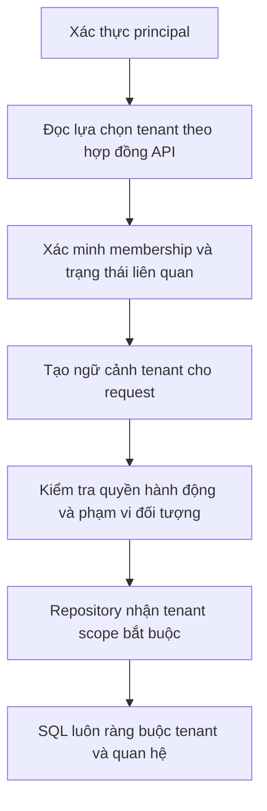

# Tenant scoped queries: truy vấn dữ liệu trong đúng phạm vi tenant

Trong chương **Tenant Isolation**, tenant scoped query là truy vấn được ràng buộc với một phạm vi tenant đã được máy chủ xác minh. Ràng buộc đó phải tồn tại ở mọi đường đọc, ghi và liên kết dữ liệu thuộc tenant; không chỉ ở màn hình danh sách hoặc một endpoint chính.

Trong module bảo vệ logic nghiệp vụ, thiếu phạm vi tenant có thể làm lộ đề nghị của tổ chức khác, cho phép duyệt sai đối tượng, gắn nhà cung cấp khác tenant hoặc thực hiện một thao tác trùng trên dữ liệu không thuộc phạm vi được phép. Truy vấn có tham số vẫn có thể mắc lỗi này nếu điều kiện phân vùng nghiệp vụ bị thiếu.

Bài học dùng hệ thống đề nghị mua hàng nhiều tổ chức. Ví dụ giả định các dữ liệu nghiệp vụ được lưu trong bảng dùng chung và có `tenant_id`; với mô hình tách schema hoặc cơ sở dữ liệu, nguyên tắc xác minh phạm vi vẫn áp dụng tại điểm chọn nơi lưu trữ.

Sau bài này, bạn có thể:

- Lấy tenant từ ngữ cảnh đã xác minh thay vì tin một ID do client khai báo.
- Viết truy vấn đọc, ghi, join và tổng hợp luôn giữ điều kiện tenant.
- Bảo vệ quan hệ giữa các bảng bằng khóa và điều kiện cùng tenant.
- Thiết kế repository, transaction và worker để không rơi về truy vấn toàn cục.
- Kiểm thử rò rỉ qua danh sách, số lượng, thao tác hàng loạt, cache và báo cáo.

## 1. Prepared statement không tự tạo tenant isolation

Truy vấn sau có thể an toàn trước việc chèn cú pháp SQL vào ID nhưng vẫn sai phạm vi:

```sql
SELECT id, state, amount, currency
FROM purchase_request
WHERE id = :request_id;
```

Nếu caller biết ID của một đề nghị thuộc tenant khác, truy vấn vẫn có thể trả bản ghi đó. ID khó đoán làm giảm khả năng đoán, không chứng minh caller có quyền đọc.

Trong endpoint nghiệp vụ thông thường, truy vấn cần được ràng buộc:

```sql
SELECT id, state, amount, currency
FROM purchase_request
WHERE tenant_id = :authorized_tenant_id
  AND id = :request_id;
```

`authorized_tenant_id` phải là phạm vi máy chủ đã xác minh. Nếu nó chỉ được chép từ body hoặc header tùy ý của request, điều kiện SQL vẫn có thể cho phép caller tự chọn tenant khác.

Tenant isolation và chống SQL injection giải quyết hai vấn đề khác nhau. Hệ thống cần cả binding tham số lẫn kiểm soát phạm vi dữ liệu.

## 2. Xác định tenant từ ngữ cảnh đáng tin cậy

Một người dùng có thể thuộc nhiều tenant. Việc chọn tenant làm việc là ý định hợp lệ của client, nhưng máy chủ phải xác minh quyền sử dụng tenant đó cho request hiện tại.

Một luồng điển hình:



Nguồn lựa chọn có thể là route, hostname, header hoặc thông tin phiên theo thiết kế. Dù chọn cách nào, cần xử lý nhất quán và không cho nhiều lớp hiểu các nguồn mâu thuẫn theo những thứ tự khác nhau.

Ví dụ user U có membership ở T1 và T2. Trong request đã xác minh scope T1, hệ thống không tự hợp quyền của hai tenant để truy cập cả hai. Muốn chuyển sang T2 phải đi qua cơ chế chọn và xác minh tương ứng.

Các nguyên tắc quan trọng:

- Không lấy tenant từ trường của đối tượng mà client đang muốn sửa.
- Không coi một chuỗi `tenantId` trong body là bằng chứng membership.
- Nếu token chứa tenant hoặc membership, kiểm chứng theo hợp đồng token và yêu cầu hiệu lực của hệ thống; claim cũ có thể không phản ánh thu hồi mới.
- Thiếu ngữ cảnh tenant ở đường bắt buộc phải dẫn tới lỗi phù hợp, không trở thành “không lọc”.
- Cố định phạm vi tenant của transaction nghiệp vụ; không âm thầm đổi tenant giữa các câu lệnh.

## 3. Những invariant cần giữ xuyên suốt truy vấn

Với một request scoped vào tenant T, mô hình ví dụ yêu cầu:

```text
mọi bản ghi nghiệp vụ trả về đều thuộc T
mọi bản ghi được sửa hoặc xóa đều thuộc T
mọi bản ghi mới được tạo mang tenant do máy chủ xác định là T
mọi quan hệ tenant-owned được nối hoặc gán đều tương thích với T
```

Các invariant này áp dụng cả với dữ liệu gián tiếp: ghi chú, tệp đính kèm, phiếu duyệt, reservation và outbox liên quan.

Phạm vi tenant là điều kiện cần, chưa phải toàn bộ quyền theo đối tượng. Trong T1, một nhân sự vẫn có thể chỉ được xem bộ phận A hoặc chỉ được duyệt dưới một hạn mức. Không bỏ các điều kiện đó chỉ vì `tenant_id` đã đúng.

Ngược lại, vai trò `APPROVER` không được dùng để vượt tenant. Vai trò cần được đánh giá trong phạm vi mà nó được gán, không phải một cờ toàn cục lấy từ một membership bất kỳ của user.

## 4. Áp dụng điều kiện tenant cho đọc chi tiết, danh sách và số lượng

Đọc chi tiết cần ghép tenant với ID. Danh sách cũng cần tenant kể cả khi client không gửi bộ lọc nào:

```sql
SELECT id, state, amount, currency, created_at
FROM purchase_request
WHERE tenant_id = :authorized_tenant_id
  AND state = :requested_state
ORDER BY created_at DESC, id DESC;
```

Đếm số lượng phải dùng cùng phạm vi:

```sql
SELECT COUNT(*)
FROM purchase_request
WHERE tenant_id = :authorized_tenant_id
  AND state = :requested_state;
```

Nếu danh sách được lọc đúng nhưng `totalCount` đếm toàn bảng, phản hồi vẫn tiết lộ dữ liệu của tenant khác. Cũng cần áp dụng các điều kiện quyền theo đối tượng hoặc bộ phận phù hợp cho cả danh sách lẫn phép đếm.

Đặc biệt cẩn thận với `OR`. Truy vấn sau sai do cách nhóm biểu thức:

```sql
-- Sai: nhánh priority không bị ràng buộc bởi tenant như mong muốn.
SELECT id
FROM purchase_request
WHERE tenant_id = :authorized_tenant_id
  AND state = 'PENDING_APPROVAL'
   OR priority = 'HIGH';
```

Cách thể hiện đúng ý định:

```sql
SELECT id
FROM purchase_request
WHERE tenant_id = :authorized_tenant_id
  AND (state = 'PENDING_APPROVAL' OR priority = 'HIGH');
```

Query builder cần đặt điều kiện tenant ở lớp bắt buộc bao ngoài các bộ lọc do client đề xuất. Không đưa nó vào cùng một danh sách điều kiện tùy chọn có thể bị bỏ qua khi input rỗng.

## 5. Join đúng tenant và đúng quan hệ cha–con

Đọc đề nghị và nhà cung cấp cần kiểm tra quan hệ tương thích:

```sql
SELECT pr.id, pr.state, s.name AS supplier_name
FROM purchase_request pr
JOIN supplier s
  ON s.tenant_id = pr.tenant_id
 AND s.id = pr.supplier_id
WHERE pr.tenant_id = :authorized_tenant_id
  AND pr.id = :request_id;
```

Chỉ lọc `pr.tenant_id` nhưng join supplier bằng ID mà không bảo vệ quan hệ tenant có thể làm lộ dữ liệu liên quan hoặc che giấu dữ liệu liên kết sai đã được ghi trước đó.

Với ghi chú hoặc phiếu duyệt:

```sql
SELECT pr.id, an.id AS note_id, an.body
FROM purchase_request pr
LEFT JOIN approval_note an
  ON an.tenant_id = pr.tenant_id
 AND an.purchase_request_id = pr.id
WHERE pr.tenant_id = :authorized_tenant_id
  AND pr.id = :request_id;
```

Điều kiện liên kết tenant nằm trong `ON`, phù hợp với mục đích giữ lại đề nghị chưa có ghi chú. Đưa điều kiện bắt buộc trên bảng con vào `WHERE` có thể làm thay đổi ý nghĩa của outer join; cần thiết kế theo kết quả nghiệp vụ mong muốn.

Một endpoint lồng nhau như:

```http
GET /purchase-requests/pr-123/attachments/at-7
```

phải xác minh `at-7` thuộc `pr-123` trong cùng tenant, không chỉ xác minh riêng cả hai ID đều đọc được. Quan hệ cha–con là một phần của đối tượng được cấp phép.

## 6. Khóa và ràng buộc cơ sở dữ liệu bảo vệ quan hệ cùng tenant

Một mô hình khóa có thể dùng cặp `(tenant_id, id)`:

```sql
CREATE TABLE supplier (
    tenant_id VARCHAR(36) NOT NULL,
    id VARCHAR(36) NOT NULL,
    name VARCHAR(200) NOT NULL,
    PRIMARY KEY (tenant_id, id)
);

CREATE TABLE purchase_request (
    tenant_id VARCHAR(36) NOT NULL,
    id VARCHAR(36) NOT NULL,
    supplier_id VARCHAR(36),
    state VARCHAR(40) NOT NULL,
    version BIGINT NOT NULL,
    PRIMARY KEY (tenant_id, id),
    FOREIGN KEY (tenant_id, supplier_id)
        REFERENCES supplier (tenant_id, id)
);
```

DDL này chỉ minh họa quan hệ; ứng dụng thực tế còn cần các trường và ràng buộc nghiệp vụ khác. Nếu supplier được phép để trống ở bản nháp, cần kiểm tra tính đầy đủ tại bước gửi duyệt.

Khóa ngoại tổng hợp ngăn một đề nghị của T1 gắn supplier chỉ tồn tại ở T2. Nếu chọn ID duy nhất toàn hệ thống làm khóa chính, vẫn có thể bổ sung khóa duy nhất và khóa ngoại tổng hợp phù hợp để bảo vệ quan hệ tenant.

Ràng buộc cơ sở dữ liệu không thay thế truy vấn có phạm vi. Một khóa ngoại đúng không ngăn `SELECT` toàn bảng trả dữ liệu sai tenant. Ngược lại, điều kiện đọc đúng không bảo vệ được mọi đường ghi nếu cơ sở dữ liệu cho phép lưu quan hệ chéo tenant.

Với dữ liệu tenant-owned, `tenant_id` thường cần bắt buộc theo mô hình. Không dùng giá trị null như một lối đi ngầm để biến bản ghi riêng tư thành dữ liệu dùng chung.

## 7. Minh họa Java: repository yêu cầu tenant scope tường minh

Ví dụ sau dùng JDBC và record của Java 16 trở lên. Các ID là chuỗi theo schema minh họa. `TenantScope` phải do tầng bảo mật tạo sau khi xác minh principal và phạm vi; bản thân record không phải bằng chứng xác thực.

```java
import java.sql.Connection;
import java.sql.PreparedStatement;
import java.sql.ResultSet;
import java.sql.SQLException;
import java.util.Objects;
import java.util.Optional;

record TenantScope(String tenantId, String principalId) {
    TenantScope {
        requireText(tenantId);
        requireText(principalId);
    }

    private static void requireText(String value) {
        if (value == null || value.isBlank()) {
            throw new IllegalArgumentException("Verified scope is required");
        }
    }
}

record PurchaseRequestView(String id, String state, long version) {
}

final class PurchaseRequestRepository {
    private static final String FIND_BY_ID = """
            SELECT id, state, version
            FROM purchase_request
            WHERE tenant_id = ? AND id = ?
            """;

    Optional<PurchaseRequestView> findById(
            Connection connection,
            TenantScope scope,
            String requestId) throws SQLException {
        Objects.requireNonNull(connection);
        Objects.requireNonNull(scope);
        Objects.requireNonNull(requestId);

        try (PreparedStatement statement =
                connection.prepareStatement(FIND_BY_ID)) {
            statement.setString(1, scope.tenantId());
            statement.setString(2, requestId);

            try (ResultSet rows = statement.executeQuery()) {
                if (!rows.next()) {
                    return Optional.empty();
                }
                return Optional.of(new PurchaseRequestView(
                        rows.getString("id"),
                        rows.getString("state"),
                        rows.getLong("version")));
            }
        }
    }
}
```

Repository không cung cấp một overload nghiệp vụ tự bỏ tenant khi scope thiếu. `Connection` được truyền từ ranh giới transaction phù hợp, tránh việc mỗi bước vô tình đọc hoặc ghi ở ngữ cảnh khác.

Nếu không tìm thấy bản ghi trong scope, endpoint có thể trả không tìm thấy theo hợp đồng. Không tự thử lại bằng `WHERE id = ?` để “tìm cho chắc”, vì đường fallback đó bỏ ràng buộc tenant. Việc báo `403` hay `404` cần theo chính sách tiết lộ sự tồn tại của tài nguyên và không yêu cầu một truy vấn toàn cục không được cấp phép.

Ví dụ chỉ bảo vệ phạm vi tenant và trả một projection nhỏ. Quyền bộ phận, quyền đọc trường, trạng thái và quyền hành động vẫn cần kiểm tra ở service hoặc được bổ sung vào truy vấn phù hợp.

## 8. Insert, update và delete đều phải giữ phạm vi

### Tạo dữ liệu

Khi tạo đề nghị, lấy `tenant_id` từ scope đã xác minh. Những ID liên quan như supplier, bộ phận hoặc tệp đính kèm phải được kiểm tra trong cùng scope.

```sql
INSERT INTO purchase_request
    (tenant_id, id, supplier_id, state, version)
VALUES
    (:authorized_tenant_id, :server_generated_id,
     :verified_supplier_id, 'DRAFT', 0);
```

Không lấy `tenant_id` từ body rồi cho phép nó ghi đè giá trị scope qua một mapper tổng quát.

### Cập nhật có điều kiện

```sql
UPDATE purchase_request
SET state = 'PENDING_APPROVAL',
    version = version + 1
WHERE tenant_id = :authorized_tenant_id
  AND id = :request_id
  AND state = 'DRAFT'
  AND version = :expected_version;
```

Câu lệnh này chỉ minh họa ràng buộc tenant, trạng thái và version. Trước đó còn phải kiểm tra quyền gửi duyệt, chủ thể trên đối tượng và dữ liệu nghiệp vụ bắt buộc. Máy chủ quyết định trạng thái đích từ hành động, không nhận tùy ý từ client.

Phải kiểm tra số hàng bị tác động. Không cập nhật hàng nào không phải thành công; cũng không tự chứng minh đối tượng thuộc tenant khác vì có thể không tồn tại hoặc đã thay đổi trạng thái.

### Xóa dữ liệu

Xóa cũng cần tenant và các guard phù hợp. Tránh `deleteById(id)` toàn cục ở đường nghiệp vụ nhiều tenant. Với đối tượng đã có nghĩa vụ hoặc bằng chứng giao dịch, chính sách có thể yêu cầu hủy hoặc lưu lịch sử thay vì xóa vật lý.

`tenant_id` của một đối tượng không nên là trường sửa tự do. Nếu có chuyển dữ liệu giữa tenant, đó là quy trình riêng cần xử lý toàn bộ quan hệ và nghĩa vụ, không phải một lệnh patch thông thường.

## 9. Transaction và xử lý hàng loạt

Một lệnh duyệt hoặc phát hành có thể đụng tới nhiều bảng. Tất cả truy vấn trong transaction phải dùng cùng scope đã xác minh:

```text
BEGIN
  tải đề nghị theo tenant và ID
  kiểm tra quyền đối tượng, trạng thái và version
  tải snapshot, quyết định duyệt và phần giữ tài nguyên cùng tenant
  kiểm tra các quan hệ khớp đúng đề nghị
  cập nhật trạng thái có điều kiện
  tạo đơn, audit và outbox với cùng tenant
COMMIT
```

Khóa một bản ghi không tự giới hạn tenant. `SELECT ... FOR UPDATE WHERE id = ...` vẫn có thể khóa nhầm dữ liệu ngoài scope nếu thiếu điều kiện bắt buộc.

Với một danh sách ID gồm dữ liệu của T1 và T2, truy vấn cần giữ scope:

```sql
SELECT id, state, version
FROM purchase_request
WHERE tenant_id = :authorized_tenant_id
  AND id IN (:bound_request_ids);
```

Danh sách ID phải được bind theo cơ chế tham số phù hợp, không nối chuỗi trực tiếp. Sau đó áp dụng quyền chi tiết cho từng đối tượng.

Nếu hợp đồng yêu cầu cả lô thành công hoặc không thay đổi gì, cần đối chiếu tập ID yêu cầu đã chuẩn hóa, xác minh đầy đủ và commit nguyên tử. Nếu số hàng không khớp hoặc một mục bị cấm, rollback theo hợp đồng. Không cập nhật một phần rồi báo cả lô thành công.

Nếu hợp đồng cho kết quả từng mục, mỗi mục vẫn cần quyền và ngữ nghĩa lỗi không làm lộ dữ liệu ngoài phạm vi. Không dùng truy vấn toàn cục để phân biệt chính xác “không tồn tại” với “thuộc tenant khác” cho caller không có quyền biết.

## 10. Truy vấn tìm kiếm, tổng hợp và phân trang

Điều kiện tenant cần có mặt trong mọi nhánh truy vấn, gồm subquery và tập dữ liệu được tổng hợp.

```sql
SELECT state, COUNT(*) AS request_count
FROM purchase_request
WHERE tenant_id = :authorized_tenant_id
GROUP BY state;
```

Một lỗi thường gặp là dùng đúng tenant ở truy vấn ngoài nhưng subquery lấy một dữ liệu không liên quan tenant, hoặc một nhánh `UNION` không có điều kiện tương ứng. Cần đánh giá toàn bộ đường dữ liệu, không chỉ tìm một chuỗi `tenant_id` trong SQL.

Bộ lọc nghiệp vụ cũng không được bỏ mất phạm vi quyền. Chẳng hạn tập bộ phận được phép rỗng phải mang nghĩa không có đối tượng phù hợp, không phải bỏ điều kiện bộ phận rồi trả mọi dữ liệu của tenant.

Với phân trang:

- Lọc tenant và quyền phù hợp trước khi giới hạn kết quả.
- Không tải toàn cục rồi lọc trong ứng dụng sau `LIMIT`; cách này tạo kết quả sai và có thể làm lộ thông tin phụ.
- Cursor phải được ràng buộc với tenant, bộ lọc và ngữ cảnh phù hợp theo hợp đồng.
- Không dùng cursor của T1 ở T2 để tra cứu toàn cục một mốc phân trang.
- Kiểm tra tổng số, gợi ý tìm kiếm và các thống kê phụ theo cùng phạm vi.

Nếu cursor được ký, chữ ký chỉ bảo vệ tính toàn vẹn của nội dung đã ký. Máy chủ vẫn phải đối chiếu nó với tenant hiện tại và các điều kiện áp dụng.

## 11. ORM, row-level security và connection pool

### Bộ lọc tự động của ORM

Bộ lọc tenant tự động có thể giảm việc lặp điều kiện, nhưng cần kiểm tra nó áp dụng cho những đường nào: đọc quan hệ, lazy loading, native SQL, bulk update, delete và truy vấn báo cáo.

Không suy rằng một annotation hoặc interceptor đã bao phủ mọi câu lệnh. Repository và kiểm thử tích hợp cần chứng minh phạm vi ở chính các đường thực tế.

### Chính sách ở cơ sở dữ liệu

Row-level security, nếu hệ quản trị và mô hình triển khai hỗ trợ, có thể bổ sung lớp bảo vệ tại cơ sở dữ liệu. Cần kiểm tra cách truyền ngữ cảnh tenant, hành vi khi thiếu ngữ cảnh và những loại tài khoản có thể bỏ qua chính sách theo hệ quản trị đang dùng.

Không dùng một tài khoản ứng dụng có khả năng vượt chính sách rồi mặc định mọi truy vấn đều bị giới hạn. Tầng ứng dụng vẫn phải giữ quyền theo đối tượng, trường và trạng thái nghiệp vụ.

### Ngữ cảnh trên kết nối dùng lại

Connection pool có thể tái sử dụng một kết nối vừa phục vụ T1 cho request của T2. Nếu tenant được lưu ở biến phiên cơ sở dữ liệu hoặc ngữ cảnh tương tự, phải thiết lập và dọn đúng theo vòng đời transaction, kể cả khi có exception.

Thiếu scope không được kế thừa tenant của request trước. Với ngữ cảnh luồng hoặc bất đồng bộ ở ứng dụng, cũng cần tránh rò rỉ qua thread pool và không tự mặc định tenant khi context bị mất.

Tham số scope tường minh giúp thấy được phụ thuộc trong mã; nó không tự thay thế cấu hình kết nối đúng nếu còn lớp enforcement khác sử dụng session state.

## 12. Worker, message và xử lý nhiều tenant

Message có trường `tenantId` chưa đủ để được tin cậy. Dịch vụ nhận cần xác thực nguồn phát, kiểm tra nguồn đó được gửi loại công việc và phạm vi tenant tương ứng, rồi đối chiếu với dữ liệu nghiệp vụ.

Một công việc có thể tham chiếu:

```text
tenantId
resourceId và quan hệ cần thiết
operationId
actor hoặc căn cứ thẩm quyền phù hợp
snapshot/version nếu hành động phụ thuộc nội dung
eventId và nguồn phát
```

Worker dựng scope cho từng công việc đã xác minh và dùng scope đó cho mọi truy vấn. Không lấy credential rộng của service làm lý do cho phép message tự chọn bất kỳ tenant nào.

```text
nhận công việc đã xác thực
  → xác minh tenant và loại thao tác được phép
  → tải operation trong đúng tenant
  → kiểm tra đối tượng, version và trạng thái
  → áp dụng thay đổi cùng tenant
  → ghi kết quả và sự kiện cùng định danh
```

Một worker chạy vòng qua nhiều tenant cần cô lập transaction và context cho từng lần xử lý. Exception ở tenant trước không được làm tenant sau kế thừa ngữ cảnh cũ hoặc bỏ lọc.

Callback từ hệ thống ngoài cũng phải khớp một operation đã được máy chủ tạo và lưu trong tenant tương ứng. Không tin một `tenantId` callback tự khai rồi cập nhật đối tượng theo ID toàn cục.

## 13. Cache, tệp và báo cáo phải giữ cùng phạm vi

### Cache và bộ gom tải dữ liệu

Key chỉ có `requestId` có thể trả dữ liệu nhầm nếu ID chỉ duy nhất trong tenant. Ngay cả với ID duy nhất toàn cục, kết quả và quyền đọc có thể khác theo tenant, principal hoặc policy.

Key cần mang ngữ cảnh phù hợp, chẳng hạn tenant và ID cùng các chiều phân quyền cần thiết. Với bộ gom hoặc cache quan hệ trong một request, không tái sử dụng dữ liệu đã tải ở scope khác như thể cùng một đối tượng được phép đọc.

### Tệp đính kèm

Trước khi trả tệp hoặc tạo đường tải, xác minh metadata của tệp thuộc đúng tenant và đúng đối tượng cha. Việc object storage có một đường dẫn chứa tên tenant không thay thế kiểm tra quyền, quan hệ và cách tạo URL.

Không cho client thay bucket, key hoặc một ID attachment ngoài scope để đọc bằng credential mạnh của service.

### Báo cáo và tác vụ xuất

Truy vấn tạo tệp cần tenant và quyền trường phù hợp. Bản ghi job, tệp kết quả và endpoint tải cũng phải có phạm vi. Không kiểm tra quyền lúc tạo job rồi để mọi người biết URL tải được báo cáo của tenant khác.

Quy định rõ quyền được kiểm tra ở lúc tạo, lúc chạy và lúc tải theo yêu cầu hiệu lực. Nếu quyền thay đổi, cách xử lý cần nhất quán với hợp đồng đó.

## 14. Uniqueness, idempotency và chống lặp có phạm vi

Không chỉ truy vấn đọc mới cần tenant. Những khóa quyết định tính duy nhất cũng phải đúng với ngữ nghĩa nghiệp vụ.

Ví dụ số đề nghị riêng trong từng tenant có thể dùng:

```sql
UNIQUE (tenant_id, request_number)
```

Một ràng buộc toàn cục trên số đề nghị có thể làm tenant này không tạo được dữ liệu chỉ vì tenant khác đã dùng cùng số, đồng thời tiết lộ một phần thông tin tồn tại qua lỗi xung đột.

Không thêm tenant vào mọi khóa một cách máy móc. Một định danh thực sự toàn cục của hệ thống ngoài có thể cần uniqueness toàn cục để chống lặp. Cần xác định ý nghĩa và phạm vi quyền đọc thông tin xung đột, thay vì chọn khóa theo thói quen.

Với idempotency, một phạm vi có thể gồm:

```text
(tenantId, actorId, operationType, idempotencyKey)
```

Dấu vân tay còn phải gắn đúng đối tượng và nội dung lệnh. Cùng key ở T1 không được trả kết quả của T2; cùng tenant nhưng khác người cũng không tự được xem kết quả của nhau.

Với inbox hoặc chống xử lý lại sự kiện, định danh nguồn, tenant và event cần được mô hình hóa theo giao thức. Một cơ chế chống lặp không được đánh dấu sự kiện của T2 đã xử lý chỉ vì T1 dùng cùng một mã cục bộ.

Ràng buộc chống trùng không thay thế tenant scope của thao tác tạo hiệu ứng. Một lệnh chỉ được xử lý một lần nhưng trên sai tenant vẫn là lỗi nghiêm trọng.

## 15. Dữ liệu toàn cục và truy vấn quản trị xuyên tenant

Một số dữ liệu thực sự dùng chung, như danh mục quốc gia hoặc cấu hình sản phẩm toàn hệ thống. Cần phân biệt chúng rõ với dữ liệu tenant-owned.

Không thiết kế quy tắc ngầm “không có tenant thì xem là dữ liệu chung” cho một bảng chứa dữ liệu riêng tư. Nên có mô hình, repository và policy thể hiện rõ loại dữ liệu được phép truy cập toàn cục.

Với quản trị hoặc hỗ trợ xuyên tenant:

- Sử dụng hành động và quyền quản trị chuyên biệt.
- Xác minh phạm vi tenant được phép xử lý hoặc một tập tenant được phê duyệt.
- Áp dụng quyền trường và giới hạn dữ liệu cần thiết.
- Ghi audit lý do, actor, phạm vi và kết quả.
- Tách đường truy cập này khỏi endpoint nghiệp vụ thông thường.

Không dùng `tenantId = null`, chuỗi `*` hoặc một header dễ điều khiển để tắt bộ lọc ở repository chung. Một người hỗ trợ có quyền vào T1 không mặc nhiên được truy vấn mọi tenant.

Với cơ sở dữ liệu hoặc schema riêng cho từng tenant, tra cứu mapping kết nối từ dữ liệu cấu hình có thẩm quyền. Không nối tên database hoặc schema trực tiếp từ input tùy ý và không mặc định về database khác khi mapping thiếu.

## 16. Ma trận kiểm thử truy vấn theo tenant

Chuẩn bị ít nhất hai tenant với dữ liệu tương tự. Nếu mô hình cho phép ID cục bộ, cố ý dùng cùng ID ở hai tenant để phát hiện chỗ chỉ truy vấn theo `id`.

| Ca kiểm thử | Kết quả cần giữ |
| --- | --- |
| Đọc chi tiết của T1 trong scope T1 | Chỉ trả dữ liệu và trường được phép |
| Dùng ID của T2 trong scope T1 | Không trả hoặc cập nhật dữ liệu T2 |
| User thuộc cả T1 và T2 nhưng request đang ở T1 | Không tự hợp dữ liệu hai tenant |
| Client đổi tenant trong body hoặc header không được xác minh | Không thay scope có thẩm quyền |
| Thiếu scope ở repository nghiệp vụ | Không chạy truy vấn toàn cục |
| Danh sách dùng bộ lọc OR | Mọi nhánh kết quả vẫn thuộc tenant được phép |
| Count, tổng hợp, subquery hoặc UNION | Không có nhánh hay số liệu ngoài scope |
| Đọc attachment của một đề nghị khác | Không vượt quan hệ cha–con dù cùng tenant |
| Gán supplier của T2 vào đề nghị T1 | Bị chặn ở service và ràng buộc dữ liệu phù hợp |
| Gửi lô ID trộn nhiều tenant | Kết quả đúng hợp đồng mà không sửa dữ liệu ngoài phạm vi |
| Cache đã có dữ liệu cùng ID ở tenant khác | Không trả nhầm dữ liệu |
| Xuất báo cáo hoặc tải tệp | Cùng giữ tenant và quyền đọc phù hợp |

Không chỉ kiểm tra mã HTTP. Đối chiếu dữ liệu lưu, số hàng bị tác động, nội dung response, metadata và các tài nguyên phụ như outbox, tệp hoặc audit thành công.

Một lỗi từ khóa ngoại không đủ chứng minh API an toàn nếu response làm lộ thông tin khác tenant hoặc tác dụng phụ đã được tạo trước đó.

## 17. Kiểm thử context, tranh chấp và quan sát vận hành

Các ca tích hợp quan trọng:

- Dùng cùng một connection lần lượt cho T1 rồi T2, kể cả khi request T1 ném exception.
- Mất tenant context ở một tác vụ bất đồng bộ: tác vụ phải dừng theo hợp đồng, không dùng tenant mặc định.
- Worker xử lý message từ nguồn không có quyền xác nhận tenant: không truy vấn bằng credential rộng để làm thay.
- Đề nghị đổi trạng thái trong lúc cập nhật: tenant scope vẫn cần đi cùng guard trạng thái và version.
- Bảng con hoặc quan hệ được thêm mới: join và truy vấn lazy loading không bỏ điều kiện cùng tenant.
- Native SQL, bulk update, import và job sửa dữ liệu: không bỏ qua các lớp lọc chỉ có ở ORM.
- Quyền membership bị thu hồi: hành vi khớp ranh giới hiệu lực đã công bố, không dựa vô thời hạn vào context cũ.
- Job xuất và URL tải tồn tại sau thay đổi quyền: kết quả đúng chính sách ở lúc thực thi và tải.

Audit nên ghi actor, tenant đã xác minh, hành động, đối tượng và định danh operation. Phân biệt tenant trong input với scope máy chủ đã xác lập nếu cần điều tra một lần cố vượt phạm vi; không dump toàn bộ dữ liệu riêng tư hoặc credential vào log.

Có thể theo dõi request thiếu scope, số lần ID không thuộc phạm vi, quan hệ chéo tenant bị khóa ngoại chặn và thao tác quản trị xuyên tenant. Dùng thông tin nội bộ này để điều tra mà không trả chi tiết tồn tại tài nguyên cho caller không có quyền.

Chỉ mục phù hợp, chẳng hạn bắt đầu bằng `tenant_id` rồi tới trạng thái và thứ tự truy vấn thường dùng, có thể hỗ trợ hiệu năng. Chỉ mục không phải cơ chế phân quyền; lựa chọn cụ thể cần dựa trên truy vấn và phân bố dữ liệu thực tế.

## 18. Cách áp dụng tenant scoped queries vào hệ thống của bạn

1. Phân loại dữ liệu tenant-owned và dữ liệu thực sự toàn cục.
2. Xác định cách chọn tenant, xác minh membership và tạo scope có thẩm quyền.
3. Yêu cầu scope ở các API repository nghiệp vụ; loại bỏ fallback toàn cục khi thiếu context.
4. Ràng buộc tenant trong SELECT, INSERT, UPDATE, DELETE, join, subquery và tổng hợp.
5. Bảo vệ quan hệ cùng tenant bằng khóa và ràng buộc phù hợp.
6. Kết hợp scope với quyền theo đối tượng, trường, trạng thái và version trong transaction.
7. Mang scope qua worker, message, cache, tệp và báo cáo bằng dữ liệu được xác minh.
8. Tách truy cập toàn cục hoặc quản trị xuyên tenant thành các đường có quyền rõ ràng.
9. Kiểm thử nhiều tenant, ID trùng cục bộ, lô trộn, context bị mất và kết nối dùng lại.

Tenant scoped query có giá trị khi phạm vi đã xác minh được giữ nguyên từ cổng nhận request đến mọi dữ liệu và hiệu ứng liên quan. Một tenant predicate đúng nguồn, quan hệ cùng tenant được bảo vệ và các guard nghiệp vụ đầy đủ giúp một ID hợp lệ không tự trở thành quyền truy cập dữ liệu của tổ chức khác.
