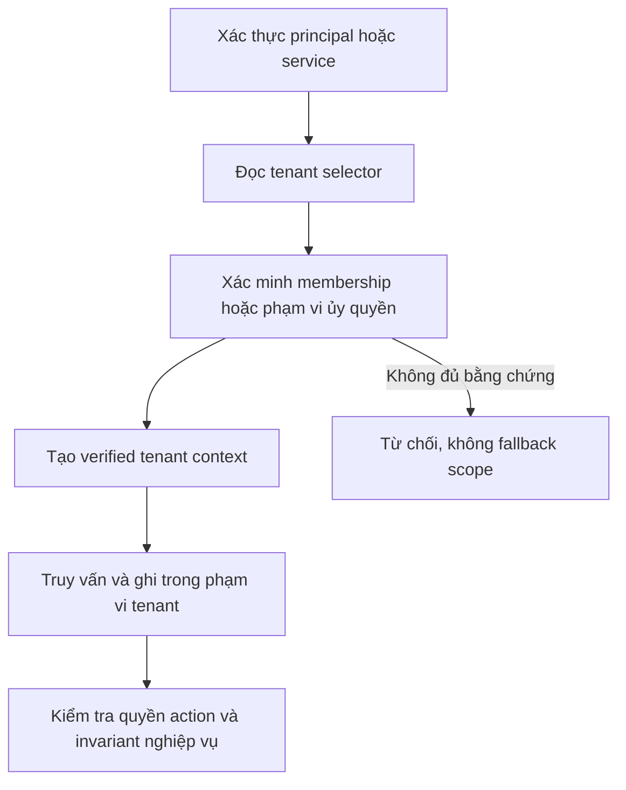

# Cross tenant denial — Từ chối truy cập ngoài phạm vi tenant

## 1. Từ chối sai tenant là một invariant của hệ thống

**Cross tenant denial** là việc hệ thống từ chối thao tác vượt khỏi phạm vi tenant mà chủ thể đã được phép sử dụng cho operation hiện tại. Việc từ chối phải bảo vệ dữ liệu đọc, dữ liệu ghi và các tác dụng nghiệp vụ, không chỉ trả một mã lỗi trên API chính.

Tenant ở đây là một miền sở hữu và quản lý dữ liệu, chẳng hạn một tổ chức khách hàng. Một người có thể được phép tham gia nhiều tenant, nhưng điều đó không làm mọi request được tự do trộn tài nguyên giữa các tenant.

Bài thuộc chương **Tenant Isolation** của module `SECURITY_APPLICATION_SECURITY_BUSINESS_LOGIC_SECURITY`. Trọng tâm là giữ đúng ranh giới tổ chức khi thực hiện quy tắc nghiệp vụ: không đọc nhầm đơn, sửa giá, gắn dữ liệu, phê duyệt hoặc trả kết quả retry của tenant khác.

Ví dụ:

- U1 là reviewer trong tenant A.
- Đơn O-B thuộc tenant B.
- U1 biết ID của O-B qua một đường nào đó rồi gọi API phê duyệt trong ngữ cảnh A.
- Backend phải không đọc lộ O-B, không đổi trạng thái, không ghi quyết định phê duyệt và không tạo outbox nghiệp vụ cho O-B.

Một request bị từ chối có thể tạo security attempt phù hợp để điều tra. Điều cần ngăn là dữ liệu hoặc tác dụng nghiệp vụ vượt ranh giới, không phải cấm mọi dấu vết kỹ thuật về lần thử.

Với đường tenant-scoped thông thường trong ví dụ:

```text
Tenant của tài nguyên được sử dụng
    phải bằng tenant context đã được server xác minh.

Đúng tenant
    vẫn phải kiểm tra quyền action trên đúng đối tượng.
```

OWASP xem tenant context đã xác minh và ranh giới cách ly được thực thi là nền tảng của bảo vệ ứng dụng nhiều tenant; tenant ID từ client chỉ là lựa chọn cần kiểm chứng, không phải bằng chứng cấp quyền. [OWASP Multi Tenant Security Cheat Sheet](https://cheatsheetseries.owasp.org/cheatsheets/Multi_Tenant_Security_Cheat_Sheet.html).

## 2. Phân biệt truy cập sai tenant với truy cập hợp lệ nhiều tenant

### 2.1. Người dùng nhiều tenant vẫn cần chọn ngữ cảnh rõ ràng

Giả sử U2 có membership hợp lệ ở cả A và B. Trong một request đã chọn A, repository không được thấy ID không có ở A rồi tự tìm tiếp ở B.

Nếu U2 cần làm việc tại B, họ phải thực hiện operation trong context B đã được xác minh, với quyền tương ứng tại B. Hệ thống không được suy ra rằng mọi membership của cùng principal tạo thành một scope toàn cục không giới hạn.

Nếu token được phát hành cho một tenant cố định, header do client gửi không được tự ghi đè tenant đó. Nếu hệ thống cho phép chọn tenant linh hoạt, resolver phải xác minh lựa chọn với danh tính và membership/service authorization phù hợp.

### 2.2. Tenant administrator khác platform administrator

Role quản trị tenant A không tự cấp quyền đọc hoặc sửa tenant B. Từ `ADMIN` không đủ để xác định phạm vi.

Operation hỗ trợ nền tảng thực sự cần nhiều tenant phải có đường thực thi riêng, danh tính/quyền riêng, tập tenant được phép và audit riêng. Không thêm `OR isAdmin` vào mọi truy vấn tenant-scoped rồi gọi đó là ngoại lệ quản trị.

### 2.3. Tài nguyên không phải lúc nào cũng thuộc một tenant

| Loại tài nguyên | Ví dụ | Cách xử lý |
| --- | --- | --- |
| Tenant-owned | Đơn, quyết định duyệt, attachment khách hàng | Ràng buộc với tenant sở hữu và context được phép |
| Global/public theo thiết kế | Danh mục mã tiền tệ công khai | Policy riêng, không tạo tenant giả chỉ để đi qua middleware |
| Được chia sẻ có kiểm soát | Tài liệu cho guest hoặc đối tác | Grant/capability và context truy cập có semantics rõ |
| Platform control plane | Tác vụ hỗ trợ hoặc migration được cấp phép | Operation đặc quyền với phạm vi cụ thể, không dùng như đường thường |

Khách mời có thể được cấp quyền vào tài nguyên của tenant sở hữu theo quy trình được thiết kế. Đó không phải lý do để bỏ kiểm tra tenant cho mọi tài nguyên. Các ví dụ SQL/Java trong bài áp dụng cho dữ liệu tenant-owned trong mô hình shared-table.

## 3. Thiết lập tenant context từ bằng chứng có thẩm quyền

### 3.1. Selector và verified context có nhiệm vụ khác nhau

Tenant ID có thể xuất hiện ở subdomain, URL, header hoặc một trường lựa chọn. Các giá trị đó chỉ yêu cầu hệ thống chọn context, trừ khi đã được một cơ chế tin cậy xác minh và ràng buộc đúng.

Một luồng hợp lý:



Nếu có nhiều nguồn selector, hợp đồng phải xác định cách đối chiếu. Ví dụ URL chọn A nhưng body khai B thì từ chối đầu vào mâu thuẫn, thay vì để mỗi lớp chọn một giá trị khác nhau.

Command nghiệp vụ thường không cần cho client sửa `tenant_id` của entity. Tenant được đặt từ context đã xác minh, còn DTO chỉ chứa dữ liệu được phép đề nghị thay đổi.

### 3.2. Dùng context bất biến và truyền đúng vòng đời

Có thể dùng kiểu nội bộ như `VerifiedTenantContext`, chỉ được tạo bởi resolver tin cậy. Kiểu này giữ tenant đã chọn, principal và tham chiếu bằng chứng cần thiết, không được bind trực tiếp từ JSON.

Truyền context rõ ràng vào repository/service giúp tránh nhầm với UUID bất kỳ. Nếu dùng context gắn vào thread/request, phải thiết lập và dọn dẹp đúng cả khi exception, retry hoặc chuyển sang xử lý bất đồng bộ.

Một worker xử lý message A rồi message B trên cùng thread không được giữ context A. Tương tự, một connection pool trả lại connection không được để request sau kế thừa tenant của request trước.

### 3.3. Thiếu context phải dẫn đến không thực thi

Các trường hợp cần xử lý an toàn:

- Không có selector trên endpoint bắt buộc tenant context.
- Selector không hợp lệ hoặc mâu thuẫn với bằng chứng đã ràng buộc.
- Principal không có quyền làm việc trong tenant được chọn.
- Nguồn membership/ủy quyền không đủ tin cậy hoặc không đáp ứng độ mới mà policy yêu cầu.

Không fallback sang tenant mặc định, tenant đầu tiên của user hoặc truy vấn không scope khi resolver lỗi. Endpoint global hợp lệ có loại operation riêng; nó không được tạo ra bằng cách coi context bị thiếu là “toàn hệ thống”.

## 4. Từ chối ở ranh giới truy vấn và quan hệ dữ liệu

### 4.1. Định danh đầy đủ có thể là tenant cộng local ID

Nếu ID chỉ duy nhất trong từng tenant, tài nguyên được định danh bằng cặp `(tenant_id, id)`. Hai tenant có thể cùng có local ID `order-42` mà đó là hai đơn khác nhau.

Ngay cả khi hệ thống dùng UUID duy nhất toàn cục, truy vấn vẫn cần ranh giới tenant hoặc cơ chế cách ly tương đương. UUID khó đoán không thay thế authorization; BOLA vẫn xảy ra khi client thay ID mà backend không kiểm tra quyền trên đối tượng. [OWASP API1: Broken Object Level Authorization](https://api-security.owasp.org/editions/2023/en/0xa1-broken-object-level-authorization/).

```sql
SELECT o.*
FROM purchase_order o
WHERE o.tenant_id = :verified_tenant_id
  AND o.project_id = :project_id
  AND o.id = :order_id;
```

Không có kết quả trong scope thì xử lý như tài nguyên không khả dụng theo hợp đồng API. Không gọi thêm `findByIdGlobally()` để tìm hộ client ở tenant khác.

### 4.2. Mọi join và quan hệ cha/con phải giữ tenant

Với URL có project, đơn và attachment, cả chuỗi phải khớp:

```sql
SELECT a.id, a.storage_key
FROM order_attachment a
JOIN purchase_order o
  ON o.tenant_id = a.tenant_id
 AND o.id = a.order_id
WHERE a.tenant_id = :verified_tenant_id
  AND a.id = :attachment_id
  AND o.id = :order_id
  AND o.project_id = :project_id;
```

Chỉ kiểm tra project A rồi tải attachment bằng ID độc lập vẫn có thể lấy file sai tenant hoặc sai parent. Query trên mới bảo vệ quan hệ; quyền đọc file/đơn và projection vẫn phải được kiểm tra theo policy.

### 4.3. Schema hỗ trợ ngăn liên kết chéo

```sql
CREATE TABLE tenant_project (
    tenant_id  uuid NOT NULL,
    id         uuid NOT NULL,
    name       text NOT NULL,
    PRIMARY KEY (tenant_id, id)
);

CREATE TABLE purchase_order (
    tenant_id               uuid NOT NULL,
    id                      uuid NOT NULL,
    project_id              uuid NOT NULL,
    requester_principal_id  uuid NOT NULL,
    state                   varchar(32) NOT NULL,
    version                 bigint NOT NULL DEFAULT 0,
    total_minor_units       bigint NOT NULL,
    currency                char(3) NOT NULL,
    PRIMARY KEY (tenant_id, id),
    FOREIGN KEY (tenant_id, project_id)
        REFERENCES tenant_project (tenant_id, id),
    CHECK (version >= 0 AND total_minor_units >= 0)
);

CREATE TABLE order_attachment (
    tenant_id    uuid NOT NULL,
    id           uuid NOT NULL,
    order_id     uuid NOT NULL,
    storage_key  text NOT NULL,
    PRIMARY KEY (tenant_id, id),
    FOREIGN KEY (tenant_id, order_id)
        REFERENCES purchase_order (tenant_id, id)
);
```

Đây là phần lõi minh họa; membership, assignment, audit và state machine chi tiết là thành phần riêng. Composite foreign key ngăn một hàng khai tenant A nhưng tham chiếu parent chỉ có ở B bằng cùng nhóm khóa.

Constraint không chứng minh người gọi có quyền trên A. Trường `storage_key` cũng phải được server quản lý và ràng buộc với object locator đúng tenant; foreign key không tự biết nội dung thực tế trong object storage.

### 4.4. Tạo mới và reference ID cũng cần ranh giới

Backend đặt tenant của đơn mới từ context, kiểm tra quyền tạo ở project đích và xác minh các reference như supplier, ngân sách hoặc attachment theo phân loại tài nguyên.

Reference tenant-owned phải nằm trong phạm vi hợp lệ. Reference tới danh mục global có policy riêng. Không nhận `tenant_id` khác trong body rồi tạo một hàng hợp lệ về mặt schema nhưng ngoài thẩm quyền của người gọi.

Chuyển tenant là operation đặc biệt có thể ảnh hưởng lịch sử, grant, file và quan hệ. Không cho sửa tenant bằng API patch thông tin đơn thông thường.

## 5. Khung Java từ chối trước khi tạo tác dụng nghiệp vụ

Ví dụ dùng `TransactionTemplate` của Spring và shared-table database. Các repository/policy là hợp đồng minh họa, không phải chương trình hoàn chỉnh có thể chép chạy ngay.

```java
public ApprovalReceipt approve(
        TrustedActor actor,
        UUID selectedTenantId,
        ApproveOrderCommand cmd) {

    return transactions.execute(tx -> {
        VerifiedTenantContext tenant = tenantContexts.resolveForAction(
            actor, selectedTenantId, Action.APPROVE_ORDER);

        // Nếu dùng RLS theo setting, context được gắn vào chính transaction này.
        tenantDatabase.bindToCurrentTransaction(tenant);

        PurchaseOrder order = orders.lockByTenantAndProject(
            tenant, cmd.projectId(), cmd.orderId())
            .orElseThrow(ResourceUnavailableException::new);

        tenant.requireOwns(order.tenantId());
        resourceAuthorization.require(
            actor, tenant, Action.READ_ORDER, order);

        IdempotencyClaim claim = idempotency.claim(
            tenant.id(), actor.principalId(), "APPROVE_ORDER",
            cmd.idempotencyKey(), fingerprints.approveOrder(cmd));

        if (claim.isCompleted()) {
            return claim.originalReceipt();
        }

        resourceAuthorization.require(
            actor, tenant, Action.APPROVE_ORDER, order);
        approvalRules.requireIndependentAndApprovable(actor, order, cmd);

        int changed = orders.approveIfPendingVersionMatches(
            tenant, cmd.projectId(), order.id(),
            cmd.expectedVersion(), actor.principalId());

        if (changed != 1) {
            throw new ConcurrentOrderChangeException();
        }

        ApprovalReceipt receipt = audit.appendApproved(
            tenant, order, actor);
        outbox.appendApprovalCommitted(tenant, receipt);
        idempotency.complete(claim, receipt);
        return receipt;
    });
}
```

Các hợp đồng cần thiết:

- `resolveForAction` xác minh lựa chọn tenant với danh tính, membership hoặc service authorization có thẩm quyền. Nó không biến `selectedTenantId` thành đáng tin chỉ vì có kiểu UUID.
- Repository luôn dùng tenant trong câu truy vấn/ghi; không bỏ filter khi không tìm thấy. `requireOwns` là kiểm tra phòng vệ để phát hiện sai lệch ở lớp dưới trước khi dùng dữ liệu.
- Quyền trên object vẫn được xét trong tenant đã chọn. Đúng tenant không cho mọi thành viên được approve mọi đơn.
- Ví dụ giả định reviewer được đọc đơn; replay kiểm tra quyền đọc kết quả hiện tại trước khi trả receipt cũ. Hệ thống khác có thể định nghĩa quyền đọc receipt riêng.
- Idempotency được scope theo tenant, principal và action; fingerprint chứa resource/version và dữ liệu nghiệp vụ có ý nghĩa. Cùng key không được làm trả kết quả của tenant khác.
- Lệnh update giữ tenant, project, ID, trạng thái nguồn và version trong điều kiện, đồng thời yêu cầu số hàng thay đổi bằng một.
- State, audit, outbox và kết quả idempotency cùng transaction. Bất kỳ lỗi lưu nào cũng phải rollback; không báo approve thành công trước commit.

Ví dụ SQL cập nhật:

```sql
UPDATE purchase_order
SET state = 'APPROVED',
    version = version + 1
WHERE tenant_id = :verified_tenant_id
  AND project_id = :project_id
  AND id = :order_id
  AND state = 'PENDING_APPROVAL'
  AND version = :expected_version;
```

Câu SQL này không tự thực thi maker–checker hoặc hạn mức. Nó bảo vệ một số ranh giới và điều kiện ghi trong giao thức đã kiểm tra policy phía trên.

Khóa đơn cũng không tự làm membership hoặc nguồn quyền bên ngoài trở thành nguyên tử với lần ghi. Nếu cần thu hồi quyền có hiệu lực chặt chẽ, phải có giao thức độ mới/khóa/version tương ứng; không dựa vào việc đã giữ một transaction bất kỳ.

## 6. Từ chối mà không làm lộ tenant hoặc tài nguyên khác

### 6.1. Không cần dò toàn hệ thống để biết nên từ chối

Query trong context A không tìm thấy ID thì backend có thể không biết ID đó thuộc B hay hoàn toàn không tồn tại. Cả hai đều không cho phép sử dụng tài nguyên trong A.

Đừng thêm query toàn cục chỉ để trả thông báo “đơn này thuộc tenant B”. Cách đó vừa mở thêm đường đọc ngoài scope, vừa giúp client dò dữ liệu.

Một hợp đồng thường dùng phản hồi tài nguyên không khả dụng hoặc không tìm thấy trong phạm vi được phép. Việc chọn HTTP status cụ thể phải nhất quán với API; thông báo không nên lộ tên tenant, owner, trạng thái hoặc số tiền của object ngoài quyền.

### 6.2. Ghi reason code đúng mức bằng chứng

| Tình huống | Reason nội bộ có thể dùng | Điều cần tránh |
| --- | --- | --- |
| Principal không được vào tenant được chọn | `TENANT_ACCESS_DENIED` | Gắn selector chưa xác minh thành tenant context đáng tin |
| Không tìm thấy resource trong scope hiện tại | `RESOURCE_UNAVAILABLE_IN_SCOPE` | Khẳng định đã xác nhận resource thuộc tenant khác khi chưa biết |
| Một lớp trả về object có tenant khác context | `TENANT_BOUNDARY_VIOLATION` | Serialize object đó để “giải thích lỗi” |
| Message không có nguồn/ủy quyền phù hợp với tenant khai báo | `UNTRUSTED_TENANT_CONTEXT` | Tin payload chỉ vì message tới từ queue nội bộ |

Audit có thể lưu principal, tenant đã xác minh, action, ID được yêu cầu ở mức cần thiết, correlation ID và reason code. Dữ liệu selector chưa được xác minh phải được đánh dấu đúng loại, giới hạn kích thước và xử lý như đầu vào không tin cậy.

Security audit của attempt có thể tồn tại dù transaction nghiệp vụ rollback, nhưng không được ghi thành một event phê duyệt đã commit. Người đọc log phía tenant A cũng không tự được biết dữ liệu chi tiết của B.

### 6.3. Không chỉ response body mới có thể lộ thông tin

Tên file, redirect, metadata, error constraint, số đếm, response cache và log mà người dùng đọc được đều có thể tạo kênh lộ dữ liệu. Thiết kế và kiểm thử hành vi từ chối trên toàn representation, không chỉ một field `message`.

Không thể suy ra bảo đảm không có mọi side channel chỉ từ một mã lỗi giống nhau. Ưu tiên chặn dữ liệu/tác dụng trực tiếp và kiểm tra các kênh quan sát thực tế của hệ thống theo rủi ro.

## 7. Cache, idempotency và các kho dữ liệu phụ

### 7.1. Tenant phải là một phần của namespace khi dữ liệu phụ thuộc tenant

Ví dụ key dữ liệu:

```text
(tenant_id, resource_type, resource_id, representation)
```

Nếu nội dung còn phụ thuộc principal hoặc policy field, cache cần xét cả những yếu tố đó. Chỉ thêm tenant mà bỏ principal không giải quyết việc hai người cùng tenant có projection khác nhau.

Không dùng `order:{id}` chung cho hai tenant có thể trùng local ID. Cache hit vẫn phải giữ ranh giới quyền; dữ liệu có tenant khác context phải bị chặn và điều tra, không coi là một bản ghi hợp lệ vì key khớp.

### 7.2. Idempotency không được trả receipt chéo tenant

Giả sử A và B đều dùng key `approve-001`. Kết quả ở B không được xuất hiện trong A hoặc khiến lệnh hợp lệ của A bị hiểu là đã thực hiện ở B.

Kho idempotency cần namespace phù hợp, thường gồm tenant, principal và action, cùng fingerprint của nội dung lệnh. Bản ghi kết quả, việc tra cứu và nhánh replay đều phải giữ đúng scope.

Đổi resource hoặc tenant mà giữ key không được trở thành cách lấy một receipt đã lưu ngoài quyền. Quyền đọc kết quả hiện tại vẫn cần được kiểm tra theo policy replay.

### 7.3. Search, báo cáo và export cũng là đường đọc tenant-owned

Filter tenant cần được áp dụng ở ranh giới truy vấn phù hợp trước khi kết quả bị lộ qua hàng, snippet, facet, tổng số hoặc tổng tiền. Không lấy kết quả toàn cục rồi chỉ che tên tenant ở UI.

Một job export phải mang scope đã được xác minh và tạo file thuộc đúng tenant; đường tải file export cũng phải kiểm tra quyền. Tên file không chứa thông tin của B chưa đủ nếu nội dung vẫn có hàng của B.

### 7.4. Storage locator không phải quyền sở hữu

Bucket/key hoặc đường dẫn blob do server quản lý phải tương ứng với object tenant-owned đã được kiểm tra. Client không được tự chọn storage key của B rồi gắn vào đơn A.

Khi cấp signed URL, kiểm tra đúng tenant, object, action và phạm vi/thời hạn. Chữ ký bảo vệ link theo mô hình đã chọn, nhưng không biến một link cấp sai object thành hợp lệ về nghiệp vụ.

Các namespace hỗ trợ tách dữ liệu; chúng không thay thế authorization. Khóa phân tán, retry state và kho dead-letter cũng cần phạm vi đúng khi key hoặc dữ liệu có ý nghĩa riêng theo tenant.

## 8. Xử lý nền và truyền context qua ranh giới service

### 8.1. Trường tenant trong message là dữ liệu cần xác minh

Ví dụ payload:

```json
{
  "tenant_id": "tenant-a",
  "order_id": "order-42",
  "action": "APPROVE_ORDER"
}
```

Chỉ nhìn payload không biết producer có quyền yêu cầu action đó trong A hay không. Consumer phải tin được đường producer/broker hoặc cơ chế bảo vệ tính toàn vẹn, rồi kiểm tra phạm vi operation và tài nguyên.

Queue dùng chung không tự là ranh giới tenant. Service nội bộ có quyền database rộng không được trở thành nơi thực hiện mọi tenant/action được caller tự khai.

### 8.2. Mỗi lần xử lý phải dựng lại context

Một worker cần:

1. Xác minh danh tính/đường gửi message và mục đích được phép.
2. Xác định tenant context hợp lệ cho operation.
3. Bắt đầu transaction và thiết lập context trên đúng connection nếu cần.
4. Đọc/ghi tài nguyên trong tenant đó và kiểm tra quyền hoặc bằng chứng ủy quyền theo policy.
5. Scope deduplication, audit và output theo cùng tenant.
6. Kết thúc transaction, giải phóng context trước message tiếp theo kể cả khi lỗi.

Quyền lúc enqueue có thể khác quyền lúc thực thi trễ. Định nghĩa job chạy theo quyền service riêng hay ủy nhiệm người dùng, và điều kiện nào cần kiểm tra lại. Không chỉ giữ role label cũ rồi bỏ mọi kiểm tra hiện tại.

### 8.3. Retry và message trùng không mở đường vượt ranh giới

Event cho A gửi trùng không được được khử trùng bằng một key va với event của B rồi trả dữ liệu của B. Retry không được đổi tenant để “tìm nơi có bản ghi”.

Nếu event tenant A tham chiếu một resource chỉ tồn tại ở B, xử lý là message không hợp lệ theo scope hoặc lỗi dữ liệu cần điều tra. Không tự chuyển context sang B để làm cho tác vụ thành công.

## 9. RLS và vòng đời connection trong mô hình shared-table

### 9.1. Policy tenant tại database là lớp bảo vệ bổ sung

Ví dụ PostgreSQL cho bảng đơn:

```sql
ALTER TABLE purchase_order ENABLE ROW LEVEL SECURITY;
ALTER TABLE purchase_order FORCE ROW LEVEL SECURITY;

CREATE POLICY purchase_order_tenant_scope
ON purchase_order
USING (
    tenant_id = current_setting('app.current_tenant', true)::uuid
)
WITH CHECK (
    tenant_id = current_setting('app.current_tenant', true)::uuid
);
```

Trong ví dụ này, context vắng mặt trả `NULL` và không cho hàng thỏa điều kiện; context sai định dạng UUID gây lỗi. Cả hai không được xử lý bằng cách retry truy vấn không scope.

Policy chỉ minh họa bảng `purchase_order`, không bảo vệ tự động tất cả bảng khác. Attachment, decision, outbox, bảng trung gian và các đường truy vấn trực tiếp khác cần ranh giới riêng phù hợp.

PostgreSQL cho superuser và role có `BYPASSRLS` bỏ qua RLS; owner thường cũng bỏ qua nếu không chịu cơ chế phù hợp như `FORCE ROW LEVEL SECURITY`. Vì vậy phải kiểm chứng đúng role chạy request thực tế và policy đang triển khai. [PostgreSQL: Row Security Policies](https://www.postgresql.org/docs/current/ddl-rowsecurity.html).

Không chạy request tenant thông thường bằng tài khoản đặc quyền có thể bypass. Nhiều policy có thể kết hợp làm rộng phạm vi hơn dự định; cần kiểm tra hiệu lực tổng hợp thay vì chỉ đọc một đoạn DDL.

### 9.2. Context phải thuộc đúng transaction

Sau khi bắt đầu transaction, có thể dùng tham số được bind:

```sql
SELECT set_config('app.current_tenant', :verified_tenant_id_text, true);
```

Đối số `true` làm giá trị chỉ áp dụng trong transaction hiện tại. Theo tài liệu PostgreSQL, `set_config` với `false` dùng phạm vi session; `current_setting` có `missing_ok = true` trả `NULL` khi setting chưa tồn tại. [PostgreSQL: Configuration Settings Functions](https://www.postgresql.org/docs/current/functions-admin.html#FUNCTIONS-ADMIN-SET).

Thiết lập context cho mỗi transaction, trên cùng connection mà các query sẽ dùng. Commit hoặc rollback trước khi trả connection về pool. Kiểm thử tái sử dụng connection sau cả thành công và lỗi, không chỉ trên một request đơn lẻ.

Context setting chỉ đáng tin nếu code thiết lập nó có thẩm quyền và không bị client điều khiển ngoài policy. Đây không phải bảo đảm chống mọi SQL injection khi cùng database role có thể bị lợi dụng để đổi context. RLS không thay cho parameter binding, quyền database tối thiểu hoặc kiểm tra membership/object.

## 10. Các lối tắt thường làm hỏng hành vi từ chối

| Lối tắt | Hậu quả | Hướng thiết kế |
| --- | --- | --- |
| Không thấy trong A thì tìm toàn cục | Đọc lộ hoặc thao tác object B | Không fallback ngoài scope |
| `tenant_id` thiếu nghĩa là “all” | Request lỗi thành truy cập nền tảng | Phân loại operation global riêng |
| Client tự sửa tenant của entity | Tạo hoặc chuyển dữ liệu trái quyền | Tenant từ verified context, action chuyển riêng |
| Chỉ root query có filter | Join/lazy load/attachment đọc chéo | Giữ tenant ở mọi đường truy cập tenant-owned |
| Role admin bỏ qua filter | Tenant admin thành platform admin | Quản trị nền tảng có đường và scope riêng |
| Trả entity rồi frontend lọc | Dữ liệu đã vượt ranh giới | Chặn trước serialization/output |
| Session hoặc worker giữ tenant cũ | Request/message sau dùng nhầm context | Context có vòng đời rõ và được dọn dẹp |
| Cache/idempotency chỉ theo local ID/key | Trả dữ liệu hoặc receipt tenant khác | Namespace theo tenant và ngữ cảnh cần thiết |
| Producer nội bộ khai tenant nào cũng được | Service có quyền rộng bị dùng như công cụ vượt scope | Xác minh nguồn và scope ủy quyền ở consumer |
| FK hoặc RLS lỗi thì dùng account privileged retry | Tự tắt ranh giới bảo mật khi gặp lỗi | Không thực thi, điều tra đúng nguyên nhân |

Nếu nghiệp vụ thật sự cần sao chép hoặc xử lý liên tenant, thiết kế một operation có source tenant, destination tenant, quyền nguồn/đích, tập dữ liệu được phép và audit cụ thể. Không làm ngoại lệ ẩn trong repository thường.

## 11. Thiết kế kiểm thử bằng hai tenant và dữ liệu va ID

### 11.1. Fixture cần có sự tương tự có chủ đích

Tạo ít nhất:

- Tenant A và B có dữ liệu khác nội dung nhưng cùng hình dạng.
- U-A chỉ có quyền A; U-B chỉ có quyền B.
- U-AB có quyền cả hai nhưng mỗi request chọn một context.
- Admin-A chỉ quản trị A.
- Một số resource có ID chỉ tồn tại ở B.
- Một số resource ở A và B cố tình cùng local ID nếu schema hỗ trợ.
- Attachment, decision, cache, idempotency và message có trường hợp cùng local key giữa hai tenant.

Với cặp trùng local ID, request trong A phải chỉ đọc/ghi object A; object B giữ nguyên. Không gọi đó là truy cập B chỉ vì client gửi cùng chuỗi ID: identity đầy đủ trong mô hình này là tenant cộng ID.

Với ID chỉ có ở B, request trong A phải không lấy được object và không có tác dụng nghiệp vụ trên B.

### 11.2. Ma trận phủ định

| Tình huống | Kết quả cần bảo đảm |
| --- | --- |
| U-A chọn tenant B ở URL/header | Không tạo verified context B |
| U-A chọn A nhưng gửi ID chỉ có ở B | Không trả dữ liệu hoặc thao tác B; không fallback |
| U-AB đang context A gửi ID B-only | Không tự dùng membership B để chuyển scope |
| U-AB chủ động chọn B hợp lệ | Đánh giá quyền action trong B, không cấm vì người đó còn membership A |
| Admin-A gọi tài nguyên B | Không được coi là platform admin |
| URL, header và body khai tenant mâu thuẫn | Xử lý đúng hợp đồng, không để các lớp dùng tenant khác nhau |
| Cùng local order ID ở A và B | Đọc/ghi đúng A khi context A; B không thay đổi |
| Parent A kết hợp child B | Không tải file hoặc tạo liên kết trái scope |
| Tạo đơn A tham chiếu ngân sách/supplier tenant-owned ở B | Bị chặn trước commit |
| PATCH thêm `tenant_id`, requester hoặc field quyền | Không chuyển ownership/scope qua mass assignment |
| List, count, search, facet và export | Không lộ dữ liệu/tổng của B |
| Cache đã được B làm nóng trước | A không nhận payload/projection của B |
| Hai tenant dùng cùng idempotency key | Không trả receipt chéo, không khử nhầm operation |
| Tải attachment, thumbnail, metadata, signed URL | Kiểm tra đúng tenant, parent và quyền tương ứng |
| Worker xử lý B rồi A, có lỗi giữa chừng | Không rò context hoặc connection state |
| Message khai A nhưng resource chỉ có B | Không tự chuyển sang B; ghi lỗi theo bằng chứng thực có |
| Consumer dùng identity service có quyền rộng | Vẫn giới hạn operation vào scope được ủy quyền |
| Context RLS thiếu/sai | Không có hàng ngoài scope, không privileged fallback |
| Pool tái dùng connection A cho B sau commit/rollback | Context B được thiết lập lại và không đọc A |
| Query chạy bằng role production thực tế | Không bị owner/BYPASSRLS vô hiệu hóa ranh giới đã dựa vào |
| Quyền tenant bị thu hồi khi request/job chờ | Xử lý theo cam kết độ mới/tuần tự hóa của hệ thống |
| API trả lỗi từ chối | Không lộ tenant đích, trạng thái, tên file, receipt hoặc lỗi chi tiết ngoài quyền |

### 11.3. Quan sát nhiều hơn mã HTTP

Sau một request bị chặn, kiểm tra state/version, decision, tổng tiền, bảng quan hệ, idempotency, outbox và các side effect liên quan. Dữ liệu nghiệp vụ của B phải giữ nguyên; chỉ security attempt được phép ghi theo thiết kế.

Với ghi nguyên tử, chèn lỗi sau những bước lưu quan trọng và đọc lại bằng connection khác. Với pool/worker, chạy chuỗi xen kẽ A–B và có cả retry/exception để bắt lỗi giữ context.

Các khung mã, schema và bảng kiểm thử trong bài mang tính thiết kế; chúng chưa được chạy như một ứng dụng hoàn chỉnh.

## 12. Quan sát, điều tra và phục hồi đúng phạm vi

Theo dõi các lần selector bị từ chối, object trả sai tenant, request dò nhiều ID ngoài scope và message không có context tin cậy. Phân biệt lỗi tích hợp với dấu hiệu lạm dụng; một `RESOURCE_UNAVAILABLE_IN_SCOPE` đơn lẻ không chứng minh có tấn công chéo tenant.

Khi phát hiện boundary violation, chặn output/tác dụng tiếp theo và bảo toàn bằng chứng cần thiết. Không tải thêm dữ liệu tenant khác để làm đẹp báo cáo lỗi ở đường request thường.

Đối soát những đường ghi liên quan nếu nghi đã có thay đổi sai tenant. Việc sửa dữ liệu cũng phải qua operation đặc quyền có phạm vi cụ thể, quyền nguồn/đích và dấu vết riêng; một script sửa lỗi không được trở thành lần vượt ranh giới tiếp theo.

Nếu hỗ trợ platform audit hoặc phục hồi dữ liệu nhiều tenant, tách quyền đó khỏi tenant audit reader và các chức năng thông thường. Bằng chứng về sự cố không được tự trở thành dữ liệu mà tenant khác có thể tải xuống.

## 13. Bài tập áp dụng

Một API trong context tenant A cho phép tạo đơn, gắn attachment, gửi duyệt và lấy kết quả idempotency. Worker dùng chung xử lý outbox của A và B; hệ thống còn có cache và RLS dựa vào setting trên connection.

Hãy thiết kế:

1. Nguồn nào biến tenant selector thành verified context và xử lý thế nào khi các nguồn selector mâu thuẫn?
2. Repository và schema bảo vệ tenant ở đơn, project, attachment và reference ngân sách ra sao?
3. Nếu query không thấy ID trong A, phản hồi và reason code nội bộ nào phù hợp mà không cần dò B?
4. Cache, idempotency, message deduplication và file export dùng namespace như thế nào?
5. Worker và connection pool thiết lập/dọn context ra sao khi xử lý xen kẽ hai tenant và có rollback?
6. Những operation liên tenant hợp lệ nào cần đường riêng thay vì một nhánh bypass trong API thường?
7. Fixture trùng local ID và ID chỉ có ở B chứng minh những điều khác nhau nào?

Cross tenant denial chỉ đáng tin khi mọi đường sử dụng tài nguyên tenant-owned đều giữ được context có thẩm quyền, từ truy vấn đến output và tác dụng nghiệp vụ. Từ chối đúng còn bao gồm không fallback ngoài scope, không lộ dữ liệu qua lỗi hoặc kho phụ, và không để xử lý nền hay retry làm thay đổi ranh giới đã được xác minh.
