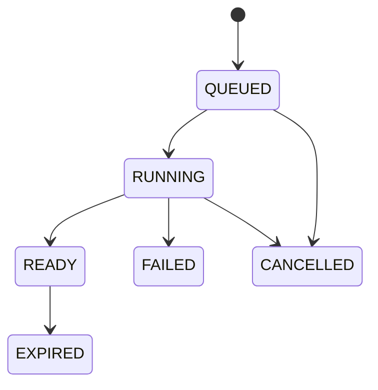

# Xuất dữ liệu an toàn theo tenant (Tenant data export)

Xuất dữ liệu là một đường đưa nhiều bản ghi ra khỏi hệ thống cùng lúc. Một API chi tiết có thể đã kiểm tra quyền rất kỹ, nhưng chức năng CSV, bảng tính, báo cáo hoặc job xuất nền lại dùng truy vấn rộng và làm lộ dữ liệu của tenant khác.

Rủi ro không kết thúc khi câu truy vấn có điều kiện tenant. Tệp tạm có thể bị dùng chung giữa các job, worker có thể chạy với ngữ cảnh cũ, link tải có thể không kiểm tra quyền hoặc người dùng bị thu hồi quyền trong khi tệp vẫn tồn tại.

Bài học thuộc chương **Tenant Isolation** trong bảo mật logic nghiệp vụ. Trọng tâm là bảo vệ toàn bộ vòng đời xuất dữ liệu: xác định phạm vi có thẩm quyền, lấy dữ liệu, tạo artifact, công bố, tải xuống và hết hiệu lực.

Ví dụ xuyên suốt là xuất đơn đề nghị mua hàng cùng các quyết định phê duyệt của một tenant.

## 1. Xác định ranh giới dữ liệu cần bảo vệ

Một lần xuất thường đi qua nhiều thành phần:

```text
Người dùng yêu cầu xuất
    → API tạo job
    → hàng đợi
    → worker lấy dữ liệu
    → bộ ghi CSV hoặc báo cáo
    → kho tệp
    → API công bố và tải xuống
```

Mỗi bước phải giữ được cùng một phạm vi được cấp. Tenant không chỉ là tham số tìm kiếm; nó là một ranh giới thẩm quyền.

Các bất biến cần bảo vệ:

1. Người gọi được hoạt động trong đúng tenant và có quyền xuất tập dữ liệu tương ứng.
2. Bộ lọc người dùng chỉ thu hẹp phạm vi được cấp, không thay thế hoặc mở rộng phạm vi đó.
3. Dữ liệu gốc, bảng liên quan, thống kê và metadata của tệp đều tuân thủ phạm vi.
4. Job, tệp tạm, artifact và link tải được liên kết với đúng tenant cùng căn cứ truy cập.
5. Retry hoặc cạnh tranh không làm trộn dữ liệu hay công bố kết quả của attempt đã mất quyền.
6. Người tải phải đáp ứng chính sách của artifact tại mốc tải.
7. Hủy, hết hạn và thu hồi có ngữ nghĩa rõ ràng đối với job và tệp đã tạo.
8. Lỗi không làm lộ dữ liệu tenant khác qua thông báo, log hoặc tệp dở dang.

### 1.1. Quyền đọc không mặc nhiên là quyền xuất hàng loạt

Được xem một đơn chưa chắc được xuất toàn bộ đơn của tenant. Tương tự, quyền xuất một nhóm cột không mở quyền nhận đầy đủ dữ liệu thanh toán, người thụ hưởng hoặc lịch sử nhạy cảm.

Một hợp đồng quyền có thể phân biệt:

| Khả năng | Ví dụ phạm vi |
|---|---|
| Xem từng đơn | Đơn của mình hoặc đơn được giao xử lý |
| Xuất đơn của mình | Tập đơn thuộc quyền hiện tại của người gọi |
| Xuất dữ liệu đơn vị | Một chi nhánh hoặc dự án được cấp |
| Xuất toàn tenant | Vai trò chuyên trách với tập dữ liệu và cột xác định |
| Xuất xuyên tenant | Luồng quản trị riêng, có thẩm quyền và audit riêng |

Không dùng việc người gọi thuộc tenant để suy ra họ có quyền xuất mọi dữ liệu trong tenant đó.

## 2. Chốt phạm vi xuất từ nguồn đáng tin cậy

Một endpoint có thể nhận ý định:

```http
POST /purchase-request-exports
Idempotency-Key: export-attempt-01
Content-Type: application/json

{
  "format": "CSV",
  "filters": {
    "state": "APPROVED",
    "createdFrom": "2026-11-01",
    "createdBefore": "2026-12-01"
  },
  "columns": ["requestId", "state", "total", "approvedAt"]
}
```

Máy chủ cần tự xác định tenant đã được phép, chủ thể yêu cầu, tập dữ liệu, phạm vi hàng và cột hiệu lực. Mốc thời gian trong bộ lọc cũng cần quy ước rõ để không hiểu khác nhau giữa giao diện và worker.

Có thể mô tả:

```text
EffectiveExportScope =
    TenantBoundary
    ∩ DatasetExportPermission
    ∩ ResourceScope
    ∩ AllowedColumns
    ∩ ValidatedUserFilters
```

Người dùng có thể xin ít dữ liệu hơn. Họ không được tự nới phạm vi bằng cách gửi `tenantId`, `ownerId`, `includeAllTenants=true` hoặc một đoạn SQL.

### 2.1. Tenant từ request cần được xác minh

Một header, subdomain hoặc lựa chọn tenant trên giao diện có thể là đầu vào để chọn ngữ cảnh. Nó không tự chứng minh quyền thành viên.

Nếu người dùng hoạt động trong nhiều tenant, mỗi lần xuất phải xác định rõ tenant được chọn và thẩm quyền tương ứng. Quyền tại tenant A không được mang sang tenant B chỉ vì cùng một tài khoản.

Thiếu tenant hợp lệ phải dẫn đến từ chối hoặc lỗi theo hợp đồng. Không dùng giá trị mặc định “tất cả tenant” cho một job thông thường.

### 2.2. Bộ lọc không được trở thành truy vấn tùy ý

Nên dùng schema có các trường, toán tử và kiểu dữ liệu được phép. Những giá trị như ID, khoảng ngày hoặc trạng thái được bind như dữ liệu.

Truy vấn tham số hóa giúp giữ đầu vào ở vị trí dữ liệu, nhưng vẫn có thể truy vấn sai tenant nếu lập trình viên quên điều kiện phạm vi. Chống chèn truy vấn và phân quyền dữ liệu là hai yêu cầu cùng cần đáp ứng.

Nếu người dùng gửi danh sách ID, phải kiểm tra chúng trong tập được phép. Hợp đồng có thể từ chối toàn bộ hoặc chỉ xuất phần hợp lệ với phản hồi rõ ràng; không được xuất phần ngoài quyền hoặc âm thầm báo như thể đã xuất đủ mọi ID yêu cầu.

### 2.3. Cột và dữ liệu dẫn xuất cũng thuộc phạm vi

Tập cột hiệu lực là phần giao giữa đề nghị và những trường người gọi được xuất. Các trường nhạy cảm cần chính sách riêng nếu có.

Dữ liệu dẫn xuất như tổng tiền, số đơn, nhãn người duyệt, danh sách dự án hoặc số bản ghi bị lỗi cũng có thể tiết lộ thông tin. Không chỉ bảo vệ các dòng dữ liệu chính mà để báo cáo tổng hợp dùng dữ liệu toàn hệ thống.

Nếu một mẫu báo cáo có sheet ẩn, phần dữ liệu nguồn hoặc nội dung phụ, chúng vẫn phải tuân thủ phạm vi của lần xuất.

## 3. Mô hình job và artifact có tenant rõ ràng

Một job có thể lưu:

```text
ExportJob:
    jobId
    tenantId
    requestedBy
    actualActorId
    dataset
    normalizedFilters
    effectiveScopeRef
    allowedColumns
    format
    dataConsistencyPolicy
    permissionContextRef
    status
    version
    attempt hoặc leaseGeneration
    createdAt
    expiresAt nếu có
```

Artifact là kết quả khác với job:

```text
ExportArtifact:
    artifactId
    jobId
    tenantId
    producingAttempt
    internalStorageRef
    size
    rowCount
    checksum nếu dùng
    classification
    accessPolicyRef
    availableUntil
```

Các trường có thẩm quyền do máy chủ ghi và bảo vệ. Client không được đổi `tenantId`, `requestedBy`, storageRef hoặc phạm vi sau khi job đã được chấp nhận.

### 3.1. Trạng thái không phải quyền truy cập

Một vòng đời có thể là:



`READY` chỉ cho biết artifact đã được công bố theo giao thức. Người biết jobId vẫn phải qua kiểm tra tải.

`FAILED` không cho phép truy cập tệp dở dang. `CANCELLED` không có nghĩa mọi byte đã tự biến mất khỏi kho tệp; quyền công bố và tải phải được chặn theo mô hình.

### 3.2. Người tạo job và người được tải

Có thể giới hạn tệp cho người yêu cầu, hoặc cho một nhóm được cấp quyền theo tenant. Cần chọn và ghi rõ.

Một người có quyền xem danh sách job không nhất thiết được tải nội dung mọi job. Vai trò hỗ trợ vận hành có thể chỉ thấy trạng thái và mã lỗi an toàn.

Không dùng `createdBy == currentUser` làm điều kiện duy nhất nếu quyền tenant hoặc quyền dữ liệu đã bị thu hồi.

## 4. Truy vấn đúng phạm vi ở mọi nguồn dữ liệu

Một truy vấn minh họa cho người có quyền xuất tập dữ liệu tương ứng trong toàn tenant:

```sql
SELECT p.id AS request_id,
       p.state,
       p.total_minor_units,
       p.currency,
       d.id AS decision_id,
       d.stage_id,
       d.decision,
       d.decided_at
FROM purchase_request p
LEFT JOIN approval_decision d
  ON d.tenant_id = p.tenant_id
 AND d.request_id = p.id
WHERE p.tenant_id = :authorized_tenant_id
  AND p.created_at >= :from_inclusive
  AND p.created_at < :until_exclusive
ORDER BY p.id, d.id;
```

Các placeholder là tham số bind. Tập cột chỉ là minh họa và vẫn cần nằm trong quyền xuất.

Nếu người gọi chỉ được xuất đơn của mình hoặc một đơn vị, phải thêm predicate phạm vi tương ứng do máy chủ xác định. Điều kiện tenant một mình không bảo vệ quyền hẹp hơn bên trong tenant.

### 4.1. Join cũng phải giữ quan hệ tenant

Chỉ viết `d.request_id = p.id` có thể ghép nhầm khi ID chỉ duy nhất trong từng tenant, hoặc khi dữ liệu liên kết đã có sai lệch.

Nên thiết kế quan hệ dữ liệu và khóa tham chiếu để biểu đạt đúng cả tenant lẫn đối tượng. Mỗi nguồn tenant riêng tư được join cần có ràng buộc phạm vi phù hợp.

Một bảng danh mục dùng chung toàn hệ thống có thể có chính sách khác. Cần xác định rõ đâu là dữ liệu dùng chung và đâu là dữ liệu tenant; không áp một quy tắc máy móc rằng mọi bảng đều phải có cùng cột tenant.

### 4.2. Giữ điều kiện phạm vi khi thêm bộ lọc

Giả sử người gọi được xem đơn của mình hoặc được chia sẻ, nhưng chỉ trong tenant hiện tại. Nhóm điều kiện phải giữ:

```text
tenant = authorizedTenant
AND (owner = subject OR share_is_valid_for_subject)
AND user_filters
```

Một nhánh OR không đúng nhóm có thể thoát khỏi điều kiện tenant. Bộ lọc nâng cao, tìm kiếm, khoảng ngày và danh sách ID không được viết lại cấu trúc bảo mật đó.

Tương tự, cursor phân trang phải được ràng buộc với tenant và tiêu chí đã chốt. Không nhận cursor từ job khác rồi dùng nó để thay scope.

### 4.3. Phân biệt snapshot quyền với snapshot dữ liệu

Hai khái niệm khác nhau:

| Snapshot | Câu hỏi nó trả lời |
|---|---|
| Phạm vi quyền của job | Job đã được chấp nhận để xuất những đối tượng, trường và điều kiện nào? |
| Ảnh chụp dữ liệu | Nội dung các bản ghi được lấy nhất quán tại mốc hoặc theo cơ chế nào? |

Lưu scope lúc tạo job không tự cho quyền tồn tại mãi. Một ảnh chụp dữ liệu nhất quán cũng không tự chứng minh người tải hiện có quyền với nó.

Cần chọn chính sách dữ liệu: theo một ảnh chụp có thể tái dựng, theo thời điểm worker đọc hoặc một hợp đồng khác được mô tả rõ.

Một trường `dataCutoff` chỉ giới hạn theo ngày không tự tái dựng dữ liệu quá khứ nếu bản ghi đã bị sửa, xóa hoặc ghi lùi thời gian. Phân trang theo ID cũng không tự đóng băng giá trị các cột.

Nếu cần xuất nhất quán, phải dùng khả năng snapshot của nguồn dữ liệu, phiên bản bất biến hoặc cơ chế tương ứng. Với nhiều dịch vụ, không mặc định có một snapshot toàn cục chỉ vì job mang cùng timestamp.

### 4.4. Nhiều dòng xuất cho một đối tượng

Join quyết định phê duyệt có thể tạo nhiều dòng cho một đơn. RowCount của tệp và số đơn là hai đại lượng khác nhau.

Cần giữ ngữ nghĩa khi phân trang, tính tổng và ghi metadata. Không ghép dữ liệu toàn cục hoặc dùng tổng số tenant khác chỉ để điền phần chân báo cáo.

## 5. Worker phải dùng phạm vi đã xác minh

Queue message không nên là nơi người gọi tự cung cấp toàn bộ truy vấn, tenant có thẩm quyền hay đường dẫn kho tệp.

Một cách làm là message tham chiếu job đã lưu. Worker xác minh nguồn giao việc, nhận lease và dùng tenant cùng scope từ bản ghi có thẩm quyền. Nếu message có tenant hint, phải đối chiếu với job; không dùng hint để đổi tenant cho job đó.

Tài khoản kỹ thuật của worker có thể đọc rộng, nhưng hành vi xuất thay người dùng phải bị giới hạn bởi kế hoạch xuất. Quyền kết nối cơ sở dữ liệu không phải quyền nghiệp vụ để lấy mọi dữ liệu.

### 5.1. Ví dụ Java cho luồng tạo artifact

Đây là mã giả theo cú pháp Java. Các cổng lease, nguồn dữ liệu, kho tệp và phân quyền cần được triển khai theo hợp đồng đã chọn.

```java
void processExport(TrustedJobReference reference) {
    JobLease lease = jobs.claim(reference);
    ExportJob job = lease.persistedJob();

    WorkerTenantContext tenantContext =
            tenantContexts.fromPersistedJob(job);

    ExportReadPlan plan = exportAuthorization.requireCanExecute(
            job, tenantContext);

    StagedArtifact staged;

    try (ExportSource source = exportSources.open(job, plan);
         PrivateExportWriter writer = artifacts.newPrivateWriter(
                 job.tenantId(), job.id(), lease.attemptId(), plan)) {

        for (ExportRow row : source.rows()) {
            isolationChecks.requireRowWithinPlan(row, plan);
            writer.write(plan.projectAllowedColumns(row));
        }

        staged = writer.finishPrivate();
    }

    PublicationPermit permit =
            exportAuthorization.requireCanPublish(job, plan);

    boolean published = jobs.publishIfLeaseAndPermitCurrent(
            job.id(), lease, permit, staged);

    if (!published) {
        cleanup.scheduleOwnedStagingArtifact(staged);
    }
}
```

Hợp đồng quan trọng:

- `TrustedJobReference` phải đến từ đường giao việc đã xác minh. Chỉ đặt tên kiểu dữ liệu không tự làm message trở nên đáng tin.
- `fromPersistedJob` không nhận một tenant tùy ý từ body hoặc biến toàn cục còn sót lại.
- `ExportReadPlan` giữ dataset, scope, bộ lọc và cột hiệu lực, không chỉ một cờ `authorized=true`.
- `open` áp dụng phạm vi tại nguồn; kiểm tra từng row là lớp phát hiện sai lệch bổ sung, không thay thế truy vấn có phân quyền.
- Dữ kiện tenant hoặc phạm vi của row cần đến từ nguồn thật. Không gán mọi row bằng job.tenantId rồi dùng chính giá trị vừa gán để chứng minh cô lập.
- Nếu phát hiện dữ liệu ngoài scope, dừng và không công bố artifact; không tiếp tục như một lần xuất hợp lệ.
- Writer tạo đối tượng riêng tư theo job và attempt. Nội dung chưa hoàn tất không được truy cập qua API tải thông thường.
- `publishIfLeaseAndPermitCurrent` kiểm tra attempt, trạng thái, version và những điều kiện hiệu lực mà giao thức yêu cầu trước khi gắn artifact vào kết quả công bố.
- Nếu quyền nằm ở nguồn khác, permit cần ngữ nghĩa về phiên bản và mốc hiệu lực rõ ràng. Phương thức này không tự tạo transaction toàn cục.
- Cleanup chỉ được xử lý đúng artifact staging thuộc attempt tương ứng, không xóa theo một tên dùng chung hoặc một prefix do client gửi.

Lỗi cần được chuyển thành trạng thái hoặc retry theo giao thức, không để worker cũ ghi đè trạng thái của attempt mới.

### 5.2. Không dùng ngữ cảnh tenant còn sót

Trong worker xử lý nhiều job, một biến tenant toàn cục hoặc ngữ cảnh gắn luồng không được quản lý đúng có thể làm job B dùng tenant của job A.

Nên truyền ngữ cảnh tường minh qua các cổng cần thiết hoặc có cơ chế quản lý vòng đời đủ chặt. Các nhánh bất đồng bộ, callback và luồng con không được mặc định thừa hưởng đúng quyền.

Đặc biệt, thiếu tenant phải bị chặn. Không dùng null để biểu thị “không lọc” trong đường xuất thông thường.

## 6. Công bố artifact và tải xuống

Ghi tệp vào kho đối tượng và cập nhật job trong cơ sở dữ liệu thường không cùng một transaction.

Một giao thức có thể là:

```text
Tạo tệp trong vùng staging riêng tư
    → hoàn tất và xác nhận metadata
    → kiểm tra quyền, trạng thái và lease theo chính sách
    → gắn artifact bằng phép ghi có điều kiện
    → job READY
    → API tải kiểm tra quyền rồi mới cấp dữ liệu
```

Nếu upload thành công nhưng bước công bố thất bại, có thể còn tệp mồ côi riêng tư cần dọn. Không được biến nó thành đường tải không cần phân quyền.

Nếu cơ sở dữ liệu đã công bố một tham chiếu không có tệp hoàn chỉnh, API không nên trả nội dung dở dang như báo cáo hợp lệ. Trạng thái và khả năng phục hồi cần phản ánh lỗi thực tế.

### 6.1. Tên object không phải cơ chế phân quyền

Một key có dạng:

```text
tenant-A / job-410 / attempt-3 / result.csv
```

giúp tổ chức dữ liệu, nhưng không tự chứng minh người tải thuộc tenant A. Không dùng việc biết đường dẫn hoặc artifactId làm quyền truy cập.

Tên và storageRef cần do máy chủ tạo, liên kết với job cùng tenant. Không để người dùng chọn key dẫn tới tệp có sẵn của một job khác.

Mã hóa dữ liệu trong kho là một lớp bảo vệ khác. Nó không thay thế việc kiểm tra ai được tải bản rõ.

### 6.2. Kiểm tra toàn bộ chuỗi khi tải

API tải cần xác nhận:

1. Người gọi được xác thực và có phạm vi tenant hợp lệ.
2. Job và artifact thuộc đúng quan hệ tenant, job, attempt được công bố.
3. Job đang ở trạng thái được tải và artifact chưa hết hạn hoặc bị vô hiệu.
4. Người gọi có quyền tải artifact theo chính sách hiện tại.
5. Bất kỳ ràng buộc dữ liệu hoặc phân phối bổ sung nào còn được đáp ứng.

Không kiểm tra tenant của job rồi dùng một storageRef khác từ query để lấy tệp. Đối tượng thật được tải phải là đối tượng đã được kiểm tra.

### 6.3. Link có chữ ký và thu hồi

Nếu phát link có chữ ký, cần hiểu nó cấp khả năng truy cập theo hợp đồng của cơ chế đó. Thời hạn, phạm vi và khả năng thu hồi cần được xác định.

Thu hồi quyền trong ứng dụng không tự vô hiệu mọi link đã phát nếu đường tải không kiểm tra lại ứng dụng. Muốn bảo đảm truy cập mới chịu quyền hiện tại, kiến trúc tải phải thực thi được yêu cầu đó.

Việc hủy job hoặc xóa tham chiếu trong database cũng không tự bảo đảm người giữ link cũ không còn tải được. Cần kiểm thử đúng cơ chế đang dùng và ghi rõ giới hạn.

## 7. Thay đổi quyền khi job đang chạy

Một job có thể mất nhiều phút. Trong thời gian đó, người yêu cầu có thể rời tenant, mất quyền xuất, chuyển nhóm hoặc không còn được đọc một phần đối tượng.

Cần chọn rõ mốc kiểm tra:

| Mốc | Điều cần xác định |
|---|---|
| Tạo job | Người gọi có được yêu cầu phạm vi này không? |
| Worker bắt đầu | Job còn được phép thực thi theo chính sách không? |
| Công bố artifact | Phạm vi đã đọc có còn đủ điều kiện được công bố không? |
| Tải xuống | Người tải có được nhận artifact này tại mốc tải không? |

Mô hình minh họa kiểm tra các mốc trên theo quyền hiện tại và ràng buộc của artifact. Nếu tổ chức chọn một mô hình cấp quyền khác cho bản xuất lịch sử, cần mô tả rõ quyền đó và cách thu hồi; không để nó phát sinh ngầm do đã lưu snapshot.

### 7.1. Scope cũ không tự trở thành grant vĩnh viễn

Giả sử U được xuất đơn của dự án X khi tạo job. Trước khi tải, U bị gỡ khỏi dự án.

Chỉ kiểm tra U vẫn thuộc tenant là chưa đủ. Artifact chứa dữ liệu thuộc scope mà U không còn được nhận theo mô hình quyền hiện tại của ví dụ.

Có thể cần vô hiệu artifact, đánh giá lại hoặc tạo lại bản xuất từ phạm vi hiện được phép. Không sửa một nhãn quyền trên artifact rồi tiếp tục cấp tệp nguyên trạng nếu nội dung vẫn vượt scope.

### 7.2. Phiên bản phải bao phủ đúng loại thay đổi

Một `policyVersion` không đổi không chứng minh quan hệ ownership, membership hoặc chia sẻ chưa đổi.

Nếu dùng epoch hay version để kiểm chứng, cơ chế tăng phiên bản phải bao phủ đúng các thay đổi ảnh hưởng quyền. Ví dụ, một epoch của tenant hoặc dataset chỉ có ý nghĩa nếu mọi đường thay đổi quyền liên quan đều cập nhật nó theo giao thức.

Một fingerprint của scope giúp nhận diện phạm vi đã chọn. Nó không tự chứng minh các quan hệ tạo nên phạm vi đó vẫn còn đúng.

Cần chọn cơ chế tái kiểm tra nguồn, thế hệ quyền, vô hiệu artifact hoặc chính sách khác đủ đáp ứng bảo đảm. Không dùng một giá trị được cache lỗi thời để tự xác nhận chính nó.

### 7.3. Quyền với tệp đã tạo là quyền với dữ liệu thật

Artifact có thể chứa các giá trị lịch sử dù nguồn đã thay đổi. Việc xóa hoặc chuyển owner của bản ghi nguồn không tự sửa nội dung tệp đã sinh.

Nếu policy yêu cầu quyền đọc hiện tại, cần xử lý cả artifact tồn tại từ trước. Nếu policy cho phép lưu một bản xuất đã được cấp riêng, quyền đọc bản đó phải được mô hình hóa và bảo vệ rõ ràng.

Khi dữ liệu đã được tải về phía người nhận, việc hủy job không kéo được các byte đó trở lại. Chức năng thu hồi cần diễn đạt đúng phạm vi mà hệ thống kiểm soát được.

## 8. Retry, cạnh tranh, hủy và dọn tệp

### 8.1. Idempotency của lệnh tạo job

Một scope khóa có thể gồm tenant, chủ thể yêu cầu và loại lệnh. Fingerprint cần bao phủ dataset, bộ lọc chuẩn hóa, các cột, thứ tự có ý nghĩa, định dạng và những lựa chọn ảnh hưởng kết quả.

Nếu có kênh phân phối, người nhận hoặc chính sách snapshot trong lệnh, chúng cũng cần được ràng buộc theo ngữ nghĩa tương ứng.

Không chỉ băm một phần body rồi bỏ tenant context hoặc các tham số đường dẫn có ảnh hưởng. Cùng key nhưng lệnh khác phải được phát hiện.

Retry đúng lệnh có thể trả lại job đã lưu, sau kiểm tra truy cập hiện tại. Không tạo nhiều job vì phản hồi đầu bị mất. Ngược lại, idempotency không thay thế quota hoặc phân quyền dữ liệu.

### 8.2. Lease và attempt ngăn worker cũ công bố

Một job có thể được giao lại sau timeout. Worker cũ chưa chắc đã dừng ngay.

Cần một thế hệ lease hoặc cơ chế tương đương để chỉ attempt hiện tại được công bố:

```sql
UPDATE export_job
SET status = 'READY',
    artifact_id = :artifact_id,
    version = version + 1
WHERE tenant_id = :tenant_id
  AND id = :job_id
  AND status = 'RUNNING'
  AND version = :expected_job_version
  AND lease_generation = :expected_lease_generation;
```

Đây chỉ là phần bảo vệ trạng thái job. Nó không tự kiểm tra quyền ở nguồn bên ngoài hay chứng minh artifact có nội dung đúng.

Handler cần xác nhận đúng một hàng được cập nhật và artifact khớp tenant, job, attempt. Khi không thắng phép ghi, worker không được tự phát link tải hoặc đổi lại trạng thái đã hủy.

Tệp staging của mỗi attempt phải riêng biệt. Hai worker không được cùng ghi một `report.csv` dùng chung rồi làm kết quả trộn lẫn.

### 8.3. Hủy không chỉ là gửi tín hiệu dừng

Lệnh hủy cần ghi trạng thái hoặc version có tác dụng chặn công bố theo giao thức. Chỉ gửi một tín hiệu tới worker không đủ nếu worker chưa nhận hoặc đang ở đoạn cuối.

Nếu hủy đã có hiệu lực trước bước công bố, phép ghi công bố phải thất bại theo mô hình. Nếu artifact đã được công bố trước, cần xử lý quyền tải và thu hồi theo hợp đồng.

Worker có thể vẫn tạo xong một tệp riêng tư sau hủy. Điều đó không được biến thành một đường tải ngoài kiểm soát.

### 8.4. Dọn dẹp đúng đối tượng

Dọn tệp cần dựa trên metadata và quyền sở hữu tài nguyên của hệ thống: tenant, job, attempt và storageRef có thẩm quyền.

Không xóa theo tên tệp người dùng gửi, một thư mục chung hoặc prefix không được kiểm tra. Cleanup của attempt cũ cũng không được xóa artifact đang được attempt mới công bố. Trước khi xóa, cần xác minh tệp vẫn là staging không còn được tham chiếu hợp lệ; mất phản hồi sau công bố không đủ để kết luận tệp chưa được công bố.

Hết hạn truy cập và xóa vật lý là hai mốc khác nhau. API có thể phải chặn tải ngay khi hết hạn dù quá trình xóa sẽ chạy sau. Ngược lại, xóa tệp không thay thế audit hoặc xử lý trạng thái job.

## 9. Nội dung, metadata và định dạng đầu ra

Cô lập tenant cần áp dụng cho mọi thành phần được đóng gói:

| Thành phần | Ví dụ rò rỉ |
|---|---|
| Dòng dữ liệu chính | Đơn hoặc quyết định phê duyệt của tenant khác |
| Nhãn và dữ liệu join | Tên nhân viên, dự án hoặc nhà cung cấp sai tenant |
| Tổng hợp | Tổng số đơn hoặc tổng tiền toàn hệ thống |
| Mẫu và thương hiệu | Logo, tiêu đề hoặc thông tin liên hệ còn từ job trước |
| Sheet hoặc dữ liệu phụ | Nguồn báo cáo ẩn chứa cột hoặc hàng ngoài quyền |
| Tệp lỗi kèm theo | Payload nguyên bản, truy vấn hoặc nội dung thất bại của tenant khác |
| Metadata tệp | Tên người soạn, đường dẫn nội bộ hoặc mô tả không phù hợp |
| Tệp tạm và archive | Ghép nhầm kết quả của nhiều job |

Một template dùng chung có thể hợp lệ nếu thật sự là dữ liệu công khai theo mô hình. Nội dung tùy biến theo tenant cần đúng cache key và nguồn dữ liệu.

### 9.1. Dữ liệu văn bản trong CSV hoặc bảng tính

Lý do, tên và bình luận có thể là đầu vào không đáng tin cậy. Ngoài việc phân tách dòng, cột và encoding đúng, cần xét cách chương trình mở tệp diễn giải dữ liệu.

Một số nội dung có thể được chương trình bảng tính xử lý như công thức. Chỉ bao giá trị CSV bằng dấu nháy kép không tự chứng minh nó sẽ được coi là văn bản.

Cần chọn cơ chế biểu diễn văn bản phù hợp định dạng và kiểm thử với luồng sử dụng đích. Không để quá trình xuất biến một trường bình luận thành nội dung được thực thi ngoài ý muốn.

### 9.2. Không đưa dữ liệu thật vào lỗi chẩn đoán công khai

Nếu phát hiện sai scope, không trả toàn bộ dòng của tenant khác để giải thích lỗi. Phản hồi có thể dùng mã lỗi an toàn và correlationId.

Log phục vụ điều tra cũng phải có phạm vi truy cập. Tránh sao chép hàng loạt dữ liệu nhạy cảm sang hệ thống log chỉ vì job xuất bị lỗi.

Tệp tên đẹp, checksum đúng hoặc số dòng đúng không chứng minh đúng tenant. Đây là các thuộc tính khác nhau cần kiểm tra riêng.

## 10. Quản trị xuyên tenant và phân phối ra ngoài

### 10.1. Luồng quản trị phải có thẩm quyền riêng

Một nhu cầu vận hành có thể thật sự cần xuất nhiều tenant. Nó cần endpoint hoặc hành động có policy riêng, tập tenant được cấp rõ ràng và audit phù hợp.

Không cho luồng người dùng thông thường bỏ điều kiện tenant bằng `admin=true` hoặc tenantId rỗng.

Nếu được phép xuất nhiều tenant, cần giữ quan hệ giữa từng nguồn, tệp con và manifest theo phạm vi đã được duyệt. Quyền rộng có chủ đích không được làm mất khả năng truy vết dữ liệu đã lấy từ đâu.

Tài khoản hỗ trợ chỉ được xem trạng thái job không tự trở thành tài khoản xuất mọi dữ liệu khách hàng.

### 10.2. Người nhận và kênh phân phối cũng là ranh giới

Một tệp đúng tenant vẫn có thể bị gửi sai người nếu lệnh cho phép nhập bất kỳ email hoặc đích lưu nào.

Phân phối ra ngoài cần quyền và kiểm tra đích riêng theo chính sách: ai được nhận, kênh nào được dùng, dữ liệu nào được chuyển và có cần điều kiện bổ sung không.

Không suy ra việc người dùng có quyền tải đồng nghĩa hệ thống được phép tự chuyển tệp tới mọi địa chỉ họ nhập. Lưu người nhận hoặc đích đã được xác minh và ràng buộc nó với lệnh có ý nghĩa.

## 11. Audit, quota và khả năng vận hành

Audit cần liên kết người yêu cầu, tác nhân thực, tenant, scope, cột, job, attempt, artifact, mốc công bố và các lần cấp truy cập tải.

Phân biệt:

```text
đã yêu cầu xuất
đã bắt đầu đọc dữ liệu
đã công bố artifact
đã cho phép tải hoặc cấp link
đã xác nhận việc truyền theo khả năng quan sát của hệ thống
```

Chỉ cấp link chưa chứng minh người dùng đã tải xong. Một job READY chưa chứng minh có ai đã nhận tệp.

Các sự kiện hủy, từ chối, thay đổi quyền, sai lệch scope và hết hạn cần đủ ngữ cảnh điều tra nhưng không làm lộ nội dung tenant khác.

### 11.1. Quota theo phạm vi có thẩm quyền

Có thể giới hạn số job đồng thời, kích thước, phạm vi thời gian, số dòng hoặc tài nguyên theo tenant và người gọi. Mục tiêu là ngăn một bên gây cạn tài nguyên hoặc tạo quá nhiều bản sao dữ liệu.

Bộ đếm và cơ chế nhận việc cần phối hợp nếu quota phải được bảo đảm trước cạnh tranh. Hai request cùng thấy “còn một suất” không nên tự cùng chiếm nếu chính sách cấm.

Tenant dùng để tính quota phải được xác minh. Không cho người dùng đổi tenant trong payload để đẩy chi phí sang tổ chức khác.

Theo dõi backlog và lỗi theo tenant, tránh việc một tenant chiếm mọi worker. Các cơ chế này bảo vệ tính sẵn sàng nhưng không thay thế kiểm tra nội dung và quyền tải.

## 12. Kiểm thử rò rỉ dữ liệu trong toàn bộ vòng đời

### 12.1. Chuẩn bị dữ liệu đủ phân biệt tenant

Tạo ít nhất tenant A và B với:

- Các đơn có cùng ID cục bộ nhưng nội dung khác nhau.
- Quyết định, người duyệt, dự án và nhà cung cấp riêng.
- Tài liệu, nhãn, cấu hình báo cáo và logo khác nhau nếu tính năng dùng chúng.
- Người dùng có quyền xuất toàn tenant, quyền hẹp và không có quyền xuất.
- Một người tham gia nhiều tenant với phạm vi khác nhau.

Có thể đặt dấu hiệu nhận diện riêng trong các dữ kiện kiểm thử để dễ phát hiện xuất nhầm. Cần kiểm tra cả nội dung phụ và metadata.

Với định dạng có đóng gói hoặc nén, đọc và kiểm tra theo cấu trúc định dạng. Chỉ tìm một chuỗi trong byte thô không đủ chứng minh không có dữ liệu nằm trong sheet, tệp con hoặc phần nội dung khác.

### 12.2. Ma trận tình huống

| Tình huống | Kết quả cần kiểm chứng |
|---|---|
| A yêu cầu xuất dữ liệu được phép của A | Chỉ chứa hàng, cột và metadata trong scope |
| A gửi tenantId của B | Không thay ngữ cảnh có thẩm quyền |
| Thiếu tenant hoặc tenant không được tham gia | Không mặc định xuất toàn hệ thống |
| A gửi ID của B trong danh sách | Không xuất dữ liệu ngoài quyền; phản hồi đúng hợp đồng |
| ID đơn trùng giữa A và B | Join không kéo quyết định hoặc nhãn của B vào A |
| Người chỉ được xem đơn của mình xin toàn tenant | Không được mở rộng scope |
| Client thêm cột nhạy cảm hoặc bộ lọc tùy ý | Không vượt tập cột và predicate được cấp |
| Phần dữ liệu chính đúng nhưng tổng hợp dùng toàn hệ thống | Phát hiện rò rỉ qua số đếm hoặc tổng tiền |
| Worker xử lý A rồi B trong cùng tiến trình | Không dùng lại ngữ cảnh, buffer hoặc template sai tenant |
| Queue message sửa tenant hoặc tham chiếu job | Phát hiện không khớp nguồn giao việc và bản ghi có thẩm quyền |
| A đổi jobId hoặc artifactId sang của B | Không xem hoặc tải được tệp của B |
| Job thuộc A nhưng query tải đưa storageRef của B | Không sử dụng storageRef ngoài quan hệ đã kiểm tra |
| Tệp dở dang tồn tại trong staging | Không truy cập qua luồng tải công khai |
| Người yêu cầu mất quyền trước worker hoặc trước tải | Xử lý theo mô hình quyền hiện tại đã chọn |
| Scope đối tượng bị thu hẹp nhưng policyVersion không đổi | Không coi policyVersion là đủ chứng minh artifact còn được tải |
| Job bị hủy trước công bố | Worker không chuyển lại thành READY |
| Worker cũ hoàn tất sau attempt mới | Không ghi đè artifact hiện tại |
| Retry đúng lệnh tạo job | Trả job đã lưu sau kiểm tra quyền, không nhân bản ngoài hợp đồng |
| Hai job có tên tệp hiển thị giống nhau | Tệp tạm và object thực không bị trộn |
| Hết hạn nhưng cleanup chưa chạy | Quyền tải vẫn bị chặn theo thời hạn |
| Link đã phát trước thay đổi quyền | Hành vi đúng bảo đảm thu hồi mà kiến trúc công bố |
| Đích phân phối do người dùng đổi | Không gửi dữ liệu ngoài kênh và người nhận được cấp |
| Xuất dùng template có dữ liệu cũ | Không còn nội dung tenant khác trong phần phụ |
| CSV chứa dữ liệu người dùng có thể bị diễn giải thành công thức | Cơ chế biểu diễn và luồng mở đích xử lý theo yêu cầu an toàn của định dạng |

### 12.3. Kiểm thử cạnh tranh và điểm chèn lỗi

Các ca tích hợp nên bao phủ:

1. Thu hồi membership sau khi tạo job nhưng trước lúc worker đọc.
2. Thay ownership hoặc chia sẻ sau khi đọc dữ liệu nhưng trước công bố.
3. Thu hồi quyền sau READY nhưng trước tải.
4. Hủy job trong lúc worker đang ghi hoặc chuẩn bị công bố.
5. Lease hết hạn, attempt mới chạy, worker cũ tiếp tục.
6. Upload xong nhưng phép ghi công bố thất bại.
7. Công bố đã commit nhưng worker mất phản hồi.
8. Cleanup chạy đồng thời với công bố hoặc retry.
9. Hai lệnh tạo đồng thời tranh chấp idempotency hoặc quota.
10. Nguồn dữ liệu đổi trong khi đang phân trang.
11. Kho tệp hoặc nguồn quyền gián đoạn, rồi job được giao lại.

Với trường hợp mất phản hồi công bố, cần đối soát trước khi dọn. Một kết quả chưa rõ không được khiến cleanup xóa chính artifact đã được công bố thành công.

Các kiểm thử phải kiểm tra cả trạng thái job, tham chiếu artifact, quyền tải và dữ liệu thực. Chỉ xác nhận endpoint trả lỗi không chứng minh tệp staging chưa bị lộ.

### 12.4. Kiểm tra điều không được xảy ra khi bị chặn

```text
không xuất hàng hoặc cột ngoài scope
không công bố artifact không có quyền
không cấp link tới tệp staging hoặc tenant khác
không trả dữ liệu thật trong lỗi
không ghi audit công bố hoặc tải thành công giả
không để worker cũ ghi đè trạng thái hủy hoặc attempt mới
không xóa artifact đang được tham chiếu hợp lệ khi dọn tệp
không dùng tenant khác làm phương án dự phòng
không thay đổi dữ liệu nghiệp vụ nguồn ngoài hợp đồng xuất
```

Job bị từ chối có thể để lại dấu vết bảo mật. Artifact staging riêng tư có thể còn chờ dọn theo giao thức, nhưng không được có đường truy cập trái quyền.

Nếu một lần xuất được cho phép từng phần, metadata cần phản ánh đúng phần thực sự xuất và không tiết lộ chi tiết phần ngoài quyền.

## 13. Bài tập áp dụng

Thiết kế chức năng xuất đơn mua hàng và lịch sử phê duyệt cho hệ thống nhiều tenant, thực thi bằng job nền và lưu tệp trong kho đối tượng.

1. Xác định ai được xuất, scope hàng, cột và định dạng theo từng loại quyền.
2. Thiết kế lệnh tạo job để tenant và các trường có thẩm quyền không bị client tự quyết định.
3. Viết truy vấn join giữ đúng tenant cho đơn, quyết định và dữ liệu liên quan.
4. Phân biệt snapshot quyền, snapshot dữ liệu và chính sách tải artifact.
5. Vẽ luồng tạo staging, công bố, tải, hủy và hết hạn.
6. Chọn scope idempotency, cơ chế lease và phép ghi ngăn worker cũ công bố.
7. Mô tả việc mất quyền hoặc chuyển owner ảnh hưởng job và tệp đã tạo.
8. Định nghĩa cleanup không xóa nhầm tệp đang được tham chiếu và cách đối soát khi commit chưa rõ.
9. Viết ca kiểm thử hai tenant trùng ID cục bộ, metadata sai tenant và hủy đồng thời với công bố.
10. Chỉ ra audit, quota và các giới hạn thực tế của cơ chế link tải được chọn.

Một bản xuất an toàn phải giữ được quan hệ giữa người yêu cầu, tenant, phạm vi dữ liệu, job và artifact tới đúng người nhận. Cô lập tenant cần hiện diện trong truy vấn, xử lý nền, kho tệp và đường tải để một kết quả đúng ở bước đầu không bị biến thành rò rỉ ở bước sau.
