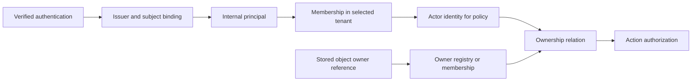

# Owner identity resolution: phân giải danh tính chủ sở hữu đối tượng

## 1. Vì sao so sánh ownerId với userId có thể sai?

Một ứng dụng cho người dùng sửa đề nghị chi phí của mình. Lập trình viên viết điều kiện `expense.ownerId == currentUser.id`. Điều kiện có vẻ rõ ràng, nhưng chỉ đúng nếu hai vế dùng cùng một không gian định danh và phản ánh đúng quan hệ sở hữu theo nghiệp vụ.

Trong thực tế, `currentUser.id` có thể là subject của nhà cung cấp đăng nhập, còn `ownerId` là mã membership trong tenant. Một người có nhiều tài khoản; một dịch vụ có thể tạo hộ người dùng; chủ sở hữu có thể là một nhóm; hoặc email được dùng làm khóa rồi được cấp lại cho người khác.

Nếu phân giải sai, hệ thống có thể từ chối chủ sở hữu hợp lệ, trao quyền cho người không liên quan hoặc làm mất ranh giới tenant.

**Owner identity resolution** là quá trình xác định chủ sở hữu của đối tượng và các danh tính liên quan từ những nguồn có thẩm quyền, để policy có thể đánh giá quan hệ giữa người gọi và đối tượng.

Quá trình này cần trả lời:

- Đối tượng được sở hữu bởi loại chủ thể nào?
- Tham chiếu owner lưu trong hệ thống mang ý nghĩa gì?
- Danh tính đã xác thực ánh xạ tới principal, membership hoặc chủ thể nghiệp vụ nào?
- Có quan hệ đại diện, nhóm hoặc chia sẻ nào được phép không?
- Dữ liệu ánh xạ có còn hợp lệ, đúng tenant và đủ rõ để ra quyết định không?

Phân giải đúng ownership là một đầu vào của phân quyền. Nó không tự cho chủ sở hữu quyền bỏ qua state machine, tự duyệt hoặc sửa dữ liệu đã được chấp nhận.

## 2. Làm rõ owner có nghĩa gì trong mô hình nghiệp vụ

Không dùng một trường `ownerId` để ngầm đại diện cho mọi người liên quan đến đối tượng.

| Khái niệm | Ý nghĩa minh họa | Có thể khác owner không? |
|---|---|---|
| Người thao tác tạo | Tài khoản hoặc service gửi lệnh tạo | Có, khi tạo hộ hoặc import |
| Người khởi xướng | Người đưa ra yêu cầu nghiệp vụ | Có, tùy loại hồ sơ |
| Chủ sở hữu hiện tại | Chủ thể có quan hệ sở hữu được mô hình quy định | Là quan hệ đang cần xác định |
| Người được giao xử lý | Người phụ trách công việc hiện tại | Có, giao xử lý không nhất thiết chuyển ownership |
| Người thụ hưởng/nhận tiền | Bên nhận giá trị từ giao dịch | Có, không tự có quyền quản trị hồ sơ |
| Người duyệt | Chủ thể chấp nhận căn cứ theo policy | Có, thường phải độc lập với bên lập |

Ví dụ nhân viên hỗ trợ tạo hồ sơ cho An, hồ sơ được giao Bình kiểm tra, còn tiền trả cho nhà cung cấp C. Không thể chỉ nhìn tài khoản tạo bản ghi để kết luận ai có quyền sở hữu hoặc ai được duyệt.

### 2.1. Định nghĩa theo từng loại đối tượng

Một bản nháp cá nhân có thể thuộc một membership. Một hồ sơ của phòng ban có thể thuộc một team. Một tài nguyên tích hợp có thể do service account quản lý. Một đối tượng dùng chung có thể có nhiều quan hệ chia sẻ.

Cần mô tả rõ loại chủ thể và quyền mà quan hệ đó có thể hỗ trợ. “Thuộc team” không có nghĩa mọi thành viên team đều được chuyển chủ, xóa tài liệu hoặc duyệt hồ sơ.

### 2.2. Người tạo và owner có vòng đời khác nhau

Thông tin người tạo/khởi xướng thường là dữ kiện nguồn gốc cần giữ. Owner hiện tại có thể được thay đổi qua một lệnh được phép.

Nếu dùng owner hiện tại thay cho lịch sử người lập, một người có thể tạo đề nghị, chuyển owner cho người khác rồi quay lại tự duyệt. Quy tắc không tự duyệt cần xét đúng nguồn gốc mà policy quy định, không chỉ quan hệ sở hữu hiện thời.

## 3. Thiết kế tham chiếu owner có kiểu và phạm vi

Một tham chiếu owner nên có ngữ nghĩa rõ, chẳng hạn:

```text
OwnerReference = tenant + ownerKind + ownerSubjectId
```

Ví dụ các loại owner mà một ứng dụng có thể hỗ trợ:

| `ownerKind` | `ownerSubjectId` tham chiếu tới | Kiểm tra quan hệ với người gọi |
|---|---|---|
| `USER_MEMBERSHIP` | Membership nội bộ trong tenant | Người gọi có ánh xạ tới membership đó không? |
| `TEAM` | Team nội bộ của tenant | Người gọi có quan hệ team đáp ứng policy không? |
| `SERVICE_ACCOUNT` | Service principal được quản lý | Credential và quyền service có đúng phạm vi không? |
| `ORGANIZATION` | Chủ thể tổ chức được định nghĩa | Người gọi có thẩm quyền đại diện tương ứng không? |

Không cần hỗ trợ mọi loại. Tốt hơn là ít loại với ngữ nghĩa rõ, thay vì một chuỗi tùy ý mà mỗi lớp hiểu khác nhau.

### 3.1. Cùng giá trị ID nhưng khác loại không phải cùng chủ thể

`TEAM:42` khác `USER_MEMBERSHIP:42`. Một subject bên ngoài cũng không tự bằng một ID nội bộ chỉ vì có cùng chuỗi.

Kiểu dữ liệu và API repository nên làm rõ sự khác biệt này. Việc dùng wrapper như `MembershipId` hoặc `TeamId` giúp tránh nhầm trong code, nhưng vẫn cần xác minh nguồn và các liên kết phía server.

### 3.2. Tenant là một phần của phép phân giải

Một membership hoặc team thuộc tenant A không được dùng làm owner cho đối tượng riêng của B chỉ vì ID tồn tại.

Với dữ liệu lưu trữ, có thể dùng registry owner hoặc các quan hệ có khóa ngoại phù hợp để bảo vệ loại và phạm vi tenant. Nếu dùng tham chiếu đa hình, cần cơ chế bảo đảm không trỏ nhầm loại hoặc bản ghi không tồn tại.

Khóa ngoại chứng minh tham chiếu tồn tại theo schema; nó không tự chứng minh membership còn hoạt động hoặc người gọi có quyền hành động.

### 3.3. Không dùng dữ liệu dễ đổi làm định danh sở hữu duy nhất

Email, tên đăng nhập hiển thị, số điện thoại và tên team có thể đổi hoặc được tái sử dụng. Không mặc định chúng là khóa sở hữu bền vững.

Dùng định danh nội bộ có vòng đời được quản lý. Các thuộc tính liên hệ hoặc hiển thị có thể hỗ trợ tìm kiếm, nhưng không tự tạo quan hệ ownership.

## 4. Từ danh tính đăng nhập tới chủ thể nội bộ

### 4.1. Xác thực trước, phân giải sau

Không phân giải owner từ một `userId`, email hoặc claim chưa được xác minh trong body. Đầu tiên phải có kết quả xác thực theo cơ chế được hệ thống tin cậy.

Với định danh liên kết từ nhà cung cấp đăng nhập, khóa thường cần cả issuer và subject theo namespace đã chọn:

```text
external identity = verified issuer + verified subject
```

Hai nhà cung cấp có cùng chuỗi subject không có nghĩa cùng một người. Issuer cũng phải là nguồn được chấp nhận cho luồng đó, với audience, thời hạn và mục đích token được xác minh theo hợp đồng xác thực.

Không chỉ đọc phần payload của token rồi dùng `sub` như thể đã biết ai đang gọi.

### 4.2. Một chuỗi ánh xạ có thể kiểm chứng

Ví dụ với đối tượng thuộc membership người dùng:



Trong một mô hình principal toàn cục, cặp issuer–subject có thể trỏ tới một principal nội bộ, rồi principal có membership ở từng tenant. Nếu hệ thống dùng namespace principal theo tenant hoặc realm, khóa ánh xạ cần bao gồm phạm vi đã được xác minh đó.

Không tự thêm realm do client khai để tạo một ánh xạ tùy ý.

### 4.3. Email giống nhau không tự cho phép liên kết account

Hai tài khoản từ hai nguồn có cùng email không mặc định được nhập thành một principal và nhận toàn bộ đối tượng của nhau. Email có thể thay đổi, tái cấp hoặc có mức bảo đảm khác nhau ở từng nguồn.

Liên kết tài khoản cần một quy trình chứng minh quyền kiểm soát hoặc xác minh quản trị phù hợp, cùng chính sách về dữ liệu nào được hợp nhất. Một claim email đã được xác minh vẫn không tự định nghĩa việc chia sẻ mọi tài nguyên giữa hai ngữ cảnh tài khoản.

### 4.4. Danh tính người khác với danh tính tài khoản

Để chống tự duyệt qua account phụ, hệ thống có thể cần một định danh người chuẩn hóa. Nhưng ownership của một đối tượng có thể được thiết kế theo account hoặc membership riêng.

Không tự mở quyền xem mọi đối tượng giữa các account chỉ vì chúng được biết là cùng một người, nếu chính sách của loại đối tượng không cho phép chia sẻ đó.

Cần chọn đúng không gian định danh cho từng câu hỏi: nhận diện cùng người để kiểm tra độc lập là một việc; quyết định account nào được sở hữu hay truy cập dữ liệu là việc khác.

## 5. Luồng phân giải và các kết quả cần phân biệt

Một luồng cho request mới có thể là:

1. Xác thực principal và cơ chế đại diện nếu có.
2. Xác minh tenant mà request nhắm tới.
3. Nạp đối tượng trong phạm vi được phép.
4. Đọc owner reference từ bản ghi có thẩm quyền.
5. Phân giải đúng loại owner và kiểm tra liên kết tenant.
6. Xác định quan hệ giữa actor và owner bằng nguồn đáng tin.
7. Áp dụng policy của hành động trên trạng thái và căn cứ hiện tại.

Không phải bước nào cũng cần một truy vấn riêng. Có thể dùng join hoặc snapshot phù hợp, miễn giữ rõ nguồn dữ liệu và ranh giới tin cậy.

### 5.1. Không gộp mọi lỗi thành “không phải owner”

| Kết quả | Ý nghĩa | Hướng xử lý |
|---|---|---|
| Phân giải thành công, quan hệ phù hợp | Có đủ căn cứ đánh giá ownership | Tiếp tục kiểm tra action policy |
| Phân giải thành công, không có quan hệ cần thiết | Actor không đáp ứng điều kiện ownership | Từ chối theo hợp đồng |
| Không có ánh xạ danh tính bắt buộc | Chưa biết principal nội bộ tương ứng | Không cho hành động cần ánh xạ đó đi qua |
| Ánh xạ mâu thuẫn hoặc nhiều kết quả không hợp lệ | Dữ liệu không đủ rõ để xác định chủ thể | Chặn và xử lý dữ liệu, không chọn ngẫu nhiên |
| Membership không còn hiệu lực | Quan hệ hiện hành không đáp ứng điều kiện | Từ chối hoặc đi theo quy trình riêng được phép |
| Owner reference hỏng/không còn phân giải được | Đối tượng có vấn đề về nguồn sở hữu | Không tự gán người gọi làm owner |
| Kho danh tính hoặc quan hệ tạm thời lỗi | Chưa đánh giá được điều kiện bắt buộc | Không mở quyền mặc định; trả lỗi phù hợp |

Phân loại giúp vận hành phân biệt thiếu quyền với lỗi dữ liệu hoặc dependency. Response công khai chỉ tiết lộ mức chi tiết người gọi được phép biết.

### 5.2. Owner rỗng không có nghĩa ai cũng là owner

Một đối tượng có thể đang chưa được giao, thuộc hệ thống, bị mồ côi hoặc dùng cơ chế chia sẻ khác. Các trạng thái này cần được biểu diễn rõ.

Không dùng `ownerId ?? currentUserId` khi đọc dữ liệu để “sửa thiếu owner”. Cách đó biến mọi người gọi thành chủ sở hữu của đối tượng chưa được phân loại.

Nếu có cơ chế nhận xử lý hoặc nhận ownership cho hồ sơ chưa gán, đó là lệnh riêng có điều kiện và kiểm soát cạnh tranh, không phải tác dụng phụ của truy vấn.

## 6. Xác định owner khi tạo, tạo hộ và import

### 6.1. Tạo đối tượng của chính người gọi

Nếu policy quy định bản nháp thuộc người tạo, server lấy owner từ danh tính/membership đã phân giải trong tenant. Client không cần tự gửi một `ownerId` đặc quyền.

Ví dụ:

```http
POST /tenants/{tenantId}/expense-requests
Content-Type: application/json

{
  "purpose": "Chi phí công tác",
  "currency": "VND"
}
```

Server đặt owner, người thao tác tạo và người khởi xướng theo hợp đồng. Không bind một trường owner tùy ý nếu DTO hoặc payload ngoài hợp đồng có thêm trường đó.

### 6.2. Tạo hộ phải có thẩm quyền riêng

Khi trợ lý tạo cho An, cần xác minh quyền tạo hộ và owner đích có đủ điều kiện. Ghi cả danh tính thao tác thật và chủ thể nghiệp vụ được đại diện.

`onBehalfOf` trong body chỉ là đối tượng được đề nghị đại diện, không phải bằng chứng người gọi được phép làm vậy.

Một role hỗ trợ cập nhật hồ sơ không tự có quyền gán owner cho mọi tài khoản. Không để quyền tạo hộ trở thành đường chiếm quyền hoặc đẩy trách nhiệm sang người không liên quan.

### 6.3. Service hoặc job tạo dữ liệu

Service principal là bên thao tác, nhưng owner nghiệp vụ có thể là người dùng, team hoặc một loại chủ thể khác. Hợp đồng phải xác định điều đó thay vì mặc định owner luôn là service.

Nếu service nhận yêu cầu từ người dùng, ngữ cảnh khởi xướng phải được truyền qua cơ chế nội bộ đáng tin. Không coi một header tự khai là căn cứ đủ để đặt owner.

Với job tự động không có người khởi xướng trực tiếp, có thể dùng owner hệ thống hoặc tổ chức nếu mô hình hỗ trợ. Không bịa danh tính người để lấp một trường bắt buộc.

### 6.4. Import và dữ liệu cũ

Một file import có email hoặc mã nhân sự không tự bảo đảm ánh xạ đúng owner. Cần nguồn tin cậy, quy tắc ánh xạ, phạm vi tenant và cách xử lý bản ghi không xác định được.

Không fallback owner thiếu sang tài khoản đang chạy import. Một lựa chọn là cách ly bản ghi chờ xác minh hoặc gán trạng thái chưa phân giải theo chính sách, trong khi chặn các hành động cần owner rõ ràng.

Quy trình làm sạch dữ liệu cần giữ căn cứ và audit cho việc sửa owner, không tự viết lại nguồn gốc như thể dữ liệu luôn đúng.

## 7. Quan hệ sở hữu không phải toàn bộ phân quyền

### 7.1. Owner không mặc định được thực hiện mọi hành động

Ví dụ ma trận cho một đề nghị chi phí:

| Hành động | Quan hệ sở hữu hỗ trợ điều gì? | Điều kiện còn cần |
|---|---|---|
| Xem nội dung được phép | Owner có thể là một căn cứ cho phép | Tenant, trạng thái truy cập và giới hạn dữ liệu nhạy cảm |
| Sửa bản nháp | Owner hoặc đại diện có quyền có thể sửa | Trạng thái `DRAFT`, version và trường được phép |
| Rút yêu cầu | Có thể dành cho owner theo policy | Chưa có quyết định/tác động cản trở việc rút |
| Duyệt | Ownership không tự cấp quyền; có thể là điều kiện loại | Role/phạm vi duyệt, không tự duyệt, hạn mức và bằng chứng |
| Chuyển owner | Có thể cần quyền quản trị riêng | Owner đích đủ điều kiện, phạm vi và chấp nhận nếu cần |
| Chi trả | Ownership không tự chứng minh được phép | Approval hợp lệ, quyền thực thi và chống lặp |

Một điều kiện `isOwner || isAdmin` dùng chung cho mọi action thường làm mất ngữ nghĩa nghiệp vụ. Cần policy theo hành động.

### 7.2. Team owner cần phân giải quan hệ cụ thể

Nếu owner là team, actor có thể là thành viên, người quản lý team hoặc đại diện theo một grant. Các quan hệ này không đồng nghĩa.

Policy có thể cho thành viên xem, chỉ người phụ trách sửa và một vai trò khác được chuyển chủ. Resolver nên cung cấp quan hệ có căn cứ để policy quyết định, không trả một cờ owner rộng rồi dùng cho mọi hành động.

Nếu có group/team lồng nhau, cần quy tắc nguồn thành viên, độ mới và cách xử lý chu trình/dữ liệu hỏng. Không gặp lỗi duyệt đồ thị rồi mặc định cho phép.

### 7.3. Chia sẻ và đại diện không cần giả thành ownership

Một người được cấp quyền xem hoặc xử lý thay có thể không phải owner. Giữ quan hệ sharing/delegation riêng giúp diễn đạt phạm vi và thu hồi đúng.

Không đổi owner tạm thời chỉ để thực hiện một hành động được ủy quyền, vì việc đổi đó có thể tác động policy khác, cache và lịch sử. Chủ thể thao tác thật vẫn cần được ghi nhận.

## 8. Minh họa Java cho phân giải và sử dụng ownership

### 8.1. Ánh xạ người dùng đã xác thực

Ví dụ sau chọn mô hình principal nội bộ toàn cục và membership theo tenant. Các dependency là hợp đồng minh họa, không phải API của thư viện cụ thể. Nhánh cho service hoặc team cần được thiết kế riêng.

```java
record ExternalIdentity(String verifiedIssuer, String verifiedSubject) {}

record ActorIdentity(
        UUID principalId,
        UUID tenantId,
        UUID membershipId,
        long bindingVersion,
        long membershipVersion) {}

ActorIdentity resolveUserActor(
        VerifiedAuthentication authentication,
        UUID requestedTenantId) {

    ExternalIdentity external = new ExternalIdentity(
            authentication.issuer(), authentication.subject());

    PrincipalBinding binding = identityBindings
            .requireUniqueActiveBinding(external);

    Membership membership = memberships
            .requireActiveFor(binding.principalId(), requestedTenantId);

    return new ActorIdentity(
            binding.principalId(),
            requestedTenantId,
            membership.id(),
            binding.version(),
            membership.version());
}
```

`VerifiedAuthentication` phải được tạo sau xác thực đúng, không deserialize từ request. `requireUniqueActiveBinding` phải xử lý thiếu hoặc mâu thuẫn bằng cách không cung cấp danh tính dùng để mở quyền.

Các version trong kết quả cho biết căn cứ đã đọc. Chúng không tự bảo đảm còn mới nếu được giữ mãi hoặc được tin mà không có cơ chế kiểm tra phù hợp.

### 8.2. Dùng quan hệ owner trong lệnh sửa bản nháp

Đoạn dưới minh họa lệnh mới sửa mục đích chi phí khi còn là bản nháp. Tầng idempotency, nếu có, xử lý gửi lại theo hợp đồng riêng.

```java
DraftReceipt changeDraftPurpose(
        UUID tenantId,
        UUID expenseId,
        ChangePurposeCommand command) {

    VerifiedAuthentication auth = identity.requireVerifiedAuthentication();
    ActorIdentity actor = actorResolver.resolveUserActor(auth, tenantId);

    return transactions.required(() -> {
        ExpenseRequest expense = expenses
                .lockByTenantAndId(actor.tenantId(), expenseId)
                .orElseThrow(NotFound::new);

        ResolvedOwner owner = ownerDirectory.requireKnown(
                expense.ownerReference());
        OwnershipRelation relation = ownerRelations.resolve(actor, owner);

        expensePolicy.requireCanEditDraft(actor, relation, expense);
        expense.requireState(ExpenseState.DRAFT);
        expense.requireExpectedVersion(command.expectedVersion());

        int changed = expenses.updateDraftPurpose(
                actor.tenantId(), expense.id(), expense.version(),
                expense.ownerReference(), command.validatedPurpose());

        if (changed != 1) {
            throw new Conflict("CONCURRENT_MODIFICATION");
        }

        DraftReceipt result = new DraftReceipt(
                expense.id(), expense.version() + 1);
        audit.appendDraftChanged(actor, owner, relation, expense, result);
        return result;
    });
}
```

Các hợp đồng cần chú ý:

- Owner được đọc từ bản ghi phía server, không từ `ownerId` client gửi kèm.
- `requireKnown` kiểm tra loại owner, tenant và tham chiếu registry phù hợp; “biết owner là ai” không tự cho phép actor.
- `ownerRelations.resolve` dùng nguồn quan hệ đáng tin, không chỉ so các chuỗi khác namespace.
- Policy xét action, tenant, quan hệ và các điều kiện hiện hành cần thiết.
- Cập nhật ràng buộc tenant, ID, version, trạng thái và owner/căn cứ ownership tương ứng theo triển khai.
- Mọi thay owner ảnh hưởng quyết định phải tăng version hoặc có cơ chế đồng thời tương đương.
- Audit thành công và cập nhật cần cùng transaction nếu đó là yêu cầu nguyên tử của hệ thống.
- Snapshot actor được đọc trước transaction không tự được đóng băng; độ mới của membership, ánh xạ và quan hệ cần được bảo vệ theo phần 10.

Code minh họa các ranh giới cần có. Tên hàm như `requireKnown` không thay thế việc triển khai kiểm tra thật hoặc integration test.

## 9. Thay owner và vòng đời danh tính

### 9.1. Chuyển ownership là lệnh có điều kiện

Một lệnh chuyển owner cần kiểm tra người thực hiện có thẩm quyền, owner đích đúng tenant/loại, trạng thái đối tượng cho phép và các ràng buộc nghiệp vụ liên quan.

Nếu việc nhận owner làm phát sinh trách nhiệm, có thể cần bước chấp nhận hoặc quy trình phê duyệt theo policy. Không mặc định ai cũng có thể đẩy một hồ sơ sang bất kỳ người nhận nào.

Cần tăng phiên bản ownership/aggregate và xử lý các grant, công việc hoặc quyết định phụ thuộc. Không chỉ đổi một ID rồi giữ nguyên mọi kết luận quyền đã cache.

### 9.2. Ownership mới không xóa nguồn gốc cũ

Giữ người tạo, người khởi xướng và các đóng góp trọng yếu theo mục đích nghiệp vụ. Chuyển owner không tự xóa điều kiện cấm tự duyệt của người từng lập căn cứ.

Nếu đổi owner làm thay đổi nội dung cần được duyệt, phải áp dụng quy tắc basis/vòng duyệt tương ứng. Không cho approval cũ bao phủ nội dung mới một cách ngầm định.

### 9.3. Đổi tên, đổi email và cấp lại tài khoản

Đổi thuộc tính hiển thị không nên làm mất ownership nếu định danh nội bộ vẫn đúng. Ngược lại, một người mới nhận lại email cũ không được tự nhận các đối tượng của người cũ.

Không tái sử dụng định danh owner bền vững cho một chủ thể khác. Nếu xóa tài khoản, có thể cần giữ tham chiếu lịch sử hoặc bản ghi đại diện phù hợp để audit không đổi ý nghĩa.

### 9.4. Liên kết và tách tài khoản

Khi hợp nhất hoặc tách tài khoản, phải xác định ownership nào được chuyển, quan hệ nào chỉ được liên kết để xác thực và quyền nào cần kiểm tra lại.

Không chỉ cập nhật bảng đăng nhập rồi mặc định mọi tài nguyên trở thành dùng chung. Ngược lại, cũng không xóa ánh xạ khiến lịch sử người lập mất khả năng truy vết.

Quy trình recovery hoặc sửa ánh xạ là thao tác nhạy cảm: một mapping sai có thể trao nhiều đối tượng cho người không liên quan dù mọi endpoint đều kiểm tra owner đúng theo mapping đó.

### 9.5. Owner không còn hoạt động

Membership bị khóa không có nghĩa đối tượng vô chủ và người gọi tiếp theo được nhận. Có thể cần bàn giao, lưu trữ hoặc quy trình quản trị riêng.

Giữ được owner lịch sử và quyền truy cập hiện hành là hai việc khác nhau. Người quản trị xử lý đối tượng mồ côi cũng cần thẩm quyền và audit, không dựa vào fallback rộng.

## 10. Tính nhất quán, race condition và cache

### 10.1. Không dùng kết quả phân giải cũ cho owner mới

Một lịch chạy nguy hiểm:

```text
T1: Đọc owner là An và xác nhận An được sửa.
T2: Chuyển owner sang Bình, commit.
T1: Cập nhật đối tượng chỉ theo ID, vẫn dùng quan hệ cũ.
```

Cần khóa hoặc điều kiện version/owner tương ứng để quyết định không áp dụng sang snapshot khác. Nếu owner nằm ở bảng quan hệ riêng, mọi đường sửa quan hệ phải tham gia cùng giao thức.

### 10.2. Quan hệ nhóm và mapping cũng có thể thay đổi

Khóa hàng đối tượng không tự khóa membership team, ánh xạ account hoặc trạng thái principal. Đọc chúng trong transaction cũng không tự tuần tự hóa với kho danh tính bên ngoài.

Nếu cần thu hồi hiệu lực rất chặt, đường thay quan hệ và đường thực thi phải có cơ chế đồng bộ hoặc kiểm tra phiên bản đủ mạnh. Nếu chấp nhận độ trễ, phải xác định giới hạn và kiểm thử đúng cam kết.

### 10.3. Cache phải giữ đúng namespace và độ mới

Phân biệt cache ánh xạ đăng nhập, cache owner reference, cache quan hệ nhóm và cache quyết định phân quyền. Mỗi loại có phụ thuộc khác nhau.

Key/điều kiện hợp lệ có thể cần tenant, loại chủ thể, issuer–subject hoặc principal nội bộ, owner reference, resource version và phiên bản nguồn quan hệ.

Không dùng `email → owner` toàn cục hoặc `id → isOwner` mà thiếu ngữ cảnh. Liên kết account, chuyển owner, đổi group và thu hồi membership đều có thể làm kết quả cũ không còn dùng được.

TTL không tự bảo đảm thu hồi ngay. Cache hit chỉ được dùng trong phạm vi độ mới đã xác định; lỗi kho danh tính không cho phép dùng một quan hệ cũ vô hạn.

### 10.4. Gửi lại lệnh và quyền nhận kết quả

Sau khi lệnh thành công, owner có thể đã đổi trước lần replay. Không trả kết quả nhạy cảm chỉ vì client có idempotency key.

Nhánh replay kiểm tra quyền nhận kết quả hiện tại theo hợp đồng, nhưng không thực hiện lại mutation hoặc đòi trạng thái nguồn cũ như với một lệnh mới. Khóa idempotency cũng cần namespace tenant/chủ thể/hành động/đối tượng phù hợp.

## 11. Service trung gian, worker và tài nguyên liên quan

### 11.1. Giữ danh tính thực hiện và căn cứ đại diện

Khi một service gọi thay người dùng, cần phân biệt credential của service với danh tính khởi xướng đã được xác minh. Không để quyền rộng của service thay cho việc kiểm tra owner của đối tượng đích.

Một message chứa `ownerId` không tự chứng minh người gửi được thao tác cho owner đó. Consumer cần hợp đồng nguồn, phạm vi tenant, loại lệnh và căn cứ thực thi rõ ràng.

### 11.2. Worker dùng ownership ở thời điểm nào?

Một job được tạo khi An là owner nhưng chạy sau khi chuyển sang Bình cần quy tắc cụ thể: kiểm tra quyền hiện hành hay thực hiện theo một lệnh đã được chấp nhận và đóng phạm vi?

Cả hai cách đều cần thiết kế rõ. Không dùng snapshot ownership cũ như quyền vô thời hạn, và không tự bỏ quên một operation đã phát sinh chỉ vì quan hệ hiện tại đổi.

### 11.3. Callback không được tự chọn owner

Với callback ngoài hệ thống, liên kết tới đối tượng/operation phải được xác nhận phía server. Người gửi không được thay owner chỉ bằng `userId`, email hoặc tenant trong payload.

Xác thực nguồn callback không thay thế kiểm tra operation, tài khoản tích hợp và các thuộc tính nghiệp vụ. Một sự kiện hợp lệ của đối tượng khác vẫn không được phép tác động đối tượng hiện tại.

### 11.4. Tệp, dòng con và kết quả xuất dữ liệu

Quyền trên một tệp đính kèm hoặc dòng con phải được xác định theo quan hệ với đối tượng cha và policy tương ứng, không dựa vào tên file hoặc ID người dùng trong URL.

Nếu tài nguyên có owner riêng hoặc chia sẻ riêng, cần mô hình đó rõ. Không mặc định owner của một hồ sơ được truy cập mọi tài nguyên có cùng chuỗi tham chiếu, hoặc được tải toàn bộ tài liệu nhạy cảm của người khác trong team.

## 12. Hành vi từ chối và audit

Không đủ căn cứ phân giải phải không dẫn tới mutation trái phép. Phân biệt nội bộ giữa không có quan hệ sở hữu, mapping thiếu, tham chiếu hỏng và lỗi dependency.

Response có thể dùng `403`, `404` hoặc lỗi dịch vụ phù hợp tùy tình huống và chính sách tiết lộ. Không trả thông tin owner thật của một đối tượng mà người gọi không được biết chỉ để giải thích vì sao họ không phải owner.

### 12.1. Audit cần chỉ ra hệ thống đã dựa vào đâu

Thông tin hữu ích gồm:

- Principal đã xác thực và tham chiếu binding được sử dụng.
- Tenant/membership của actor và phiên bản liên quan.
- Owner reference, loại owner và version của đối tượng.
- Quan hệ trực tiếp, team, sharing hoặc delegation được policy xét.
- Action, kết quả và mã lý do nội bộ.
- Người thao tác thực tế và người được đại diện khi cần.

Không ghi token, secret hoặc toàn bộ profile cá nhân vào log. Các tham chiếu có kiểm soát thường đủ để truy vết.

### 12.2. Sửa mapping phải có dấu vết riêng

Vì mapping là đầu vào cho nhiều quyết định, thay đổi nó cần quyền và audit thích hợp. Không để một API sửa thông tin liên hệ đồng thời thay binding đăng nhập hoặc owner mà không kiểm tra riêng.

Nếu phát hiện một ánh xạ sai đã được sử dụng, giữ dấu vết sửa và đánh giá các hành động bị ảnh hưởng. Không viết lại lịch sử để xóa căn cứ mà hệ thống đã thực sự dùng.

### 12.3. Không mất dấu vết từ chối do rollback

Audit thành công có thể cùng transaction với thay đổi. Audit từ chối cần cơ chế phù hợp để không biến mất khi transaction nghiệp vụ rollback.

Lỗi ghi log không được trở thành lý do cho phép người không được xác lập quyền sở hữu tiếp tục hành động.

## 13. Kiểm thử owner identity resolution

### 13.1. Fixture phải có nhiều không gian định danh

Tạo hai issuer có cùng chuỗi subject nhưng ánh xạ tới principal khác nhau; một người có nhiều account liên kết hợp lệ; hai tenant với membership khác nhau; owner trực tiếp và owner team.

Thêm tài khoản cùng email nhưng không có quan hệ liên kết, membership đã bị khóa, owner reference không hợp lệ và trường hợp dịch vụ tạo hộ. Giữ fixture đúng với mô hình hệ thống; dữ liệu cố ý hỏng cần được đánh dấu rõ.

### 13.2. Ma trận tình huống

| Tình huống | Kỳ vọng |
|---|---|
| Body giả `userId`, email hoặc owner | Không thay thế danh tính và tham chiếu server |
| Token chưa được xác minh nhưng có subject giống owner | Không dùng để phân giải actor có thẩm quyền |
| Hai issuer có cùng subject | Không bị nhập nhầm danh tính |
| Hai account cùng email nhưng chưa được liên kết | Không tự chia sẻ ownership |
| Account mới nhận email cũ | Không tự nhận đối tượng của chủ thể trước |
| Người hợp lệ đổi tên/email | Không mất ownership chỉ do đổi thuộc tính hiển thị |
| Membership A bị dùng cho đối tượng tenant B | Không vượt ranh giới tenant |
| `TEAM:42` và `USER_MEMBERSHIP:42` | Không bị coi là cùng owner |
| Thành viên team không có quyền action cụ thể | Không được phép chỉ vì có quan hệ team |
| Người có grant xem nhưng không phải owner | Được xem trong grant, không tự được chuyển owner hoặc duyệt |
| Tạo hộ không có căn cứ đại diện | Không đặt owner đích trái phép |
| Service tạo hộ người dùng | Giữ đúng owner và nguồn khởi xướng, không gộp thành service |
| Owner null hoặc mapping lỗi | Không fallback owner sang người gọi |
| Người tạo chuyển owner rồi duyệt | Không mất điều kiện chống tự duyệt theo nguồn gốc |
| Chuyển owner đồng thời với lệnh sửa | Không cập nhật dựa trên quan hệ cũ trái cam kết |
| Thu hồi team membership hoặc unlink account | Cache/quyền hiệu lực cập nhật theo cam kết |
| Replay sau khi mất quyền nhận kết quả | Không lộ response cũ chỉ vì biết key |
| Chủ sở hữu hợp lệ, đúng action và trạng thái | Luồng hợp lệ vẫn thành công |

### 13.3. Kiểm tra cả kết quả phân giải và tác động

Unit test phù hợp cho ánh xạ namespace và policy quan hệ. API test cần kiểm tra token, route tenant và DTO qua ranh giới thực; integration test cần kiểm tra ràng buộc tham chiếu, transaction và version.

Sau một lần bị chặn, xác nhận không đổi owner, trạng thái, basis, quyền chia sẻ hoặc operation ngoài ý muốn. Không chỉ assert một hàm resolver đã được gọi.

Với đổi owner/quan hệ đồng thời, điều khiển lịch đọc–ghi bằng điểm đồng bộ phù hợp. Với expiry/cache, dùng nguồn thời gian kiểm thử thay vì dựa vào sleep ngẫu nhiên.

### 13.4. Positive test để tránh so sánh sai namespace

Đưa vào một tình huống mà external subject khác hoàn toàn membership ID nhưng ánh xạ hợp lệ tới owner. Hành động được phép phải thành công.

Test này giúp phát hiện implementation so trực tiếp hai chuỗi khác loại, vốn có thể từ chối mọi người nhưng vẫn vượt qua toàn bộ negative test.

## 14. Tự rà soát thiết kế

Trước khi dùng ownership để cho phép một hành động, hãy trả lời được:

1. Owner của loại đối tượng này là account, membership, người, team hay chủ thể nào khác?
2. Tham chiếu owner có loại và tenant rõ ràng không?
3. Danh tính đăng nhập được xác thực và ánh xạ bằng khóa nào, từ nguồn nào?
4. Email, tên hiển thị hoặc ID client khai có thể vô tình trở thành bằng chứng sở hữu không?
5. Account linking, tạo hộ và service trung gian có giữ đúng người thao tác và chủ thể nghiệp vụ không?
6. Policy có phân biệt ownership, sharing, delegation và quyền theo action không?
7. Owner thiếu, đã bị khóa hoặc không phân giải được được xử lý thế nào?
8. Chuyển owner có giữ lịch sử maker và vô hiệu hóa đúng quyết định/cache phụ thuộc không?
9. Transaction và nguồn quan hệ có đáp ứng cam kết khi thay đổi đồng thời không?
10. Kiểm thử có chứng minh cả chủ thể hợp lệ được dùng quyền và chủ thể khác không chiếm được đối tượng không?

Phân giải owner đúng nghĩa là xác định được quan hệ sở hữu từ những danh tính và tham chiếu có thẩm quyền, trong đúng phạm vi nghiệp vụ. Quan hệ đó chỉ được dùng cùng policy hành động, trạng thái và cơ chế nhất quán phù hợp; nó không được suy ra từ một ID, email hoặc claim tự khai.
