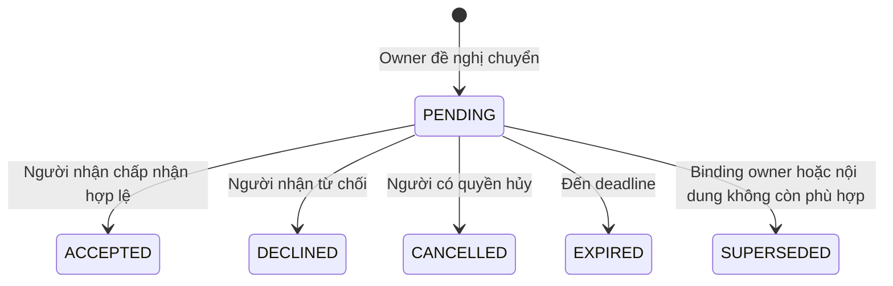

# Transferred ownership — Chuyển quyền sở hữu đối tượng an toàn

## 1. Chuyển owner là thay đổi thẩm quyền trên đối tượng

**Transferred ownership** là trạng thái hoặc kết quả sau khi quyền sở hữu nghiệp vụ của một đối tượng được chuyển từ chủ thể này sang chủ thể khác theo một quy trình được cấp phép.

Nếu policy cho owner được đọc, chỉnh sửa, chia sẻ hoặc quản lý đối tượng, thay `owner_id` cũng làm thay đổi người có những khả năng đó. Vì vậy, đây là một operation bảo mật và nghiệp vụ, không chỉ là cập nhật thông tin hiển thị.

Bài thuộc chương **Object Ownership** của module `SECURITY_APPLICATION_SECURITY_BUSINESS_LOGIC_SECURITY`. Trọng tâm là bảo vệ quy tắc nghiệp vụ khi đổi owner: đúng người chuyển, đúng người nhận, đúng tenant, đúng phiên bản đối tượng và không làm mất lịch sử phục vụ phê duyệt độc lập.

Ví dụ xuyên suốt là một bản nháp đơn mua hàng:

- An đang là owner hiện tại.
- Bình là người nhận được đề nghị tiếp quản.
- Cả hai là người dùng còn hoạt động trong cùng tenant.
- Chuyển quyền chỉ được chấp nhận khi đơn còn `DRAFT` trong policy minh họa.
- Bình phải xác nhận nhận quyền; trước đó An vẫn là owner.
- Creator, requester và lịch sử maker không được viết lại chỉ vì đổi owner.

Những thiết kế yếu thường cho phép owner tự gán một `owner_id` bất kỳ, cho owner cũ tiếp tục dùng quyền cache hoặc đổi requester theo owner mới để xóa dấu vết tự duyệt. Một luồng chuyển quyền an toàn phải xử lý rõ các hậu quả đó.

## 2. Owner hiện tại khác creator, requester và assignee

| Thuộc tính hoặc quan hệ | Ý nghĩa | Có tự đổi khi chuyển owner không? |
| --- | --- | --- |
| Current owner | Chủ thể đang giữ quyền/trách nhiệm sở hữu mà policy định nghĩa | Có, đây là mục tiêu của operation |
| Creator | Chủ thể thực sự tạo đối tượng ban đầu | Không viết lại lịch sử |
| Requester | Chủ thể đứng phía yêu cầu nghiệp vụ | Không mặc nhiên đổi theo owner |
| Assignee | Người đang được giao một công việc cụ thể | Theo policy phân công riêng |
| Reviewer | Người có quyền/assignment xét duyệt | Không tự cấp hoặc thay bằng owner mới |
| Tenant sở hữu dữ liệu | Miền tổ chức quản lý đối tượng | Không đổi trong luồng cùng tenant của bài |
| Maker history | Những người đã tham gia phía tạo/sửa/gửi yêu cầu | Không xóa để làm sạch xung đột |

Ví dụ An tạo đề nghị rồi chuyển việc quản lý bản nháp cho Bình. An vẫn là creator và có thể vẫn là requester. Bình trở thành owner không làm đề nghị biến thành một yêu cầu “chưa từng do An tạo”.

Nếu Bình sửa đơn giá hoặc nội dung quan trọng, policy maker–checker có thể đưa Bình vào tập maker. Việc chỉ nhận ownership có được tính là tham gia phía maker hay không phải được nghiệp vụ định nghĩa; không nên tự suy ra chỉ từ tên field.

Ownership cũng không nhất thiết luôn thuộc một người dùng. Một số hệ thống có team-owned resource hoặc service-owned resource. Bài này chọn owner là một principal người dùng để minh họa; chuyển sang team/service cần thêm quy tắc về thành viên, năng lực tiếp nhận và trách nhiệm thực hiện.

## 3. Định nghĩa quyền trước, trong và sau khi chuyển

### 3.1. Chọn semantics của ownership

Trước khi viết API, cần xác định owner được làm gì. Ví dụ policy có thể cho owner sửa nháp nhưng không được tự phê duyệt hoặc thay tenant.

```text
Quyền của principal trên object
    = các nguồn grant/role/quan hệ phù hợp
      kết hợp với điều kiện theo đối tượng và nghiệp vụ.

Ownership là một nguồn quan hệ,
không phải quyền bỏ qua mọi điều kiện khác.
```

OWASP nhấn mạnh kiểm tra quyền theo đúng request và quan hệ/thuộc tính đối tượng. Thay đổi quan hệ owner phải được phản ánh trong quyết định quyền thực tế, không chỉ ở màn hình hiển thị. [OWASP Authorization Cheat Sheet](https://cheatsheetseries.owasp.org/cheatsheets/Authorization_Cheat_Sheet.html).

### 3.2. Luồng minh họa cần sự chấp nhận của người nhận

| Giai đoạn | Owner hiện tại | Quyền của người nhận từ đề nghị chuyển | Điều cần tránh |
| --- | --- | --- | --- |
| Chưa có đề nghị | An | Không có quyền mới | Đoán recipient ID rồi coi người đó đã nhận |
| Đề nghị `PENDING` | An | Chỉ xem preview/nhận/từ chối theo policy của transfer | Cấp toàn bộ quyền owner trước khi accept |
| Chuyển được commit | Bình | Quyền từ quan hệ owner mới, trong giới hạn policy | Owner cũ tiếp tục dùng quan hệ cũ |
| Đề nghị bị hủy/hết hạn | An nếu chưa có operation khác đổi owner | Không nhận quyền owner từ đề nghị đó | Token hoặc job cũ tự hồi sinh đề nghị |

Preview trước khi nhận nên chỉ cung cấp dữ liệu cần thiết và được phép tiết lộ cho người nhận. Có một transfer request không mặc nhiên cấp quyền đọc toàn bộ attachment, dữ liệu nhạy cảm hoặc lịch sử nội bộ.

### 3.3. Owner cũ có mất mọi quyền không?

Sau commit, An không còn được dùng **quan hệ owner cũ** làm nguồn cho phép hành động mới. Nhưng An có thể vẫn có grant đọc độc lập hoặc quyền auditor hợp lệ.

Do đó cần phân biệt:

- Thu hồi quyền suy ra từ ownership cũ.
- Thu hồi mọi khả năng truy cập của An trên object.

Hai mục tiêu không giống nhau. Nếu sản phẩm hứa owner cũ mất toàn bộ quyền, phải xem xét cả grant, group, role, link chia sẻ và credential liên quan. Nếu giữ grant độc lập, người nhận cần được biết chính sách chia sẻ sẽ tiếp tục áp dụng.

## 4. Chính sách và state machine của transfer

### 4.1. Policy được chọn cho ví dụ

1. Chỉ chuyển trong cùng tenant; target phải là người dùng còn hoạt động, đủ điều kiện tiếp nhận.
2. Người tạo đề nghị là owner hiện tại và có quyền transfer theo policy.
3. Người nhận phải là đúng principal đã được chỉ định, được xác thực khi accept.
4. Chỉ đối tượng ở `DRAFT` được chuyển bằng luồng này.
5. Đề nghị gắn với owner, ownership epoch và content version tại lúc tạo.
6. Có tối đa một đề nghị `PENDING` cho một object.
7. Đề nghị có thời hạn; retry, xem trang hoặc gửi lại thông báo không tự gia hạn.
8. Creator, requester, maker history và tenant giữ nguyên.
9. Owner mới, transfer state, quyền phái sinh cần cập nhật, audit và kết quả idempotency cùng commit.

Luồng chuyển bắt buộc bởi quản trị, chuyển team hoặc chuyển tenant là các biến thể riêng; chúng không được ngầm dùng chung một endpoint bỏ qua điều kiện.

### 4.2. Trạng thái của đề nghị khác trạng thái của object



`PENDING` không có nghĩa object đã đổi owner. `ACCEPTED` chỉ được công bố như một kết quả thành công khi transaction thay owner đã commit.

Không mở lại cùng transfer ID sau khi đã đóng. Nếu muốn đề nghị lại, tạo transfer mới với ID và điều kiện mới. Cách đó giúp phân biệt link cũ, retry và một lần chuyển thực sự khác.

### 4.3. Các invariant chính

```text
Transfer thành công từ A sang B:
    tenant giữ nguyên
    owner đổi A -> B
    ownership_epoch tăng k -> k + 1
    content_version không bị sửa bởi riêng thao tác đổi owner
    creator/requester/maker history được bảo toàn
    transfer ACCEPTED và audit commit cùng thay đổi owner.

Transfer không thành công:
    không có owner mới do thao tác đó tạo ra.

Chỉ đúng người nhận, đúng đề nghị còn hiệu lực,
đúng owner/epoch/content binding mới được accept.
```

`ownership_epoch` xác định thế hệ ownership. `row_version` phục vụ concurrency của hàng dữ liệu; `content_version` xác định nội dung nghiệp vụ. Chúng có nhiệm vụ khác nhau và cần quy tắc tăng rõ ràng.

## 5. Mô hình dữ liệu minh họa

### 5.1. Lưu owner hiện tại và transfer history riêng

Schema PostgreSQL phần lõi:

```sql
CREATE TABLE tenant_member (
    tenant_id       uuid NOT NULL,
    principal_id    uuid NOT NULL,
    principal_kind  varchar(16) NOT NULL,
    state           varchar(16) NOT NULL,
    PRIMARY KEY (tenant_id, principal_id),
    CHECK (principal_kind IN ('HUMAN', 'SERVICE')),
    CHECK (state IN ('ACTIVE', 'DISABLED'))
);

CREATE TABLE purchase_order (
    tenant_id                  uuid NOT NULL,
    id                         uuid NOT NULL,
    owner_principal_id         uuid NOT NULL,
    created_by_principal_id    uuid NOT NULL,
    requester_principal_id     uuid NOT NULL,
    state                      varchar(32) NOT NULL,
    ownership_epoch            bigint NOT NULL DEFAULT 0,
    content_version            bigint NOT NULL DEFAULT 1,
    row_version                bigint NOT NULL DEFAULT 0,
    PRIMARY KEY (tenant_id, id),
    FOREIGN KEY (tenant_id, owner_principal_id)
        REFERENCES tenant_member (tenant_id, principal_id),
    CHECK (ownership_epoch >= 0 AND row_version >= 0),
    CHECK (content_version > 0)
);

CREATE TABLE ownership_transfer (
    tenant_id                  uuid NOT NULL,
    id                         uuid NOT NULL,
    object_id                  uuid NOT NULL,
    from_owner_id              uuid NOT NULL,
    to_owner_id                uuid NOT NULL,
    requested_by               uuid NOT NULL,
    base_ownership_epoch       bigint NOT NULL,
    bound_content_version      bigint NOT NULL,
    transfer_version           bigint NOT NULL DEFAULT 0,
    state                      varchar(16) NOT NULL,
    policy_version             varchar(128) NOT NULL,
    created_at                 timestamptz NOT NULL,
    expires_at                 timestamptz NOT NULL,
    accepted_at                timestamptz,
    accepted_by                uuid,
    PRIMARY KEY (tenant_id, id),
    FOREIGN KEY (tenant_id, object_id)
        REFERENCES purchase_order (tenant_id, id),
    FOREIGN KEY (tenant_id, from_owner_id)
        REFERENCES tenant_member (tenant_id, principal_id),
    FOREIGN KEY (tenant_id, to_owner_id)
        REFERENCES tenant_member (tenant_id, principal_id),
    CHECK (from_owner_id <> to_owner_id),
    CHECK (requested_by = from_owner_id),
    CHECK (base_ownership_epoch >= 0 AND transfer_version >= 0),
    CHECK (bound_content_version > 0),
    CHECK (expires_at > created_at),
    CHECK (state IN (
        'PENDING', 'ACCEPTED', 'DECLINED',
        'CANCELLED', 'EXPIRED', 'SUPERSEDED'
    )),
    CHECK (
        (state = 'ACCEPTED'
         AND accepted_at IS NOT NULL
         AND accepted_by IS NOT NULL
         AND accepted_by = to_owner_id)
        OR
        (state <> 'ACCEPTED'
         AND accepted_at IS NULL
         AND accepted_by IS NULL)
    )
);

CREATE UNIQUE INDEX ownership_transfer_one_pending
ON ownership_transfer (tenant_id, object_id)
WHERE state = 'PENDING';
```

Các bảng còn lại như grant, audit, outbox và idempotency không được triển khai trong schema minh họa này.

Foreign key cùng tenant ngăn target chỉ có membership ở tenant khác được gắn vào cùng cặp khóa. Nó không kiểm tra membership còn `ACTIVE`, nguồn danh tính đúng hay target có đủ điều kiện nghiệp vụ; application policy vẫn phải làm các việc đó.

`requested_by = from_owner_id` thể hiện luồng owner trực tiếp của ví dụ. Nếu hỗ trợ admin thực hiện thay, cần mô hình lưu actor thật và căn cứ riêng, không giả danh owner để vượt constraint.

### 5.2. Unique pending không tự chạy đồng hồ

Partial unique index bảo vệ tối đa một hàng `PENDING` trên mỗi object. PostgreSQL hỗ trợ unique partial index để ràng buộc tính duy nhất trên một tập con các hàng. [PostgreSQL: Constraints](https://www.postgresql.org/docs/current/ddl-constraints.html).

Đề nghị đã quá hạn nhưng state còn `PENDING` vẫn chiếm vị trí đó. Khi tạo đề nghị mới, đường xử lý có thể khóa object và transfer cũ, xác định nó đã hết hiệu lực rồi ghi `EXPIRED` hoặc `SUPERSEDED` theo policy trước khi tạo mới. Job nền cũng có thể thực hiện việc kết thúc, nhưng không thay thế deadline check trên đường accept.

Các binding `object_id`, source, target, epoch và content version của transfer đã tạo phải được bảo vệ khỏi sửa tùy ý. Đổi target là đề nghị mới, không phải sửa âm thầm một link đã gửi cho người khác.

## 6. Tạo đề nghị và xác minh người nhận

### 6.1. Dùng action riêng, không mở field owner trong API sửa thông thường

Ví dụ command:

```java
public record RequestOwnershipTransferCommand(
    UUID objectId,
    UUID targetPrincipalId,
    long expectedOwnershipEpoch,
    long expectedContentVersion,
    String idempotencyKey
) {}
```

Actor, tenant, source owner, policy version và deadline được server xác định. Target ID là lựa chọn cần kiểm tra, không phải bằng chứng rằng người nhận hợp lệ.

API sửa mô tả hoặc sửa các dòng hàng không được bind thêm `owner_principal_id`, `created_by` hoặc `requester` từ body. DTO/allowlist giúp giới hạn field được ghi; chúng vẫn phải đi cùng authorization trên object và action. [OWASP Mass Assignment Cheat Sheet](https://cheatsheetseries.owasp.org/cheatsheets/Mass_Assignment_Cheat_Sheet.html).

### 6.2. Kiểm tra tại thời điểm đề nghị

Backend cần xác minh owner hiện tại, quyền transfer, trạng thái cho phép, epoch/content version khớp và người nhận đủ điều kiện trong cùng tenant. Đồng thời xử lý transfer pending cũ theo policy, rồi lưu đề nghị, audit và outbox thông báo trong cùng transaction.

Tạo đề nghị không thay owner. Không gửi thông báo “đã trở thành owner” trước khi người nhận accept và transaction đổi owner commit.

### 6.3. Invitation hoặc link không tự chứng minh danh tính người nhận

Một link có transfer ID không nên đủ để bất kỳ người cầm link nào chiếm object trong mô hình đã chọn. Backend yêu cầu phiên xác thực và đối chiếu principal với target đã lưu.

Nếu dùng token mời, ràng buộc nó với đúng transfer, action, target/context cần thiết và thời hạn; không để client thay object ID sau khi token được kiểm tra. Token không ghi đè state, epoch hoặc deadline server.

Không dùng một địa chỉ email tự khai làm định danh cuối cùng khi chưa hoàn tất quy trình xác minh phù hợp. Nếu sản phẩm cho mời người chưa có tài khoản, cần bước liên kết invitation với principal đã xác minh trước khi nhận quyền.

## 7. Accept trong transaction và cập nhật có điều kiện

### 7.1. Khóa những dữ kiện cần được giữ ổn định

Core model cần giữ ổn định object và transfer trong lúc accept. Nếu yêu cầu source/target membership phải còn hoạt động đến commit, membership status cũng phải được bảo vệ bằng khóa hoặc cơ chế tương đương.

Một giao thức minh họa:

1. Đọc routing metadata của transfer trong đúng tenant/object để biết các principal liên quan; đây là dữ liệu nội bộ, chưa cấp quyền cho caller.
2. Lấy shared lock trên các hàng membership liên quan theo thứ tự principal xác định.
3. Khóa object, rồi khóa transfer; đọc lại và đối chiếu các binding bất biến.
4. Kiểm tra quyền, idempotency, state, owner/epoch/content version và deadline.
5. Ghi owner mới, chuyển transfer state và dữ liệu liên quan cùng transaction.

Các đường create/cancel/expire/accept và đường khác cần cùng nhóm khóa phải tuân thứ tự thống nhất. Việc thay đổi membership status phải dùng update có khóa xung đột tương ứng; không tuyên bố bảo đảm nguyên tử với một directory bên ngoài chỉ vì đã khóa một bản copy nội bộ.

PostgreSQL giữ row lock đến khi transaction kết thúc; writer hoặc locker xung đột phải chờ theo mode khóa. Khóa không thay thế việc đọc lại state và thực thi policy sau khi chờ. [PostgreSQL: Explicit Locking](https://www.postgresql.org/docs/current/explicit-locking.html#LOCKING-ROWS).

### 7.2. Khung application service Java

Ví dụ dùng `TransactionTemplate` của Spring và giả định các repository cùng một database/transaction manager. Các kiểu dữ liệu và helper là hợp đồng minh họa.

```java
public TransferAcceptanceOutcome acceptTransfer(
        AcceptTransferCommand cmd, TrustedActor actor) {

    return transactions.execute(tx -> {
        VerifiedTenantContext tenant = tenantContexts.resolve(
            actor, cmd.selectedTenantId());

        TransferRoute route = transfers.findScopedRoute(
            tenant, cmd.objectId(), cmd.transferId());

        LockedParticipants participants = memberships.lockInPrincipalOrder(
            tenant, route.participantIds());

        PurchaseOrder order = orders.lockByTenant(tenant, cmd.objectId());
        OwnershipTransfer transfer = transfers.lockByTenantAndObject(
            tenant, cmd.objectId(), cmd.transferId());

        transfer.requireSameRoute(route);
        transferAccess.requireReceiptAccess(actor, tenant, transfer, participants);

        IdempotencyClaim claim = idempotency.claim(
            tenant.id(), actor.principalId(), "ACCEPT_OWNERSHIP_TRANSFER",
            cmd.idempotencyKey(), fingerprints.acceptTransfer(cmd));

        if (claim.isCompleted()) {
            return claim.originalOutcome();
        }

        transfer.requirePending();
        transferPolicy.requireActorIsRecipient(actor, transfer);
        transferPolicy.requireActiveHumanParticipants(participants, transfer);
        transferPolicy.requireSourceStillOwnsCurrentDraft(order, transfer);
        transfer.requireBoundContentVersion(order.contentVersion());

        Instant decisionAt = databaseClock.currentInstant();
        TransferAcceptanceOutcome outcome;

        if (!decisionAt.isBefore(transfer.expiresAt())) {
            outcome = transferWorkflow.expireLocked(transfer, decisionAt);
        } else {
            int changed = orders.transferOwnerIfCurrent(
                tenant, order, transfer.fromOwnerId(), transfer.toOwnerId(),
                transfer.baseOwnershipEpoch(), transfer.boundContentVersion());

            if (changed != 1) {
                throw new ConcurrentOwnershipChangeException();
            }

            transfers.markAcceptedOrThrow(transfer, actor, decisionAt);
            ownershipAcl.reconcileManagedGrants(tenant, order, transfer);

            TransferReceipt receipt = audit.appendOwnershipTransferred(
                tenant, order, transfer, actor, decisionAt);
            outbox.appendOwnershipTransferred(receipt);
            outcome = TransferAcceptanceOutcome.accepted(receipt);
        }

        idempotency.complete(claim, outcome);
        return outcome;
    });
}
```

Những hợp đồng quan trọng:

- `TransferRoute` chỉ lấy metadata định tuyến từ transfer đúng tenant/object; source/target không được sửa sau tạo. Sau khi khóa, `requireSameRoute` xác nhận dữ liệu vẫn đúng.
- Các hàng membership được giữ ổn định trước khi kiểm tra trạng thái. Source vẫn phải được phép chuyển theo policy hiện tại; target còn đủ điều kiện nhận. Mức độ nhất quán của các nguồn quyền khác cũng phải được định nghĩa nếu có.
- `requireReceiptAccess` chỉ cho caller đọc kết quả transfer phù hợp, không yêu cầu caller đã là owner hiện tại. Nếu buộc current owner trước replay, retry có thể sai sau một lần chuyển tiếp hợp lệ.
- `requireSourceStillOwnsCurrentDraft` kiểm tra owner, ownership epoch và business state. So sánh owner ID đơn lẻ là chưa đủ.
- Thời gian quyết định lấy từ nguồn có thẩm quyền sau các bước chờ khóa. Ví dụ chấp nhận khi `decision_at < expires_at`; bằng deadline là hết hạn. Đây là policy theo điểm quyết định, không phải lời hứa commit trước deadline.
- `expireLocked` ghi transfer hết hạn và audit phù hợp nhưng không đổi owner; trả kết quả nghiệp vụ để transaction có thể commit. Ném exception ngay sau khi ghi hết hạn trong cùng transaction có thể làm mất chính thay đổi đó.
- `reconcileManagedGrants` chỉ cập nhật grant phái sinh từ ownership theo policy đã chọn, trong cùng transaction. Grant độc lập được giữ hay gỡ phải có quy tắc rõ, không xóa mọi ACL vô điều kiện.
- Owner, transfer, grant cần cập nhật, audit, outbox và kết quả idempotency cùng commit hoặc cùng rollback. Lỗi lưu không bị nuốt và không trả thành công trước commit.

### 7.3. Điều kiện cập nhật owner ở database

```sql
UPDATE purchase_order
SET owner_principal_id = :target_from_verified_transfer,
    ownership_epoch = ownership_epoch + 1,
    row_version = row_version + 1
WHERE tenant_id = :verified_tenant_id
  AND id = :object_id
  AND state = 'DRAFT'
  AND owner_principal_id = :expected_source_owner
  AND ownership_epoch = :base_ownership_epoch
  AND content_version = :bound_content_version
  AND row_version = :locked_row_version;
```

Các tham số nguồn/đích lấy từ transfer đã xác minh, không từ cặp owner ID tùy ý trong body accept. Phải kiểm tra số hàng thay đổi bằng một.

Creator, requester, tenant và content version không bị sửa trong câu lệnh đổi owner. Việc chuyển quyền được ghi riêng với các giá trị trước/sau để phục vụ điều tra.

## 8. Các cuộc đua và lý do cần ownership epoch

### 8.1. Hai người hoặc hai request cùng accept

Cùng một target có thể gửi hai request do nhấp lặp hoặc retry. Khóa và state/version của transfer bảo đảm chỉ một lần đổi owner có hiệu lực.

Cùng idempotency key và cùng fingerprint trả kết quả đã lưu. Key khác gửi vào một transfer đã đóng nhận xung đột theo hợp đồng ví dụ, không tăng epoch thêm lần nữa.

### 8.2. Cancel hoặc expire tranh chấp với accept

Cả hai action tranh chấp cùng object/transfer theo giao thức khóa. Transaction xử lý sau phải đọc lại state và deadline; không được dựa vào trạng thái đã đọc ngoài transaction.

Nếu accept commit trước, cancel không hoàn tác bằng cách đổi transfer về `CANCELLED`. Muốn chuyển lại phải là một operation mới. Nếu cancel hoặc expire thắng trước, link cũ không được đổi owner.

### 8.3. Owner quay về cùng ID nhưng khác thế hệ

Giả sử từng có đề nghị An → Cường ở epoch 7. Sau đó một chuỗi chuyển hợp lệ đưa object từ An → Bình → An, làm epoch tăng đến 9.

Chỉ kiểm tra `owner == An` có thể khiến đề nghị cũ tưởng vẫn hợp lệ. Kiểm tra `base_ownership_epoch == 7` sẽ phát hiện nó không còn gắn với thế hệ ownership hiện tại. Trạng thái terminal của transfer cũng phải được giữ và không mở lại.

### 8.4. Nội dung thay đổi trong lúc chờ nhận

Nếu An đổi giá hoặc nội dung quan trọng sau khi gửi đề nghị, Bình không nên bị buộc nhận một nội dung khác với bản đã xem mà không có policy rõ.

Ví dụ ràng buộc `bound_content_version` làm accept bị từ chối khi nội dung đổi. Đường chỉnh sửa có thể đánh dấu đề nghị cũ `SUPERSEDED` trong cùng transaction, rồi tạo đề nghị mới sau đó nếu cần.

Các thay đổi chỉ mang tính trình bày có thể được policy xử lý khác, nhưng backend phải xác định chúng từ dữ liệu thực, không tin cờ `minor_change` do client khai để né version check.

### 8.5. Membership bị vô hiệu đồng thời

Nếu source hoặc target bị disable trước khi accept giành các khóa/bằng chứng cần thiết, accept phải đánh giá lại và từ chối theo policy. Nếu khóa local membership được giữ đến commit trong mô hình này, thao tác disable xung đột sẽ có thứ tự rõ với lần chuyển.

Nếu membership đến từ dịch vụ ngoài hoặc chỉ có cache, cần cam kết độ mới tương ứng. Không dùng từ “nguyên tử” cho những hệ thống không cùng tham gia giao thức.

## 9. Cập nhật quyền suy ra, cache, file và job

### 9.1. Không để owner cũ tiếp tục hành động bằng snapshot cũ

Sau chuyển quyền, các action dựa vào ownership cần đọc quan hệ hiện tại hoặc kiểm tra ownership epoch theo cơ chế đủ mới. Một token/session claim `is_owner = true` không tự thay đổi khi database đổi owner.

Nếu yêu cầu chặt chẽ về thứ tự ghi, đường sửa của owner và đường transfer phải cùng khóa/kiểm tra object, giữ điều kiện owner/epoch/state khi ghi. Như vậy một lệnh của owner cũ chờ phía sau transfer sẽ thấy quan hệ mới trước khi tạo tác dụng.

Cache authorization hoặc projection phải xét phạm vi principal, tenant, object và version quan hệ cần thiết. Publish event invalidation có thể hỗ trợ làm mới, nhưng node dùng cache cũ vẫn cần giới hạn độ mới phù hợp với rủi ro.

### 9.2. Phân biệt grant phái sinh và grant độc lập

Có thể tính quyền owner trực tiếp từ object, hoặc materialize grant có provenance như `OWNER_DERIVED`. Nếu materialize, việc chuyển phải gỡ/đổi những grant quản lý bởi cơ chế đó một cách nhất quán.

Một grant auditor hoặc chia sẻ tường minh không được tự nhận là quyền phái sinh chỉ vì holder cũng là owner cũ. Ngược lại, giữ nguyên mọi ACL có thể trái cam kết rằng owner cũ mất quyền. Cần phân loại nguồn và ghi rõ kết quả trong policy/receipt phù hợp.

### 9.3. Attachment và signed URL

Attachment kế thừa quyền từ parent cần dùng quan hệ owner hiện tại theo policy, không chỉ lưu một owner riêng đã lỗi thời. Nếu attachment có ACL độc lập, quy tắc chuyển phải nói rõ ACL đó thay đổi thế nào.

Signed URL đã cấp có thể tiếp tục truy cập trong thời hạn theo mô hình capability của nó. Nếu yêu cầu thu hồi ngay quyền tải sau transfer, cần cơ chế kiểm tra trực tuyến hoặc thiết kế link/credential đáp ứng được yêu cầu; chỉ đổi `owner_id` không hủy được mọi URL đã phát.

### 9.4. Job đang chờ và service thực thi

Job được tạo bởi owner cũ cần policy rõ: tiếp tục theo một ý định đã được chấp nhận, kiểm tra lại ownership lúc chạy, hủy hay chuyển sang owner mới.

Nếu cần kiểm tra lại, job lưu object, tenant, ownership epoch và căn cứ ủy quyền thích hợp, rồi xác minh tại điểm thực thi. Không tự thay `requested_by` thành owner mới để làm job hợp lệ.

Thông báo, search index và các projection có thể cập nhật bất đồng bộ. Chúng không nên là nguồn duy nhất quyết định quyền ghi nhạy cảm nếu còn có cửa sổ lỗi thời không được chấp nhận.

## 10. Không dùng transfer để lách phê duyệt hoặc tenant isolation

### 10.1. Creator/requester không bị đổi để “rửa” xung đột

An tạo một đơn, chuyển owner cho Bình rồi xin quyền reviewer. Nếu backend chỉ so reviewer với owner hiện tại, An có thể tự duyệt yêu cầu do mình tạo.

Policy maker–checker phải dùng đúng quan hệ lịch sử và danh tính được xác minh, không chỉ một field ownership có thể thay đổi. Chủ thể thực hiện transfer, source và target đều phải được ghi riêng, không ghi đè creator.

Nếu cần chuyển requester nghiệp vụ thật sự, đó là action khác với chính sách, bằng chứng và tác động lên vòng phê duyệt được xác định. Không gom vào transfer owner để tránh các kiểm tra bổ sung.

### 10.2. Mở rộng sang trạng thái đang duyệt cần thiết kế riêng

Ví dụ chính chỉ cho chuyển draft. Nếu sản phẩm muốn cho chuyển trong khi `PENDING_APPROVAL` hoặc sau `APPROVED`, cần xác định:

- Ownership có phải dữ kiện mà reviewer đã chấp thuận không?
- Có cần đóng vòng, tạo snapshot mới hoặc phê duyệt lại không?
- Người nhận có tạo xung đột với các reviewer đã ghi quyết định không?
- Assignment, hạn mức hoặc trách nhiệm thực thi thay đổi ra sao?
- Tác dụng đã xảy ra có thể tiếp tục hay cần quy trình điều chỉnh?

Không giữ nguyên hiệu lực phê duyệt cho nội dung/ngữ cảnh khác chỉ vì danh sách mặt hàng chưa thay đổi. Cũng không xóa quyết định cũ; nếu cần vô hiệu quyền sử dụng nó, ghi action mới và cập nhật trạng thái hiệu lực.

### 10.3. Chuyển owner không phải chuyển tenant

Target thuộc tenant B không được nhận object trong tenant A qua API cùng tenant chỉ vì có một principal ID hợp lệ ở đâu đó.

Mô hình guest hoặc liên tổ chức phải xác định quyền tham gia trong tenant sở hữu hoặc dùng operation cross-tenant riêng. Chuyển tenant có thể ảnh hưởng dữ liệu con, storage, grant, audit và retention; nó không phải một biến thể tùy ý của việc sửa owner.

## 11. Audit, receipt và sửa sai sau chuyển

### 11.1. Ghi điều gì đã xảy ra và vì sao được phép

Một audit record có thể chứa:

```text
tenant_id, object_id, transfer_id
actor nhận quyền và actor đã đề nghị
from_owner, to_owner
ownership_epoch trước/sau
content_version đã ràng buộc
policy_version, reason/căn cứ chuyển
decision_at, request/command/correlation ID
```

Không ghi token mời nguyên văn hoặc bí mật xác thực. Quyền xem lịch sử ownership có thể khác quyền đọc toàn bộ object và phải được kiểm tra riêng.

`OwnershipTransferred` là sự kiện về thay đổi đã commit. `TransferRequested` chỉ mô tả đề nghị. Đừng phát sự kiện thành công cuối cùng khi mới tạo invitation.

### 11.2. Receipt retry là bằng chứng lịch sử

Receipt nên đặt tên rõ như `owner_after_transfer` và `ownership_epoch_after_transfer`, thay vì mô tả chúng là owner hiện tại vĩnh viễn.

Nếu sau đó Bình chuyển tiếp cho Cường, retry của lần An → Bình vẫn trả receipt cũ theo policy đọc receipt. Nó không được chuyển object quay lại Bình hoặc tăng epoch. Muốn xem owner hiện tại cần truy vấn trạng thái hiện tại với quyền phù hợp.

### 11.3. Sửa sai bằng operation mới

Nếu chuyển nhầm nhưng transaction đã commit, không sửa event cũ hoặc xóa transfer history. Thực hiện chuyển lại hoặc action phục hồi có thẩm quyền, với epoch mới và audit mới.

Không để một request “undo” bỏ qua quyền của owner hiện tại hoặc trạng thái object đã thay đổi. Khôi phục nhầm owner có thể là một lần chiếm quyền khác nếu chỉ dựa vào quyền từng tồn tại trong quá khứ.

## 12. Các tình huống kiểm thử cần có

| Tình huống | Kết quả cần bảo đảm theo mô hình ví dụ |
| --- | --- |
| Tạo đề nghị hợp lệ | Owner chưa đổi; chỉ có pending transfer và dữ liệu/audit cần thiết |
| Target accept đúng người, cùng tenant, còn hạn | Owner/epoch, transfer, ACL cần đổi, audit/outbox và idempotency commit cùng nhau |
| Người không phải target có link hoặc transfer ID | Không nhận quyền |
| Target chỉ có membership ở tenant khác | Bị từ chối |
| Source không còn owner hoặc mất điều kiện chuyển | Không accept bằng thẩm quyền cũ |
| Target bị disable trong lúc chờ | Đánh giá lại theo policy và không nhận sai điều kiện |
| Object không còn draft | Không dùng luồng draft để đổi owner |
| Content version thay đổi sau đề nghị | Không nhận nội dung khác bằng binding cũ |
| Hai pending transfer đồng thời | Không vượt ràng buộc một pending trên object |
| Pending đã quá hạn nhưng job chưa chạy | Accept bị chặn; tạo mới xử lý pending cũ đúng transaction |
| Accept đúng mốc expiry | Bị coi là hết hạn theo quy ước đã chọn |
| Cancel/expire tranh chấp với accept | Chỉ một trạng thái terminal phù hợp được commit |
| Owner đi An → Bình → An rồi dùng đề nghị cũ | Epoch cũ không còn hợp lệ |
| Cùng key/cùng nội dung sau khi mất response | Trả outcome gốc, không đổi owner hoặc tăng epoch lần nữa |
| Cùng key nhưng đổi transfer/object | Từ chối xung đột |
| Key mới cho transfer đã accepted | Không tạo lần chuyển thứ hai |
| Lỗi ghi ACL, audit, outbox hoặc idempotency | Rollback owner và transfer state cùng nhau |
| Owner cũ dùng request/cache/session cũ | Không tạo tác dụng mới từ quan hệ owner đã mất ngoài cam kết độ mới |
| Owner cũ còn grant đọc độc lập | Hành vi đúng policy giữ/gỡ grant, không nhầm nguồn quyền |
| Transfer rồi requester cũ tự approve | Vẫn bị policy maker–checker chặn |
| PATCH chung có owner/creator/requester | Không mass assignment các quan hệ nhạy cảm |
| Attachment, URL tải, search và job sau transfer | Đúng policy kế thừa, hiệu lực và độ mới đã định nghĩa |
| Undo sau khi object đã đổi trạng thái hoặc chuyển tiếp | Không dùng quyền lịch sử để ghi đè owner hiện tại |

Với race condition, dùng hai kết nối/transaction thật, chủ động giữ/nhả các khóa để kiểm tra cả hai thứ tự. Đọc dữ liệu đã commit từ kết nối khác và đối chiếu owner, epoch, transfer state, grant và event.

Không chỉ kiểm tra API trả thành công hoặc mock của hàm cập nhật owner được gọi. Bảo đảm không có owner mới mà thiếu transfer/audit, cũng không có event thành công cho một transaction đã rollback.

Các schema và khung Java trong bài mang tính minh họa thiết kế; chúng chưa được chạy như một ứng dụng hoàn chỉnh.

## 13. Bài tập áp dụng

Một người tạo đơn chuyển owner cho đồng nghiệp, giữ grant đọc độc lập và có một job đang chờ chạy. Trong lúc invitation còn pending, người tạo sửa tổng tiền. Sau khi accept được thử lại, object đã được một operation khác chuyển tiếp rồi quay về owner ban đầu.

Hãy thiết kế:

1. Những quan hệ nào thay đổi và những dữ kiện lịch sử nào phải giữ nguyên?
2. Transfer phải ràng buộc owner, epoch, content version và người nhận như thế nào?
3. Lúc nào target được xem preview, đọc toàn bộ dữ liệu và tạo tác dụng owner?
4. Grant đọc của owner cũ, cache, file URL và job đang chờ được xử lý theo policy nào?
5. Cơ chế nào ngăn invitation cũ hợp lệ trở lại khi owner ID quay về giá trị cũ?
6. Đường accept, cancel, expiry và sửa nội dung dùng thứ tự khóa và điều kiện ghi ra sao?
7. Receipt retry và action phục hồi cần được đặt tên/lưu bằng chứng thế nào để không bị hiểu là trạng thái hiện tại hoặc quyền undo vô hạn?

Chuyển ownership an toàn phải cập nhật đúng quan hệ quyền hiện tại mà vẫn giữ chính xác nguồn gốc và lịch sử nghiệp vụ. Một lần đổi owner chỉ hoàn tất khi thẩm quyền chuyển/nhận, binding dữ liệu, quyền phái sinh và bằng chứng commit cùng tuân policy đã xác định.
