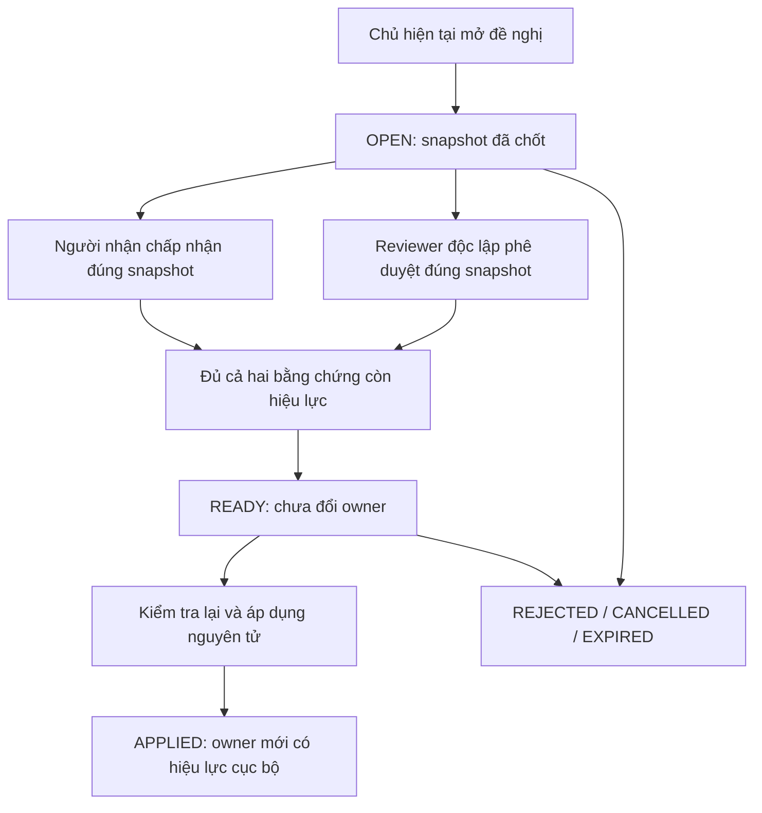

# Ownership change approval: phê duyệt thay đổi chủ sở hữu đối tượng

Trong chương **Object Ownership**, thay đổi chủ sở hữu là một hành động làm thay đổi quan hệ quyền với đối tượng. Nó có thể quyết định ai được quản lý thành viên, xuất dữ liệu, thay cấu hình hoặc tiếp tục các quy trình nghiệp vụ. Vì vậy, trường `ownerId` không nên được xem như một thuộc tính mô tả mà bất kỳ người có quyền sửa đối tượng nào cũng được cập nhật.

Trong module bảo vệ logic nghiệp vụ, phê duyệt đổi chủ sở hữu cần ngăn chiếm quyền đối tượng, chuyển cho sai người, dùng quyết định cũ hoặc thay chủ trong lúc hệ thống đang kiểm tra quyền. Cơ chế phải kết hợp business invariants, state machine, quyền theo đối tượng, transaction và idempotency.

Bài học sử dụng ví dụ bàn giao chủ sở hữu chính của một dự án. Chính sách minh họa yêu cầu người chủ hiện tại đề nghị, người nhận chấp nhận và một người độc lập phê duyệt trước khi hệ thống áp dụng thay đổi.

Sau bài này, bạn có thể:

- Phân biệt quyền sửa đối tượng với quyền đề nghị và phê duyệt đổi chủ sở hữu.
- Gắn mọi bằng chứng với đúng đối tượng, chủ hiện tại, người nhận và phiên bản đề nghị.
- Thiết kế tiếp nhận, phê duyệt, áp dụng, hủy và hết hạn thành các bước rõ ràng.
- Ngăn quyết định cũ hoặc yêu cầu đồng thời ghi đè quan hệ sở hữu mới.
- Xử lý quyền dẫn xuất, cache, tác vụ nền và kết quả bên ngoài sau bàn giao.

## 1. Đổi owner là chuyển một quan hệ quyền

Giả sử một thành viên có quyền sửa tên và mô tả dự án gửi:

```http
PATCH /projects/p-17
Content-Type: application/json

{
  "name": "Dự án vận hành",
  "ownerId": "account-controlled-by-caller"
}
```

Nếu máy chủ bind toàn bộ body vào entity, một quyền chỉnh sửa nội dung có thể biến thành quyền chiếm sở hữu. Việc caller biết ID dự án hoặc đang là thành viên không chứng minh họ được chuyển quan hệ owner.

Một biến thể khác là endpoint đổi owner có kiểm tra vai trò quản lý nhưng không kiểm tra người nhận có thuộc tenant hay không. Dữ liệu có thể bị gắn với principal ngoài phạm vi, làm các API suy diễn quyền từ `ownerId` hoạt động sai.

Cần định nghĩa rõ ý nghĩa owner trong mô hình của hệ thống:

| Quan hệ | Ý nghĩa có thể có | Có tự đồng nghĩa owner không? |
| --- | --- | --- |
| Người tạo | Ai đã tạo đối tượng trong lịch sử | Không |
| Chủ sở hữu chính | Chủ thể nắm một nhóm quyền quản lý theo chính sách | Theo định nghĩa của hệ thống |
| Người được giao xử lý | Ai đang chịu trách nhiệm một nhiệm vụ | Không |
| Người thanh toán hoặc đơn vị chịu phí | Chủ thể liên quan tới nghĩa vụ chi phí | Không mặc định |
| Thành viên hoặc người được chia sẻ | Có một phần quyền truy cập | Không |

Bàn giao owner không phải lý do ghi đè `createdBy`, người đã duyệt hoặc người đã thực hiện các giao dịch trước đó. Các trường lịch sử phải tiếp tục phản ánh đúng người thực sự tham gia.

## 2. Chính sách ví dụ cho dự án nhạy cảm

Giả sử dự án P17 có chủ hiện tại là An và người nhận dự kiến là Bình, cùng thuộc tenant T1. Chính sách ví dụ quy định:

1. Chỉ chủ hiện tại đang đủ điều kiện mới được mở đề nghị chuyển chủ theo đường thông thường.
2. Người nhận phải là tài khoản nhân sự hợp lệ, đang hoạt động, thuộc cùng tenant và đủ điều kiện làm owner.
3. Người nhận phải là cá nhân khác chủ hiện tại; chuyển giữa hai tài khoản của cùng người dùng là quy trình quản trị khác trong ví dụ này.
4. Người nhận phải chấp nhận đúng đề nghị, không chỉ mở một liên kết thông báo.
5. Một reviewer có quyền trên dự án phải phê duyệt, độc lập với chủ hiện tại và người nhận.
6. Dự án phải ở trạng thái cho phép bàn giao; ví dụ chỉ chấp nhận khi `ACTIVE`.
7. Mỗi dự án chỉ có một đề nghị chuyển chủ đang có hiệu lực theo chính sách đã chọn.
8. Không có quyền owner mới trước khi bước áp dụng được commit.
9. Việc áp dụng phải kiểm tra lại các điều kiện có thể thay đổi, gồm quyền nguồn, người nhận, hạn mức sở hữu nếu có và hiệu lực bằng chứng.

Không phải mọi loại đối tượng đều cần cả ba người. Một tài nguyên ít rủi ro có thể dùng quy trình đơn giản hơn; một đối tượng khác có thể cần nhiều cấp duyệt. Số bước và mức độc lập phải là quyết định chính sách rõ ràng.

Sự chấp nhận của Bình và phê duyệt của reviewer trả lời hai câu hỏi khác nhau:

```text
Người nhận: tôi đồng ý tiếp nhận quan hệ sở hữu cụ thể này.
Reviewer: việc chuyển giao này được phép theo chính sách của tổ chức.
```

Không dùng một bằng chứng để thay thế bằng chứng còn lại nếu chính sách yêu cầu cả hai.

## 3. Chốt nội dung đề nghị thành một snapshot

Đề nghị chuyển chủ cần xác định đầy đủ thay đổi được xét:

```text
transferId
tenantId và projectId
fromOwnerPrincipalId
sourceOwnershipEpoch
toOwnerPrincipalId
proposalRevision
phiên bản chính sách và phạm vi quyền bàn giao liên quan
thời hạn của đề nghị
lý do và dữ liệu cần cho quyết định
```

Người nhận và reviewer phải đưa ra bằng chứng cho đúng snapshot đó. Nếu đích chuyển từ Bình sang Chi sau khi Bình đã chấp nhận, bằng chứng cũ không được dùng để chuyển cho Chi.

Các loại phiên bản có ý nghĩa khác nhau:

| Phiên bản | Điều nó giúp bảo vệ |
| --- | --- |
| `proposalRevision` | Nội dung đề nghị đã được ai chấp nhận hoặc duyệt |
| `ownershipEpoch` | Một thế hệ quan hệ sở hữu, tăng khi đổi owner có hiệu lực |
| `projectVersion` | Phát hiện cập nhật cạnh tranh trên bản ghi dự án |
| Phiên bản chính sách | Điều kiện phê duyệt và bàn giao được áp dụng |

`ownershipEpoch` giúp phát hiện trường hợp An từng là chủ, dự án chuyển cho Chi, rồi lại chuyển về An. Chỉ so sánh `ownerId == An` không nhận ra đã có các lần bàn giao ở giữa. Một đề nghị được lập ở thế hệ cũ không được tự có hiệu lực trở lại.

Không nhất thiết mọi thay đổi nhỏ của dự án đều làm mất đề nghị. Nhưng dữ liệu ảnh hưởng quyết định như phạm vi tài nguyên, ràng buộc bảo mật hoặc nghĩa vụ bàn giao phải có quy tắc version và đánh giá lại phù hợp. Không dùng một snapshot cũ để che việc đối tượng đã thay đổi ý nghĩa.

## 4. Vòng đời đề nghị và thời điểm đổi chủ thực sự

Có thể lưu sự chấp nhận và phê duyệt dưới dạng các bằng chứng độc lập. Hai bước này không nhất thiết phải diễn ra theo một thứ tự cố định, trừ khi chính sách yêu cầu.



Trong mô hình này:

- `OPEN`: đề nghị đang nhận các quyết định hợp lệ.
- `READY`: đã đủ bằng chứng theo chính sách, nhưng quan hệ owner vẫn chưa đổi.
- `APPLIED`: thay đổi owner tại nguồn có thẩm quyền cục bộ đã commit.
- `REJECTED`: người nhận hoặc reviewer đã từ chối theo quyền và quy tắc tương ứng.
- `CANCELLED`: đề nghị bị hủy hợp lệ trước ranh giới áp dụng.
- `EXPIRED`: không còn được áp dụng vì hết hạn.
- `STALE`: căn cứ nguồn hoặc nội dung đã không còn phù hợp và không thể dùng tiếp như cũ.

Các trạng thái kết thúc không tự mở lại khi có callback hoặc request cũ. Nếu muốn chuyển lại sau khi đã áp dụng, chủ mới phải tạo quy trình bàn giao mới theo chính sách.

## 5. Mở đề nghị từ quyền nguồn có thẩm quyền

Ví dụ endpoint:

```http
POST /projects/p-17/ownership-transfers
Idempotency-Key: transfer-p17-to-binh-01
Content-Type: application/json

{
  "targetPrincipalId": "account-binh",
  "expectedProjectVersion": 14,
  "reason": "Bàn giao trách nhiệm vận hành dự án"
}
```

Máy chủ phải:

1. Xác thực actor và xác lập tenant scope.
2. Tải P17 trong scope đó, kiểm tra actor là chủ hiện tại và có quyền mở đề nghị.
3. Lấy `fromOwnerPrincipalId` và `sourceOwnershipEpoch` từ dự án đã lưu.
4. Tải người nhận và kiểm tra tenant, trạng thái, loại principal cùng điều kiện sở hữu.
5. Kiểm tra dự án và version, cùng quy tắc không có đề nghị đang có hiệu lực khác.
6. Tạo snapshot và thời hạn phía máy chủ, ghi đề nghị cùng audit.

Không nhận `fromOwnerId`, `approvedBy`, `accepted=true`, tenant hoặc epoch từ body làm sự thật. Người gọi chỉ đề xuất đích và ý định; máy chủ xác định căn cứ quyền.

Việc tạo đề nghị không được đồng thời ghi owner mới. Không cho người nhận quyền quản lý chỉ vì đã có một transfer record trỏ tới họ.

Nếu chủ hiện tại không còn hoạt động hoặc không thể tham gia, đường thông thường phải xử lý theo chính sách. Không dùng quy tắc “không tìm thấy chủ thì cho caller nhận luôn” làm fallback.

## 6. Người nhận chấp nhận đúng đối tượng và đúng vai trò

Người nhận có thể gửi:

```http
POST /projects/p-17/ownership-transfers/tr-8/accept
Content-Type: application/json

{
  "expectedProposalRevision": 2
}
```

Máy chủ kiểm tra actor là principal nhận của snapshot hiện tại, vẫn thuộc tenant và còn đủ điều kiện. Chỉ có email giống tên hoặc biết ID `tr-8` không đủ.

Nếu dùng liên kết mời hoặc token, kiểm tra mục đích, transfer, người nhận và thời hạn theo cơ chế của hệ thống. Việc sở hữu một liên kết bị chuyển tiếp không tự chứng minh người bấm là người nhận đã được chỉ định.

Màn hình chấp nhận cần cho biết đủ nội dung để quyết định, chẳng hạn dự án, chủ hiện tại, phạm vi bàn giao và các nghĩa vụ được mô hình hóa. Nó không tự cấp quyền đọc toàn bộ tài liệu riêng tư trước khi Bình trở thành owner.

Sự chấp nhận cần được lưu với actor thực tế, snapshot và thời điểm máy chủ. Nếu chính sách cho rút chấp nhận trước áp dụng, thao tác rút phải cạnh tranh qua cùng cơ chế trạng thái; không chỉ xóa một cờ ở giao diện.

## 7. Reviewer phê duyệt độc lập và đúng phạm vi

Reviewer cần quyền phê duyệt đổi owner trên chính dự án, không chỉ một vai trò quản lý chung không có phạm vi.

Các kiểm tra gồm:

- Đề nghị thuộc đúng tenant, đúng dự án và đang nhận quyết định.
- Reviewer đủ quyền theo chính sách và phạm vi hiện tại.
- Reviewer không là chủ nguồn hoặc người nhận theo danh tính cá nhân đáng tin cậy.
- Snapshot đã xem khớp revision được quyết định.
- Không có điều kiện cấm như dự án đang xóa hoặc dữ liệu bàn giao đã thay đổi trái chính sách.
- Lý do, mức bảo đảm xác thực hoặc bằng chứng bổ sung đạt yêu cầu nếu có.

Hai tài khoản của cùng một người không tự tạo thành hai bên độc lập. Nếu có hành động thay mặt hoặc ủy quyền, lưu actor thực tế và người được đại diện rồi đánh giá xung đột theo chính sách.

Nếu reviewer muốn thay đích nhận hoặc phạm vi quyền, đó là sửa nội dung đề nghị. Cần revision mới và bằng chứng áp dụng cho bản mới; không vừa đổi đích vừa phê duyệt bằng một snapshot cũ.

Timeout không tạo đồng ý. Thiếu reviewer có thể dẫn tới hết hạn hoặc chuyển nhiệm vụ theo policy, nhưng không được coi service account là một người duyệt độc lập chỉ để đủ số lượng.

## 8. Minh họa Java: đối chiếu nguồn sở hữu và bằng chứng

Đoạn mã sau kiểm tra một phần điều kiện sẵn sàng trên dữ liệu máy chủ đã xác minh. Các record là mô hình nội bộ, không phải DTO nhận cờ phê duyệt từ client. Ví dụ dùng record của Java 16 trở lên.

```java
import java.time.Instant;
import java.util.Objects;
import java.util.UUID;

enum ProjectState {
    ACTIVE, ARCHIVED, DELETING
}

record OwnershipView(
        UUID tenantId,
        UUID projectId,
        UUID ownerPrincipalId,
        long ownershipEpoch,
        ProjectState state) {
}

record TransferSpec(
        UUID transferId,
        UUID tenantId,
        UUID projectId,
        long revision,
        UUID fromOwnerPrincipalId,
        long sourceOwnershipEpoch,
        UUID toOwnerPrincipalId,
        String policyVersion,
        Instant validUntil) {
}

record RecipientAcceptance(
        TransferSpec spec,
        UUID acceptedByPrincipalId,
        Instant validUntil) {
}

record IndependentApproval(
        TransferSpec spec,
        UUID reviewerPersonId,
        Instant validUntil) {
}

final class OwnershipTransferPolicy {
    private OwnershipTransferPolicy() {
    }

    static void requireReady(
            OwnershipView project,
            TransferSpec spec,
            RecipientAcceptance acceptance,
            IndependentApproval approval,
            UUID sourcePersonId,
            UUID targetPersonId,
            Instant now) {
        Objects.requireNonNull(project);
        Objects.requireNonNull(spec);
        Objects.requireNonNull(acceptance);
        Objects.requireNonNull(approval);
        Objects.requireNonNull(sourcePersonId);
        Objects.requireNonNull(targetPersonId);
        Objects.requireNonNull(now);

        require(Objects.requireNonNull(project.tenantId())
                .equals(spec.tenantId()), "TENANT_MISMATCH");
        require(Objects.requireNonNull(project.projectId())
                .equals(spec.projectId()), "PROJECT_MISMATCH");
        require(Objects.requireNonNull(project.ownerPrincipalId())
                .equals(spec.fromOwnerPrincipalId()), "SOURCE_OWNER_CHANGED");
        require(project.ownershipEpoch() == spec.sourceOwnershipEpoch(),
                "OWNERSHIP_GENERATION_CHANGED");
        require(project.state() == ProjectState.ACTIVE,
                "PROJECT_NOT_TRANSFERABLE");
        require(!Objects.requireNonNull(spec.toOwnerPrincipalId())
                .equals(spec.fromOwnerPrincipalId()), "SAME_ACCOUNT");
        require(!sourcePersonId.equals(targetPersonId), "SAME_PERSON");

        require(spec.equals(acceptance.spec()), "ACCEPTANCE_SPEC_MISMATCH");
        require(spec.toOwnerPrincipalId()
                .equals(acceptance.acceptedByPrincipalId()),
                "WRONG_RECIPIENT");
        require(spec.equals(approval.spec()), "APPROVAL_SPEC_MISMATCH");

        UUID reviewer = Objects.requireNonNull(approval.reviewerPersonId());
        require(!reviewer.equals(sourcePersonId)
                && !reviewer.equals(targetPersonId), "REVIEWER_CONFLICT");
        require(now.isBefore(spec.validUntil())
                && now.isBefore(acceptance.validUntil())
                && now.isBefore(approval.validUntil()), "EVIDENCE_EXPIRED");
    }

    private static void require(boolean condition, String code) {
        if (!condition) {
            throw new SecurityException(code);
        }
    }
}
```

So sánh đầy đủ `TransferSpec` minh họa rằng bằng chứng không được dùng cho transfer, đích hoặc revision khác. Trong ứng dụng thật, có thể so ID snapshot bất biến và các quan hệ được cơ sở dữ liệu bảo vệ.

Hàm chưa kiểm tra quyền reviewer, trạng thái tài khoản, membership hiện tại, quota người nhận, trạng thái transfer hoặc project version. Các danh tính và bằng chứng phải được tải từ nguồn có thẩm quyền; bằng chứng đã rút hoặc bị thu hồi không được truyền như vẫn có hiệu lực.

Các trường bắt buộc cần được xác thực khi dựng mô hình. Kết quả kiểm tra chỉ có giá trị nếu service bảo vệ dữ liệu tương ứng tới ranh giới áp dụng bằng transaction hoặc cơ chế nhất quán phù hợp.

## 9. Áp dụng thay đổi trong transaction

Với owner được quản lý tại cơ sở dữ liệu cục bộ, luồng áp dụng có thể là:

```text
BEGIN TRANSACTION
  nhận quyền xử lý idempotency key hoặc operation hiện tại
  bảo vệ project, transfer và dữ liệu quyền liên quan theo thứ tự thống nhất
  tải lại owner, ownershipEpoch và projectVersion
  kiểm tra transfer vẫn là đề nghị hiện tại, chưa kết thúc hoặc hết hạn
  kiểm tra nguồn còn đủ quyền theo chính sách
  kiểm tra người nhận vẫn hoạt động, cùng tenant và đủ điều kiện sở hữu
  đối chiếu chấp nhận, phê duyệt, snapshot và quyền reviewer
  kiểm tra quota hoặc tổ hợp quyền của người nhận nếu có
  cập nhật owner có điều kiện và tăng ownershipEpoch, projectVersion
  cập nhật các quan hệ quyền cục bộ bắt buộc theo kế hoạch bàn giao
  chuyển transfer thành APPLIED
  ghi audit, version quyền, outbox và kết quả operation
COMMIT
```

Một câu SQL bảo vệ cập nhật có thể có dạng:

```sql
UPDATE project
SET owner_principal_id = :verified_target_principal_id,
    ownership_epoch = ownership_epoch + 1,
    version = version + 1
WHERE tenant_id = :authorized_tenant_id
  AND id = :project_id
  AND owner_principal_id = :expected_source_principal_id
  AND ownership_epoch = :expected_source_ownership_epoch
  AND version = :locked_project_version
  AND state = 'ACTIVE';
```

Phải cập nhật đúng một hàng. Không có hàng bị tác động thì không được đánh dấu transfer thành công. Mệnh đề SQL không thay thế những kiểm tra bằng chứng và quyền trong transaction.

Nếu một bước cục bộ bắt buộc như cập nhật quyền hoặc ghi kết quả thất bại, rollback toàn bộ phần cục bộ. Không để owner đã đổi nhưng transfer vẫn chưa áp dụng, hoặc transfer báo thành công trong khi owner còn cũ.

Không giữ transaction mở trong lúc chờ người nhận hay reviewer. Các bước con người được nối bằng dữ liệu bền vững; transaction áp dụng là một ranh giới ngắn sau khi đã có bằng chứng.

## 10. Tranh chấp, thế hệ sở hữu và hạn mức người nhận

### Hai đề nghị hoặc hai lần áp dụng

Nếu chính sách chỉ cho một đề nghị đang có hiệu lực, việc mở đề nghị phải bảo vệ trạng thái đó bằng khóa, version hoặc ràng buộc phù hợp. Hai request không được cùng đọc “chưa có transfer” rồi tạo hai đường bàn giao hợp lệ độc lập.

Dù có lớp chặn đề nghị trùng, bước áp dụng vẫn phải kiểm tra owner nguồn và epoch. Một lỗi ở bước tạo không được làm hai lần chuyển cùng thắng trên cùng thế hệ sở hữu.

### Owner thay đổi rồi quay lại

```text
epoch 7: An là owner, mở đề nghị TR-8 chuyển cho Bình
epoch 8: một quy trình hợp lệ khác chuyển cho Chi
epoch 9: một quy trình mới chuyển lại cho An
```

TR-8 không được dùng tiếp chỉ vì owner hiện lại là An. Nó được tạo cho epoch 7 và phải bị coi là không còn áp dụng cho epoch 9.

### Người nhận cùng lúc nhận nhiều dự án

Nếu một người chỉ được làm owner tối đa một số lượng dự án, hai transfer trên hai project khác nhau có thể cùng vượt hạn mức. Khóa riêng từng project không bảo vệ quota chung của người nhận.

Cần một cơ chế nhất quán ở dữ liệu quota hoặc tập quan hệ sở hữu liên quan. Chọn thứ tự khóa thống nhất để tránh các quy trình bàn giao song song tự gây deadlock không cần thiết.

### Hủy hoặc rút chấp nhận trong lúc áp dụng

Các hành động này phải cạnh tranh trên trạng thái có thẩm quyền. Nếu hủy thắng trước ranh giới áp dụng, không đổi owner. Nếu áp dụng đã commit, không trả kết quả “đã hủy, không có gì thay đổi”; muốn quay lại cần quy trình mới hoặc xử lý ngoại lệ đúng chính sách.

## 11. Quyền dẫn xuất và quyền được giữ lại sau bàn giao

Đổi `ownerId` có thể làm thay đổi một phần quyền, nhưng không tự xác định mọi membership hoặc credential khác.

| Nguồn quyền | Điều cần quy định |
| --- | --- |
| Quyền suy ra trực tiếp từ owner | Khi nào owner cũ mất và owner mới nhận khả năng tương ứng |
| Vai trò được gán riêng | Giữ, gỡ hay đánh giá lại theo kế hoạch bàn giao |
| Chia sẻ đối tượng | Có tiếp tục tồn tại và ai được quản lý sau bàn giao |
| Ủy quyền do owner cũ cấp | Có phụ thuộc quan hệ sở hữu hiện tại hay không |
| Token hoặc cache quyền | Cơ chế làm quyết định cũ không tiếp tục cấp quyền ngoài hợp đồng |
| Khóa hoặc tích hợp bên ngoài | Có cần chuyển giao, thu hồi hoặc thay credential bằng quy trình riêng không |

Trong ví dụ, quyền owner được suy ra từ owner hiện tại. Một vai trò editor gán riêng cho An không tự mất nếu kế hoạch bàn giao không quy định gỡ. Nếu mục tiêu là An không còn bất kỳ quyền nào, phải mô tả và thực thi phạm vi thu hồi đó rõ ràng.

Quyền mới cũng không được mở rộng quá ý nghĩa owner đã duyệt. Một chuyển chủ dự án không tự cấp vai trò quản trị toàn tenant cho Bình.

Cache, token hoặc bản chiếu quyền cần version và ngữ nghĩa hiệu lực phù hợp. Không chỉ xóa cache ở một máy rồi tuyên bố mọi điểm thực thi đã thấy owner mới. Cổng hành động nhạy cảm cần đọc hoặc kiểm chứng nguồn quyền theo bảo đảm đã chọn.

Các lịch sử như người tạo đề nghị, người hưởng chi hoặc người đã duyệt không được đổi thành owner mới để đơn giản hóa dữ liệu. Việc làm đó có thể phá vỡ quy tắc không tự duyệt và khả năng audit các giao dịch đang tồn tại.

## 12. Hệ thống ngoài và sự kiện đến muộn

Nếu đổi owner cục bộ còn cần cập nhật kho tài liệu, nền tảng triển khai hoặc nhà cung cấp khác, một transaction cục bộ không tự bao trùm các thay đổi đó.

Cần xác định đâu là nguồn owner có thẩm quyền:

- Nếu nguồn là cơ sở dữ liệu cục bộ, `APPLIED` có thể chỉ xác nhận quan hệ cục bộ đã đổi; các bước đồng bộ ngoài phải có trạng thái riêng.
- Nếu nguồn thực sự là hệ thống ngoài, không nên báo đã bàn giao hoàn tất trước khi có bằng chứng phù hợp từ nguồn đó.

Thiết kế cần operation ổn định, outbox hoặc cơ chế bền vững tương đương, chống lặp và đối soát. Nếu các điểm thực thi tạm thời không đồng nhất, phải có chính sách rõ về hành động nhạy cảm trong giai đoạn chuyển tiếp.

Timeout không chứng minh chưa đổi owner bên ngoài. Không tạo lại một operation khác hoặc tự đổi owner về nguồn cũ khi chưa biết kết quả. Bù trừ sau một bàn giao đã xảy ra là hành động mới cần điều kiện và thẩm quyền tương ứng.

Với sự kiện muộn, đối chiếu transfer, operation và thế hệ sở hữu. Một sự kiện “An chuyển cho Bình” của epoch cũ không được ghi đè Bình đã chuyển tiếp cho Chi qua một quy trình hợp lệ mới.

Consumer của bản chiếu nên có version hoặc thứ tự có thẩm quyền để tránh trạng thái cũ ghi đè trạng thái mới. Timestamp tùy ý trong message không tự chứng minh quan hệ nhân quả.

## 13. Idempotency, hết hạn và bằng chứng đã kết thúc

Sau khi áp dụng thành công nhưng mất phản hồi, retry cùng ý định phải nhận kết quả tương ứng mà không tăng epoch hoặc tạo thêm tác dụng phụ.

| Tình huống | Hành vi cần thiết |
| --- | --- |
| Cùng key, cùng transfer và revision đã áp dụng | Không thực hiện lại; trả kết quả theo quyền xem hiện tại |
| Cùng key nhưng đổi project hoặc đích nhận | Từ chối tái sử dụng key cho ý định khác |
| Key khác trên transfer đã áp dụng | Không tạo một lần đổi owner mới |
| Acceptance hoặc approval của revision cũ | Không tính cho nội dung hiện tại |
| Link cũ sau khi hủy hoặc hết hạn | Không hồi sinh transfer hoặc đổi owner |
| Callback lặp | Không tăng epoch hoặc cấp quyền thêm lần nữa |

Idempotency key không phải quyền truy cập. Sau bàn giao, An có thể không còn quyền đọc toàn bộ dự án; việc xem biên nhận transfer cần chính sách riêng và chỉ trả dữ liệu được phép.

Thời hạn proposal, acceptance và approval cần được kiểm tra theo thời gian có thẩm quyền tại ranh giới được quy định. Hết hạn không tự tạo chấp nhận hoặc phê duyệt; tạo đề nghị mới phải đi lại các bước bắt buộc.

Giữ lịch sử hoặc tombstone cần thiết theo chính sách để nhận diện transfer đã đóng, message lặp và kết quả đến muộn. Xóa bản ghi quá sớm có thể làm một liên kết cũ hoặc operation cũ mất khả năng đối chiếu.

## 14. Chuyển tenant và khôi phục quyền là các quy trình riêng

Ví dụ chỉ cho bàn giao giữa các principal trong cùng tenant. Máy chủ phải kiểm tra quan hệ tenant của project, chủ nguồn, người nhận và reviewer bằng dữ liệu có thẩm quyền.

Chuyển một dự án sang tenant khác có thể kéo theo dữ liệu, thành viên, nghĩa vụ, tích hợp và chính sách bảo mật khác. Không thực hiện bằng cách mở rộng endpoint này để patch thêm `tenant_id`.

Khi chủ hiện tại nghỉ việc hoặc không thể truy cập, hệ thống có thể có quy trình khôi phục quản trị. Quy trình đó cần quyền chuyên biệt, bằng chứng, mức độc lập, phạm vi và audit phù hợp. Không giả vờ chủ cũ đã đồng ý bằng cách tạo acceptance hoặc chữ ký dưới tên họ.

Các công cụ quản trị, import, CLI và worker cũng phải tuân thủ cùng ranh giới hoặc một đường ngoại lệ được cấp quyền rõ ràng. Một endpoint công khai an toàn không bảo vệ được hệ thống nếu script quản trị thường ngày vẫn cho sửa owner tùy ý.

Quyền sửa policy, mapping danh tính hoặc credential thực thi cũng là một phần của ranh giới tin cậy. Người có thể tự biến mình thành reviewer hoặc đổi mapping cá nhân có thể làm mất tính độc lập nếu các thay đổi đó không được kiểm soát.

## 15. Ma trận kiểm thử quyền, nội dung và vòng đời

| Ca kiểm thử | Kết quả cần giữ |
| --- | --- |
| Chủ hợp lệ đề nghị, đúng người nhận chấp nhận, reviewer độc lập duyệt | Chỉ đổi owner sau bước áp dụng hợp lệ |
| Người chỉ được sửa mô tả gửi thêm `ownerId` | Không đổi quan hệ sở hữu |
| Người ngoài scope mở transfer bằng ID dự án thật | Không tạo đề nghị hoặc lộ dữ liệu ngoài quyền |
| Người nhận thuộc tenant khác hoặc không còn hoạt động | Không được áp dụng theo đường thông thường |
| Một người dùng hai tài khoản làm nguồn và đích | Bị chặn theo chính sách khác cá nhân của ví dụ |
| Chủ nguồn hoặc người nhận tự làm reviewer | Không đủ bằng chứng độc lập |
| Người khác biết link accept | Không chấp nhận thay người nhận đã chỉ định |
| Sửa đích hoặc revision sau khi có bằng chứng | Không tái sử dụng acceptance hoặc approval cũ |
| Dự án chuyển sang `DELETING` | Không áp dụng transfer chỉ vì đã từng đủ bằng chứng |
| Transfer hết hạn, bị hủy hoặc bị từ chối | Không mở lại qua link hoặc request cũ |
| Hai tài khoản của cùng reviewer được dùng để tránh xung đột | Quyết định dựa trên danh tính cá nhân phù hợp |

Luôn có ca đối chứng hợp lệ. Nếu mọi request đều bị chặn do route sai, dữ liệu thiếu hoặc target không hợp lệ, bộ test chưa chứng minh được kiểm soát ownership.

Kiểm tra owner, epoch, version, quan hệ quyền, transfer, audit và outbox sau thao tác. Một response lỗi không đủ nếu owner đã đổi hoặc ý định bàn giao bên ngoài đã được tạo.

## 16. Kiểm thử cạnh tranh và lỗi giữa các bước

| Kịch bản | Invariant hoặc hành vi cần giữ |
| --- | --- |
| Hai request mở transfer cùng lúc | Không có hai đề nghị hiệu lực trái chính sách |
| Hai worker áp dụng cùng transfer | Chỉ một lần đổi owner và tăng epoch |
| Hủy hoặc rút chấp nhận đồng thời với áp dụng | Kết quả theo ranh giới quyết định, không báo hủy giả sau commit |
| Owner đổi rồi quay lại cùng principal | Proposal epoch cũ vẫn không được dùng |
| Người nhận bị khóa hoặc reviewer mất quyền trước áp dụng | Kiểm tra lại theo chính sách hiệu lực đã chọn |
| Hai dự án cùng chuyển cho một người gần chạm quota | Không vượt quota chung do chỉ khóa từng project |
| Lỗi sau cập nhật owner nhưng trước ghi transfer | Transaction rollback phần cục bộ bắt buộc |
| Mất phản hồi sau commit | Retry không đổi owner hoặc epoch thêm lần nữa |
| Nhà cung cấp đã đổi nhưng phản hồi timeout | Đối soát operation cũ, không giả định chưa áp dụng |
| Sự kiện cũ đến sau một lần chuyển mới | Không ghi đè owner thế hệ mới |
| Cache quyền còn owner cũ | Hành vi khớp bảo đảm hiệu lực mà hệ thống công bố |
| Import hoặc API quản trị cố sửa owner trực tiếp | Bị chặn hoặc đi đúng quy trình ngoại lệ có thẩm quyền |

Các test transaction và tranh chấp cần lịch thực thi có kiểm soát và cơ chế lưu trữ phù hợp. Mock hai lần cập nhật thành công hoặc gọi tuần tự không chứng minh được điều kiện loại trừ khi chạy đồng thời.

Với tác dụng bên ngoài, thu nhận lời gọi ở một biên kiểm thử độc lập để phát hiện hiệu ứng đã gửi trước khi request lỗi. Không chỉ nhìn dữ liệu cục bộ sau rollback.

## 17. Audit và thông tin trạng thái cho người tham gia

Audit cần giải thích được:

```text
project, tenant, transfer và revision
owner nguồn, owner đích và sourceOwnershipEpoch
actor thực sự mở đề nghị
người nhận chấp nhận hoặc từ chối, thời điểm và snapshot
reviewer thực tế, phạm vi quyền và quyết định
policy version và các điều kiện quan trọng đã kiểm tra
thời điểm áp dụng, project version và ownershipEpoch trước–sau
operation, kết quả đồng bộ ngoài, hủy hoặc đối soát liên quan
```

Phân biệt rõ “đang chờ người nhận”, “đang chờ reviewer”, “đủ điều kiện nhưng chưa áp dụng”, “đã đổi owner cục bộ” và “đang đồng bộ hoặc đối soát”. Một email chấp nhận không phải bằng chứng rằng Bình đã có quyền owner.

Thông báo nên phát từ ý định đã commit. Lỗi gửi thông báo được retry mà không đảo ngược hoặc lặp lại quyết định bàn giao.

Người tham gia chỉ được xem dữ liệu phù hợp với vai trò của họ. Reviewer hoặc người nhận cần biết nội dung quyết định, nhưng không mặc nhiên được đọc mọi tài liệu dự án. Giới hạn cả API trạng thái, link thông báo và biên nhận sau khi quyền sở hữu đã đổi.

Theo dõi các lần cố đổi owner qua patch, dùng bằng chứng sai revision, áp dụng proposal epoch cũ và thao tác quản trị ngoại lệ. Không ghi token mời, credential hoặc bí mật tích hợp vào log để phục vụ theo dõi.

## 18. Cách áp dụng ownership change approval vào hệ thống của bạn

1. Định nghĩa quan hệ owner mang những quyền và nghĩa vụ nào, tách khỏi người tạo hoặc người được giao nhiệm vụ.
2. Xác định ai được đề nghị, ai phải chấp nhận và ai phải phê duyệt độc lập.
3. Chốt snapshot gồm đối tượng, nguồn, đích, thế hệ sở hữu, revision và chính sách.
4. Thiết kế trạng thái bằng chứng và proposal mà không đổi owner trước ranh giới áp dụng.
5. Kiểm tra lại quyền nguồn, eligibility người nhận, reviewer, trạng thái và quota tại lúc áp dụng.
6. Cập nhật owner cùng dữ liệu cục bộ bắt buộc trong transaction có version và chống lặp.
7. Xác định rõ quyền nào mất, quyền nào được giữ, cách xử lý cache, token và các hệ thống ngoài.
8. Tách chuyển tenant, khôi phục quản trị và bù trừ thành các quy trình có thẩm quyền riêng.
9. Kiểm thử thay đích, tự duyệt, epoch cũ, áp dụng đồng thời, timeout và sự kiện muộn.

Phê duyệt đổi chủ sở hữu bảo vệ một sự chuyển giao quyền cụ thể. Bằng chứng chỉ có giá trị khi gắn với đúng nguồn, đúng người nhận và đúng thế hệ đối tượng, rồi được tiêu thụ tại một ranh giới áp dụng mà các thao tác cạnh tranh không thể vượt qua.
