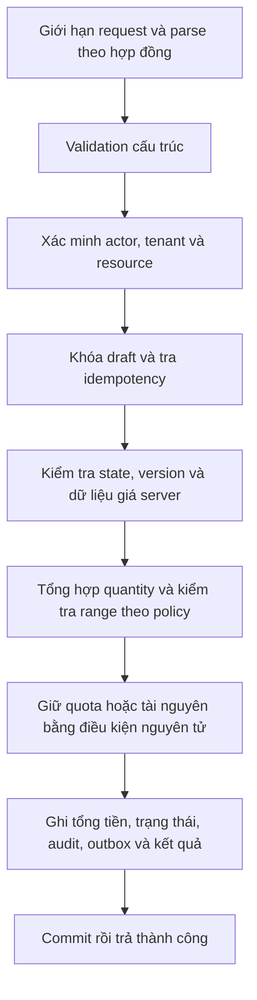

# Allowed value ranges — Miền giá trị được phép theo nghiệp vụ

## 1. Một giá trị đúng kiểu chưa chắc được phép sử dụng

**Allowed value ranges** là tập hoặc khoảng giá trị mà một trường được phép nhận trong một operation cụ thể, với đơn vị, độ chính xác, quan hệ dữ liệu và ngữ cảnh nghiệp vụ đã xác định.

Parse được chuỗi thành số nguyên chỉ chứng minh dữ liệu biểu diễn được bằng kiểu đó. Nó không chứng minh số lượng hợp lệ, chiết khấu nằm trong thẩm quyền hoặc quota còn đủ để chấp nhận một lần mua mới.

Bài thuộc chương **Business Input Rules** của module `SECURITY_APPLICATION_SECURITY_BUSINESS_LOGIC_SECURITY`. Mục tiêu là ngăn lạm dụng quy tắc nghiệp vụ thông qua giá trị âm, quá lớn, quá chính xác, sai đơn vị, chia nhỏ yêu cầu hoặc gửi đồng thời để vượt giới hạn.

Ví dụ xuyên suốt là gửi một đơn mua hàng từ draft sang bước tiếp theo:

- Mỗi dòng có số lượng nguyên từ 1 đến 1.000.
- Một request có từ 1 đến 50 dòng.
- Tổng số lượng của cùng sản phẩm trong đơn còn chịu giới hạn riêng của sản phẩm.
- Client có thể đề nghị chiết khấu theo hợp đồng API, nhưng server quyết định mức được chấp nhận theo policy và thẩm quyền.
- Giá, tiền tệ và các tổng tiền có thẩm quyền lấy từ dữ liệu server.
- Quota đã dùng phải được tính trong điều kiện đồng thời, không chỉ kiểm tra một request đứng riêng.

Các con số là policy minh họa, không phải giới hạn chung cho mọi hệ thống. Điều cần học là cách xác định và thực thi miền giá trị đúng.

OWASP phân biệt kiểm tra cú pháp với kiểm tra ngữ nghĩa: dữ liệu cần đúng kiểu/định dạng và có ý nghĩa hợp lệ cho operation. Validation cũng không thay thế kiểm tra authorization trên tài nguyên được tham chiếu. [OWASP Input Validation Cheat Sheet](https://cheatsheetseries.owasp.org/cheatsheets/Input_Validation_Cheat_Sheet.html).

## 2. Mô tả miền giá trị bằng một hợp đồng đầy đủ

### 2.1. Không chỉ ghi min và max

Với mỗi trường cần xác định:

| Thuộc tính hợp đồng | Câu hỏi cần trả lời |
| --- | --- |
| Kiểu và biểu diễn | Số nguyên, số thập phân cố định, chuỗi ngày hay timestamp? Có chấp nhận số dưới dạng chuỗi không? |
| Đơn vị | Cái, gram, đồng, minor unit, phần trăm hay basis point? |
| Cận dưới/cận trên | Bao gồm hay loại trừ điểm biên? |
| Bước giá trị | Chỉ số nguyên, bội số của 5, hay tối đa hai chữ số thập phân? |
| Missing/null | Bắt buộc, cho phép thiếu hay có default được định nghĩa? |
| Ngữ cảnh | Theo sản phẩm, tenant, role/grant, trạng thái hoặc thời gian nào? |
| Quan hệ liên trường | Tổng, thứ tự ngày, phần đã dùng, số còn lại được kiểm tra thế nào? |
| Nguồn dữ liệu | Client được đề nghị gì, server tự tính hoặc tra cứu gì? |
| Cách xử lý sai | Từ chối, yêu cầu xét ngoại lệ hay một quy trình riêng? |

Ví dụ “quantity tối đa 1.000” còn thiếu quy tắc quantity có được bằng 0, là `1.5`, bị thiếu, là chuỗi `"10"` hoặc xuất hiện nhiều lần cho cùng sản phẩm hay không.

### 2.2. Biểu diễn rõ các điểm biên

```text
Số lượng nguyên của một dòng:          1 <= quantity <= 1000
Chiết khấu đề nghị trong policy cứng:  0 <= discount_bps <= 2000
Thời gian hiệu lực:                   valid_from <= t < valid_until
Số còn lại có thể sử dụng:            0 <= used <= limit
```

Khoảng đóng `[1, 1000]` khác khoảng mở `(1, 1000)`. Đối với số nguyên, còn phải nói rõ bước nhảy; không thể áp dụng cùng cách hiểu cho một giá trị đo liên tục.

Giá trị âm không bị cấm trong mọi miền nghiệp vụ. Nhưng với action mua hàng trong ví dụ, quantity âm không được dùng làm cách ngầm tạo trả hàng hoặc tăng quota còn lại. Trả hàng là action riêng với số lượng và quyền được kiểm soát tương ứng.

### 2.3. Cận trên thực tế phụ thuộc những ràng buộc nào?

Với các giới hạn bắt buộc cùng áp dụng, miền hợp lệ là giao của chúng:

```text
Giới hạn hợp đồng API
    ∩ giới hạn sản phẩm
    ∩ policy tenant/hợp đồng mua bán
    ∩ điều kiện workflow
    ∩ constraint của nguồn thẩm quyền phù hợp
    ∩ nguồn lực/quota còn lại.
```

Nếu cùng lúc có các cận trên bắt buộc là 1.000, 100 và 60 thì cận hiệu lực là 60, không phải cận lớn nhất. Tuy nhiên, nhiều grant authorization có thể là các nguồn cho phép thay thế nhau; không lấy mọi constraint của mọi grant trộn thành một tập tùy ý. Phải có một grant phù hợp đồng thời về action, tài nguyên, scope và điều kiện.

## 3. Tách giá trị client đề nghị với giá trị server có thẩm quyền

### 3.1. Một request không được tự quyết định giá và hạn mức

Ví dụ request hợp lệ có thể chứa product ID, quantity và mức chiết khấu đề nghị. Server phải lấy giá áp dụng, tiền tệ, hạn mức và quy tắc từ nguồn được kiểm soát.

Không tin các trường như:

```json
{
  "unit_price": 1,
  "total": 1,
  "max_allowed_quantity": 999999999,
  "max_discount_bps": 10000,
  "skip_limit_check": true
}
```

Giá trị nằm trong một khoảng số hợp lệ không làm nó trở thành nguồn có thẩm quyền. `unit_price = 1` có thể là số nguyên dương nhưng vẫn là hành vi sửa giá trái phép.

Nếu nghiệp vụ cho phép đề nghị giá thủ công hoặc vượt hạn mức để xin xét ngoại lệ, cần action/trạng thái riêng. Ghi nhận đề nghị ngoại lệ không đồng nghĩa áp dụng ngay giá hoặc chiết khấu đó vào một đơn đã được chấp nhận.

### 3.2. Ví dụ chính sách theo ngữ cảnh

| Giá trị | Giới hạn cứng minh họa | Điều kiện nghiệp vụ bổ sung |
| --- | --- | --- |
| Quantity mỗi dòng | Số nguyên `[1, 1000]` | Sản phẩm có thể cho ít hơn |
| Số dòng | `[1, 50]` | Không dùng nhiều dòng để né giới hạn theo sản phẩm |
| Quantity mỗi sản phẩm/đơn | Theo policy sản phẩm | Cộng tất cả dòng cùng sản phẩm trước khi so sánh |
| Tổng quantity toàn đơn | Tối đa 5.000 trong ví dụ | Cộng bằng phép toán không tràn số |
| Chiết khấu đề nghị | `[0, 2000]` bps | Còn chịu hợp đồng và constraint của grant phù hợp |
| Tổng phải trả | Tối thiểu 1 đơn vị tiền trong ví dụ, có cận trên server | Server tính lại từ dữ liệu có thẩm quyền |
| Quantity trong quota | Không vượt phần còn lại | Phải giữ đúng khi nhiều request chạy đồng thời |

`1 bps = 0,01%`; vì vậy `2000 bps = 20%`, không phải 2.000%. Tên field và tài liệu phải làm rõ đơn vị để tránh một lớp hiểu `20` là 20%, lớp khác hiểu là 0,20%.

Trong ví dụ số tiền VND được lưu theo đồng. Với tiền tệ hoặc đơn vị khác, phải xác định lại scale và đơn vị, không mặc định mọi currency đều có cùng số chữ số thập phân.

## 4. Parse và kiểm tra biểu diễn trước khi dùng giá trị

### 4.1. Hạn chế chi phí ngay trước và trong parse

Một số có hàng triệu chữ số, array quá lớn hoặc object lồng rất sâu có thể tiêu tốn tài nguyên trước khi validator nhìn thấy nó. Cần giới hạn kích thước request, độ sâu, độ dài số/chuỗi và số phần tử phù hợp ở lớp nhận dữ liệu/parser.

Validation sau parse không bảo vệ được parser đã hết bộ nhớ. Ngoài JSON, CSV, import file, message và lời gọi nội bộ cũng cần hợp đồng tương đương cho dữ liệu không đáng tin.

### 4.2. Quy định rõ coercion và trường trùng

Đối với quantity nguyên trong hợp đồng ví dụ:

- Không tự cắt `3.9` thành `3`.
- Không mặc nhiên chấp nhận `"3"` nếu API yêu cầu JSON integer.
- Không để giá trị vượt kiểu đích bị ép kiểu thành số nhỏ hoặc âm.
- Chọn xử lý duplicate field rõ ràng; ví dụ từ chối hai field `quantity` trong cùng object thay vì để gateway và backend chọn giá trị khác nhau.
- Trường không được phép sửa không được bind vào entity chỉ vì client gửi thêm.

Một parser có thể hỗ trợ coercion để tiện sử dụng. Cần kiểm tra cấu hình thực tế, không coi annotation range là bằng chứng định dạng đầu vào đã đúng.

### 4.3. JSON number không tự bảo đảm miền số của ứng dụng

JSON chuẩn không cho `NaN` hoặc `Infinity` dưới dạng number. Tuy nhiên, số có exponent lớn vẫn có thể đúng grammar và vượt khả năng biểu diễn của một kiểu đích. RFC 8259 cho phép implementation đặt giới hạn range/precision và nêu vấn đề tương tác với những số rất lớn. [RFC 8259, mục 6](https://www.rfc-editor.org/rfc/rfc8259.html#section-6).

Không nên suy ra mọi đường vào đều là JSON nghiêm ngặt. Native API, thư viện hoặc dữ liệu import có thể tạo giá trị floating point đặc biệt. Nếu miền bắt buộc dùng số thực máy, cần kiểm tra finite trước so sánh:

```java
if (!Double.isFinite(value) || value < min || value > max) {
    throw new InvalidRangeException();
}
```

Chỉ viết `value < min || value > max` không chặn được `NaN`, vì các phép so sánh đó không trở thành true với `NaN`. Với tiền và tỷ lệ cần độ chính xác cố định, chọn kiểu số nguyên có đơn vị hoặc decimal phù hợp thay vì dựa vào binary floating point.

## 5. Validation cấu trúc trong Java

### 5.1. DTO biểu diễn đúng những gì client được phép đề nghị

Ví dụ dùng Jakarta Validation:

```java
import jakarta.validation.Valid;
import jakarta.validation.constraints.Max;
import jakarta.validation.constraints.Min;
import jakarta.validation.constraints.NotNull;
import jakarta.validation.constraints.Size;
import java.util.List;
import java.util.UUID;

public record SubmitOrderInput(
    @NotNull @Min(0)
    Long expectedVersion,

    @NotNull @Size(min = 1, max = 50)
    List<@NotNull @Valid OrderLineInput> lines,

    @NotNull @Min(0) @Max(2000)
    Integer requestedDiscountBps
) {}

public record OrderLineInput(
    @NotNull UUID productId,

    @NotNull @Min(1) @Max(1000)
    Integer quantity
) {}
```

Đây là hai kiểu minh họa, có thể đặt ở các file phù hợp khi triển khai thật. Framework hoặc điểm vào phải thực sự gọi validation; đặt annotation không tự bảo vệ mọi lời gọi service/job.

Các điểm cần chú ý:

- `@NotNull` tách yêu cầu bắt buộc khỏi điều kiện khoảng số.
- `@Size` kiểm tra số phần tử, không tự kiểm tra nội dung từng dòng.
- `@Valid` phục vụ cascade; phần tử `null` còn cần constraint riêng.
- Wrapper như `Integer` giúp phân biệt dữ liệu bị thiếu với số 0 khi hợp đồng cần điều đó.
- DTO không có đơn giá có thẩm quyền, tổng tiền, owner, tenant hay trạng thái phê duyệt để client tùy ý đặt.

Jakarta Validation quy định `@Min` chấp nhận `null` như giá trị không vi phạm chính constraint đó, và không hỗ trợ trực tiếp `double`/`float` theo hợp đồng chuẩn của annotation. Vì vậy phải chọn constraint và kiểu dữ liệu đúng, không chỉ thêm `@Min` cho mọi field. [Jakarta Validation: Min](https://jakarta.ee/specifications/bean-validation/3.0/apidocs/jakarta/validation/constraints/Min.html).

### 5.2. Annotation không biết dữ liệu hiện tại của nghiệp vụ

Quantity 100 có thể vượt cap 75 của một sản phẩm. Chiết khấu 1.000 bps có thể vượt mức 500 bps của người gọi. Product ID đúng định dạng UUID có thể thuộc tenant khác hoặc không được phép mua.

Các kiểm tra đó cần dữ liệu server và policy theo đối tượng. Giữ validation cấu trúc đủ sớm để chặn request hỏng; thực hiện kiểm tra ngữ cảnh trước khi tạo tác dụng nghiệp vụ hoặc lộ dữ liệu ngoài quyền.

## 6. Độ chính xác, đơn vị và quy tắc làm tròn

### 6.1. Chọn biểu diễn có nghĩa xác định

Đối với chiết khấu, hợp đồng chính của bài dùng integer basis point. Nếu một adapter khác chọn nhận chuỗi phần trăm với tối đa hai chữ số thập phân, cần parse theo grammar được định nghĩa thay vì gọi `Double.parseDouble` rồi ép kiểu.

Ví dụ adapter đó chỉ nhận ASCII, không exponent, không dấu phân cách hàng nghìn:

```java
private static final Pattern PERCENT_TEXT = Pattern.compile(
    "(?:0|[1-9][0-9]{0,2})(?:[.][0-9]{1,2})?");

public static int parsePercentAsBps(String text) {
    if (text == null || text.length() > 6
            || !PERCENT_TEXT.matcher(text).matches()) {
        throw new InvalidPercentFormatException();
    }

    BigDecimal percent = new BigDecimal(text);
    if (percent.compareTo(BigDecimal.ZERO) < 0
            || percent.compareTo(new BigDecimal("20")) > 0) {
        throw new InvalidPercentRangeException();
    }

    return percent.movePointRight(2).intValueExact();
}
```

Khung dùng `Pattern` và `BigDecimal` từ thư viện Java chuẩn; các exception là kiểu nghiệp vụ minh họa. Adapter này là một lựa chọn hợp đồng thay thế, không yêu cầu client đồng thời gửi cả phần trăm và bps để server đoán trường nào đúng.

`20`, `20.0`, `20.00` có thể tương đương theo hợp đồng này; `20.001`, `2e1`, `20,00`, chuỗi có khoảng trắng hoặc số nhiều chữ số hơn quy định bị từ chối. Định dạng hiển thị theo locale ở UI không được tự làm thay đổi định dạng truyền trên API.

### 6.2. So sánh số và so sánh representation khác nhau

Với `BigDecimal`, `compareTo` so sánh giá trị số còn `equals` còn xét scale. Hai giá trị `2.0` và `2.00` có thể bằng nhau về số nhưng không bằng nhau theo `equals`.

Để kiểm tra range, dùng so sánh số. Nếu hợp đồng giới hạn representation/scale, kiểm tra điều đó riêng. Những phép đổi scale hoặc chuyển kiểu exact có thể từ chối khi phải làm tròn hoặc mất thông tin. [Java BigDecimal](https://docs.oracle.com/en/java/javase/21/docs/api/java.base/java/math/BigDecimal.html).

Không làm tròn dữ liệu ngoài miền vào trong miền rồi coi là hợp lệ. Ví dụ input `20.004%` không nên được làm tròn thành `20.00%` trước khi kiểm tra hợp đồng chỉ cho hai chữ số lẻ.

### 6.3. Quy định điểm làm tròn cho kết quả suy ra

Giá trị input và kết quả tính toán là hai bài toán khác nhau. Input cần được chấp nhận đúng hợp đồng; kết quả suy ra có thể cần làm tròn theo policy nghiệp vụ.

Trong ví dụ, số tiền chỉ gồm tổng hàng trừ chiết khấu. Chọn làm tròn chiết khấu một lần trên tổng đơn về đơn vị tiền đã chọn bằng `HALF_UP`; đây là policy minh họa, không phải quy tắc chung cho mọi hệ thống tiền tệ.

Nếu tính theo từng dòng, thuế/phí hoặc tier giá, phải định nghĩa nhất quán và kiểm tra tác động khi tách/gộp dòng. Không để client thay cách chia dòng để nhận lợi ích làm tròn ngoài ý định.

## 7. Chặn tràn số và kiểm tra cả kết quả server tính

### 7.1. Mỗi operand hợp lệ chưa bảo đảm tích hoặc tổng hợp lệ

Đoạn code sau có thể tràn ở kiểu `int` trước khi gán sang `long`:

```java
long lineTotal = unitPriceAsInt * quantityAsInt;
```

Phải chọn kiểu và phép toán có kiểm soát từ đầu. Trong ví dụ có thể dùng:

```java
long lineGross = Math.multiplyExact(
    trustedUnitPriceMinor, (long) quantity);

long newGross = Math.addExact(currentGross, lineGross);
```

`multiplyExact`, `addExact` và các phép exact tương ứng ném exception khi kết quả vượt kiểu đích thay vì im lặng tiếp tục với giá trị sai. [Java Math](https://docs.oracle.com/en/java/javase/21/docs/api/java.base/java/lang/Math.html).

Exception phải được ánh xạ thành không thực hiện operation và xử lý đúng loại lỗi. Nếu overflow đến từ dữ liệu giá server bị hỏng, cần điều tra dữ liệu/hạ tầng, không mặc nhiên coi đó chỉ là lỗi nhập của người dùng. Không bắt exception rồi thay bằng 0, số tối đa hoặc một tổng mặc định để tiếp tục.

### 7.2. Ví dụ tính tiền với bps

```java
public static long payableMinor(long grossMinor, int discountBps) {
    if (grossMinor <= 0 || discountBps < 0 || discountBps > 2000) {
        throw new InvalidPricingInputException();
    }

    long discountMinor = BigDecimal.valueOf(grossMinor)
        .multiply(BigDecimal.valueOf(discountBps))
        .divide(BigDecimal.valueOf(10_000), 0, RoundingMode.HALF_UP)
        .longValueExact();

    return Math.subtractExact(grossMinor, discountMinor);
}
```

Hàm minh họa chỉ xử lý số học theo policy cứng. Nó chưa kiểm tra actor có được yêu cầu mức chiết khấu đó, có đúng hợp đồng/currency hay tổng tiền có nằm dưới hạn mức của đơn không.

Sau tính toán còn phải kiểm tra kết quả: gross/discount/payable đúng dấu và quan hệ, tổng nằm trong miền nghiệp vụ, đơn vị nhất quán và version dữ liệu giá phù hợp. Nếu có thuế/phí, chúng phải được đưa vào mô hình và kiểm tra trước khi lưu kết quả có thẩm quyền.

### 7.3. Không tin tổng do client gửi để “đối chiếu nhanh”

Client có thể gửi một tổng ước tính hoặc version báo giá để phát hiện dữ liệu đã cũ, nhưng server vẫn phải tính lại. Nếu giá/policy đã thay đổi, xử lý theo hợp đồng xác nhận lại thay vì âm thầm dùng một giá trị mà người dùng chưa đồng ý.

Tổng server tính cũng cần range check. Việc giá đến từ database không làm dữ liệu đó miễn mọi constraint, và một thay đổi policy có thể làm các giá trị kết hợp vượt giới hạn lưu trữ hoặc thẩm quyền cũ.

## 8. Kiểm tra theo nhóm và quan hệ liên trường

### 8.1. Cộng theo khóa nghiệp vụ trước khi áp giới hạn

Giả sử sản phẩm P có cap 100 đơn vị trên một đơn. Hai dòng P có quantity 60 và 60 đều qua kiểm tra `[1, 1000]` theo dòng nhưng tổng 120 phải bị từ chối.

Hợp đồng có thể chọn:

- Cấm dòng trùng khóa nghiệp vụ.
- Hoặc cho phép và tổng hợp trước khi kiểm tra cap.

Khóa nghiệp vụ phải đủ rõ, ví dụ sản phẩm/biến thể hoặc đơn vị đóng gói theo policy. Không gộp tùy ý hai biến thể khác nhau chỉ vì cùng tên hiển thị.

Nếu tổng hợp quantity:

```java
Map<UUID, Long> quantities = new HashMap<>();

for (OrderLineInput line : validatedInput.lines()) {
    quantities.merge(
        line.productId(),
        line.quantity().longValue(),
        (left, right) -> Math.addExact(left, right));
}

long totalUnits = 0;
for (long quantity : quantities.values()) {
    totalUnits = Math.addExact(totalUnits, quantity);
}
```

Đoạn này giả định validation cấu trúc đã loại bỏ null, sai kiểu và quantity ngoài giới hạn cứng. Sau tổng hợp còn so sánh từng sản phẩm với cap server và `totalUnits` với giới hạn toàn đơn.

### 8.2. Ràng buộc liên trường không phải nhiều range độc lập

Các ví dụ khác:

```text
discount_amount <= gross_amount
return_quantity <= quantity_còn_đủ_điều_kiện_trả
requested_refund <= số_tiền_còn_được_phép_hoàn
start_at < end_at
requested_units <= limit_units - used_units
```

Hai ngày đều nằm trong năm được phép vẫn có thể bị đảo thứ tự. Một amount dương vẫn có thể vượt phần còn được hoàn. Cần đánh giá quan hệ, không chỉ kiểm tra từng field riêng.

### 8.3. Ranh giới thời gian cần timezone và nguồn thời gian rõ

Nếu cho phép ngày giao trong 1 đến 90 ngày, phải biết ngày cơ sở tính theo timezone nào, ngày cuối có được bao gồm không và dùng ngày lịch hay khoảng thời gian tuyệt đối.

Nếu giới hạn theo cửa sổ quota, window ID/thời gian phải được server xác định theo policy. Client không được tự chọn một cửa sổ rỗng để né mức đã dùng. Timestamp client tự khai cũng không thay thế thời gian có thẩm quyền cho quyết định hết hạn.

## 9. Quota và range động phải đúng khi có concurrency

### 9.1. “Kiểm tra rồi ghi” có thể vượt giới hạn

Còn 50 đơn vị quota. Hai request cùng đọc được 50 và mỗi request đề nghị 30. Mỗi request đứng riêng đều hợp lệ, nhưng nếu cả hai cùng ghi không có điều kiện nguyên tử, hệ thống chấp nhận tổng 60.

Đây là lỗi business invariant dưới concurrency. Thêm `@Max(50)` hoặc một kiểm tra ở frontend không giải quyết được vì phần còn lại là dữ liệu thay đổi theo transaction.

### 9.2. Một bảng quota có constraint cục bộ

```sql
CREATE TABLE actor_product_quota (
    tenant_id     uuid NOT NULL,
    principal_id  uuid NOT NULL,
    product_id    uuid NOT NULL,
    window_id     uuid NOT NULL,
    limit_units   bigint NOT NULL,
    used_units    bigint NOT NULL DEFAULT 0,
    PRIMARY KEY (tenant_id, principal_id, product_id, window_id),
    CHECK (limit_units >= 0),
    CHECK (used_units >= 0 AND used_units <= limit_units)
);
```

Tenant, principal và window được chọn từ ngữ cảnh/policy đã xác minh. Một update có điều kiện:

```sql
UPDATE actor_product_quota
SET used_units = used_units + :requested_units
WHERE tenant_id = :verified_tenant_id
  AND principal_id = :trusted_principal_id
  AND product_id = :authorized_product_id
  AND window_id = :server_window_id
  AND :requested_units > 0
  AND :requested_units <= limit_units - used_units;
```

Với một hàng quota đã tồn tại và các constraint được giữ, update chỉ thành công khi còn đủ phần chưa dùng; phải kiểm tra số hàng cập nhật bằng một. Nếu không có hàng, không được mặc định “không giới hạn”. Cơ chế khởi tạo quota cũng cần kiểm soát tính duy nhất và cạnh tranh.

Nếu request gồm nhiều sản phẩm, quota, ngân sách hoặc tồn kho, các lần giữ tài nguyên và ghi trạng thái đơn phải trong cùng transaction hoặc một giao thức phân tán được thiết kế tương ứng. Một sản phẩm thất bại không được để lại phần giữ thành công của các sản phẩm khác khi API cam kết toàn bộ hoặc không gì cả.

### 9.3. Quy trình submit đề xuất



Các đường giữ/hoàn trả cùng tài nguyên cần thứ tự khóa thống nhất để giảm deadlock. Nếu transaction thất bại và retry, phải đọc lại dữ liệu động và kiểm tra lại; không tái sử dụng một snapshot quota cũ như bằng chứng còn đủ.

### 9.4. Idempotency khác với giới hạn cộng dồn

Retry cùng một thao tác đã commit phải trả kết quả cũ, không dùng quota lần nữa. Nhưng hai key khác nhau vẫn có thể là hai thao tác mới; quota và state phải bảo vệ tổng tác dụng của chúng.

Ngược lại, chỉ có quota không ngăn một retry vô tình tạo thêm đơn nếu vẫn còn quota. Cần cả idempotency lẫn ràng buộc dữ liệu/tài nguyên.

Fingerprint của thao tác phải dùng representation nghiệp vụ đã được định nghĩa nhất quán. Nếu có bước chuẩn hóa hợp lệ, không để tầng hash và tầng thực thi hiểu hai nội dung khác nhau. Không clamp dữ liệu sai rồi vô tình coi nhiều lệnh khác nhau là cùng một lệnh hợp lệ.

## 10. Trạng thái, quyền và thay đổi policy

### 10.1. Một giá trị có thể hợp lệ ở bước này nhưng không được sửa ở bước khác

Quantity 10 nằm trong cap không có nghĩa client được sửa một đơn đã được duyệt. Chiết khấu trong hard cap cũng không cho phép bỏ qua người có thẩm quyền hoặc sử dụng một snapshot đã lỗi thời.

Đường ghi phải kiểm tra state machine và version. Nếu việc chỉnh sửa làm thay đổi nội dung được duyệt, phải vô hiệu hoặc mở lại quy trình theo policy, không giữ bằng chứng phê duyệt cũ cho số liệu mới.

### 10.2. Đừng trộn constraint của các nguồn quyền

Một người có mức chiết khấu cao tại project A và mức thấp tại B không được lấy hạn mức A áp vào đơn B. Giới hạn động phải gắn với grant/role binding phủ đúng tài nguyên.

Nếu vượt quyền trực tiếp nhưng được phép xin ngoại lệ, server chỉ tạo đề nghị xét ngoại lệ theo action đó. Không tự áp dụng mức vượt rồi coi việc đã ghi audit là đủ an toàn.

### 10.3. Policy thay đổi cần xử lý dữ liệu đang tồn tại

Giảm cap sản phẩm từ 100 xuống 75 có thể làm draft cũ chứa 90 không còn được submit. Phải chọn policy cho bước thực thi: kiểm tra theo policy hiện tại, giữ một báo giá/policy snapshot còn hiệu lực hoặc yêu cầu người dùng xác nhận lại.

Không tự cắt quantity 90 thành 75 hoặc tự tăng chiết khấu để làm tổng tiền vừa hạn mức. Những thao tác đó thay đổi ý định và có thể phá nội dung đã được xem xét.

Lưu version policy/giá và số liệu có thẩm quyền đã dùng khi cần giải thích quyết định. Nhưng có một version trong audit không thay thế việc thực thi đúng rule tại thời điểm ghi.

## 11. Lỗi, audit và lớp bảo vệ tại database

### 11.1. Từ chối rõ ràng, không tiếp tục bằng giá trị mặc định

Phân biệt lỗi parse/định dạng, lỗi hard range, lỗi ngữ cảnh, thiếu quyền và conflict do dữ liệu động. HTTP status và cấu trúc lỗi theo hợp đồng API, nhưng không được lộ dữ liệu tài nguyên mà người gọi không có quyền biết.

Ví dụ người ngoài tenant không nên nhận thông báo chứa tồn kho hoặc quota chính xác của sản phẩm tenant khác chỉ vì validation động chạy trước kiểm tra quyền.

Không cắt array xuống 50 dòng, ép quantity âm thành 1 hoặc thay số parse lỗi bằng 0 rồi tiếp tục. Nếu sản phẩm có tính năng gợi ý chỉnh input, đó là phản hồi đề xuất để client xác nhận, không phải thay đổi âm thầm trước commit.

### 11.2. Database bảo vệ được phần nào?

`NOT NULL`, kiểu dữ liệu và `CHECK` giúp chặn trạng thái lưu trữ sai như quantity âm hoặc `used > limit` trong một hàng. Điều kiện liên hàng như tổng nhiều dòng, quota dùng bởi nhiều đơn hoặc sự tương ứng với quyền actor cần giao thức/operation phù hợp.

Không chỉ dựa vào một constraint có thể cho phép null trong biểu thức; trường bắt buộc cần được khai báo `NOT NULL`. Đồng thời, cập nhật trực tiếp bằng job/import phải giữ cùng invariant, không dùng tài khoản đặc quyền để retry bỏ constraint khi gặp lỗi.

### 11.3. Audit tối thiểu có ý nghĩa

Có thể ghi action, actor/tenant đã xác minh, object/version, reason code, policy version và những giá trị có giới hạn cần giải thích quyết định. Với lỗi cực lớn, không ghi nguyên chuỗi số hoặc toàn payload vào log gây tốn tài nguyên lần nữa.

Sự kiện từ chối không được mô tả như thao tác đã commit. Với thành công, state/tổng tiền/quota và audit/outbox phải nhất quán. Nếu cần lưu attempt khi transaction rollback, dùng đường thu thập phù hợp với mục đích đó.

## 12. Kiểm thử điểm biên và tình huống tấn công

### 12.1. Kiểm tra cận và bước giá trị

Với quantity nguyên `[1, 1000]`, kiểm tra ít nhất:

```text
0, 1, 2, 999, 1000, 1001
null, thiếu field, số âm, số vượt kiểu đích
1.5, chuỗi "1", exponent nếu hợp đồng cấm, biểu diễn không chuẩn.
```

Với range động, không chỉ kiểm tra hard max. Sản phẩm cap 75 cần kiểm tra 74/75/76 dù cả ba đều dưới 1.000.

### 12.2. Ma trận nghiệp vụ

| Tình huống | Kết quả cần bảo đảm |
| --- | --- |
| Missing/null/array rỗng hoặc phần tử null | Không lọt qua chỉ nhờ annotation số |
| Hơn 50 dòng hoặc payload quá lớn | Bị chặn ở lớp phù hợp, không âm thầm cắt |
| Số lượng âm để tăng tồn/quota | Không được thực hiện action mua hàng |
| Số thập phân ở quantity nguyên | Không bị truncate thành số được chấp nhận |
| NaN/Infinity ở một đường vào hỗ trợ floating point | Không lọt qua phép so sánh range |
| Exponent lớn, số quá nhiều chữ số/scale | Bị giới hạn trước khi tạo chi phí không kiểm soát |
| Chiết khấu 20.001% khi hợp đồng tối đa hai số lẻ | Không làm tròn vào miền rồi chấp nhận |
| Nhầm phần trăm, bps, đồng và minor unit | Không tạo kết quả sai đơn vị |
| Unit price/total/max limit tự khai | Không thay dữ liệu có thẩm quyền |
| Hai dòng cùng sản phẩm, mỗi dòng dưới cap nhưng tổng vượt | Bị từ chối theo tổng hợp khóa nghiệp vụ |
| Nhiều sản phẩm hợp lệ nhưng tổng units/amount vượt | Không chỉ kiểm tra từng dòng riêng |
| Phép cộng hoặc nhân vượt kiểu | Không tiếp tục bằng kết quả wrap, 0 hoặc giá trị mặc định |
| Cap sản phẩm/giá/policy đổi sau lúc mở UI | Đánh giá lại hoặc yêu cầu xác nhận theo policy version |
| Quantity hợp lệ nhưng object đã được duyệt | Không bỏ qua state/version để sửa nội dung |
| Grant hạn mức cao thuộc project khác | Không trộn scope với constraint có lợi |
| Hai request cùng dùng phần quota còn lại | Tổng commit không vượt limit |
| Retry cùng key sau commit | Không tăng used quota hoặc tạo đơn lần nữa |
| Key khác nhau cho nhiều request | Quota cộng dồn vẫn được bảo vệ |
| Lỗi ở sản phẩm cuối sau khi đã giữ quota sản phẩm trước | Rollback toàn operation nếu hợp đồng nguyên tử |
| Hoàn trả/hủy được giao trùng | Không trả quota/tài nguyên nhiều lần |
| Product/reference thuộc tenant khác | Không lộ cap/quota và không tạo liên kết ngoài quyền |
| Lỗi validation có số hoặc payload rất dài | Log và response có giới hạn, không gây chi phí lần hai |

### 12.3. Kiểm thử tính chất và concurrency

Có thể kiểm tra các tính chất phù hợp với policy đã định nghĩa:

- Khi giá cố định, không có tier pricing và các điều kiện khác giữ nguyên, tăng quantity hợp lệ không làm gross giảm.
- Trong mô hình tổng hợp cùng sản phẩm của bài, tách/gộp dòng không thay đổi kết quả cap theo sản phẩm.
- Tổng `used_units` đã commit luôn nằm trong `[0, limit_units]`.
- Request bị từ chối không làm thay đổi state, tổng tiền, quota, decision hoặc outbox trái phép.
- Retry cùng thao tác chỉ tạo một hiệu ứng nghiệp vụ.

Với concurrency, dùng hai kết nối/transaction thật cùng tranh chấp quota, rồi đọc dữ liệu đã commit bằng kết nối khác. Kiểm thử tuần tự hai lần không chứng minh hệ thống chống được race condition.

Các đoạn Java, DDL và tình huống trong bài là minh họa thiết kế; chúng chưa được chạy như một ứng dụng hoàn chỉnh.

## 13. Bài tập áp dụng

Một sản phẩm có hard cap 1.000 mỗi dòng, cap nghiệp vụ 100 mỗi đơn và quota còn 150 trong cửa sổ hiện tại. Actor có quyền đề nghị tối đa 500 bps chiết khấu trên project P1. Client gửi hai dòng cùng sản phẩm, mỗi dòng 60, đề nghị 1.000 bps, đồng thời mở hai request với key khác nhau.

Hãy xác định:

1. Những giá trị nào đúng kiểu nhưng không đúng ngữ cảnh, và rule nào phát hiện từng vấn đề?
2. Server phải tổng hợp dữ liệu theo khóa nào trước khi kiểm tra cap?
3. Những trường nào lấy từ client và những dữ kiện nào phải lấy/tính ở server?
4. Khi giảm mỗi đơn xuống mức hợp lệ, cơ chế nào ngăn hai request cùng vượt quota 150?
5. Biểu diễn bps, số tiền và phép toán exact nào phù hợp với hợp đồng đã chọn?
6. State/version, idempotency và transaction phối hợp ra sao để không có đơn hoặc phần giữ quota bị commit dở dang?
7. Các điểm biên, biểu diễn sai và tình huống đồng thời nào cần được kiểm thử?

Miền giá trị được phép phải diễn tả cả số, đơn vị, độ chính xác, quan hệ và ngữ cảnh. Hệ thống chỉ bảo vệ được nghiệp vụ khi kiểm tra đúng giá trị thực sự được sử dụng, tính toán không mất thông tin ngoài policy và giữ giới hạn động nhất quán tại thời điểm tạo tác dụng.
