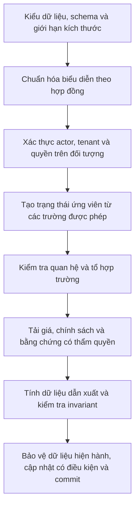

# Cross field constraints: ràng buộc giữa các trường dữ liệu nghiệp vụ

Trong chương **Business Input Rules**, cross field constraints là những điều kiện chỉ có thể đánh giá khi xem nhiều trường cùng nhau. Từng giá trị có thể đúng kiểu, đúng định dạng và nằm trong khoảng cho phép, nhưng tổ hợp của chúng vẫn mâu thuẫn hoặc tạo ra một kết quả nghiệp vụ không hợp lệ.

Trong module bảo vệ logic nghiệp vụ, các ràng buộc này giúp ngăn sửa tổng tiền, dùng sai nhánh xử lý, giữ phê duyệt cho nội dung đã đổi hoặc khai thác cập nhật từng phần. Chúng phải kết hợp với nguồn dữ liệu có thẩm quyền, quyền theo đối tượng, state machine, transaction và idempotency.

Bài học dùng ví dụ đơn hàng có giao tận nơi hoặc nhận tại cửa hàng. Các quy tắc tính tiền trong ví dụ được giản lược để làm rõ quan hệ giữa các trường; hệ thống thực tế cần mô hình hóa đầy đủ các khoản và chính sách của mình.

Sau bài này, bạn có thể:

- Nhận diện các tổ hợp sai dù từng trường riêng lẻ đều hợp lệ.
- Mô hình hóa điều kiện bắt buộc, loại trừ, so sánh và tổng hợp giữa các trường.
- Phân biệt ý định client với dữ liệu tham chiếu và giá trị máy chủ phải tính.
- Kiểm tra trạng thái ứng viên sau PATCH thay vì chỉ kiểm tra body.
- Giữ các ràng buộc đúng khi dữ liệu hoặc tài nguyên thay đổi đồng thời.
- Thiết kế ca kiểm thử tập trung vào những tổ hợp có thể bị lạm dụng.

## 1. Validation từng trường chưa chứng minh được nghiệp vụ đúng

Giả sử các trường có quy tắc riêng:

```text
quantity > 0
unitPrice >= 0
discountAmount >= 0
shippingFee >= 0
total >= 0
```

Payload sau vẫn có thể vượt các kiểm tra đó:

```json
{
  "quantity": 10,
  "unitPrice": 100000,
  "discountAmount": 0,
  "shippingFee": 25000,
  "total": 1
}
```

Mỗi số đều đạt điều kiện riêng, nhưng tổng tiền không khớp với các thành phần. Nếu máy chủ tin `total`, người gọi có thể đề xuất mua mười sản phẩm nhưng chỉ trả một đơn vị tiền.

Một ví dụ không liên quan số tiền:

```json
{
  "fulfillmentMode": "PICKUP",
  "shippingAddressId": "address-a",
  "pickupPointId": "store-7"
}
```

Theo chính sách ví dụ, nhận tại cửa hàng phải có điểm nhận và không có địa chỉ giao hàng. Nếu hai phần hệ thống chọn nhánh theo hai trường khác nhau, ứng dụng có thể tính phí theo pickup nhưng thực hiện giao tận nơi.

Câu hỏi cần trả lời là:

> Các trường này có cùng mô tả một ý định nghiệp vụ hợp lệ, và kết quả được tính từ chúng có còn khớp dữ liệu có thẩm quyền không?

## 2. Các dạng ràng buộc thường gặp

| Dạng ràng buộc | Ví dụ | Lỗi có thể phát sinh |
| --- | --- | --- |
| Thứ tự hoặc so sánh | `startsAt < endsAt`, `min <= max` | Khoảng thời gian hoặc khoảng giá đảo ngược |
| Bắt buộc có điều kiện | Giao tận nơi phải có địa chỉ | Đi vào nhánh xử lý thiếu dữ liệu |
| Loại trừ | Chỉ dùng một cách biểu diễn giảm giá theo hợp đồng | Áp dụng cả giảm cố định lẫn giảm phần trăm ngoài ý muốn |
| Chính xác một lựa chọn | Có địa chỉ giao hoặc điểm nhận theo mode | Hai thành phần hiểu khác nhau về cách xử lý |
| Quan hệ số học | Tổng tiền bằng tổng các khoản đã xác định | Sửa tổng hoặc tạo số âm bằng giảm giá |
| Đồng nhất đơn vị | Số tiền và giới hạn phải cùng loại tiền | So sánh hai con số không cùng ý nghĩa |
| Nhất quán tham chiếu | Địa chỉ và đơn hàng cùng phạm vi được phép | Gắn tài nguyên của người khác hoặc tenant khác |
| Nhất quán với trạng thái | Nội dung đã duyệt không bị thay mà giữ bằng chứng cũ | Bỏ qua bước phê duyệt lại |

Không phải mọi ràng buộc đều chỉ so sánh các trường trong cùng JSON. Một số cần đối tượng đã lưu, dữ liệu giá, membership hoặc quyết định đã được máy chủ xác minh.

Cũng cần phân biệt quyền với tính hợp lệ. Một đơn giá có thể làm công thức tổng tiền đúng nhưng khách hàng vẫn không có quyền tự đặt đơn giá. Validation không thay thế field authorization.

## 3. Phân loại nguồn dữ liệu trước khi viết công thức

Với đơn hàng, có thể phân loại:

| Nhóm | Ví dụ | Cách xử lý |
| --- | --- | --- |
| Ý định client được đề xuất | Sản phẩm, số lượng, phương thức nhận, mã khuyến mãi | Kiểm tra schema, quyền và điều kiện nghiệp vụ |
| Dữ liệu tham chiếu có thẩm quyền | Giá sản phẩm, phạm vi địa chỉ, chính sách mã giảm giá | Tải và xác minh ở máy chủ |
| Giá trị dẫn xuất | Tổng hàng, mức giảm thực tế, phí và tổng thanh toán | Máy chủ tính theo quy tắc đã chọn |
| Điều kiện phiên bản | `expectedVersion`, revision của báo giá | So sánh với dữ liệu lưu trữ, không dùng làm bằng chứng tự khai |
| Bằng chứng quy trình | Kết quả thanh toán hoặc phê duyệt | Lấy từ luồng được xác thực, không nhận bằng cờ trong body |

Client có thể đề xuất `couponCode`, nhưng không tự quyết định `discountPercent = 90`. Client có thể gửi một tổng tiền để thể hiện giá đã nhìn thấy nếu hợp đồng hỗ trợ, nhưng giá trị đó chỉ dùng để phát hiện khác biệt, không thay thế tổng được máy chủ xác lập.

Kiểm tra `total = quantity × unitPrice` chỉ trên các số client gửi vẫn có thể chấp nhận một đơn giá bị sửa. Công thức đúng trên dữ liệu không có thẩm quyền chưa đủ bảo vệ nghiệp vụ.

## 4. Hợp đồng ví dụ cho đơn hàng

Giả sử hệ thống chọn các quy tắc sau:

- Đơn có ít nhất một dòng hàng; cùng một sản phẩm không được lặp ID trong lệnh của ví dụ.
- Số lượng là số nguyên dương trong giới hạn sản phẩm và chính sách.
- `DELIVERY` bắt buộc có `shippingAddressId`, không có `pickupPointId`.
- `PICKUP` bắt buộc có `pickupPointId`, không có `shippingAddressId`.
- Đơn giá, giảm giá thực tế và phí do máy chủ xác lập.
- Đơn chỉ dùng một loại tiền; các khoản trong công thức phải cùng đơn vị.
- Trong công thức giản lược, giảm giá áp lên tổng hàng và không vượt tổng hàng; phí giao hàng không âm.
- Với pickup, khoản phí giao hàng của mô hình này bằng 0. Nếu sản phẩm có phí xử lý riêng, cần biểu diễn khoản đó riêng theo chính sách.
- Chỉ sửa nội dung theo các trạng thái và quyền được cho phép; khi chốt đơn cần một báo giá còn hiệu lực cho đúng nội dung.

Ví dụ ý định hợp lệ:

```json
{
  "items": [
    {"productId": "product-a", "quantity": 2},
    {"productId": "product-b", "quantity": 1}
  ],
  "fulfillmentMode": "DELIVERY",
  "shippingAddressId": "address-a",
  "pickupPointId": null,
  "couponCode": "WELCOME",
  "expectedOrderVersion": 7
}
```

Máy chủ phải xác minh địa chỉ, sản phẩm và mã, sau đó tạo dữ liệu giá. Không nhận `tenantId`, trạng thái thanh toán, người đã duyệt hoặc các trường giá nội bộ để client điều khiển luồng.

Các quy tắc lặp sản phẩm, phí hoặc giảm giá có thể khác ở hệ thống khác. Điều quan trọng là chọn một ngữ nghĩa rõ và dùng cùng ngữ nghĩa ở kiểm tra, tính giá, lưu trữ và thực hiện.

## 5. Bảng quyết định cho các nhánh có điều kiện

Với phương thức nhận hàng, viết bảng trước khi viết các câu `if`:

| Mode | Địa chỉ giao | Điểm nhận | Kết quả theo ví dụ |
| --- | --- | --- | --- |
| `DELIVERY` | Có giá trị hợp lệ | Không có | Được xét tiếp |
| `DELIVERY` | Không có | Không có | Thiếu địa chỉ bắt buộc |
| `DELIVERY` | Có hoặc không | Có | Tổ hợp mâu thuẫn |
| `PICKUP` | Không có | Có giá trị hợp lệ | Được xét tiếp |
| `PICKUP` | Không có | Không có | Thiếu điểm nhận bắt buộc |
| `PICKUP` | Có | Có hoặc không | Tổ hợp mâu thuẫn |
| Không hỗ trợ | Bất kỳ | Bất kỳ | Không có nhánh nghiệp vụ hợp lệ |

Ở lệnh tạo của ví dụ, trường không gửi có thể được biểu diễn nội bộ là null. Chuỗi rỗng hoặc chỉ có khoảng trắng không được coi là một ID hợp lệ. Với PATCH, sự vắng mặt còn có ý nghĩa khác và phải xử lý riêng.

Không chọn nhánh bằng quy tắc “có địa chỉ thì giao, nếu không thì pickup” trong khi một thành phần khác chỉ đọc `fulfillmentMode`. Hai thành phần phải dùng cùng một biểu diễn ý định đã được xác thực.

Sau kiểm tra hình dạng, vẫn phải kiểm tra tham chiếu:

- Địa chỉ thuộc người hoặc phạm vi được phép dùng cho đơn.
- Điểm nhận thuộc tenant, còn hoạt động và phù hợp với các mặt hàng.
- Địa chỉ đáp ứng vùng phục vụ theo chính sách.
- Những thay đổi làm đổi giá hoặc điều kiện phải tạo kết quả tính giá tương ứng.

Một bộ ba mode–địa chỉ–điểm nhận đúng hình dạng chưa chứng minh caller có quyền sử dụng các ID đó.

## 6. Ràng buộc số học phải dựa trên một mô hình tiền rõ ràng

Giả sử máy chủ có các dòng giá VND đã được xác minh:

```text
Sản phẩm A: 2 × 120.000 = 240.000
Sản phẩm B: 1 ×  80.000 =  80.000

subtotal = 320.000
discount =  30.000
shipping =  25.000
total    = 315.000 VND
```

Trong mô hình không có khoản khác của ví dụ:

```text
subtotal = tổng(quantity × unitPrice) của các dòng
0 <= discount <= subtotal
shipping >= 0
total = subtotal - discount + shipping
```

Nếu có thuế, phí xử lý, làm tròn hoặc khoản điều chỉnh, chúng phải là thành phần có định nghĩa và nguồn tính rõ ràng. Không dùng công thức giản lược rồi thêm một trường tổng tiền tùy ý để bù phần chưa mô hình hóa.

Các điều cần quy định:

- Số tiền được biểu diễn bằng đơn vị nào và loại tiền nào.
- Số chữ số thập phân được phép theo loại tiền và hợp đồng.
- Làm tròn ở dòng hàng, khoản giảm hay toàn đơn.
- Thứ tự áp dụng nhiều quy tắc giảm giá nếu được phép kết hợp.
- Khoảng giá trị tối đa và cách xử lý tràn số.

Không mặc định mọi loại tiền đều có hai chữ số thập phân. Nếu dùng số nguyên theo đơn vị nhỏ nhất, phải kiểm tra phép nhân và phép cộng không tràn. Nếu dùng `BigDecimal`, dựng giá trị từ biểu diễn thập phân chính xác và dùng quy tắc scale, rounding thống nhất; không lấy sai số của một số thực nhị phân làm căn cứ thanh toán.

Độ dài số hoặc số mũ cực lớn cũng cần được giới hạn ở đầu vào. Chọn một kiểu số chính xác không thay thế giới hạn tài nguyên của bộ phân tích và validation.

## 7. Minh họa Java: kiểm tra nhánh và tính tổng có kiểm soát

Ví dụ dùng record của Java 16 trở lên. `TrustedPricing` được tạo từ dữ liệu giá và chính sách máy chủ đã xác minh, với số lượng gắn với đúng ý định đặt hàng; nó không phải DTO nhận trực tiếp đơn giá hoặc mức giảm từ client.

```java
import java.util.List;
import java.util.Objects;

enum FulfillmentMode {
    DELIVERY, PICKUP
}

record FulfillmentIntent(
        FulfillmentMode mode,
        String shippingAddressId,
        String pickupPointId) {
}

record PricedLine(long quantity, long unitPriceMinor, String currency) {
}

record TrustedPricing(
        String currency,
        List<PricedLine> lines,
        long discountMinor,
        long shippingMinor) {
    TrustedPricing {
        Objects.requireNonNull(currency);
        lines = List.copyOf(lines);
    }
}

record OrderTotals(
        String currency,
        long subtotalMinor,
        long discountMinor,
        long shippingMinor,
        long totalMinor) {
}

final class CrossFieldRules {
    private CrossFieldRules() {
    }

    static void validateFulfillment(FulfillmentIntent intent) {
        Objects.requireNonNull(intent);
        Objects.requireNonNull(intent.mode());

        switch (intent.mode()) {
            case DELIVERY -> {
                require(hasText(intent.shippingAddressId()),
                        "SHIPPING_ADDRESS_REQUIRED");
                require(intent.pickupPointId() == null,
                        "PICKUP_POINT_NOT_ALLOWED");
            }
            case PICKUP -> {
                require(hasText(intent.pickupPointId()),
                        "PICKUP_POINT_REQUIRED");
                require(intent.shippingAddressId() == null,
                        "SHIPPING_ADDRESS_NOT_ALLOWED");
            }
        }
    }

    static OrderTotals calculate(
            FulfillmentMode mode, TrustedPricing pricing) {
        Objects.requireNonNull(mode);
        Objects.requireNonNull(pricing);
        require(!pricing.lines().isEmpty(), "ITEMS_REQUIRED");
        require(pricing.shippingMinor() >= 0, "NEGATIVE_SHIPPING");
        require(mode != FulfillmentMode.PICKUP
                        || pricing.shippingMinor() == 0,
                "PICKUP_SHIPPING_MUST_BE_ZERO");

        try {
            long subtotal = 0;
            for (PricedLine line : pricing.lines()) {
                require(line.quantity() > 0, "INVALID_QUANTITY");
                require(line.unitPriceMinor() >= 0, "INVALID_UNIT_PRICE");
                require(pricing.currency().equals(line.currency()),
                        "CURRENCY_MISMATCH");
                long lineTotal = Math.multiplyExact(
                        line.quantity(), line.unitPriceMinor());
                subtotal = Math.addExact(subtotal, lineTotal);
            }

            require(pricing.discountMinor() >= 0
                            && pricing.discountMinor() <= subtotal,
                    "INVALID_DISCOUNT");
            long afterDiscount = Math.subtractExact(
                    subtotal, pricing.discountMinor());
            long total = Math.addExact(
                    afterDiscount, pricing.shippingMinor());

            return new OrderTotals(pricing.currency(), subtotal,
                    pricing.discountMinor(), pricing.shippingMinor(), total);
        } catch (ArithmeticException overflow) {
            throw new IllegalArgumentException("AMOUNT_OUT_OF_RANGE", overflow);
        }
    }

    private static boolean hasText(String value) {
        return value != null && !value.isBlank();
    }

    private static void require(boolean valid, String code) {
        if (!valid) {
            throw new IllegalArgumentException(code);
        }
    }
}
```

Hai hàm thực hiện hai trách nhiệm khác nhau: kiểm tra tổ hợp phương thức nhận hàng và tính một mô hình tổng tiền xác định. Service phải gọi các bước thích hợp, không chỉ chọn một hàm rồi coi đơn đã hợp lệ toàn bộ.

Ví dụ chưa kiểm tra giới hạn số lượng theo sản phẩm, ID trùng, quyền trên địa chỉ, nguồn giá, hiệu lực mã giảm giá hoặc giá trị tối đa của toàn đơn theo policy. Những điều kiện đó vẫn cần trước khi commit.

`Math.multiplyExact` và `Math.addExact` phát hiện tràn số, không xác định một số tiền lớn có hợp lý về nghiệp vụ hay không. Cần cả miền giá trị được cho phép và cách ánh xạ lỗi phù hợp trong API.

## 8. PATCH phải được kiểm tra trên trạng thái ứng viên hoàn chỉnh

Giả sử đơn đã lưu:

```json
{
  "fulfillmentMode": "DELIVERY",
  "shippingAddressId": "address-a",
  "pickupPointId": null
}
```

Client gửi:

```json
{
  "fulfillmentMode": "PICKUP"
}
```

Nếu chỉ kiểm tra các trường có trong body, `PICKUP` là một giá trị enum hợp lệ. Nhưng sau khi ghép với dữ liệu cũ, đơn vẫn có địa chỉ giao và chưa có điểm nhận. Trạng thái kết quả vi phạm ràng buộc.

Với hợp đồng yêu cầu client thể hiện rõ việc chuyển nhánh, một payload có thể là:

```json
{
  "expectedOrderVersion": 7,
  "fulfillmentMode": "PICKUP",
  "shippingAddressId": null,
  "pickupPointId": "store-7"
}
```

Quy trình xử lý:

```text
tải trạng thái hiện tại có thẩm quyền
phân biệt trường không gửi với trường được yêu cầu đặt null
kiểm tra quyền trên từng trường và thao tác xóa
tạo bản ứng viên từ dữ liệu cũ cộng các thay đổi được phép
kiểm tra toàn bộ ràng buộc trên bản ứng viên
tính lại các dữ liệu dẫn xuất bị ảnh hưởng
chỉ lưu khi mọi điều kiện và version đều phù hợp
```

Không ghi từng trường vào entity được quản lý rồi mới kiểm tra, vì listener hoặc mã nghiệp vụ có thể quan sát trạng thái trung gian. Không để một validation lỗi nhưng một phần thay đổi đã được lưu.

Một hệ thống có thể dùng lệnh riêng `changeFulfillmentMode` tự xây dựng trạng thái mới theo hợp đồng. Dù chọn cách nào, hệ quả như xóa địa chỉ cũ hoặc tính lại phí phải rõ ràng; không dựa vào hành vi ngầm khác nhau giữa mapper và service.

## 9. Chia validation thành các lớp có thứ tự

Một luồng có thể tổ chức như sau:



Sơ đồ thể hiện các trách nhiệm, không bắt buộc mọi phép đọc đều nằm ngoài transaction. Những dữ liệu có thể thay đổi phải được tải hoặc kiểm tra lại tại ranh giới nhất quán phù hợp trước commit.

Các phép kiểm tra rẻ, chỉ phụ thuộc cấu trúc lệnh có thể chạy sớm. Những kết luận như mã còn lượt dùng, đối tượng vẫn ở trạng thái nháp hoặc báo giá chưa hết hạn không nên được xem là vĩnh viễn đúng sau một lần đọc cũ.

Không lấy một cờ `validated=true` từ client hoặc kết quả trên giao diện để bỏ qua các lớp này. Một lệnh đến từ worker, import hoặc API hàng loạt cũng phải có dữ liệu và điều kiện đủ để xác lập trạng thái hợp lệ.

## 10. Báo giá và bằng chứng phê duyệt phải khớp nội dung

Khi chốt đơn theo báo giá, máy chủ cần bảo đảm báo giá áp dụng cho đúng các dữ liệu ảnh hưởng giá:

- Sản phẩm và số lượng.
- Loại tiền hoặc thị trường được phép.
- Mã và quy tắc khuyến mãi.
- Phương thức nhận, điểm nhận hoặc vùng giao cần cho tính phí.
- Các phiên bản dữ liệu và thời hạn được policy quy định.

Một `quoteId` hợp lệ nhưng thuộc đơn khác, tenant khác hoặc giỏ hàng cũ không đủ. Client không được giữ báo giá pickup rồi đổi sang giao tận nơi để hưởng phí bằng 0.

Nếu nghiệp vụ có duyệt giá ngoại lệ, bản phê duyệt cũng phải trỏ tới đúng nội dung đã xét. Thay số lượng, mức giảm hoặc người nhận theo cách ảnh hưởng quyết định có thể yêu cầu đánh giá lại; không chỉ giữ `approved=true`.

Tổng tiền khớp công thức không chứng minh đơn đã được thanh toán. `paymentStatus = PAID` là kết quả của một quy trình có bằng chứng riêng. Ràng buộc số học, field authorization và thứ tự workflow bổ sung cho nhau.

Nếu nội dung thay đổi làm báo giá hoặc phê duyệt cũ không còn áp dụng, trả kết quả yêu cầu xem lại theo hợp đồng. Không âm thầm chốt một giá mới mà người dùng chưa đồng ý khi hành động đòi hỏi sự đồng ý với giá cụ thể.

## 11. Transaction bảo vệ các điều kiện phụ thuộc dữ liệu thay đổi

Một số ràng buộc nhìn giống so sánh trường nhưng liên quan tài nguyên dùng chung:

```text
requestedQuantity <= availableQuantity
couponUses + newUse <= couponLimit
approvedAmount + reservedAmount <= budgetLimit
```

Hai request có thể cùng đọc một giá trị cũ và cùng vượt qua, rồi tổng kết quả vi phạm invariant. Validator thuần trên một DTO không giải quyết được lịch thực thi này.

Luồng chốt đơn có thể là:

```text
BEGIN TRANSACTION
  nhận quyền xử lý idempotency key
  tải và bảo vệ đơn trong tenant và phạm vi được phép
  kiểm tra expectedVersion và trạng thái cho phép
  tạo và kiểm tra bản ứng viên
  kiểm tra giá, quote và các bằng chứng còn áp dụng
  bảo vệ phần tồn kho hoặc quota dùng chung theo giao thức đã chọn
  nhận phần tài nguyên nếu còn đủ bằng cập nhật có điều kiện
  tính và lưu các giá trị dẫn xuất cùng nội dung chốt
  cập nhật trạng thái, version, audit và outbox bắt buộc
  lưu kết quả operation
COMMIT
```

Khóa chỉ một đơn hàng không tự bảo vệ lượt dùng mã hoặc kho dùng chung. Cần cơ chế nhất quán ở chính dữ liệu cạnh tranh, và mọi đường ghi liên quan phải tuân thủ nó.

Transaction cục bộ cũng không bao trùm một tác dụng đã gửi sang hệ thống ngoài. Ghi ý định bền vững, dùng operation ổn định và xử lý kết quả chưa rõ theo giao thức; không gọi bên ngoài trước khi biết tổ hợp nội dung có thể được chấp nhận.

## 12. Chuẩn hóa đơn vị, thời gian và biểu diễn một cách nhất quán

Ràng buộc giữa trường dễ sai khi các lớp hiểu dữ liệu khác nhau:

| Dữ liệu | Điều cần quy định |
| --- | --- |
| Tiền | Loại tiền, đơn vị, scale và rounding |
| Số lượng | Số nguyên hay phân số, đơn vị sản phẩm và giới hạn |
| Thời gian | Instant hay ngày địa phương, múi giờ và ranh giới so sánh |
| Khoảng giá trị | Đầu mút bao gồm hay loại trừ |
| ID hoặc mã | Biểu diễn chuẩn và quy tắc so sánh |
| Trường vắng mặt | Giữ nguyên, mặc định hay không hợp lệ theo từng lệnh |

Ví dụ `startsAt < endsAt` cần so sánh các thời điểm cùng ý nghĩa, không so chuỗi có định dạng hoặc độ lệch múi giờ khác nhau. Với lịch theo ngày địa phương, phải xác định múi giờ của nghiệp vụ trước khi suy ra khoảng thời gian thực.

Nếu hợp đồng có giảm giá phần trăm, cần phân biệt 10% với tỷ lệ `0.10` và số `10`. Không để một lớp hiểu tỷ lệ còn lớp khác hiểu điểm phần trăm.

Việc chuẩn hóa phải diễn ra nhất quán trước khi so sánh và tính dấu vân tay của lệnh. Không “sửa hộ” một tổ hợp mâu thuẫn bằng cách tự chọn giá trị có lợi nhất cho client hoặc âm thầm bỏ một trường có ý nghĩa nghiệp vụ.

Với tên trường trùng hoặc nhiều cách biểu diễn cùng thuộc tính, bộ phân tích và bộ kiểm tra phải có cùng cách hiểu. Payload mơ hồ không được phép tạo tình trạng lớp kiểm tra đọc một giá trị nhưng lớp ghi dùng giá trị khác.

## 13. Lỗi ràng buộc phải rõ ràng và không lộ dữ liệu ngoài quyền

Một kết quả lỗi có thể dùng mã ổn định, chẳng hạn:

```json
{
  "code": "INVALID_FULFILLMENT_COMBINATION",
  "fields": ["fulfillmentMode", "shippingAddressId", "pickupPointId"]
}
```

Các trường đó đều thuộc hợp đồng mà client được phép dùng. Không cần trả một entity đầy đủ, giá vốn hoặc chi tiết điều tra nội bộ để giải thích một tổ hợp sai.

Phân biệt:

- Sai cấu trúc hoặc giá trị đầu vào.
- Tổ hợp nghiệp vụ không hợp lệ.
- Không có quyền sửa trường hoặc sử dụng đối tượng tham chiếu.
- Xung đột version hoặc báo giá đã thay đổi.
- Dịch vụ bắt buộc không khả dụng nên chưa xác lập được kết quả.

Mã HTTP cụ thể cần theo hợp đồng API. Lỗi lấy giá không nên bị biến thành một giá mặc định bằng 0, và lỗi xác minh mã không nên bị coi là mã được áp dụng toàn phần.

Khi có lỗi, không commit một phần dữ liệu nghiệp vụ trừ khi hợp đồng cố ý hỗ trợ tiến trình từng phần có trạng thái rõ ràng. Với lệnh chốt đơn của ví dụ, không được giữ mức giảm mới nhưng tổng tiền cũ hoặc nhận tồn kho rồi bỏ quên việc tạo đơn.

## 14. Idempotency phải giữ đúng ý định đã được kiểm tra

Retry thường xảy ra sau khi client không nhận được phản hồi. Cùng ý định đã commit không được tính lại thành một đơn mới, trừ kho thêm lần nữa hoặc áp mã thêm lần nữa.

Dấu vân tay lệnh cần ràng buộc với tenant, actor, đối tượng và các dữ liệu có ý nghĩa như:

```text
sản phẩm, số lượng và biểu diễn đã chuẩn hóa
phương thức nhận và tham chiếu liên quan
mã đề xuất, quote hoặc revision được chấp nhận
điều kiện phiên bản của lệnh
```

Nếu không gửi và gửi null có ngữ nghĩa khác ở endpoint, chúng không được tùy tiện gộp thành cùng một ý định. Nếu thứ tự dòng không có ý nghĩa theo hợp đồng, có thể chuẩn hóa theo một quy tắc xác định trước khi đối chiếu.

Khi lệnh cũ đã thành công, trả kết quả đã lưu theo quyền xem hiện tại, không tính lại theo giá mới rồi ghi đè kết quả cũ. Nếu chưa có lần thành công và báo giá đã hết hiệu lực, không dùng idempotency key làm căn cứ cho phép giá cũ.

Cùng key nhưng đổi từ pickup sang delivery, đổi số lượng hoặc đổi quote là thay đổi ý định theo hợp đồng thông thường. Máy chủ cần phát hiện, thay vì giữ một phần dữ liệu cũ rồi ghép với phần mới thành một tổ hợp chưa từng được kiểm tra.

Idempotency không thay thế validation, quyền theo đối tượng hoặc kiểm soát cạnh tranh. Nó giúp nhận diện cùng một lệnh; mỗi lần thực thi mới vẫn cần đầy đủ căn cứ hợp lệ.

## 15. Kiểm thử tổ hợp thay vì chỉ kiểm thử từng trường

Một ca kiểm thử có sức phân biệt cần giữ các điều kiện khác hợp lệ và chỉ làm sai quan hệ đang xét. Nếu vừa thiếu trường bắt buộc vừa sai quyền đối tượng, lỗi trả về chưa chứng minh ràng buộc giữa các trường đã hoạt động.

| Ca kiểm thử | Kết quả cần giữ |
| --- | --- |
| Delivery có địa chỉ hợp lệ và không có điểm nhận | Đi qua kiểm tra nhánh khi các điều kiện khác đúng |
| Pickup có điểm nhận hợp lệ và không có địa chỉ | Có ca thành công riêng, không mặc định chặn mọi mode |
| Delivery kèm điểm nhận hoặc pickup kèm địa chỉ | Từ chối tổ hợp mâu thuẫn |
| Mode đúng nhưng thiếu tham chiếu bắt buộc | Không dùng giá trị mặc định để đi tiếp |
| Địa chỉ đúng định dạng nhưng thuộc người khác | Bị chặn theo quyền trên tham chiếu |
| Các dòng khác loại tiền | Không cộng thành một tổng tiền chung |
| Giảm giá bằng tổng hàng | Xử lý đúng ranh giới chính sách, không nhầm thành số âm |
| Giảm giá lớn hơn tổng hàng | Không tạo tổng âm hoặc số bị tràn |
| Phép nhân hoặc tổng vượt miền số | Lỗi có kiểm soát, không wrap thành giá trị nhỏ |
| Cùng sản phẩm lặp nhiều dòng | Bị từ chối theo hợp đồng ví dụ, không né giới hạn số lượng |
| PATCH chỉ đổi mode | Kiểm tra trạng thái ứng viên, không chỉ enum trong body |
| PATCH xóa trường bắt buộc | Không lưu trạng thái không đầy đủ |
| Client gửi tổng khớp với đơn giá tự sửa | Không tin đơn giá client dù công thức đúng |

Kiểm tra các ranh giới dưới, tại và trên giới hạn, không chỉ vài giá trị ở giữa. Với giảm phần trăm hoặc nhiều khoản làm tròn, dùng các số liệu có thể phân biệt rõ quy tắc làm tròn khác nhau.

Oracle nên được tính từ bảng nghiệp vụ và giá trị kỳ vọng độc lập. Gọi chính hàm production để tính expected rồi so với kết quả của nó sẽ khó phát hiện công thức bị viết sai.

## 16. Kiểm thử tính chất, trạng thái và tranh chấp

Các tính chất có thể dùng cho mô hình ví dụ:

```text
mọi đơn được chấp nhận đều thỏa bảng mode–địa chỉ–điểm nhận
mọi khoản trong tổng có cùng loại tiền
0 <= discount <= subtotal
total = subtotal - discount + shipping
pickup không có khoản shipping khác 0 theo chính sách ví dụ
```

Nếu thứ tự dòng không có ý nghĩa theo hợp đồng, hoán đổi thứ tự không được làm thay đổi tổng. Nếu chính sách có bước phụ thuộc thứ tự, phải kiểm thử theo ngữ nghĩa đó thay vì áp dụng tính chất không phù hợp.

Các ca tích hợp quan trọng:

| Kịch bản | Điều cần xác minh |
| --- | --- |
| Chuyển mode sau khi đã có quote | Quote cũ không áp dụng nếu dữ liệu ảnh hưởng giá đã đổi |
| Đổi số lượng sau khi duyệt giá ngoại lệ | Không giữ bằng chứng cũ cho nội dung mới ngoài chính sách |
| Đơn rời trạng thái nháp trong lúc PATCH | Không ghi bản ứng viên dựa trên trạng thái cũ |
| Hai request cùng nhận lượt mã cuối | Không cùng vượt quota từ một ảnh chụp cũ |
| Hai đơn cùng lấy lượng kho còn lại | Invariant tài nguyên vẫn đúng sau mọi commit |
| Lỗi sau khi nhận tài nguyên nhưng trước chốt đơn | Rollback hoặc phục hồi theo giao thức đã thiết kế |
| Mất phản hồi sau commit và retry | Không tạo thêm đơn, phần giữ hoặc lượt dùng mã |
| Worker nhận lệnh cũ sau khi quote hết hạn | Kiểm tra đúng ranh giới hiệu lực của lệnh hoặc operation |

Kiểm tra cả đơn, dòng hàng, snapshot giá, tồn kho, sổ khuyến mãi, outbox và lời gọi bên ngoài. HTTP trả lỗi không đủ nếu một tác dụng phụ đã xảy ra trước lỗi.

Những ca concurrency cần lịch thực thi có kiểm soát và cơ chế lưu trữ phù hợp. Validator thuần có thể được kiểm thử riêng, nhưng mock dữ liệu hiện tại không chứng minh transaction ngăn được hai request cạnh tranh.

## 17. Những lỗi thiết kế dễ làm mất ràng buộc

| Cách làm | Vấn đề | Hướng xử lý |
| --- | --- | --- |
| Chỉ gắn validation từng field | Không nhìn thấy quan hệ giữa các giá trị | Kiểm tra ở mức lệnh hoặc trạng thái ứng viên |
| Chỉ kiểm tra body của PATCH | Không thấy dữ liệu cũ còn lại | Ghép thay đổi được phép rồi kiểm tra toàn bộ kết quả |
| Kiểm tra công thức trên giá client | Client điều khiển cả dữ liệu đầu vào lẫn tổng | Tải giá và policy có thẩm quyền |
| Mỗi service chọn nhánh bằng một cờ khác | Tính phí và thực hiện có thể khác nhau | Chuẩn hóa ý định và dùng cùng hợp đồng |
| Xem chuỗi rỗng, null và vắng mặt như nhau ở mọi nơi | Có thể xóa hoặc giữ sai dữ liệu bắt buộc | Định nghĩa ngữ nghĩa riêng theo lệnh |
| Cộng tiền khác đơn vị | Kết quả số học không còn ý nghĩa | Kiểm tra loại tiền và đơn vị trước tính toán |
| Bỏ kiểm tra khi caller là admin hoặc worker | Đường nội bộ vẫn tạo được dữ liệu trái invariant | Quy trình ngoại lệ có quy tắc rõ, không tắt mọi ràng buộc |
| Đọc quota rồi ghi không có điều kiện | Hai lệnh hợp lệ riêng lẻ có thể phá invariant chung | Transaction và cơ chế nhất quán trên tài nguyên dùng chung |
| Ghi dữ liệu trước rồi mới báo validation lỗi | Có thể để lại một phần thay đổi hoặc hiệu ứng | Chỉ commit trạng thái đã được chấp nhận đầy đủ |

Ràng buộc cơ sở dữ liệu có thể bổ sung cho những điều kiện biểu diễn được tại đó. Không kỳ vọng một `CHECK` trên một hàng tự xác minh quyền trên địa chỉ, hiệu lực quote ngoài hệ thống hoặc mọi invariant trải nhiều bản ghi.

## 18. Cách áp dụng cross field constraints vào một lệnh nghiệp vụ

1. Liệt kê các trường được phép đề xuất, trường máy chủ quản lý và nguồn tham chiếu có thẩm quyền.
2. Viết bảng các nhánh có điều kiện, tổ hợp bắt buộc và tổ hợp bị cấm.
3. Định nghĩa công thức, đơn vị, ranh giới, rounding và miền số một cách rõ ràng.
4. Với cập nhật từng phần, mô hình hóa sự vắng mặt và null rồi kiểm tra trạng thái ứng viên đầy đủ.
5. Kiểm tra quyền trên đối tượng, từng trường và các tham chiếu trước khi sử dụng dữ liệu nhạy cảm hoặc lưu thay đổi.
6. Tính lại các giá trị dẫn xuất và xác minh quote hoặc phê duyệt khớp nội dung hiện tại.
7. Bảo vệ dữ liệu thay đổi đồng thời bằng version, khóa hoặc cập nhật có điều kiện tại ranh giới commit.
8. Thiết kế lỗi và idempotency để không ghép các phần của hai ý định khác nhau.
9. Kiểm thử ca đối chứng, tổ hợp sai, ranh giới số học, PATCH và tác dụng phụ khi lỗi hoặc chạy đồng thời.

Cross field constraints bảo vệ ý nghĩa chung của dữ liệu. Một lệnh chỉ nên được chấp nhận khi các trường, các nguồn có thẩm quyền và trạng thái nghiệp vụ cùng mô tả một kết quả hợp lệ, rồi kết quả đó được lưu bằng một cơ chế nhất quán.
