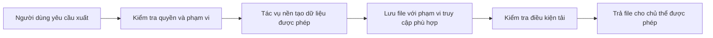

# Confidentiality of business data — Tính bí mật của dữ liệu nghiệp vụ

Một nhân viên có thể được phép xem đơn hàng nhưng không được xem giá vốn. Một nhà cung cấp có thể xem báo giá của mình nhưng không được xem báo giá của đối thủ. Một người duyệt có thể đọc hồ sơ được giao trong bộ phận, nhưng không được tải toàn bộ hồ sơ của tổ chức.

Trong cả ba tình huống, tài khoản đã được xác thực và chức năng đọc dữ liệu có thể hoạt động đúng về mặt kỹ thuật. Vấn đề bảo mật nằm ở việc thông tin có đến đúng chủ thể, đúng phạm vi, đúng mức chi tiết và đúng thời điểm hay không.

Trong chương **Security Objectives**, bài học này xem tính bí mật dưới góc nhìn bảo vệ logic nghiệp vụ. Mục tiêu là chuyển yêu cầu “không để lộ dữ liệu” thành chính sách truy cập, business invariant và tình huống kiểm thử cụ thể cho API, quy trình phê duyệt, báo cáo, export, cache và nhật ký.

## 1. Tính bí mật là kiểm soát việc tiết lộ thông tin

**Confidentiality**, hay tính bí mật, là thuộc tính bảo vệ thông tin khỏi việc bị tiết lộ cho chủ thể không được phép theo chính sách của hệ thống. Chủ thể có thể là người dùng, tổ chức đối tác, ứng dụng tích hợp, tác vụ nền hoặc nhân viên vận hành.

Tính bí mật không chỉ có nghĩa là “người ngoài không đọc được cơ sở dữ liệu”. Nó còn bao gồm các trường hợp:

- Người thuộc tổ chức A không đọc được đơn hàng của tổ chức B.
- Người mua thấy giá bán áp dụng cho mình nhưng không thấy giá vốn nội bộ.
- Người duyệt chỉ thấy hồ sơ thuộc phạm vi công việc được giao.
- Một báo giá chưa công bố không xuất hiện trong báo cáo hoặc kết quả tìm kiếm cho đối tượng chưa được phép xem.
- Nội dung được bảo vệ không bị đưa vào log, thông báo hoặc file tải xuống có phạm vi truy cập rộng hơn nguồn dữ liệu.

Một thông tin không cần là mật khẩu hoặc dữ liệu định danh cá nhân mới cần bảo vệ. Giá thương lượng, biên lợi nhuận, điều khoản thanh toán, hạn mức tín dụng, dự báo doanh thu, tên đối tác trong một thương vụ chưa công bố và nhận xét nội bộ khi phê duyệt đều có thể nhạy cảm về nghiệp vụ.

### 1.1. Phân biệt với tính toàn vẹn và tính sẵn sàng

| Mục tiêu | Nội dung được bảo vệ | Ví dụ vi phạm trong nghiệp vụ |
| --- | --- | --- |
| Tính bí mật | Ai biết hoặc suy ra được thông tin nào | Người mua đọc được giá vốn hoặc đơn của khách hàng khác |
| Tính toàn vẹn | Dữ liệu và quyết định có bị thay đổi trái phép không | Người mua sửa tổng tiền hoặc tự ghi trạng thái đã duyệt |
| Tính sẵn sàng | Chủ thể hợp lệ có sử dụng được chức năng khi cần không | Tác vụ export chiếm tài nguyên khiến người dùng không mở được đơn |

Các mục tiêu có thể liên quan đến nhau. Nếu giá thương lượng của một khách hàng bị lộ, người khác có thể dùng thông tin đó để lạm dụng chương trình ưu đãi hoặc gây thiệt hại thương mại. Tuy vậy, kiểm soát quyền đọc và kiểm soát quyền sửa vẫn cần được mô hình hóa riêng.

Mã hóa dữ liệu giúp bảo vệ tính bí mật trong những ranh giới cụ thể, chẳng hạn đường truyền hoặc thiết bị lưu trữ. Khi ứng dụng đã giải mã rồi trả dữ liệu cho sai tài khoản, lỗi tiết lộ vẫn xảy ra.

## 2. Ví dụ xuyên suốt: nền tảng quản lý đơn mua hàng

Giả sử một nền tảng phục vụ nhiều tổ chức. Mỗi tổ chức có người mua, người duyệt và nhân viên tài chính. Hệ thống còn có thông tin thương mại nội bộ phục vụ vận hành.

Một đơn có thể chứa:

```text
Định danh: mã đơn, tổ chức, người mua, bộ phận.
Nội dung: sản phẩm, số lượng, giá bán, tổng tiền, tiền tệ.
Thương mại nội bộ: giá vốn, biên lợi nhuận, ghi chú đàm phán.
Phê duyệt: người được giao duyệt, trạng thái, nhận xét nội bộ.
Thanh toán: nghĩa vụ thanh toán, tham chiếu giao dịch, chứng từ.
Tài liệu: báo giá, hợp đồng, hóa đơn và tệp đính kèm.
```

Để phân tích, bài học sử dụng chính sách minh họa sau:

| Chủ thể | Dữ liệu được đọc trong ví dụ | Phạm vi bị giới hạn |
| --- | --- | --- |
| Người mua | Thông tin đơn của mình, giá bán, trạng thái và tài liệu được chia sẻ | Không thấy giá vốn hoặc ghi chú nội bộ |
| Người duyệt | Nội dung cần cho quyết định trên hồ sơ được giao | Không tự có quyền với mọi hồ sơ trong tổ chức |
| Nhân viên tài chính | Dữ liệu thanh toán cần cho công việc được phân công | Không tự có quyền đọc mọi ghi chú thương mại |
| Nhân viên phụ trách giá vốn | Các trường thương mại được cấp quyền trong phạm vi phụ trách | Không mặc nhiên có quyền trên tổ chức khác |
| Tác vụ export | Những bản ghi và trường mà chính sách cho phép xuất | Không dùng quyền rộng của tài khoản chạy nền để mở rộng phạm vi người yêu cầu |

Đây là chính sách dùng để giải thích, không phải mô hình bắt buộc cho mọi doanh nghiệp. Điều cần học là cách phát biểu và thực thi các giới hạn. Tên vai trò giống nhau giữa hai hệ thống không bảo đảm chúng có cùng quyền.

## 3. Phân loại dữ liệu để quyết định cách xử lý

Nếu mọi trường đều được coi là “dữ liệu đơn hàng”, người triển khai dễ trả nguyên entity hoặc cho một vai trò đọc tất cả. Phân loại giúp gắn từng nhóm thông tin với quyết định truy cập và kênh tiết lộ cụ thể.

| Nhóm dữ liệu | Ví dụ | Điều cần làm rõ |
| --- | --- | --- |
| Có thể công khai theo chính sách | Danh mục sản phẩm đã công bố, giá niêm yết công khai | Đã công bố chưa, có phụ thuộc thị trường hay thời điểm không? |
| Chỉ dùng trong tổ chức | Quy trình nội bộ, mã bộ phận, báo cáo vận hành | Ai thuộc tổ chức và nhóm công việc được xem? |
| Chỉ dành cho các bên liên quan | Đơn mua, hợp đồng, báo giá riêng | Quan hệ nào với đối tượng tạo ra quyền đọc? |
| Nhạy cảm theo nghiệp vụ | Giá vốn, hạn mức, nhận xét duyệt, chiến lược giá | Vai trò hoặc mục đích nào thật sự cần từng trường? |
| Bí mật dùng cho truy cập hoặc tích hợp | Token, khóa API, thông tin xác thực dịch vụ | Dịch vụ nào cần sử dụng; có thể tránh hiển thị cho con người không? |

Các nhãn trên là ví dụ để thiết kế chính sách; không phải một hệ thống phân loại pháp lý. Nhãn cần đi kèm hành vi xử lý, chẳng hạn trường nào được trả qua API, được xuất, được lưu cache hoặc được ghi log.

Cùng một giá trị có thể có mức nhạy cảm khác nhau tùy ngữ cảnh. Tên một nhà cung cấp trong danh bạ công khai có thể không bí mật; việc nhà cung cấp đó đang tham gia một thương vụ chưa công bố lại có thể là thông tin cần bảo vệ.

Dữ liệu dẫn xuất cũng cần phân loại. Một dashboard không chứa tên khách hàng nhưng hiển thị doanh thu chính xác của một nhóm chỉ có một khách hàng có thể tiết lộ gần như trực tiếp doanh thu của khách hàng đó.

## 4. Chuyển yêu cầu thành business invariant

Một yêu cầu như “bảo mật dữ liệu khách hàng” chưa đủ để xác định phải viết truy vấn, DTO và test thế nào. Cần diễn đạt các điều kiện có thể kiểm tra được.

| Mã | Invariant về tính bí mật | Ví dụ vi phạm |
| --- | --- | --- |
| C1 | Chủ thể chỉ đọc được bản ghi trong tổ chức và phạm vi đối tượng mà chính sách cho phép | Đổi `orderId` và đọc được đơn của tổ chức khác |
| C2 | Response chỉ chứa các trường được phép cho chủ thể và hành động hiện tại | Người mua nhận `costPrice` dù giao diện không hiển thị |
| C3 | Trạng thái và thời điểm công bố giới hạn đúng khả năng đọc | Báo giá nháp xuất hiện trong tìm kiếm trước khi công bố |
| C4 | Danh sách, tổng hợp và metadata không mở rộng thông tin vượt chính sách | API chi tiết chặn đơn nhưng API đếm làm lộ đơn đó |
| C5 | Bản sao qua export, cache, log và thông báo có chính sách bảo vệ phù hợp | CSV chứa trường nội bộ hoặc cache trả nhầm dữ liệu giữa hai tài khoản |
| C6 | Việc thay đổi quyền có hiệu lực theo ranh giới thu hồi đã được xác định | Người bị gỡ khỏi nhóm vẫn tải báo cáo mới qua một đường bỏ kiểm tra quyền |
| C7 | Tác vụ trung gian không sử dụng đặc quyền của nó để mở rộng quyền đọc của người yêu cầu | Worker xuất toàn bộ dữ liệu vì nó dùng tài khoản cơ sở dữ liệu có quyền rộng |

C6 cần nêu rõ ranh giới. Ví dụ: “quyền mới phải áp dụng cho mọi lần tải qua ứng dụng sau khi cập nhật quyền hoàn tất”. Nếu chấp nhận cache quyền trong một khoảng thời gian, khoảng trễ và các hành động chịu ảnh hưởng phải được quy định cụ thể.

Thu hồi quyền không làm người dùng quên dữ liệu đã xem và không tự xóa file họ đã tải trước đó. Chính sách kỹ thuật cần xác định điều hệ thống còn kiểm soát được: những lần truy cập, xuất dữ liệu hoặc tải xuống tiếp theo.

## 5. Quyền đọc là quan hệ giữa chủ thể, đối tượng, trường và ngữ cảnh

Một cách diễn đạt quyết định quyền là:

```text
Được tiết lộ
= chủ thể hợp lệ
  và được phép thực hiện hành động
  và đối tượng nằm trong phạm vi
  và trường dữ liệu được phép
  và điều kiện trạng thái, thời điểm, quan hệ còn hiệu lực.
```

Đăng nhập chỉ giải quyết một phần của điều kiện đầu. Vai trò tổng quát như `MANAGER`, `APPROVER` hoặc `FINANCE` không tự trả lời được phạm vi của từng đơn.

### 5.1. Phạm vi tổ chức không lấy theo lời khai của client

Một request có thể gửi:

```http
GET /api/orders/ORD-2048?tenantId=organization-b
```

`tenantId` ở đây là dữ liệu client cung cấp. Máy chủ phải xác minh người gọi có quyền hoạt động trong tổ chức đó, hoặc tự xác định tổ chức từ ngữ cảnh đã xác thực và được kiểm tra.

Nếu ứng dụng hỗ trợ người dùng thuộc nhiều tổ chức, việc chọn tổ chức hiện hành vẫn cần được đối chiếu với thành viên và quyền thực tế. Không nên suy ra rằng mọi `tenantId` gắn vào request đều đáng tin.

### 5.2. Có cùng tổ chức chưa có nghĩa được đọc mọi đối tượng

Một người mua có thể chỉ được đọc đơn mình tạo. Người duyệt có thể chỉ được xem hồ sơ được giao trong bộ phận. Người hỗ trợ có thể chỉ có quyền tạm thời với một vụ việc cụ thể.

Những quan hệ này cần có dữ liệu hoặc quy tắc đáng tin ở máy chủ. `ownerId`, `assigneeId` hoặc `departmentId` từ request không tự tạo ra quan hệ phân quyền.

### 5.3. Quyền đọc một đối tượng không bao hàm mọi trường

Cần phân biệt:

- **Quyền trên đối tượng:** có được nhìn thấy đơn này không?
- **Quyền trên trường:** nếu được thấy đơn, có được thấy giá vốn hoặc nhận xét nội bộ không?
- **Quyền trên hành động:** được mở từng đơn có đồng nghĩa được xuất hàng chục nghìn đơn không?

Hành động export có thể cần quyền riêng vì làm tăng lượng thông tin được chuyển ra khỏi hệ thống. Tuy nhiên, quyền export cũng không mặc nhiên thay thế các giới hạn theo đối tượng và trường.

### 5.4. Trạng thái nghiệp vụ có thể quyết định quyền đọc

Ví dụ, báo giá đang soạn chỉ dành cho người phụ trách; báo giá đã phát hành được chia sẻ cho khách hàng tương ứng. Nhận xét nội bộ không nhất thiết trở thành công khai chỉ vì báo giá đã phát hành.

Khi thay đổi trạng thái, cần xem xét cả thay đổi về khả năng hiển thị. Một luồng phê duyệt kiểm tra đúng quyền sửa nhưng vô tình công bố tài liệu cho sai bên vẫn có thể làm mất tính bí mật.

## 6. Áp dụng phạm vi đọc ngay trong đường truy vấn

Hãy xét cách triển khai dễ gây lỗi:

```text
Tìm đơn chỉ theo orderId
→ trả entity cho bộ chuyển đổi JSON
→ giao diện tự ẩn trường không cần thiết.
```

Thiết kế này vừa dễ thiếu kiểm tra đối tượng, vừa dễ đưa trường nhạy cảm vào response. Giao diện ẩn một trường không ngăn người dùng đọc response bằng công cụ mạng hoặc một client khác.

Một thiết kế rõ hơn là chọn loại dữ liệu trả về theo nghiệp vụ và truy vấn trong phạm vi đã được phép.

### 6.1. Minh họa đường đọc dành riêng cho người mua

Trong ví dụ này, người mua được xem mã đơn, trạng thái, giá bán tổng cộng và tiền tệ của đơn mình sở hữu trong tổ chức đang được phép hoạt động. Họ không được xem giá vốn hoặc ghi chú nội bộ.

Đoạn Java sau minh họa hợp đồng service; repository và các kiểu dữ liệu cần được cài đặt theo ứng dụng thực tế. `AuthenticatedActor` phải đến từ ngữ cảnh xác thực của máy chủ, bao gồm tổ chức hiện hành đã được xác minh.

```java
public record BuyerOrderView(
        UUID id,
        String orderNumber,
        OrderStatus status,
        BigDecimal total,
        String currency) {
}

public BuyerOrderView getBuyerOrder(
        AuthenticatedActor actor,
        UUID orderId) {

    return orderReads.findBuyerView(
                    actor.tenantId(),
                    actor.userId(),
                    orderId)
            .orElseThrow(OrderNotVisibleException::new);
}
```

Một truy vấn tương ứng có thể là:

```sql
SELECT o.id,
       o.order_number,
       o.status,
       o.total,
       o.currency
FROM orders o
WHERE o.tenant_id = :actorTenantId
  AND o.buyer_user_id = :actorUserId
  AND o.id = :orderId;
```

Các tham số phải được bind bằng cơ chế truy vấn tham số hóa của thư viện truy cập dữ liệu. Danh sách cột là danh sách do phía máy chủ xác định, không phải một chuỗi SQL tùy ý lấy từ client.

Thiết kế này thể hiện hai giới hạn khác nhau:

1. Điều kiện `WHERE` giới hạn bản ghi được đọc.
2. Danh sách `SELECT` và DTO giới hạn trường được trả về.

Ví dụ chỉ áp dụng cho đường đọc của người mua theo chính sách đã nêu. Đường đọc của người duyệt cần phạm vi phân công phù hợp; đường đọc của nhân viên tài chính cần chính sách tương ứng. Không nên thêm một điều kiện rộng chỉ vì người dùng có một vai trò tổng quát.

### 6.2. DTO rõ ràng giúp tránh tiết lộ ngoài ý muốn

Nếu API trả trực tiếp entity, một trường mới như `internalMargin` có thể bị serialize sau khi được thêm vào mô hình lưu trữ. Một DTO hoặc projection có danh sách trường rõ ràng giúp kiểm soát hợp đồng đầu ra và việc mở rộng nó.

DTO không thay thế phân quyền. Một DTO chứa các trường phù hợp nhưng lấy từ sai đơn vẫn vi phạm C1. Ngược lại, truy vấn đúng đơn nhưng DTO chứa giá vốn trái phép vẫn vi phạm C2.

Nếu API hỗ trợ chọn trường, mở rộng quan hệ hoặc truy vấn linh hoạt, các tùy chọn đó vẫn phải được kiểm tra với danh sách trường, quan hệ và phạm vi mà chủ thể được phép truy cập.

### 6.3. Áp dụng cho danh sách trước khi phân trang và tổng hợp

Một API danh sách không nên đọc một trang dữ liệu của mọi người rồi mới bỏ những dòng không được phép trong bộ nhớ. Cách đó có thể làm sai phân trang, làm lộ số lượng hoặc để dữ liệu đi qua những thành phần không cần biết.

Phạm vi được phép nên được áp dụng trước khi phân trang, tính tổng số dòng hoặc tổng hợp dữ liệu. Nếu chính sách tổng hợp cho phép phạm vi rộng hơn đọc từng bản ghi, cần định nghĩa riêng chính sách đó và kiểm tra rủi ro suy luận tương ứng.

Các quan hệ lồng nhau cũng cần kiểm tra. Được xem đơn không có nghĩa được đọc toàn bộ hồ sơ người tạo, lịch sử khách hàng hoặc tài liệu của những đơn khác thông qua các liên kết trong response.

## 7. Các kênh đọc dễ bị bỏ sót

Bảo vệ endpoint `GET /orders/{id}` chưa bao phủ toàn bộ khả năng tiết lộ dữ liệu. Cần lần theo dữ liệu qua mọi kênh có thể trả thông tin hoặc tạo bản sao.

| Kênh | Ví dụ rò rỉ | Điều cần thực thi |
| --- | --- | --- |
| Tìm kiếm, gợi ý nhập liệu | Gõ tên công ty và nhận được đối tác của tổ chức khác | Lọc phạm vi trước khi tạo kết quả gợi ý |
| API danh sách | Danh sách chứa đơn ngoài bộ phận | Áp dụng đúng phạm vi đọc, kể cả phân trang và tổng số |
| API chi tiết | Đổi mã đối tượng và đọc được đơn khác | Kiểm tra quyền trên từng đối tượng |
| Báo cáo, dashboard | Tổng số tiền bao gồm giao dịch không được phép biết | Chính sách tổng hợp và chống suy luận phù hợp |
| Export CSV, Excel, PDF | Xuất thêm cột giá vốn bị ẩn trên màn hình | Chính sách riêng cho bản ghi, cột và hành động xuất |
| Tệp đính kèm | Tải hợp đồng bằng đường dẫn file không kiểm tra đơn gốc | Kiểm tra quyền với file và quan hệ chia sẻ tương ứng |
| Thông báo | Nội dung nhạy cảm hiện trong thông báo gửi đến nhóm quá rộng | Chọn đúng người nhận và mức chi tiết được phép |
| WebSocket hoặc luồng sự kiện | Người dùng tiếp tục nhận cập nhật sau khi mất quyền | Giới hạn subscription và kiểm tra hiệu lực quyền theo thiết kế |
| API xử lý hàng loạt | Trộn một mã ngoài phạm vi vào danh sách hợp lệ | Kiểm tra từng đối tượng; chính sách lỗi không làm lộ dữ liệu |
| Công cụ quản trị, tích hợp | Quyền kỹ thuật rộng bị dùng để trả dữ liệu cho sai người | Xác định chủ thể, mục đích và phạm vi truy cập của từng đường |

Thông tin metadata cũng có thể nhạy cảm: tên file, kích thước tài liệu, số lượng đơn, mã khách hàng hoặc việc một thương vụ tồn tại. Chính sách bảo vệ cần nêu rõ mức tiết lộ được chấp nhận, thay vì chỉ loại bỏ phần nội dung chính.

## 8. Bảo vệ export và tệp tải xuống theo cả vòng đời

Export thường tách thành nhiều giai đoạn:



### 8.1. Worker không được trở thành đường nâng quyền đọc

Tác vụ nền có thể dùng tài khoản kỹ thuật đọc nhiều bảng hoặc nhiều tổ chức. Quyền kỹ thuật đó phục vụ thực thi, không phải quyền được phép tiết lộ cho người yêu cầu export.

Một yêu cầu export nên lưu được chủ thể yêu cầu, tổ chức, phạm vi truy vấn đã được chấp thuận và loại dữ liệu cần xuất. Worker phải sử dụng chính sách được định nghĩa để tạo đúng tập bản ghi và trường, thay vì tin trực tiếp vào `tenantId` hoặc danh sách cột trong payload công việc.

Nếu chính sách yêu cầu thu hồi quyền áp dụng cho các lần xuất hoặc tải tiếp theo, cần kiểm tra lại quyền tại thời điểm chạy và tải. Việc người dùng có quyền lúc bấm nút không tự bảo đảm họ còn quyền khi file hoàn tất sau đó.

Nếu nghiệp vụ cho phép tạo một bản chụp lịch sử có hiệu lực riêng, quyền với bản chụp đó cần được định nghĩa rõ. Không nên vô tình biến mọi file export thành một bản sao được miễn kiểm tra quyền chỉ vì dữ liệu nguồn từng truy cập được.

### 8.2. File hoàn tất vẫn cần chính sách truy cập

Cần xét quyền đọc trạng thái job, tên file, thông báo hoàn tất và nội dung file. Đoán được `jobId` hoặc `fileId` không được đủ để tải dữ liệu.

Có thể kiểm tra quyền tại một endpoint tải của ứng dụng rồi stream file cho người dùng. Với URL ký sẵn tới kho đối tượng, người có URL thường có thể dùng nó trong phạm vi và thời hạn chữ ký cho phép; cần quản lý việc chia sẻ, thời hạn và cách thu hồi phù hợp.

Nếu yêu cầu nghiệp vụ là kiểm tra quyền hiện tại ở mọi lần tải, một URL trực tiếp còn hiệu lực sau khi người dùng mất quyền có thể không đáp ứng yêu cầu đó. Cần chọn cơ chế đi qua kiểm tra quyền hoặc một khả năng thu hồi tương ứng của hệ thống lưu trữ.

Đường dẫn khó đoán và URL ký sẵn là cơ chế có ích trong các thiết kế phù hợp, nhưng không tự thay thế quyết định ai được nhận file.

### 8.3. Giảm phạm vi và thời gian tồn tại của bản sao

File nên chỉ chứa dữ liệu cần cho mục đích xuất và có thời hạn lưu phù hợp. Cũng cần quản lý bản sao tạm trong quá trình tạo, file lỗi và bản lưu ở vị trí trung gian.

Một file đã được chuyển cho người dùng nằm ngoài nhiều cơ chế thu hồi của ứng dụng. Điều này làm cho quyết định xuất dữ liệu, phạm vi cột và phạm vi bản ghi cần được kiểm soát ngay từ đầu.

## 9. Cache, log và thông báo có thể vượt qua kiểm soát ở API

### 9.1. Cache phải phản ánh ngữ cảnh quyết định quyền

Giả sử ứng dụng cache response theo khóa:

```text
order-detail:ORD-2048
```

Nhân viên phụ trách giá vốn mở đơn trước, response có trường thương mại nội bộ. Sau đó người mua mở cùng đơn và nhận lại response từ cache. Truy vấn cơ sở dữ liệu có thể đã được bảo vệ đúng nhưng response cache vẫn tiết lộ dữ liệu.

Thiết kế cache cần chọn rõ dữ liệu nào được cache và ở mức nào. Có thể cache dữ liệu nguồn rồi kiểm tra quyền và dựng DTO cho từng người đọc, hoặc cache response theo phạm vi chia sẻ thực sự tương đương.

Nếu cache response, khóa và cơ chế vô hiệu hóa phải phản ánh các yếu tố làm thay đổi khả năng nhìn thấy, chẳng hạn tổ chức, phạm vi người đọc, loại projection và trạng thái hoặc phiên bản chính sách liên quan. Chỉ thêm `userId` vào khóa vẫn có thể chưa xử lý được tình huống người dùng vừa bị thu hồi quyền.

Với cache HTTP, cần cấu hình phù hợp cho dữ liệu riêng tư và các proxy trung gian. Những chỉ dẫn như `private` hoặc `no-store` giải quyết các hành vi cache tương ứng; chúng không thay thế phân quyền và không ngăn người đã nhận dữ liệu tự lưu lại nội dung.

### 9.2. Nhật ký không nên là bản sao toàn bộ request và response

Ghi toàn bộ body giúp việc debug có vẻ thuận tiện, nhưng có thể đưa giá thương lượng, ghi chú duyệt, chứng từ hoặc token vào một hệ thống có nhóm người đọc rộng hơn.

Một sự kiện audit có thể chỉ cần:

```json
{
  "event": "ORDER_READ_DENIED",
  "actorId": "user-17",
  "tenantId": "organization-a",
  "resourceType": "ORDER",
  "resourceId": "order-2048",
  "reasonCode": "OUT_OF_SCOPE",
  "correlationId": "request-8f31"
}
```

Ví dụ này minh họa việc lưu dấu vết quyết định mà không sao chép nội dung đơn. Bản thân định danh và metadata trong log cũng cần quyền đọc, thời hạn lưu và phạm vi sử dụng phù hợp.

Cần xem xét cả log ứng dụng, truy vấn, tracing, công cụ theo dõi lỗi và bản ghi tích hợp. Không nên ghi nguyên token, URL tải có chữ ký hoặc tham số bí mật vào những kênh dễ bị sao chép.

### 9.3. Thông báo nên tiết lộ vừa đủ cho người nhận

Một email hoặc thông báo đẩy có thể đi tới thiết bị dùng chung hoặc một nhóm nhận rộng. Với dữ liệu nhạy cảm, có thể gửi thông báo tổng quát kèm liên kết yêu cầu xác thực và phân quyền khi mở.

Nếu thông báo chứa trực tiếp số tiền, tên đối tác hoặc nhận xét, danh sách người nhận và các trường được chèn phải tuân theo chính sách tiết lộ. Việc hệ thống gửi thông báo tự động không tự làm cho nội dung đó được phép chia sẻ.

## 10. Ngăn tiết lộ gián tiếp và suy luận dữ liệu

Không trả một trường nhạy cảm vẫn chưa bảo đảm người dùng không suy ra được nó từ kết quả khác.

### 10.1. Tổng hợp có thể làm lộ từng đối tượng

Giả sử một báo cáo cho phép xem tổng doanh thu theo nhiều bộ lọc. Một người dùng biết tổng của nhóm gồm A và B, rồi lấy được tổng của riêng A. Hiệu hai số có thể làm lộ giá trị của B.

Tương tự, một dashboard của nhóm chỉ có một khách hàng có thể tiết lộ số liệu của khách hàng đó dù không trả tên. Việc bỏ định danh trực tiếp không tự làm dữ liệu trở nên không thể liên kết.

Tùy nhu cầu, có thể giới hạn chiều lọc, hạn chế mức chi tiết, ẩn nhóm quá nhỏ, làm tròn hoặc kiểm soát quyền truy cập báo cáo. Một ngưỡng số lượng tối thiểu đơn lẻ không bảo đảm ngăn mọi suy luận, đặc biệt khi người dùng được kết hợp nhiều truy vấn hoặc đã biết một phần dữ liệu.

### 10.2. Thông báo lỗi có thể làm lộ sự tồn tại

Nếu một API trả “đơn không tồn tại” cho mã ngẫu nhiên nhưng “đơn thuộc khách hàng X” cho mã ngoài phạm vi, người gọi có thể dùng lỗi để xác nhận thông tin cần bảo vệ.

Cần chọn hợp đồng lỗi theo chính sách. Có hệ thống dùng cùng một phản hồi cho tài nguyên không tồn tại và không được phép thấy; có hệ thống cho phép tiết lộ sự tồn tại nhưng không cho đọc nội dung. Dù chọn cách nào, response không nên mang thêm thông tin không cần thiết.

Sự khác biệt về số lượng, kích thước hoặc thời gian phản hồi cũng có thể là tín hiệu trong một số tình huống. Cần đánh giá theo mức nhạy cảm và khả năng quan sát thực tế; chỉ thống nhất mã lỗi không chứng minh mọi kênh suy luận đã được loại bỏ.

### 10.3. Che một phần dữ liệu có mục đích giới hạn

Hiển thị một phần số tài khoản hoặc rút gọn tên có thể giảm mức tiết lộ cho một màn hình cụ thể. Nhưng dữ liệu vẫn có thể nhận diện được khi kết hợp với thông tin khác.

Nếu người dùng hoàn toàn không được biết một trường, bỏ trường khỏi dữ liệu trả về thường rõ ràng hơn việc gửi giá trị thật rồi che ở frontend. Nếu cần che ở máy chủ, phải xác định chủ thể được thấy phần nào và việc tiết lộ phần đó có được chấp nhận hay không.

## 11. Kiểm thử theo chính sách tiết lộ

Test về tính bí mật cần kiểm tra dữ liệu thực sự rời hệ thống, không chỉ nút bấm trên giao diện hoặc mã trạng thái HTTP.

Nên chuẩn bị tập dữ liệu có khả năng phân biệt rõ phạm vi:

```text
Hai tổ chức A và B.
Hai người mua A1 và A2 trong tổ chức A.
Một người duyệt chỉ được giao một số hồ sơ của A.
Một người có quyền xem trường thương mại nội bộ.
Các đơn thuộc nhiều người, nhiều trạng thái và nhiều mức chia sẻ tài liệu.
Một số trường nội bộ chứa giá trị đánh dấu dễ phát hiện trong output.
```

Các giá trị đánh dấu chỉ dùng trong dữ liệu kiểm thử, chẳng hạn `INTERNAL_MARGIN_TEST_ONLY`, giúp phát hiện một trường lọt vào response, export hoặc log. Chúng không phải cơ chế bảo vệ trong môi trường vận hành.

| Tình huống | Thao tác kiểm thử | Thuộc tính cần xác minh |
| --- | --- | --- |
| Truy cập hợp lệ | A1 mở đơn được phép của mình | Có đủ trường cần thiết cho chức năng và không có trường nội bộ |
| Sai tổ chức | A1 yêu cầu đơn của B | Không nhận nội dung hoặc metadata ngoài chính sách |
| Sai chủ sở hữu | A1 yêu cầu đơn của A2 không được chia sẻ | Cùng tổ chức không làm mất giới hạn theo đối tượng |
| Sai trường | Người mua yêu cầu thêm `costPrice` hoặc quan hệ nội bộ | Trường không được trả, kể cả qua tùy chọn mở rộng |
| Danh sách và tìm kiếm | A1 tìm theo mã hoặc tên thuộc phạm vi khác | Kết quả, gợi ý và số lượng không làm lộ ngoài chính sách |
| Trạng thái chưa công bố | Người chưa được phép tìm một báo giá nháp | Không đọc được qua chi tiết, danh sách hoặc báo cáo |
| Export | Người mua xuất đơn | Tập bản ghi và cột đúng phạm vi; file và job được bảo vệ |
| Tệp đính kèm | Đổi `fileId` hoặc dùng đường dẫn của đơn khác | Quyền tải gắn với tài liệu và quan hệ chia sẻ hợp lệ |
| Cache khác chủ thể | Người có quyền rộng đọc trước, người có quyền hẹp đọc sau | Response của người thứ hai không chứa dữ liệu của người thứ nhất |
| Thu hồi quyền | Gỡ người dùng khỏi phạm vi rồi truy cập lại | Hành vi đúng ranh giới hiệu lực đã quy định, kể cả cache và download |
| Tác vụ chậm | Quyền thay đổi trong lúc export chờ chạy | Worker và bước tải xử lý theo chính sách đã công bố |
| Log và tracing | Gọi luồng thành công, bị từ chối và gặp lỗi | Không ghi dữ liệu hoặc bí mật vượt mục đích đã định |
| Tổng hợp | Kết hợp bộ lọc hoặc nhóm nhỏ | Không vượt mức tiết lộ mà chính sách báo cáo cho phép |

### 11.1. Kiểm tra hợp đồng đầu ra thay vì chỉ tìm một trường cấm

Có thể kiểm tra tập tên trường được phép trong DTO và các cấu trúc lồng nhau. Cách này giúp phát hiện khi một trường mới vô tình xuất hiện, thay vì chỉ chặn tên trường đã biết.

Ngoài tên trường, cần xác minh giá trị thuộc đúng đối tượng. Một response chỉ có các trường hợp lệ vẫn sai nếu `total` hoặc tên tài liệu lấy từ đơn của tổ chức khác.

### 11.2. Kiểm thử nhiều đường thực thi cho cùng dữ liệu

Một invariant nên được đối chiếu trên API chi tiết, danh sách, export, báo cáo và file nếu các kênh đó cùng tồn tại. Lỗi thường xuất hiện khi mỗi chức năng tự viết lại một phiên bản điều kiện phân quyền và một phiên bản bị thiếu giới hạn.

Unit test phù hợp với hàm quyết định quyền và quy tắc projection. Integration test cần xác minh truy vấn áp dụng đúng phạm vi. Test ở ranh giới API kiểm tra danh tính, serialization, mã lỗi và những tùy chọn client có thể điều khiển. Các luồng bất đồng bộ cần kiểm tra cả lúc tạo công việc, thực thi và tải kết quả.

Không cần một hệ thống thật của bên thứ ba để kiểm tra mọi điều kiện; có thể dùng môi trường thử nghiệm hoặc thành phần giả lập có quan sát được dữ liệu chuyển đi. Điều cần chứng minh là thông tin đến đúng chủ thể theo chính sách.

## 12. Những cơ chế có ích nhưng không tự đủ

| Cơ chế | Điều cơ chế giúp làm | Điều vẫn phải giải quyết |
| --- | --- | --- |
| Xác thực, token hợp lệ | Xác định chủ thể trong ranh giới xác thực | Quyền với tổ chức, đối tượng, trường và hành động cụ thể |
| TLS | Bảo vệ dữ liệu trên đường truyền giữa các đầu kết nối tương ứng | Ứng dụng có trả dữ liệu cho sai người không? |
| Mã hóa lưu trữ | Giảm tiết lộ khi dữ liệu lưu trữ bị truy cập trong mô hình đe dọa phù hợp | Ai được phép yêu cầu ứng dụng đọc và giải mã dữ liệu? |
| UUID hoặc mã khó đoán | Giảm khả năng đoán mã tài nguyên | Người đã biết mã có được phép đọc không? |
| Ẩn trường trên giao diện | Điều chỉnh cách hiển thị | Response hoặc file có còn chứa dữ liệu thật không? |
| DTO | Làm rõ hợp đồng trường dữ liệu | Dữ liệu có được lấy từ đối tượng đúng phạm vi không? |
| URL ký sẵn | Cấp khả năng truy cập có phạm vi và thời hạn theo chữ ký | Ai nhận URL, có thể chia sẻ không, cần thu hồi như thế nào? |
| Audit log | Hỗ trợ truy vết việc đọc và quyết định từ chối | Có ngăn truy cập trái phép và bảo vệ chính log không? |
| Rate limit | Hạn chế tốc độ hoặc lượng truy vấn | Một request có thể đã tiết lộ dữ liệu cần bảo vệ |
| Transaction | Nhóm các thao tác dữ liệu và hỗ trợ tính nhất quán theo cơ chế sử dụng | Điều kiện phân quyền và dữ liệu đầu ra có đúng chính sách không? |
| Idempotency | Giúp kiểm soát việc lặp tác động theo hợp đồng | Kết quả lưu để trả lại có được kiểm tra quyền và cách ly đúng không? |

Idempotency đặc biệt dễ bị xem là chỉ liên quan đến thao tác ghi. Nếu hệ thống lưu response chứa dữ liệu nghiệp vụ rồi trả lại chỉ dựa trên khóa do người gọi gửi, nó vẫn có thể làm lộ kết quả của chủ thể khác. Bản ghi idempotency cần phạm vi chủ thể phù hợp; khi trả kết quả đã lưu phải áp dụng chính sách truy cập hiện tại tương ứng.

Tương tự, transaction có thể giúp giữ nhất quán giữa dữ liệu quyết định quyền và dữ liệu được đọc, nhưng không tự tạo ra điều kiện phân quyền. Nếu quyền hoặc trạng thái thay đổi đồng thời, hệ thống phải định nghĩa thời điểm quyết định truy cập có hiệu lực và chọn cơ chế thực thi phù hợp với yêu cầu đó.

## 13. Quy trình thiết kế một chức năng đọc dữ liệu nghiệp vụ

Với một API hoặc màn hình mới, có thể đi theo trình tự:

1. **Liệt kê thông tin cần bảo vệ:** gồm nội dung, trường dẫn xuất, metadata và sự tồn tại của đối tượng nếu cần.
2. **Xác định người nhận và mục đích:** người mua, người duyệt, tài chính, đối tác hay tác vụ nền cần biết gì để hoàn thành công việc?
3. **Viết chính sách có phạm vi:** hành động nào được phép, với tổ chức và đối tượng nào, trong trạng thái hoặc thời gian nào?
4. **Chọn hợp đồng đầu ra tối thiểu:** DTO, projection, trường lồng nhau, định dạng và quyền export.
5. **Thực thi ở phía máy chủ:** lấy danh tính đáng tin, áp dụng phạm vi truy vấn và kiểm soát dữ liệu trước khi trả ra.
6. **Lần theo các bản sao:** cache, log, thông báo, báo cáo, export, file tải và hệ thống tích hợp.
7. **Định nghĩa thay đổi quyền:** hiệu lực thu hồi, xử lý tác vụ chậm, cache và liên kết tải còn tồn tại.
8. **Kiểm thử chủ thể và kênh đối kháng:** đổi người gọi, tổ chức, mã đối tượng, trường yêu cầu, trạng thái và đường xuất dữ liệu.

Một hợp đồng rõ ràng có thể là:

> Người mua chỉ nhận mã đơn, trạng thái, tổng giá bán và tiền tệ của đơn thuộc chính mình trong tổ chức đã được xác minh. Giá vốn và nhận xét nội bộ không xuất hiện trong API, export hoặc thông báo dành cho người mua. Mỗi lần tải qua ứng dụng phải áp dụng phạm vi truy cập có hiệu lực tại thời điểm quyết định tải.

Tính bí mật của dữ liệu nghiệp vụ được duy trì khi mọi đường tiết lộ đều tôn trọng cùng ý nghĩa của quyền đọc. Điểm quyết định là chủ thể nào được biết thông tin nào, về đối tượng nào, trong ngữ cảnh nào; mã hóa, phân quyền, projection và kiểm thử phải cùng phục vụ chính sách cụ thể đó.
