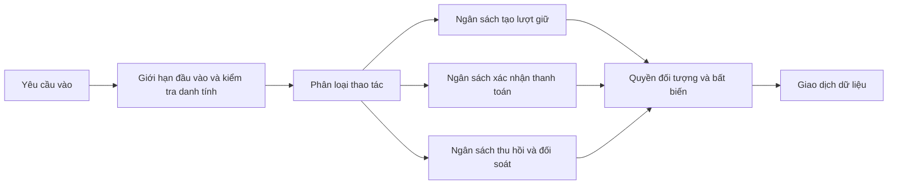
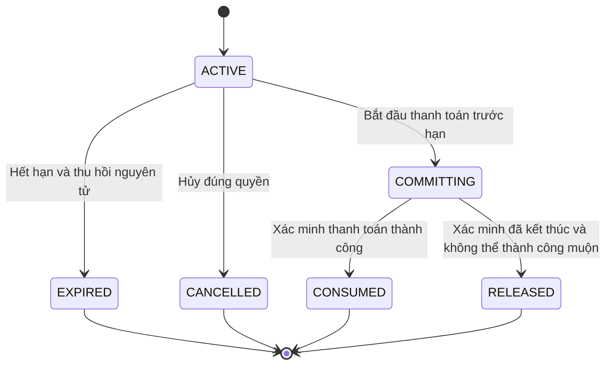

# Availability of business operations — Tính sẵn sàng của các thao tác nghiệp vụ

## 1. Mục tiêu của bài học

Trong chương **Security Objectives**, tính sẵn sàng cần được nhìn từ công việc mà người dùng có quyền thực hiện. Máy chủ trả lời HTTP nhanh chưa có nghĩa khách hàng mua được hàng, nhân viên phê duyệt được hồ sơ hoặc một thanh toán đang chờ có thể đi đến kết quả rõ ràng.

Trong phạm vi Business Logic Security, mục tiêu là bảo vệ khả năng hoàn tất thao tác nghiệp vụ trước việc chiếm giữ tài nguyên, lạm dụng chức năng, tạo công việc không giới hạn và gây kẹt quy trình. Việc bảo vệ này phải đi cùng bất biến nghiệp vụ, quyền theo đối tượng, máy trạng thái, transaction và idempotency.

Sau bài học, bạn có thể:

- Phân biệt dịch vụ còn hoạt động với nghiệp vụ còn sử dụng được.
- Nhận diện hành vi làm cạn tài nguyên nghiệp vụ dù từng yêu cầu riêng lẻ vẫn hợp lệ.
- Đặt mục tiêu đo lường cho thời gian hoàn tất, khả năng tiếp nhận và thời gian phục hồi.
- Chọn giới hạn tốc độ, số công việc đồng thời, quota, thời hạn giữ tài nguyên và cách phân chia năng lực xử lý.
- Thiết kế retry, hàng đợi và suy giảm chức năng có kiểm soát mà không phá quy tắc bảo mật khác.
- Viết tình huống kiểm thử chứng minh người dùng hợp lệ vẫn tiến triển khi có tải lạm dụng trong phạm vi thiết kế.

Bạn nên biết HTTP, transaction và mô hình trạng thái cơ bản. Các con số trong bài là giả định để phân tích, cần được hiệu chỉnh theo đo đạc và chính sách thực tế trước khi triển khai.

## 2. Tính sẵn sàng phải gắn với một kết quả nghiệp vụ

Một phát biểu có ích là:

> Trong điều kiện tải và phụ thuộc đã xác định, chủ thể được phép có thể thực hiện thao tác hợp lệ, nhận kết quả trung thực trong thời hạn chấp nhận được và tiếp tục hoặc phục hồi khi có lỗi.

Phát biểu này chứa bốn phần cần làm rõ: **ai được phục vụ**, **thao tác nào**, **điều kiện vận hành nào** và **thời hạn bao lâu**. Không có hệ thống hữu hạn nào cam kết phục vụ vô hạn công việc đồng thời; cần xác định cả hành vi khi vượt khả năng đã thiết kế.

| Tín hiệu hạ tầng | Điều có thể vẫn hỏng ở tầng nghiệp vụ |
| --- | --- |
| `/health` trả thành công | Toàn bộ suất đặt đã bị một nhóm tài khoản giữ nhưng không sử dụng |
| API tạo tác vụ trả rất nhanh | Tác vụ nằm mãi trong hàng đợi, không hoàn thành trước hạn |
| Cơ sở dữ liệu còn kết nối được | Các transaction dài chiếm khóa trên những đối tượng quan trọng |
| CPU trung bình thấp | Quota gửi mã xác nhận hoặc hạn mức gọi nhà cung cấp đã cạn |
| Người dùng vẫn đăng nhập được | Đơn hàng bị treo ở trạng thái chờ và không có đường tiếp tục |

Vì vậy, một đáp ứng `PENDING` trung thực có thể là bước hợp lệ của quy trình bất đồng bộ, nhưng không tự chứng minh thao tác đã sẵn sàng theo yêu cầu của người dùng. Cần quan sát cả việc đi đến kết quả cuối cùng.

### 2.1. Hai nhóm tài nguyên đều cần được bảo vệ

**Tài nguyên kỹ thuật** gồm luồng xử lý, bộ nhớ, kết nối cơ sở dữ liệu, dung lượng hàng đợi, thời gian CPU và số kết nối ra ngoài.

**Tài nguyên nghiệp vụ** gồm hàng tồn có thể bán, suất đặt lịch, số hồ sơ được xử lý, ngân sách khuyến mại, quota xác minh và thời gian của người phê duyệt.

Một hệ thống có thể dư tài nguyên kỹ thuật nhưng hết khả năng phục vụ nghiệp vụ. Ví dụ, hàng còn trong kho nhưng tất cả đều đang bị giữ trong các giỏ hàng không có ý định thanh toán.

OWASP API6:2023 lưu ý rằng tự động hóa quá mức các luồng như mua hàng hoặc đặt chỗ có thể khiến người dùng hợp lệ mất cơ hội sử dụng dịch vụ. Điều này phụ thuộc vào chính sách của từng nghiệp vụ, không chỉ vào số request. [Nguồn: OWASP Unrestricted Access to Sensitive Business Flows](https://api-security.owasp.org/editions/2023/en/0xa6-unrestricted-access-to-sensitive-business-flows/).

### 2.2. Phân biệt an toàn và khả năng tiến triển

- **Safety — không xảy ra điều bị cấm:** không bán vượt tồn kho, không duyệt sai người, không ghi nhận thanh toán hai lần.
- **Liveness — công việc có thể tiến triển:** yêu cầu đã được nhận không bị chờ vô hạn; tài nguyên tạm giữ được xử lý khi hết hạn; công việc lỗi có đường phục hồi.

Ví dụ, khóa toàn bộ chức năng mua hàng có thể ngăn bán vượt kho nhưng không đạt mục tiêu sẵn sàng. Ngược lại, bỏ kiểm tra tồn kho để mọi yêu cầu đều thành công sẽ phá tính đúng đắn. Thiết kế cần chỉ rõ khả năng tiến triển **trong các điều kiện an toàn của nghiệp vụ**.

## 3. Ví dụ xuyên suốt: luồng giữ hàng và thanh toán

Giả sử một sàn bán hàng hỗ trợ nhiều cửa hàng, mỗi cửa hàng có `tenantId`. Một sản phẩm có 40 đơn vị có thể bán. Khách hàng tạo một lượt giữ hàng trước khi thanh toán.

Chính sách giả định:

1. Mỗi lượt giữ tối đa 2 đơn vị sản phẩm.
2. Mỗi người mua có tối đa 2 lượt giữ chưa kết thúc trong một cửa hàng.
3. Lượt giữ ở trạng thái `ACTIVE` có thời hạn 120 giây do máy chủ xác lập.
4. Khi hết hạn, hệ thống đặt mục tiêu thu hồi lượt giữ thông thường trong 30 giây tiếp theo.
5. Lượt đã bắt đầu thanh toán nhưng chưa biết kết quả cần được đối soát; không áp dụng máy móc quy tắc thu hồi của `ACTIVE`.
6. Gửi lại cùng ý định không được giữ thêm hàng hoặc tạo thêm lần thanh toán.
7. Công việc tạo lượt giữ mới không được chiếm toàn bộ năng lực xử lý xác nhận thanh toán và giải phóng tài nguyên.

Các giới hạn này không chứng minh đã giải quyết mọi dạng bot. Nhiều tài khoản có thể cùng thuộc một người. Nhưng chúng cho biết rõ đơn vị cần đo, trạng thái cần quản lý và nơi cần đặt kiểm soát.

### 3.1. Kịch bản gây mất sẵn sàng

Nếu mỗi tài khoản có thể giữ hàng không giới hạn và không hết hạn, chỉ vài lượt gọi API đã đủ làm toàn bộ hàng không còn khả dụng. CPU, băng thông và tỷ lệ phản hồi HTTP vẫn có thể bình thường.

Nếu lượt giữ có thời hạn nhưng người dùng được tự đặt `expiresAt` hoặc gia hạn vô hạn, sự chiếm giữ vẫn tiếp tục. Nếu có job thu hồi nhưng job dùng chung một hàng đợi luôn đầy, “có cơ chế hết hạn” cũng chưa đủ bảo đảm hàng được trả lại đúng thời gian.

Một chuỗi nhân quả cần được phân tích đầy đủ:

```text
Tạo nhiều lượt giữ hợp lệ về hình thức
  → số hàng khả dụng giảm
  → khách khác không thể mua
  → khách thử lại nhiều hơn
  → tải tạo/đọc lượt giữ tăng
  → job thu hồi và xác nhận bị chậm
  → thời gian chiếm giữ kéo dài thêm
```

Kiểm soát cần cắt được chuỗi này ở nhiều điểm, thay vì chỉ tăng thêm máy chủ.

### 3.2. Những bất biến hỗ trợ tính sẵn sàng

Với một sản phẩm trong mô hình không nhập thêm hoặc điều chỉnh kho:

```text
available_quantity >= 0
held_quantity >= 0
sold_quantity >= 0

available_quantity + held_quantity + sold_quantity = tổng số ban đầu

open_holds(tenant, buyer) <= giới hạn chưa kết thúc

Mỗi lượt giữ kết thúc chỉ hoàn trả hoặc tiêu thụ hàng một lần.
```

Các bất biến này giữ dữ liệu đúng. Mục tiêu tiến triển đi kèm là: lượt giữ hết hạn đủ điều kiện phải được xử lý trong thời hạn mục tiêu, và người dùng hợp lệ không bị chờ vô hạn do nhóm khác chiếm công việc.

`open_holds` cần đếm cả lượt đang thanh toán nhưng chưa rõ kết quả, nếu chúng vẫn chiếm hàng. Chỉ đếm trạng thái `ACTIVE` sẽ cho phép người dùng đẩy nhiều lượt sang trạng thái chờ rồi tiếp tục chiếm thêm hàng.

## 4. Đặt mục tiêu có thể đo và kiểm chứng

Tránh yêu cầu chung chung như “checkout phải luôn sẵn sàng”. Một mục tiêu hữu ích cần chỉ rõ tải, kết quả hợp lệ, độ trễ, tỷ lệ đáp ứng và cách tính thất bại.

| Thành phần | Ví dụ mục tiêu cho mô hình học tập |
| --- | --- |
| Tiếp nhận | Trong hồ sơ tải đã kiểm thử, phần lớn ý định hợp lệ nhận được kết quả tiếp nhận hoặc từ chối có lý do trong 2 giây |
| Hoàn tất | Theo dõi tỷ lệ ý định hợp lệ đạt kết quả cuối đúng trong cửa sổ thời gian đã định nghĩa |
| Hết hạn | Ít nhất 99% lượt `ACTIVE` đủ điều kiện được thu hồi trong 30 giây sau hạn giữ |
| Công bằng | Một cửa hàng hoặc người mua gây tải cao không làm nhóm được bảo vệ mất toàn bộ năng lực xử lý |
| Phục hồi | Sau khi ngừng tải lạm dụng, độ trễ, tuổi hàng đợi và tốc độ hoàn tất trở về ngưỡng mục tiêu trong thời gian đã đo |

Đây là mẫu đặc tả. Để thành SLO triển khai được, cần bổ sung cửa sổ đo, giá trị tỷ lệ còn thiếu, phân bố tải, số khách đồng thời, quy mô dữ liệu và tình trạng các hệ thống phụ thuộc.

### 4.1. Đo ý định thay vì đếm mọi request như nhau

Một khách hàng gửi lại cùng lệnh 5 lần không có nghĩa có 5 cơ hội mua độc lập. Ngược lại, 5 lần phản hồi thành công cho cùng một ý định không phải 5 giao dịch hoàn tất.

Có thể theo dõi tỷ lệ:

```text
tỷ lệ hoàn tất đúng hạn =
    số ý định hợp lệ duy nhất đạt kết quả đúng trong hạn
    / số ý định hợp lệ duy nhất đủ thời gian quan sát
```

Phải định nghĩa trước cách nhận diện ý định, tính hợp lệ và cửa sổ quan sát. Không xác định “hợp lệ” chỉ bằng việc yêu cầu đã qua admission control, vì như vậy các khách bị chặn nhầm sẽ biến mất khỏi mẫu đo.

Không phải lúc nào cũng biết chính xác đâu là bot hay người dùng thật. Có thể kết hợp nhóm khách đã xác minh, hành trình kiểm tra tổng hợp được kiểm soát, mẫu điều tra và số liệu chặn nhầm. Báo cáo cần nêu phạm vi nhận diện thay vì khẳng định đã đo hoàn hảo mọi người dùng hợp lệ.

### 4.2. Không để số liệu đẹp che mất nhu cầu không được phục vụ

Nếu hàng bị giữ hết, tỷ lệ thành công của số request còn được phép tạo lượt giữ có thể vẫn cao. Vì vậy, cần quan sát thêm số lần không có hàng do đang giữ, tuổi lượt giữ, tỷ lệ giữ thành mua và mức tập trung tài nguyên theo chủ thể.

Tương tự, hàng đợi nhỏ có thể do hệ thống từ chối gần như toàn bộ công việc. Phải xem đồng thời tốc độ nhận, tốc độ từ chối, tốc độ hoàn tất và thời gian phục hồi.

## 5. Giới hạn theo ý nghĩa và chi phí của thao tác

Một giới hạn “100 request mỗi phút” không cho biết mỗi request làm bao nhiêu việc. Một request tạo 1 dòng hàng và một request xử lý 10.000 dòng không có cùng chi phí.

OWASP API4:2023 đề cập rủi ro khi thiếu giới hạn thời gian xử lý, kích thước đầu vào, số thao tác trong một batch hoặc mức tiêu thụ dịch vụ có tính phí. Cần đặt giới hạn ở đơn vị công việc thực sự. [Nguồn: OWASP Unrestricted Resource Consumption](https://api-security.owasp.org/editions/2023/en/0xa4-unrestricted-resource-consumption/).

| Cơ chế | Đơn vị giới hạn | Vấn đề giải quyết |
| --- | --- | --- |
| Rate limit | Số lần trong một khoảng thời gian | Tốc độ gửi lệnh hoặc gọi dịch vụ |
| Concurrency limit | Số công việc đang chạy | Cạn luồng, kết nối hoặc năng lực phụ thuộc |
| Quota nghiệp vụ | Số lượng/giá trị tài nguyên theo chủ thể và kỳ hạn | Chiếm hàng, suất đặt, lượt xác minh hoặc ngân sách |
| Giới hạn kích thước | Số dòng, số phần tử, dung lượng | Một request gây công việc quá lớn |
| Deadline/timeout | Thời gian chờ hoặc xử lý | Công việc chiếm tài nguyên quá lâu |
| Giới hạn hàng đợi | Số công việc hoặc tổng dung lượng đang chờ | Bộ nhớ, lưu trữ và độ trễ tăng không kiểm soát |

Các cơ chế bổ sung cho nhau. Tốc độ thấp vẫn có thể gây cạn tài nguyên nếu mỗi công việc kéo dài nhiều phút. Ngược lại, giới hạn đồng thời không chặn được việc chiếm toàn bộ hàng rồi để yên.

### 5.1. Chọn khóa giới hạn đúng phạm vi

Có thể phối hợp giới hạn theo người dùng, cửa hàng, đối tượng nóng, thao tác và toàn hệ thống. Định danh người dùng phải lấy từ ngữ cảnh xác thực; `tenantId` do client chọn cần được kiểm tra quyền trước khi dùng như phạm vi nghiệp vụ đáng tin.

Giới hạn theo IP là một tín hiệu bổ sung. Nhiều người hợp lệ có thể dùng chung IP, còn một tác nhân có thể dùng nhiều IP. Tương tự, giới hạn theo tài khoản cần được xem cùng nguy cơ tạo nhiều tài khoản và mục tiêu công bằng của sản phẩm.

Trạng thái của chính bộ giới hạn cũng cần được chặn tăng trưởng: không lưu vô hạn khóa tùy ý do máy khách tạo, không để hết hạn khóa gây bùng tải và không thực hiện một truy vấn đắt tiền cho mọi request bị chặn.

### 5.2. Giới hạn tổng cần được thực thi nguyên tử

Hai yêu cầu có thể cùng đọc “đang có 1 lượt giữ, giới hạn là 2”, rồi mỗi yêu cầu tạo thêm một lượt. Kết quả là 3 lượt đang mở dù từng lần kiểm tra riêng đều đạt.

Nếu quota là điều kiện cứng, việc nhận quota và tạo tài nguyên phải có cơ chế nhất quán phù hợp. Một bộ đếm trong bộ nhớ của mỗi máy chủ không tự tạo thành quota chung cho toàn bộ cụm.

## 6. Giới hạn công việc đồng thời để bảo vệ năng lực xử lý

### 6.1. Admission control là quyết định trước khi làm việc tốn kém

**Admission control** quyết định có nhận thêm công việc vào tài nguyên được bảo vệ hay không. Khi hết năng lực, hệ thống cần trả kết quả có chủ đích hoặc chuyển sang một hàng đợi hữu hạn, thay vì để mọi yêu cầu cùng chờ trong bộ nhớ.

Ví dụ, có thể dành một ngân sách đồng thời riêng cho tạo lượt giữ mới. Việc đọc trạng thái thanh toán, xử lý xác nhận và thu hồi lượt giữ có ngân sách khác. Đây là cách cô lập ảnh hưởng của một nhóm công việc, thường được gọi là **bulkhead**.



Các nhánh vẫn có thể dùng chung cơ sở dữ liệu hoặc dịch vụ ngoài. Tách luồng ở ứng dụng chưa bảo đảm cô lập hoàn toàn; cần phân bổ cả kết nối, worker và năng lực phụ thuộc, rồi đo mức phục vụ thực tế.

### 6.2. Ví dụ Java: cổng đồng thời cục bộ không tạo hàng chờ

Đoạn Java sau là một thành phần độc lập, dùng `Semaphore` để giới hạn số lời gọi đồng bộ đang chạy qua **cùng một instance**. Nó không triển khai xác thực, quota nghiệp vụ hoặc chống thanh toán trùng.

```java
import java.util.concurrent.Callable;
import java.util.concurrent.Semaphore;

public final class LocalBulkhead {
    private final Semaphore permits;

    public LocalBulkhead(int maxConcurrent) {
        if (maxConcurrent <= 0) {
            throw new IllegalArgumentException("maxConcurrent must be positive");
        }
        this.permits = new Semaphore(maxConcurrent);
    }

    public <T> T execute(Callable<T> action) throws Exception {
        if (!permits.tryAcquire()) {
            throw new CapacityExceededException();
        }

        try {
            return action.call();
        } finally {
            permits.release();
        }
    }

    public static final class CapacityExceededException
            extends RuntimeException {
        public CapacityExceededException() {
            super("LOCAL_CAPACITY_EXCEEDED");
        }
    }
}
```

Có thể cấu hình một instance dùng chung cho nhánh tạo lượt giữ trong mỗi tiến trình, với số permit được chọn từ năng lực đã đo. Không tạo một `LocalBulkhead` mới cho từng request, vì khi đó các request không chia sẻ giới hạn.

Theo hợp đồng của Java, `tryAcquire()` không tham số thử nhận permit ngay tại thời điểm gọi; `release()` trả lại permit. Bản thân lời gọi không chờ này không bảo đảm thứ tự công bằng giữa người dùng hoặc tenant. [Tài liệu Java Semaphore](https://docs.oracle.com/en/java/javase/21/docs/api/java.base/java/util/concurrent/Semaphore.html).

Những giới hạn cần hiểu rõ:

- Nếu có 5 tiến trình, mỗi tiến trình có 12 permit, có thể có đến 60 công việc chạy qua các cổng đó; đây không phải giới hạn toàn cụm bằng 12.
- `finally` bảo đảm trả permit khi lời gọi kết thúc thông thường hoặc ném lỗi; nếu công việc treo mãi, vẫn phải có timeout ở các tầng tài nguyên thực tế.
- Không bọc một hàm chỉ trả `Future` rồi coi permit đã đại diện cho toàn bộ công việc bất đồng bộ: hàm có thể trả về trước khi tài nguyên được giải phóng.
- Hủy chờ ở phía client không chứng minh công việc phía máy chủ đã dừng. Permit phải phản ánh thời gian chiếm dụng thực tế.
- Giới hạn đồng thời chung không tự ngăn một tenant giành hết permit. Công bằng cần cơ chế phân bổ riêng.

### 6.3. Không để công việc nền quan trọng bị bỏ đói

Thu hồi lượt giữ, xác nhận kết quả và đối soát đều giúp giải phóng trạng thái đang chiếm tài nguyên. Nếu chúng dùng chung hàng chờ với tạo lượt giữ mới, tải lạm dụng có thể trì hoãn chính cơ chế phục hồi.

Có thể dành worker, kết nối hoặc phần năng lực tối thiểu cho các thao tác kết thúc. Mức ưu tiên không có nghĩa bỏ xác minh: một endpoint tự nhận là callback thanh toán vẫn phải kiểm tra nguồn và nội dung trước khi tạo thay đổi.

## 7. Giữ hàng có giới hạn cần transaction và trạng thái bền vững

### 7.1. Nhận quota và giữ tồn kho trong cùng thao tác nhất quán

Giả sử có bản ghi `buyer_hold_budget` cho từng người mua trong cửa hàng và bản ghi `inventory` cho từng sản phẩm. Các bản ghi có khóa duy nhất phù hợp; bộ đếm là `NOT NULL` và không âm. Việc khởi tạo bản ghi ngân sách cũng phải xử lý cạnh tranh bằng khóa duy nhất.

Mã SQL có tham số dưới đây minh họa luồng cho một dòng sản phẩm. Nó cần được điều phối bởi mã ứng dụng; các dòng chú thích kiểm tra số dòng là điều kiện bắt buộc trước khi thực hiện bước kế tiếp.

```sql
BEGIN;

UPDATE buyer_hold_budget
SET open_hold_count = open_hold_count + 1
WHERE tenant_id = :trusted_tenant_id
  AND buyer_id = :authenticated_buyer_id
  AND open_hold_count < :server_max_open_holds;

-- Ứng dụng phải kiểm tra affectedRows = 1; nếu không, ROLLBACK.

UPDATE inventory
SET available_quantity = available_quantity - :validated_quantity,
    held_quantity = held_quantity + :validated_quantity
WHERE tenant_id = :trusted_tenant_id
  AND sku_id = :sku_id
  AND available_quantity >= :validated_quantity;

-- Ứng dụng phải kiểm tra affectedRows = 1; nếu không, ROLLBACK.

INSERT INTO reservation (
    id, tenant_id, buyer_id, sku_id, quantity,
    state, created_at, expires_at
) VALUES (
    :server_reservation_id, :trusted_tenant_id,
    :authenticated_buyer_id, :sku_id, :validated_quantity,
    'ACTIVE', :server_now, :server_expiry
);

COMMIT;
```

Điều kiện trước khi vào luồng:

- Đã xác thực, kiểm tra quyền theo cửa hàng và giới hạn chi phí đầu vào.
- Số lượng là số nguyên trong khoảng chính sách, chẳng hạn từ 1 đến 2; không tin giá trị âm, bằng 0 hoặc quá lớn.
- Hạn giữ và giới hạn quota do máy chủ quyết định.
- Đã tích hợp cơ chế idempotency: retry đã có kết quả không chạy lại phần cấp quota. Việc nhận khóa và thay đổi nội bộ cần nhất quán.

Nếu không đủ hàng, bước cập nhật ngân sách trước đó phải rollback. Nếu tạo bản ghi lượt giữ thất bại, cả ngân sách và hàng giữ cũng phải rollback. Không trả kết quả nhận giữ thành công trước khi commit.

Với nhiều sản phẩm hoặc nhiều bộ đếm, cần thứ tự truy cập/khóa nhất quán trên mọi đường ghi, giới hạn số dòng và chiến lược xử lý deadlock có số lần thử hữu hạn. Không để một request lớn khóa tùy ý nhiều đối tượng nóng.

### 7.2. Hết hạn là một chuyển trạng thái, không chỉ là một timestamp

Có `expires_at` không có nghĩa tài nguyên đã được trả lại. Cần một thao tác thu hồi bảo đảm:

1. Lượt giữ thuộc phạm vi xử lý và vẫn là `ACTIVE`.
2. Đã đến hạn theo nguồn thời gian đáng tin được hệ thống quy định.
3. Chuyển sang trạng thái kết thúc chỉ thành công một lần.
4. Hoàn trả hàng và giảm `open_hold_count` trong cùng transaction với chuyển trạng thái.

Nếu worker chạy lại hoặc hai worker xử lý cùng bản ghi, chỉ lượt thắng điều kiện mới được hoàn trả hàng. Một câu lệnh tăng tồn kho không gắn với kết quả chuyển trạng thái có thể hoàn trả hai lần.

Nên có chỉ mục phục vụ tìm các lượt đủ điều kiện theo trạng thái và hạn, xử lý theo batch hữu hạn, theo dõi tuổi bản ghi cũ nhất và cho phép tiếp tục sau khi worker dừng. Quét toàn bảng liên tục có thể khiến job thu hồi trở thành nguồn gây quá tải.

### 7.3. Quyền thao tác phải bảo vệ cả việc chiếm và việc giải phóng

Chủ thể không có quyền không được tạo lượt giữ cho người khác, gia hạn thời gian của họ, hủy lượt giữ của khách khác hoặc sửa trực tiếp trạng thái. Tấn công vào khả năng sử dụng dịch vụ có thể đến từ việc phá tài nguyên đang thuộc người dùng hợp lệ, không chỉ từ việc chiếm thêm tài nguyên.

Mã đối tượng khó đoán không thay cho kiểm tra quan hệ người dùng–lượt giữ và tổ chức. Các job hệ thống có quyền khác khách hàng nhưng vẫn phải tuân thủ điều kiện trạng thái và ghi bằng chứng.

## 8. Hàng đợi phải hữu hạn và phù hợp thời hạn nghiệp vụ

Đưa công việc vào hàng đợi chỉ chuyển nơi chờ; nó không tự tạo thêm năng lực xử lý.

Giả sử một worker pool xử lý ổn định 20 công việc mỗi giây và đang có 1.000 công việc tương đương đứng trước. Trong mô hình đơn giản không lỗi, riêng thời gian xử lý phần công việc đó đã khoảng 50 giây. Nếu thao tác cần xong trong 10 giây, tiếp tục nhận công việc mà vẫn hứa đáp ứng thời hạn là không phù hợp.

Nếu tốc độ nhận liên tục lớn hơn tốc độ hoàn tất, backlog tiếp tục tăng. Cần giới hạn ít nhất số công việc, dung lượng lưu trữ, tuổi công việc và phần đóng góp của mỗi tenant hoặc loại thao tác.

### 8.1. Hợp đồng khi tiếp nhận công việc bất đồng bộ

- Chỉ báo đã nhận khi ý định đã được lưu bền vững theo thiết kế, chẳng hạn trong cùng transaction với outbox.
- Trả mã thao tác để người có quyền tra cứu kết quả mà không tạo lại công việc.
- Có quy tắc xử lý khi quá hạn: hủy nếu chưa gây hiệu ứng, tiếp tục đối soát nếu kết quả chưa rõ hoặc chuyển xử lý có giám sát.
- Công việc lỗi không được retry vô hạn và chặn cả nhóm. Cần nơi cách ly cùng quy trình xử lý hoặc phát lại có kiểm soát.
- Nếu không còn dung lượng hàng đợi, từ chối sớm trước khi tạo tài nguyên không thể phục hồi hoặc phải có transaction bù rõ ràng.

Một outbox tồn tại bền vững nhưng không được tiêu thụ vẫn có thể tăng đầy cơ sở dữ liệu. Phải đo độ trễ phát, tốc độ xử lý và dung lượng; đặt backpressure lên những thao tác tạo thêm công việc khi cần.

### 8.2. Công bằng cần xuất hiện ở cả lúc nhận và lúc xử lý

Quota tiếp nhận theo tenant không giúp nhiều nếu một tenant đã có backlog rất lớn đứng trước tất cả nhóm khác trong một hàng đợi. Có thể cần hàng đợi tách nhóm, lịch phục vụ có trọng số hoặc mức năng lực tối thiểu được bảo vệ.

Đừng ưu tiên dựa trên trường do client tự đặt như `priority: urgent`. Quyền ưu tiên phải do máy chủ quyết định từ loại thao tác và chính sách đã xác minh. Đồng thời theo dõi starvation của các nhóm ưu tiên thấp; không để “chưa đến lượt” trở thành trạng thái vô hạn.

## 9. Deadline, retry và idempotency phải được thiết kế cùng nhau

### 9.1. Deadline cần bao phủ toàn bộ thao tác

Ngân sách thời gian có thể bị tiêu thụ khi chờ permit, chờ kết nối, chờ khóa, truy vấn, kết nối mạng và đọc phản hồi. Chỉ đặt timeout cho một đoạn không bảo đảm tổng thời gian nằm trong hạn.

Nên truyền phần thời gian còn lại xuống các bước phụ thuộc và không bắt đầu bước tốn kém khi đã hết ngân sách. Đặt giới hạn thời gian transaction và chờ khóa phù hợp; tránh giữ khóa cơ sở dữ liệu trong lúc chờ người dùng hoặc gọi mạng kéo dài.

Timeout thường chỉ nói rằng bên gọi ngừng chờ. Nó không tự chứng minh bên được gọi chưa commit, chưa gửi tin nhắn hoặc chưa xử lý thanh toán.

### 9.2. Retry có thể khuếch đại tải

Nếu ba tầng đều cho phép tối đa 3 lần gọi cho một thao tác, số lần gọi xuống tầng cuối có thể lên đến `3 × 3 × 3 = 27`. Đây là giới hạn trong ví dụ mọi lần thử đều đi qua ba tầng; cách cấu hình thực tế phải phân biệt rõ số lần thử tổng với số lần retry thêm.

Chính sách phù hợp thường cần:

- Chọn rõ tầng chịu trách nhiệm retry.
- Chỉ thử lại lỗi được phân loại có khả năng tạm thời; không retry tự động việc sai quyền, sai giá hoặc sai trạng thái.
- Giới hạn tổng lần thử và tổng thời gian, dùng backoff cùng jitter để tránh các client thử lại đồng loạt.
- Có ngân sách retry và giảm hoặc ngừng retry khi nó chỉ làm phụ thuộc quá tải thêm.
- Giữ cùng định danh ý định khi thực hiện lại thao tác có tác dụng phụ.

Những rủi ro của retry, thời hạn và việc mất phản hồi sau tác dụng phụ được phân tích trong [Amazon Builders’ Library: Timeouts, retries, and backoff with jitter](https://aws.amazon.com/builders-library/timeouts-retries-and-backoff-with-jitter/).

### 9.3. Idempotency giảm công việc trùng nhưng không miễn phí

Khóa idempotency phải được giới hạn theo chủ thể, tổ chức và thao tác, gắn với tham số có ý nghĩa. Cùng khóa với nội dung khác phải bị từ chối. Việc nhận khóa cần nguyên tử để hai yêu cầu cạnh tranh không cùng thực thi.

Trả kết quả đã lưu vẫn cần kiểm tra quyền và giới hạn tốc độ truy xuất phù hợp. Nếu không giới hạn, endpoint tra trạng thái hoặc cache idempotency cũng có thể bị dùng để tiêu hao tài nguyên.

Khóa mới không được vượt qua quota nghiệp vụ. Việc đổi liên tục idempotency key có thể làm đầy bảng khóa nếu không có giới hạn và chính sách lưu giữ. Sau khi khóa hết hạn, ràng buộc nghiệp vụ và lịch sử cần thiết vẫn phải chặn hiệu ứng trùng.

## 10. Phục hồi công việc bị kẹt mà không phá bất biến

Một máy trạng thái phù hợp cần phân biệt giữ hàng chưa thanh toán với thao tác đã gây ra tác động bên ngoài:



`COMMITTING` biểu thị ý định thanh toán đã bắt đầu và chưa có kết luận cuối cùng được xác minh. Nó không được thu hồi chỉ vì đồng hồ đã đi qua `expires_at` của lượt `ACTIVE` ban đầu.

### 10.1. Hết hạn và bắt đầu thanh toán có thể cạnh tranh

Khi người mua bắt đầu thanh toán, thao tác cần kiểm tra đồng thời:

```text
đúng tổ chức và chủ thể có quyền
AND state = ACTIVE
AND expires_at > thời điểm quyết định đáng tin
```

Việc chuyển sang `COMMITTING` cùng tạo ý định thanh toán/outbox cần nhất quán. Worker hết hạn chỉ nhận lượt còn `ACTIVE` và đã đến hạn. Cơ chế khóa hoặc cập nhật có điều kiện phải khiến hai đường xử lý không thể cùng giành quyền quyết định cho một lượt giữ.

Nếu hết hạn thắng, không được bắt đầu thanh toán theo lượt giữ đó. Nếu bắt đầu thanh toán thắng, worker hết hạn không được trả hàng của nó về kho như một lượt chưa thanh toán.

Mọi đường kết thúc phải cập nhật hàng và quota đúng một lần. `CONSUMED` chuyển số lượng đang giữ sang đã bán; các trạng thái kết thúc có hoàn trả đưa số lượng đang giữ về khả dụng. Trong cả hai trường hợp, `open_hold_count` được giảm cùng transaction khi lượt giữ không còn mở.

### 10.2. Không dùng timeout làm bằng chứng giao dịch thất bại

Giả sử hệ thống thanh toán đã xử lý nhưng phản hồi bị mất. Trả hàng ngay rồi cho người khác mua có thể khiến hai khách cùng có căn cứ đòi một lượng hàng.

Một đường phục hồi có kiểm soát cần:

1. Lưu định danh ý định trước khi gọi bên ngoài.
2. Retry cùng định danh theo hợp đồng idempotency của nhà cung cấp, hoặc truy vấn kết quả bằng định danh đó.
3. Đối chiếu số tiền, loại tiền, đối tượng và nguồn kết quả trước khi chốt.
4. Giữ trạng thái chưa rõ riêng biệt với thất bại đã xác minh.
5. Chuyển xử lý có giám sát khi quá thời gian mục tiêu; có quyền và bằng chứng cho quyết định khắc phục.

Chỉ giải phóng theo nhánh `RELEASED` khi đã có căn cứ rằng ý định không còn có thể thành công muộn theo giao thức tích hợp. Nếu tiền đã được xử lý và cần hoàn, đó là luồng bù hoặc hoàn tiền riêng; không giả vờ tác dụng trước đó chưa xảy ra.

Trong thời gian bên ngoài mất khả năng xác nhận, có thể phải hạn chế tạo ý định mới để tránh tăng số trạng thái chưa rõ. Đây là giới hạn thực tế của tính sẵn sàng: hệ thống cần giữ đúng dữ liệu và giúp công việc phục hồi, không hứa hoàn tất điều chưa thể chứng minh.

### 10.3. Thời hạn và gia hạn cũng cần chống lạm dụng

Nếu cho phép gia hạn giữ hàng, cần quy định quyền, số lần, tổng thời gian tối đa và điều kiện gia hạn. Không lấy một timestamp xa trong tương lai từ client làm thời hạn chính thức.

Gia hạn, hủy, thu hồi và bắt đầu thanh toán phải cạnh tranh trên cùng trạng thái có kiểm soát. Một job chạy trễ không được xử lý theo dữ liệu cũ rồi hoàn trả hàng của lượt vừa được gia hạn hợp lệ hoặc đã chuyển sang thanh toán.

## 11. Suy giảm chức năng có kiểm soát

**Graceful degradation** là giảm phần chức năng hoặc mức dịch vụ theo chính sách khi tài nguyên hay phụ thuộc gặp vấn đề, trong khi vẫn bảo vệ các thao tác còn có thể thực hiện đúng.

| Tình trạng | Phản ứng có thể áp dụng | Điều kiện vẫn phải giữ |
| --- | --- | --- |
| Hệ thống gợi ý chậm | Bỏ gợi ý, hiển thị danh mục cơ bản | Không để gợi ý trở thành phụ thuộc bắt buộc của mua hàng |
| Tạo lượt giữ bị quá tải | Từ chối sớm yêu cầu mới vượt năng lực; bảo vệ năng lực kết thúc lượt cũ | Không báo đã giữ khi chưa commit |
| Cổng thanh toán chưa rõ kết quả | Cho xem trạng thái đã lưu, hạn chế phát sinh mới, ưu tiên đối soát | Không gán thành công hoặc thất bại bằng suy đoán |
| Nguồn phân quyền không khả dụng | Dùng chính sách cache được phép nếu còn hợp lệ, hoặc từ chối/trì hoãn thao tác nhạy cảm | Không bỏ kiểm tra quyền để tăng tỷ lệ thành công |
| Không có dữ liệu tồn kho đủ tin cậy | Có thể hiển thị dữ liệu tham khảo có ngữ nghĩa rõ, tạm dừng nhận giữ mới | Không coi cache cũ là căn cứ khẳng định đã giữ hàng |
| Báo cáo lớn tranh tài nguyên | Tạm hạn chế xuất báo cáo hoặc chuyển sang lịch xử lý hữu hạn | Bảo vệ năng lực xử lý giao dịch chính |

### 11.1. Trạng thái phản hồi cần trung thực

Phân biệt cho client những trường hợp có cách xử lý khác nhau: bị giới hạn theo chính sách, hệ thống tạm quá tải, đối tượng đã hết hạn, sai quyền và thao tác vẫn đang được xác minh.

Hướng dẫn retry chỉ hữu ích khi không khiến client tạo thêm ý định mới hoặc dồn tải vào cùng thời điểm. Endpoint tra cứu kết quả cũng cần ngân sách riêng; không hướng mọi client polling liên tục không giới hạn.

Đối với phản hồi quá tải chưa nhận công việc, client cần biết không có thao tác mới được tạo. Đối với timeout sau điểm tiếp nhận bền vững, cần định danh và đường tra cứu để giải quyết sự không chắc chắn.

### 11.2. Circuit breaker cần phạm vi phù hợp

Circuit breaker có thể tạm ngừng gửi thêm lời gọi tới một phụ thuộc đang liên tục lỗi, rồi thử phục hồi có giới hạn. Nó không tự hủy công việc đã chạy, không chứng minh kết quả thanh toán và không thay cho quota hay quyền theo đối tượng.

Phạm vi quá rộng có thể làm một lỗi cục bộ chặn tất cả tenant. Phạm vi quá nhỏ lại làm số trạng thái theo dõi tăng không kiểm soát. Cần chọn theo cấu trúc phụ thuộc, đo chặn nhầm và giới hạn số lời gọi thăm dò khi phục hồi.

## 12. Chính kiểm soát cũng có thể bị dùng để khóa nghiệp vụ

Tính sẵn sàng cần được xét cả khi thiết kế các biện pháp chống lạm dụng. Một kiểm soát có thể bảo vệ hệ thống nhưng vô tình cho kẻ khác quyền làm gián đoạn công việc của nạn nhân.

### 12.1. Khóa tài khoản hoặc quota bằng dữ liệu chưa xác minh

Nếu bất kỳ ai cũng có thể gửi tên đăng nhập của nạn nhân để làm tăng bộ đếm rồi khóa toàn bộ tài khoản, cơ chế chống thử mật khẩu trở thành công cụ từ chối dịch vụ có mục tiêu.

Tương tự, không nên tiêu quota quan trọng của người mua chỉ dựa vào một `buyerId` trong request chưa chứng minh quyền đại diện. Cần phân biệt nguồn gửi, đối tượng bị nhắm tới và chủ thể đã xác thực, rồi chọn giới hạn theo mục tiêu bảo vệ.

Các cơ chế trì hoãn, xác minh bổ sung và phục hồi quyền truy cập phải được đánh giá cùng tỷ lệ chặn nhầm. Không tự động mở quyền trái chính sách để giải quyết khó khăn này.

### 12.2. Sửa hoặc hủy đối tượng của người khác

Một endpoint hủy lượt giữ thiếu kiểm tra chủ sở hữu có thể liên tục hủy giỏ hàng của khách thật. Trong quy trình phê duyệt, một endpoint thu hồi hoặc trả về hồ sơ sai quyền có thể khiến người dùng không bao giờ hoàn thành công việc.

Vì thế, bảo vệ availability bao gồm bảo vệ quyền **tiếp tục và kết thúc** một quy trình đang thuộc về chủ thể hợp lệ. Cần kiểm tra cả quyền trên đối tượng, trạng thái và phiên bản khi sửa hoặc hủy.

### 12.3. Người xử lý độc quyền trở thành điểm kẹt

Trong quy trình có bước phê duyệt, một người được phân công có thể vắng mặt hoặc cố tình không xử lý. Cần quy định hạn xử lý, người thay thế, quyền chuyển phân công và cách thông báo hoặc nâng cấp xử lý.

Hết hạn không có nghĩa tự động duyệt. Đường thay thế vẫn phải giữ điều kiện như không tự duyệt, đúng phạm vi tổ chức và đúng nội dung đang được xem xét. Nếu ai đó đang xử lý đồng thời, việc chuyển phân công cần phiên bản hoặc khóa để tránh hai quyết định trái nhau.

## 13. Quan sát dấu hiệu mất sẵn sàng và khả năng phục hồi

### 13.1. Đo công việc đúng được hoàn thành

**Goodput nghiệp vụ** có thể hiểu là lượng công việc hợp lệ tạo kết quả đúng trong thời hạn mục tiêu. Nó khác với tổng số request đã xử lý, vì request bị lặp hoặc kết quả trễ có thể tiêu tài nguyên mà không thêm giá trị.

Nhóm chỉ số nên theo dõi:

- Tốc độ hoàn tất ý định hợp lệ và độ trễ theo loại thao tác.
- Số yêu cầu bị admission control hoặc quota từ chối, cùng chỉ báo chặn nhầm.
- Số lượt giữ đang mở, tuổi lượt giữ, tỷ lệ giữ thành mua và độ tập trung theo nhóm chủ thể.
- Độ trễ thu hồi sau hạn; tuổi của các trạng thái `COMMITTING` chưa có kết luận.
- Số lượng, dung lượng và tuổi công việc cũ nhất trong hàng đợi/outbox.
- Số công việc đang chạy, thời gian chờ kết nối/khóa và tải của từng phụ thuộc.
- Hệ số khuếch đại retry, số lần dedup và số lần bị xung đột idempotency.
- Thời gian trở lại ngưỡng mục tiêu sau khi nguồn gây tải chấm dứt.

Không đặt mọi mã người dùng hoặc mã lượt giữ thành nhãn metric không giới hạn. Độ lớn dữ liệu quan sát cũng có thể làm cạn bộ nhớ hoặc tăng chi phí. Dùng chiều tổng hợp hữu hạn cho metric và truy vết chi tiết bằng cơ chế log có kiểm soát phù hợp.

### 13.2. Bằng chứng cần phục vụ điều tra mà không trở thành nguồn quá tải

Với một quyết định quan trọng, cần truy được chủ thể, tenant, thao tác, đối tượng, phiên bản, kết quả, lý do và mã tương quan. Không ghi bí mật xác thực hoặc dữ liệu thanh toán nhạy cảm không cần thiết.

Đối với lượng lớn yêu cầu bị từ chối, có thể dùng bộ đếm tổng hợp và log có giới hạn theo chính sách. Bằng chứng bắt buộc cho thay đổi nghiệp vụ đã commit vẫn cần được giữ bền vững; không áp dụng lấy mẫu tùy tiện làm mất lịch sử quyết định bắt buộc.

### 13.3. Kế hoạch vận hành cần bảo vệ phần giúp hệ thống thoát kẹt

Khi xảy ra mất sẵn sàng:

1. Xác định thao tác và nhóm khách bị ảnh hưởng qua kết quả nghiệp vụ, không chỉ tình trạng máy chủ.
2. Xác định nút thắt: hàng bị giữ, quota, khóa dữ liệu, hàng đợi hay phụ thuộc chậm.
3. Giảm đầu vào tạo thêm công việc tại đúng phạm vi; bảo vệ năng lực xác nhận, thu hồi và đối soát.
4. Xử lý trạng thái chưa rõ theo máy trạng thái; không xóa bộ đếm hoặc tăng tồn kho thủ công để làm số liệu đẹp.
5. Mở lại dần khi cả độ trễ lẫn backlog phục hồi, đồng thời quan sát retry từ client.
6. Đối chiếu cuối cùng giữa tài nguyên, ý định và kết quả để phát hiện rò rỉ hoặc hiệu ứng trùng.

Nếu cần thao tác vận hành đặc biệt, phải có quyền, điều kiện thực hiện và audit. Một đường quản trị bỏ mọi bất biến sẽ tạo rủi ro mới ngay trong lúc hệ thống khó quan sát nhất.

## 14. Kiểm thử availability bằng kết quả nghiệp vụ

Kiểm thử cần chạy với mô hình tải và dữ liệu đã xác định, có cả luồng gây áp lực và luồng hợp lệ được quan sát độc lập. Bảng sau là các tình huống thiết kế, không phải kết quả đã đo của một triển khai cụ thể.

| Tình huống | Điều cần chứng minh |
| --- | --- |
| Một người mua tạo lượt giữ liên tục | Không vượt quota đang mở; khách khác còn khả năng tạo và hoàn tất trong phạm vi tải mục tiêu |
| Một request chứa quá nhiều dòng hoặc số lượng quá lớn | Bị chặn trước phần công việc đắt; không giữ tài nguyên dở dang |
| Hai yêu cầu cạnh tranh tại biên quota | Số lượt mở không vượt giới hạn; yêu cầu thua không làm rò bộ đếm |
| Hai yêu cầu cạnh tranh lượng hàng cuối | Không âm tồn kho, không có hai lượt giữ cùng chiếm một đơn vị |
| Tải tạo mới tăng cao | Luồng xác nhận, thu hồi và đối soát vẫn đạt phần năng lực được bảo vệ |
| Job thu hồi tạm dừng rồi chạy lại | Lượt `ACTIVE` đủ điều kiện được thu hồi; không tăng tồn kho hai lần |
| Thu hồi cạnh tranh với bắt đầu thanh toán | Chỉ một nhánh thắng theo điều kiện thời gian và trạng thái; không vừa thu hồi vừa thanh toán |
| Cổng thanh toán chậm hoặc mất phản hồi | Công việc đồng thời bị chặn ở ngưỡng; trạng thái chưa rõ được đối soát đúng |
| Hàng đợi đầy | Không báo tiếp nhận giả; không tăng công việc chờ vô hạn |
| Client retry đồng loạt | Retry có giới hạn; cùng ý định không tạo thêm lượt giữ hoặc thanh toán |
| Nhiều tiến trình ứng dụng | Giới hạn cục bộ và quota toàn cục được phân biệt; không vượt quota do đổi máy chủ |
| Một tenant dùng nhiều tài nguyên | Các tenant được bảo vệ không bị bỏ đói theo mục tiêu đã định nghĩa |
| Thao tác hủy nhắm vào lượt giữ của người khác | Bị chặn theo quyền đối tượng; khách hợp lệ vẫn giữ được quy trình của mình |
| Dừng tiến trình giữa cấp quota và tạo lượt giữ | Transaction rollback hoặc phục hồi nhất quán; không mất quota vĩnh viễn |
| Ngừng nguồn tải lạm dụng | Hàng đợi giảm, tài nguyên được giải phóng và goodput hồi phục trong thời gian mục tiêu |

### 14.1. Dùng phép đo phù hợp với từng tầng

Kiểm thử đơn vị phù hợp với kiểm tra thời hạn, chuyển trạng thái, phân loại lỗi có thể retry và quyết định theo quota đã biết. Dùng thời gian được kiểm soát thay vì buộc bài kiểm thử chờ nhiều phút thật.

Kiểm thử tích hợp với cơ sở dữ liệu xác minh cập nhật có điều kiện, khóa, rollback và ràng buộc duy nhất. Tạo các transaction độc lập và đồng bộ điểm cạnh tranh; mock repository không chứng minh được tính nguyên tử thật.

Kiểm thử tải theo nhóm chủ thể xác minh giới hạn, công bằng và goodput. Cần ghi rõ cấu hình máy chủ, dữ liệu, số tiến trình, tải đến và trạng thái phụ thuộc để kết quả có thể so sánh.

Kiểm thử lỗi và phục hồi mô phỏng chậm, mất phản hồi, restart worker, sự kiện lặp và công việc quá hạn. Sau phục hồi, kiểm tra đồng thời hiệu năng và các bất biến tồn kho, quota, thanh toán.

### 14.2. Đừng chỉ kiểm tra rằng kẻ gây tải bị chặn

Một kiểm soát chặn tất cả request có thể đạt tỷ lệ chặn lạm dụng rất cao nhưng làm availability bằng không. Cần một nhóm ý định hợp lệ có căn cứ để kỳ vọng được phục vụ, rồi đo việc chúng thực sự hoàn thành.

Không tính phản hồi quá tải như một lần mua thành công chỉ vì nó được trả nhanh. Hãy tách ít nhất ba kết quả: hoàn tất nghiệp vụ, từ chối đúng chính sách và không hoàn tất do mất khả năng phục vụ. Các trường hợp chưa xác định cần được theo dõi tiếp trong cửa sổ quan sát.

## 15. Mẫu đặc tả mục tiêu và tiêu chí chấp nhận

Một đặc tả gọn nên ghi rõ:

```text
Thao tác quan trọng:
  Ai được làm gì và kết quả nghiệp vụ cuối là gì?

Tài nguyên có thể bị chiếm:
  Hàng, suất đặt, quota, kết nối, khóa, worker hay ngân sách bên ngoài?

Hồ sơ tải:
  Tải hợp lệ, burst, tải lạm dụng, số chủ thể, số tiến trình,
  quy mô dữ liệu và giả định về hệ thống phụ thuộc.

Giới hạn và tính công bằng:
  Giới hạn nào theo người, tenant, đối tượng và toàn hệ thống?
  Phần năng lực nào được bảo vệ cho công việc kết thúc/phục hồi?

Mục tiêu quan sát:
  Tỷ lệ hoàn tất, độ trễ, độ trễ thu hồi, tuổi hàng đợi,
  tỷ lệ chặn nhầm và thời gian trở lại trạng thái bình thường.

Tính đúng đắn:
  Bất biến, quyền theo đối tượng, máy trạng thái,
  transaction, khóa nghiệp vụ và idempotency cần giữ.

Khi vượt năng lực hoặc phụ thuộc lỗi:
  Từ chối, trì hoãn, suy giảm hay đối soát theo đường nào?
  Điều gì tuyệt đối không được bỏ qua để tăng tỷ lệ phản hồi?

Phục hồi và bằng chứng:
  Ai hoặc worker nào xử lý công việc quá hạn?
  Kiểm chứng đã giải phóng đúng tài nguyên và không tạo hiệu ứng trùng ra sao?
```

### 15.1. Ví dụ một tiêu chí chấp nhận có phạm vi rõ

Giả sử môi trường kiểm thử có 1.000 đơn vị hàng, khách hợp lệ mua 1 đơn vị mỗi ý định, tải hợp lệ là 2 ý định mỗi giây trong 5 phút. Nhóm gây áp lực gồm 10 tài khoản đã xác thực, chỉ tạo rồi bỏ lượt giữ, tổng tải gửi là 100 request mỗi giây. Nhóm này không tự thanh toán, không tạo thêm tài khoản và không đổi được định danh đã xác minh.

Với giới hạn 2 lượt chưa kết thúc mỗi tài khoản và 2 đơn vị mỗi lượt, nhóm gây áp lực chỉ có thể cùng lúc giữ tối đa 40 đơn vị. Nhu cầu hợp lệ tối đa trong lần chạy là 600 đơn vị, nên ví dụ có đủ hàng để quan sát ảnh hưởng của tải mà không nhầm với hết nguồn cung thực sự.

Có thể đặt tiêu chí cho lần chạy này:

- Ít nhất 99% ý định hợp lệ hoàn tất luồng thanh toán mô phỏng đúng trong 5 giây; bộ mô phỏng có thời gian đáp ứng được cố định trong hồ sơ thử.
- Không vượt giới hạn lượt giữ và không âm bộ đếm tồn kho.
- Ít nhất 99% lượt `ACTIVE` bị bỏ đủ điều kiện được thu hồi trong 30 giây sau hạn.
- Sau khi dừng tải gây áp lực, tuổi hàng đợi và độ trễ của luồng hợp lệ trở về ngưỡng nền đã định nghĩa trong tối đa 60 giây.
- Không phát sinh thêm lần giữ hoặc thanh toán khi phát lại cùng ý định.

Đây là tiêu chí để kiểm thử, chưa phải khẳng định hệ thống nào đã đạt. Cần ghi cấu hình và ngưỡng nền cụ thể trước khi chạy. Nếu mở rộng đối thủ sang nhiều tài khoản mới, nhiều tenant hoặc phụ thuộc thanh toán lỗi, phải mở rộng hồ sơ tải và bổ sung kiểm soát tương ứng; kết quả của kịch bản hẹp không chứng minh mọi trường hợp.

Tính sẵn sàng của nghiệp vụ được thể hiện qua **công việc đúng còn hoàn tất được, tài nguyên được phân bổ có giới hạn và trạng thái lỗi có đường phục hồi rõ ràng**. Mỗi biện pháp chống lạm dụng cần được đánh giá bằng cả khả năng bảo vệ tài nguyên lẫn khả năng phục vụ chủ thể hợp lệ, trong khi vẫn giữ nguyên các điều kiện an toàn của quy trình.
