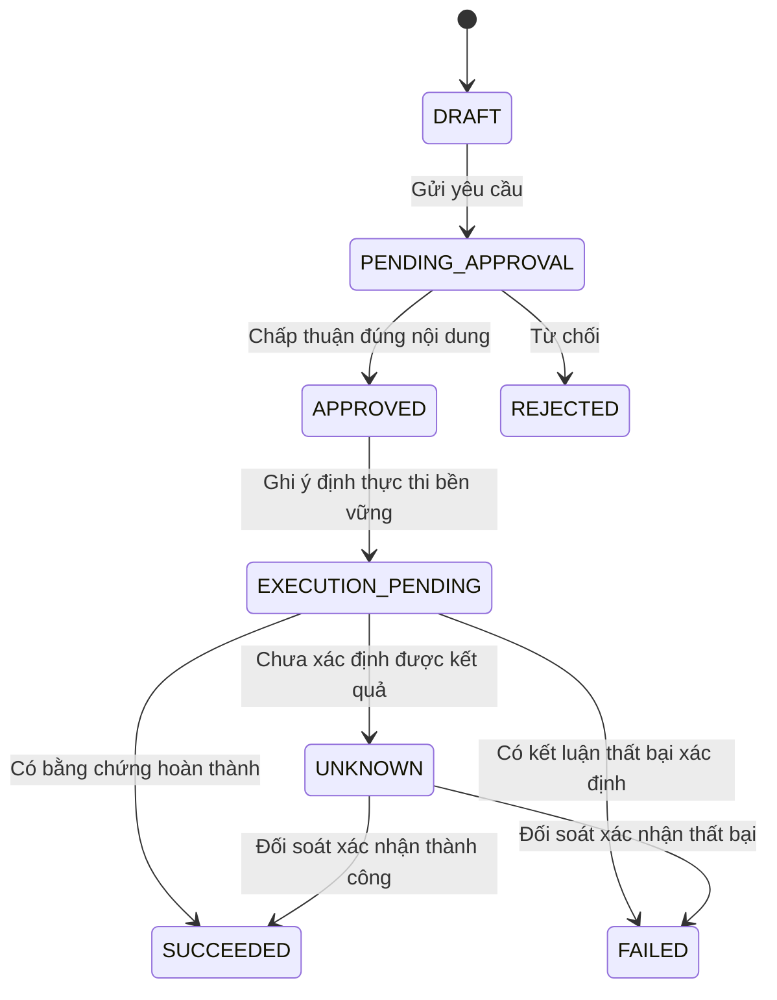

# Tính chống chối bỏ đối với thao tác quan trọng

## 1. Mục tiêu bảo vệ

**Tính chống chối bỏ** (*non-repudiation*) hướng đến việc tạo và bảo vệ bằng chứng để một bên có thể kiểm chứng một hành động hoặc sự chấp thuận đã diễn ra, gắn với chủ thể và nội dung cụ thể. Trong bảo mật logic nghiệp vụ, mục tiêu này đặc biệt quan trọng khi có tranh chấp như:

- “Tôi không phê duyệt khoản hoàn tiền đó.”
- “Tôi chỉ đồng ý số tiền 1.200.000 VND, không phải 12.000.000 VND.”
- “Nhân viên quản trị đã thay đổi tài khoản nhận tiền sau khi tôi xác nhận.”
- “Hệ thống báo hoàn tiền thành công nhưng nhà cung cấp chưa thực hiện.”
- “Yêu cầu được gửi hai lần, nhưng tôi chỉ chấp thuận một nghiệp vụ.”

Một thiết kế tốt phải giúp trả lời: **ai đã xác nhận điều gì, dựa trên quyền và phiên bản dữ liệu nào, hệ thống đã thực hiện đến đâu, và bằng chứng có còn nguyên vẹn hay không**.

Chống chối bỏ không có nghĩa là mọi tranh chấp đều biến mất hoặc một chữ ký luôn chứng minh được ý chí của một người. Mức tin cậy còn phụ thuộc vào việc gắn khóa với danh tính, bảo vệ tài khoản và khóa, trải nghiệm xác nhận, thời điểm ghi nhận và khả năng kiểm chứng độc lập.

NIST mô tả chữ ký số là cơ chế phát hiện thay đổi dữ liệu, xác thực bên ký và hỗ trợ bên nhận đưa ra bằng chứng với bên thứ ba. Đây là một thành phần của mục tiêu chống chối bỏ. Xem [NIST FIPS 186-5: Digital Signature Standard](https://csrc.nist.gov/pubs/fips/186-5/final).

Bài học thuộc chương **Security Objectives** của module **SECURITY_APPLICATION_SECURITY_BUSINESS_LOGIC_SECURITY**. Sau bài học, bạn có thể:

- Phân biệt chống chối bỏ với xác thực, phân quyền, toàn vẹn và truy vết.
- Xác định bằng chứng cần có cho phê duyệt, sửa giá, hoàn tiền hoặc cấp quyền.
- Giải thích giới hạn của log, hash, HMAC, chữ ký số và dấu thời gian.
- Thiết kế luồng lưu bằng chứng gắn với transaction, state machine và idempotency.
- Xây dựng tiêu chí kiểm thử việc tạo, bảo vệ và xác minh bằng chứng.

## 2. Phân biệt các mục tiêu dễ bị nhầm

| Mục tiêu | Câu hỏi chính | Ví dụ | Giới hạn khi đứng riêng |
|---|---|---|---|
| Xác thực | Ai đang sử dụng danh tính này? | Một phiên đăng nhập đã qua MFA | Chưa chứng minh người đó đồng ý nội dung giao dịch cụ thể |
| Phân quyền | Chủ thể có được thực hiện hành động này không? | Người duyệt có quyền hoàn tiền trong tổ chức | Có quyền không đồng nghĩa đã thực hiện hoặc đã chấp thuận |
| Toàn vẹn | Dữ liệu có bị thay đổi ngoài dự kiến không? | Nội dung có chữ ký được kiểm tra hợp lệ | Còn phải xác định ai kiểm soát khóa và dữ liệu nói về việc gì |
| Truy vết và trách nhiệm giải trình | Có dựng lại được chuỗi thao tác và bên chịu trách nhiệm không? | Liên kết sự kiện yêu cầu, phê duyệt và thực thi | Dấu vết có thể chỉ là tuyên bố của một hệ thống |
| Chống chối bỏ | Có bằng chứng đáng tin để đánh giá một sự phủ nhận không? | Hồ sơ gắn chủ thể, nội dung, thời điểm và kết quả | Phụ thuộc mô hình tin cậy, quản lý khóa và quy trình kiểm chứng |

Một access token hợp lệ chứng minh yêu cầu đã thỏa điều kiện xác thực theo mô hình của hệ thống. Nó không tự tạo ra bằng chứng rằng người dùng đã nhìn thấy và đồng ý số tiền, đối tượng hoặc hệ quả của giao dịch.

Tương tự, một dòng log chứa `userId` không tự chứng minh rằng người đó đã trực tiếp thao tác. Hệ thống có thể đang dùng tài khoản chung, người quản trị đang thao tác thay, phiên bị chiếm đoạt hoặc dịch vụ nền thực thi một lệnh đã được phê duyệt từ trước.

OWASP cũng lưu ý rằng log có thể hỗ trợ kiểm soát chống chối bỏ, nhưng độ tin cậy của log phụ thuộc nhiều vào bên ghi và cách bên đó được kiểm soát. Xem [OWASP Logging Cheat Sheet](https://cheatsheetseries.owasp.org/cheatsheets/Logging_Cheat_Sheet.html).

## 3. Xác định thao tác quan trọng và điều cần chứng minh

### 3.1. Chọn theo hậu quả nghiệp vụ

Một thao tác cần mức bằng chứng cao khi có thể tạo ra tổn thất, thay đổi quyền hoặc khó khôi phục:

| Nhóm thao tác | Nội dung cần gắn vào bằng chứng |
|---|---|
| Phê duyệt đơn hoặc khoản chi | Đối tượng, phiên bản nội dung, tổng tiền, tiền tệ, người đề nghị, người duyệt |
| Hoàn tiền | Giao dịch gốc, khoản hoàn, đích hoàn theo tham chiếu, người duyệt, kết quả từ nhà cung cấp |
| Sửa giá hoặc ưu đãi | Giá trước/sau, phạm vi áp dụng, thời gian hiệu lực, lý do, thẩm quyền |
| Cấp quyền đặc biệt | Chủ thể được cấp, tập quyền, phạm vi, thời hạn, người phê duyệt |
| Thay đổi đích nhận tiền | Đối tượng liên quan, tham chiếu đích cũ/mới, bước xác nhận và thời điểm hiệu lực |
| Ghi đè quy tắc qua chức năng quản trị | Quy tắc được bỏ qua, lý do, quyền đặc biệt, người chịu trách nhiệm |

Không nhất thiết mọi thao tác đọc đều cần chữ ký số. Mức bảo vệ phải gắn với tranh chấp cần giải quyết và hậu quả của việc bằng chứng bị thiếu hoặc giả mạo.

### 3.2. Tách bốn mệnh đề

Trong cùng một nghiệp vụ hoàn tiền, có ít nhất bốn mệnh đề khác nhau:

1. **Có yêu cầu:** một chủ thể đề nghị hoàn tiền.
2. **Có chấp thuận:** người có thẩm quyền đồng ý một nội dung xác định.
3. **Có thực thi:** dịch vụ đã gửi hoặc áp dụng lệnh theo nội dung đó.
4. **Có kết quả:** nhà cung cấp đã xử lý thành công, thất bại xác định hoặc kết quả còn chưa rõ.

Bằng chứng cho một mệnh đề không tự chứng minh mệnh đề khác. Bản ghi `REFUND_APPROVED` không chứng minh tiền đã hoàn. HTTP timeout cũng không chứng minh nhà cung cấp chưa hoàn tiền.

Tên sự kiện phải phản ánh đúng điều hệ thống biết. Chỉ ghi `REFUND_SUCCEEDED` khi có căn cứ phù hợp để kết luận thành công; dùng trạng thái chờ xác minh hoặc chưa rõ kết quả khi bằng chứng chưa đủ.

### 3.3. Xác định bên nào đang đưa ra tuyên bố

Cần phân biệt:

- **Người đề nghị:** tạo yêu cầu nghiệp vụ.
- **Người phê duyệt:** chấp thuận nội dung trong phạm vi quyền.
- **Dịch vụ thực thi:** thực hiện lệnh hoặc tích hợp với bên ngoài.
- **Dịch vụ chứng thực audit:** ký xác nhận hồ sơ mà nó nhận được theo chính sách.
- **Bên cung cấp kết quả:** chẳng hạn cổng thanh toán phát hành thông báo xử lý.

Nếu dịch vụ audit ký bằng khóa của tổ chức, chữ ký chứng thực rằng bên nắm khóa audit đã ký hồ sơ đó. Trường `actorId` bên trong vẫn là thông tin do hệ thống đưa vào; chữ ký này không biến thành chữ ký riêng của người dùng được nêu tên.

Nếu cần bằng chứng chữ ký gắn trực tiếp với người phê duyệt, phải có cơ chế đăng ký khóa, kiểm chứng danh tính, kiểm soát sử dụng khóa và xác nhận nội dung phù hợp với mục tiêu đó.

## 4. Ví dụ xuyên suốt: phê duyệt khoản hoàn tiền

### 4.1. Giả định của ví dụ

Một hệ thống có nghiệp vụ sau:

- Nhân viên hỗ trợ tạo yêu cầu hoàn 12.000.000 VND cho đơn `order-73`.
- Khoản hoàn phải về phương thức thanh toán gốc, được tham chiếu bằng định danh giao dịch.
- Người duyệt phải thuộc đúng tổ chức, có quyền và hạn mức phù hợp, khác người đề nghị.
- Nội dung được duyệt gồm số tiền, tiền tệ, giao dịch gốc, đích hoàn và phiên bản yêu cầu.
- Mỗi nghiệp vụ hoàn có một `operationId` ổn định qua các lần retry.
- Hệ thống có kiểm soát riêng để tổng tiền đã hoàn và đang giữ chỗ hoàn không vượt tiền còn được hoàn.

Các quy tắc về quyền, số tiền và chống thực thi trùng vẫn phải được thực thi. Hồ sơ bằng chứng bổ sung khả năng kiểm chứng những quyết định và kết quả đó.

### 4.2. Trạng thái và bằng chứng tương ứng



Đây là mô hình minh họa, chưa bao gồm mọi nhánh hủy hoặc hết hạn. Trạng thái `UNKNOWN` không phải giấy phép tạo một khoản hoàn mới; hệ thống phải tra cứu, retry theo định danh đã thống nhất hoặc đối soát để làm rõ kết quả.

Các sự kiện bằng chứng có thể gồm:

| Sự kiện | Khẳng định được ghi nhận |
|---|---|
| `REFUND_REQUESTED` | Chủ thể đã tạo yêu cầu với nội dung cụ thể |
| `REFUND_APPROVED` | Người duyệt được hệ thống chấp nhận đối với phiên bản cụ thể |
| `REFUND_EXECUTION_REQUESTED` | Hệ thống đã commit ý định thực thi |
| `REFUND_PROVIDER_ACKNOWLEDGED` | Nhà cung cấp đã tiếp nhận theo nghĩa mà hợp đồng tích hợp quy định |
| `REFUND_SUCCEEDED` | Có căn cứ đối chiếu cho kết quả hoàn thành |
| `REFUND_RESULT_UNRESOLVED` | Kết quả còn chưa rõ và cần xử lý tiếp |

Biên nhận “đã tiếp nhận” có thể chỉ xác nhận đưa vào hàng đợi. Phải hiểu trạng thái của nhà cung cấp trước khi ánh xạ thành kết quả nghiệp vụ nội bộ.

### 4.3. Nội dung được xem, được chấp thuận và được thực thi phải khớp

Người duyệt cần thấy thông tin quan trọng trước khi xác nhận: giao dịch gốc, khoản hoàn, tiền tệ và đích hoàn dưới dạng đủ nhận biết. Thông báo chung chung như “Xác nhận thao tác?” làm giảm giá trị của bằng chứng về ý định.

Hệ thống có thể tạo một challenge cho lần phê duyệt, gắn với:

- Chủ thể và phạm vi tổ chức.
- Hành động `REFUND_APPROVE` cùng định danh nghiệp vụ.
- Phiên bản hoặc digest của nội dung quan trọng.
- Mã challenge dùng một lần và thời hạn hiệu lực.
- Ngữ cảnh ứng dụng hoặc môi trường để hạn chế dùng sai mục đích.

Khi nhận xác nhận, backend kiểm tra lại quyền, trạng thái, nội dung và thời hạn. Việc tiêu thụ challenge phải được thực hiện nguyên tử cùng quyết định tương ứng để hai request không cùng dùng thành công một challenge.

Nếu số tiền hoặc đích hoàn thay đổi, quyết định cũ phải mất hiệu lực theo chính sách và nội dung mới phải được xác nhận lại. Nguyên tắc ràng buộc chấp thuận với dữ liệu quan trọng được trình bày trong [OWASP Transaction Authorization Cheat Sheet](https://cheatsheetseries.owasp.org/cheatsheets/Transaction_Authorization_Cheat_Sheet.html).

## 5. Một hồ sơ bằng chứng cần chứa gì?

### 5.1. Nhóm dữ liệu cốt lõi

| Nhóm | Dữ liệu minh họa | Lý do cần có |
|---|---|---|
| Ngữ nghĩa | `schemaVersion`, `eventType`, phiên bản hợp đồng nghiệp vụ | Biết bản ghi có ý nghĩa gì |
| Phạm vi | Ứng dụng, môi trường, `tenantId` | Tránh nhầm giữa tổ chức hoặc môi trường |
| Định danh | `eventId`, `operationId`, `requestId` | Phân biệt sự kiện, nghiệp vụ và lần gọi |
| Chủ thể | ID ổn định, nguồn danh tính, người được đại diện nếu có | Phân biệt người thực hiện và quan hệ ủy quyền |
| Thực thi | Danh tính dịch vụ hoặc job | Biết thành phần áp dụng quyết định |
| Đối tượng | Loại đối tượng, ID, phiên bản nội dung | Tránh tranh chấp về đối tượng hoặc phiên bản |
| Nội dung | Số tiền, tiền tệ, tham chiếu đích, digest và tham chiếu snapshot | Kiểm chứng nội dung đã được chấp thuận |
| Quyết định | Cho phép/từ chối, mã lý do, phiên bản policy | Giải thích căn cứ quyết định |
| Kết quả | Trạng thái trước/sau, tham chiếu kết quả bên ngoài | Phân biệt ý định với kết quả đã biết |
| Thời gian | Thời điểm server ghi nhận, thời điểm nguồn ngoài, nguồn thời gian | Dựng lại trình tự mà không đánh đồng các loại thời điểm |
| Kiểm chứng | Thuật toán, ID phiên bản khóa, chữ ký, chứng thực thời gian nếu có | Xác minh nguồn và toàn vẹn về sau |

Không nên dùng email làm định danh duy nhất vì email có thể thay đổi hoặc được tái cấp. Nếu có thao tác thay mặt, ghi cả chủ thể thực hiện và chủ thể được đại diện cùng tham chiếu ủy quyền; không ghi đè thành một người dùng duy nhất.

Tham chiếu ngữ cảnh xác thực có thể cho biết lần xác thực tăng cường nào đã được kiểm tra. Không lưu mật khẩu, OTP, access token hoặc session cookie làm “bằng chứng”.

### 5.2. Ví dụ dữ liệu trước khi ký

JSON sau chỉ minh họa cấu trúc, chưa phải chuỗi byte canonical để ký. Giá trị digest là chỗ giữ chỗ và phải được thay bằng digest thực khi triển khai.

```json
{
  "protected": {
    "envelopeVersion": "audit-envelope/v1",
    "algorithm": "Ed25519",
    "keyId": "audit-key-2026-11",
    "issuer": "audit-service",
    "purpose": "AUDIT_ATTESTATION"
  },
  "evidence": {
    "schemaVersion": "refund-evidence/v1",
    "eventId": "evt-refund-0042-approved",
    "eventType": "REFUND_APPROVED",
    "environment": "production",
    "tenantId": "tenant-01",
    "operationId": "refund-0042",
    "requestId": "req-88",
    "actor": {
      "subjectId": "user-finance-18",
      "identityIssuer": "internal-idp",
      "authenticationContextRef": "authctx-91"
    },
    "executor": {
      "serviceId": "refund-service"
    },
    "target": {
      "type": "refund",
      "id": "refund-0042",
      "contentVersion": 7,
      "contentDigestAlgorithm": "SHA-256",
      "contentDigest": "<digest-cua-snapshot-canonical>"
    },
    "approvedContent": {
      "orderId": "order-73",
      "originalChargeRef": "charge-93",
      "amountMinor": "12000000",
      "currency": "VND",
      "destinationRef": "original-payment-method:charge-93"
    },
    "decision": {
      "action": "REFUND_APPROVE",
      "result": "APPROVED",
      "policyVersion": "refund-policy-v3",
      "previousState": "PENDING_APPROVAL",
      "nextState": "APPROVED"
    },
    "serverRecordedAt": "2026-11-21T03:15:30Z",
    "confirmationChallengeId": "approval-challenge-57"
  }
}
```

`amountMinor` là chuỗi biểu diễn số nguyên theo đơn vị tiền đã quy ước để tránh sai khác do giới hạn biểu diễn số giữa các nền tảng. Trong ví dụ VND này, đơn vị là một đồng. Hợp đồng schema phải quy định miền giá trị, định dạng chuỗi và cách kiểm tra; không chỉ dựa vào tên trường.

Chữ ký được lưu riêng và bao phủ toàn bộ byte canonical của cấu trúc không chứa trường chữ ký, gồm cả `protected` và `evidence`. Vì vậy các trường như `keyId`, mục đích ký và phiên bản schema không bị để ngoài phạm vi bảo vệ.

Digest của snapshot chỉ hữu ích khi còn có thể truy xuất đúng nội dung gốc để tính lại. Nếu chỉ lưu hash mà xóa toàn bộ nội dung và mô tả schema cần thiết, bên kiểm chứng có thể không còn biết dữ liệu nào đã được chấp thuận.

## 6. Giá trị và giới hạn của các cơ chế bảo vệ bằng chứng

### 6.1. Log vận hành và audit trail

Log vận hành thường phục vụ chẩn đoán: lỗi mạng, stack trace, thời gian xử lý. Audit trail ghi lại các sự kiện có ý nghĩa trách nhiệm: ai yêu cầu, ai quyết định, đối tượng nào thay đổi và kết quả ra sao.

Một request có thể tạo nhiều log kỹ thuật nhưng chỉ tương ứng một nghiệp vụ. Vì vậy cần `requestId` cho từng lần gọi và `operationId` ổn định để liên kết toàn bộ nghiệp vụ.

Thông điệp `logger.info("Refund approved")` thiếu chủ thể, nội dung, phạm vi và phiên bản. Nó cũng có thể chưa được chuyển khỏi bộ đệm khi tiến trình gặp sự cố.

Audit trail cần hợp đồng sự kiện rõ, lưu bền vững, kiểm soát quyền và cơ chế phát hiện sửa/xóa. Ghi log có cấu trúc còn giúp tránh việc dữ liệu chứa ký tự xuống dòng bị diễn giải thành bản ghi giả; encoder phải escape dữ liệu đúng cách.

### 6.2. Hash, MAC và chữ ký không có cùng ý nghĩa

| Cơ chế | Hỗ trợ điều gì? | Chưa đủ để kết luận điều gì? |
|---|---|---|
| Hash mật mã | So sánh nội dung với digest đã có căn cứ tin cậy | Hash đặt cạnh dữ liệu không tự xác thực người tạo; bên sửa cả hai có thể tính lại |
| HMAC | Kiểm tra toàn vẹn và nguồn trong nhóm nắm bí mật chung | Các bên giữ cùng khóa có thể tạo MAC, nên không phân biệt được bên nào tạo trước bên thứ ba |
| Chữ ký số | Kiểm tra thông điệp bằng khóa công khai tương ứng với khóa ký | Còn phải kiểm chứng khóa thuộc ai, ai kiểm soát việc ký và thông điệp có ý nghĩa gì |
| Kho chỉ bổ sung hoặc WORM | Hạn chế sửa/xóa trong cấu hình và thời hạn được bảo vệ | Không tự chứng minh dữ liệu nhập ban đầu là đúng hoặc người dùng đã đồng ý |
| Chuỗi hash | Liên kết thứ tự và giúp phát hiện thay đổi khi có mốc tin cậy | Không tự phát hiện mọi trường hợp xóa đuôi, thay toàn bộ chuỗi hoặc tạo nhánh giả |

Độ mạnh của bằng chứng không chỉ bằng độ mạnh của thuật toán. Nếu ứng dụng bị chiếm quyền có thể yêu cầu dịch vụ ký mọi nội dung tùy ý, kẻ kiểm soát ứng dụng có thể xin chữ ký cho hồ sơ sai. Dịch vụ ký cần giới hạn danh tính gọi, loại sự kiện, mục đích và nguồn dữ liệu được chấp nhận.

Một chữ ký hợp lệ trên dữ liệu bịa vẫn là một chữ ký hợp lệ về mặt mật mã. Để tăng khả năng kiểm chứng, có thể đối chiếu với nguồn độc lập như nhật ký xác thực, bản xác nhận phía người dùng hoặc biên nhận của nhà cung cấp.

### 6.3. Ký đúng byte và đúng ngữ nghĩa

Hai JSON có thể mang cùng dữ liệu nhưng khác thứ tự thuộc tính, khoảng trắng hoặc cách biểu diễn số. Nếu mỗi bên tự serialize rồi ký hoặc kiểm tra theo cách khác nhau, chữ ký có thể không khớp.

Cần xác định định dạng byte ổn định, chẳng hạn một scheme canonicalization đã được lựa chọn và kiểm chứng. [RFC 8785: JSON Canonicalization Scheme](https://www.rfc-editor.org/rfc/rfc8785) mô tả cách tạo biểu diễn canonical cho JSON.

Khi áp dụng, cần quy định:

- Schema và trường bắt buộc, cách xử lý trường không biết.
- UTF-8, dạng biểu diễn số và cách xử lý thuộc tính trùng.
- Quy tắc Unicode của dữ liệu nghiệp vụ; không tự biến đổi chuỗi sau khi ký.
- Mọi trường quyết định ý nghĩa, gồm hành động, đối tượng, tổ chức, môi trường, số tiền và đích giao dịch.
- Metadata về phiên bản định dạng, thuật toán và khóa nào nằm trong dữ liệu được ký.

Chỉ sắp xếp key chưa có nghĩa đã triển khai đầy đủ JCS. Nếu dùng JCS, phải tuân theo toàn bộ yêu cầu áp dụng của nó và dùng triển khai phù hợp.

Chữ ký cũng không làm một dữ liệu mơ hồ trở nên rõ nghĩa. Trường `amount: 12000000` còn cần tiền tệ và đơn vị. Trường `approved: true` còn cần biết phê duyệt hành động gì, nội dung nào và trong bao lâu.

### 6.4. Thời gian do ứng dụng ghi và dấu thời gian tin cậy

`serverRecordedAt` là tuyên bố về thời gian của server. Đồng bộ đồng hồ, giám sát độ lệch và dùng UTC hỗ trợ dựng lại trình tự, nhưng không biến timestamp của ứng dụng thành bằng chứng độc lập với ứng dụng.

Một dịch vụ đóng dấu thời gian có thể cung cấp bằng chứng rằng dữ liệu tương ứng đã tồn tại không muộn hơn mốc thời gian được chứng thực, theo mô hình tin cậy của dịch vụ đó. Giao thức này được mô tả trong [RFC 3161: Time-Stamp Protocol](https://www.rfc-editor.org/rfc/rfc3161).

Cần phân biệt:

- Timestamp không tự chứng minh nội dung là đúng hoặc người dùng có ý định thực hiện.
- Thời điểm được đóng dấu không nhất thiết là thời điểm bấm nút hay thời điểm tiền được hoàn.
- Nếu cần chứng minh một chữ ký đã tồn tại tại mốc thời gian, dấu thời gian phải ràng buộc gói có chứa chữ ký đó; đóng dấu riêng bản thảo nội dung không chứng minh thời điểm chữ ký được tạo.
- Dấu thời gian và chứng thư liên quan cũng phải được xác minh theo chính sách tin cậy.

### 6.5. Khóa và danh tính phải kiểm chứng được trong tương lai

Hồ sơ cần chỉ rõ phiên bản khóa và bên phát hành. Bên kiểm chứng tra khóa từ registry hoặc chuỗi chứng thực được tin cậy; không mặc nhiên tin khóa công khai hay URL lấy từ chính payload.

Khi xoay khóa, cần lưu đủ dữ liệu xác minh lịch sử: khóa công khai, metadata gắn danh tính, chính sách sử dụng, chứng thư hoặc trạng thái liên quan nếu mô hình sử dụng chúng. Không cần giữ khóa riêng cũ chỉ để xác minh chữ ký cũ.

Nếu khóa bị lộ hoặc thu hồi, kết luận về bằng chứng phải xét thời điểm và phạm vi ảnh hưởng. Một thời gian do ứng dụng tự khai không đủ chứng minh chữ ký có trước sự cố. Ngược lại, không nên tự động coi mọi chữ ký lịch sử là giả chỉ vì khóa hiện đã được thay thế.

Khả năng xác minh lâu dài còn phụ thuộc thuật toán và dữ liệu hỗ trợ. Khi gia hạn bảo vệ hoặc chứng thực lại hồ sơ, cần giữ bản gốc và chuỗi liên hệ; không thay toàn bộ chứng cứ cũ bằng một bản mới rồi mất dấu quá trình.

## 7. Gắn bằng chứng với transaction và tác dụng phụ

### 7.1. Tránh khoảng trống giữa thay đổi trạng thái và audit

Một cách làm dễ tạo khoảng trống:

```text
1. Commit yêu cầu hoàn tiền thành APPROVED.
2. Gửi sự kiện audit qua mạng.
3. Tiến trình dừng trước khi bước 2 hoàn tất.
```

Kết quả: nghiệp vụ đã thay đổi nhưng thiếu hồ sơ tương ứng.

Với quyết định phê duyệt nằm trong cùng một database, có thể lưu trong **một transaction cục bộ**:

1. Kiểm tra quyền, trạng thái, nội dung và challenge.
2. Cập nhật trạng thái bằng điều kiện phiên bản phù hợp.
3. Tiêu thụ challenge dùng một lần.
4. Lưu sự kiện audit với ID ổn định và snapshot cần thiết.
5. Lưu outbox để chuyển bằng chứng đến kho bảo vệ.
6. Commit tất cả hoặc rollback tất cả.

Cách này bảo đảm tính nguyên tử của phần dữ liệu cục bộ trong giả định database và cơ chế transaction hoạt động đúng. Nó chưa bảo vệ trước người có quyền sửa toàn bộ database; cần cơ chế bảo vệ và kiểm chứng ở phạm vi tin cậy khác.

Sự kiện của một transaction đã rollback không được trình bày như một phê duyệt đã commit. Có thể ghi riêng lần thử thất bại, với loại sự kiện và kết quả phản ánh đúng thực tế.

### 7.2. Outbox hỗ trợ chuyển tin, không tự tạo bằng chứng độc lập

Worker đọc outbox, ký hoặc chuyển hồ sơ đến kho bằng chứng rồi ghi nhận tiến độ. Nếu gửi lại do timeout, bên nhận xử lý trùng theo `eventId`; không tạo hai sự kiện nghiệp vụ độc lập chỉ vì có hai lần truyền.

Nếu chữ ký hoặc việc lưu sang kho độc lập diễn ra sau commit, cần thừa nhận khoảng thời gian bằng chứng mới chỉ tồn tại ở database cục bộ. Nên theo dõi:

- Hồ sơ chờ ký hoặc chờ lưu trữ.
- Tuổi của sự kiện cũ nhất chưa được bảo vệ.
- Sai lệch giữa trạng thái nghiệp vụ và bằng chứng đã được tiếp nhận.
- Lỗi xác minh, thiếu số thứ tự hoặc sự kiện bị gửi vào sai phạm vi.

Nếu chính sách đòi bằng chứng được một bên độc lập tiếp nhận **trước tác dụng phụ không thể đảo ngược**, cần thiết kế bước chờ xác nhận trong workflow. Không suy ra yêu cầu đó đã được đáp ứng chỉ vì có một outbox sẽ gửi sau.

### 7.3. Hệ thống bên ngoài cần bằng chứng và đối soát riêng

Không có transaction database cục bộ nào tự rollback một khoản hoàn đã được cổng thanh toán thực hiện.

Trước khi gọi ra ngoài, hệ thống cần có ý định thực thi bền vững và định danh nghiệp vụ ổn định. Sau khi gọi, ghi nhận bằng chứng đáp ứng từ nhà cung cấp, sự kiện được xác minh và kết quả đối soát.

Có thể xảy ra:

```text
Đã lưu ý định → Nhà cung cấp hoàn thành → Response bị mất
```

Hệ thống phải giữ trạng thái chưa rõ hoặc đang chờ xử lý phù hợp và làm rõ bằng cùng định danh nghiệp vụ. Không ghi “chưa hoàn” chỉ vì timeout, và không tạo khoản hoàn mới với định danh khác để né trạng thái cũ.

Đối với webhook, cần xác minh nguồn gửi và đối chiếu tổ chức nhận, giao dịch, số tiền, tiền tệ, loại sự kiện. Bằng chứng nhà cung cấp đã tiếp nhận một request khác với bằng chứng đã hoàn thành giao dịch.

### 7.4. Lỗi lưu bằng chứng phải có chính sách rõ

Nếu quy tắc nói rằng một phê duyệt quan trọng chỉ hợp lệ khi có audit record bền vững, lỗi ghi record đó phải làm transaction phê duyệt thất bại.

Lỗi của hệ thống chuyển log chẩn đoán không nhất thiết phải dừng mọi chức năng. Cần phân biệt bằng chứng bắt buộc của nghiệp vụ với telemetry hỗ trợ vận hành, đồng thời định nghĩa rõ trạng thái chờ, cơ chế phục hồi và cảnh báo cho từng loại lỗi.

Chính sách này cũng phải xử lý tình huống tác dụng phụ đã xảy ra trước khi phát hiện lỗi ghi nhận kết quả: đối soát và bổ sung sự kiện mới phản ánh việc khôi phục, không bịa một chuỗi sự kiện như thể không có sự cố.

## 8. Bảo vệ hồ sơ sau khi được tạo

### 8.1. Chống sửa và chống xóa cần cơ chế khác nhau

Một kho bằng chứng có thể kết hợp:

- Quyền ghi chỉ bổ sung; tài khoản ứng dụng không có quyền sửa/xóa hồ sơ đã chấp nhận.
- Kho lưu trữ có retention lock hoặc WORM theo chính sách được cấu hình.
- Tách quyền quản trị ứng dụng, database, kho bằng chứng và khóa ký.
- Bản sao trong phạm vi quản trị độc lập.
- Chữ ký, liên kết hash hoặc checkpoint để phát hiện can thiệp.
- Theo dõi truy cập, xuất dữ liệu và thay đổi cấu hình lưu trữ.

Từ “immutable” cần được hiểu trong phạm vi sản phẩm, cấu hình và quyền thực tế. Một bảng chỉ bị chặn `UPDATE` đối với tài khoản ứng dụng vẫn có thể bị chủ sở hữu database thay đổi nếu không có bảo vệ bổ sung.

### 8.2. Chuỗi hash cần mốc kiểm chứng đáng tin

Có thể liên kết hồ sơ theo biểu diễn không mơ hồ:

```text
h_i = SHA-256(encode(streamId, sequence_i, h_previous, canonical_event_i))
```

Nếu kẻ tấn công sửa một sự kiện rồi tính lại mọi hash phía sau trong cùng kho mà không có mốc đối chiếu bên ngoài, một bên kiểm chứng mới có thể không nhận ra chuỗi đã bị thay thế.

Tương tự, cắt bỏ phần cuối có thể để lại một đoạn đầu vẫn nhất quán. Cần checkpoint được bảo vệ hoặc công bố sang phạm vi độc lập, số thứ tự và cơ chế theo dõi tính đầy đủ.

Trong hệ thống phân tán, không nên mặc định có một thứ tự toàn cục hoàn hảo cho mọi sự kiện. Hãy định nghĩa stream, thứ tự trong stream và cách checkpoint thể hiện phạm vi; việc xử lý nhánh hoặc thiếu sự kiện cũng phải được thiết kế.

### 8.3. Bảo mật và khả năng kiểm chứng phải cùng tồn tại

Bằng chứng có thể chứa thông tin tài chính, cá nhân và quyền truy cập. Cần giới hạn dữ liệu, phân quyền đọc, mã hóa phù hợp và kiểm soát bản xuất.

Tham chiếu tài khoản hoặc token thay thế dữ liệu nhạy cảm giúp giảm phơi lộ, nhưng vẫn phải có cách giải nghĩa tham chiếu khi điều tra được phép. Một hash của dữ liệu dễ đoán cũng không tự làm dữ liệu đó bí mật.

Thời hạn giữ bằng chứng, snapshot, khóa công khai và dữ liệu xác minh phải tương thích với nhau. Giữ chữ ký nhiều năm nhưng xóa nội dung cần kiểm chứng sớm hơn có thể làm hồ sơ mất tác dụng.

Hệ thống cũng cần quy trình hủy dữ liệu đúng hạn, xử lý yêu cầu giữ lại và giới hạn truy cập theo chính sách áp dụng. Không nên lưu vô hạn mọi request chỉ vì chúng có thể hữu ích.

## 9. Minh họa Java: chữ ký của dịch vụ audit

Ví dụ sau chỉ minh họa thao tác ký và xác minh bằng Java Security API trong môi trường Java có provider hỗ trợ `Ed25519`. Cần kiểm tra khả năng của provider và hệ thống quản lý khóa được chọn.

**Khóa riêng trong ví dụ thuộc dịch vụ audit.** Chữ ký tạo ra là chứng thực của dịch vụ này cho hồ sơ, không phải chữ ký của người phê duyệt được nêu trong hồ sơ.

`canonicalEnvelopeWithoutSignature` phải là byte canonical của cả metadata được bảo vệ và sự kiện, theo hợp đồng đã thống nhất. Hàm dưới đây không tự canonicalize JSON.

```java
import java.nio.charset.StandardCharsets;
import java.security.GeneralSecurityException;
import java.security.PrivateKey;
import java.security.PublicKey;
import java.security.Signature;

public final class AuditEvidenceSignature {
    private static final String ALGORITHM = "Ed25519";

    private static final byte[] DOMAIN =
            "CRITICAL-ACTION-AUDIT/v1\n"
                    .getBytes(StandardCharsets.US_ASCII);

    private AuditEvidenceSignature() {
    }

    public static byte[] signForAuditService(
            byte[] canonicalEnvelopeWithoutSignature,
            PrivateKey auditServicePrivateKey)
            throws GeneralSecurityException {

        Signature signer = Signature.getInstance(ALGORITHM);
        signer.initSign(auditServicePrivateKey);
        signer.update(DOMAIN);
        signer.update(canonicalEnvelopeWithoutSignature);
        return signer.sign();
    }

    public static boolean verifyAuditAttestation(
            byte[] canonicalEnvelopeWithoutSignature,
            byte[] detachedSignature,
            PublicKey trustedAuditServicePublicKey)
            throws GeneralSecurityException {

        Signature verifier = Signature.getInstance(ALGORITHM);
        verifier.initVerify(trustedAuditServicePublicKey);
        verifier.update(DOMAIN);
        verifier.update(canonicalEnvelopeWithoutSignature);
        return verifier.verify(detachedSignature);
    }
}
```

Tiền tố `DOMAIN` cố định phân biệt mục đích ký của giao thức này với các mục đích khác. Bên ký và bên xác minh phải sử dụng cùng byte tiền tố và cùng định dạng payload.

API `Signature` sử dụng khóa riêng khi ký, khóa công khai khi xác minh và dữ liệu được đưa qua `update`. Xem [Java SE 17: Signature](https://docs.oracle.com/en/java/javase/17/docs/api/java.base/java/security/Signature.html) và [Java Security Standard Algorithm Names](https://docs.oracle.com/en/java/javase/17/docs/specs/security/standard-names.html).

Trước khi coi hồ sơ là đáng tin, tầng ứng dụng còn phải:

1. Giới hạn kích thước, parse theo schema và từ chối cấu trúc không hợp lệ.
2. Chọn khóa từ registry tin cậy theo issuer và key ID, với thuật toán và mục đích được policy cho phép.
3. Xác minh chữ ký trên đúng byte; kết quả `false` hoặc lỗi xác minh không được chuyển thành chấp nhận.
4. Kiểm tra ngữ nghĩa: môi trường, tổ chức, hành động, đối tượng, phiên bản và nội dung.
5. Nếu đây là bằng chứng được dùng để thực thi, kiểm tra thêm quyền hiện hành theo chính sách, challenge, thời hạn và tình trạng đã sử dụng.
6. Nếu đây là xác minh lịch sử, đánh giá khóa và mốc thời gian theo policy lịch sử tương ứng.

Một chữ ký hợp lệ không tự chống replay. Một hồ sơ cũ còn nguyên vẹn vẫn có thể bị gửi lại; backend phải ràng buộc nó với nghiệp vụ và trạng thái sử dụng.

Khóa riêng không nên nằm trong source code hoặc được ghi vào log. Ví dụ nhận đối tượng khóa từ bên ngoài để giữ riêng trách nhiệm quản lý khóa; cách triển khai thực tế phụ thuộc keystore, dịch vụ ký hoặc thiết bị quản lý khóa mà hệ thống hỗ trợ.

## 10. Kiểm chứng và bàn giao bằng chứng

Một hồ sơ cần được kiểm chứng bằng quy trình có thể lặp lại, không chỉ bằng màn hình hiện trạng của ứng dụng.

### 10.1. Trình tự kiểm chứng

1. **Xác định câu hỏi:** đang kiểm chứng yêu cầu, phê duyệt, lần gửi hay kết quả hoàn tiền?
2. **Thu thập đúng bản gốc:** lấy byte payload đã ký, chữ ký, snapshot, phiên bản schema và các tham chiếu cần thiết.
3. **Kiểm tra nguồn tin cậy:** xác định issuer, khóa, phạm vi sử dụng và chính sách xác minh lịch sử.
4. **Kiểm tra mật mã:** xác minh chữ ký, digest, checkpoint và chứng thực thời gian nếu có.
5. **Kiểm tra ngữ nghĩa:** đối chiếu tổ chức, đối tượng, hành động, số tiền, tiền tệ, đích và phiên bản.
6. **Dựng chuỗi liên hệ:** nối yêu cầu, chấp thuận, ý định thực thi, sự kiện bên ngoài và kết quả theo `operationId`.
7. **Đánh giá tính đầy đủ:** kiểm tra khoảng trống, sự kiện lặp, kết quả còn chưa rõ và nguồn đối chiếu độc lập.
8. **Ghi kết luận có phạm vi:** nêu điều đã được chứng minh, điều chỉ là tuyên bố của hệ thống và bằng chứng còn thiếu.

Không dùng giá hiện tại hoặc quyền hiện tại để thay thế toàn bộ nội dung lịch sử. Khi đánh giá quyết định cũ, cần biết dữ liệu, phiên bản policy và phạm vi quyền mà hệ thống đã dùng lúc đó.

Phải phân biệt “chữ ký sai” với “chưa thể xác minh vì thiếu khóa hoặc thiếu dữ liệu”. Hai trạng thái đều không đủ căn cứ chấp nhận hồ sơ như đã được xác minh, nhưng nguyên nhân và cách xử lý khác nhau.

### 10.2. Giữ lịch sử thu thập và xử lý

Khi xuất hồ sơ cho người kiểm tra, nên có manifest liệt kê ID sự kiện, tên thành phần, digest, nguồn lấy và thời điểm xuất. Ghi lại ai đã thu thập, sao chép hoặc chuyển giao; giữ nguyên bản gốc và chỉ tạo bản trình bày ở lớp riêng.

Nếu che dữ liệu cho người nhận có quyền hạn chế, phải làm rõ phần nào được che và cách đối chiếu với bản gốc khi được phép. Không sửa trực tiếp payload đã ký rồi vẫn trình bày chữ ký như thể bao phủ bản đã biên tập.

Một trang HTML hoặc PDF đọc được có ích cho con người, nhưng việc render không thay thế chữ ký trên dữ liệu gốc. Người kiểm tra cần biết bản trình bày tương ứng với phiên bản bằng chứng nào.

### 10.3. Kết luận phải theo đúng nguồn

Ví dụ các kết luận khác nhau:

- “Dịch vụ audit đã ký hồ sơ ghi rằng user-finance-18 được chấp nhận là người phê duyệt.”
- “Có chữ ký riêng của chủ thể trên nội dung hoàn tiền phiên bản 7, và chuỗi tin cậy khóa đã được kiểm tra theo chính sách.”
- “Nhà cung cấp có biên nhận hoàn thành khớp với nghiệp vụ refund-0042.”
- “Chỉ có ý định thực thi đã commit; kết quả từ nhà cung cấp hiện chưa được xác định.”

Nếu hệ thống tự ký bản sao response của nhà cung cấp, chữ ký đó chứng thực bản sao theo tuyên bố của hệ thống. Nó không tự biến thành chữ ký của nhà cung cấp. Với webhook dùng bí mật HMAC chung, khả năng chứng minh độc lập cũng phải được đánh giá theo việc những bên nào nắm bí mật.

## 11. Ma trận kiểm thử cho mục tiêu chống chối bỏ

Kiểm thử cần quan sát cả nghiệp vụ, hồ sơ bằng chứng và khả năng xác minh.

| Tình huống | Kỳ vọng |
|---|---|
| Người có quyền duyệt đúng nội dung | Có đúng quyết định phê duyệt được commit, gắn chủ thể, phiên bản và nghiệp vụ |
| Người không có quyền cố duyệt | Không có phê duyệt thành công; sự kiện từ chối không bị gắn nhãn thành công |
| Thay số tiền hoặc đích sau khi xác nhận | Không dùng chấp thuận cũ để thực thi nội dung mới |
| Gửi cùng challenge đồng thời | Chỉ một lần tiêu thụ thành công theo policy |
| Replay hồ sơ có chữ ký hợp lệ | Không phát sinh thêm nghiệp vụ; chữ ký không thay thế kiểm tra đã sử dụng |
| Hai request cùng một nghiệp vụ | Quy tắc idempotency được giữ; audit phân biệt lần thử kỹ thuật và quyết định nghiệp vụ |
| Transaction nghiệp vụ rollback | Không còn sự kiện thành công đã commit cho thay đổi bị rollback |
| Dừng tiến trình sau commit trước khi chuyển outbox | Hồ sơ bền vững còn để chuyển lại; trạng thái chờ được quan sát |
| Kho bằng chứng từ chối lưu | Thực hiện đúng chính sách lỗi; không âm thầm tuyên bố hồ sơ đã được bảo vệ độc lập |
| Sửa một byte số tiền hoặc metadata được bảo vệ | Xác minh chữ ký thất bại |
| Đổi `keyId` sang khóa không tin cậy | Không tự chấp nhận khóa từ payload hoặc từ URL tùy ý |
| Khóa đã xoay | Hồ sơ cũ vẫn có dữ liệu xác minh theo chính sách lịch sử |
| Khóa bị lộ hoặc thu hồi | Kết luận xét thời điểm, phạm vi ảnh hưởng và chứng thực hỗ trợ; không chỉ tin timestamp tự khai |
| Xóa sự kiện giữa stream hoặc cắt đuôi | Cơ chế kiểm tra tính đầy đủ phát hiện trong phạm vi checkpoint được bảo vệ |
| Provider xử lý xong nhưng response bị mất | Hồ sơ phản ánh kết quả chưa rõ cho đến khi làm rõ; không tự tạo khoản hoàn mới |
| Sự kiện provider sai giao dịch hoặc số tiền | Không dùng để kết luận nghiệp vụ đã hoàn thành |
| Dữ liệu người dùng chứa ký tự xuống dòng | Được encode thành dữ liệu, không tạo bản ghi giả |
| Khôi phục từ backup và xuất hồ sơ | Còn đủ payload, chữ ký, khóa công khai, schema và snapshot để kiểm chứng |

Unit test có thể kiểm tra schema, policy và chữ ký. Integration test cần kiểm tra transaction, outbox, điều kiện cập nhật và lưu trữ. Kiểm thử luồng với bên thanh toán giả lập cần tạo được tình huống timeout, kết quả đến muộn và thông điệp trùng.

Không chỉ đếm số dòng log hoặc kiểm tra HTTP 200. Cần kiểm tra rằng sự kiện nói đúng điều đã xảy ra, dữ liệu ký đúng nội dung và một lần phát lại không tạo thêm tác dụng phụ.

## 12. Những cách hiểu làm bằng chứng yếu đi

| Cách hiểu | Điểm cần làm rõ |
|---|---|
| “Có userId trong log là không thể chối.” | Còn nguồn danh tính, cách xác thực, thao tác thay mặt và quyền sửa log |
| “Đã MFA nên người dùng đồng ý mọi giao dịch trong phiên.” | Cần ràng buộc xác nhận với nội dung và mục đích cụ thể |
| “SHA-256 đặt cạnh JSON chứng minh JSON nguyên bản.” | Bên thay được cả hai có thể tính lại digest |
| “HMAC chứng minh duy nhất bên gửi đã tạo thông điệp.” | Bên giữ cùng bí mật cũng có khả năng tạo MAC |
| “Server ký hồ sơ nên đó là chữ ký của khách hàng.” | Phải phân biệt chủ thể nắm khóa với chủ thể được nêu trong payload |
| “Chữ ký đúng thì lệnh được phép thực thi.” | Còn quyền, trạng thái, thời hạn, challenge và kiểm tra replay |
| “Timestamp nằm trong payload ký là thời gian độc lập.” | Bên ký vẫn có thể tự khai thời gian; cần nguồn chứng thực phù hợp khi có yêu cầu |
| “Kho immutable bảo đảm nội dung ban đầu đúng.” | Chống sửa sau khi ghi không xác minh được ý định hoặc sự thật ban đầu |
| “Có log APPROVED thì khoản hoàn đã thành công.” | Chấp thuận và kết quả thực thi là hai mệnh đề khác nhau |
| “Nhật ký tốt giúp bỏ bớt kiểm tra nghiệp vụ.” | Ghi lại thao tác sai không thay thế việc ngăn thao tác sai |

Một người có quyền vẫn có thể lạm dụng chính quyền đó. Bằng chứng cần ghi được nội dung và ngữ cảnh quyết định để có thể đánh giá sau; đồng thời hệ thống vẫn phải áp dụng tách trách nhiệm, giới hạn quyền và bất biến tiền tệ ngay lúc thực thi.

## 13. Mẫu đặc tả mục tiêu cho một thao tác quan trọng

Có thể bắt đầu bằng một đặc tả ngắn thay vì chọn công nghệ ký trước:

```text
Thao tác:
- Phê duyệt hoàn tiền.

Mệnh đề cần kiểm chứng:
- Chủ thể nào được hệ thống chấp nhận là người phê duyệt.
- Đã chấp thuận giao dịch gốc, khoản tiền, tiền tệ,
  đích hoàn và phiên bản nội dung nào.
- Dịch vụ đã thực thi đến đâu và căn cứ kết quả là gì.

Ràng buộc:
- Đúng tổ chức, quyền, hạn mức và tách trách nhiệm.
- Đổi nội dung quan trọng làm mất hiệu lực chấp thuận cũ.
- Challenge dùng một lần; retry không tạo thêm khoản hoàn.

Bằng chứng bắt buộc trước khi công nhận phê duyệt:
- Bản ghi quyết định bền vững cùng transaction nghiệp vụ.
- Tham chiếu hoặc snapshot đủ để dựng lại nội dung.

Bảo vệ và xác minh:
- Xác định bên ký và phạm vi tuyên bố của chữ ký.
- Bảo vệ sửa/xóa; có chính sách lưu trữ và quản lý khóa.
- Xác định có cần tiếp nhận độc lập trước thực thi hay không.
- Có quy trình kiểm tra chữ ký, ngữ nghĩa và tính đầy đủ.

Xử lý sự cố:
- Lỗi ghi bằng chứng bắt buộc làm quyết định không được commit.
- Kết quả bên ngoài chưa rõ được đối soát theo operationId cũ.
```

Cần chọn mức bảo đảm phù hợp cho từng mệnh đề. Audit trail được bảo vệ có thể đáp ứng nhu cầu trách nhiệm giải trình nội bộ; một yêu cầu chứng minh độc lập về sự chấp thuận của chủ thể có thể cần cơ chế chữ ký và quy trình danh tính khác. Việc sử dụng trong tranh chấp còn phụ thuộc yêu cầu và quy trình áp dụng, ngoài phần xác minh kỹ thuật của bài.

## 14. Tài liệu tham khảo

- [NIST FIPS 186-5: Digital Signature Standard](https://csrc.nist.gov/pubs/fips/186-5/final) — vai trò của chữ ký số đối với toàn vẹn, xác thực bên ký và bằng chứng.
- [OWASP Logging Cheat Sheet](https://cheatsheetseries.owasp.org/cheatsheets/Logging_Cheat_Sheet.html) — thiết kế, bảo vệ và giới hạn của nhật ký ứng dụng.
- [OWASP Transaction Authorization Cheat Sheet](https://cheatsheetseries.owasp.org/cheatsheets/Transaction_Authorization_Cheat_Sheet.html) — ràng buộc xác nhận với dữ liệu và trình tự giao dịch.
- [RFC 8785: JSON Canonicalization Scheme](https://www.rfc-editor.org/rfc/rfc8785) — biểu diễn JSON ổn định cho thao tác mật mã.
- [RFC 3161: Time-Stamp Protocol](https://www.rfc-editor.org/rfc/rfc3161) — bằng chứng tồn tại dữ liệu theo mô hình dịch vụ đóng dấu thời gian.
- [Java SE 17: Signature](https://docs.oracle.com/en/java/javase/17/docs/api/java.base/java/security/Signature.html) — API ký và xác minh chữ ký.
- [Java Security Standard Algorithm Names](https://docs.oracle.com/en/java/javase/17/docs/specs/security/standard-names.html) — tên thuật toán sử dụng trong Java Security API.

Các ID, trạng thái, hạn mức nghiệp vụ và schema trong bài là minh họa. Khi áp dụng, cần thay bằng hợp đồng dữ liệu, phạm vi tin cậy và quy trình quản lý bằng chứng của hệ thống cụ thể.
