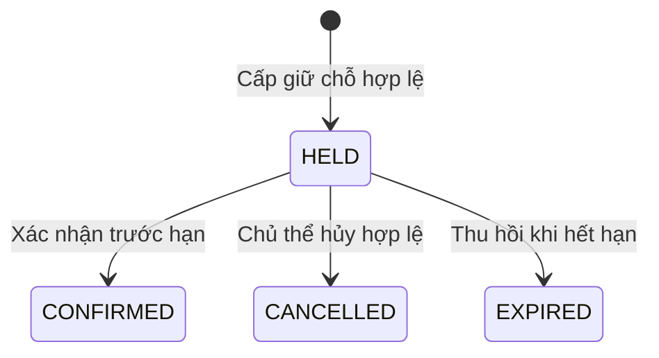

# Công bằng trong phân bổ tài nguyên — Fairness of resource allocation

## 1. Công bằng là một mục tiêu bảo mật nghiệp vụ

Một hệ thống có thể không bị đọc trộm dữ liệu, không cho sửa giá và không vượt tổng số hàng tồn, nhưng vẫn phân bổ tài nguyên rất bất công. Một người dùng có thể giữ gần hết suất đăng ký bằng nhiều tài khoản, gửi yêu cầu với tần suất lớn hoặc liên tục gia hạn giữ chỗ. Những người còn lại vẫn truy cập được ứng dụng, nhưng hầu như không có cơ hội sử dụng tài nguyên.

Trong chương **Security Objectives**, công bằng trong phân bổ tài nguyên là mục tiêu bảo đảm rằng:

> Tài nguyên được cấp cho những chủ thể đủ điều kiện theo chính sách phân bổ đã xác định, và caller không thể giành thêm lợi thế trái chính sách bằng cách thay đổi số tài khoản, số request, thứ tự gọi hoặc thời điểm gửi.

Tài nguyên ở đây có thể là:

- Số lượng hàng giới hạn, vé hoặc suất đăng ký.
- Khung giờ khám, lịch tư vấn hoặc lượt hỗ trợ.
- Ngân sách khuyến mại và số lượt sử dụng quyền lợi.
- Worker, kết nối, dung lượng lưu trữ hoặc thời gian xử lý.
- Hạn mức của một dịch vụ dùng chung giữa nhiều tenant.

“Công bằng” không nhất thiết có nghĩa mỗi người nhận số lượng bằng nhau. Một hệ thống có thể ưu tiên người đã được phê duyệt, chia theo trọng số hợp đồng hoặc dành riêng một phần cho nhóm được xác định. Mục tiêu bảo mật là thực thi đúng chính sách đó, kể cả khi có người cố lạm dụng.

Sau bài này, bạn cần có thể:

1. Viết một chính sách phân bổ có chủ thể, tài nguyên, phạm vi và giới hạn rõ ràng.
2. Chuyển chính sách thành các bất biến có thể kiểm tra.
3. Phân biệt chống vượt tổng tài nguyên với chống một bên chiếm phần của bên khác.
4. Thiết kế giữ chỗ, hàng đợi, quota và idempotency hỗ trợ cùng một chính sách.
5. Kiểm thử các trường hợp giữ chỗ hàng loạt, nhiều tài khoản và tranh chấp đồng thời.

## 2. Công bằng khác gì khả dụng, phân quyền và toàn vẹn?

| Mục tiêu | Câu hỏi chính | Ví dụ |
| --- | --- | --- |
| Khả dụng | Người dùng có tiếp cận được chức năng không? | Trang đăng ký và API vẫn phản hồi. |
| Phân quyền | Chủ thể có được thực hiện hành động này trên đối tượng này không? | Chỉ người đủ điều kiện mới được đăng ký chiến dịch. |
| Toàn vẹn nghiệp vụ | Dữ liệu và chuyển trạng thái có giữ đúng quy tắc không? | Không xác nhận quá 100 suất khi chỉ có 100 suất. |
| Công bằng phân bổ | Phần tài nguyên nhận được có đúng chính sách chia sẻ không? | Mỗi chủ thể đủ điều kiện nhận tối đa hai suất, không phụ thuộc họ gửi bao nhiêu request. |

Các mục tiêu hỗ trợ nhau nhưng không thay thế nhau.

Ví dụ, cả 100 suất đều được cấp cho một người thông qua 100 tài khoản:

- Hệ thống có thể vẫn khả dụng.
- Mỗi tài khoản có thể đã đăng nhập hợp lệ.
- Tổng xác nhận có thể vẫn bằng 100 nên không bị bán vượt số lượng.
- Chính sách “mỗi người tối đa hai suất” vẫn bị phá nếu các tài khoản thuộc cùng một chủ thể.

Ngược lại, giới hạn đúng hai suất mỗi người chưa ngăn được tổng số xác nhận vượt 100 khi nhiều request cạnh tranh. Cần đồng thời bảo vệ **giới hạn tổng** và **giới hạn theo chủ thể**.

## 3. Bắt đầu bằng một hợp đồng phân bổ rõ ràng

Một yêu cầu như “không để bot lấy hết suất” chưa đủ để triển khai. Cần xác định thế nào là một chủ thể, bao nhiêu suất được cấp và lợi thế nào được cho phép.

### 3.1. Những câu hỏi bắt buộc

| Thành phần chính sách | Cần xác định |
| --- | --- |
| Tài nguyên | Một suất, một đơn vị hàng, một phút xử lý hay một lượt quyền lợi? |
| Chủ thể được chia phần | Tài khoản, khách hàng đã xác minh, tổ chức, tenant hay một nhóm quan hệ? |
| Phạm vi | Theo chiến dịch, mặt hàng, ngày, tenant hay toàn bộ hệ thống? |
| Điều kiện tham gia | Ai được vào hàng đợi và ai đủ điều kiện nhận tài nguyên? |
| Giới hạn | Tối đa bao nhiêu đang giữ, đã nhận hoặc sử dụng trong một cửa sổ thời gian? |
| Thứ tự | Đến trước, bốc thăm, chia vòng, trọng số hay mức ưu tiên được kiểm chứng? |
| Giữ chỗ | Giữ bao lâu, có được gia hạn không, hết hạn thì thu hồi thế nào? |
| Trường hợp ngoại lệ | Ai có thể cấp thêm; cấp từ ngân sách nào; có dấu vết gì? |
| Kết quả chưa rõ | Tài nguyên được giữ lại hay giải phóng khi hệ thống ngoài timeout? |

Đặc biệt, cần phân biệt:

- **Giới hạn đồng thời:** tại một thời điểm được giữ tối đa bao nhiêu.
- **Giới hạn tích lũy:** đã nhận bao nhiêu trong toàn chiến dịch hoặc kỳ.
- **Giới hạn tần suất:** được tạo bao nhiêu lượt giữ chỗ mới trong một cửa sổ.
- **Giới hạn thời gian chiếm dụng:** mỗi lượt hoặc mỗi chủ thể được giữ tài nguyên trong bao lâu.

Giới hạn đồng thời bằng hai không ngăn một người giữ hai suất, để hết hạn rồi giữ lại liên tục. Vì vậy, giới hạn số lượng có thể phải phối hợp với thời gian giữ và tần suất tạo mới.

### 3.2. Chính sách minh họa xuyên suốt

Một chương trình có 100 suất đăng ký:

1. Chỉ khách hàng đủ điều kiện được tham gia.
2. Mỗi chủ thể phân bổ được xác minh có tối đa hai suất tính trên **đang giữ chỗ cộng đã xác nhận** trong chiến dịch.
3. Lượt giữ chỗ có hiệu lực 120 giây, không gia hạn bằng cách gửi lại cùng request.
4. Mỗi chủ thể được tạo tối đa ba lượt giữ chỗ mới được chấp nhận trong một cửa sổ trượt 10 phút.
5. Thứ tự được xét theo hàng đợi do server quản lý giữa các lượt đang đủ điều kiện.
6. Một lượt xác nhận phải thuộc đúng chủ thể, chưa hết hạn và chưa bị hủy.
7. Hủy hoặc hết hạn phải hoàn trả tài nguyên đúng một lần theo chuyển trạng thái hợp lệ.

Đây là chính sách minh họa. Những con số trên không phải cấu hình khuyến nghị cho mọi sản phẩm.

“Chủ thể phân bổ” trong bài là định danh dùng để áp dụng quota. Nó có thể liên kết nhiều tài khoản của cùng một khách hàng theo chính sách đã xác định. Hệ thống không thể bảo đảm giới hạn theo một con người nếu thực tế chỉ nhận diện được các tài khoản độc lập.

## 4. Các mô hình chia phần và giới hạn bảo mật của chúng

Không có một thuật toán công bằng đúng cho mọi tài nguyên. Cần chọn theo mục tiêu và công bố rõ phạm vi.

### 4.1. Đến trước được phục vụ trước

First Come, First Served ưu tiên thứ tự tới được hệ thống theo định nghĩa của server.

Ưu điểm là dễ giải thích. Tuy nhiên:

- Độ trễ mạng, tốc độ tự động hóa và số kết nối có thể tạo lợi thế.
- Nếu mỗi request được một vị trí, một người có thể tạo hàng nghìn vị trí.
- Nếu thời điểm tham gia do client gửi lên, caller có thể tự nhận đã đến sớm.
- Một lượt đầu hàng không còn đủ điều kiện có thể làm chậm các lượt sau nếu không có chính sách bỏ qua hoặc loại bỏ rõ ràng.

Một hàng đợi bảo vệ được thứ tự không tự tạo cơ hội ngang nhau cho mọi người ngoài đời. Chính sách phải thừa nhận định nghĩa thứ tự mà hệ thống thực sự thực thi.

### 4.2. Chia đều và chia vòng

Chia đều hướng tới phần bằng nhau giữa các chủ thể trong một phạm vi. Chia vòng có thể xét mỗi chủ thể một đơn vị trước khi quay lại vòng tiếp theo.

Với tài nguyên không chia nhỏ được, cần quy tắc giải quyết phần dư và thứ tự giữa các vòng. Chia vòng theo request thay vì theo chủ thể vẫn có thể bị spam request để chiếm phần.

Với suất đã cấp vĩnh viễn, không thể mặc định lấy lại phần của người đến trước để chia cho người đến sau. Chính sách phải xác định giai đoạn đăng ký và thời điểm phân bổ.

### 4.3. Chia theo trọng số

Trong một dịch vụ dùng chung, tenant có thể được cấp phần theo trọng số hợp đồng. Ví dụ, nếu có 60 worker và ba tenant đều đang có đủ công việc, trọng số 1:2:3 có thể được diễn giải thành mục tiêu 10:20:30 worker.

Cần định nghĩa thêm:

- Đang chia số worker đồng thời, số job hay thời gian xử lý?
- Tenant ít nhu cầu có được cho mượn phần còn dư không?
- Khi tenant đó cần lại phần đã cho mượn, thu hồi lúc nào?
- Trọng số thuộc nguồn cấu hình nào và caller có sửa được không?

Chia theo số job có thể không công bằng về chi phí nếu một job chạy một giây còn job khác chạy một giờ. Đơn vị đo phải phù hợp với tài nguyên thực sự khan hiếm.

### 4.4. Bốc thăm trong một đợt đăng ký

Một đợt đăng ký rồi bốc thăm có thể giảm lợi thế bấm nhanh, nhưng số cơ hội của mỗi chủ thể phải được kiểm soát. Nếu mỗi tài khoản có một vé và một người tạo được nhiều tài khoản, lợi thế chỉ chuyển từ tốc độ sang số danh tính.

Quá trình chọn cần được bảo vệ khỏi sửa danh sách, thay đổi trọng số hoặc tự ý chạy lại để đạt kết quả mong muốn. Không nên coi nhãn “ngẫu nhiên” là bằng chứng đã phân bổ công bằng.

### 4.5. Ưu tiên và nguy cơ bị bỏ đói

Ưu tiên hợp lệ có thể dựa trên hợp đồng, phê duyệt hoặc mức khẩn cấp được xác lập bởi nguồn có thẩm quyền. Caller không được tự quyết định `priority = highest`.

**Starvation — bị bỏ đói tài nguyên** xảy ra khi một nhóm phải chờ rất lâu hoặc không bao giờ được phục vụ dù vẫn đủ điều kiện. Có thể giảm nguy cơ bằng phần năng lực tối thiểu, giới hạn nhóm ưu tiên hoặc tăng ưu tiên theo thời gian chờ.

Các biện pháp này vẫn phụ thuộc năng lực và mô hình tải. Nếu nhu cầu kéo dài vượt năng lực, không thể hứa mọi yêu cầu đều được phục vụ trong thời gian hữu hạn mà không có chính sách từ chối, giới hạn hoặc tăng tài nguyên.

## 5. Mô hình đe dọa: lợi thế bị tạo ra bằng cách nào?

| Cách lạm dụng | Cơ chế | Quy tắc có nguy cơ bị phá |
| --- | --- | --- |
| Gửi nhiều request | Cùng chủ thể tạo nhiều cơ hội cạnh tranh. | Một vị trí hoặc phần phân bổ theo chủ thể. |
| Dùng nhiều tài khoản | Một bên xuất hiện dưới nhiều danh tính phân bổ. | Giới hạn theo khách hàng thực sự. |
| Giữ chỗ hàng loạt | Không mua/không xác nhận nhưng chiếm phần lớn tài nguyên. | Thời gian chiếm dụng và cơ hội của người khác. |
| Gia hạn bằng retry | Mỗi lần gửi lại làm TTL bắt đầu lại. | Giới hạn thời gian giữ chỗ. |
| Bỏ qua hàng đợi | Gọi thẳng API giữ chỗ hoặc xác nhận. | Thứ tự phân bổ do server quản lý. |
| Sửa hạng ưu tiên | Tự gửi tier, priority hoặc thông tin phê duyệt. | Phân bổ theo quyền lợi được kiểm chứng. |
| Chạy đồng thời | Nhiều request cùng thấy quota còn trống. | Tổng tài nguyên và quota chủ thể. |
| Chia nhỏ thao tác | Mỗi request dưới ngưỡng nhưng tổng vượt hạn mức. | Giới hạn tích lũy theo đúng phạm vi. |
| Lặp thao tác hoàn trả | Gửi hủy nhiều lần để tăng giả số suất còn lại. | Bảo toàn tài nguyên. |
| Lạm dụng đường quản trị | Cấp suất qua import, job hoặc API nội bộ. | Cùng ngân sách và giới hạn trên mọi đường ghi. |

Một rủi ro thường được gọi là **Sybil**: một bên tạo hoặc điều khiển nhiều danh tính để nhận nhiều phần hơn. Không thể xử lý đầy đủ chỉ bằng quota theo tài khoản nếu tài khoản có thể được tạo không giới hạn.

IP, thiết bị hoặc địa chỉ liên hệ có thể hỗ trợ phát hiện liên quan, nhưng không luôn tương đương một chủ thể. Nhiều người dùng hợp lệ có thể chung mạng; một người lạm dụng có thể đổi IP. Cần định nghĩa tín hiệu nào chỉ hỗ trợ đánh giá rủi ro, tín hiệu nào thực sự quyết định quota và cách xử lý trường hợp gộp nhầm.

Thông điệp bảo mật cần trung thực: hệ thống bảo đảm được giới hạn theo loại định danh mà nó có thể kiểm chứng, trong phạm vi dữ liệu và chính sách liên kết đã triển khai.

## 6. Chuyển công bằng thành các bất biến

Với chiến dịch có dung lượng cố định, đặt:

- `C`: tổng số suất có thể phân bổ.
- `R`: số suất còn tự do.
- `H`: số suất đang giữ chỗ.
- `F`: số suất đã xác nhận.
- `H_s`, `F_s`: số suất đang giữ và đã xác nhận của chủ thể `s`.
- `L_s`: hạn mức của chủ thể theo chính sách.

Các bất biến tại thời điểm commit:

```text
I1. R >= 0, H >= 0, F >= 0
I2. R + H + F = C
I3. Với mọi s: H_s + F_s <= L_s
I4. H = tổng H_s và F = tổng F_s trong cùng phạm vi
I5. Mỗi lượt giữ chỗ chỉ chuyển ra khỏi HELD một lần
I6. Tạo giữ chỗ phải xuất phát từ một lượt được cấp quyền phân bổ hợp lệ
```

I2 giả định chưa có thao tác thay đổi tổng dung lượng. Nếu có thêm suất, rút suất hoặc dành phần riêng, cần mở rộng mô hình và kiểm tra tương ứng, thay vì âm thầm thay đổi các số đếm.

Với chính sách ba lượt giữ chỗ mới trong cửa sổ trượt 10 phút:

```text
Số lượt tạo giữ chỗ mới đã được chấp nhận của s
trong khoảng (now - 10 phút, now] <= 3
```

Hủy hoặc hết hạn trả lại suất nhưng không xóa lịch sử của lượt đã tạo trong cửa sổ này. Nếu mỗi lần hủy đều xóa dấu vết tần suất, người dùng có thể giữ–hủy lặp lại để vượt chính sách.

### 6.1. Bất biến về an toàn và mục tiêu về tiến triển

Các điều kiện “không vượt quota” và “không cấp trùng” là thuộc tính an toàn: điều xấu không được xảy ra.

Công bằng còn có khía cạnh tiến triển: người đủ điều kiện có cơ hội được xét và không bị một nhóm độc chiếm vô thời hạn trong các giả định tải đã xác định.

Một hệ thống từ chối mọi yêu cầu có thể không vi phạm quota, nhưng không đạt mục tiêu phân bổ. Vì vậy cần kết hợp:

- Bất biến dữ liệu để chặn vượt mức.
- Chính sách hàng đợi/lập lịch để quyết định ai được xét tiếp.
- Theo dõi thời gian chờ và tỷ lệ được phục vụ để phát hiện nhóm bị bỏ đói.

Không thể chứng minh toàn bộ công bằng bằng một constraint trong database.

## 7. Đặt quota đúng chủ thể và đúng phạm vi

### 7.1. Quota theo tài khoản chưa chắc là quota theo khách hàng

Nếu chính sách thực sự là “mỗi tài khoản hai suất”, quota theo account có thể đúng. Nếu chính sách là “mỗi khách hàng hai suất”, cần ánh xạ tài khoản sang một định danh khách hàng phù hợp.

```text
authenticatedAccount
    → membership / hồ sơ đã được kiểm chứng
    → allocationSubjectId
    → quota của chiến dịch
```

`allocationSubjectId` phải được xác lập từ dữ liệu server kiểm chứng. Caller không được gửi mã khác để nhận quota mới.

Với hệ thống nhiều tenant, khóa có thể là:

```text
(tenantId, campaignId, allocationSubjectId)
```

Nhưng khóa phải khớp hợp đồng. Nếu hạn mức là toàn chiến dịch xuyên tenant, thêm `tenantId` vào khóa theo cách chia nhỏ độc lập có thể vô tình nhân hạn mức. Ngược lại, gộp các tổ chức được phép có quota riêng cũng là thực thi sai.

### 7.2. Quota cần tính cả phần đang chờ

Chỉ tính số đã xác nhận sẽ bỏ sót tài nguyên đang bị chiếm dụng:

```text
Chính sách: tối đa 2 suất mỗi chủ thể.

Sai:
  confirmed_s + requested <= 2

Cần trong mô hình này:
  held_s + confirmed_s + requested <= 2
```

Tương tự, hạn mức xử lý phải tính các job đang chạy nếu mục tiêu là giới hạn số worker bị chiếm đồng thời. Chỉ đếm job đã hoàn tất không bảo vệ được năng lực đang bị sử dụng.

### 7.3. Thay đổi danh tính, quyền hoặc hạn mức

Cần xác định điều gì xảy ra khi:

- Hai tài khoản được hợp nhất vào cùng khách hàng.
- Khách hàng đổi tổ chức hoặc chuyển tenant.
- Một chủ thể bị thu hồi điều kiện tham gia.
- Quota giảm trong khi chủ thể đang có giữ chỗ hợp lệ.

Ví dụ, hợp nhất hai hồ sơ đã nhận hai suất mỗi hồ sơ có thể tạo tổng bốn suất cho cùng chủ thể mới. Không nên mặc định reset bộ đếm. Cần quy tắc chuyển tiếp, đối soát hoặc xử lý ngoại lệ.

Nếu hệ thống cho phép quyền lợi cũ tiếp tục hiệu lực, phải diễn đạt đó là một ngoại lệ chính sách có phạm vi, thay vì vẫn tuyên bố bất biến hạn mức mới áp dụng vô điều kiện cho mọi dữ liệu lịch sử.

## 8. Giữ chỗ là một quyền chiếm dụng có thời hạn

Giữ chỗ chuyển tài nguyên từ phần tự do sang phần tạm cấp. Trong thời gian đó, những người khác không được nhận cùng tài nguyên.



Các trạng thái cuối không được xử lý lại như thể lượt giữ vẫn còn hiệu lực.

| Chuyển đổi | Thay đổi tài nguyên |
| --- | --- |
| Tạo giữ chỗ `q` suất | `R -= q`, `H += q`, `H_s += q` |
| Xác nhận giữ chỗ | `H -= q`, `F += q`, `H_s -= q`, `F_s += q` |
| Hủy/hết hạn giữ chỗ | `H -= q`, `R += q`, `H_s -= q` |

Bảng giả định hủy sau xác nhận là một quy trình riêng. Nếu sản phẩm hỗ trợ trường hợp đó, phải định nghĩa rõ tác động lên quota tích lũy, quyền lợi và tài nguyên có được bán/cấp lại hay không.

### 8.1. Thời gian phải có nguồn đáng tin

Server xác lập `expiresAt`; client chỉ hiển thị thời gian còn lại. Đồng hồ đếm ngược trên trình duyệt không phải cơ chế hết hạn.

Cần quy định ranh giới, chẳng hạn:

```text
Có thể xác nhận khi trustedNow < expiresAt.
Đã hết hạn khi trustedNow >= expiresAt.
```

Nguồn thời gian phải nhất quán với nơi quyết định chuyển trạng thái. Khi transaction phải chờ khóa lâu, cần dùng giá trị thời gian phù hợp sau khi lấy khóa; không vô tình dùng mốc đã cũ trước thời gian chờ.

### 8.2. Hết hạn logic khác với đã hoàn trả vào kho

Một bản ghi có `expiresAt` trong quá khứ chưa chắc đã được worker thu hồi. Nếu hệ thống vẫn còn tính nó trong `H`, không được đồng thời coi nó đã tự do ở một đường khác.

Có thể lựa chọn:

- Worker chuyển `HELD → EXPIRED` và cập nhật số đếm nguyên tử.
- Đường cấp mới chủ động thu hồi giữ chỗ hết hạn theo cùng giao thức.
- Tính tồn khả dụng bằng một mô hình khác có bảo đảm nhất quán tương đương.

Không trộn các cách tính khiến một lượt hết hạn được cộng lại hai lần.

### 8.3. Xác nhận và hết hạn chạy đồng thời

Hai tác vụ có thể cạnh tranh trên cùng lượt giữ chỗ:

```text
T1: chủ thể xác nhận
T2: worker thu hồi hết hạn
```

Chỉ một chuyển đổi hợp lệ từ `HELD` được commit. Trạng thái lượt giữ và các bộ đếm phải được thay đổi trong cùng transaction.

Nếu T2 đã thu hồi, T1 không được tiếp tục xác nhận dựa trên trạng thái đã đọc trước đó. Nếu T1 đã xác nhận hợp lệ, T2 không được hoàn lại các suất đó vào phần tự do.

## 9. Phối hợp hàng đợi, quota và transaction

Một kiến trúc dễ phân tích cho ví dụ này là:

1. API tiếp nhận yêu cầu tham gia hàng đợi.
2. Server duy trì tối đa một lượt chờ đang hoạt động cho mỗi chủ thể trong chiến dịch.
3. Bộ phân bổ chọn lượt tiếp theo theo chính sách.
4. Trong một quyết định cấp tài nguyên được bảo vệ, server kiểm tra lại điều kiện, quota, tần suất và số suất còn lại.
5. Server tạo giữ chỗ, tiêu thụ lượt chờ và ghi kết quả.
6. Client chỉ được xác nhận lượt giữ đã cấp cho chính mình.

API nội bộ cấp giữ chỗ cũng phải bảo vệ cùng quy tắc. Nếu caller gọi thẳng được API đó và bỏ qua bước xét lượt, hàng đợi chỉ còn là một thành phần giao diện.

### 9.1. Vé hàng đợi không phải tài nguyên đã được cấp

Một queue token có chữ ký có thể giúp chứng minh token do server phát. Nó vẫn cần gắn với:

- Chủ thể và chiến dịch.
- Phạm vi sử dụng.
- Thời hạn và định danh lượt.
- Trạng thái đã dùng/chưa dùng hoặc cơ chế chống phát lại tương đương.

Chữ ký không tự chứng minh rằng đã đến lượt, còn quota hoặc còn suất. Quyết định cấp cuối cùng vẫn phải xét các điều kiện hiện tại.

Cần nói rõ thứ tự áp dụng ở thời điểm nào: tiếp nhận yêu cầu, chọn người để cấp giữ chỗ hay hoàn tất xác nhận. Cấp token lần lượt rồi để mọi client tự chạy đua có thể chỉ giữ thứ tự phát token, không giữ thứ tự cấp tài nguyên.

### 9.2. Minh họa cấp giữ chỗ nguyên tử

Trong một mô hình dùng chung database, có thể tổ chức như sau:

```text
Bắt đầu transaction:

  Xác lập/đọc lượt phân bổ hợp lệ theo hàng đợi.
  Khóa dữ liệu theo thứ tự thống nhất của ứng dụng.
  Tải inventory và usage của đúng chủ thể.

  Kiểm tra:
    chủ thể vẫn đủ điều kiện;
    đã đến lượt theo chính sách;
    requestedQuantity là số nguyên dương trong miền cho phép;
    số lượt giữ chỗ mới trong cửa sổ chưa chạm giới hạn;
    freeUnits >= requestedQuantity;
    heldBySubject + confirmedBySubject + requestedQuantity <= quota.

  Cập nhật inventory.
  Cập nhật usage của chủ thể.
  Tạo reservation với thời hạn do server xác lập.
  Ghi nhận lượt đã được cấp và lịch sử dùng hạn mức tần suất.
  Ghi kết quả idempotency / outbox nếu có.

Commit.
```

Các đường tạo, xác nhận, hủy và hết hạn phải phối hợp cùng một giao thức khóa/cập nhật. Thứ tự khóa nhất quán giúp giảm nguy cơ deadlock; ứng dụng vẫn cần xử lý lỗi giao dịch theo chính sách retry phù hợp.

Nếu hàng đợi, quyền tham gia hoặc quota nằm ở service khác, một transaction database cục bộ không tự bảo đảm nguyên tử trên toàn bộ các thành phần đó. Cần thiết kế quyền cấp có phạm vi, cơ chế giữ ngân sách/lease hoặc một bên có thẩm quyền quyết định cuối cùng, tùy yêu cầu bảo đảm.

### 9.3. Ví dụ cập nhật có điều kiện

SQL sau chỉ minh họa hai bộ đếm. Nó giả định ứng dụng đã xác lập đúng chủ thể, kiểm tra lượt cấp và thực hiện các bước còn lại trong cùng transaction:

```sql
UPDATE campaign_subject_usage
SET held_units = held_units + :quantity,
    version = version + 1
WHERE campaign_id = :campaign_id
  AND allocation_subject_id = :subject_id
  AND :quantity > 0
  AND held_units + confirmed_units + :quantity <= :trusted_quota;

UPDATE campaign_inventory
SET free_units = free_units - :quantity,
    held_units = held_units + :quantity,
    version = version + 1
WHERE campaign_id = :campaign_id
  AND :quantity > 0
  AND free_units >= :quantity;
```

Ứng dụng phải:

- Bảo đảm mỗi câu lệnh tác động đúng một hàng; nếu không, rollback toàn bộ.
- Tạo reservation và cập nhật lượt chờ trong cùng transaction trước khi commit.
- Dùng quota từ chính sách được server xác lập, không từ body.
- Định nghĩa khóa duy nhất cho hàng inventory và hàng usage; các bộ đếm cần `NOT NULL` và ràng buộc không âm phù hợp.
- Xử lý trường hợp hàng usage chưa tồn tại mà không tạo hai bộ đếm cho cùng chủ thể.
- Tránh tràn số và giá trị số lượng ngoài miền cho phép.
- Bảo đảm thứ tự cập nhật này phù hợp giao thức khóa của các đường ghi khác.

Hai câu `UPDATE` riêng lẻ không phải toàn bộ cơ chế công bằng. Chúng chỉ giữ được phần bất biến tương ứng khi được phối hợp đúng với transaction, danh tính, hàng đợi và vòng đời giữ chỗ.

Nếu mọi lần cấp đều khóa cùng một hàng inventory, quyết định có thể được tuần tự hóa dễ hơn nhưng hàng đó cũng là điểm tranh chấp. Khi tối ưu bằng phân vùng hoặc ngân sách cấp trước, phải bảo đảm tổng ngân sách phân vùng không vượt dung lượng và quota toàn cục không bị nhân lên theo số phân vùng.

## 10. Idempotency và rate limiting giữ những phần khác nhau

### 10.1. Idempotency ngăn retry tạo thêm lượt cấp

Client mất phản hồi sau khi giữ chỗ đã được tạo. Gửi lại cùng yêu cầu phải trả trạng thái/kết quả của cùng lượt giữ theo hợp đồng, thay vì tạo một lượt mới.

Một thiết kế cần xác định:

- Phạm vi key, ví dụ chiến dịch, chủ thể và loại thao tác.
- Dấu vân tay nội dung để từ chối cùng key nhưng khác số lượng.
- Cách xử lý hai request cùng key chạy đồng thời.
- Thời hạn lưu và hành vi khi bản ghi đã hết hạn.
- Kiểm tra quyền trước khi trả kết quả đã lưu.

Gửi lại không được tự gia hạn `expiresAt`. Nếu lượt cũ đã hết hạn, response cần phản ánh trạng thái đó; một yêu cầu giữ mới phải được xét như một lượt mới theo hàng đợi và hạn mức.

Caller có thể đổi key, vì vậy idempotency không thay thế quota theo chủ thể, tần suất hay giới hạn tổng.

### 10.2. Rate limiting không quyết định ai xứng đáng nhận suất

Rate limit có thể giảm tải và hạn chế tự động hóa, nhưng:

- Một request duy nhất vẫn có thể xin số lượng quá lớn nếu không kiểm tra nghiệp vụ.
- Nhiều tài khoản hoặc nhiều IP có thể chia tải để tránh ngưỡng.
- Giới hạn theo IP có thể ảnh hưởng nhóm người hợp lệ dùng chung mạng.
- Hai request trong ngưỡng vẫn có thể cùng vượt quota nếu xử lý cạnh tranh không đúng.

Cần phân biệt giới hạn kỹ thuật ở cổng API với hạn mức tạo giữ chỗ được chấp nhận. Request retry của cùng operation không nên vô tình tiêu thụ thêm hạn mức nghiệp vụ tạo mới, dù nó vẫn có thể chịu giới hạn lưu lượng kỹ thuật.

Cửa sổ thời gian cũng phải rõ: cửa sổ cố định có thể cho phép một đợt gần cuối cửa sổ và một đợt ngay đầu cửa sổ sau. Nếu chính sách nói “trong bất kỳ 10 phút liên tục nào”, một bộ đếm reset theo mốc 10 phút không diễn đạt cùng quy tắc.

## 11. Giới hạn ở các luồng phụ và hệ thống bên ngoài

### 11.1. Mọi đường vào phải chịu cùng ngân sách

Người dùng có thể tiếp cận tài nguyên qua ứng dụng, API đối tác, import, trang quản trị hoặc job nội bộ. Nếu mỗi đường giữ một bộ đếm độc lập, tổng phần được cấp có thể vượt chính sách dù từng đường riêng lẻ đều có quota.

Một thao tác cấp suất nên có nguồn gốc rõ:

```text
campaignId
allocationSubjectId
reservationId / operationId
quantity
policyVersion
admissionReference
createdBy / serviceIdentity
createdAt
```

Công cụ quản trị không nên mặc định được cộng thêm suất ngoài dung lượng. Nếu có quyền ngoại lệ, cần biểu diễn rõ loại ngoại lệ, người có thẩm quyền, phần ngân sách sử dụng và cách xử lý ảnh hưởng đến lượt đang chờ.

### 11.2. Dịch vụ dùng chung cần công bằng giữa các tenant

Quota bên trong một tenant không ngăn tenant đó chiếm hết worker toàn hệ thống. Có thể cần đồng thời:

- Giới hạn tổng năng lực.
- Giới hạn hoặc phần năng lực theo tenant.
- Giới hạn theo chủ thể bên trong tenant.
- Cơ chế cho mượn và thu hồi phần năng lực chưa dùng, nếu chính sách cho phép.

Đây là các tầng giới hạn khác nhau. Khi triển khai nhiều instance, quota cục bộ mỗi instance có thể bị nhân lên. Cần một cơ chế phối hợp hoặc chia ngân sách sao cho tổng vẫn đúng.

Tương tự, nếu caller có thể tự chọn loại job “nhẹ” nhưng thực tế gửi công việc rất tốn tài nguyên, quota theo số job có thể bị lạm dụng. Phân loại chi phí phải được kiểm chứng hoặc được đo/giới hạn ở mức phù hợp.

### 11.3. Thanh toán có thể làm thay đổi mô hình giữ chỗ

Ví dụ ban đầu coi xác nhận là một chuyển đổi nội bộ có kết quả xác định. Nếu xác nhận cần gọi đối tác thanh toán, phải mô hình hóa thêm trạng thái đang xác nhận hoặc đang chờ kết quả.

```text
HELD → CONFIRMING → CONFIRMED
                 → RELEASED, khi đã xác định được phép giải phóng
```

Trong thời gian `CONFIRMING`, số suất vẫn phải được tính vào phần đã bị chiếm dụng theo mô hình đã chọn. Không tự giải phóng chỉ vì HTTP timeout nếu đối tác có thể đã thu tiền.

Nếu giải phóng quá sớm, người khác có thể nhận suất; sau đó giao dịch cũ được xác nhận thành công và hệ thống không còn suất để thực hiện nghĩa vụ. Nếu giữ vô thời hạn mà không đối soát, tài nguyên lại bị treo và làm giảm công bằng cho người chờ.

Cần mã thao tác ổn định, quy trình retry/đối soát, thời hạn xử lý vận hành và đường xử lý ngoại lệ. Một transaction database cục bộ không tự hoàn tác tác động thanh toán ở hệ thống ngoài.

## 12. Đo lường công bằng mà không nhầm với lưu lượng

Số request bị chặn không đủ để kết luận tài nguyên đã được chia đúng. Có thể chặn rất nhiều bot nhưng vẫn để một nhóm nhỏ chiếm gần hết phần cấp thành công.

Những chỉ số hữu ích:

| Chỉ số | Điều có thể phát hiện | Cách diễn giải |
| --- | --- | --- |
| Số suất giữ và xác nhận theo chủ thể | Tập trung tài nguyên, vượt quota | Dùng định danh phân bổ và phạm vi chiến dịch đúng. |
| Thời gian chờ theo nhóm chính sách | Nhóm bị bỏ đói hoặc ưu tiên quá mức | So sánh giữa các nhóm có điều kiện đủ tương đồng. |
| Tỷ lệ giữ chỗ hết hạn theo chủ thể/nhóm | Giữ chỗ không có ý định hoàn tất | Tín hiệu điều tra, chưa tự chứng minh gian lận. |
| Tần suất tạo–hủy–tạo lại | Chiếm dụng luân phiên | Phân biệt thao tác mới với retry cùng operation. |
| Phần năng lực nhận được so với trọng số | Sai lệch ở dịch vụ chia theo hợp đồng | Xét khi nhóm thực sự có nhu cầu và cùng đơn vị chi phí. |
| Tuổi của các lượt chờ đủ điều kiện | Bỏ sót lượt hoặc starvation | Loại trừ lượt đã rút, không còn đủ điều kiện theo chính sách. |
| Chênh lệch inventory với sổ reservation | Sai số hoặc hoàn trả trùng | Đối soát trên dữ liệu cùng phạm vi và mốc nhất quán. |
| Số giữ chỗ đang chờ kết quả ngoài quá lâu | Tài nguyên bị treo | Liên kết với operation và tiến trình đối soát. |

Khi kiểm tra phương trình bảo toàn giữa nhiều bảng, cần đọc ở một mốc dữ liệu nhất quán. Đọc từng bảng ở những thời điểm khác nhau trong lúc hệ thống đang thay đổi có thể tạo cảnh báo chênh lệch giả.

Audit nên ghi quyết định cấp/từ chối, mã lý do, chủ thể, chiến dịch, số lượng, phiên bản chính sách và mã thao tác. Log không thay thế constraint hoặc kiểm soát chuyển trạng thái, nhưng giúp giải thích vì sao một chủ thể đã nhận tài nguyên.

Dữ liệu nhận diện và tín hiệu rủi ro cần có phạm vi sử dụng rõ. Gộp nhầm nhiều người thành một chủ thể cũng có thể khiến chính sách công bằng bị thực thi sai.

## 13. Kiểm thử các tình huống lạm dụng phân bổ

Mỗi kiểm thử nên xác nhận cả response và tác động: trạng thái reservation, bộ đếm toàn chiến dịch, usage của chủ thể, lượt chờ và sự kiện/tác động bên ngoài nếu có.

| Tình huống | Thao tác | Kết quả cần giữ |
| --- | --- | --- |
| Vượt quota trực tiếp | Chủ thể đã có hai suất xin thêm một. | Không cấp thêm; inventory không bị trừ. |
| Bỏ sót phần đang giữ | Đã giữ hai suất nhưng chưa xác nhận, tiếp tục xin thêm. | Giới hạn tính cả phần đang giữ. |
| Đổi idempotency key | Cùng chủ thể gửi nhiều key mới. | Quota và tần suất vẫn được áp dụng. |
| Retry cùng key | Response đầu bị mất, gửi lại cùng nội dung. | Cùng reservation/operation; không tăng quota sử dụng hoặc kéo dài TTL. |
| Cùng key, khác số lượng | Đổi từ một lên hai suất trong payload. | Từ chối xung đột theo hợp đồng, không tạo tác động mới. |
| Tranh chấp quota | Chủ thể còn một suất nhưng gửi hai yêu cầu đồng thời. | Tổng phần được cấp không vượt quota. |
| Tranh chấp suất cuối | Hai chủ thể cùng xin suất cuối. | Tối đa một lượt được cấp; không có số đếm âm. |
| Xác nhận và hết hạn cạnh tranh | Hai luồng cùng chuyển một reservation. | Chỉ một chuyển đổi hợp lệ; tài nguyên không vừa xác nhận vừa hoàn lại. |
| Hủy lặp | Gửi nhiều lệnh hủy cho cùng lượt giữ. | Hoàn trả tài nguyên tối đa một lần. |
| Vượt thời gian giữ | Retry liên tục gần hạn. | Hạn giữ cũ không bị tự động reset. |
| Giữ–hủy lặp | Tạo ba lượt rồi tiếp tục xin trong cùng cửa sổ. | Không được né hạn mức tạo mới bằng hủy hoặc hết hạn. |
| Ranh giới cửa sổ | Gửi sát hai phía mốc thời gian. | Hành vi khớp cửa sổ trượt đã công bố. |
| Bỏ qua hàng đợi | Gọi thẳng API cấp giữ chỗ. | Không cấp khi thiếu quyền phân bổ hợp lệ. |
| Phát lại vé hàng đợi | Dùng lại vé đã tiêu thụ hoặc chuyển vé cho chủ thể khác. | Không tạo phần cấp mới ngoài chính sách. |
| Nhiều tài khoản cùng chủ thể đã biết | Dùng hai account liên kết cùng khách hàng. | Cùng dùng một quota theo chính sách. |
| Giả nhóm ưu tiên | Gửi tier hoặc priority từ client. | Không thay đổi ưu tiên có thẩm quyền. |
| Đường cấp thay thế | Dùng import hoặc công cụ quản trị. | Cùng ngân sách hoặc ngoại lệ được kiểm soát rõ. |
| Timeout hệ thống ngoài | Đối tác có thể đã thành công nhưng chưa có response. | Không cấp lại suất cho người khác khi chưa đủ căn cứ giải phóng. |

### 13.1. Kiểm thử đồng thời phải tạo được cách xen kẽ

Nếu lỗi nằm ở “cùng đọc quota còn trống”, bộ kiểm thử nên dùng điểm đồng bộ để hai luồng cùng đến giai đoạn đó trước khi tiếp tục. Gửi hai request liên tiếp rất nhanh chưa chắc đã tái hiện được race condition.

Các bảo đảm về khóa, cập nhật có điều kiện và unique constraint cần được kiểm tra ở mức tích hợp với database phù hợp. Mock repository không chứng minh được hai transaction cạnh tranh sẽ giữ đúng bất biến.

Đồng thời cần kiểm thử rollback: tạo lỗi sau khi cập nhật usage nhưng trước khi tạo reservation phải khiến toàn bộ thay đổi chưa commit bị hủy.

### 13.2. Kiểm thử thời gian và tiến triển

Có thể dùng nguồn thời gian điều khiển được trong kiểm thử để đánh giá:

- Ngay trước, đúng tại và ngay sau `expiresAt`.
- Request chờ khóa tới khi giữ chỗ đã hết hạn.
- Tái xử lý cùng lượt hết hạn.
- Worker thu hồi tạm dừng rồi hoạt động lại.
- Các lượt ưu tiên liên tục xuất hiện trong khi nhóm thường đang chờ.
- Tenant đang mượn năng lực khi tenant sở hữu phần đó bắt đầu có nhu cầu.

Không chỉ kiểm tra “không cấp sai”, mà còn kiểm tra bộ phân bổ tiếp tục xét những lượt hợp lệ theo chính sách khi điều kiện phục vụ có đủ.

## 14. Một ví dụ phân tích từ yêu cầu đến cơ chế

Yêu cầu ban đầu:

> Mỗi khách hàng tối đa hai suất, ai đến trước được xét trước, không để một người giữ hết chỗ.

Chuyển thành thiết kế có thể đánh giá:

| Yêu cầu cụ thể | Cơ chế tương ứng | Bằng chứng kiểm thử |
| --- | --- | --- |
| Hai suất theo khách hàng được xác minh | Ánh xạ account sang allocation subject; quota chung theo chiến dịch. | Hai account cùng subject không nhận tổng quá hai. |
| Tính cả phần đang chiếm dụng | Usage gồm giữ chỗ và đã xác nhận. | Chưa xác nhận vẫn không được vượt quota. |
| Không vượt 100 suất | Inventory và reservation cập nhật nguyên tử. | Nhiều request cùng xin phần cuối không làm vượt dung lượng. |
| Xét theo lượt hợp lệ của server | Một lượt chờ hoạt động theo subject; quyết định cấp gắn lượt. | Không được bypass hoặc phát lại lượt đã dùng. |
| Giữ tối đa 120 giây | Hạn do server xác lập; không reset vì retry. | Gửi lại không kéo dài quyền chiếm dụng. |
| Không giữ–hủy vô hạn | Hạn mức lượt giữ mới trong cửa sổ trượt. | Hủy không xóa lịch sử đã tiêu thụ. |
| Không cộng lại hai lần | Chuyển trạng thái cuối có điều kiện, cùng transaction với số đếm. | Hủy/hết hạn lặp không tăng tài nguyên giả. |
| Không treo tài nguyên không ai xử lý | Worker, đối soát và chỉ số tuổi trạng thái. | Lỗi tạm thời có đường phục hồi được kiểm chứng. |

Thiết kế này không chứng minh mọi khách hàng đều có cơ hội ngang nhau trong thực tế. Nó chứng minh những thuộc tính cụ thể mà hệ thống đã cam kết. Nếu mục tiêu là giảm lợi thế đường truyền hoặc thời điểm tham gia, cần xem xét một chính sách phân bổ khác, như nhận đăng ký trong một đợt rồi chọn theo quy tắc đã công bố.

## 15. Bài tập áp dụng

Một hệ thống có 50 suất tư vấn, mỗi tài khoản tối đa một suất. Giữ chỗ tồn tại 15 phút. Endpoint retry cập nhật lại thời hạn. Worker hết hạn chỉ cộng lại số suất tự do mà không kiểm tra trạng thái hiện tại. Người dùng có thể tạo nhiều tài khoản.

Hãy trả lời:

1. Chính sách đang giới hạn theo tài khoản hay theo khách hàng? Hệ thống có đủ dữ liệu để bảo đảm mục tiêu nào?
2. Retry có tạo lợi thế chiếm dụng gì?
3. Điều gì xảy ra nếu xác nhận và worker hết hạn chạy cùng lúc?
4. Cần những bất biến nào cho tổng tài nguyên và quota?
5. Đường vào hàng đợi và đường cấp giữ chỗ cần liên kết thế nào?
6. Chọn hai chỉ số để nhận ra giữ chỗ hàng loạt và một cách kiểm tra chúng mà không kết luận mọi lượt hết hạn đều là gian lận.

Gợi ý tự đánh giá:

- Nhận ra quota theo account không tự trở thành quota theo một người.
- Không cho retry tùy ý gia hạn quyền chiếm dụng.
- Mọi lần hoàn trả đều gắn với chuyển trạng thái hợp lệ đúng một lần.
- Chấp nhận rằng kiểm soát tốc độ, quota, hàng đợi và nhận diện chủ thể giải quyết các phần khác nhau của vấn đề.
- Kiểm thử đồng thời và thời gian bằng dữ liệu cuối cùng, không chỉ bằng mã HTTP.

## 16. Những điểm cần ghi nhớ

Công bằng phân bổ bắt đầu từ một chính sách có thể diễn đạt: **chia tài nguyên gì, cho chủ thể nào, theo thứ tự nào, trong phạm vi nào và với giới hạn nào**.

Bảo vệ tổng số lượng chưa đủ. Hệ thống còn phải ngăn một chủ thể giành quá phần được phép bằng nhiều request, nhiều danh tính hoặc nhiều đường vào. Quota cần tính đúng phần đang chiếm dụng; giữ chỗ cần có vòng đời rõ; idempotency cần giữ cùng một tác động qua retry; transaction cần bảo toàn các bộ đếm khi cạnh tranh.

Các mục tiêu về thời gian chờ và cơ hội được xét cần hàng đợi/lập lịch cùng chỉ số vận hành phù hợp. Một biện pháp chỉ được coi là bảo vệ công bằng khi có thể nối nó với quy tắc phân bổ cụ thể và bằng chứng kiểm thử quan sát được.
