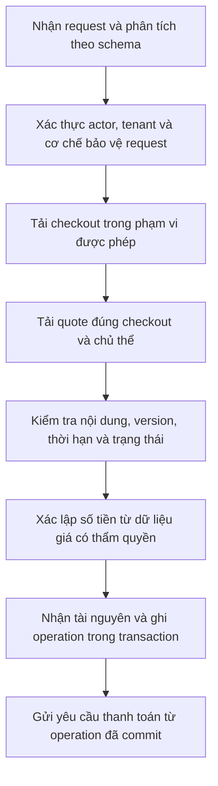

# Hidden field tampering: ngăn sửa trường ẩn để thay đổi kết quả nghiệp vụ

Trong chương **Parameter Tampering**, hidden field tampering là việc thay đổi, thêm hoặc gửi lại các tham số mà giao diện đặt trong trường ẩn, nhằm khiến máy chủ xử lý một ý định khác với quy tắc nghiệp vụ. Trường ẩn không hiển thị như ô nhập thông thường, nhưng giá trị của nó vẫn nằm trên phía client và có thể bị người điều khiển client thay đổi.

Trong module bảo vệ logic nghiệp vụ, rủi ro xuất hiện khi máy chủ tin giá, chủ sở hữu, trạng thái phê duyệt hoặc bước xử lý chỉ vì các giá trị đó được gửi từ một form do hệ thống từng tạo. Việc bảo vệ cần dựa vào quyền theo đối tượng, nguồn dữ liệu có thẩm quyền, state machine, transaction và idempotency.

Bài học dùng ví dụ xác nhận đơn hàng. Các request và dữ liệu chỉ minh họa cách thiết kế, kiểm thử trong môi trường được kiểm soát; trọng tâm là chặn việc client tự xác lập sự thật nghiệp vụ.

Sau bài này, bạn có thể:

- Giải thích vì sao `type="hidden"` không tạo ranh giới tin cậy.
- Nhận diện trường ẩn nào là ý định, tham chiếu hay bằng chứng cần xác minh.
- Thiết kế form và lệnh máy chủ không nhận giá trị nghiệp vụ nhạy cảm một cách tùy ý.
- Phân biệt CSRF token, báo giá được ký và quyền theo đối tượng.
- Kiểm thử sửa giá, đổi ID, gửi tham số trùng, dùng form cũ và gửi yêu cầu đồng thời.

## 1. Trường ẩn vẫn là dữ liệu do client gửi

HTML có thể chứa:

```html
<form method="post" action="/orders/confirm">
  <input type="hidden" name="productId" value="product-a">
  <input type="hidden" name="unitPrice" value="120000">
  <input type="hidden" name="customerId" value="customer-17">
  <input type="hidden" name="paymentStatus" value="UNPAID">

  <label>
    Số lượng
    <input type="number" name="quantity" min="1" value="1">
  </label>
  <button type="submit">Xác nhận</button>
</form>
```

Người điều khiển trình duyệt có thể xem HTML, sửa DOM hoặc gửi một request mới không đi qua form. Máy chủ chỉ nhận dữ liệu HTTP, không có bằng chứng rằng người dùng đã giữ nguyên những input ẩn ban đầu.

Một request đã bị sửa có thể là:

```http
POST /orders/confirm
Content-Type: application/x-www-form-urlencoded

productId=product-a&quantity=10&unitPrice=1&customerId=customer-other&paymentStatus=PAID
```

Nếu máy chủ dùng trực tiếp các giá trị đó để tạo đơn, caller có thể sửa giá, đổi người sở hữu hoặc giả trạng thái thanh toán.

Thuộc tính giao diện không thay thế kiểm tra máy chủ:

| Cách trình bày | Điều nó thực hiện | Điều nó không bảo đảm |
| --- | --- | --- |
| `type="hidden"` | Không hiển thị ô nhập thông thường | Giá trị không bị thay đổi |
| Ẩn bằng CSS | Giấu phần tử trên giao diện | Dữ liệu không bị đọc hoặc gửi lại |
| `readonly` ở loại input hỗ trợ | Hạn chế sửa qua thao tác giao diện thông thường | Caller không tạo request khác |
| `disabled` | Thường không được gửi như một control hợp lệ khi submit form | Caller không tự thêm cùng tên tham số vào HTTP |
| JavaScript kiểm tra trước submit | Hỗ trợ trải nghiệm và phản hồi sớm | Mọi request đều đã chạy đoạn JavaScript đó |

Trường ẩn cũng có thể chứa token nhạy cảm. Nó không bí mật với người đang điều khiển phiên client, nhưng vẫn cần được bảo vệ trước bên ngoài; không vì gọi nó là hidden mà tùy ý ghi vào log hoặc chia sẻ.

## 2. Lỗi thực sự nằm ở việc trao thẩm quyền cho giá trị ẩn

Không phải cứ dùng input ẩn là có lỗ hổng. Một ID đối tượng hoặc CSRF token được gửi bằng trường ẩn có thể là thành phần hợp lệ nếu máy chủ xử lý đúng.

Điểm cần tìm là nơi dữ liệu được sử dụng:

```text
nhận unitPrice từ form
  → gán vào dòng đơn
  → tính total
  → gửi amount sang cổng thanh toán
```

Ở đây, máy chủ đã trao cho client quyền xác lập đơn giá. Dù `total = quantity × unitPrice` được tính đúng, kết quả vẫn sai vì nguồn đơn giá không đáng tin.

Một đường khác:

```text
nhận customerId từ hidden input
  → kiểm tra customer tồn tại
  → tạo đơn cho customer đó
```

Kiểm tra tồn tại không chứng minh caller được tạo đơn thay người này. Tương tự, `step=4`, `approved=true` hoặc `role=MANAGER` không phải bằng chứng đã đi qua bước cần thiết hay có quyền tương ứng.

Khi rà soát một trường ẩn, hãy hỏi:

> Máy chủ coi giá trị này là đề xuất cần kiểm tra, một tham chiếu phải cấp quyền, hay một sự thật nghiệp vụ được tin ngay?

## 3. Phân loại các tham số trước khi xử lý

| Nhóm dữ liệu | Ví dụ | Trách nhiệm của máy chủ |
| --- | --- | --- |
| Ý định được phép đề xuất | Sản phẩm, số lượng, phương thức nhận hàng | Kiểm tra schema, quyền và điều kiện nghiệp vụ |
| Tham chiếu đối tượng | `checkoutId`, `quoteId`, `addressId` | Tải trong đúng tenant, chủ thể và quan hệ |
| Giá trị máy chủ quản lý | Đơn giá, tổng tiền, mức giảm thực tế | Xác lập từ dữ liệu và chính sách có thẩm quyền |
| Danh tính và phạm vi | `customerId`, `tenantId`, người duyệt | Lấy hoặc xác minh từ ngữ cảnh có thẩm quyền |
| Bằng chứng quy trình | Đã duyệt, đã trả tiền, đã xác minh | Kiểm tra nguồn bằng chứng và trạng thái thật |
| Điều kiện đồng thời | `expectedVersion`, revision | So sánh với dữ liệu hiện hành |
| Token bảo vệ | CSRF token hoặc token báo giá | Xác minh mục đích, tính hợp lệ và các ràng buộc tương ứng |

Một tham số có thể được phép trong một chức năng quản trị nhưng không được phép trong chức năng của khách. Ví dụ chọn khách hàng để tạo đơn thay phải là hành động được cấp quyền rõ ràng, không suy ra từ việc mọi form đều có `customerId`.

Tương tự, lựa chọn tenant có thể là đầu vào hợp lệ ở hệ thống nhiều tổ chức, nhưng máy chủ vẫn phải xác minh membership và phạm vi của request. Một chuỗi tenant gửi từ hidden input không tự tạo quyền sử dụng tenant đó.

## 4. Validation cú pháp và tính toán lại chưa đủ

Những kiểm tra sau đều có ích nhưng chưa giải quyết toàn bộ vấn đề:

- `unitPrice` là số nguyên dương.
- `customerId` đúng định dạng.
- `paymentStatus` thuộc một enum đã biết.
- `total` bằng tổng các giá trị client gửi.
- Request có CSRF token hợp lệ.

Đơn giá `1` có thể đúng kiểu số nhưng không phải giá được phép. ID người khác có thể đúng định dạng và thực sự tồn tại. Trạng thái `PAID` có thể hợp lệ trong mô hình nhưng caller không được tự ghi nó.

Sanitize một chuỗi hoặc escape ký tự không biến nó thành quyết định có thẩm quyền. Hidden field tampering có thể dùng toàn bộ giá trị hợp lệ về cú pháp, nên cần kiểm tra ý nghĩa, nguồn và quan hệ nghiệp vụ.

Giới hạn số lượng cũng phải được kiểm tra tại máy chủ. Thuộc tính `min` hoặc `max` trên input không chặn request chứa số âm, số quá lớn hoặc dữ liệu có biểu diễn khác hợp đồng.

## 5. Tách cập nhật ý định khỏi bước chốt đơn

Một thiết kế rõ ràng có thể gồm:

```text
Khách đề xuất sản phẩm, số lượng và phương thức nhận
  → máy chủ xác minh và tính một báo giá
  → khách xem nội dung báo giá
  → khách xác nhận checkout và báo giá cụ thể
  → máy chủ kiểm tra lại và ghi ý định thanh toán
```

Nếu khách đổi số lượng, hệ thống cập nhật giỏ hàng và tạo hoặc chọn báo giá mới theo chính sách. Bước xác nhận không ghép số lượng mới với giá cũ chưa được kiểm tra.

Trong ví dụ, báo giá được máy chủ lưu và ràng buộc với:

- Tenant, khách hàng và checkout.
- Snapshot sản phẩm, số lượng và loại tiền.
- Phương thức nhận và những dữ liệu ảnh hưởng phí.
- Mã khuyến mãi cùng kết quả áp dụng có thẩm quyền.
- Tổng tiền và thời hạn báo giá.
- Các version hoặc chính sách cần để xác định hiệu lực.

Giả sử sản phẩm cam kết giữ giá trong thời hạn báo giá. Máy chủ có thể tôn trọng mức giá đã chốt đó khi báo giá còn hợp lệ, thay vì luôn dùng giá danh mục mới nhất. Đây phải là chính sách rõ ràng, không phải tác dụng ngẫu nhiên của một input cũ.

Việc giữ giá không tự bảo đảm tồn kho hoặc lượt mã đã được dành. Những điều kiện tài nguyên cần cơ chế riêng hoặc được kiểm tra tại lúc chốt theo hợp đồng.

## 6. Form an toàn vẫn có thể dùng trường ẩn

Một form xác nhận có thể chỉ gửi các tham chiếu và điều kiện cần thiết:

```html
<form method="post" action="/checkouts/confirm">
  <input type="hidden" name="checkoutId" value="checkout-42">
  <input type="hidden" name="quoteId" value="quote-9">
  <input type="hidden" name="expectedVersion" value="7">
  <input type="hidden" name="csrfToken" value="server-issued-test-token">

  <p>Tổng tiền và nội dung đơn được hiển thị từ báo giá đã xác minh.</p>
  <button type="submit">Xác nhận báo giá này</button>
</form>
```

Các giá trị minh họa không có tính bảo mật tự thân. Máy chủ vẫn phải kiểm tra:

```text
checkout thuộc tenant và khách đang được phép thao tác
quote thuộc checkout và đúng chủ thể
quote khớp nội dung hiện tại và còn hiệu lực
expectedVersion khớp dữ liệu được phép xác nhận
csrfToken hợp lệ cho cơ chế phiên và hành động theo thiết kế
```

Không có trường đơn giá hoặc trạng thái thanh toán trong lệnh xác nhận. Việc biết một `quoteId` khác không làm caller có quyền dùng báo giá đó.

Phần hiển thị tổng tiền phục vụ người dùng xem và đồng ý. Máy chủ không lấy lại con số từ DOM hoặc tin một bản sao hidden chỉ vì trang ban đầu do chính hệ thống render.

## 7. Minh họa Java: nhận đúng tập tham số của lệnh

Đoạn mã sau dùng record của Java 16 trở lên. Nó nhận một form đã được phân tích thành map nhiều giá trị để phát hiện tham số trùng. Parser HTTP cần áp dụng đúng hợp đồng content type và không làm mất thông tin trùng trước bước này.

```java
import java.util.List;
import java.util.Map;
import java.util.Objects;
import java.util.Set;

record ConfirmCheckoutCommand(
        String checkoutId,
        String quoteId,
        long expectedVersion,
        String csrfToken) {
}

final class ConfirmCheckoutInput {
    private static final Set<String> ALLOWED = Set.of(
            "checkoutId", "quoteId", "expectedVersion", "csrfToken");

    private ConfirmCheckoutInput() {
    }

    static ConfirmCheckoutCommand parse(Map<String, List<String>> form) {
        Objects.requireNonNull(form);
        require(ALLOWED.containsAll(form.keySet()), "UNSUPPORTED_FIELD");

        String checkoutId = exactlyOne(form, "checkoutId", 128);
        String quoteId = exactlyOne(form, "quoteId", 128);
        String rawVersion = exactlyOne(form, "expectedVersion", 20);
        String csrfToken = exactlyOne(form, "csrfToken", 2048);

        final long version;
        try {
            version = Long.parseLong(rawVersion);
        } catch (NumberFormatException invalid) {
            throw new IllegalArgumentException("INVALID_VERSION", invalid);
        }
        require(version >= 0, "INVALID_VERSION");

        return new ConfirmCheckoutCommand(
                checkoutId, quoteId, version, csrfToken);
    }

    private static String exactlyOne(
            Map<String, List<String>> form, String name, int maxLength) {
        List<String> values = form.get(name);
        require(values != null && values.size() == 1,
                "MISSING_OR_REPEATED_FIELD");
        String value = values.get(0);
        require(value != null && !value.isBlank()
                && value.length() <= maxLength, "INVALID_FIELD");
        return value;
    }

    private static void require(boolean valid, String code) {
        if (!valid) {
            throw new IllegalArgumentException(code);
        }
    }
}
```

Giới hạn độ dài trong ví dụ là hợp đồng minh họa, cần phù hợp định dạng ID và token của hệ thống. Ngoài ra phải giới hạn kích thước body, số tham số và tài nguyên phân tích ở tầng nhận HTTP.

Parser này không xác minh quyền, CSRF token hoặc báo giá. Nó chỉ ngăn lệnh xác nhận vô tình nhận thêm `unitPrice`, `approved`, `customerId` hay một cấu trúc entity tùy ý.

Nếu framework đã chuyển tham số trùng thành một giá trị duy nhất, helper trên không thể khôi phục thông tin đã mất. Cần đặt quy tắc từ tầng parser và tránh việc lớp kiểm tra đọc giá trị đầu còn binder dùng giá trị cuối.

## 8. Luồng xử lý máy chủ không dựa vào sự thật do form tự khai

Một luồng xác nhận có thể tổ chức như sau:



Phần transaction có thể gồm:

```text
BEGIN TRANSACTION
  nhận quyền xử lý idempotency key trong đúng phạm vi
  tải và bảo vệ checkout của actor trong tenant đã xác minh
  kiểm tra expectedVersion và trạng thái cho phép xác nhận
  tải quote đúng checkout, khách và snapshot
  kiểm tra hiệu lực quote cùng các điều kiện áp dụng
  xác định số tiền, loại tiền và dữ liệu thanh toán từ máy chủ
  kiểm tra/nhận tồn kho hoặc quota bằng giao thức nhất quán
  ghi nội dung chốt, trạng thái và version mới
  tạo operationId, outbox, audit và kết quả idempotency
COMMIT
```

Nếu báo giá không tìm thấy trong phạm vi được phép, không thử truy vấn toàn cục rồi dùng kết quả đó. Nếu một bước bắt buộc thất bại, không để lại một phần đơn hoặc một ý định thanh toán trái phép.

Lời gọi thanh toán dùng số tiền và loại tiền của operation đã chốt, không dùng một bản sao client gửi lại trong bước sau. Callback cần được xác thực và đối chiếu với đúng operation, số tiền cùng loại tiền theo giao thức.

Trang chuyển hướng có `success=true` hoặc một hidden input `paid=1` không phải bằng chứng nhà cung cấp đã xử lý thành công.

## 9. Kiểm tra chéo để ngăn các payload tự nhất quán nhưng sai nguồn

Người gọi có thể sửa đồng thời nhiều trường để vượt một kiểm tra đơn giản:

```text
quantity = 10
unitPrice = 1
subtotal = 10
discount = 0
total = 10
```

Tổng khớp công thức nhưng đơn giá vẫn không hợp lệ. Vì vậy, kiểm tra chéo phải dùng các nguồn có thẩm quyền:

- Đơn giá từ báo giá được máy chủ chốt theo chính sách.
- Số lượng khớp snapshot và giới hạn được phép.
- Mức giảm được máy chủ xác lập từ mã hoặc quyền ngoại lệ hợp lệ.
- Phí khớp phương thức nhận và dữ liệu liên quan.
- Mọi khoản dùng cùng đơn vị và loại tiền.

Nếu client được đề xuất số lượng, kiểm tra số nguyên, giới hạn, sản phẩm trùng và các quy tắc tài nguyên phù hợp. Không để nhiều dòng cùng sản phẩm né một giới hạn chỉ được áp dụng từng dòng ngoài ý muốn.

Tránh số thực nhị phân cho các phép tính đòi hỏi tiền chính xác. Nếu dùng số nguyên theo đơn vị tiền đã xác định, kiểm tra tràn số; nếu dùng số thập phân chính xác, áp dụng scale và rounding thống nhất. Một số có giá trị kỹ thuật hợp lệ vẫn có thể vượt miền nghiệp vụ.

Quyền chỉnh giá ngoại lệ, nếu có, cần một lệnh và quy trình được cấp quyền riêng. Không bật bằng một cờ hidden `manualPrice=true` trong form khách hàng.

## 10. Báo giá được ký vẫn cần kiểm tra phạm vi và hiệu lực

Ngoài cách lưu báo giá trên máy chủ rồi gửi ID, một nền tảng có thể hỗ trợ mang dữ liệu báo giá trong một bằng chứng được ký hoặc bảo vệ tính toàn vẹn. Khi đó cần hiểu đúng điều cơ chế chứng minh.

Chữ ký hoặc MAC hợp lệ có thể chứng minh nội dung do bên có thẩm quyền phát hành và không bị sửa theo cơ chế đó. Nó không tự chứng minh:

- Người đang gửi được phép dùng bằng chứng này.
- Báo giá thuộc đúng checkout và tenant.
- Nội dung giỏ hàng hiện tại còn khớp.
- Bằng chứng chưa hết hạn, chưa bị thu hồi hoặc chưa được tiêu thụ theo chính sách.
- Tồn kho hoặc quota còn đủ.

Cần ràng buộc các dữ liệu quan trọng như mục đích, đối tượng nhận, tenant, checkout, chủ thể, snapshot, loại tiền và thời hạn theo thiết kế. Dùng cơ chế xác minh của nền tảng phù hợp, không coi việc có một chuỗi tên `signature` trong form là đã có bảo vệ.

Bí mật dùng để phát hành bằng chứng không được nằm trong JavaScript gửi cho người dùng. Mã hóa Base64 hoặc làm rối tên trường không tạo tính toàn vẹn. Mã hóa nội dung cũng không tự giải quyết việc dùng lại một bằng chứng hợp lệ trong sai ngữ cảnh.

Nếu nghiệp vụ yêu cầu tiêu thụ đúng một lần, cần cơ chế bền vững để nhận diện và tiêu thụ định danh tương ứng một cách nhất quán. Một bằng chứng được ký có thể vẫn bị gửi lại nguyên vẹn.

## 11. CSRF token bảo vệ một vấn đề khác

CSRF token thường được đặt trong hidden input, nhưng giá trị của nó hữu ích vì máy chủ xác minh nó theo cơ chế bảo vệ request, không phải vì input bị ẩn.

Một người dùng hợp lệ có thể lấy CSRF token cho phiên của mình rồi sửa `unitPrice`, `quoteId` hoặc `customerId`. Token có thể vẫn hợp lệ trong khi hành động nghiệp vụ không được phép.

Do đó, các lớp bảo vệ cần cùng tồn tại:

```text
xác thực và bảo vệ request theo cơ chế phiên
AND quyền theo đối tượng và tenant
AND quyền trên các trường hoặc lệnh
AND báo giá, trạng thái và bằng chứng nghiệp vụ hợp lệ
AND transaction cùng chống thực hiện trùng
```

Không dùng một CSRF token làm ID báo giá hoặc căn cứ rằng toàn bộ dữ liệu của form chưa từng thay đổi. Nếu có cơ chế bảo vệ toàn bộ nội dung form, vẫn cần kiểm tra quyền, thời hạn, replay và dữ liệu hiện tại theo chính sách.

Các kênh API không dựa trên cookie phiên có mô hình bảo vệ request riêng. Dù dùng cơ chế nào, việc một request được xác thực hợp lệ không biến mọi tham số của nó thành dữ liệu đáng tin.

## 12. Tham số trùng và nhiều lớp parser có thể tạo cách hiểu khác nhau

Ví dụ một request chứa:

```text
quoteId=quote-allowed&quoteId=quote-other
```

Nếu lớp kiểm tra chọn giá trị đầu còn lớp thực thi chọn giá trị cuối, máy chủ có thể kiểm tra quyền trên một báo giá nhưng dùng báo giá khác.

Cần xác định rõ:

- Một trường scalar có được xuất hiện nhiều lần không.
- Query string và body có được cùng cung cấp một thuộc tính không.
- Content type nào được endpoint hỗ trợ.
- Tên trường có phân biệt hoa thường, alias hay đường dẫn lồng nhau không.
- Quy trình giải mã được áp dụng nhất quán ở lớp nào.

Với lệnh xác nhận của ví dụ, mỗi trường chỉ được có một giá trị. Tên không thuộc schema bị từ chối; không cho một binder nhận các đường dẫn như `order.ownerId` rồi tự tạo graph đối tượng ngoài lệnh được phép.

Không dùng giá trị mặc định nhạy cảm khi parser không hiểu body. Content type không được hỗ trợ hoặc payload mơ hồ phải được xử lý theo hợp đồng trước khi tạo thay đổi nghiệp vụ.

Validation và service cần dùng cùng một biểu diễn lệnh đã được phân tích, thay vì tự đọc lại raw request theo những quy tắc khác nhau.

## 13. Form cũ, nhiều tab và idempotency

Một form không bị sửa vẫn có thể không còn hợp lệ. Người dùng mở hai tab, thay địa chỉ hoặc số lượng ở tab thứ nhất rồi xác nhận báo giá cũ ở tab thứ hai.

Cần kiểm tra:

- Checkout version và snapshot tương ứng.
- Hiệu lực báo giá và chính sách giữ giá.
- Trạng thái còn được xác nhận hay đã tạo operation.
- Những tài nguyên hoặc giới hạn cần đánh giá tại thời điểm chốt.

Không tự thay version mới vào lệnh cũ rồi giữ nguyên mọi kết luận. Nội dung người dùng đồng ý có thể đã khác và cần được xem lại.

Idempotency xử lý trường hợp cùng một ý định được gửi lại sau khi mất phản hồi. Phạm vi key cần gắn tenant, actor, loại thao tác và dữ liệu có ý nghĩa như checkout, quote cùng điều kiện phiên bản.

| Trường hợp | Hành vi cần thiết |
| --- | --- |
| Cùng key, cùng lệnh đã commit | Trả kết quả tương ứng theo quyền xem hiện tại, không tạo đơn hoặc thanh toán mới |
| Cùng key nhưng đổi quote hoặc checkout | Từ chối tái sử dụng key cho ý định khác |
| Key khác nhưng checkout đã được xác nhận | Invariant và trạng thái ngăn tạo operation mới trái chính sách |
| Quote hết hạn trước lần chốt hợp lệ | Không coi key là quyền giữ báo giá vô thời hạn |
| Transaction trước rollback | Không trả một kết quả thành công chưa từng commit |

Không thêm một hidden field `alreadyValidated=true` để tránh kiểm tra khi retry. Kết quả đã commit và quyền tạo operation mới là hai việc khác nhau.

## 14. Cùng nguyên tắc trên mọi đường tạo hành động

Những trường không được tin từ form cũng không được tin nếu chúng đi vào qua một kênh khác:

- Mobile client gửi JSON.
- API hàng loạt hoặc import.
- Worker xử lý một lệnh do người dùng khởi tạo.
- Callback hoặc trang chuyển hướng sau thanh toán.
- Công cụ hỗ trợ hoặc trang quản trị.

Worker không được coi `amount`, `approved` hoặc `tenantId` trong message là có thẩm quyền chỉ vì message nằm trong hàng đợi. Cần xác minh nguồn, phạm vi và liên kết tới operation hoặc dữ liệu đã chốt.

Với công cụ quản trị cho phép chọn khách hàng hoặc sửa giá, kiểm tra riêng quyền hành động, đối tượng và điều kiện ngoại lệ. Không sử dụng một DTO entity chung rồi bỏ mọi guard cho người có role nhân viên.

Một số metadata như URL quay lại hoặc endpoint callback cũng có thể bị gửi qua trường ẩn. Nếu hệ thống sử dụng chúng, cần chính sách đích được phép phù hợp, thay vì để caller quyết định tùy ý nơi chuyển hướng hoặc nơi máy chủ gửi yêu cầu.

Form và trang có dữ liệu riêng tư cũng cần cache đúng phạm vi. Trả nhầm HTML chứa báo giá hoặc token của người khác là lỗi riêng; backend từ chối dùng báo giá đó không làm việc lộ nội dung trang trở nên chấp nhận được.

## 15. Ma trận kiểm thử sửa trường ẩn

Thực hiện trên dữ liệu tổng hợp và môi trường kiểm thử được phép. Bắt đầu bằng một form hợp lệ có thể xác nhận thành công để bảo đảm route, token và fixture đúng.

| Ca kiểm thử | Kết quả cần giữ |
| --- | --- |
| Gửi nguyên lệnh hợp lệ | Chỉ tạo kết quả cho đúng checkout và báo giá |
| Thêm `unitPrice`, `total` hoặc `discountPercent` | Không điều khiển giá; bị từ chối theo schema của ví dụ |
| Thêm `customerId`, `tenantId` hoặc `approvedBy` | Không thay danh tính, phạm vi hoặc bằng chứng |
| Thêm `paymentStatus=PAID` hoặc `step=final` | Không bỏ qua quy trình thanh toán hay các bước bắt buộc |
| Đổi `checkoutId` sang đối tượng của người khác | Không truy cập hoặc tạo tác dụng phụ ngoài quyền |
| Dùng quote của checkout khác hoặc tenant khác | Không áp dụng báo giá chỉ vì ID hợp lệ |
| Sửa số lượng nhưng giữ quote cũ | Không chốt một tổ hợp chưa được xác minh |
| Sửa đồng thời đơn giá và tổng để công thức vẫn khớp | Không vượt kiểm tra nguồn giá có thẩm quyền |
| Gửi hai `quoteId` với giá trị khác nhau | Không có cách hiểu khác giữa validation và thực thi |
| Gửi alias, tên lồng nhau hoặc content type không hỗ trợ | Không bind thêm trường hoặc dùng mặc định nhạy cảm |
| Xóa hoặc thay CSRF token trong kênh yêu cầu token | Bị xử lý theo cơ chế bảo vệ request |
| Token CSRF hợp lệ nhưng quote không thuộc caller | Vẫn bị chặn theo quyền và quan hệ |
| Bằng chứng báo giá được ký nhưng sai chủ thể hoặc mục đích | Không được dùng ngoài phạm vi đã phát hành |

Với cơ chế báo giá được ký, thêm ca sửa nội dung không còn hợp lệ và ca dùng nguyên một bằng chứng thật của đối tượng khác. Ca thứ hai giúp chứng minh kiểm tra không chỉ dừng ở chữ ký.

Không chấp nhận mọi lỗi HTTP làm bằng chứng an toàn. Một lỗi schema không chứng minh quyền theo đối tượng hoạt động; mỗi ca cần payload và điều kiện còn lại phù hợp để kiểm tra đúng ranh giới.

## 16. Kiểm thử trạng thái, đồng thời và hiệu ứng phụ

Các ca quan trọng:

| Kịch bản | Invariant hoặc hành vi cần giữ |
| --- | --- |
| Dùng lại form sau khi checkout thay đổi | Version và snapshot cũ không áp dụng nhầm |
| Quote hết hạn trong khi người dùng mở trang | Xử lý đúng thời hạn tại ranh giới chốt đã định |
| Hai tab xác nhận đồng thời | Chỉ một operation hợp lệ cho cùng checkout theo chính sách |
| Hai request cùng nhận lượt khuyến mãi cuối | Không vượt quota dùng chung |
| Lỗi sau nhận tồn kho nhưng trước ghi đơn | Không để dữ liệu nửa chừng ngoài giao thức phục hồi |
| Mất phản hồi sau commit rồi gửi lại | Không trừ kho, áp mã hoặc tạo thanh toán thêm lần nữa |
| Callback thanh toán giả hoặc sai số tiền | Không đánh dấu thành công bằng dữ liệu client tự khai |
| Callback thành công gửi lặp | Không lặp hiệu ứng hoặc ghi nhận nhiều operation |
| Worker nhận message cũ | Không ghép dữ liệu cũ với checkout hoặc quote mới |

Quan sát các nguồn độc lập:

```text
snapshot checkout và đơn trước–sau
dòng hàng, giá, loại tiền và version đã chốt
tồn kho hoặc reservation
sổ dùng khuyến mãi
operation và outbox
lời gọi tới fake provider ở biên thanh toán
audit thành công và nhật ký từ chối
```

Một request trả lỗi nhưng đã gọi nhà cung cấp với giá bị sửa vẫn là thất bại của cơ chế bảo vệ. Rollback cơ sở dữ liệu không tự thu hồi tác dụng đã gửi ra ngoài.

Các ca transaction và tranh chấp cần điểm đồng bộ có kiểm soát và cơ chế lưu trữ phù hợp. Kiểm thử JavaScript trên trang hoặc mock một repository đúng không chứng minh mọi đường backend đã giữ các invariant.

## 17. Lỗi, audit và tín hiệu điều tra

Phản hồi lỗi nên dùng mã ổn định, đủ để client biết cần tải lại form, sửa input hoặc xin quyền phù hợp. Không trả entity đầy đủ hoặc chi tiết tài khoản khác chỉ để giải thích tại sao `quoteId` không được phép.

Audit nên gắn được:

```text
actor và tenant đã xác minh
checkout, quote, snapshot hoặc revision
hành động và trạng thái trước–sau
operation hoặc idempotency liên quan
nhóm lý do từ chối và tên trường vi phạm khi phù hợp
thời điểm máy chủ, version và mã tương quan
```

Không ghi toàn bộ body một cách mặc định. Trường ẩn có thể chứa CSRF token, capability hoặc dữ liệu riêng tư. Việc cần điều tra parameter tampering không phải lý do đưa credential vào log.

Các lần gửi trường máy chủ quản lý, dùng quote khác chủ hoặc tham số trùng là tín hiệu đáng quan sát. Tuy nhiên, form cũ, client chưa cập nhật hoặc mất kết nối cũng có thể gây lỗi. Giữ thông tin đủ để phân biệt và không xem mọi lần từ chối là kết luận chắc chắn về ý đồ của người dùng.

Phát hiện trên log chỉ hỗ trợ điều tra. Quyết định từ chối và ngăn tác dụng phụ phải xảy ra ngay trên đường xử lý, không chờ một tác vụ phân tích về sau.

## 18. Cách bảo vệ một form có trường ẩn

1. Liệt kê mọi input, gồm trường ẩn, tham số tự thêm bởi JavaScript và metadata qua các kênh khác.
2. Phân loại ý định, tham chiếu, dữ liệu dẫn xuất và bằng chứng; xác định nguồn có thẩm quyền cho từng loại.
3. Tạo lệnh đầu vào với tập trường cho phép, tách khỏi entity và mô hình phản hồi.
4. Giữ thông tin tham số trùng và một cách phân tích nhất quán trước khi validation hoặc binding.
5. Kiểm tra actor, tenant, quyền đối tượng và các quan hệ từ dữ liệu máy chủ.
6. Tải hoặc xác minh báo giá, tính các giá trị cần thiết và kiểm tra nội dung cùng trạng thái hiện tại.
7. Ghi kết quả, tài nguyên và ý định tác dụng phụ trong ranh giới transaction phù hợp, có version và chống lặp.
8. Xác minh token theo đúng mục đích; không để CSRF hoặc chữ ký thay thế quyền và invariant nghiệp vụ.
9. Kiểm thử sửa giá, thay ID, form cũ, tham số trùng và tác dụng phụ khi lỗi hoặc chạy đồng thời.

Trường ẩn là cách vận chuyển dữ liệu trong giao diện. Sự tin cậy đến từ việc máy chủ xác minh người gọi, đối tượng, bằng chứng và trạng thái, rồi tự xác lập kết quả nghiệp vụ trong giới hạn được phép.
