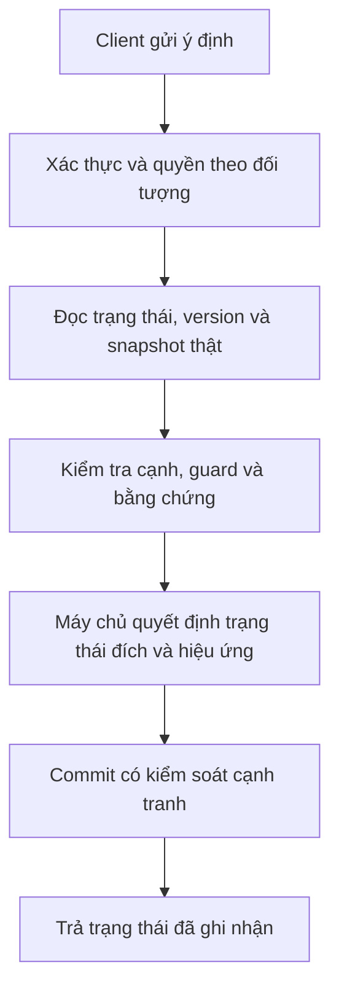

# Status parameter tampering: ngăn sửa tham số trạng thái để đi vòng nghiệp vụ

Trong chương **Parameter Tampering**, status parameter tampering là việc gửi, thay đổi hoặc dùng lại một tham số biểu diễn trạng thái nhằm khiến hệ thống công nhận một bước nghiệp vụ chưa được thực hiện hợp lệ. Tham số có thể mang tên `status`, `state`, `stage`, `approved` hoặc nằm sâu trong một đối tượng con.

Trong module bảo vệ logic nghiệp vụ, trạng thái thường quyết định quyền đi tiếp: đã duyệt mới được thực hiện, đã xác nhận mới được ghi nhận thành công, chưa xử lý mới được hủy. Nếu máy chủ để client tự ghi những trạng thái đó, người gọi có thể bỏ bước phê duyệt, giả kết quả hoặc mở lại thao tác đã kết thúc để thực hiện thêm lần nữa.

Bài học dùng ví dụ đề nghị hoàn tiền. Các quy tắc là mô hình minh họa để làm rõ nguồn thẩm quyền, state machine, quyền theo đối tượng, transaction và idempotency; không phải đặc tả cho mọi hệ thống thanh toán.

Sau bài này, bạn có thể:

- Nhận diện nơi một giá trị trạng thái từ client trở thành bằng chứng nghiệp vụ sai.
- Phân biệt trạng thái truy vấn, điều kiện phiên bản và kết quả được phép ghi.
- Thiết kế API theo hành động hoặc ánh xạ trạng thái đích qua các guard đầy đủ.
- Bảo vệ trạng thái trước request đồng thời, message cũ và callback không hợp lệ.
- Kiểm thử cả dữ liệu lẫn tác dụng phụ khi một lần sửa trạng thái bị từ chối.

## 1. Trạng thái thường đại diện cho một sự kiện đã xảy ra

Giả sử ứng dụng có endpoint cập nhật đề nghị:

```http
PATCH /refund-requests/rf-123
Content-Type: application/json

{
  "customerComment": "Vui lòng xử lý sớm",
  "status": "APPROVED"
}
```

Nếu caller là chủ đề nghị, kiểm tra quyền sở hữu có thể thành công. Nhưng sở hữu đề nghị không có nghĩa được duyệt chính đề nghị đó. Khi máy chủ gán trực tiếp `status`, một quyền sửa ghi chú đã biến thành quyền phê duyệt.

Tương tự:

```http
PATCH /refund-requests/rf-123
Content-Type: application/json

{
  "status": "SUCCEEDED"
}
```

`SUCCEEDED` không chỉ là một nhãn hiển thị. Nó có thể làm hệ thống ghi nhận tiền đã hoàn, gửi thông báo, cập nhật báo cáo hoặc mở các hành động tiếp theo.

Cần hỏi ý nghĩa của từng trạng thái:

> Muốn khẳng định trạng thái này là đúng, hệ thống phải có những hành động, quyền và bằng chứng nào?

Nếu câu trả lời là “đã có người có thẩm quyền duyệt” hoặc “đã nhận kết quả từ nhà cung cấp”, một chuỗi client tự gửi không thể thay thế những bằng chứng đó.

## 2. Các đường thường dẫn tới việc sửa trạng thái trái phép

| Đường nhận dữ liệu | Ví dụ | Rủi ro |
| --- | --- | --- |
| Form hoặc hidden input | `status=APPROVED` | Caller bỏ qua thao tác trên giao diện |
| JSON patch tổng quát | Gửi thêm `state` cùng ghi chú | Mass assignment vào entity |
| Query string trên trang kết thúc | `status=success` | Trang chuyển hướng bị coi là xác nhận kết quả |
| Thuộc tính lồng nhau | `payment.status=SUCCEEDED` | Trạng thái đối tượng con làm thay đổi kết quả tổng |
| Cờ thay thế | `approved=true`, `skipReview=true` | Bỏ guard dù trường `status` chính được bảo vệ |
| Import hoặc thao tác hàng loạt | Cột trạng thái do người dùng cung cấp | Đường phụ ghi trực tiếp trạng thái |
| Message hoặc callback | Nguồn gửi tự khai đã hoàn tất | Service có quyền kỹ thuật thực hiện thay caller |

Một DTO không có `status` vẫn có thể nguy hiểm nếu nhận `approvedBy`, `completedAt`, `amountRefunded` hoặc một cờ ngoại lệ đủ để bước sau suy ra đã thành công.

Do đó, phải bảo vệ cả dữ liệu làm căn cứ cho trạng thái, không chỉ tên trường dễ nhìn thấy.

## 3. Không phải mọi tham số status đều có cùng thẩm quyền

Một giá trị trạng thái có thể xuất hiện hợp lệ ở nhiều vai trò:

| Vai trò của dữ liệu | Ví dụ | Cách xử lý |
| --- | --- | --- |
| Bộ lọc đọc | `GET /refund-requests?status=REJECTED` | Kiểm tra giá trị và phạm vi dữ liệu được đọc |
| Điều kiện kỳ vọng | `expectedState=PENDING_APPROVAL` | So sánh với trạng thái thật, không gán vào đối tượng |
| Ý định muốn đổi trạng thái | Client đề nghị hủy | Ánh xạ sang hành động có quyền và guard tương ứng |
| Kết quả từ hệ thống ngoài | Callback báo hoàn tiền thành công | Xác thực nguồn và đối chiếu đúng operation trước khi áp dụng |
| Trạng thái đã lưu | `APPROVED` trong dữ liệu có thẩm quyền | Dùng cùng bằng chứng và invariant, không coi là đủ cho mọi bước |

Vấn đề không phải cấm tuyệt đối chuỗi tên `status`. Vấn đề là tránh để dữ liệu được đề xuất trở thành kết luận có thẩm quyền mà không qua kiểm tra.

Một API nhận trạng thái đích vẫn có thể an toàn nếu máy chủ ánh xạ nó sang hành động xác định, kiểm tra cạnh, quyền, bằng chứng và thực hiện đúng hiệu ứng. Gán entity trực tiếp theo enum là một thiết kế khác và thiếu các bảo đảm đó.

HTTP status code cũng không phải trạng thái nghiệp vụ. HTTP `200` có thể chỉ xác nhận API đã tiếp nhận một yêu cầu; không tự chứng minh giao dịch bên ngoài đã hoàn tất.

## 4. Quy trình ví dụ và chủ thể được phép tạo từng kết quả

Giả sử hệ thống có các hành động:

| Nguồn | Hành động | Đích | Chủ thể và bằng chứng chính |
| --- | --- | --- | --- |
| `DRAFT` | `SUBMIT` | `PENDING_APPROVAL` | Người tạo; nội dung hoàn tiền hợp lệ được chốt |
| `PENDING_APPROVAL` | `APPROVE` | `APPROVED` | Reviewer đủ quyền, khác người tạo, duyệt đúng snapshot |
| `PENDING_APPROVAL` | `REJECT` | `REJECTED` | Reviewer đủ quyền và lý do theo policy |
| `DRAFT` hoặc `PENDING_APPROVAL` | `CANCEL` | `CANCELLED` | Người có quyền hủy; chưa qua ranh giới không được hủy trực tiếp |
| `APPROVED` | `REQUEST_EXECUTION` | `EXECUTION_PENDING` | Chủ thể có quyền thực hiện; nhận tài nguyên và ghi operation bền vững |
| `EXECUTION_PENDING` | `START_EXECUTION` | `EXECUTING` | Worker nhận đúng operation, không tạo lần thực hiện mới |
| `EXECUTING` | Xác nhận thành công | `SUCCEEDED` | Kết quả nhà cung cấp được xác thực và khớp operation |
| `EXECUTING` | Kết quả chưa rõ | `RECONCILING` | Hệ thống cần đối soát, chưa kết luận thất bại |
| `EXECUTING` hoặc `RECONCILING` | Xác nhận thất bại cuối cùng | `FAILED` | Bằng chứng kết quả cuối cùng theo giao thức |

Đối soát có thể đưa một operation sang `SUCCEEDED` khi xác nhận thành công. Các cạnh bổ sung phải được định nghĩa rõ thay vì cho phép một hàm `setStatus` xử lý mọi chuyển đổi.

Trong ví dụ, người tạo không được tự duyệt. Quyền duyệt và quyền yêu cầu thực hiện là hai khả năng khác nhau. Worker có credential kỹ thuật không tự trở thành người duyệt.



Trạng thái đích là kết quả của luồng xử lý; nó không được xác lập chỉ bằng việc client biết tên enum.

## 5. Những invariant trạng thái cần bảo vệ

Với đề nghị hoàn tiền của ví dụ:

1. `APPROVED` phải có quyết định duyệt gắn với đúng nội dung, chủ thể và chính sách áp dụng.
2. Không dùng cùng người tạo làm reviewer nếu quy tắc không tự duyệt yêu cầu độc lập theo cá nhân.
3. `EXECUTION_PENDING` phải có operation và các phần tài nguyên cần thiết đã được ghi bền vững.
4. `SUCCEEDED` phải có kết quả xác nhận được đối chiếu với đúng operation, số tiền và loại tiền.
5. Một operation không được tạo hiệu ứng hoàn tiền nhiều lần do retry hoặc đổi key.
6. Không quay một đối tượng đã kết thúc về nháp để tái sử dụng bằng chứng hoặc tạo lần thực hiện ngoài chính sách.
7. Tổng tiền đã hoàn và phần còn được giữ phải thỏa giới hạn của giao dịch gốc theo mô hình nghiệp vụ.

Một giá trị trạng thái hợp lệ nhưng thiếu dữ liệu đi kèm vẫn có thể là trạng thái sai. Enum hoặc `CHECK` giới hạn tập giá trị chỉ chặn tên không được mô hình hóa, không tự chứng minh đường đi trước đó hợp lệ.

Không dùng thứ tự enum để quyết định rằng “được chuyển tới mọi trạng thái có số thứ tự lớn hơn”. Nhánh từ chối, hủy, đối soát và các trạng thái kết thúc không có ý nghĩa theo một trục tăng đơn giản.

## 6. Thiết kế lệnh cụ thể và tách khỏi entity

Một hợp đồng dễ kiểm soát là:

```http
POST /refund-requests/rf-123/approve
Idempotency-Key: approve-rf123-snapshot2-01
Content-Type: application/json

{
  "expectedVersion": 7
}
```

Endpoint xác định ý định `APPROVE`. Máy chủ lấy reviewer từ danh tính đã xác thực, tải trạng thái và nội dung thật, rồi quyết định có tạo kết quả `APPROVED` hay không.

Lệnh này không nhận `status`, `approvedBy`, `approvedAt`, hạn mức hoặc snapshot tự khai làm bằng chứng. Nếu cần client chỉ rõ snapshot đã xem, giá trị đó là điều kiện đối chiếu với dữ liệu có thẩm quyền.

Một endpoint sửa ghi chú có DTO riêng, chỉ chứa các trường được phép sửa trong trạng thái phù hợp. Từ chối thuộc tính không được hỗ trợ theo schema đã chọn, thay vì bind toàn bộ JSON vào entity rồi cố bỏ một vài trường nguy hiểm.

Các cờ như `skipApproval` hoặc `forceComplete` cũng không thuộc DTO thông thường. Nếu doanh nghiệp cần ngoại lệ, dùng một hành động được cấp quyền, có guard và audit riêng.

Tách cả mô hình phản hồi. Khách hàng được đọc `status` để theo dõi không đồng nghĩa họ được gửi lại trường đó để ghi. Dùng chung DTO đọc và ghi dễ vô tình biến quyền xem thành quyền cập nhật.

## 7. Minh họa Java: tạo quyết định duyệt từ trạng thái có thẩm quyền

Đoạn mã dùng record của Java 16 trở lên. `ApprovalAuthority` là một căn cứ quyền phía máy chủ đã xác minh cho phạm vi cụ thể, không phải role hoặc hạn mức lấy từ body. Ví dụ giới hạn số tiền ở VND.

```java
import java.time.Instant;
import java.util.Objects;
import java.util.UUID;

enum RefundState {
    DRAFT,
    PENDING_APPROVAL,
    APPROVED,
    REJECTED,
    CANCELLED,
    EXECUTION_PENDING,
    EXECUTING,
    RECONCILING,
    SUCCEEDED,
    FAILED
}

record ApproveRefundCommand(long expectedVersion) {
}

record ApprovalAuthority(
        UUID tenantId,
        UUID departmentId,
        UUID reviewerPersonId,
        long limitVnd,
        boolean active) {
}

record RefundSnapshot(
        UUID id,
        UUID tenantId,
        UUID departmentId,
        UUID requestedByPersonId,
        UUID contentSnapshotId,
        long amountVnd,
        RefundState state,
        long version) {
}

record ApprovalDecision(
        UUID refundId,
        UUID tenantId,
        long sourceVersion,
        UUID approvedSnapshotId,
        UUID approvedByPersonId,
        Instant approvedAt) {
}

final class RefundApproval {
    private RefundApproval() {
    }

    static ApprovalDecision decide(
            ApprovalAuthority authority,
            RefundSnapshot current,
            ApproveRefundCommand command,
            Instant serverNow) {
        Objects.requireNonNull(authority);
        Objects.requireNonNull(current);
        Objects.requireNonNull(command);
        Objects.requireNonNull(serverNow);

        UUID reviewer = Objects.requireNonNull(
                authority.reviewerPersonId());
        require(authority.active(), "AUTHORITY_INACTIVE");
        require(Objects.requireNonNull(authority.tenantId())
                .equals(current.tenantId()), "TENANT_MISMATCH");
        require(Objects.requireNonNull(authority.departmentId())
                .equals(current.departmentId()), "OUT_OF_SCOPE");
        require(current.state() == RefundState.PENDING_APPROVAL,
                "WRONG_STATE");
        require(command.expectedVersion() == current.version(),
                "VERSION_CONFLICT");
        require(!reviewer.equals(current.requestedByPersonId()),
                "SELF_APPROVAL_FORBIDDEN");
        require(current.amountVnd() > 0
                && current.amountVnd() <= authority.limitVnd(),
                "AMOUNT_NOT_ALLOWED");

        UUID snapshot = Objects.requireNonNull(current.contentSnapshotId());
        return new ApprovalDecision(current.id(), current.tenantId(),
                current.version(), snapshot, reviewer, serverNow);
    }

    private static void require(boolean allowed, String code) {
        if (!allowed) {
            throw new IllegalStateException(code);
        }
    }
}
```

Kết quả là một quyết định duyệt có kiểu riêng, không phải một lệnh gán trạng thái bất kỳ. Tầng lưu thực hiện cập nhật duyệt chuyên biệt với trạng thái đích do máy chủ xác định.

Mã chưa bao phủ mọi chính sách thực tế như nhiều cấp duyệt, thời hạn, tình trạng giao dịch gốc hoặc hiệu lực quyền thay đổi đồng thời. Các trường bắt buộc phải được xác thực khi dựng mô hình. Quyết định không được coi là đã commit trước khi bước ghi nguyên tử thành công.

Tên record cũng không tự tạo thẩm quyền. Controller không được bind JSON của client thành `ApprovalAuthority` hoặc `ApprovalDecision` rồi bỏ qua quá trình xác minh.

## 8. Ghi quyết định và trạng thái trong cùng ranh giới nhất quán

Một cập nhật duyệt có thể dùng:

```sql
UPDATE refund_request
SET state = 'APPROVED',
    approved_by_person_id = :authenticated_reviewer_person_id,
    approved_snapshot_id = content_snapshot_id,
    approved_at = :server_time,
    version = version + 1
WHERE tenant_id = :authorized_tenant_id
  AND id = :refund_id
  AND state = 'PENDING_APPROVAL'
  AND version = :expected_version
  AND requested_by_person_id <> :authenticated_reviewer_person_id;
```

Trước đó vẫn phải xác lập quyền reviewer, phạm vi bộ phận, hạn mức và nội dung theo nguồn có thẩm quyền. SQL này không tự biết tất cả policy; nó giữ các điều kiện cần thiết ở chính bước cập nhật.

Luồng transaction:

```text
BEGIN TRANSACTION
  nhận quyền xử lý idempotency key
  tải và bảo vệ đối tượng trong scope đã xác minh
  đọc trạng thái, version, snapshot và dữ liệu cần cho quyết định
  kiểm tra quyền theo đối tượng, hành động, guard và invariant
  tạo quyết định cùng trạng thái đích phía máy chủ
  cập nhật có điều kiện hoặc theo giao thức khóa đã chọn
  ghi bằng chứng duyệt, audit, outbox và kết quả idempotency
COMMIT
```

Phải kiểm tra số hàng cập nhật. Không có hàng bị tác động không phải thành công và không cho phép tự bỏ điều kiện version rồi thử lại.

Nếu ghi bằng chứng bắt buộc thất bại, rollback trạng thái tương ứng. Không để đối tượng mang `APPROVED` nhưng không có quyết định, hoặc có audit thành công cho một thay đổi chưa commit.

Một request không có quyền không được làm đối tượng chuyển sang `REJECTED` hay `FAILED` chỉ vì thao tác của caller thất bại. Kết quả từ chối truy cập và trạng thái nghiệp vụ là hai việc khác nhau.

## 9. Trạng thái phải được bảo vệ trước cập nhật cạnh tranh

Giả sử hai request cùng đọc `PENDING_APPROVAL`:

```text
A: người duyệt chuẩn bị đồng ý
B: người tạo chuẩn bị hủy
```

Nếu cả hai ghi trạng thái không điều kiện, lần ghi cuối có thể che quyết định đã commit trước đó, trong khi các hiệu ứng phụ của cả hai vẫn tồn tại.

Khóa hoặc cập nhật có điều kiện phải bảo đảm chỉ một nhánh rời cùng phiên bản được commit. Request còn lại nhận xung đột hoặc thấy hành động không còn hợp lệ theo hợp đồng.

Một lỗi khác là cập nhật toàn bộ entity từ một bản cũ. Dù DTO sửa ghi chú không có `status`, mã sao chép dữ liệu hoặc cơ chế lưu toàn bộ bản ghi có thể ghi đè trạng thái mới bằng trạng thái cũ đã tải. Cần version và cách cập nhật thuộc tính có kiểm soát trên mọi đường ghi.

Không dùng mặc định `DRAFT` khi một trường trạng thái vắng mặt hoặc không phân tích được. Trạng thái khởi tạo chỉ do luồng tạo hợp lệ xác lập; việc đọc hoặc cập nhật một đối tượng cũ không được vô tình đặt lại tiến trình.

## 10. Callback và trang chuyển hướng không có cùng thẩm quyền

Sau khi gửi yêu cầu hoàn tiền, frontend có thể quay lại:

```http
GET /refund-result?refundId=rf-123&status=SUCCEEDED
```

Trang kết quả nên đọc trạng thái hiện tại mà caller được phép xem. Nó không dùng query string để cập nhật đề nghị hoặc tạo bằng chứng đã hoàn tiền.

Callback phía máy chủ có thể mang trường trạng thái hợp lệ, nhưng cần kiểm tra:

- Nguồn gửi và tính xác thực theo giao thức.
- Loại sự kiện mà nguồn đó có quyền xác nhận.
- Định danh operation và giao dịch bên ngoài đã được máy chủ lưu.
- Quan hệ đúng với đề nghị và tenant; không tin tenant tự khai mà không đối chiếu.
- Số tiền, loại tiền và nội dung liên quan khớp operation.
- Event chưa được áp dụng hoặc có cách xử lý lặp an toàn.
- Cạnh chuyển trạng thái còn phù hợp với kết quả hiện tại.

Nếu nhận một kết quả thành công có dữ liệu không khớp, không áp dụng thành công chỉ vì trường `status` có giá trị đúng. Cần giữ bằng chứng và xử lý đối soát phù hợp, không tự che một hiệu ứng có thể đã xảy ra bằng cách đặt nhãn tùy ý.

Sự kiện thất bại đến sau thành công cũng không được mặc định ghi đè theo thứ tự nhận. Các trường hợp đảo ngược, điều chỉnh hoặc kết quả mâu thuẫn cần ngữ nghĩa riêng của giao thức và nghiệp vụ.

## 11. Bảo vệ cả trạng thái con và trạng thái được suy ra

Một hệ thống có thể tách:

```text
trạng thái xét duyệt
trạng thái operation hoàn tiền
trạng thái đối soát
trạng thái hiển thị tổng hợp cho khách
```

Tách như vậy có thể làm mô hình rõ hơn, nhưng không tự tạo an toàn. Nếu client sửa được `approval.state` hoặc một cờ trong operation, trạng thái tổng hợp vẫn có thể bị nâng lên dù trường `status` chính chỉ đọc.

Các phép tổng hợp cần dùng dữ liệu có thẩm quyền. Không đánh dấu toàn bộ đề nghị thành công chỉ vì một phần tử do client thêm vào có `completed=true`.

Bản chiếu để hiển thị có thể cập nhật chậm. Cổng tạo operation không nên dựa vào một cờ cho phép cũ trong cache nếu hợp đồng yêu cầu trạng thái hiện hành tại nguồn có thẩm quyền.

Một nhãn `APPROVED` cũng chưa đủ nếu snapshot hoặc số tiền đã thay đổi. Phê duyệt phải áp dụng cho đúng nội dung đang được thực hiện, và các phần dữ liệu đó cần được bảo vệ cùng trạng thái.

## 12. Version, chữ ký và idempotency không thay guard nghiệp vụ

Các cơ chế hỗ trợ có mục đích khác nhau:

| Cơ chế | Điều nó giúp bảo vệ | Điều không tự chứng minh |
| --- | --- | --- |
| Version | Phát hiện dữ liệu đã thay đổi | Caller có quyền chuyển trạng thái |
| `expectedState` | Đặt điều kiện về bản người dùng định thao tác | Trạng thái đích hoặc bước trước là hợp lệ |
| Bằng chứng được ký | Tính toàn vẹn và nguồn phát theo cơ chế | Đúng đối tượng, còn hạn, chưa dùng hoặc đúng quyền nếu chưa kiểm tra |
| CSRF token | Bảo vệ request theo mô hình phiên tương ứng | Được tự duyệt hoặc tự xác nhận thành công |
| Idempotency key | Nhận diện lại cùng một ý định | Được tạo một ý định mới trái quyền hoặc trái trạng thái |

Một token cho phép thực hiện hành động, nếu nền tảng có hỗ trợ, cần gắn với đúng chủ thể, đối tượng, hành động, phạm vi và hiệu lực. Nó không nên trở thành một chuỗi “đặt status bất kỳ” có thể dùng cho mọi đề nghị.

Với retry sau commit, trả kết quả cũ mà không chạy lại các hiệu ứng. Nếu cùng key nhưng đổi trạng thái mong muốn, hành động hoặc đối tượng, đó không còn là cùng lệnh theo hợp đồng idempotency.

Key khác cũng không làm một đề nghị `SUCCEEDED` được thực hiện thêm lần nữa. Ràng buộc trạng thái, operation duy nhất và invariant lâu dài phải tiếp tục tồn tại sau khi cache idempotency hết hạn.

## 13. Import, thao tác hàng loạt và công cụ quản trị

Một endpoint khách hàng an toàn chưa đủ nếu chức năng import cho người dùng đưa vào cột `status` rồi lưu trực tiếp.

Các đường cần rà soát gồm:

- Import dữ liệu và đồng bộ từ hệ thống khác.
- API cập nhật hàng loạt.
- Công cụ hỗ trợ có nút “đổi trạng thái”.
- Script sửa dữ liệu và lệnh vận hành.
- Worker hoặc consumer có quyền ghi rộng.

Mỗi đường cần xác định caller có quyền yêu cầu hành động gì và nguồn dữ liệu nào đủ thẩm quyền. Một file có cột `approvedBy` không chứng minh người đó thực sự đã duyệt.

Với lô nhiều đối tượng, kiểm tra từng tenant, đối tượng, trạng thái và version. Quyền với mục đầu tiên không cấp quyền cho cả lô. Quy định rõ toàn bộ hoặc không gì cả, hoặc kết quả từng mục, và không để dữ liệu ngoài phạm vi bị thay đổi.

Tài khoản quản trị vẫn cần ranh giới hành động. Nếu có quyền sửa ngoại lệ, mô hình hóa lý do, điều kiện, giới hạn và audit. Không dùng một nhánh `isAdmin` để tắt mọi invariant và tạo trạng thái không có dữ liệu căn cứ.

Quyền cơ sở dữ liệu và ràng buộc có thể bổ sung bảo vệ. Nhưng một tài khoản kỹ thuật có quyền cập nhật mọi cột sẽ không tự bị giới hạn bởi tên hàm service; các đường dùng credential đó phải nằm trong ranh giới kiểm soát phù hợp.

## 14. Sửa sai và đối soát không phải gán lại một nhãn

Hệ thống có thể cần sửa dữ liệu sai hoặc đối soát kết quả thật sau sự cố. Quy trình đó cần trả lời:

- Sự thật nghiệp vụ đã xảy ra là gì và nguồn bằng chứng nào xác nhận?
- Những dữ liệu đi kèm nào phải được cập nhật cùng trạng thái?
- Ai có quyền xử lý ngoại lệ này?
- Có operation hoặc tác dụng bên ngoài nào đang chưa rõ kết quả không?
- Có cần bù trừ thay vì thay đổi lịch sử không?

Ví dụ nhà cung cấp đã hoàn tiền nhưng ứng dụng chưa nhận phản hồi. Đặt `FAILED` vì timeout có thể khiến hệ thống giải phóng phần hạn mức rồi cho hoàn thêm lần nữa. Timeout cần được hiểu là chưa biết kết quả khi giao thức chưa chứng minh thất bại.

Ngược lại, đặt `SUCCEEDED` để “đóng ticket” khi chưa có bằng chứng có thể làm báo cáo và nghĩa vụ xử lý sai. Đối soát phải gắn kết quả thật với đúng operation, số tiền và loại tiền.

Một tác dụng đã xảy ra không bị hoàn tác bằng cách đặt lại `DRAFT`. Nếu cần hoàn tác hoặc đảo giao dịch theo nghiệp vụ, tạo hành động mới có thẩm quyền và bằng chứng phù hợp.

Giữ lịch sử quyết định và sự kiện sửa sai thay vì xóa dữ liệu để làm tiến trình trông như chưa từng đi qua các bước trước đó.

## 15. Ma trận kiểm thử sửa trạng thái

Tạo fixture hợp lệ trong môi trường kiểm thử được phép. Cần ca đối chứng thành công cho từng hành động để một lần từ chối không chỉ đến từ route sai hoặc dữ liệu không hợp lệ.

| Ca kiểm thử | Kết quả cần giữ |
| --- | --- |
| Người tạo sửa ghi chú và gửi thêm `status=APPROVED` | Không tạo phê duyệt hoặc chuyển trạng thái trái phép |
| Gửi enum hợp lệ `SUCCEEDED` trên đề nghị của mình | Quyền sở hữu không thay bằng chứng kết quả |
| Gửi cờ `approved`, `completedAt` hoặc `skipReview` | Không tạo đường thay thế cho trường trạng thái bị chặn |
| Gửi trạng thái lồng trong operation hoặc đối tượng con | Không làm tổng hợp trạng thái sai nguồn |
| Người duyệt hợp lệ duyệt từ `PENDING_APPROVAL` | Có quyết định và snapshot đúng, tăng version theo lệnh |
| Người tạo có thêm role duyệt tự duyệt | Vẫn bị chặn theo phân tách trách nhiệm |
| Người đúng role nhưng sai bộ phận hoặc tenant | Không thay đổi đối tượng ngoài phạm vi |
| Gọi thực hiện khi còn nháp hoặc chờ duyệt | Không tạo operation hoặc outbox thực hiện |
| Đặt trạng thái kết thúc về nháp | Không mở lại đường thực hiện ngoài quy trình |
| Đổi snapshot hoặc số tiền sau duyệt | Không giữ bằng chứng cũ cho nội dung mới trái chính sách |
| Query đọc có bộ lọc status hợp lệ | Hoạt động theo quyền đọc, không bị nhầm thành quyền ghi |
| Client gửi `expectedState` không khớp | Không ghi đè trạng thái thật bằng điều kiện tự khai |

Với endpoint có schema chỉ nhận lệnh cụ thể, kiểm thử trường không hỗ trợ theo hợp đồng. Với API nhận trạng thái đích, kiểm thử từng cạnh, quyền và hiệu ứng tương ứng thay vì chỉ kiểm tra tên enum.

Các biến thể tham số trùng, alias, chữ hoa–thường hoặc đường dẫn lồng nhau cần được phân tích nhất quán. Không để lớp validation kiểm tra một trường nhưng mapper dùng một trường khác có cùng ý nghĩa.

## 16. Kiểm thử tranh chấp, callback và hiệu ứng phụ

| Kịch bản | Điều cần xác minh |
| --- | --- |
| Duyệt và hủy cùng phiên bản | Chỉ một nhánh rời phiên bản đó được commit |
| Sửa ghi chú từ bản cũ sau khi trạng thái đổi | Không ghi đè tiến trình mới bằng entity cũ |
| Hai request yêu cầu thực hiện đồng thời | Không tạo hai operation trái invariant |
| Retry cùng key sau mất phản hồi | Không lặp quyết định hoặc hiệu ứng |
| Key khác trên đối tượng đã thành công | Không được thực hiện thêm chỉ vì key mới |
| Trang return gửi `status=SUCCEEDED` | Chỉ đọc trạng thái, không xác nhận kết quả |
| Callback không xác thực hoặc sai operation | Không áp dụng trạng thái thành công |
| Callback đúng nguồn nhưng sai số tiền hoặc loại tiền | Không cập nhật thành công ngoài giao thức đối soát |
| Callback lặp hoặc kết quả cũ đến muộn | Không ghi đè kết quả mới hoặc tạo hiệu ứng thêm |
| Lỗi ghi bằng chứng sau chuẩn bị cập nhật | Phần cục bộ bắt buộc rollback nhất quán |
| Quyền reviewer bị thu hồi trước ranh giới quyết định | Hành vi khớp ngữ nghĩa hiệu lực đã công bố |
| Import hoặc worker gửi trạng thái tùy ý | Không vượt cùng cơ chế bảo vệ hành động |

Oracle cần quan sát cả:

```text
trạng thái và version của đề nghị
snapshot và bằng chứng duyệt
operation hoàn tiền
phần giữ và số tiền đã ghi nhận
outbox, inbox chống lặp và audit thành công
lời gọi tới fake provider ở biên ngoài
```

API trả lỗi nhưng đã phát lệnh hoàn tiền vẫn là vi phạm. Đừng dùng việc rollback database làm bằng chứng rằng hệ thống ngoài chưa bị tác động.

Các ca concurrency cần lịch thực thi có kiểm soát và cơ chế lưu trữ phù hợp. Test chỉ mock state rồi gọi hai hàm tuần tự không chứng minh cập nhật có điều kiện hoặc khóa thực sự loại trừ tranh chấp.

## 17. Lỗi và audit phải phân biệt ý định với kết quả đã commit

Khi một thao tác bị chặn, lỗi nên phân biệt đủ cho hợp đồng API giữa không có quyền, sai trạng thái, xung đột version và dữ liệu bằng chứng không hợp lệ. Không cần tiết lộ trạng thái hoặc dữ liệu của đối tượng ngoài quyền để giải thích quá chi tiết.

Audit nên gắn được:

```text
actor thực tế và tenant đã xác minh
đối tượng, hành động, trạng thái nguồn và đích
version và snapshot liên quan
căn cứ quyền hoặc loại chủ thể dịch vụ
định danh quyết định, operation và sự kiện ngoài
kết quả đã commit hoặc lý do lần thử bị từ chối
thời điểm máy chủ và mã tương quan
```

Nếu ghi một lần cố đặt `SUCCEEDED`, ghi rõ đó là request bị từ chối; không để dòng log bị đọc như bằng chứng giao dịch đã thành công.

Không dump token, credential hoặc toàn bộ payload nhạy cảm để điều tra. Có thể ghi tên nhóm trường cấm và mã lý do phù hợp, cùng định danh đã được phép lưu.

Theo dõi các lần cố đi tắt từ nháp tới duyệt, gọi thực hiện khi chưa duyệt, đặt lại trạng thái kết thúc hoặc gửi callback không khớp. Đây là tín hiệu hỗ trợ điều tra; điều kiện chặn vẫn phải nằm trên đường tạo hiệu ứng.

## 18. Cách bảo vệ một luồng trước status parameter tampering

1. Liệt kê mọi trường và cờ có thể tác động tới trạng thái, gồm cả dữ liệu con và bằng chứng gián tiếp.
2. Với mỗi trạng thái, xác định sự kiện, chủ thể và bằng chứng cần để khẳng định nó là đúng.
3. Định nghĩa các hành động, cạnh được phép, quyền theo đối tượng, guard và invariant.
4. Tách lệnh đầu vào khỏi entity; không nhận trạng thái hoặc bằng chứng máy chủ quản lý qua patch tùy ý.
5. Tạo quyết định phía máy chủ từ dữ liệu có thẩm quyền, bảo vệ bằng transaction và version.
6. Giữ operation ổn định và chống lặp cho retry, hàng đợi và callback.
7. Phân biệt dữ liệu hiển thị, trang chuyển hướng và kết quả ngoài đã được xác thực.
8. Đưa import, quản trị và đối soát vào cùng ranh giới hoặc một đường ngoại lệ có quyền rõ ràng.
9. Kiểm thử giá trị trạng thái hợp lệ nhưng sai quyền, sai thời điểm, sai snapshot và các lịch thực thi cạnh tranh.

Trạng thái đáng tin là kết quả của một hành động hợp lệ cùng bằng chứng tương ứng. Khi máy chủ giữ quyền xác lập kết quả đó, việc thay một tham số không thể tự tạo ra phê duyệt, hoàn tất hoặc quyền đi tiếp trong quy trình.
