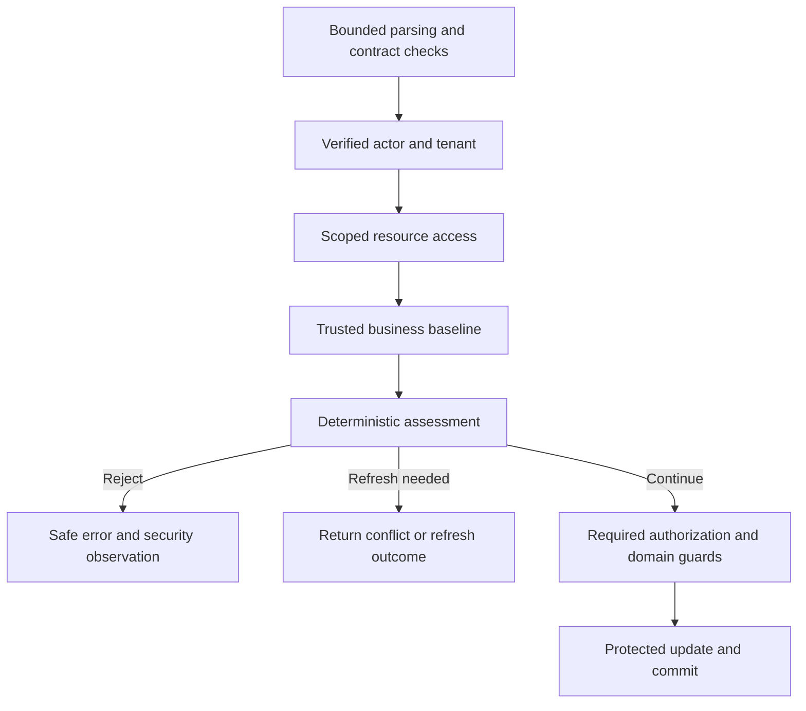

# Tampering detection: phát hiện sửa tham số nghiệp vụ

## 1. Phát hiện điều gì và để làm gì?

Một request checkout có `total = 1` dù báo giá phía server là 205.000. Một request khác gửi lại version cũ vì người dùng mở hai tab. Cả hai có dữ liệu khác trạng thái hiện tại, nhưng không nên bị diễn giải giống nhau.

**Tampering detection** là việc phát hiện dữ liệu, tham chiếu hoặc chuỗi hành động có dấu hiệu bị thay đổi ngoài hợp đồng được phép, bằng cách đối chiếu với những căn cứ mà hệ thống có thể tin cậy.

Trong bảo vệ logic nghiệp vụ, phát hiện cần hỗ trợ ba mục tiêu:

- Chặn hành động không đáp ứng các điều kiện bắt buộc trước khi có tác động trái phép.
- Ghi nhận tín hiệu đủ rõ để phân biệt lạm dụng, lỗi client, sai cấu hình và vấn đề dữ liệu.
- Giúp vận hành điều tra những cách thử vượt quyền hoặc bất biến mà không làm lộ dữ liệu hay tạo thêm đường nâng quyền.

Không cần kết luận người dùng có ý đồ xấu mới được từ chối một lệnh không hợp lệ. Ngược lại, một request bị từ chối chưa đủ chứng minh có tấn công.

### 1.1. Phát hiện không thay thế thực thi quy tắc

Một hệ thống chỉ ghi cảnh báo sau khi đã chấp nhận giá sai vẫn bị thiệt hại. Cơ chế phân quyền, validation, state machine, transaction và idempotency phải giữ các bất biến ngay cả khi pipeline phân tích sự kiện bị chậm.

Không dùng điểm rủi ro thấp để cho phép tự duyệt, sửa owner trái quyền hoặc thu tiền theo giá client. Các điều kiện bắt buộc không trở thành tùy chọn chỉ vì chưa có đủ tín hiệu đáng ngờ.

## 2. Những lớp tín hiệu cần phân biệt

| Lớp phát hiện | Dấu hiệu minh họa | Ý nghĩa có thể rút ra |
|---|---|---|
| Vi phạm hợp đồng đầu vào | Gửi `approvedBy`, `isAdmin`, giá hoặc trạng thái không được phép sửa | Request chứa trường ngoài khả năng được cấp |
| Không khớp căn cứ server | Tổng tiền, quantity, owner hoặc version khác căn cứ liên quan | Cần xác định thay đổi bị cấm hay dữ liệu đã cũ |
| Sai ràng buộc ngữ cảnh | Quote của giỏ khác, basis của hồ sơ khác, ID ngoài tenant | Không được dùng tham chiếu trong ngữ cảnh hiện tại |
| Sai toàn vẹn/xác thực | Nội dung ký không còn hợp lệ theo cơ chế kiểm tra | Không được tin nội dung đó; nguyên nhân cần điều tra |
| Vi phạm thứ tự hoặc trạng thái | Gọi chi trả trước duyệt, dùng lại bước chỉ cho một lần | Workflow không cho phép hành động hiện tại |
| Bất biến bị phá ở dữ liệu/tác động | Đã giao hàng nhưng không có căn cứ thanh toán phù hợp | Có thể có đường ghi lỗi, tác động trùng hoặc lạm dụng đã lọt qua |

### 2.1. Tín hiệu mạnh vẫn không tự chứng minh động cơ

Chữ ký sai có thể do sửa dữ liệu, nhưng cũng có thể do lỗi tích hợp hoặc triển khai khóa không đồng bộ. Trường đặc quyền xuất hiện có thể do client cũ vẫn gửi entity đầy đủ. Một quote không khớp có thể do bug chọn giỏ.

Hệ thống vẫn phải từ chối việc sử dụng dữ liệu không đáp ứng hợp đồng. Việc gán nguyên nhân hoặc quyết định xử lý tài khoản cần thêm ngữ cảnh và quy trình phù hợp.

### 2.2. Tín hiệu yếu không nên bị nâng thành cáo buộc

Version cũ, quote hết hạn hoặc retry sau timeout thường xuất hiện trong luồng bình thường. Có thể ghi nhận để quan sát nhưng không nên tự coi mỗi lần là gian lận.

Nhiều lần sai lệch có mẫu, nhắm tới nhiều đối tượng hoặc liên tục thử các trường đặc quyền có thể tăng mức đáng chú ý. Việc tổng hợp cần giữ phạm vi actor, tenant và hành động; không chỉ đếm mọi lỗi chung vào một bộ đếm.

## 3. Xây dựng căn cứ đối chiếu đáng tin

### 3.1. Hai giá trị đều do client gửi không tạo phép kiểm tra độc lập

Các cách đối chiếu sau không đủ:

```text
So total với tổng các dòng có unitPrice đều do client gửi.
So ownerId trong body với ownerId trong hidden field.
Kiểm tra isApproved trong payload khớp status = APPROVED cũng trong payload.
So checksum với một checksum khác do cùng client tự tạo.
```

Người gọi có thể sửa tất cả cho nhất quán với nhau. Căn cứ cần đến từ nguồn mà người gọi không được tự thay đổi qua request đó.

### 3.2. Nguồn đối chiếu theo từng loại dữ liệu

| Dữ liệu cần kiểm tra | Nguồn/căn cứ có thể dùng |
|---|---|
| Chủ thể thao tác | Kết quả xác thực đã kiểm chứng |
| Tenant và phạm vi | Membership/quyền hiện hành theo hợp đồng |
| Owner, maker, người được giao | Bản ghi và lịch sử phía server |
| Giá và ưu đãi | Pricing rule, catalog/hợp đồng hoặc quote được chốt |
| Quyết định phê duyệt | Vòng duyệt và basis có phiên bản |
| Kết quả thanh toán | Operation đã lưu và kết quả tích hợp được xác thực, đối chiếu đúng |
| Nội dung tài liệu | Artifact version và digest/kiểm chứng có nguồn đáng tin |

Nguồn server cũng có thể bị cũ hoặc sai. Cần giữ version, thời điểm và phạm vi để biết phép so sánh đang dựa trên snapshot nào, không mặc định mọi giá trị đọc được từ cache đều là hiện hành.

### 3.3. Đối chiếu đúng ngữ nghĩa đã cam kết

Một quote còn được cam kết giữ giá có thể khác catalog mới mà vẫn hợp lệ. Không so đơn giản với giá mới nhất rồi kết luận khách sửa giá.

Tương tự, người được chia sẻ quyền hợp lệ có thể khác owner trực tiếp. Một thao tác trả hàng có thể dùng quy tắc số lượng khác lệnh mua. Detector cần ngữ cảnh domain của action đang xử lý.

Không dùng một rule quá tổng quát như “mọi field khác DB đều là tampering”, vì nhiều field chính là ý định thay đổi hợp lệ của người dùng.

## 4. Các quy tắc phát hiện cụ thể

### 4.1. Trường do server quản lý bị gửi vào lệnh thường

Ví dụ lệnh sửa ghi chú lại có:

```json
{
  "note": "Cập nhật nội dung",
  "approvedBy": "another-user",
  "state": "APPROVED",
  "ownerId": "someone-else"
}
```

DTO theo lệnh cần giới hạn trường được phép. Nếu hợp đồng từ chối field đặc quyền, ghi sự kiện có mã rõ và không áp dụng một phần đặc quyền qua mapper khác.

Nếu hệ thống chủ động bỏ qua unknown field, phải bảo đảm không có đường ánh xạ phụ áp dụng chúng. Không coi việc bỏ qua là đủ cho mọi kiến trúc; chọn hợp đồng và kiểm thử rõ.

### 4.2. Sai ràng buộc tham chiếu

Kiểm tra quote, basis, payment attempt hoặc evidence có gắn đúng tenant, chủ thể và aggregate không. Một token hay ID tồn tại chưa đủ.

Ví dụ người dùng sở hữu cả giỏ A và B nhưng dùng quote rẻ của A để chốt cấu hình đắt của B. Đây vẫn là sai ràng buộc dù không có truy cập dữ liệu người khác.

### 4.3. Giá trị không đáp ứng bất biến

Các rule điển hình gồm:

- Tổng tiền không xuất phát từ căn cứ được phép hoặc currency/unit không khớp.
- Quantity âm trong lệnh mua không cho phép số âm.
- Refund vượt phần còn có thể hoàn theo ledger.
- Tự duyệt hoặc tính một người thành nhiều người độc lập.
- Chuyển trạng thái bỏ qua điều kiện phê duyệt.
- Dùng một quyền lợi vượt số lần được phép.

Không cần mọi rule đều mang nhãn “tampering” trong domain. Có thể dùng mã lỗi nghiệp vụ chuẩn, đồng thời ghi một tín hiệu an ninh với mức đánh giá phù hợp.

### 4.4. So sánh giá phải thống nhất đơn vị và làm tròn

Một chênh lệch tiền có thể do scale, đơn vị nhỏ nhất hoặc thứ tự làm tròn không đồng bộ. Chuẩn hóa theo hợp đồng và dùng công thức có thẩm quyền trước khi phân loại.

Không tự cho phép một sai số tiền tùy ý chỉ để giảm cảnh báo. Một khoảng dung sai không có căn cứ có thể bị khai thác nhiều lần. Nếu nghiệp vụ cho phép sai khác do làm tròn, quy tắc đó phải được xác định và kiểm thử cụ thể.

## 5. Đặt detector trong luồng xử lý an toàn

Một luồng cho command mới có thể là:



Các bước có thể được kết hợp trong triển khai. Điều cần giữ là không tải/tiết lộ dữ liệu ngoài quyền và không có tác động nghiệp vụ trước các điều kiện bắt buộc.

### 5.1. Minh họa Java cho phân loại một request checkout

Ví dụ giả định actor, cart và quote đã được nạp đúng phạm vi, và người gọi được phép nhận thông tin cần thiết. Các kiểu/dependency là hợp đồng minh họa của ứng dụng.

```java
enum Disposition {
    CONTINUE, REJECT, REQUIRE_REFRESH
}

record Assessment(Disposition disposition, String ruleCode) {}

Assessment inspectCheckoutIntent(
        ParsedCheckoutIntent input,
        ActorContext actor,
        CartSnapshot cart,
        AuthoritativeQuote quote,
        Instant now) {

    if (input.containsForbiddenServerManagedFields()) {
        return new Assessment(
                Disposition.REJECT, "SERVER_MANAGED_FIELD_SUPPLIED");
    }

    if (!quote.isBoundTo(actor, cart.id())) {
        return new Assessment(
                Disposition.REJECT, "QUOTE_CONTEXT_MISMATCH");
    }

    if (input.expectedCartVersion() != cart.version()
            || input.expectedQuoteVersion() != quote.version()
            || quote.cartRevision() != cart.pricingRevision()
            || !now.isBefore(quote.validUntil())) {
        return new Assessment(
                Disposition.REQUIRE_REFRESH, "QUOTE_REFRESH_REQUIRED");
    }

    if (input.hasExpectedTotal()
            && !money.sameCurrencyAndAmount(
                    input.expectedTotal(), quote.total())) {
        return new Assessment(
                Disposition.REQUIRE_REFRESH, "PRICE_NOT_ACCEPTED");
    }

    return new Assessment(Disposition.CONTINUE, "NO_MISMATCH_FOUND");
}
```

Các giới hạn của ví dụ:

- `ParsedCheckoutIntent` đến từ parser có giới hạn và hợp đồng rõ; không lấy cờ “forbidden field absent” do client tự khai.
- `AuthoritativeQuote` không phải object do body deserialize rồi đổi tên thành trusted.
- `isBoundTo` kiểm tra những liên kết mà hợp đồng quote yêu cầu; chỉ khớp cart ID có thể chưa đủ trong một hệ thống thực tế.
- Tổng dự kiến chỉ là điều kiện thể hiện ý định, không thay tổng quote.
- `REQUIRE_REFRESH` là phân loại luồng xử lý, không khẳng định có gian lận.
- `NO_MISMATCH_FOUND` không chứng minh được phép thực hiện mọi hành động. Command vẫn phải qua authorization, guards, kiểm soát dùng quote/ưu đãi và cập nhật nhất quán.
- Lỗi lấy baseline phải được xử lý ở luồng ngoài như không đủ căn cứ, không tự cung cấp baseline rỗng hoặc giá 0.

### 5.2. Trả kết quả và ghi nhận ở đúng ranh giới

Với `REJECT` hoặc `REQUIRE_REFRESH`, không thực hiện mutation trái hợp đồng. Một lớp ngoài có thể map thành `400`, `403`, `404`, `409` hoặc lỗi phù hợp theo nguyên nhân và quyền tiết lộ.

Sự kiện an ninh từ lệnh bị rollback cần cơ chế ghi nhận phù hợp ngoài phần nghiệp vụ đã rollback. Nếu chỉ insert log trong cùng transaction rồi throw exception, dấu vết có thể mất.

## 6. Toàn vẹn mật mã, ràng buộc ngữ cảnh và replay

### 6.1. Kiểm tra chữ ký chỉ trả lời một phần câu hỏi

Chữ ký hoặc MAC có thể giúp kiểm tra dữ liệu không bị sửa theo cơ chế đó và nguồn khóa được tin cậy. Sau đó vẫn cần kiểm tra:

- Token dành cho mục đích/hành động nào.
- Tenant, subject và đối tượng được ràng buộc.
- Thời hạn và điều kiện thu hồi nếu có.
- Revision hoặc nội dung nghiệp vụ được bao phủ.
- Có được dùng lại hay chỉ dùng một lần.

Một token ký đúng nhưng dùng cho đối tượng khác là sai ngữ cảnh. Một token cũ có thể nguyên vẹn nhưng không còn được phép dùng.

### 6.2. Không ký cho dữ liệu chưa được xác minh rồi coi là an toàn

Nếu endpoint nhận `price = 1` từ client và ký nguyên giá trị đó, token có chữ ký không chứng minh giá được tính đúng. Nguồn và validation trước khi ký phải có thẩm quyền.

Tương tự, một digest client tự gửi không phải bằng chứng toàn vẹn độc lập. Cần biết digest được tính từ đâu và tham chiếu tin cậy nằm ở đâu.

### 6.3. Canonicalization phải phù hợp giao thức

Đối với dữ liệu có chữ ký trên byte gốc, xác minh theo đúng hợp đồng trước khi biến đổi làm mất ý nghĩa của phần được ký. Không dùng một phiên bản normalized khác rồi mặc định hai nội dung là tương đương.

Đối với fingerprint nghiệp vụ, có thể cần biểu diễn chuẩn hóa để những khác biệt được hợp đồng coi là tương đương không thành xung đột giả. Không dùng cùng một quy tắc mặc định cho cả hai mục đích.

### 6.4. Replay hợp lệ khác với dùng lại trái quy tắc

Retry cùng lệnh sau mất response thường là hành vi bình thường. Idempotency cần trả kết quả phù hợp mà không lặp tác động.

Dùng một quote/nonce chỉ cho một lần để tạo nghĩa vụ mới, hoặc cùng key nhưng đổi nội dung, cần bị phát hiện theo hợp đồng. Không chỉ đếm số lần request xuất hiện để kết luận replay độc hại.

## 7. Phát hiện ở cấp workflow và tác động

### 7.1. Chuỗi hành động có thể lộ lạm dụng mà từng field không cho thấy

Các chuỗi cần xem xét gồm:

```text
tạo đề nghị → đổi owner → tự duyệt
duyệt giá → đổi người nhận → thực thi
trả tiền cho giỏ cũ → sửa dòng hàng → yêu cầu giao giỏ mới
gửi refund → đổi key → gửi lại khi refund cũ chưa rõ kết quả
```

Mỗi request có thể có kiểu dữ liệu đúng. Detector cần sự kiện và trạng thái từ server để đối chiếu căn cứ, vòng duyệt, operation và thứ tự hợp lệ.

Không dùng danh sách `completedSteps` client khai làm lịch sử chuẩn. Thời gian client gửi cũng không tự chứng minh thứ tự thực sự xảy ra.

### 7.2. Chỉ báo từ kết quả nghiệp vụ

Một job đối soát có thể phát hiện:

- Order/fulfillment khác căn cứ đã được chấp nhận.
- Approval gắn với basis không còn đúng theo policy.
- Payment thành công không khớp số tiền, currency hoặc operation.
- Một người được tính nhiều lần trong quorum cần người độc lập.
- Một quyền lợi đã được sử dụng vượt giới hạn.

Đây là tín hiệu quan trọng về bất biến đã không được giữ. Nguyên nhân có thể là bug, dữ liệu sửa ngoài luồng, consumer xử lý sai hoặc tấn công. Không mặc định đổ lỗi cho request cuối cùng chỉ vì nó có mặt gần thời điểm phát hiện.

### 7.3. Không bù trừ tùy tiện khi phát hiện muộn

Nếu tiền đã chuyển hoặc hàng đã giao, xóa bản ghi hay trả lỗi không hoàn tác được tác động. Cần bảo toàn chứng cứ, đối soát và dùng workflow khắc phục có quyền, trạng thái và idempotency riêng.

Detector không nên tự đổi owner, hoàn tiền hoặc sửa ledger chỉ để làm số liệu khớp mà không có policy cho hành động đó.

## 8. Sai lệch do cạnh tranh, cache và bất đồng bộ

### 8.1. Version cũ không tự là tampering

Một người dùng mở hai tab, hoặc request qua mạng chậm, có thể gửi căn cứ cũ. Phản hồi làm mới/xung đột thường phù hợp hơn gắn nhãn tấn công.

Tuy vậy, command vẫn phải không áp dụng quyết định trên snapshot cũ sang dữ liệu mới. Dùng khóa, version và các điều kiện cập nhật bao phủ dữ liệu liên quan.

### 8.2. Baseline cũ có thể tạo cảnh báo sai

Một instance dùng cache policy hoặc giá cũ có thể báo client không khớp trong khi instance khác vừa cấp dữ liệu mới hợp lệ. Giữ policy/evaluator version, resource revision và nguồn baseline trong telemetry để chẩn đoán.

Không giảm kiểm soát bằng cách chấp nhận mọi giá client khi có mismatch. Sửa nguồn nhất quán hoặc yêu cầu xác nhận lại theo hợp đồng.

### 8.3. Thông điệp đến trễ hoặc đảo thứ tự

Sự kiện nhận sau chưa chắc xảy ra sau. Giữ aggregate version, operation và định danh sự kiện, không suy thứ tự chỉ từ thời điểm consumer nhận.

Một callback lặp có thể là đặc tính tích hợp bình thường. Chống trùng phải ngăn tác động lặp, còn detector phân loại theo ngữ cảnh thay vì coi mọi bản lặp là gian lận.

### 8.4. Không nhầm số lần gửi với số tác động

Outbox/worker có thể gửi cùng operation nhiều lần khi mất xác nhận. Điều cần kiểm tra là số nghĩa vụ và tác động nghiệp vụ, cùng cơ chế chống trùng ở ranh giới ngoài.

Hai message vật lý không tự chứng minh thu tiền hai lần. Ngược lại, một message duy nhất vẫn có thể mang amount sai hoặc tác động sai tenant.

## 9. Telemetry an toàn và có thể giải thích

### 9.1. Một sự kiện nên tách quan sát khỏi kết luận

Ví dụ cấu trúc minh họa:

```json
{
  "eventType": "BUSINESS_PARAMETER_ANOMALY",
  "ruleCode": "SERVER_MANAGED_FIELD_SUPPLIED",
  "ruleVersion": 3,
  "disposition": "REJECTED",
  "actorId": "principal-17",
  "effectiveTenantId": "tenant-A",
  "action": "EDIT_DRAFT",
  "resourceReference": "expense-81",
  "fieldPaths": ["/approvedBy", "/state"],
  "resourceVersion": 12,
  "correlationId": "req-4c90",
  "attribution": "UNDETERMINED"
}
```

Đây là ví dụ định dạng, không phải kết quả chạy hoặc kết luận về một người thật.

`fieldPaths` ghi tên trường có thể đủ; không nhất thiết ghi giá trị thô. Nếu cần dữ liệu giá/tiền để đối chiếu, giới hạn phạm vi, quyền xem và thời hạn lưu theo chính sách.

### 9.2. Giữ nguồn của từng thuộc tính

Actor và tenant hiệu lực lấy từ ngữ cảnh đã xác minh. Nếu cần giữ tenant hoặc actor mà payload tự khai để điều tra, phải đánh dấu chúng là dữ liệu khai báo không đáng tin, không dùng lẫn với ngữ cảnh thực thi.

Correlation ID, header và chuỗi lỗi từ client cần được kiểm tra/xử lý phù hợp trước khi đưa vào log. Không để dữ liệu tùy ý làm giả cấu trúc sự kiện.

Địa chỉ mạng qua header chuyển tiếp chỉ có ý nghĩa theo cấu hình proxy tin cậy. Không coi một header client tự chọn là nguồn nhận diện chắc chắn.

### 9.3. Không biến logging thành rò rỉ dữ liệu

Tránh lưu token, secret, cookie phiên, thông tin thanh toán nhạy cảm, toàn bộ tài liệu hoặc payload vượt nhu cầu. Một detector hữu ích không đòi hỏi chép mọi request vào log.

Log và công cụ tìm kiếm cũng cần cách ly tenant/quyền phù hợp. Tên owner, tham chiếu tài nguyên và quan hệ đại diện có thể nhạy cảm dù không phải credential.

### 9.4. Độ tin cậy của dấu vết

Audit thành công có thể ghi cùng transaction nghiệp vụ. Sự kiện từ lệnh bị từ chối cần cơ chế để không mất khi rollback.

Phân quyền ghi và hạn chế sửa/xóa giúp bảo vệ dấu vết. Một hash chain không tự chống được người có thể sửa cả chuỗi và mọi điểm kiểm chứng; mức bảo đảm phải phù hợp mô hình đe dọa thực tế.

## 10. Tổng hợp tín hiệu và phản ứng vận hành

### 10.1. Kết hợp theo ngữ cảnh, không chỉ số lỗi

Những mẫu đáng xem xét gồm liên tục gửi field đặc quyền, thử nhiều ID ngoài phạm vi, đổi nhiều tham số tiền sau mỗi lần bị chặn hoặc dùng cùng căn cứ cho nhiều nghĩa vụ không được phép.

Một IP có thể đại diện nhiều người qua mạng dùng chung. Một người cũng có thể dùng nhiều IP hoặc thiết bị. Dùng thêm actor, tenant, loại rule, đối tượng và cửa sổ thời gian theo nhu cầu; không coi một chiều đơn lẻ là bằng chứng đầy đủ.

### 10.2. Phân biệt lỗi triển khai với mẫu lạm dụng

Nếu một đợt triển khai làm mọi client gửi thêm field ngoài hợp đồng, số cảnh báo có thể tăng do sai tương thích. Nếu key rotation gây sai xác minh hàng loạt, đó có thể là sự cố tích hợp.

Giữ phiên bản client khi có nguồn phù hợp, rule version, evaluator version và mốc triển khai để điều tra. Không vì nghi lỗi triển khai mà tự tắt bất biến hoặc cho phép dữ liệu chưa được xác minh.

### 10.3. Phản ứng theo chính sách, không tự nâng quyền hoặc sửa nghiệp vụ

Có thể từ chối request, yêu cầu làm mới, xác thực bổ sung, giới hạn tần suất hoặc đưa vào quy trình rà soát nếu policy quy định. Điều kiện bắt buộc vẫn phải được giữ.

Không tự khóa vĩnh viễn một account chỉ vì một mismatch bình thường. Không tự thu thêm, hoàn tiền hoặc dùng quyền admin để hoàn tất thao tác bị chặn.

Response cho client cần an toàn và đủ để xử lý bước tiếp theo; không đưa toàn bộ rule, owner thật hoặc dữ liệu baseline riêng tư vào message.

### 10.4. Khi telemetry không khả dụng

Hệ thống vẫn phải chặn các hành động vi phạm authorization và domain invariants. Không để lỗi detector/analytics trở thành `allow` mặc định.

Nếu một loại audit bắt buộc là điều kiện để hoàn tất hành động, lỗi ghi audit cần xử lý theo hợp đồng và không commit một phần trái thiết kế. Nếu kênh phân tích chỉ phục vụ quan sát, sự cố của nó không nên làm mất hiệu lực các hàng rào nghiệp vụ độc lập.

Bảo vệ kênh sự kiện khỏi quá tải bằng giới hạn, tổng hợp hoặc cơ chế phù hợp, nhưng phải biết dữ liệu bắt buộc nào cần giữ. Không để một người gửi vô hạn payload làm cạn tài nguyên log.

## 11. Kiểm thử chất lượng phát hiện và ngăn tác động

### 11.1. Ma trận tình huống

| Tình huống | Kỳ vọng |
|---|---|
| Gửi giá, role, owner hoặc trạng thái ngoài hợp đồng | Không áp dụng trái quyền; sự kiện đúng rule |
| Đổi nhiều field nhất quán với nhau | Vẫn đối chiếu nguồn server, không tin sự nhất quán nội bộ của payload |
| Quote/basis hợp lệ nhưng sai giỏ hoặc tenant | Không dùng được ngoài ràng buộc |
| Chữ ký sai hoặc token sai mục đích/thời hạn | Không được tin; log không lộ secret, không kết luận động cơ tự động |
| Client ký/chế checksum của chính payload | Không trở thành căn cứ server |
| Version cũ do hai tab | Xử lý xung đột/làm mới, tránh gắn nhãn tấn công mặc định |
| Catalog đổi nhưng quote còn được cam kết | Không cảnh báo sai chỉ vì khác catalog mới |
| Currency/unit hoặc scale không khớp | Không tạo tác động theo cách diễn giải sai |
| Retry cùng key/nội dung sau mất response | Không lặp tác động, không mặc định coi là replay độc hại |
| Cùng key nhưng đổi nội dung có ý nghĩa | Phát hiện xung đột theo hợp đồng |
| Dùng lại căn cứ chỉ cho một lần | Constraint/workflow chặn nghĩa vụ trùng |
| Baseline hoặc kho policy không khả dụng | Không fallback permit hoặc giá trị rỗng |
| Callback lặp/đảo thứ tự | Không đếm/tác động trùng, giữ đúng ngữ nghĩa operation |
| Sự kiện an ninh ghi trong lúc lệnh rollback | Có dấu vết theo cơ chế đã thiết kế |
| Kênh analytics/log lỗi | Không mở quyền hoặc bỏ bất biến để chạy tiếp |
| Request hợp lệ, biểu diễn tương đương theo hợp đồng | Không bị chặn/cảnh báo sai do so byte máy móc |

### 11.2. Assertion về tác động

Sau request bị chặn, kiểm tra trạng thái, owner, basis, quyết định, tồn/quyền lợi và payment operation liên quan không bị đổi trái hợp đồng. Kiểm tra không có event cho phép tác động được ghi ngoài ý muốn.

Không chỉ assert có một sự kiện `TAMPERING_DETECTED`. Một detector log đúng nhưng command vẫn commit sai chưa đạt mục tiêu.

Với request hợp lệ, kiểm tra vẫn thành công và không tạo sự kiện có phân loại sai. Bộ test chỉ gồm negative case có thể chấp nhận một implementation chặn tất cả.

### 11.3. Assertion về telemetry

Kiểm tra actor/tenant lấy từ nguồn xác thực, rule code và version phù hợp, disposition đúng và correlation có thể nối với request. Quét nội dung để bảo đảm không có token, secret hoặc dữ liệu riêng tư thừa.

Không dùng toàn bộ payload thô làm expected log. Chọn các thuộc tính có ý nghĩa cần chứng minh, tránh buộc test phản chiếu chi tiết triển khai không liên quan.

### 11.4. Tái hiện race và sai lệch parser

Dùng điểm đồng bộ để đổi dữ liệu giữa đọc và ghi, hoặc cho hai request tranh cùng quyền lợi. Kiểm thử transaction/constraint trên loại cơ sở dữ liệu triển khai khi cần.

Thử key trùng, tham số lặp, biểu diễn số ở biên và trường có mặt/null/vắng theo hợp đồng. Nếu nhiều entry point dùng parser khác nhau, kiểm tra chúng không biến cùng một ý định thành các giá trị tiền hoặc chủ thể khác nhau.

Property-based test và fuzzing có thể giúp tìm tổ hợp ít gặp. Oracle vẫn phải dựa trên bất biến và hợp đồng độc lập, không gọi lại cùng hàm đang được kiểm thử để tự xác nhận.

## 12. Tự rà soát thiết kế phát hiện tampering

Trước khi coi một rule có giá trị, hãy trả lời được:

1. Rule đang kiểm tra trường, tham chiếu, thứ tự hay tác động nào?
2. Căn cứ đối chiếu đến từ đâu và có thể bị người gọi thay cùng lúc không?
3. Rule có tôn trọng quote, snapshot, sharing và policy đã cam kết không?
4. Có phân biệt không hợp lệ, đã cũ, chưa đánh giá được và dấu hiệu lạm dụng không?
5. Khi rule kích hoạt, tác động nghiệp vụ có thực sự bị chặn ở đúng ranh giới không?
6. Signature, version và idempotency có được kiểm tra cả ngữ cảnh lẫn hiệu lực không?
7. Telemetry có đủ nguồn, phiên bản và correlation mà không chứa bí mật không cần thiết không?
8. Race, cache cũ và message đến trễ có làm hệ thống gán nguyên nhân sai không?
9. Sự cố logging/analytics có thể làm mở quyền hoặc mất tính nguyên tử không?
10. Test có chứng minh cả việc phát hiện đúng, không cảnh báo sai và không có tác động trái phép không?

Phát hiện tampering có giá trị khi dựa trên căn cứ đáng tin, phân loại sai lệch đúng ngữ cảnh và gắn với hàng rào nghiệp vụ thực sự. Một cảnh báo chỉ là quan sát; sự an toàn còn phụ thuộc vào việc request không được dùng dữ liệu chưa hợp lệ để tạo quyền, quyết định hoặc tác động.
