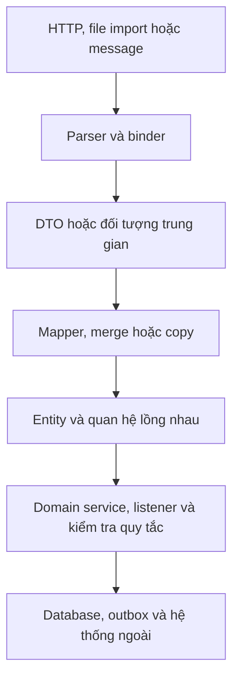

# Sensitive field exclusion: loại trường nhạy cảm khỏi luồng gán hàng loạt

Trong chương **Mass Assignment**, sensitive field exclusion là việc ngăn dữ liệu từ nguồn không đáng tin được gán trực tiếp vào những thuộc tính mà caller không có thẩm quyền kiểm soát. Những thuộc tính đó không chỉ gồm mật khẩu hoặc bí mật; chúng còn có thể là tenant, danh tính cá nhân, vai trò, bằng chứng xác minh, trạng thái nghiệp vụ hoặc phiên bản quyền.

Trong module bảo vệ logic nghiệp vụ, một phép sao chép dữ liệu quá rộng có thể biến quyền sửa hồ sơ thành quyền quản trị, quyền ghi chú thành quyền phê duyệt hoặc quyền tạo bản nháp thành quyền xác nhận thanh toán. Loại trường nhạy cảm cần được thực thi xuyên suốt schema đầu vào, mapping, domain service và bước lưu, cùng quyền theo đối tượng, transaction và idempotency.

Bài học dùng ví dụ người dùng cập nhật hồ sơ tài khoản của chính mình. Mục tiêu là chỉ nhận những thay đổi được cho phép, trong khi các thuộc tính bảo mật tiếp tục do những luồng có thẩm quyền quản lý.

Sau bài này, bạn có thể:

- Nhận diện trường nhạy cảm với thao tác ghi, kể cả khi giá trị không phải bí mật.
- Thiết kế tập trường đầu vào cho phép thay vì dựa vào danh sách cấm dễ thiếu.
- Tách DTO đọc, DTO ghi và entity để giảm khả năng gán ngoài ý muốn.
- Bảo vệ thuộc tính lồng nhau, PATCH, alias và các giá trị mặc định.
- Kiểm thử dữ liệu nhạy cảm và tác dụng phụ trước–sau một request.

## 1. Một yêu cầu sửa hồ sơ có thể trở thành thay đổi quyền

Giả sử endpoint cho phép người dùng sửa tên hiển thị và ngôn ngữ:

```http
PUT /accounts/me/profile
Content-Type: application/json

{
  "displayName": "An",
  "locale": "vi-VN",
  "expectedVersion": 7,
  "roles": ["TENANT_ADMIN"],
  "tenantId": "tenant-other",
  "personId": "person-other",
  "emailVerified": true,
  "locked": false,
  "authzEpoch": 0
}
```

Một cách triển khai nguy hiểm:

```text
account = tải tài khoản của người đang đăng nhập
copy tất cả thuộc tính từ body vào account
lưu account
```

Quyền sửa đúng tài khoản đã được kiểm tra, nhưng quyền trên từng thuộc tính chưa được kiểm tra. Caller có thể được nhận diện đúng và vẫn sửa những trường vượt quá thẩm quyền.

`personId` đặc biệt dễ bị bỏ sót vì không có tên giống một quyền. Nếu nó được dùng để kiểm tra một người có tự duyệt hoặc tự cấp quyền cho mình không, cho phép sửa trường này có thể làm mất ràng buộc phân tách trách nhiệm.

Mass assignment là vấn đề ở đường dữ liệu từ đầu vào tới thuộc tính có hiệu lực. Nó có thể xuất hiện qua binder, mapper, phép merge, reflection, import hoặc cách tạo entity từ một đối tượng request dùng chung.

## 2. Nhạy cảm với ghi khác với bí mật khi đọc

Một trường có thể không bí mật nhưng vẫn không được client cập nhật tự do.

| Nhóm trường | Ví dụ | Rủi ro nếu được gán từ đầu vào thông thường |
| --- | --- | --- |
| Danh tính và phạm vi | `id`, `tenantId`, `personId`, `ownerId` | Đổi đối tượng, tổ chức hoặc căn cứ kiểm tra quyền |
| Quyền và chính sách | `roles`, `permissions`, `riskOverride`, `mfaRequired` | Nâng quyền hoặc tắt điều kiện bảo vệ |
| Bằng chứng xác minh | `emailVerified`, `verifiedBy`, `verifiedAt` | Tự khai một quy trình đã hoàn tất |
| Trạng thái nghiệp vụ | `status`, `approvedBy`, `paymentStatus` | Bỏ qua bước và tạo bằng chứng giả |
| Giá trị dẫn xuất | `total`, `discountAmount`, `creditLimit` theo mô hình | Thay đổi kết quả hoặc giới hạn do máy chủ quản lý |
| Bí mật và credential lưu trữ | `passwordHash`, khóa tích hợp | Thay credential ngoài quy trình hoặc làm lộ bí mật |
| Vòng đời dữ liệu | `deletedAt`, cờ khóa, cờ kích hoạt | Khôi phục, mở khóa hoặc xóa trái phép |
| Metadata có thẩm quyền | `createdBy`, `createdAt`, `authzEpoch`, version đã lưu | Làm sai lịch sử, cơ chế thu hồi hoặc kiểm soát cạnh tranh |

Phân loại phải dựa trên cách hệ thống sử dụng trường, không chỉ dựa vào từ khóa trong tên. Một trường mới tên `trustedSource` có thể mở một nhánh bỏ kiểm tra dù không nằm trong danh sách cấm cũ.

Quyền đọc và quyền ghi cần được tách. Người dùng có thể được xem vai trò hiện tại nhưng không được tự gửi lại vai trò để cập nhật. Ngược lại, một luồng đổi mật khẩu có thể nhận mật khẩu mới nhưng không trả hoặc nhận trực tiếp giá trị hash lưu trữ.

## 3. Ranh giới cần bảo vệ là từ input tới hiệu ứng

Một đường xử lý thường có nhiều bước:



Loại trường ở một bước chưa đủ nếu nó được đưa trở lại ở bước khác. Ví dụ DTO chính không có `roles`, nhưng mapper còn merge một map `extraProperties` vào entity; caller vẫn có đường thay đổi quyền.

Không nên copy dữ liệu trước rồi khôi phục trường cấm sau:

```text
oldRoles = account.roles
copyAll(body, account)
account.roles = oldRoles
```

Trong khoảng giữa, mã nghiệp vụ hoặc listener có thể đã dùng giá trị mới. Với đối tượng con hoặc collection dùng chung tham chiếu, việc giữ một biến cũ cũng có thể không tạo ra bản sao độc lập để khôi phục.

Cách dễ kiểm chứng hơn là không đưa trường không được phép vào lệnh và không gán nó từ input ngay từ đầu. Mọi thay đổi nhạy cảm còn lại phải là hệ quả được domain service chủ động xác lập.

## 4. Tập trường cho phép là hợp đồng chính

Với endpoint hồ sơ của ví dụ, đầu vào chỉ gồm:

```text
displayName
locale
expectedVersion
```

`expectedVersion` là điều kiện đối chiếu phiên bản người dùng đã xem. Nó không phải giá trị version mới để ghi đè lên bản ghi.

Một danh sách cấm như:

```text
không copy roles, passwordHash, tenantId
```

có thể bỏ sót `personId`, `emailVerified`, một thuộc tính lồng nhau hoặc trường mới được thêm sau này. Nếu mặc định mọi thuộc tính khác đều được copy, mỗi lần mở rộng entity có thể vô tình mở rộng quyền của API.

Một tập cho phép có ngữ nghĩa ngược lại: chỉ thuộc tính được xác định cho lệnh này mới đi vào mapping. Entity có thêm trường không làm đầu vào tự nhận thêm khả năng.

Danh sách loại trừ ở binder hoặc mapper vẫn có thể là lớp bổ sung. Tuy nhiên, không nên lấy một danh sách cấm dùng chung làm toàn bộ chính sách cho mọi endpoint và mọi vai trò.

Trong hợp đồng minh họa, trường không được hỗ trợ bị từ chối trước khi cập nhật. Một sản phẩm có thể chọn bỏ qua trường lạ trong một số API vì lý do tương thích, nhưng phải bảo đảm chúng không có hiệu lực và không khiến client tưởng thay đổi nhạy cảm đã được chấp nhận. Dù chọn cách nào, cần kiểm thử hành vi cụ thể.

## 5. Tách DTO đọc, lệnh ghi và mô hình lưu trữ

Ba mô hình có trách nhiệm khác nhau:

| Mô hình | Mục đích | Điều nên tránh |
| --- | --- | --- |
| DTO phản hồi | Trả dữ liệu caller được phép đọc | Dùng nguyên làm hợp đồng cập nhật |
| Lệnh đầu vào | Diễn đạt ý định được phép đề xuất | Chứa toàn bộ cột của entity |
| Entity hoặc mô hình lưu trữ | Giữ dữ liệu nghiệp vụ và metadata | Được bind trực tiếp từ request |

Ví dụ response có thể hiển thị `emailVerified` để người dùng biết trạng thái. Trường đó không nên xuất hiện trong lệnh sửa tên và ngôn ngữ chỉ vì hai mô hình đều liên quan tài khoản.

Đường tạo mới và đường cập nhật cũng có thể cần lệnh khác nhau. Khi tạo tài khoản, máy chủ gán tenant, danh tính liên kết, trạng thái khởi tạo và các metadata phù hợp. Không để một DTO chung nhận mọi trường rồi kỳ vọng các giá trị mặc định luôn an toàn.

Việc một kiểu được đặt tên `SafeDto` không tạo bảo đảm nếu nó có map mở, entity con hoặc cơ chế tự động copy tất cả thuộc tính cùng tên. Cần nhìn tập dữ liệu thực sự có thể đi qua nó.

## 6. Minh họa Java: chuẩn bị thay đổi hồ sơ có phạm vi hẹp

Đoạn mã dùng record của Java 16 trở lên. `ActorContext` được dựng từ ngữ cảnh đã xác thực và policy hiện tại; `AccountGuardSnapshot` được tải từ dữ liệu máy chủ. Controller chỉ nhận `UpdateProfileCommand` theo schema đã định.

```java
import java.util.Objects;
import java.util.Set;
import java.util.UUID;

record UpdateProfileCommand(
        String displayName,
        String locale,
        long expectedVersion) {
}

record ActorContext(
        UUID tenantId,
        UUID accountId,
        boolean active,
        boolean mayEditOwnProfile) {
}

record AccountGuardSnapshot(
        UUID tenantId,
        UUID accountId,
        boolean locked,
        long version) {
}

record AuthorizedProfileChange(
        UUID tenantId,
        UUID accountId,
        long expectedVersion,
        String displayName,
        String locale) {
}

final class ProfileUpdatePolicy {
    private static final Set<String> SUPPORTED_LOCALES =
            Set.of("vi-VN", "en-US");

    private ProfileUpdatePolicy() {
    }

    static AuthorizedProfileChange prepare(
            ActorContext actor,
            AccountGuardSnapshot account,
            UpdateProfileCommand command) {
        Objects.requireNonNull(actor);
        Objects.requireNonNull(account);
        Objects.requireNonNull(command);

        require(actor.active() && actor.mayEditOwnProfile(),
                "PROFILE_UPDATE_NOT_ALLOWED");
        require(Objects.requireNonNull(actor.tenantId())
                .equals(account.tenantId()), "TENANT_MISMATCH");
        require(Objects.requireNonNull(actor.accountId())
                .equals(account.accountId()), "ACCOUNT_MISMATCH");
        require(!account.locked(), "ACCOUNT_LOCKED");
        require(command.expectedVersion() == account.version(),
                "VERSION_CONFLICT");

        String name = Objects.requireNonNull(command.displayName()).strip();
        require(!name.isEmpty() && name.length() <= 100,
                "INVALID_DISPLAY_NAME");
        require(command.locale() != null
                && SUPPORTED_LOCALES.contains(command.locale()),
                "UNSUPPORTED_LOCALE");

        return new AuthorizedProfileChange(account.tenantId(),
                account.accountId(), account.version(), name, command.locale());
    }

    private static void require(boolean valid, String code) {
        if (!valid) {
            throw new IllegalArgumentException(code);
        }
    }
}
```

Hai locale và giới hạn độ dài là chính sách minh họa. Ứng dụng cần dùng hợp đồng thực tế và ánh xạ lỗi phù hợp; validation tên không thay thế xử lý đầu ra đúng ngữ cảnh khi hiển thị.

Các kiểu không có `roles`, `personId`, `emailVerified`, `passwordHash` hoặc `authzEpoch`. Kết quả chỉ thể hiện đúng hai trường hồ sơ được sửa, cùng scope và điều kiện phiên bản do máy chủ xác lập.

Ví dụ không cấu hình thư viện JSON. Tầng HTTP vẫn cần kiểm tra schema, trường lạ, tên trùng và giới hạn kích thước. Không bind client thành `ActorContext` hoặc `AuthorizedProfileChange` chỉ vì đó là record có sẵn.

## 7. Bước lưu cũng chỉ cập nhật các cột được phép

Một câu SQL cập nhật hồ sơ có thể là:

```sql
UPDATE user_account
SET display_name = :validated_display_name,
    locale = :validated_locale,
    version = version + 1
WHERE tenant_id = :authorized_tenant_id
  AND id = :authenticated_account_id
  AND version = :expected_version
  AND locked = FALSE;
```

Các cột vai trò, mapping danh tính và bằng chứng xác minh không có vị trí nhận giá trị từ lệnh này. Nếu có metadata như `updated_at` hoặc `updated_by`, máy chủ tự gán theo ngữ cảnh có thẩm quyền.

Phải kiểm tra đúng một hàng được cập nhật. Không có hàng bị tác động có thể là xung đột, trạng thái thay đổi hoặc đối tượng không còn trong phạm vi; không coi đó là thành công rồi trả lại body của client như dữ liệu đã lưu.

Luồng tổng thể:

```text
phân tích input theo schema và tập trường được hỗ trợ
xác thực actor và tenant scope

BEGIN TRANSACTION
  tải tài khoản trong phạm vi được phép
  kiểm tra quyền đối tượng, trạng thái và version
  chuẩn bị các thay đổi được phép và kiểm tra giá trị
  cập nhật có điều kiện đúng các cột của lệnh
  ghi audit và dữ liệu bắt buộc liên quan
COMMIT

tạo response theo quyền đọc, không serialize toàn bộ entity
```

Nếu dùng ORM, cần kiểm chứng mapping và lệnh lưu thực tế giữ cùng ngữ nghĩa. Tên hàm `updateProfile` không bảo đảm an toàn nếu bên trong vẫn copy một entity đầy đủ nhận từ request.

## 8. Thuộc tính lồng nhau và collection không được mở cửa sau

Một lớp account không nhận `roles` trực tiếp nhưng vẫn có thể bị sửa qua cấu trúc khác:

```json
{
  "preferences": {
    "locale": "vi-VN",
    "security": {
      "mfaRequired": false
    }
  },
  "membership": {
    "roleIds": ["TENANT_ADMIN"]
  }
}
```

Nếu một endpoint hỗ trợ preferences, dùng kiểu đầu vào chỉ chứa các trường preference được phép. Không tái sử dụng một entity cấu hình có cả phần bảo mật hoặc map tùy ý rồi merge toàn bộ.

Với collection, cần xem cả quyền thêm, sửa và xóa phần tử. Thay toàn bộ một mảng membership có thể ngầm xóa giới hạn hoặc thêm một quan hệ quản trị dù request không có một trường đơn lẻ tên `isAdmin`.

Các ID tham chiếu cũng cần kiểm tra quyền. Cho sửa `addressId` không có nghĩa được gắn địa chỉ người khác; cho chọn một nhóm làm việc không có nghĩa được thêm mình vào nhóm cấp quyền cao.

Chỉ bảo vệ thuộc tính cấp gốc bằng danh sách tên sẽ không bao phủ những đường dẫn mà binder hỗ trợ. Cần schema và mapping rõ cho từng cấu trúc con, hoặc lệnh nghiệp vụ riêng cho những thay đổi nhạy cảm.

## 9. PATCH, null và giá trị mặc định có thể làm thay đổi trường bị loại

Với cập nhật từng phần, cần phân biệt:

```text
trường không gửi
trường được gửi với null
trường được gửi với false, 0 hoặc chuỗi rỗng
```

Một mapper có thể biến trường không gửi thành giá trị mặc định rồi copy sang entity. Ví dụ role bị đặt thành tập rỗng, cờ khóa thành false hoặc thời điểm xác minh thành null dù người dùng không yêu cầu thay đổi chúng.

Loại trường nhạy cảm không chỉ là bỏ qua một giá trị có trong payload; nó còn là bảo đảm đường cập nhật không vô tình ghi giá trị mặc định vào thuộc tính ngoài phạm vi lệnh.

Với một object con, thay cả object từ DTO có thể làm mất metadata không xuất hiện trong DTO. Cần cập nhật đúng các thuộc tính được phép trên trạng thái ứng viên, hoặc xác định một hành động thay thế toàn phần có hệ quả rõ ràng.

Nếu API hỗ trợ patch tổng quát, kiểm tra từng phép toán và đường dẫn, gồm xóa, copy, move hoặc test. Không cho copy từ một trường bí mật sang trường công khai, và không để xóa một thuộc tính bắt buộc làm hệ thống rơi vào nhánh mặc định ít bảo vệ hơn.

Ví dụ `PUT /accounts/me/profile` trong bài coi tên và locale là nội dung đầy đủ của tài nguyên profile. Nếu muốn hỗ trợ PATCH chỉ sửa một trường, cần một mô hình biểu diễn sự hiện diện và kiểm tra trạng thái kết quả theo hợp đồng riêng.

## 10. Trường bị loại khỏi input vẫn có thể được máy chủ thay đổi hợp lệ

Sensitive field exclusion không có nghĩa mọi trường nhạy cảm phải bất biến trong mọi tình huống. Nó có nghĩa client không được trực tiếp quyết định chúng qua một luồng không có thẩm quyền.

Ví dụ:

| Lệnh hợp lệ | Dữ liệu client được đề xuất | Hệ quả máy chủ có thể xác lập |
| --- | --- | --- |
| Yêu cầu đổi email | Email mới theo hợp đồng | Tạo tiến trình xác minh và không tự đánh dấu email mới đã xác minh |
| Hoàn tất xác minh email | Bằng chứng hợp lệ đúng tài khoản và mục đích | Đặt trạng thái xác minh theo kết quả kiểm tra |
| Đổi mật khẩu | Mật khẩu mới và bằng chứng yêu cầu theo policy | Tính hash và cập nhật metadata bảo mật |
| Duyệt đề nghị | Ý định duyệt, version và dữ liệu cần thiết | Ghi người duyệt, thời gian và snapshot phía máy chủ |
| Thay vai trò được cấp quyền | Role và đối tượng nằm trong phạm vi quản trị | Tăng version quyền, ghi audit và phát sự kiện thu hồi hoặc cấp mới |

Nếu đổi một thông tin liên hệ làm mất hiệu lực xác minh cũ, domain service có thể chủ động đặt lại bằng chứng theo chính sách. Điều đó khác việc cho client gửi `emailVerified=true` để tự chọn kết quả.

Do vậy, kiểm thử cần phân biệt “không bị gán trực tiếp từ input” với “không bao giờ được thay đổi”. Các thay đổi dẫn xuất hợp lệ phải có nguyên nhân và quy tắc rõ, không được xuất hiện do mapper mặc định.

## 11. Chức năng quản trị cần lệnh và quyền riêng

Một quản trị viên có thể được phép thay vai trò, nhưng điều đó không làm mọi trường của account được sửa tùy ý.

Thay vì một DTO khổng lồ dùng cho cả người dùng và admin, có thể tách:

```text
UpdateOwnProfile
RequestEmailChange
ChangePassword
AssignRole
LockAccount
LinkPersonIdentity
```

Mỗi lệnh có tập trường, quyền theo đối tượng, scope, guard và audit phù hợp. Ví dụ người được gán role trong tenant A không được quản lý account của tenant B hoặc tự gán một role ngoài danh mục được ủy quyền quản trị.

Thay mapping cá nhân có thể tác động quy tắc không tự duyệt. Tắt yêu cầu xác thực mạnh có thể tác động thao tác đặc quyền. Đây là những thay đổi cần chính sách tương xứng, không phải trường phụ của một form hồ sơ.

Nếu có đường import hoặc khôi phục đặc biệt, tách nó thành ranh giới có thẩm quyền rõ ràng. Không dùng `isAdmin` hoặc `trusted=true` do chính request cung cấp để bật chế độ copy toàn bộ entity.

## 12. Cấu hình serialize và deserialize phải được hiểu theo từng chiều

Một thuộc tính không xuất hiện trong JSON phản hồi chưa chứng minh nó không được nhận khi ghi. Tùy binder và cấu hình, quy tắc ẩn đầu ra, chỉ đọc, chỉ ghi hoặc bỏ qua đầu vào có thể có ý nghĩa khác nhau.

Cần kiểm chứng riêng:

- Trường có được đọc vào từ body không.
- Nó có alias hoặc đường dẫn lồng nhau được hỗ trợ không.
- Form, query string và JSON có đi qua cùng cơ chế không.
- Các cấu hình chung, mixin hoặc mapper tùy chỉnh có làm đổi hành vi không.
- Một endpoint khác có dùng lại entity với cấu hình khác không.

Không xem việc không có setter công khai là bằng chứng duy nhất. Một số cơ chế dựng đối tượng có thể dùng constructor, reflection hoặc truy cập thuộc tính theo cấu hình. Điều quan trọng là đường đầu vào thực tế có thể tạo thay đổi nào.

Các annotation hoặc cấu hình binder có thể hỗ trợ phòng vệ, nhưng hợp đồng lệnh hẹp và mapping tường minh thường dễ rà soát hơn một mạng các ngoại lệ ẩn.

Với tham số trùng hoặc tên có nhiều biểu diễn, parser và binder phải cùng cách hiểu. Đừng để lớp kiểm tra loại `roles` nhưng một alias hoặc đường dẫn khác vẫn được mapper gán vào cùng thuộc tính bảo mật.

## 13. API phụ, import và worker cần cùng nguyên tắc

Mass assignment có thể quay lại ở một đường khác sau khi API chính được sửa:

| Kênh | Rủi ro thường gặp |
| --- | --- |
| API hàng loạt | Một DTO entity được tái sử dụng cho nhiều account |
| Import CSV hoặc bảng dữ liệu | Cột trùng tên thuộc tính được tự gán |
| Mobile API | Hợp đồng rộng hơn web và nhận các cờ nội bộ |
| Công cụ hỗ trợ | Cho sửa trực tiếp mọi trường để xử lý nhanh |
| Worker hoặc consumer | Tin payload vì đến từ hàng đợi |
| Đồng bộ hệ thống ngoài | Nguồn được xác thực nhưng không có quyền quyết định mọi thuộc tính |

Nguồn có thẩm quyền với một trường chưa chắc có thẩm quyền với trường khác. Một dịch vụ cập nhật tên hiển thị không tự được thay vai trò hoặc mapping tenant.

Worker cần xác minh nguồn, loại công việc và scope, rồi gọi lệnh nghiệp vụ phù hợp. Quyền ghi kỹ thuật của service không thay thế quyền quyết định giá trị trong payload.

Với hàng loạt, kiểm tra từng đối tượng và từng trường. Một account hợp lệ trong lô không cấp quyền sửa những account khác; định nghĩa rõ toàn bộ hoặc không gì cả, hoặc kết quả từng mục, mà không để mục bị cấm thay đổi âm thầm.

## 14. Version, thu hồi và idempotency vẫn cần được giữ

Loại trường nhạy cảm khỏi input không giải quyết mọi tranh chấp. Sau khi kiểm tra account chưa khóa, một request quản trị có thể khóa nó trước lúc hồ sơ được lưu.

Cần khóa, version hoặc cập nhật có điều kiện phù hợp để không dùng quyết định cũ ngoài hợp đồng. Một entity cũ được lưu toàn bộ còn có thể ghi đè những thay đổi bảo mật vừa được commit ở luồng khác, dù client không gửi trường đó.

`expectedVersion` của client là điều kiện so sánh. Version mới, epoch quyền và metadata thu hồi do máy chủ xác lập. Không bind trực tiếp các giá trị cũ hoặc nhỏ hơn rồi làm mất cơ chế phát hiện thay đổi.

Nếu lệnh có tác dụng phụ cần idempotency, dấu vân tay phải phản ánh đúng các trường được phép và ý định thực tế. Một payload chứa trường không hỗ trợ cần được xử lý theo schema trước khi làm nó có hiệu lực.

Retry cùng một lệnh đã thành công không được tạo thêm sự kiện cấp quyền hoặc tiến trình xác minh ngoài chính sách. Ngược lại, idempotency key không cấp quyền sửa một trường nhạy cảm chỉ vì key đã từng được dùng hợp lệ cho một lệnh khác.

Phản hồi kết quả cũ vẫn phải tuân thủ quyền đọc hiện tại; không trả nguyên entity có dữ liệu bí mật chỉ vì nó đã được lưu trong bản ghi idempotency.

## 15. Ma trận kiểm thử loại trường nhạy cảm

Trước hết, có ca đối chứng cập nhật profile hợp lệ. Sau đó thêm từng nhóm trường vào cùng một request vốn hợp lệ để kiểm tra đúng ranh giới.

| Ca kiểm thử | Kết quả cần giữ |
| --- | --- |
| Chỉ gửi tên, locale và version hợp lệ | Đúng các trường hồ sơ và metadata máy chủ được phép thay đổi |
| Gửi thêm `roles` hoặc `permissions` | Không thay đổi quyền; phản hồi đúng schema đã chọn |
| Gửi `tenantId`, `personId` hoặc `id` | Không chuyển phạm vi hoặc căn cứ danh tính |
| Gửi `emailVerified=true` hoặc thông tin người xác minh | Không tạo bằng chứng xác minh giả |
| Gửi `locked=false`, `deletedAt=null` | Không mở khóa hoặc phục hồi ngoài lệnh chuyên biệt |
| Gửi `authzEpoch`, version lưu trữ hoặc lịch sử tạo | Không ghi đè metadata có thẩm quyền |
| Gửi `passwordHash` | Không thay credential qua luồng hồ sơ |
| Gửi cấu trúc membership hoặc security lồng nhau | Không sửa qua một đường dẫn thay thế |
| Gửi alias, tên trùng hoặc nhiều nguồn tham số | Không có khác biệt giữa lớp kiểm tra và lớp gán |
| Bỏ trường không được phép mà mapper có giá trị mặc định | Không vô tình ghi đè thuộc tính nhạy cảm |
| Caller có quyền trên account khác nhưng không có quyền trường | Không suy quyền sửa toàn bộ entity |
| Account hoặc tenant ngoài phạm vi | Không thay đổi dữ liệu dù tập trường hợp lệ |

Không chỉ quan sát mã HTTP. Truy vấn độc lập các thuộc tính bảo mật trước–sau trong môi trường test, kiểm tra quyền hiệu lực và theo dõi operation hoặc outbox liên quan.

Với các giá trị bí mật trong fixture, so sánh theo cách không đưa chúng ra báo cáo hoặc log. Một test in toàn bộ entity để chứng minh không đổi có thể tự tạo ra vấn đề lộ dữ liệu.

## 16. Kiểm thử hồi quy khi entity và cấu hình thay đổi

Một nguy cơ của danh sách cấm là trường mới tự trở thành đầu vào được gán. Khi thêm thuộc tính như `riskOverride`, hãy kiểm tra:

- API profile không tự nhận hoặc áp dụng thuộc tính mới.
- DTO response nếu thay đổi không kéo theo khả năng ghi.
- Mapper, import và endpoint phụ không tự mở đường copy.
- Kiểu con, alias hoặc cấu trúc lồng nhau không làm trường đi qua một tên khác.

Các ca concurrency và lỗi cần có:

| Kịch bản | Điều cần xác minh |
| --- | --- |
| Cập nhật profile đồng thời với khóa account | Không ghi đè cờ khóa hoặc bỏ guard ngoài hợp đồng |
| Cập nhật từ snapshot cũ sau thay đổi vai trò | Không phục hồi vai trò hoặc epoch cũ |
| Lỗi sau chuẩn bị mapping nhưng trước commit | Không để lại một phần dữ liệu hoặc tác dụng phụ trái phép |
| Hai cập nhật cùng version | Phát hiện xung đột theo thiết kế, không âm thầm ghi đè |
| Retry hoặc gửi lô cùng payload nhạy cảm | Không tạo đường đi vòng qua parser hoặc service khác |
| Cấu hình serialize thay đổi | Thuộc tính bí mật vẫn không xuất hiện và thuộc tính chỉ đọc không trở thành ghi được |

Oracle nên kiểm tra tập thay đổi thực tế so với tập được phép của lệnh. Tính cả metadata hợp lệ do máy chủ quản lý; không yêu cầu mọi byte của bản ghi bất biến khi lệnh đúng là phải tăng version hoặc thời điểm cập nhật.

Những ca dựa vào transaction hoặc ORM cần kiểm thử tích hợp với cơ chế lưu trữ phù hợp. Mock một mapper chỉ copy hai trường không chứng minh endpoint thực tế cũng dùng mapper đó hoặc không còn một đường copy khác.

## 17. Lỗi, audit và quan sát hành vi gán ngoài hợp đồng

Phản hồi có thể dùng mã ổn định như `UNSUPPORTED_FIELD` hoặc một lỗi quyền phù hợp. Không cần liệt kê toàn bộ tên thuộc tính bảo mật chưa được caller biết hoặc trả entity để giải thích tại sao không được sửa.

Audit nên gắn được:

```text
actor và tenant đã xác minh
đối tượng, loại lệnh và version liên quan
tên trường được phép đã thay đổi
metadata và hệ quả nghiệp vụ do máy chủ xác lập nếu có
kết quả đã commit hoặc nhóm lý do từ chối
operation và mã tương quan phù hợp
```

Tách một lần cố gửi `roles` bị chặn khỏi một hành động quản trị thay vai trò đã được cấp quyền. Cả hai có thể cùng nhắc tới thuộc tính, nhưng chỉ hành động sau tạo thay đổi hợp lệ.

Không log toàn bộ input theo mặc định. Payload bị chặn có thể chứa mật khẩu, token hoặc bí mật mà caller vô tình gửi nhầm. Ưu tiên nhóm trường vi phạm, định danh và thông tin tối thiểu cần cho điều tra.

Theo dõi các lần gửi thuộc tính máy chủ quản lý, đường dẫn lồng nhau bất thường hoặc request từ client cũ. Những dấu hiệu này giúp phát hiện lỗi tích hợp hoặc lạm dụng; cơ chế ngăn gán vẫn phải thực thi ngay trước khi dữ liệu có hiệu lực.

## 18. Cách áp dụng sensitive field exclusion vào một endpoint

1. Liệt kê mọi thuộc tính entity và đánh giá tác động của việc caller tự đặt giá trị.
2. Xác định tập trường đầu vào cho từng lệnh, tách khỏi DTO đọc và mô hình lưu trữ.
3. Chọn cách xử lý trường không hỗ trợ, alias, tham số trùng và cấu trúc lồng nhau theo hợp đồng rõ ràng.
4. Mapping tường minh đúng các trường được phép; không copy toàn bộ rồi khôi phục trường cấm.
5. Giữ identity, tenant, quyền, bằng chứng, trạng thái và metadata từ nguồn có thẩm quyền.
6. Để domain service chủ động tạo các hệ quả nhạy cảm hợp lệ, thay vì nhận kết quả từ client.
7. Lưu đúng cột cùng guard đối tượng, trạng thái và version trong ranh giới nhất quán.
8. Bao phủ import, worker, mobile, hàng loạt và công cụ quản trị bằng cùng nguyên tắc.
9. Kiểm thử tập thay đổi trước–sau và bổ sung regression test khi entity hoặc cấu hình binding thay đổi.

Loại trường nhạy cảm có hiệu quả khi dữ liệu ngoài thẩm quyền không bao giờ được tự động biến thành thuộc tính có hiệu lực. Một hợp đồng lệnh hẹp, mapping rõ và bước lưu có kiểm soát giúp giữ ranh giới đó ngay cả khi mô hình tài khoản ngày càng có thêm dữ liệu bảo mật.
