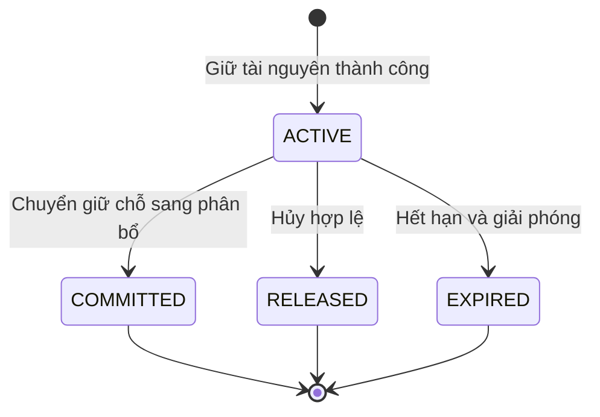

# Tồn kho và tài nguyên khan hiếm trong bảo mật logic nghiệp vụ

## 1. Vì sao đây là tài sản cần bảo vệ?

**Tồn kho và tài nguyên khan hiếm** là những nguồn lực có số lượng, công suất hoặc thời gian sử dụng hữu hạn mà hệ thống phân phối cho người dùng. Ngoài hàng hóa trong kho, chúng còn gồm ghế ngồi, phòng lưu trú, lịch hẹn, suất tham gia, lượt dùng ưu đãi hoặc hạn mức xử lý của một dịch vụ.

Một lỗi logic nghiệp vụ có thể làm hệ thống:

- Cam kết bán nhiều hơn số lượng có thể cung cấp.
- Giao cùng một ghế hoặc một khoảng thời gian cho nhiều người.
- Cho phép một bên giữ phần lớn nguồn lực mà không hoàn tất giao dịch.
- Hoàn trả tài nguyên nhiều lần sau một lần hủy.
- Để người dùng chiếm hoặc giải phóng phần tài nguyên của người khác.
- Tiếp tục nhận tiền khi tài nguyên cần cung cấp đã được cấp cho người khác.

Tác hại không nhất thiết xuất hiện dưới dạng mất dữ liệu hoặc sập server. API vẫn trả lời nhanh nhưng khách hàng hợp lệ không còn mua được hàng vì toàn bộ nguồn hàng đang bị giữ chỗ. Đây là tổn hại đến **khả năng tiếp cận tài nguyên ở cấp nghiệp vụ**.

OWASP nêu việc mua vét hàng có nhu cầu cao và chiếm các khung giờ đặt chỗ là những ví dụ lạm dụng luồng nghiệp vụ nhạy cảm. Xem [OWASP API6:2023 — Unrestricted Access to Sensitive Business Flows](https://api-security.owasp.org/editions/2023/en/0xa6-unrestricted-access-to-sensitive-business-flows/).

Bài học thuộc chương **Business Assets**, module **SECURITY_APPLICATION_SECURITY_BUSINESS_LOGIC_SECURITY**. Mục tiêu là nhận diện tài sản hữu hạn, viết bất biến bảo vệ và liên kết chúng với quyền theo đối tượng, state machine, transaction, idempotency và kiểm thử hành vi lạm dụng.

## 2. Xác định chính xác tài nguyên đang phân phối

### 2.1. Không phải tài nguyên nào cũng chỉ cần một bộ đếm

| Loại tài nguyên | Đơn vị khan hiếm | Điều phải bảo vệ |
|---|---|---|
| Hàng hóa đồng nhất | Số lượng theo SKU và kho | Tổng giữ chỗ và phân bổ không vượt nguồn hàng được phép dùng |
| Ghế có định danh | Một ghế trong một sự kiện | Không có hai cam kết hiệu lực trên cùng ghế |
| Phòng hoặc lịch hẹn | Tài nguyên trong khoảng thời gian | Không có các lượt đặt chồng lấn ngoài công suất |
| Lượt ưu đãi | Một quyền lợi theo chiến dịch và chủ thể | Không cấp vượt tổng số lượt hoặc giới hạn từng chủ thể |
| Hạn mức dịch vụ | Số đơn vị theo khách hàng và kỳ | Không tiêu thụ vượt quyền lợi được cấp |
| Năng lực xử lý | Số tác vụ đang thực thi | Không cho một bên chiếm hết năng lực ngoài chính sách |

Với SKU có nhiều sản phẩm tương đương, bộ đếm là mô hình tự nhiên. Với ghế cụ thể, chỉ biết “còn một ghế” chưa chứng minh ghế A12 chưa thuộc về người khác. Với lịch hẹn, hai cuộc hẹn có giờ bắt đầu khác nhau vẫn có thể chồng lấn.

### 2.2. Những câu hỏi cần trả lời trước khi thiết kế

- Tài nguyên thuộc tổ chức, kho, sự kiện hoặc kỳ hạn nào?
- Tài nguyên có thể thay thế cho nhau hay có định danh riêng?
- Khi nào người dùng chỉ bày tỏ ý định, khi nào được giữ chỗ và khi nào có cam kết cung cấp?
- Thời hạn giữ chỗ là bao lâu, có được gia hạn và trong điều kiện nào?
- Điều gì giải phóng tài nguyên: hủy, hết hạn, thất bại thanh toán hay quy trình khác?
- Hệ thống có cho phép bán trước, chờ hàng hoặc overbooking theo chính sách hay không?
- Có hạn mức theo người mua, tổ chức, chiến dịch hoặc toàn hệ thống không?

Bài học dùng mô hình **không bán vượt tồn và không overbooking**. Nếu doanh nghiệp chủ động cho phép các hình thức đó, phải mô tả riêng hạn mức, nghĩa vụ và cách xử lý thiếu hụt; không thể dùng một bất biến không âm của ví dụ để thay thế chính sách thực tế.

## 3. Mô hình tồn kho: hàng có, giữ chỗ và đã phân bổ

### 3.1. Phân biệt ba lượng

Xét một SKU tại một kho thuộc một tổ chức:

- **`on_hand`**: số hàng đang có và được chấp nhận là có thể dùng để thực hiện cam kết, bao gồm hàng tự do, đang giữ chỗ và đã phân bổ nhưng chưa xuất.
- **`held`**: phần đang được giữ tạm thời cho các reservation chưa kết thúc.
- **`allocated`**: phần đã được phân bổ cho đơn được chấp nhận nhưng chưa xuất kho.

Số có thể nhận giữ chỗ mới là:

```text
available = on_hand - held - allocated
```

Hàng hỏng, hàng cách ly hoặc hàng chưa qua kiểm tra không được mặc nhiên tính vào `on_hand` trong mô hình này. Hệ thống kho thực tế có thể có nhiều nhóm trạng thái hơn; điều quan trọng là định nghĩa rõ nhóm nào được phép bán.

Không cộng thêm một lần “số đã thanh toán” vào công thức nếu các đơn đó đã được tính trong `allocated`. Các nhóm phải có ranh giới không chồng lấn.

### 3.2. Các bất biến cơ bản

```text
on_hand >= 0
held >= 0
allocated >= 0
held + allocated <= on_hand

held = tổng số lượng của reservation đang chiếm phần giữ chỗ
allocated = tổng số lượng phân bổ chưa xuất và chưa được giải phóng
```

Các đẳng thức tổng hợp cần được hiểu tại một trạng thái dữ liệu nhất quán. Đọc bộ đếm rồi đọc danh sách reservation ở thời điểm khác có thể tạo chênh lệch biểu kiến khi hệ thống đang hoạt động.

Bất biến không chỉ là “tồn kho không âm”. Nếu `held` tăng mà không có reservation để tìm và giải phóng về sau, hàng có thể bị kẹt dù mọi bộ đếm đều không âm.

### 3.3. Ví dụ chuyển lượng

| Bước | `on_hand` | `held` | `allocated` | `available` |
|---|---:|---:|---:|---:|
| Ban đầu | 10 | 0 | 0 | 10 |
| Giữ chỗ 3 sản phẩm | 10 | 3 | 0 | 7 |
| Chấp nhận đơn, chuyển 3 sang phân bổ | 10 | 0 | 3 | 7 |
| Một khách khác giữ thêm 2 | 10 | 2 | 3 | 5 |
| Reservation 2 sản phẩm hết hạn và được giải phóng | 10 | 0 | 3 | 7 |
| Xuất 3 sản phẩm đã phân bổ | 7 | 0 | 0 | 7 |
| Nhận lại 1 sản phẩm, kiểm tra đạt và nhập lại nguồn bán | 8 | 0 | 0 | 8 |

Chuyển từ giữ chỗ sang phân bổ không làm giảm khả dụng lần thứ hai. Xuất hàng giảm cả `on_hand` và `allocated`, vì vậy cũng không làm số khả dụng của khách khác thay đổi.

Hủy đơn đã phân bổ nhưng chưa xuất có thể giảm `allocated` theo chính sách; không tăng `on_hand` vì hàng chưa rời kho. Sau khi đã xuất, hoàn tiền và nhận hàng trả lại là hai nghiệp vụ khác nhau.

## 4. Các kiểu lạm dụng cần tính đến

| Hành vi | Quy tắc có nguy cơ bị phá vỡ |
|---|---|
| Gửi nhiều yêu cầu đồng thời mua sản phẩm cuối cùng | Phân bổ không vượt nguồn hàng |
| Dùng số lượng âm hoặc vượt miền giá trị | Không tạo thêm hàng bằng cách thao tác số lượng |
| Lặp lại yêu cầu hủy hoặc thông điệp hết hạn | Mỗi reservation chỉ giải phóng một lần |
| Sửa `reservationId`, `warehouseId` hoặc `tenantId` | Chỉ thao tác trong phạm vi được cấp |
| Tạo nhiều reservation rồi không thanh toán | Không chiếm nguồn lực vượt chính sách |
| Liên tục gia hạn reservation | Thời hạn giữ chỗ có giới hạn và căn cứ |
| Gửi thanh toán sau khi reservation đã được cấp lại | Chỉ chấp nhận cam kết có tài nguyên hợp lệ |
| Gọi API phân bổ trực tiếp, bỏ bước xác nhận cần thiết | Chỉ chuyển trạng thái đúng quy trình |
| Hủy để tạo tồn rồi gửi lại xác nhận cũ | Reservation kết thúc không được hồi sinh tùy ý |
| Đặt riêng từng SKU để vượt giới hạn toàn chiến dịch | Hạn mức phải được thực thi đúng phạm vi |

Người gọi có thể sử dụng tài khoản thật, request hợp lệ về định dạng và lượng truy cập không quá lớn. Chỉ một lần giải phóng trùng cũng có thể tạo ra tồn kho ảo.

Cũng có các tình huống vô ý có cùng biểu hiện: người dùng bấm hai lần, client retry sau timeout, hàng đợi gửi lại thông điệp hoặc webhook đến muộn. Cơ chế bảo vệ phải giữ quy tắc trong cả hai trường hợp.

## 5. Vòng đời reservation

### 5.1. Mỗi reservation là một quyền giữ tài nguyên có phạm vi

Một reservation nên có tối thiểu:

- ID ổn định, tổ chức và chủ thể được giữ chỗ.
- Tài nguyên và số lượng được giữ.
- Nghiệp vụ tạo ra nó, trạng thái và thời hạn.
- Tham chiếu đơn hoặc allocation khi đã chuyển thành cam kết.
- Dữ liệu phục vụ xử lý lặp và truy vết.

Không chỉ lưu một khóa cache với TTL rồi quên quan hệ giữa khóa đó và bộ đếm tồn kho.

### 5.2. Mô hình trạng thái đơn giản



`COMMITTED` ở đây nghĩa là đã chuyển phần giữ chỗ thành allocation, không đồng nghĩa đã xuất hàng. Allocation hoặc đơn hàng có vòng đời riêng cho xuất, hủy và xử lý ngoại lệ.

Một reservation chỉ được đi khỏi `ACTIVE` một lần. Các request lặp có thể trả trạng thái hiện tại hoặc kết quả cũ theo hợp đồng API, nhưng không được trừ hoặc cộng tài nguyên lần nữa.

### 5.3. TTL không tự thực hiện nghiệp vụ giải phóng

Đến `expires_at` chỉ xác định reservation không còn đủ điều kiện để được xác nhận theo chính sách thời hạn. Cơ sở dữ liệu không tự đồng bộ các bộ đếm chỉ vì thời gian đã trôi qua.

Nếu worker hết hạn chạy chậm, phần giữ chỗ có thể vẫn nằm trong `held` cho đến khi transaction giải phóng hoàn tất. Điều này giảm khả dụng tạm thời nhưng tránh cấp trùng.

Nếu muốn tính phần hết hạn là khả dụng ngay khi có request mới, request đó phải tham gia một cơ chế thu hồi và cập nhật nguyên tử. Không được trừ các reservation hết hạn khỏi phép tính hiển thị rồi coi số đó là quyền phân phối mà chưa xử lý trạng thái nguồn.

### 5.4. Xác nhận và hết hạn có thể cạnh tranh

```text
Luồng A: xác nhận reservation.
Luồng B: đánh dấu reservation hết hạn và trả tài nguyên.
```

Cả hai phải tranh cùng quyền chuyển từ `ACTIVE`, bằng khóa hoặc cập nhật trạng thái có điều kiện. Luồng thắng mới được cập nhật bộ đếm tương ứng trong cùng transaction; luồng còn lại đọc lại kết quả và xử lý theo hợp đồng.

Thời điểm xét hết hạn phải được định nghĩa rõ: xét khi server nhận request, khi có quyền chuyển trạng thái hay theo một quy tắc khác. Dùng nguồn thời gian tin cậy và kiểm tra ở điểm quyết định tương ứng; không nhận `clientNow` để kéo dài quyền giữ chỗ.

Trong mô hình của bài, hệ thống xét điều kiện thời hạn tại điểm giành quyền chuyển trạng thái. Một request đến sớm nhưng chờ khóa quá lâu có thể không còn đủ điều kiện khi được xử lý.

## 6. Giữ chỗ nguyên tử ở nguồn dữ liệu có thẩm quyền

### 6.1. Vì sao đọc rồi ghi có thể sai?

Đoạn giả mã sau có khoảng trống cạnh tranh:

```java
StockSnapshot stock = inventory.load(stockKey);

if (stock.available() >= quantity) {
    reservations.insertNew(stockKey, quantity);
    inventory.saveHeld(stockKey, stock.held() + quantity);
}
```

Nếu còn một sản phẩm, hai transaction có thể cùng đọc thấy khả dụng bằng 1 và cùng tạo reservation. Một cách ghi đè còn có thể làm `held` chỉ bằng 1 dù có hai reservation, khiến kiểm tra bộ đếm không phát hiện ngay sai lệch.

Bọc đoạn trên trong transaction chưa đủ nếu cách đọc và mức cô lập không ngăn được sự xen kẽ đó. Cần đưa quyết định tranh tài nguyên vào cơ chế nguyên tử phù hợp.

### 6.2. Ví dụ bảng bộ đếm

Ví dụ sau dùng PostgreSQL và giả định mỗi dòng đại diện duy nhất một SKU tại một kho của một tổ chức:

```sql
CREATE TABLE inventory (
    tenant_id UUID NOT NULL,
    warehouse_id UUID NOT NULL,
    sku_id UUID NOT NULL,
    on_hand BIGINT NOT NULL,
    held BIGINT NOT NULL DEFAULT 0,
    allocated BIGINT NOT NULL DEFAULT 0,

    PRIMARY KEY (tenant_id, warehouse_id, sku_id),

    CHECK (on_hand >= 0),
    CHECK (held >= 0),
    CHECK (allocated >= 0),
    CHECK (held <= on_hand - allocated)
);
```

Điều kiện cuối biểu diễn `held + allocated <= on_hand` mà không cần cộng hai bộ đếm lớn. Các trường số đều `NOT NULL`.

Ràng buộc trên chỉ bảo vệ những giá trị cùng dòng. Nó chưa chứng minh bộ đếm bằng tổng các bản ghi reservation và allocation. PostgreSQL cũng nêu rõ giới hạn của `CHECK` khi muốn ràng buộc dữ liệu ở các dòng khác. Xem [PostgreSQL 18: Constraints](https://www.postgresql.org/docs/18/ddl-constraints.html).

Bảng reservation cần có ID duy nhất, liên kết đến đúng dòng inventory, chủ thể sở hữu, số lượng dương, trạng thái, thời hạn và định danh nghiệp vụ. Các ràng buộc tham chiếu và duy nhất phải phản ánh đúng phạm vi của mô hình.

### 6.3. Cập nhật có điều kiện

Có thể giành phần tồn kho bằng câu lệnh:

```sql
UPDATE inventory
SET held = held + :quantity
WHERE tenant_id = :tenantId
  AND warehouse_id = :warehouseId
  AND sku_id = :skuId
  AND :quantity > 0
  AND :quantity <= :perReservationLimit
  AND on_hand - held - allocated >= :quantity
RETURNING on_hand, held, allocated;
```

Các ký hiệu `:name` là placeholder minh họa của tầng truy cập dữ liệu; cần bind bằng cơ chế của thư viện sử dụng, không nối chuỗi SQL.

Backend phải:

1. Xác thực chủ thể và kiểm tra quyền trong phạm vi tài nguyên.
2. Giành quyền xử lý idempotency của request trước khi thay đổi tồn.
3. Kiểm tra hoặc cập nhật hạn mức tổng của chủ thể nếu có.
4. Chạy cập nhật trên và yêu cầu đúng một dòng được trả về.
5. Tạo reservation với số lượng, phạm vi và thời hạn do server chấp nhận.
6. Lưu kết quả idempotency và sự kiện cần thiết.
7. Commit các thay đổi cục bộ trong cùng transaction.

Nếu câu lệnh không trả dòng nào, không được tạo reservation thành công. Điều đó có thể do thiếu khả dụng hoặc không thỏa điều kiện; cách phản hồi phải phù hợp với chính sách quyền và hợp đồng API.

Nếu bước tạo reservation hoặc lưu hạn mức thất bại, toàn bộ transaction phải rollback. Không được bắt lỗi xung đột, vẫn commit phần tăng `held`, rồi trả một reservation cũ như thể mọi thứ nhất quán.

Trong PostgreSQL ở mức Read Committed, một `UPDATE` gặp dòng đang được cập nhật có thể chờ và kiểm tra lại điều kiện trên phiên bản mới sau khi bên kia commit. Điều này hỗ trợ mẫu cập nhật có điều kiện trên cùng dòng. Xem [PostgreSQL 18: Transaction Isolation](https://www.postgresql.org/docs/18/transaction-iso.html).

Cơ chế này không tự bảo vệ mọi quy tắc trên nhiều dòng. Chẳng hạn, hai SKU đều được giữ đúng tồn nhưng tổng số sản phẩm mà một khách giữ vẫn có thể vượt giới hạn nếu bộ đếm khách không được điều phối.

### 6.4. Tăng, chuyển và giải phóng phải cùng một mô hình

| Nghiệp vụ | Biến đổi bộ đếm |
|---|---|
| Tạo reservation số lượng `q` | `held += q` |
| Reservation bị hủy hoặc hết hạn | `held -= q` |
| Chuyển reservation thành allocation | `held -= q; allocated += q` |
| Hủy allocation chưa xuất | `allocated -= q` |
| Xuất allocation | `allocated -= q; on_hand -= q` |
| Nhập thêm hàng đạt điều kiện bán | `on_hand += q` |

Mỗi biến đổi phải đi cùng chuyển trạng thái hoặc bản ghi nghiệp vụ tương ứng trong cùng transaction cục bộ. Không cho client chọn tùy ý loại điều chỉnh và số lượng rồi áp dụng trực tiếp vào các bộ đếm.

Ví dụ worker hết hạn cần:

- Giành quyền chuyển reservation đang `ACTIVE` và thực sự hết hạn.
- Lấy số lượng từ reservation đã được bảo vệ, không từ message do client cung cấp.
- Giảm `held` của đúng tài nguyên và đánh dấu `EXPIRED` trong cùng transaction.
- Nếu reservation đã kết thúc, không giảm `held` lần nữa.

Nếu một điều chỉnh tồn thực tế sẽ làm `on_hand` thấp hơn lượng đã giữ và phân bổ, mô hình không được âm thầm bỏ qua ràng buộc. Cần chuyển sang quy trình thiếu hụt, kiểm kê và xử lý cam kết theo thẩm quyền.

### 6.5. Nhiều tài nguyên trong một giao dịch

Đơn có nhiều SKU hoặc combo cần quy định rõ: giữ toàn bộ hoặc chấp nhận giữ một phần. Với chính sách giữ toàn bộ, thất bại ở một SKU phải rollback phần giữ của các SKU khác trong transaction phù hợp.

Khi khóa nhiều dòng, cần thứ tự khóa thống nhất để giảm deadlock. Các đường xác nhận, giải phóng, cập nhật hạn mức và điều chỉnh phải tuân theo thiết kế điều phối chung.

Nếu dùng Serializable hoặc gặp lỗi deadlock, chiến lược retry phải xét toàn bộ transaction và idempotency; không chỉ lặp lại tùy ý câu lệnh cuối cùng. Tài liệu về khóa và deadlock có tại [PostgreSQL 18: Explicit Locking](https://www.postgresql.org/docs/18/explicit-locking.html).

Trong hệ thống nhiều database hoặc nhiều nhà cung cấp, transaction cục bộ không bao trùm mọi tác dụng phụ. Khi đó cần reservation có vòng đời, điều phối và xử lý bù; không giả định có một commit nguyên tử toàn hệ thống.

## 7. Kiểm tra đầu vào và quyền trong ứng dụng Java

Một DTO nên thể hiện ý định của người gọi, thay vì cho phép người gọi điều khiển các bộ đếm nội bộ:

```java
import java.util.Objects;
import java.util.UUID;

public record ReserveStockRequest(
        UUID warehouseId,
        UUID skuId,
        int quantity) {

    public ReserveStockRequest {
        Objects.requireNonNull(warehouseId, "warehouseId");
        Objects.requireNonNull(skuId, "skuId");

        if (quantity <= 0) {
            throw new IllegalArgumentException(
                    "quantity must be positive");
        }
    }
}
```

Đây chỉ là kiểm tra cấu trúc tối thiểu, chưa phải một hàm giữ chỗ an toàn. Tầng use case còn phải kiểm tra giới hạn từng reservation, hạn mức tổng, quyền trên kho/SKU, trạng thái bán và khả dụng tại điểm ghi nguyên tử.

Các trường không nên do client tự quyết gồm:

- Chủ sở hữu reservation và phạm vi tổ chức được cấp.
- `held`, `allocated`, `available` hoặc số tồn sau thao tác.
- Trạng thái `COMMITTED` hoặc bằng chứng đã thanh toán.
- Thời hạn tối đa và quyền gia hạn.
- Giá có thẩm quyền hoặc điều kiện ưu đãi nếu cần kiểm tra trước khi phân bổ.

`warehouseId` và `skuId` hợp lệ về kiểu chưa chứng minh người gọi được sử dụng chúng. Với API đọc, hủy, gia hạn và xác nhận reservation, backend cũng phải kiểm tra chủ sở hữu hoặc quyền được ủy quyền trên đúng đối tượng.

Người có quyền quản trị không nên mặc nhiên được điều chỉnh mọi tổ chức. Nghiệp vụ sửa tồn, chuyển kho hoặc ghi nhận hàng hỏng cần quyền phù hợp, lý do và dấu vết về thay đổi.

## 8. Idempotency: không nhân đôi giữ chỗ hoặc hoàn trả

### 8.1. Phân biệt ba định danh

| Định danh | Vai trò |
|---|---|
| `reservationId` | Đối tượng giữ chỗ đã được tạo |
| `operationId` hoặc khóa idempotency trong phạm vi quy định | Nhận diện cùng một thao tác logic qua các lần retry |
| `requestId` | Nhận diện từng lần gọi kỹ thuật |

Một request tạo reservation có thể thành công nhưng response bị mất. Lần thử lại phải truy xuất hoặc tiếp tục cùng nghiệp vụ, thay vì giữ thêm hàng.

Bản ghi idempotency cần gắn khóa với phạm vi như tổ chức, chủ thể, hành động và nội dung đã chuẩn hóa. Hai request đồng thời phải tranh quyền xử lý một cách nguyên tử; cùng khóa nhưng đổi SKU hoặc số lượng phải được phát hiện là xung đột.

Lưu kết quả trả về cũng không bỏ qua phân quyền: người khác không được đọc reservation bằng cách dùng lại một khóa đoán được.

### 8.2. Chống lặp phải bao phủ cả đầu vào lẫn chuyển trạng thái

Idempotency của API tạo reservation không tự ngăn việc hai job cùng giải phóng một reservation. Phía xử lý hủy, hết hạn, xác nhận và xuất kho cũng cần định danh sự kiện hoặc điều kiện trạng thái phù hợp.

Ngược lại, khóa idempotency mới không biến cùng một allocation thành quyền xuất hàng mới. Các ràng buộc theo đối tượng nghiệp vụ vẫn phải chặn xuất hoặc hoàn trả ngoài chính sách.

Sau khi hết thời gian lưu khóa request, các ràng buộc dài hạn như một reservation chỉ chuyển sang allocation một lần vẫn phải còn hiệu lực.

## 9. Thanh toán, hết hạn và sự kiện đến muộn

### 9.1. Không giữ khóa database trong suốt cuộc gọi mạng

Một transaction chờ cổng thanh toán có thể giữ khóa tồn kho lâu và cản trở các giao dịch khác. Thiết kế thường cần một reservation bền vững cùng trạng thái đơn, rồi tương tác bên ngoài theo quy trình riêng.

Trước khi gọi thanh toán, cần lưu ý định thực thi và định danh ổn định. Khi nhận kết quả, đối chiếu đúng đơn, reservation, số lượng, số tiền, tiền tệ và loại kết quả mà hệ thống chấp nhận.

Số lượng được tính tiền phải khớp với nội dung đơn được chấp thuận. Không để người gọi thanh toán cho một sản phẩm rồi xác nhận allocation cho nhiều sản phẩm hơn.

### 9.2. Quy định rõ giai đoạn đang thanh toán

Nếu bắt đầu thanh toán khi reservation gần hết hạn, cần một chính sách rõ ràng:

- Có cho bắt đầu giao dịch mới trong khoảng thời gian đó không?
- Có gia hạn giữ chỗ cho giai đoạn thanh toán hay không, và tối đa bao lâu?
- Trạng thái nào vẫn được tính là chiếm tài nguyên?
- Khi kết quả chưa rõ, ai đối soát và khi nào được cấp lại tài nguyên?
- Nếu đã thu tiền nhưng không thể cấp tài nguyên, quy trình xử lý bù là gì?

Nếu thêm trạng thái như `PAYMENT_PENDING` vào reservation, nó vẫn phải được tính vào lượng giữ khi còn quyền chiếm tài nguyên. Không đổi tên trạng thái rồi vô tình loại nó khỏi phép tổng `held`.

Không nên cho client tự gia hạn vô hạn bằng cách liên tục báo “đang thanh toán”. Backend cần căn cứ, giới hạn và cơ chế làm rõ kết quả.

### 9.3. Ví dụ sự kiện thanh toán đến muộn

```text
1. Reservation của A hết hạn và được giải phóng hợp lệ.
2. Phần hàng đó được phân bổ cho B.
3. Hệ thống nhận thông báo thu tiền thành công cho A.
```

Không thể hồi sinh reservation cũ rồi lấy hàng đã cam kết cho B. Cần một nhánh ngoại lệ: thử cấp lại bằng một quyết định mới nếu còn tài nguyên và chính sách cho phép, hoặc hủy/hoàn giao dịch theo quy trình.

Một webhook hợp lệ về chữ ký không làm mất hiệu lực bất biến tồn kho. Chữ ký xác minh nguồn thông báo; quyền phân bổ tài nguyên vẫn do state machine và dữ liệu hiện tại quyết định.

## 10. Bảo vệ các tài nguyên khan hiếm khác

### 10.1. Ghế hoặc tài nguyên có định danh riêng

Với ghế A12 của sự kiện E, có thể dùng một dòng trạng thái hiện tại cho cặp `eventId, seatId`. Việc chuyển `FREE` sang `HELD` phải kiểm tra điều kiện ngay ở thao tác ghi.

Lịch sử có thể có nhiều reservation cho cùng ghế qua thời gian, nên đặt unique trên toàn bộ lịch sử theo ghế sẽ ngăn cả các lần đặt hợp lệ về sau. Cần ràng buộc quyền chiếm **hiện tại**, bằng mô hình dòng trạng thái hoặc ràng buộc phù hợp với các trạng thái còn hiệu lực.

Worker giải phóng phải kiểm tra cả ID reservation đang nắm ghế:

```text
Chỉ giải phóng nếu:
- ghế đang HELD;
- currentReservationId khớp reservation mà worker xử lý;
- reservation đó thực sự được phép kết thúc.
```

Nếu chỉ kiểm tra “ghế đang HELD”, một thông điệp hết hạn cũ có thể giải phóng ghế vừa được giữ lại bởi người khác. Đây là lý do ID của lần chiếm tài nguyên quan trọng bên cạnh ID của chính tài nguyên.

### 10.2. Lịch hẹn hoặc tài nguyên theo khoảng thời gian

Với một phòng họp, các lượt 09:00–10:00 và 09:30–10:30 chồng lấn dù giờ bắt đầu khác nhau. `UNIQUE(room_id, start_time)` không bảo vệ đủ quy tắc.

Cần xác định:

- Khoảng thời gian có bao gồm điểm kết thúc hay không.
- Thời gian đệm trước/sau giữa hai lượt.
- Múi giờ nghiệp vụ và cách xử lý thời điểm nhập vào.
- Công suất là một hay nhiều lượt đồng thời.
- Trạng thái nào còn chiếm lịch.

Sau đó mới chọn ràng buộc chống chồng lấn, khóa hoặc mô hình các ô công suất phù hợp. Kiểm tra xung đột bằng một truy vấn rồi insert độc lập vẫn có nguy cơ cạnh tranh.

### 10.3. Lượt ưu đãi và hạn mức

Một chương trình có 1.000 lượt ưu đãi cần bảo vệ cả giới hạn toàn chiến dịch và giới hạn theo chủ thể. Việc cập nhật bộ đếm toàn chiến dịch đúng chưa chặn cùng một người dùng nhận nhiều lượt bằng request song song.

Nếu hạn mức theo ngày hoặc kỳ, khóa dữ liệu cần gắn với kỳ được xác định bởi chính sách. Không để client tự khai kỳ hoặc đồng hồ để chuyển tiêu thụ sang một kỳ có lợi hơn.

Khi hủy giao dịch, phải có quy định ưu đãi có được trả lại hay không. Hoàn tiền không mặc nhiên làm một quyền lợi đã dùng trở thành chưa dùng.

### 10.4. Nguồn lực dùng chung giữa nhiều phạm vi

Nếu hai tổ chức thực sự dùng chung một nguồn hàng, không được tạo hai bộ đếm độc lập đều tuyên bố sở hữu toàn bộ số lượng đó. Cần một cơ chế phân phối chung hoặc chia hạn ngạch mà tổng không vượt nguồn lực toàn cục.

Ngược lại, nếu hàng của mỗi tổ chức tách biệt, khóa dữ liệu phải chứa phạm vi tổ chức để không lấy hàng của bên khác. Mô hình quyền và mô hình nguồn lực cần phản ánh cùng một thực tế.

## 11. Chống chiếm giữ và phân phối ngoài chính sách

### 11.1. Đúng số lượng chưa chắc đã chống lạm dụng

Hệ thống có thể không bán vượt tồn nhưng vẫn cho một tài khoản giữ toàn bộ hàng rồi bỏ đó. Lúc này bất biến số lượng còn đúng, nhưng chính sách tiếp cận tài nguyên bị thất bại.

Cần định nghĩa giới hạn theo nghiệp vụ, chẳng hạn:

- Số lượng tối đa trong một reservation.
- Tổng số lượng đang giữ của một chủ thể trong một chiến dịch.
- Số reservation đang hoạt động.
- Tổng thời gian được giữ, số lần và điều kiện gia hạn.
- Số lượt mua đã hoàn thành trong kỳ.
- Điều kiện được tham gia đợt phân phối.

Các giới hạn tổng phải được kiểm tra nguyên tử ở đúng phạm vi. Hai request giữ hai SKU khác nhau vẫn có thể cùng vượt giới hạn người mua nếu mỗi request chỉ nhìn một snapshot cũ của tổng.

### 11.2. Rate limit là một phần của cơ chế

Rate limit giảm tốc độ tạo yêu cầu, nhưng không giới hạn trực tiếp lượng tài nguyên đang bị chiếm. Một request giữ 1.000 sản phẩm có thể gây tác hại hơn hàng trăm request xem hàng.

Nên phân biệt:

| Kiểm soát | Đại lượng được giới hạn |
|---|---|
| Rate limit | Số request trong một khoảng thời gian |
| Hạn mức giữ chỗ | Số lượng hoặc số reservation còn chiếm tài nguyên |
| TTL và giới hạn gia hạn | Thời gian một quyền giữ được tồn tại |
| Giới hạn mua | Số lượng đã cam kết hoặc đã mua theo định nghĩa |
| Hàng đợi phân phối | Trình tự được phép tham gia quyết định cấp tài nguyên |

Hàng đợi chỉ có tác dụng nếu backend kiểm tra quyền vào luồng cấp tài nguyên, thay vì chỉ hiển thị một trang chờ. Token hàng đợi cần gắn với phạm vi, chủ thể, thời hạn và quy tắc sử dụng, đồng thời không thay thế kiểm tra tồn tại thời điểm phân bổ.

IP hoặc thiết bị có thể là tín hiệu hỗ trợ nhưng không đồng nghĩa một người: nhiều khách hợp lệ có thể dùng chung mạng và một người có thể dùng nhiều mạng. Nếu chính sách giới hạn theo người thực, phải xác định bằng chứng danh tính và cách xử lý nhiều tài khoản phù hợp.

### 11.3. Gia hạn và hủy cũng là bề mặt lạm dụng

Cho phép gia hạn không giới hạn có thể khiến TTL mất tác dụng. Cần giới hạn tổng thời gian giữ từ lúc tạo, kiểm tra trạng thái và căn cứ gia hạn, thay vì đặt lại thời hạn mỗi khi client gửi heartbeat.

Hủy hàng loạt sát thời điểm phân phối hoặc liên tục giữ rồi nhả cũng có thể tác động đến cơ hội mua và vận hành. Chính sách phát hiện cần quan sát chuỗi hành vi, tỷ lệ hoàn tất và tác động tài nguyên, không chỉ từng request.

Các giới hạn phải được mô tả rõ và áp dụng nhất quán trên API chính, API cũ, chức năng quản trị và job. Không để một đường nội bộ trở thành cách bỏ qua hạn mức.

## 12. Cache, thông điệp và đối soát

### 12.1. Phân biệt số hiển thị với quyết định cấp tài nguyên

Nếu database là nguồn phân phối có thẩm quyền, cache hoặc read replica có thể phục vụ thông tin “còn hàng” để hiển thị. Giá trị đó có thể trễ và không phải cam kết giữ chỗ.

Điểm ghi có thẩm quyền vẫn phải kiểm tra khả dụng nguyên tử. Giao diện cần phản ánh khả năng số lượng thay đổi trước khi đặt thành công.

Một hệ thống có thể chọn nguồn phân phối khác database, nhưng khi đó phải thiết kế rõ tính nguyên tử, độ bền, phục hồi sau sự cố và cách đồng bộ. Không thể dùng bộ đếm ở hai nơi như hai nguồn có quyền quyết định độc lập.

### 12.2. Không coi khóa ứng dụng là bằng chứng duy nhất

`synchronized` trong một JVM không điều phối các instance khác. Một worker cũ cũng có thể tiếp tục làm việc sau khi lease hoặc khóa phân tán của nó đã hết hạn.

Nếu chọn cơ chế lease phân tán, nơi ghi cần có cách từ chối thao tác cũ, chẳng hạn kiểm tra phiên bản sở hữu hoặc fencing token theo thiết kế. Việc khóa tự hết TTL không tự dừng được tiến trình cũ.

Trong mô hình reservation, điều kiện trạng thái và định danh lần giữ chỗ tại nguồn dữ liệu là hàng rào quan trọng trước các thao tác đến muộn.

### 12.3. Thông điệp có thể lặp hoặc sai thứ tự

Một sự kiện `ReservationExpired` có thể được giao lại sau khi reservation đã kết thúc. Một sự kiện thanh toán có thể đến sau thông điệp hủy.

Consumer cần kiểm tra định danh sự kiện, phiên bản hoặc trạng thái hiện tại và điều kiện chuyển tiếp. Không thực hiện phép cộng/trừ tồn chỉ dựa trên tên message.

Outbox giúp liên kết thay đổi dữ liệu cục bộ với ý định phát sự kiện. Nó không tự bảo đảm consumer chỉ nhận một lần; phía nhận vẫn phải xử lý lặp an toàn.

### 12.4. Đối soát phát hiện chênh lệch, không thay thế hàng rào nguyên tử

Nên quan sát và đối chiếu:

- `held` với tổng reservation còn chiếm hàng.
- `allocated` với tổng allocation chưa xuất và chưa hủy.
- Số vật lý được chấp nhận bán với sổ tồn và các nghiệp vụ nhập/xuất.
- Reservation quá hạn chưa được xử lý và thời gian chờ giải phóng.
- Khoản thu đã xác nhận nhưng thiếu allocation.
- Allocation có hiệu lực nhưng chưa có căn cứ chấp thuận cần thiết.
- Sự kiện lặp, xung đột trạng thái và điều chỉnh thủ công.

Đối soát phải dùng một điểm nhìn nhất quán hoặc cơ chế xét độ trễ. Khi phát hiện lệch, cần xác định nguồn và quy trình sửa; không tự đặt lại bộ đếm từ một truy vấn có thể đang đọc dữ liệu lệch thời điểm.

Dấu vết nên chứa ID nghiệp vụ, reservation, tài nguyên, chủ thể, số lượng và chuyển trạng thái, với dữ liệu nhạy cảm được giới hạn. Các chỉ số tổng hợp giúp phát hiện chiếm giữ bất thường mà không cần ghi toàn bộ request.

## 13. Kiểm thử các bất biến tài nguyên

### 13.1. Ma trận khởi đầu

| Tình huống | Kết quả nghiệp vụ mong đợi |
|---|---|
| Giữ đúng lượng khả dụng, trong quyền và hạn mức | Có reservation và bộ đếm tương ứng sau commit |
| Số lượng 0, âm hoặc vượt giới hạn | Không tạo reservation và không thay bộ đếm |
| Hai yêu cầu tranh sản phẩm cuối cùng | Chỉ một yêu cầu được giữ thành công |
| Hai yêu cầu cùng khóa và nội dung | Cùng nghiệp vụ, không giữ thêm lần nữa |
| Cùng khóa nhưng đổi số lượng hoặc SKU | Bị phát hiện xung đột |
| Hai khóa mới nhưng vượt tổng hạn mức khách | Hạn mức tổng vẫn được giữ |
| Tạo reservation thất bại sau khi tăng `held` | Transaction rollback phần tăng |
| Gửi hủy hai lần | Tài nguyên chỉ được trả một lần |
| Worker hết hạn xử lý cùng reservation hai lần | Chỉ một lần chuyển trạng thái và giải phóng |
| Xác nhận cạnh tranh với hết hạn | Chỉ một nhánh thắng, không vừa phân bổ vừa trả hàng |
| Worker hết hạn chạy chậm | Không cấp trùng; độ trễ khả dụng được theo dõi |
| Thay ID sang reservation người khác | Không xem hoặc thay đổi ngoài phạm vi quyền |
| Chuyển giữ chỗ thành allocation | Không giảm `available` thêm một lần |
| Xuất cùng allocation do sự kiện lặp | Không trừ `on_hand` lần nữa |
| Ghế được giữ lại, sau đó nhận thông điệp hết hạn cũ | Reservation mới không bị giải phóng |
| Hai lịch khác giờ bắt đầu nhưng chồng lấn | Bị chặn theo công suất và quy tắc thời gian |
| Đơn nhiều SKU thiếu một SKU | Thực hiện đúng hợp đồng giữ toàn bộ hoặc giữ một phần |
| Cache báo còn hàng nhưng nguồn ghi đã hết | Không tạo cam kết vượt khả dụng |
| Webhook thanh toán đến sau khi hàng đã cấp lại | Đi vào xử lý ngoại lệ, không hồi sinh quyền cũ |
| Hoàn tiền khi hàng đã xuất | Không tự tăng tồn trước nghiệp vụ nhận lại hợp lệ |

### 13.2. Quan sát cả trạng thái và sổ lượng

Không chỉ kiểm tra HTTP status. Sau mỗi kịch bản cần quan sát:

- Số reservation và allocation có hiệu lực.
- Giá trị `on_hand`, `held`, `allocated`.
- Tổng theo từng tài nguyên, chủ thể và phạm vi hạn mức.
- Trạng thái đơn cùng bằng chứng thanh toán liên quan.
- Sự kiện được phát và tác dụng ở consumer.
- Khả năng tìm và giải phóng phần giữ sau restart.

Kiểm thử đồng thời phải tạo được sự chồng lấn thực sự. Gửi hai request tuần tự không chứng minh cơ chế tranh tài nguyên đúng.

Unit test phù hợp với quy tắc số lượng và quyền. Integration test trên database tương ứng cần kiểm tra transaction, ràng buộc, khóa và rollback. Kiểm thử luồng với thời gian kiểm soát được và nhà cung cấp giả lập giúp kiểm tra hết hạn, timeout và kết quả đến muộn.

Một mục tiêu cốt lõi là: sau mọi chuỗi giữ, xác nhận, hủy, hết hạn và retry hợp lệ, không có tài nguyên bị tạo thêm hoặc biến mất ngoài các nghiệp vụ nhập, xuất, điều chỉnh đã được chấp nhận.

## 14. Đặc tả ngắn cho một tài nguyên mới

Trước khi viết service Java, hãy ghi rõ:

1. **Đơn vị và phạm vi:** đang phân phối SKU tại kho, một ghế, một khoảng thời gian hay một quyền lợi theo kỳ?
2. **Nguồn có thẩm quyền:** thành phần nào được quyết định cấp tài nguyên?
3. **Bất biến:** lượng nào không được vượt, đối tượng nào không được chiếm đồng thời?
4. **Vòng đời:** khi nào bắt đầu giữ, cam kết, giải phóng và hết hạn?
5. **Quyền:** ai được tạo, xem, gia hạn, xác nhận hoặc điều chỉnh?
6. **Cạnh tranh và xử lý lặp:** thao tác nào phải nguyên tử, ID nào giữ ổn định?
7. **Chính sách chống chiếm giữ:** giới hạn từng lần, tổng lượng, thời gian và chủ thể.
8. **Ngoại lệ:** xử lý thiếu hụt vật lý, thanh toán đến muộn và sự cố liên hệ thống.
9. **Bằng chứng kiểm tra:** sổ lượng, trạng thái, sự kiện và chỉ số nào chứng minh quy tắc được giữ?

Ví dụ, “giữ hàng trong 10 phút” còn thiếu giới hạn tổng, nguồn thời gian, điều kiện xác nhận và cơ chế trả hàng. Một đặc tả có thể bổ sung: “chỉ giữ khi cập nhật nguyên tử thành công; reservation có chủ sở hữu; hết hạn phải được giải phóng một lần; xác nhận và hết hạn tranh cùng chuyển trạng thái; retry không tạo thêm phần giữ”.

## 15. Tài liệu tham khảo

- [OWASP API6:2023 — Unrestricted Access to Sensitive Business Flows](https://api-security.owasp.org/editions/2023/en/0xa6-unrestricted-access-to-sensitive-business-flows/) — lạm dụng luồng mua hàng và đặt chỗ.
- [PostgreSQL 18: Transaction Isolation](https://www.postgresql.org/docs/18/transaction-iso.html) — mức cô lập và hành vi cập nhật khi có cạnh tranh.
- [PostgreSQL 18: Constraints](https://www.postgresql.org/docs/18/ddl-constraints.html) — ràng buộc dữ liệu và giới hạn của kiểm tra trên một dòng.
- [PostgreSQL 18: Explicit Locking](https://www.postgresql.org/docs/18/explicit-locking.html) — khóa và deadlock.

Mô hình số lượng, trạng thái reservation và SQL trong bài là minh họa. Khi áp dụng, cần điều chỉnh theo chính sách bán hàng, định nghĩa tồn thực tế và hợp đồng tích hợp của hệ thống.
