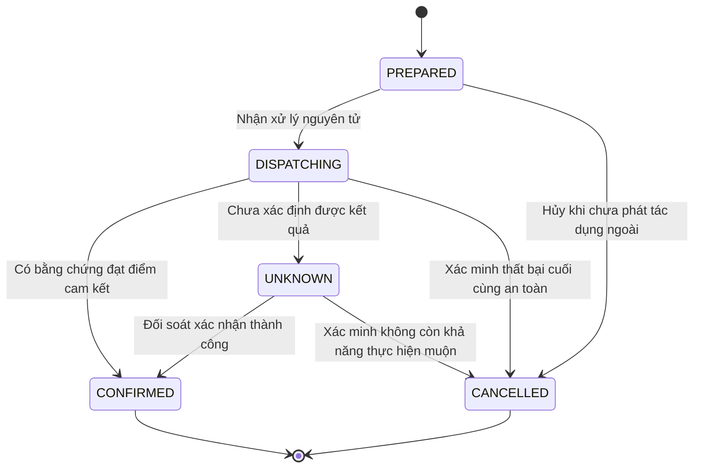

# Orders and fulfillment rights — Đơn hàng và quyền được thực hiện đơn hàng

## 1. Mục tiêu và phạm vi

Trong chương **Business Assets**, đơn hàng cần được nhìn như tập hợp các cam kết và quyền có giá trị. Một thay đổi sai không chỉ làm lệch một bản ghi: nó có thể khiến kho xuất thêm hàng, hệ thống cấp thêm giấy phép, khách khác nhận được sản phẩm hoặc một quyền đã bị thu hồi vẫn tiếp tục được sử dụng.

Trong bài này, **fulfillment** là việc thực hiện nghĩa vụ của đơn hàng, chẳng hạn giao hàng vật lý, cấp giấy phép phần mềm hoặc kích hoạt quyền sử dụng dịch vụ. **Fulfillment right** là quyền được hưởng lợi ích đó theo mô hình ứng dụng và chính sách sản phẩm; đây không phải phân tích quyền sở hữu theo pháp luật.

Bài học thuộc phạm vi Business Logic Security: bảo vệ bất biến nghiệp vụ, thứ tự xử lý, quyền theo đối tượng, transaction, idempotency và kiểm thử các cách lạm dụng luồng thực hiện đơn hàng.

Sau bài học, bạn có thể:

- Phân biệt bản ghi đơn hàng, bằng chứng thanh toán, tồn kho và quyền fulfillment.
- Xác định người thụ hưởng, số lượng, nội dung, điều kiện cấp và điều kiện thu hồi quyền.
- Mô hình hóa giao từng phần, gửi lại yêu cầu, hủy và xử lý kết quả bên ngoài chưa rõ.
- Bảo vệ ngân sách quyền khi nhiều worker hoặc nhiều kho cùng xử lý.
- Thiết kế kiểm thử chứng minh không giao quá quyền, không cấp quyền sai người và không tái sinh quyền qua sự kiện cũ.

Ví dụ chính dùng hàng trả trước và cho phép chia nhiều lần giao. Các luồng trả sau, thanh toán khi nhận hàng, đổi hàng và cấp bù cần chính sách riêng. Mã Java và SQL minh họa từng phần của thiết kế, không phải một dịch vụ hoàn chỉnh có thể triển khai ngay.

## 2. Tài sản thật sự nằm ở đâu trong một đơn hàng?

Đơn hàng có thể chứa những dữ liệu sau:

- Sản phẩm, biến thể, số lượng và các điều kiện đã chấp nhận.
- Tổng tiền, loại tiền, giảm giá và phiên bản báo giá.
- Người mua, tổ chức sở hữu đơn và người thụ hưởng.
- Địa chỉ nhận, tài khoản nhận giấy phép hoặc phạm vi dịch vụ.
- Bằng chứng phê duyệt, bằng chứng thanh toán và lịch sử điều chỉnh.
- Số lượng được phép thực hiện, đang được phân bổ, đã thực hiện và đã thu hồi.

Các trường này liên kết với nhau. Trả đủ tiền cho một sản phẩm không tạo quyền nhận một sản phẩm khác. Có quyền xem đơn không mặc nhiên có quyền đổi người nhận. Một đơn đã được thanh toán không có nghĩa mọi tác vụ giao hàng gắn với nó đều hợp lệ.

### 2.1. Bốn khái niệm dễ bị gộp nhầm

| Khái niệm | Câu hỏi nó trả lời | Điều nó không tự chứng minh |
| --- | --- | --- |
| Đơn hàng | Những bên nào đã đặt nội dung gì, theo điều kiện nào? | Điều kiện cấp hàng đã đạt hay chưa |
| Bằng chứng thanh toán | Khoản thanh toán nào đã được xác minh, cho nội dung nào? | Người gọi hiện tại được đổi địa chỉ hoặc giao thêm hàng |
| Tồn kho hoặc tài nguyên cung ứng | Hệ thống có hàng, giấy phép hoặc năng lực để cung cấp không? | Khách hàng này có quyền nhận phần tài nguyên đó |
| Quyền fulfillment | Ai được nhận lợi ích nào, với phạm vi và số lượng bao nhiêu? | Một tác vụ cụ thể đã thực hiện thành công bên ngoài |

Việc giữ tồn kho bảo vệ nguồn cung. Việc phân bổ quyền fulfillment bảo vệ số lợi ích được phép trao. Hai bước có thể được phối hợp nhưng không nên dùng thay nhau.

### 2.2. Có hai phía quyền cần kiểm tra

**Quyền thụ hưởng:** khách hàng hoặc tài khoản nào được nhận hàng, giấy phép hay dịch vụ.

**Thẩm quyền thực hiện:** chủ thể nào được ra lệnh hoặc xác nhận việc cung cấp lợi ích đó. Ví dụ, dịch vụ kho được giao hàng cho những đơn thuộc cửa hàng và kho mà nó phụ trách.

Khách sở hữu đơn không vì thế được gọi API nội bộ để đánh dấu đã thanh toán. Dịch vụ kho có quyền xuất hàng cũng không được tự tăng số lượng đã mua. Cả hai phía đều cần gắn với đối tượng và chính sách cụ thể.

## 3. Ví dụ xuyên suốt: một đơn có hàng vật lý và sản phẩm số

Giả sử đơn `O-503` thuộc cửa hàng `T-01`, do khách hàng `B-09` tạo, có hai dòng:

| Dòng | Nội dung | Số lượng | Người thụ hưởng | Cách fulfillment |
| --- | --- | --- | --- | --- |
| `L-1` | Thiết bị `DEVICE-A` | 4 | Người nhận theo địa chỉ đã xác nhận | Có thể chia thành nhiều kiện |
| `L-2` | Giấy phép `LICENSE-B` | 1 | Tài khoản `B-09` | Cấp quyền vào đúng tài khoản |

Trong mô hình giả định:

1. Máy chủ xác định giá, tổng tiền và loại tiền từ dữ liệu đáng tin.
2. Đơn được chốt ở một phiên bản nội dung trước khi liên kết thanh toán.
3. Sau khi đủ điều kiện trả trước và các phê duyệt bắt buộc, hệ thống cấp quyền gốc cho từng dòng đúng một lần.
4. Dòng `L-1` có thể được giao thành hai lần, mỗi lần 2 thiết bị, nhưng tổng quyền sử dụng không vượt 4.
5. Giấy phép chỉ được cấp cho tài khoản thụ hưởng đã xác định; người gọi không tự thay bằng tài khoản khác.
6. Phần quyền chưa phân bổ có thể bị thu hồi theo quy trình hủy được phép.
7. Phần đang thực hiện hoặc chưa rõ kết quả không được tự chuyển thành quyền rảnh để giao lại.
8. Hoàn tiền, trả hàng và cấp bù là các quyết định cần mô hình riêng; chúng không tự đặt lại ngân sách giao ban đầu.

Các chính sách này là giả định học tập. Một sản phẩm miễn phí hợp lệ, một đơn bán chịu được duyệt hoặc một đơn thanh toán khi nhận hàng có thể có căn cứ cấp quyền khác. Điều quan trọng là căn cứ đó được biểu diễn và kiểm soát rõ ràng, thay vì để một cờ tùy ý mở khóa giao hàng.

### 3.1. Đặc tả một quyền ở mức có thể kiểm tra

```text
Quyền gốc cho dòng L-1:
  tổ chức/cửa hàng: T-01
  đơn và dòng: O-503 / L-1
  phiên bản nội dung nguồn: 7
  sản phẩm: DEVICE-A
  người thụ hưởng và nơi nhận: theo snapshot được xác nhận
  số lượng được cấp: 4
  căn cứ: quyết định chấp nhận thanh toán và phê duyệt tương ứng
  điều kiện sử dụng: không bị chặn, còn lượng chưa dùng,
                     đúng người thực hiện và đúng nội dung
```

Quyền phải bao gồm ngữ cảnh, không chỉ là `canShip = true`. Với sản phẩm số, cần thay nơi nhận bằng tài khoản, tổ chức, phạm vi dịch vụ hoặc thời hạn sử dụng theo chính sách thực tế.

## 4. Cấp quyền từ bằng chứng đáng tin

### 4.1. Tạo đơn chưa phải là cấp quyền nhận hàng

Một endpoint tạo đơn thường tiếp nhận ý định mua. Trong luồng trả trước, nó không được tạo ngay quyền xuất hàng chỉ vì client gửi `paid: true` hoặc `status: READY_TO_SHIP`.

Những dữ liệu sau không đủ làm bằng chứng thanh toán:

- Tham số `success=true` trên URL quay về từ trang thanh toán.
- Ảnh chụp màn hình hoặc mã giao dịch do khách tự nhập chưa được xác minh.
- Tên sự kiện có chữ “completed” nhưng chưa xét ý nghĩa thanh toán của phương thức đang dùng.
- Một callback chưa xác minh nguồn, chưa đối chiếu tài khoản nhà cung cấp và môi trường.

OWASP khuyến nghị xác minh thanh toán phía máy chủ, kiểm tra nguồn callback và đối chiếu số tiền, loại tiền, mã đơn trước khi thực hiện đơn hàng. Không lấy tham số từ trang quay về làm căn cứ cấp hàng. [Nguồn: OWASP Third Party Payment Gateway Integration](https://cheatsheetseries.owasp.org/cheatsheets/Third_Party_Payment_Gateway_Integration_Cheat_Sheet.html).

### 4.2. Bằng chứng phải gắn với đúng nội dung

Đối với ví dụ trả trước, cần kiểm tra tối thiểu:

```text
đúng nhà cung cấp, tài khoản nhận tiền và môi trường
AND đúng ý định thanh toán đã liên kết với đơn
AND trạng thái đã đủ điều kiện theo chính sách
AND đúng số tiền và loại tiền dự kiến
AND đúng phiên bản nội dung được chấp nhận
AND các phê duyệt hoặc điều kiện chặn bắt buộc đã được giải quyết
```

Thành công ở bước ủy quyền thanh toán không tự có cùng ý nghĩa với việc đã thu tiền. Cần định nghĩa chính xác trạng thái nào tạo căn cứ cấp quyền cho từng phương thức; không áp dụng một chuỗi trạng thái chung cho mọi nhà cung cấp.

Nếu số lượng, sản phẩm, giá hoặc người thụ hưởng thay đổi, hệ thống phải xử lý như thay đổi có ý nghĩa nghiệp vụ. Không gắn bằng chứng thanh toán cũ cho nội dung mới chỉ vì mã đơn vẫn giống nhau.

### 4.3. Giao diện quay về và webhook có vai trò khác nhau

Trang quay về có thể yêu cầu máy chủ kiểm tra hoặc tra cứu kết quả, nhưng không tự quyết định quyền. Đồng thời, không nên phụ thuộc việc khách quay lại trang để hoàn tất xử lý: khách có thể thanh toán xong rồi mất kết nối.

Tài liệu fulfillment của Stripe mô tả việc dùng xử lý phía máy chủ và chuẩn bị cho cùng một phiên Checkout kích hoạt nhiều lần, kể cả đồng thời. Đây là ví dụ của một tích hợp cụ thể; các điều kiện sự kiện và trạng thái cần được áp dụng theo tài liệu của nhà cung cấp đang dùng. [Nguồn: Stripe Fulfill orders](https://docs.stripe.com/checkout/fulfillment?ui=full-page).

### 4.4. Một sự kiện không đồng nghĩa một quyền mới

Một thanh toán có thể tạo nhiều loại sự kiện. Hai thanh toán nhầm cùng trỏ vào một đơn cũng không mặc nhiên cho phép nhân đôi hàng của đơn đó.

Cần có khóa cấp quyền theo nghiệp vụ. Chẳng hạn, trong mô hình mỗi dòng có một quyền mua gốc:

```text
UNIQUE (tenant_id, order_line_id, grant_kind, grant_sequence)

Quyền mua gốc:
  grant_kind = ORIGINAL_PURCHASE
  grant_sequence = 0
```

`order_line_id` ở đây phải xác định duy nhất một dòng trong tenant. Nếu hệ thống chỉ đảm bảo mã dòng duy nhất trong từng đơn, khóa phải chứa thêm `order_id`.

Phiên bản nội dung và bằng chứng thanh toán được lưu trong quyền, nhưng không thêm một cách tùy tiện vào khóa duy nhất để tạo lại quyền gốc mỗi khi phiên bản thay đổi. Dòng đã cấp quyền cần được điều chỉnh bằng nghiệp vụ rõ ràng, không được reset như dòng mới.

Một quyền cấp bù hợp lệ, nếu được hỗ trợ, phải có loại và quyết định nguồn riêng để không bị lẫn với việc phát lại quyền mua gốc.

## 5. Những bất biến cần bảo vệ ở mức dòng hàng

### 5.1. Ngân sách quyền có thể được phân chia

Với quyền vật lý `L-1`, đặt:

- `granted`: tổng quyền đã cấp, bằng 4 trong ví dụ.
- `available`: phần chưa phân bổ, còn có thể nhận xử lý.
- `claimed`: phần đã dành cho một ý định fulfillment chưa kết thúc rõ ràng.
- `consumed`: phần đã dùng tại điểm cam kết fulfillment mà hệ thống định nghĩa.
- `revoked`: phần đã thu hồi, không được dùng tiếp.

Bất biến của mô hình đơn giản:

```text
granted = available + claimed + consumed + revoked

available >= 0
claimed >= 0
consumed >= 0
revoked >= 0
```

`claimed` là phân bổ quyền fulfillment, không phải tên khác của tồn kho đang giữ. Nó trả lời “phần quyền nào đã được giao cho ý định xử lý này”, dù hệ thống kho có mô hình giữ hàng riêng.

### 5.2. “Đã dùng quyền” cần một điểm cam kết cụ thể

Với hàng vật lý, việc tạo nhãn vận chuyển chưa chắc có nghĩa hàng đã được bàn giao. Với sản phẩm số, tạo bản ghi tác vụ chưa chắc có nghĩa tài khoản đã được cấp quyền.

Hệ thống cần chỉ rõ điểm nào chuyển quyền từ `claimed` sang `consumed`, ví dụ một xác nhận bàn giao đáng tin hoặc việc cấp giấy phép đã commit. Dữ liệu vận chuyển tiếp tục theo dõi được tiến trình sau đó; `consumed` không nhất thiết có nghĩa khách đã nhận hàng tận tay.

Một tác vụ chưa biết kết quả vẫn giữ phần quyền trong `claimed`. Nếu giải phóng quá sớm, một worker khác có thể dùng lại phần quyền mà tác vụ trước đã thực hiện bên ngoài.

### 5.3. Minh họa phân bổ và thu hồi

| Thời điểm | Available | Claimed | Consumed | Revoked | Tổng |
| --- | --- | --- | --- | --- | --- |
| Cấp quyền ban đầu | 4 | 0 | 0 | 0 | 4 |
| Ý định A nhận xử lý 2 | 2 | 2 | 0 | 0 | 4 |
| A thực hiện thành công tại điểm cam kết | 2 | 0 | 2 | 0 | 4 |
| Hủy 2 đơn vị chưa phân bổ | 0 | 0 | 2 | 2 | 4 |

Sau dòng cuối, một sự kiện thanh toán cũ không được đặt `available` trở lại 4. Hai đơn vị đã thực hiện không biến mất khỏi lịch sử chỉ vì có yêu cầu hoàn tiền.

## 6. Quyền theo đối tượng và nội dung đã chốt

### 6.1. Quyền xem đơn không phải quyền fulfillment

Một mô hình kiểm soát có thể phân biệt:

| Chủ thể | Hành động được xem xét | Điều kiện theo đối tượng |
| --- | --- | --- |
| Khách hàng | Xem đơn và tiến trình | Là chủ thể được phép xem trong đúng tenant |
| Khách hàng | Đề nghị thay địa chỉ | Còn trong giai đoạn cho phép; xác nhận lại dữ liệu ảnh hưởng |
| Nhân viên kho | Nhận một phần quyền để xử lý | Được phân công đúng cửa hàng, kho và loại hàng |
| Dịch vụ fulfillment | Thực hiện một ý định đã phân bổ | Ý định còn hợp lệ, đúng snapshot và chưa bị xử lý kết thúc |
| Dịch vụ cấp giấy phép | Ghi nhận quyền sử dụng | Đúng người thụ hưởng, sản phẩm, phạm vi và lượng được cấp |
| Nhân viên hỗ trợ | Yêu cầu hủy hoặc cấp bù | Có quyền riêng và đi qua quy trình nghiệp vụ tương ứng |

API phải tự tải đơn, dòng hàng, quyền và ý định trong phạm vi được phép. Không tin `ownerId`, `tenantId`, `warehouseId` hay `isPaid` chỉ vì chúng xuất hiện trong body hoặc header.

Một mã đơn khó đoán không ngăn người có mã đó sửa quyền. Webhook được xác thực cũng không trở thành lời cho phép ghi bất kỳ đơn nào; cần liên kết thanh toán–đơn và tenant do máy chủ quản lý.

### 6.2. Chống thay người nhận sau khi quyền đã được phân bổ

Giả sử ý định A đã được tạo cho 2 thiết bị đến địa chỉ X. Nếu worker lúc chạy lại lấy địa chỉ hiện tại từ bảng đơn, một thay đổi sau đó có thể khiến quyền đã duyệt được dùng để giao đến Y.

Hai hướng thiết kế cần được cân nhắc rõ:

- Khóa nội dung nhận hàng có ý nghĩa sau một điểm trong quy trình.
- Cho phép thay đổi bằng một thao tác riêng: kiểm tra quyền, đánh giá ảnh hưởng đến phí và điều kiện, cập nhật phiên bản, hủy hoặc thay thế các kế hoạch chưa bắt đầu và phát lại kế hoạch hợp lệ.

Ý định fulfillment nên tham chiếu snapshot bất biến hoặc phiên bản dữ liệu nhận đã được chấp nhận. Một outbox cũ không được tự ghép với địa chỉ mới mà thiếu bước kiểm tra.

Đối với giấy phép, cùng vấn đề xuất hiện khi đổi `beneficiaryAccountId`, tổ chức nhận hoặc gói dịch vụ. Việc dùng đúng giá tiền nhưng cấp cho sai tài khoản vẫn là thất thoát quyền.

### 6.3. Không gán request trực tiếp vào entity

Một lệnh yêu cầu xử lý có thể nhận mã phần kế hoạch và phiên bản mà người thao tác đã xem. Các trường như lượng quyền đã cấp, số lượng đã thực hiện, bằng chứng thanh toán, người thụ hưởng chính thức và trạng thái hệ thống không được ghi trực tiếp từ JSON.

Nếu API hỗ trợ chỉ định số lượng, số lượng đó là một đề nghị phải được kiểm tra với quyền còn lại. Nếu API hỗ trợ thay người nhận, đó phải là nghiệp vụ được phân quyền riêng; không để một hàm cập nhật đơn chung âm thầm làm cả hai việc.

## 7. Tách trạng thái đơn, thanh toán và từng lần fulfillment

### 7.1. Một trường `status` thường không đủ diễn đạt

Trong `O-503`, giấy phép có thể đã cấp nhưng hàng vật lý chưa giao đủ. Đơn cũng có thể có một khoản hoàn một phần trong khi một kiện đã được bàn giao.

Cần phân biệt ít nhất:

- Tiến trình thương mại của đơn: còn mở, có chặn, đang hủy hoặc đã kết thúc theo chính sách.
- Tiến trình thanh toán: chưa đạt điều kiện, đã xác minh, đang hoàn hoặc các trạng thái tích hợp cần thiết.
- Ngân sách quyền của từng dòng.
- Trạng thái từng ý định fulfillment và bằng chứng thực hiện bên ngoài.

Trạng thái tổng hợp như `PARTIALLY_FULFILLED` nên được tính hoặc cập nhật nhất quán từ các thành phần liên quan. Một sự kiện của kiện A không được đánh dấu toàn bộ đơn đã giao nếu kiện B hoặc giấy phép vẫn chưa được thực hiện.

### 7.2. Máy trạng thái của một ý định fulfillment



Khi tạo `PREPARED`, phần quyền tương ứng đi từ `available` sang `claimed`. Khi `CONFIRMED`, phần đó đi từ `claimed` sang `consumed`. Khi hủy an toàn, phần đang phân bổ được trả về `available` hoặc chuyển sang `revoked`, tùy quyền gốc còn hợp lệ hay đã bị thu hồi.

Các thay đổi ngân sách và chuyển trạng thái phải nhất quán. Mỗi lần hủy hoặc xác nhận chỉ được cập nhật bộ đếm một lần, gắn với đúng ý định và đúng claim.

### 7.3. Cạnh tranh giữa hủy và bắt đầu thực hiện

Worker chỉ chuyển `PREPARED` sang `DISPATCHING` bằng một thao tác có điều kiện. Luồng hủy cũng chỉ thắng khi ý định còn ở giai đoạn có thể hủy an toàn.

Nếu luồng hủy thắng, sự kiện outbox đã tồn tại không đủ để worker tiếp tục gọi kho: worker phải kiểm tra hoặc giành trạng thái thực thi đúng cách. Nếu worker đã bắt đầu, yêu cầu hủy không được tự giải phóng quyền chỉ vì chưa thấy xác nhận thành công.

Khi có hệ thống ngoài, trạng thái nội bộ phải đi cùng giao thức bên nhận để ngăn xử lý trùng hoặc xử lý muộn sau khi đã xác nhận hủy.

## 8. Ví dụ Java: biểu diễn ngân sách quyền bằng giá trị bất biến

Đoạn mã dưới đây chỉ kiểm soát số lượng. Nó không thay cho xác thực, quyền đối tượng, kiểm tra điều kiện thanh toán hoặc đồng bộ cơ sở dữ liệu. Không bind trực tiếp JSON của client vào kiểu dữ liệu miền này.

```java
public record FulfillmentBalance(
        long granted,
        long available,
        long claimed,
        long consumed,
        long revoked) {

    public FulfillmentBalance {
        if (granted <= 0 || available < 0 || claimed < 0
                || consumed < 0 || revoked < 0) {
            throw new IllegalArgumentException("INVALID_QUANTITY");
        }

        long total = Math.addExact(
                Math.addExact(available, claimed),
                Math.addExact(consumed, revoked));

        if (total != granted) {
            throw new IllegalArgumentException("UNBALANCED_RIGHT");
        }
    }

    public FulfillmentBalance claim(long quantity) {
        if (quantity <= 0 || quantity > available) {
            throw new IllegalArgumentException("INSUFFICIENT_RIGHT");
        }

        return new FulfillmentBalance(
                granted,
                available - quantity,
                Math.addExact(claimed, quantity),
                consumed,
                revoked);
    }

    public FulfillmentBalance revokeAvailable(long quantity) {
        if (quantity <= 0 || quantity > available) {
            throw new IllegalArgumentException("RIGHT_NOT_REVOCABLE_NOW");
        }

        return new FulfillmentBalance(
                granted,
                available - quantity,
                claimed,
                consumed,
                Math.addExact(revoked, quantity));
    }
}
```

Ví dụ `new FulfillmentBalance(4, 4, 0, 0, 0).claim(2)` tạo trạng thái có 2 quyền rảnh và 2 quyền đang phân bổ. Gọi `claim(3)` trên kết quả đó bị từ chối. Giá trị cũ không bị sửa dở nếu một kiểm tra thất bại.

`Math.addExact` phát hiện tràn số; lớp ứng dụng cần ánh xạ lỗi phù hợp và không lưu thay đổi một phần. Số lượng cũng cần giới hạn chính sách trước đó, thay vì chỉ dựa vào miền của `long`.

Không cung cấp hàm xác nhận chỉ nhận một số lượng bất kỳ rồi giảm `claimed` mà không định danh ý định. Khi hoàn tất, phải tải đúng claim, kiểm tra trạng thái và số lượng của nó để không dùng nhầm phần đã dành cho tác vụ khác.

### 8.1. Bản sao trong bộ nhớ không bảo vệ cạnh tranh

Hai worker có thể cùng đọc `available = 4`, mỗi worker gọi `claim(3)` thành công trên bản sao riêng. Nếu ghi không điều kiện, hệ thống có thể tạo hai tác vụ cùng mang quyền nhận 3 dù chỉ mua 4.

Ngân sách chỉ được bảo vệ khi quyết định phân bổ và việc ghi được thực thi nguyên tử với điều kiện còn quyền. Ràng buộc số học trên một bản ghi giúp phát hiện dữ liệu sai nhưng không tự ràng buộc tổng của tất cả claim nếu các đường ghi không phối hợp.

## 9. Transaction cho việc phân bổ quyền

### 9.1. Luồng điều phối

Với một ý định chứa một dòng, có thể thiết kế:

```text
BEGIN TRANSACTION
  1. Tải và khóa đơn trong đúng tenant.
  2. Kiểm tra quyền người thao tác, phiên bản nội dung,
     snapshot người nhận và các điều kiện chặn.
  3. Xử lý idempotency hoặc nhận diện lại phần kế hoạch đã có ý định.
  4. Phân bổ lượng quyền còn rảnh bằng cập nhật có điều kiện.
  5. Tạo ý định PREPARED cùng claim chỉ rõ quyền và số lượng.
  6. Lưu outbox chứa định danh ý định.
COMMIT
```

Các luồng hủy, thu hồi, thay đổi điều kiện chặn và phân bổ phải tôn trọng cùng giao ước khóa hoặc phiên bản. Khóa bản ghi đơn không tự ngăn một câu SQL khác sửa dòng quyền nếu câu đó không tham gia giao ước.

Nếu dữ liệu quyền thực thi hoặc chính sách nằm ngoài cơ sở dữ liệu này, cần quy định tính mới và hiệu lực thu hồi của chúng. Chỉ bắt đầu transaction không tự làm các nguồn bên ngoài trở thành một ảnh chụp nhất quán.

### 9.2. Cập nhật ngân sách có điều kiện

Mảnh SQL sau giả định bước tải/khóa đơn và các kiểm tra quyền, nội dung, người nhận đã đạt trong transaction. Các tham số tin cậy được lấy từ ngữ cảnh và bản ghi phía máy chủ; không truyền thẳng từ yêu cầu của client.

```sql
UPDATE fulfillment_right
SET available_quantity = available_quantity - :quantity,
    claimed_quantity = claimed_quantity + :quantity,
    row_version = row_version + 1
WHERE tenant_id = :trusted_tenant_id
  AND id = :right_id
  AND order_id = :verified_order_id
  AND authorized_order_revision = :expected_order_revision
  AND beneficiary_id = :verified_beneficiary_id
  AND issuance_state = 'ACTIVE'
  AND row_version = :expected_right_version
  AND available_quantity >= :quantity;
```

`quantity` phải là số nguyên dương trong giới hạn nghiệp vụ. Nếu `affectedRows != 1`, không tạo claim thành công. Một kết quả bằng 0 có thể do thiếu quyền còn lại, sai phiên bản, quyền không còn hiệu lực hoặc không có bản ghi phù hợp; không được tiếp tục bằng một câu `UPDATE` bỏ điều kiện.

Sau cập nhật thành công, việc chèn ý định, claim và outbox vẫn phải nằm trong cùng transaction. Nếu bất kỳ bước nào thất bại, rollback cả lượng quyền vừa phân bổ.

Với ý định nhiều dòng, chuẩn hóa và cộng gộp các dòng trùng, kiểm tra tràn số, xử lý theo thứ tự ổn định và chỉ commit khi toàn bộ phần bắt buộc đều đạt. Không để một client lặp cùng `right_id` nhiều lần rồi vượt kiểm tra chỉ xét từng phần riêng.

### 9.3. Ràng buộc dữ liệu hỗ trợ

Một số ràng buộc phù hợp với mô hình:

```sql
-- Các cột số lượng đều phải NOT NULL.
ALTER TABLE fulfillment_right
ADD CONSTRAINT ck_right_quantities CHECK (
    granted_quantity > 0
    AND available_quantity >= 0
    AND claimed_quantity >= 0
    AND consumed_quantity >= 0
    AND revoked_quantity >= 0
    AND granted_quantity = available_quantity + claimed_quantity
                         + consumed_quantity + revoked_quantity
);

-- Các cột trong khóa đều phải NOT NULL.
ALTER TABLE fulfillment_claim
ADD CONSTRAINT uq_intent_right
UNIQUE (tenant_id, fulfillment_intent_id, right_id);
```

Quan hệ giữa đơn, quyền và claim cần được ràng buộc đúng tenant; có thể dùng khóa ngoại tổng hợp phù hợp với schema. `UNIQUE (tenant_id, fulfillment_intent_id, right_id)` không tự chứng minh quyền đó thuộc đúng đơn, đúng người thụ hưởng hoặc tổng các claim khớp bộ đếm.

Không dùng `UNIQUE(order_id)` để ngăn mọi lần fulfillment nếu nghiệp vụ cho phép nhiều kiện hoặc nhiều sản phẩm số trong cùng đơn. Tính duy nhất phải đặt đúng đơn vị quyền gốc, ý định, claim hoặc tác dụng ngoài cần bảo vệ.

## 10. Ba lớp chống trùng cần được phân biệt

| Lớp | Định danh điển hình | Điều nó ngăn |
| --- | --- | --- |
| Nhận sự kiện | Nhà cung cấp, tài khoản/môi trường, mã sự kiện | Xử lý lại cùng một lần thông báo đã nhận |
| Ý định và nghiệp vụ | Quyền gốc, phần kế hoạch fulfillment, claim và ngân sách lượng | Cấp lại quyền hoặc phân bổ vượt quyền dù yêu cầu có mã mới |
| Tác dụng bên ngoài | Định danh ổn định của ý định tại kho hoặc hệ thống cấp quyền | Gửi lại tạo thêm kiện hoặc thêm lợi ích ở bên nhận |

### 10.1. Event deduplication không đủ để bảo vệ giao hàng

Hai sự kiện khác mã có thể cùng dẫn đến quyết định “đơn đã thanh toán”. Chỉ lưu `event_id` đã xử lý không ngăn cả hai đường cấp thêm quyền nếu thiếu khóa cấp quyền gốc và điều kiện nghiệp vụ.

Stripe nêu rằng webhook có thể bị gửi lặp và không bảo đảm thứ tự đến. Vì vậy, mã tiếp nhận cần nhận diện sự kiện và logic phía sau phải giải quyết trạng thái nghiệp vụ hiện hành. Không dùng thứ tự nhận hoặc timestamp đơn thuần làm căn cứ cấp lại quyền. [Nguồn: Stripe Webhooks](https://docs.stripe.com/webhooks#event-delivery-behaviors).

### 10.2. API idempotency và khóa phần kế hoạch

Một khóa API có thể được lưu theo `(tenant, actor, operation, key)`, gắn với dấu vân tay chứa phần kế hoạch, quyền, số lượng và phiên bản người nhận. Cùng khóa nhưng đổi nội dung phải bị từ chối; đọc lại kết quả vẫn cần kiểm tra quyền.

Để cùng một phần kế hoạch không bị tạo hai ý định qua hai người thao tác hoặc hai khóa API khác nhau, cần thêm khóa nghiệp vụ ổn định. Chẳng hạn, mỗi bước của kế hoạch đã được máy chủ chấp nhận chỉ có một ý định tương ứng. Các phần chia kiện hợp lệ có định danh khác nhau và cùng tiêu ngân sách quyền.

Nếu chèn ý định gặp xung đột khóa duy nhất sau khi đã cập nhật số lượng, phải rollback hoặc xử lý nhất quán trong transaction. Không dùng `ON CONFLICT DO NOTHING` rồi commit phần quyền đã trừ mà không có claim tương ứng.

### 10.3. Khóa đã hết hạn không làm quyền được cấp lại

Thời gian lưu idempotency API phục vụ cửa sổ retry. Lịch sử quyền, claim, các quyết định thu hồi và tác dụng đã xác nhận có vòng đời riêng. Dọn khóa tạm không được làm hệ thống quên rằng quyền đã được dùng hoặc đơn đã bị hủy.

## 11. Tác dụng bên ngoài và kết quả chưa rõ

### 11.1. Transaction nội bộ không bao trùm kho hoặc nhà cung cấp

Một worker có thể gửi lệnh cho kho, kho đã xử lý, nhưng phản hồi bị mất trước khi ứng dụng lưu kết quả. Rollback cơ sở dữ liệu ứng dụng không lấy lại được kiện hàng đã bàn giao hoặc giấy phép đã cấp ở hệ thống khác.

Luồng triển khai cần có:

1. Ý định, claim và outbox được lưu bền vững trước khi gọi bên ngoài.
2. Worker giành quyền xử lý bằng điều kiện trạng thái; trước điểm bắt đầu, vẫn kiểm tra điều kiện chặn theo chính sách.
3. Cùng định danh ổn định cho các lần gửi lại cùng ý định.
4. Bên nhận có cơ chế idempotency hoặc khả năng tra cứu phù hợp; phạm vi và thời hạn của cơ chế đó phải được hiểu rõ.
5. Bằng chứng kết quả gắn đúng ý định, sản phẩm, số lượng và người nhận.
6. Thao tác xác nhận cập nhật trạng thái và ngân sách đúng một lần.

Outbox giúp không mất ý định phát lệnh sau commit. Nó không tự ngăn bên nhận thực hiện hai lần. Worker có thể gửi lại khi dừng giữa chừng; giao thức tích hợp phải chịu được việc đó.

### 11.2. Timeout không giải phóng quyền đang phân bổ

Khi chưa biết kết quả, ý định đi vào `UNKNOWN` hoặc trạng thái phục hồi tương đương. Phần quyền vẫn trong `claimed`, chờ tra cứu, đối soát hoặc quyết định xử lý có kiểm soát.

Không chuyển `UNKNOWN` thành `CANCELLED` chỉ vì một khoảng thời gian đã qua. Nếu cần hủy ở bên ngoài, phải xác minh yêu cầu không còn có thể thực hiện muộn trước khi tái sử dụng phần quyền đó.

Một lease xử lý hết hạn chỉ cho phép phối hợp lại worker theo giao thức được thiết kế; nó không chứng minh tác dụng bên ngoài chưa xảy ra. Nếu hai worker có thể gửi lệnh sau chuyển giao, cùng định danh bên nhận hoặc cơ chế ngăn worker cũ phải bảo vệ hiệu ứng trùng.

Nếu bên ngoài không hỗ trợ nhận diện lại, chống trùng hay tra cứu đủ tin cậy, ứng dụng không thể tự suy ra bảo đảm chỉ một tác dụng chỉ từ transaction cục bộ. Phải thiết kế điểm dừng, đối soát hoặc xử lý thủ công có bằng chứng phù hợp với giới hạn đó.

### 11.3. Xác nhận phải khớp nội dung, không chỉ khớp mã đơn

Một phản hồi thành công cho `O-503` chưa đủ để xác nhận mọi claim. Cần liên kết với ý định cụ thể và đối chiếu dữ liệu liên quan, ví dụ:

```text
tenant / tài khoản tích hợp
fulfillment_intent_id
tham chiếu bên ngoài
loại tác dụng
sản phẩm và số lượng
snapshot người nhận hoặc tài khoản thụ hưởng
trạng thái đạt điểm cam kết theo hợp đồng
```

Không dùng một mã vận đơn hoặc giấy phép đã gắn với ý định A để xác nhận thêm ý định B, trừ khi nghiệp vụ có mô hình gom nhiều phần vào cùng một tác dụng và có liên kết phân bổ rõ ràng.

## 12. Hủy, thu hồi, hoàn tiền và trả hàng là những việc khác nhau

| Thao tác | Tác động trực tiếp | Điều không được suy ra tự động |
| --- | --- | --- |
| Hủy phần quyền chưa phân bổ | Chuyển `available` sang `revoked` | Phần đã giao cũng biến mất |
| Hủy ý định chưa thực hiện | Kết thúc claim theo trạng thái an toàn | Luôn có thể trả quyền về rảnh dù đơn đã bị thu hồi |
| Hoàn tiền | Tạo hoặc xác nhận việc trả tiền theo chính sách | Đã lấy lại hàng hoặc giấy phép không còn sử dụng được |
| Trả hàng | Ghi nhận hàng quay lại và kiểm tra điều kiện | Tự phát sinh quyền được giao lại từ đơn cũ |
| Cấp bù/đổi hàng | Tạo quyền mới có căn cứ riêng | Có thể reset mọi bộ đếm của quyền gốc |

### 12.1. Cạnh tranh giữa giao và hủy

Giả sử dòng hàng còn `available = 2`. Một nhân viên tạo ý định giao 2, trong khi khách yêu cầu hủy 2.

Hai thao tác phải cùng cạnh tranh trên ngân sách và điều kiện nghiệp vụ. Nếu hủy thắng, phần quyền chuyển sang `revoked`, phân bổ giao thất bại. Nếu phân bổ giao thắng, yêu cầu hủy không được tiếp tục giả định cả 2 vẫn còn rảnh; cần xử lý theo tiến trình của ý định đã được tạo.

Từ góc nhìn triển khai, thao tác hủy có thể đặt điều kiện chặn fulfillment mới và điều chỉnh phần chưa phân bổ trong một transaction. Các claim đã bắt đầu được xử lý riêng, theo giao thức hủy/đối soát phù hợp.

### 12.2. Đừng mở lại quyền chỉ vì một cờ tài chính thay đổi

Hoàn tiền có thể liên quan toàn bộ đơn, một dòng, phí vận chuyển hoặc một khoản điều chỉnh khác. Không suy ra số lượng hàng được giao lại bằng cách chia tiền hoàn cho đơn giá hiện tại; giảm giá, thuế và phân bổ phí có thể làm phép tính đó không đúng nghĩa.

Trong mô hình đang xét, `consumed` là lịch sử đã dùng quyền. Sau khi nhận lại hàng, giữ lịch sử đó và ghi nhận quy trình trả hàng riêng. Nếu doanh nghiệp chấp nhận đổi hoặc cấp bù, tạo quyền mới có quyết định nguồn và giới hạn riêng; không làm quyền gốc như chưa từng được dùng.

### 12.3. Sự kiện cũ không được hồi sinh đơn đã thu hồi

Một thông báo thanh toán đến muộn có thể phản ánh khoản tiền thực sự đã được xử lý. Cần xác minh và đối soát, không bỏ qua chỉ vì phiên checkout đã hết hạn.

Tuy nhiên, nó cũng không được tự mở lại phần quyền đã bị thu hồi hoặc bỏ qua quyết định hủy hiện hành. Hệ thống phải chọn một đường nghiệp vụ rõ ràng như hoàn tiền, yêu cầu xem xét hoặc tiếp tục sau một quyết định mới hợp lệ.

Việc bảo toàn bằng chứng tài chính và việc cho phép giao hàng là hai quyết định có liên quan nhưng không đồng nhất.

## 13. Những điểm riêng của sản phẩm số

### 13.1. Cấp quyền một lần không đồng nghĩa chỉ được dùng một lần

Với `L-2`, một giấy phép có thể cho phép nhiều lần đăng nhập hoặc tải lại. Bất biến là không cấp thêm giấy phép hoặc phạm vi vượt giao dịch đã chấp nhận, không nhất thiết là mỗi lần tải tiêu thêm một quyền mua.

Cần định nghĩa đúng đơn vị giá trị: số ghế, số thiết bị, tài khoản thụ hưởng, thời gian dịch vụ, số lượt sử dụng hay quyền truy cập một nội dung. Một cờ `isPremium` không đủ biểu diễn mọi nguồn cấp quyền và điều kiện thu hồi.

### 13.2. Đường dẫn nhận hàng là một tài sản nhạy cảm

Đường dẫn tải, mã kích hoạt hoặc token nhận quà có thể mang khả năng nhận lợi ích. Không coi việc biết mã đơn là đủ để lấy chúng.

Nếu dùng token, cần giới hạn phạm vi, đối tượng nhận, thời hạn và khả năng sử dụng lại theo chính sách; tránh đưa token vào log hoặc nơi không cần thiết. Một URL đã ký giúp bảo vệ nội dung hoặc thời hạn theo cơ chế của nó, nhưng không mặc nhiên hỗ trợ thu hồi tức thì sau khi đã phát.

Quyền đã thay đổi cần được phản ánh ở những điểm truy cập có liên quan, như dịch vụ cấp giấy phép, cache quyền hoặc endpoint tải. Xóa một nút trên giao diện không ngăn token còn hiệu lực tiếp tục được dùng.

### 13.3. Thu hồi phải giữ đúng nguồn quyền

Một khách có thể mua cùng sản phẩm từ hai đơn hoặc được cấp thêm quyền từ một hợp đồng khác. Thu hồi quyền phát sinh từ đơn A không được xóa nhầm quyền độc lập hợp lệ từ đơn B.

Nên lưu liên kết nguồn cấp và nguồn thu hồi để tính quyền hiệu lực theo chính sách. Ví dụ, thu hồi một nguồn giấy phép không đồng nghĩa đặt cả tài khoản thành “không có giấy phép” nếu một nguồn khác vẫn còn hiệu lực.

Tương tự, nếu một quyền đã hết hạn hoặc bị thu hồi, phát lại sự kiện cấp cũ không được tái kích hoạt ngoài chính sách. Cần kiểm tra danh tính nghiệp vụ của quyết định cấp và lịch sử điều chỉnh, không chỉ xem cache hiện tại có trống hay không.

## 14. Bằng chứng kiểm toán và đối soát tài sản

### 14.1. Cần giải thích được vì sao một lợi ích đã được trao

Với mỗi quyền và ý định fulfillment, nên truy vết được:

```text
tenant_id, order_id, order_line_id
authorized_order_revision
right_id, grant_kind, quyết định nguồn
beneficiary_id hoặc snapshot người nhận
actor_id / danh tính dịch vụ
fulfillment_intent_id, claim_id, quantity
state_before, state_after
tham chiếu thanh toán, phê duyệt và tác dụng bên ngoài cần thiết
correlation_id, thời điểm và mã lý do
```

Giới hạn dữ liệu nhạy cảm theo nhu cầu. Không ghi token nhận hàng, bí mật webhook, thông tin xác thực hoặc toàn bộ thông tin thanh toán vào log. Với địa chỉ và dữ liệu người nhận, cân nhắc dùng tham chiếu snapshot được bảo vệ thay vì nhân bản ở nhiều nơi.

Bằng chứng thay đổi thành công cần nhất quán với transaction nghiệp vụ, chẳng hạn qua bản ghi lịch sử hoặc outbox. Dấu vết lần thử bị từ chối cần tồn tại theo cơ chế phù hợp mà không biến thành thông báo giao thành công giả.

### 14.2. Đối soát từ nhiều phía

Định kỳ hoặc khi có cảnh báo, kiểm tra:

- Mỗi quyền gốc có căn cứ cấp hợp lệ và không bị nhân đôi theo khóa nghiệp vụ.
- Tổng các bucket quyền cân bằng với lượng đã cấp.
- Tổng claim đang mở khớp phần `claimed`; tổng xác nhận khớp phần đã dùng theo mô hình.
- Ý định đã xác nhận có tham chiếu tác dụng đúng đối tượng, lượng và người nhận.
- Phần đã thu hồi không tiếp tục được phân bổ.
- Không có sự kiện outbox, ý định hoặc kết quả ngoài bị mồ côi.
- Không có quyền số bị cấp sai tài khoản hoặc tiếp tục hiệu lực trái quyết định thu hồi.

Nếu tổng lệch, không sửa bộ đếm chỉ để thỏa công thức mà chưa biết nguyên nhân. Một tổng cân bằng vẫn có thể che việc giao sai người hoặc dùng nhầm bằng chứng thanh toán.

### 14.3. Tín hiệu cần điều tra

Các dấu hiệu gồm nhiều lần phân bổ thất bại sát giới hạn, cùng ý định có nhiều tham chiếu giao hàng, thay địa chỉ ngay trước fulfillment, xác nhận sau hủy, nhiều lần cấp quyền từ một dòng và trạng thái `UNKNOWN` tồn tại quá thời gian mục tiêu.

Cảnh báo hỗ trợ phát hiện; kiểm soát phòng ngừa vẫn phải chặn thay đổi sai tại điểm thực thi. Quyền quản trị sửa lịch sử hoặc cấp bù cần được tách và kiểm soát, không trở thành đường bỏ qua mọi điều kiện.

## 15. Kiểm thử theo các cách làm thất thoát quyền

Mỗi tình huống cần kiểm tra kết quả nghiệp vụ, bộ đếm, ý định, sự kiện và tác dụng ngoài, thay vì chỉ kiểm tra mã phản hồi.

| Tình huống | Kết quả cần chứng minh |
| --- | --- |
| Gửi `paid=true` hoặc `READY_TO_SHIP` từ client | Không phát sinh quyền gốc hoặc lệnh giao trái phép |
| Thay mã đơn, dòng hoặc tenant bằng đối tượng của người khác | Không xem, phân bổ, sửa người nhận hoặc hủy ngoài quyền |
| Dùng thanh toán sai số tiền, loại tiền, môi trường hoặc tài khoản nhận | Không cấp quyền theo bằng chứng không khớp |
| Sửa SKU, số lượng hoặc người thụ hưởng sau khi chốt thanh toán | Bị chặn hoặc phải đi qua luồng thay đổi có kiểm soát |
| Phát lại cùng webhook | Không cấp lại quyền và không tạo thêm tác dụng |
| Hai sự kiện khác mã cho cùng thanh toán/đơn | Khóa cấp quyền gốc vẫn ngăn nhân đôi lợi ích |
| Hai thanh toán cùng trỏ một đơn | Không tự nhân đôi số lượng; phát sinh đường đối soát tài chính phù hợp |
| Hai worker cùng phân bổ 3 khi chỉ còn 4 | Không có tổng 6 quyền được phân bổ thành công |
| Hai phần giao hợp lệ, mỗi phần 2 trong ngân sách 4 | Được phép hoàn tất cả hai mà không nhầm là trùng toàn đơn |
| Request lặp cùng quyền thành nhiều dòng | Tổng lượng được chuẩn hóa và không vượt ngân sách |
| Hủy cạnh tranh với phân bổ hoặc bắt đầu thực hiện | Không vừa thu hồi vừa sử dụng cùng phần quyền |
| Kho đã nhận lệnh nhưng phản hồi bị mất | Giữ trạng thái chưa rõ; đối soát cùng ý định, không tạo kiện mới tùy tiện |
| Worker dừng sau trừ quyền nhưng trước ghi claim/outbox | Transaction rollback hoặc phục hồi nhất quán; không rò quyền |
| Lỗi khóa duy nhất khi tạo ý định sau cập nhật lượng | Không commit phần lượng đã trừ mà thiếu ý định tương ứng |
| Xác nhận hoặc webhook cũ đến sau hủy/hoàn | Không hồi sinh quyền đã thu hồi; xử lý theo trạng thái hiện hành |
| Một kiện hoàn tất khi đơn còn các phần khác | Không đánh dấu toàn bộ quyền đã thực hiện sai |
| Thu hồi giấy phép từ đơn A khi đơn B vẫn cấp quyền | Chỉ tác động đúng nguồn và giữ các quyền độc lập hợp lệ |
| Khóa idempotency tạm đã bị dọn rồi lệnh cũ xuất hiện | Lịch sử và ràng buộc nghiệp vụ vẫn ngăn hiệu ứng trùng |

### 15.1. Chọn đúng tầng kiểm thử

**Kiểm thử đơn vị** xác minh phép chuyển ngân sách, giới hạn số lượng, chính sách cấp/thu hồi và ma trận trạng thái. Với mọi phép chuyển hợp lệ, kiểm tra các bucket không âm và tổng không đổi theo mô hình.

**Kiểm thử tích hợp cơ sở dữ liệu** xác minh transaction, ràng buộc, khóa và cập nhật có điều kiện. Dùng các transaction độc lập và điểm đồng bộ để tạo cạnh tranh. Mock repository không chứng minh được tổng claim thật sẽ không vượt quyền.

**Kiểm thử API và worker** xác minh ngữ cảnh danh tính, phạm vi tenant, trường không được gán từ client, snapshot người nhận và việc mọi đường gọi áp dụng cùng quy tắc.

**Kiểm thử tích hợp ngoài và phục hồi** mô phỏng gửi lặp, mất phản hồi, sự kiện sai thứ tự, restart tiến trình và trạng thái chưa rõ. Đối chiếu số tác dụng tại bên nhận với claim và ngân sách trong ứng dụng.

### 15.2. Kiểm tra chuỗi hành động thay vì từng API riêng lẻ

Các chuỗi như thanh toán, phân bổ một phần, hủy phần còn lại rồi phát lại webhook thường bộc lộ lỗi mà từng API độc lập không cho thấy.

Có thể kiểm tra các thuộc tính:

```text
Với mọi quyền:
  các bucket không âm và tổng bằng granted

Với mọi ý định đã xác nhận:
  có claim hợp lệ và bằng chứng đúng nội dung, người nhận, số lượng

Với mọi phần quyền đã thu hồi:
  không phát sinh claim mới từ phần đó

Với mọi quyền mua gốc của một dòng:
  phát lại sự kiện không tạo thêm grant cùng danh tính nghiệp vụ
```

Những thuộc tính này cần được bổ sung khi sản phẩm có cấp bù, đổi hàng, chuyển nhượng hoặc nhiều loại đơn vị quyền. Không mở rộng khả năng của sản phẩm bằng cách nới một bất biến mà chưa biểu diễn quyết định nghiệp vụ mới.

## 16. Mẫu mô tả tài sản trước khi triển khai

Với mỗi loại đơn và mỗi loại fulfillment, có thể ghi:

```text
Tài sản:
  Hàng, giấy phép, số ghế, thời gian dịch vụ hoặc lợi ích nào?

Nguồn cấp quyền:
  Quyết định thanh toán, phê duyệt, hợp đồng hoặc chính sách nào?
  Danh tính nghiệp vụ nào ngăn quyết định đó bị áp dụng hai lần?

Chủ thể:
  Ai được hưởng? Ai được phân bổ, thực hiện, xác nhận và thu hồi?
  Phạm vi tenant, kho, tài khoản và đối tượng là gì?

Nội dung được chấp nhận:
  Dòng hàng, phiên bản, số lượng, điều kiện và người nhận nào?

Ngân sách:
  Bao nhiêu còn rảnh, đang phân bổ, đã dùng và đã thu hồi?
  Các phần giao hợp lệ được nhận diện và giới hạn thế nào?

Điểm cam kết và tính nhất quán:
  Khi nào quyền được coi là đã dùng?
  Transaction và cơ chế cạnh tranh bảo vệ những thay đổi nào?

Gửi lại và phục hồi:
  Khóa sự kiện, khóa ý định và định danh tác dụng ngoài là gì?
  Xử lý kết quả chưa rõ, hủy và tác dụng đến muộn như thế nào?

Kiểm chứng:
  Bằng chứng nào giải thích được lợi ích đã trao?
  Các tình huống nào chứng minh không cấp sai, cấp vượt hoặc cấp lại?
```

Đơn hàng an toàn cần bảo vệ mối liên kết giữa **nội dung đã được chấp nhận, người được hưởng, lượng quyền có hạn và bằng chứng thực hiện**. Mọi luồng giao hàng, cấp quyền, hủy, hoàn và retry đều cần tôn trọng mối liên kết đó để một thay đổi dữ liệu không trở thành một lần trao lợi ích ngoài chính sách.
