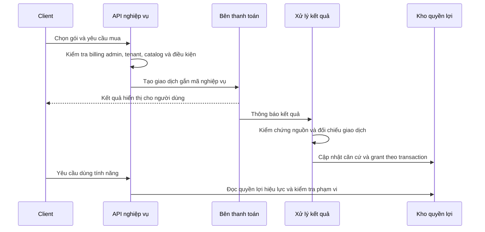

# Gói thuê bao và quyền sử dụng dịch vụ — Subscriptions and service access

## 1. Vì sao thuê bao là tài sản nghiệp vụ cần bảo vệ?

Một hệ thống bán phần mềm dưới dạng dịch vụ không chỉ bảo vệ dữ liệu và tiền thanh toán. Nó còn phải bảo vệ **quyền được sử dụng dịch vụ**: ai được dùng tính năng nào, trong tổ chức nào, trong bao lâu và với giới hạn nào.

Nếu caller có thể đổi một field để biến gói miễn phí thành gói trả phí, kéo dài ngày hết hạn hoặc thêm thành viên vượt số ghế đã mua, họ đã chiếm được một tài sản có giá trị dù không rút tiền trực tiếp từ hệ thống.

Trong chương **Business Assets**, thuê bao và quyền truy cập dịch vụ cần được nhìn như các quyền lợi có vòng đời:

- Được tạo từ một căn cứ hợp lệ: thanh toán, trial, hợp đồng hoặc phê duyệt ngoại lệ.
- Có chủ thể thụ hưởng và phạm vi rõ ràng.
- Có thời điểm bắt đầu, kết thúc và chính sách thay đổi.
- Có giới hạn sử dụng như số ghế, lượt gọi hoặc số tác vụ đồng thời.
- Có thể bị thu hồi hoặc thay thế theo quy tắc.
- Phải được thực thi ở nơi tạo ra tác động, không chỉ trên giao diện.

Những rủi ro điển hình gồm sử dụng miễn phí ngoài chính sách, leo thang lên tính năng cao cấp, chia sẻ quyền sai tổ chức, vượt số ghế, đặt lại quota và duy trì quyền sau khi hết hiệu lực.

Bài này trình bày mô hình độc lập với nhà cung cấp thanh toán. Các gói, con số và chính sách bên dưới đều là ví dụ học tập.

## 2. Tách bốn khái niệm dễ bị nhập làm một

| Khái niệm | Trả lời câu hỏi | Ví dụ |
| --- | --- | --- |
| **Subscription — thuê bao** | Thỏa thuận cung cấp dịch vụ nào đang được quản lý? | Tổ chức Alpha đăng ký gói Team theo kỳ. |
| **Billing/payment — lập hóa đơn và thanh toán** | Nghĩa vụ thanh toán và kết quả thu tiền là gì? | Hóa đơn của kỳ đã được xác nhận thu tiền. |
| **Entitlement — quyền lợi sử dụng dịch vụ** | Chủ thể được hưởng tính năng/giới hạn nào trong khoảng nào? | Alpha được dùng xuất báo cáo và tối đa 10 ghế đến hết kỳ. |
| **Authorization — phân quyền thao tác** | Actor có được làm hành động này trên đối tượng này không? | Thành viên hiện tại của Alpha được xuất báo cáo thuộc Alpha. |

Bốn khái niệm liên quan nhưng không tương đương:

- Thuê bao tồn tại không chứng minh đã có quyền lợi hiệu lực.
- Có thanh toán thành công không chứng minh tiền đó thuộc đúng tenant hoặc đúng kỳ hiện tại.
- Tenant có quyền lợi không có nghĩa mọi người dùng đều được truy cập mọi dữ liệu của tenant.
- Một quản trị viên có quyền mua gói không mặc nhiên có quyền đọc báo cáo nhạy cảm.
- Thuê bao có thể cấp quyền hợp lệ mà không thu tiền từng kỳ ngay lập tức, nếu có trial, hợp đồng công nợ hoặc ngoại lệ được phê duyệt.

Vì vậy, điều kiện `subscription.status == ACTIVE` không nên được dùng như câu trả lời duy nhất cho toàn bộ quyết định truy cập.

### Ví dụ xuyên suốt

Một dịch vụ quản lý báo cáo có:

- Gói Free: tính năng cơ bản.
- Gói Team: xuất báo cáo, tối đa 10 ghế và 100.000 đơn vị xử lý cho mỗi kỳ quyền lợi.
- Một trial 7 ngày cho chủ thể đủ điều kiện theo chính sách.
- Quyền mua gói thuộc billing admin; quyền mời thành viên và quyền đọc/xuất dữ liệu được kiểm tra riêng.
- Hủy cuối kỳ giữ quyền đã được cấp đến thời điểm kết thúc, không tự cấp kỳ tiếp theo.
- Nâng gói chỉ có hiệu lực khi thỏa điều kiện thanh toán hoặc phê duyệt mà server áp dụng.

“Đơn vị xử lý” và “kỳ quyền lợi” phải có định nghĩa riêng. Không mặc định một request luôn bằng một đơn vị hoặc kỳ luôn bắt đầu lúc client bấm mua.

## 3. Lập danh mục tài sản và nguồn có thẩm quyền

### 3.1. Những dữ liệu mang giá trị nghiệp vụ

| Tài sản | Điều cần giữ đúng | Rủi ro nếu bị thao túng |
| --- | --- | --- |
| Danh mục gói và giá | Tính năng, giá, loại tiền, đơn vị và phiên bản chính sách. | Mua gói cao với giá sai hoặc tự gán tính năng. |
| Thuê bao | Tổ chức sở hữu, gói, lịch thay đổi, kỳ liên quan. | Chuyển quyền lợi sang tổ chức khác. |
| Hóa đơn và thanh toán | Số tiền, loại tiền, bên mua, dòng hàng và kết quả có thẩm quyền. | Dùng giao dịch khác làm bằng chứng mở quyền. |
| Bản cấp quyền lợi | Nguồn cấp, chủ thể, tính năng, giới hạn, thời hạn và hiệu lực. | Dùng tính năng ngoài căn cứ được cấp. |
| Số ghế | Số đã mua và số đang chiếm dụng theo chính sách. | Thêm người dùng vượt giới hạn. |
| Sổ sử dụng | Mức đã dùng/đang giữ chỗ trong đúng kỳ và loại tài nguyên. | Gọi vượt quota hoặc đặt lại bộ đếm. |
| Trial và ưu đãi | Điều kiện, chủ thể hưởng, số lần và phạm vi. | Tạo vòng lặp dùng thử miễn phí. |
| Ngoại lệ quản trị | Người phê duyệt, lý do, phạm vi và ngày hết hạn. | Quyền cao cấp tồn tại vô thời hạn không có căn cứ. |

Bản cấp quyền lợi thường được gọi là **entitlement grant**. Nó không nhất thiết là một hàng duy nhất chứa tất cả tính năng; có thể được biểu diễn bằng nhiều bản ghi hoặc một projection được kiểm soát. Dù chọn cách nào, hệ thống vẫn phải giải thích được vì sao quyền hiện tại tồn tại.

### 3.2. Mỗi loại sự thật có nguồn riêng

- Danh mục và chính sách phía server quyết định gói nào tồn tại, giá/giới hạn nào được chấp nhận.
- Cơ chế xác thực và membership quyết định actor là ai, thuộc tổ chức nào.
- Dữ liệu billing được đối chiếu với bên có thẩm quyền quyết định nghĩa vụ nào đã được thanh toán.
- Chính sách cấp quyền chuyển các căn cứ đó thành quyền lợi sử dụng.
- Thành phần thực thi truy cập đọc quyền lợi phù hợp và kiểm tra quyền trên đối tượng.
- Sổ sử dụng có thẩm quyền quyết định còn ngân sách để chấp nhận tác vụ tiêu thụ hay không.

Client có thể đề xuất `planId` hoặc yêu cầu hủy. Client không được tự xác lập `paid=true`, `seatLimit`, `validUntil` hoặc `tenantId` của người thụ hưởng mà server không kiểm tra.

Dữ liệu lưu trong database cũng cần xét nguồn gốc. Một cột `isPremium` từng được bind trực tiếp từ JSON không trở thành bằng chứng đáng tin chỉ vì đã được lưu.

## 4. Mô hình quyền lợi đủ để ra quyết định

Một mô hình khái niệm:

```text
EntitlementGrant
  id
  beneficiaryTenantId
  featureOrResource
  validFrom
  validUntil
  limitDefinition
  sourceType
  sourceReference
  sourceRevision
  policyVersion
  revocationState
```

Ý nghĩa của từng phần:

- **Beneficiary:** bên được hưởng quyền, khác với actor đã thực hiện thanh toán nếu nghiệp vụ cho phép mua hộ.
- **Feature/resource:** quyền dùng tính năng nào hoặc ngân sách tài nguyên nào.
- **Validity interval:** khoảng hiệu lực do server xác lập.
- **Limit definition:** số ghế, đơn vị xử lý, số tác vụ đồng thời hoặc cách tính khác.
- **Source:** hóa đơn/dòng hàng, trial, hợp đồng hay phê duyệt đã tạo quyền.
- **Revision/policy:** căn cứ phiên bản để giải thích cập nhật và xử lý thông điệp cũ.
- **Revocation:** trạng thái thu hồi theo chính sách, không chỉ suy ra từ ngày hết hạn.

Không phải mọi hệ thống cần lưu đúng các field trên. Đây là danh sách câu hỏi mà mô hình dữ liệu cần trả lời được.

### 4.1. Khoảng hiệu lực nửa mở

Có thể định nghĩa khoảng hiệu lực là `[validFrom, validUntil)`:

```text
validFrom <= trustedNow < validUntil
```

Theo đó, đúng tại `validUntil`, quyền không còn hiệu lực. Cách biểu diễn này giúp hai kỳ liền nhau có ranh giới rõ.

Cần thống nhất múi giờ và nguồn thời gian. Nếu hợp đồng dựa trên ngày địa phương, chuyển ngày bắt đầu/kết thúc sang thời điểm cụ thể theo chính sách trước khi thực thi. Không lấy đồng hồ hoặc ngày do client cung cấp làm căn cứ.

### 4.2. Quyền đồng thời tồn tại không luôn được cộng

Một tenant có thể có quyền cơ bản, trial, gói chính và add-on cùng lúc. Cần định nghĩa cách kết hợp:

- Tính năng có thể là hợp của những quyền đang hiệu lực.
- Số ghế có thể là gói nền cộng add-on đã mua.
- Hai bản ghi mô tả cùng một giao dịch không được cộng hai lần.
- Hai gói thay thế nhau có thể dùng quy tắc ưu tiên thay vì cộng quota.
- Thu hồi một add-on không nhất thiết thu hồi toàn bộ gói nền.

Không nên dùng một phép `MAX(validUntil)` hoặc cộng mọi `limit` rồi xem đó là chính sách đầy đủ. Kết quả phụ thuộc loại quyền và nguồn cấp.

## 5. Bất biến bảo vệ thuê bao và quyền dịch vụ

Những bất biến sau minh họa cách biến tài sản thành yêu cầu có thể kiểm thử:

```text
I1. Mọi quyết định truy cập gắn đúng actor, tenant, action và resource.

I2. Chỉ grant có nguồn cấp hợp lệ và còn hiệu lực
    mới tham gia quyết định quyền lợi hiện tại.

I3. Một sự kiện/giao dịch được xử lý lại
    không tạo thêm quyền lợi ngoài ý nghĩa nghiệp vụ của nó.

I4. Quyền có thời hạn không được kéo dài từ dữ liệu client
    hoặc từ việc phát lại thông điệp cũ.

I5. Ghế đang hoạt động + ghế đang giữ chỗ
    <= số ghế có hiệu lực, trong mô hình tính cả hai.

I6. Đã tiêu thụ + đang giữ ngân sách + yêu cầu mới
    <= quota của đúng tài nguyên và kỳ, trước khi chấp nhận tác vụ.

I7. Hủy cuối kỳ không tự tạo quyền cho kỳ tiếp theo.

I8. Mọi cấp thêm, đổi hạn hoặc thu hồi quyền
    đều có căn cứ và dấu vết phù hợp.
```

I5 cần quy tắc chuyển tiếp khi giảm gói. Nếu tổ chức đang có 10 thành viên nhưng hạ xuống gói 5 ghế, không thể vừa giữ nguyên cả 10 ghế vừa tuyên bố giới hạn 5 được áp dụng ngay vô điều kiện. Có thể lên lịch hạ gói sau khi giảm người dùng, từ chối thao tác, hoặc định nghĩa trạng thái vượt hạn mức có kiểm soát. Quyết định phải rõ.

Tương tự, I6 chỉ áp dụng theo loại quota đã cam kết. Hệ thống tính phí vượt mức có thể cho phép vượt một ngưỡng mềm, nhưng vẫn cần giới hạn cứng hoặc cơ chế phê duyệt khác theo chính sách của mình.

## 6. Vòng đời thương mại và hiệu lực truy cập là hai trục khác nhau

Một thuê bao có thể có trạng thái thương mại như chờ kích hoạt, dùng thử, đang phục vụ, có vấn đề gia hạn hoặc đã kết thúc. Nhưng một cờ trạng thái thường không đủ mô tả thời hạn đã được cấp, lịch hủy, nợ thanh toán và quyền từng tính năng.

| Tình huống | Căn cứ cần xét | Quyền truy cập theo chính sách minh họa |
| --- | --- | --- |
| Đã tạo checkout, chưa có căn cứ thanh toán/trial | Chỉ có ý định mua. | Chưa cấp quyền trả phí. |
| Trial đang hiệu lực | Trial hợp lệ, chưa hết hạn hoặc bị thu hồi. | Dùng các tính năng trial cho phép. |
| Đã thanh toán kỳ hiện tại | Grant đúng tenant, đúng kỳ và còn hiệu lực. | Dùng tính năng theo grant, vẫn cần phân quyền. |
| Đã yêu cầu hủy cuối kỳ | Grant hiện tại và thời điểm kết thúc. | Giữ quyền đến hết hạn, không tự gia hạn. |
| Gia hạn thất bại trước khi kỳ hiện tại kết thúc | Quyền đã cấp của kỳ hiện tại. | Không mặc định thu hồi sớm nếu chính sách không yêu cầu. |
| Đã hết kỳ, đang trong grace period | Khoảng ân hạn được chính sách cho phép. | Chỉ cấp phần quyền và thời hạn ân hạn đã định nghĩa. |
| Đã hết cả kỳ và ân hạn | Không còn grant được chấp nhận. | Chuyển sang quyền cơ bản hoặc từ chối tính năng tương ứng. |
| Hoàn tiền, tranh chấp hoặc thu hồi ngoại lệ | Chính sách thu hồi và sự kiện có thẩm quyền. | Xử lý theo quy tắc cụ thể, không suy đoán từ một nhãn chung. |

### 6.1. Hủy cuối kỳ khác hủy ngay

Hủy cuối kỳ thường là thay đổi lịch tiếp tục dịch vụ:

```text
cancelAtPeriodEnd = true
currentGrant.validUntil = thời điểm kết thúc đã được xác lập
```

Không nên tự đặt `validUntil = now` nếu người dùng được quyền dùng hết kỳ đã mua.

Ngược lại, thao tác hủy ngay hoặc thu hồi vì lý do khác cần quyền và chính sách riêng. Hoàn tiền có thực hiện hay không là một quyết định liên quan nhưng không được tự suy ra chỉ từ việc quyền truy cập đã kết thúc.

### 6.2. Grace period phải có mốc neo

Ân hạn không phải là “mỗi khi thấy thanh toán lỗi thì cộng thêm vài ngày”.

Một chính sách có thể định nghĩa:

```text
graceStart = thời điểm kỳ đủ điều kiện kết thúc
graceEnd = graceStart + khoảng ân hạn được chính sách cho phép
```

Retry thanh toán hoặc nhận lại cùng thông báo thất bại không được reset mốc này. Nếu không, caller hoặc chuỗi lỗi tích hợp có thể duy trì quyền miễn phí vô hạn.

Cũng cần xác định ân hạn có áp dụng cho mọi tính năng hay chỉ một phần. Quyền đọc dữ liệu, tạo tác vụ tốn tài nguyên và thay đổi cấu hình có thể có chính sách khác nhau.

## 7. Từ ý định mua đến bản cấp quyền

Một luồng an toàn không để client tự tuyên bố đã hoàn tất thanh toán:



Kết quả hiển thị cho người dùng không phải nguồn cấp quyền. URL quay về chứa `success=true`, màn hình “thanh toán thành công” hoặc request từ trình duyệt đều có thể bị phát lại hoặc tự tạo.

### 7.1. Những gì server cần đối chiếu

Sau khi kiểm chứng thông điệp theo cơ chế tích hợp, vẫn cần xác định:

- Thông điệp thuộc đúng tài khoản tích hợp/môi trường mà hệ thống chấp nhận.
- Mã thanh toán hoặc hóa đơn khớp với một giao dịch nghiệp vụ đã được tạo/ghi nhận hợp lệ.
- Giao dịch thuộc đúng người mua và tenant thụ hưởng theo ánh xạ server quản lý.
- Dòng hàng, loại tiền, số tiền và trạng thái đáp ứng quy tắc đã xác lập.
- Khoảng cung cấp dịch vụ và loại quyền được cấp khớp thỏa thuận.
- Không có thu hồi hoặc thay đổi có thẩm quyền khiến kết quả không còn được áp dụng như cũ.

Không dùng riêng một field metadata do client kiểm soát để quyết định tenant nhận quyền. Cần liên kết với bản ghi nghiệp vụ có nguồn gốc được kiểm soát.

Các điều chỉnh như thuế, chiết khấu hoặc phí xử lý phải được đối chiếu theo mô hình đã chọn. Không so sánh tùy tiện số tiền thực nhận sau phí với một giá niêm yết rồi xem đó là toàn bộ kiểm tra.

### 7.2. Kiểm chứng nguồn không thay thế kiểm tra nghiệp vụ

Một webhook có chữ ký hợp lệ chứng minh điều gì đó về nguồn và tính toàn vẹn theo cơ chế đã cấu hình. Nó không tự chứng minh:

- Đây là khoản thanh toán cho tenant đang yêu cầu quyền.
- Khoản thanh toán đã đủ điều kiện cấp đúng tính năng đó.
- Sự kiện chưa được xử lý.
- Sự kiện thuộc kỳ hiện tại.
- Trạng thái trong thông điệp chưa bị thay thế bởi thông tin mới hơn.

Tương tự, service nội bộ không được tùy ý cấp quyền chỉ vì request đi qua mạng nội bộ. Cần kiểm tra danh tính service, phạm vi được cấp và căn cứ nghiệp vụ.

## 8. Gia hạn, sự kiện trùng và sự kiện đến sai thứ tự

### 8.1. Gia hạn phải dựa trên kỳ được mua

Cách xử lý nguy hiểm:

```text
Khi nhận payment_succeeded:
    validUntil = validUntil + một tháng
```

Nếu nhận cùng thông điệp hai lần, hệ thống có thể cấp thêm một kỳ không được mua. Nếu nhận muộn, việc cộng vào thời điểm hiện tại cũng có thể làm lệch lịch.

Cách diễn đạt tốt hơn:

```text
Xác định giao dịch/dòng hàng có thẩm quyền.
Xác định khoảng dịch vụ mà giao dịch đó thanh toán.
Tạo hoặc cập nhật quyền tương ứng theo định danh nghiệp vụ ổn định.
Xử lý lại cùng căn cứ không tạo thêm thời gian hoặc quota.
```

Ví dụ, hóa đơn thanh toán cho khoảng từ 01/02 đến 01/03 được xác nhận vào ngày 03/02. Theo chính sách đã chọn, quyền có thể được khôi phục cho phần thời gian còn lại đến 01/03. Không tự biến nó thành một tháng mới tính từ 03/02.

Kỳ theo tháng lịch không nhất thiết bằng 30 ngày. Mốc bắt đầu/kết thúc phải xuất phát từ thỏa thuận và chính sách lịch của hệ thống, không phải một phép cộng số ngày thuận tiện.

### 8.2. Khử trùng ở hai cấp

Có thể cần hai loại khóa:

| Cấp | Ví dụ định danh | Vai trò |
| --- | --- | --- |
| Thông điệp | Tài khoản tích hợp + mã sự kiện từ nguồn. | Tránh áp dụng lại cùng thông điệp. |
| Tác động nghiệp vụ | Nguồn cấp + dòng hóa đơn + bên thụ hưởng + loại quyền/kỳ phù hợp. | Tránh cấp hai lần khi các sự kiện khác nhau cùng mô tả một giao dịch. |

Khóa cụ thể phụ thuộc mô hình. Một hóa đơn có nhiều dòng hợp lệ không được gộp sai thành một quyền; ngược lại, nhiều message cho cùng một dòng không được nhân thêm quyền.

Việc ghi nhận message đã xử lý, cập nhật căn cứ và cấp quyền cần một ranh giới giao dịch phù hợp. Đánh dấu “đã xử lý” rồi mới cấp quyền ở bước không được bảo vệ có thể làm mất quyền khi tiến trình lỗi giữa hai bước.

Nếu nhận message vào hàng đợi trước rồi xử lý sau, cần bảo đảm đã lưu bền vững và có đường retry. Đã nhận thông điệp chưa có nghĩa đã hoàn tất cấp quyền.

### 8.3. Không dùng thứ tự đến làm thứ tự nghiệp vụ

Ví dụ:

1. Hệ thống đã nhận một thay đổi có hiệu lực kết thúc thuê bao.
2. Sau đó một message thanh toán cũ mới được giao lại.
3. Handler gán `ACTIVE` và cộng hạn sử dụng như một sự kiện mới.

Kết quả là thuê bao đã kết thúc bị kích hoạt lại sai.

Có thể xử lý bằng phiên bản nguồn đáng tin, truy vấn lại trạng thái có thẩm quyền hoặc xây dựng quyền từ các sự thật nghiệp vụ theo kỳ. Cách chọn phải phù hợp hợp đồng tích hợp.

Timestamp trong payload không tự tạo ra một thứ tự toàn phần đáng tin. Không loại bỏ máy móc mọi sự kiện “cũ” nếu chúng vẫn là sự thật hợp lệ cần ghi nhận, như thanh toán của một hóa đơn trước đó; điều cần ngăn là tác động sai lên quyền hiện tại.

## 9. Nâng gói, hạ gói và thay đổi quyền lợi

### 9.1. Yêu cầu đổi gói là ý định, chưa phải quyền mới

Client có thể gửi:

```json
{
  "targetPlanId": "team",
  "expectedSubscriptionVersion": 12
}
```

Server cần xác định:

- Actor có quyền đổi thuê bao của tenant này không.
- Gói đích có được phép chọn trong ngữ cảnh này không.
- Giá, số ghế và điều kiện từ catalog/chính sách có thẩm quyền.
- Thời điểm hiệu lực: ngay lập tức, đầu kỳ tiếp theo hay sau phê duyệt.
- Cách xử lý quyền cũ, quota đã dùng và giao dịch còn đang chờ.
- Phiên bản thuê bao còn đúng với lựa chọn mà người dùng đã xác nhận không.

Không cho body tự ghi `seatLimit`, `featureFlags`, `paidThrough` hoặc trạng thái thanh toán.

Nếu quy trình cần phê duyệt ngoại lệ giá hoặc hạn mức, phê duyệt phải gắn đúng tenant, nội dung thay đổi và phiên bản. Không dùng kết quả duyệt của gói rẻ hơn để áp dụng một thay đổi có giá trị lớn hơn.

### 9.2. Nâng gói không phải nút đặt lại quota

Giả sử tenant đã dùng 80.000 đơn vị trong kỳ có quota 100.000. Sau nâng gói, quota của cùng kỳ được xác lập thành 200.000.

Nếu chính sách là tăng tổng quyền của kỳ, ngân sách còn lại có thể là:

```text
200.000 - 80.000 = 120.000
```

Đặt bộ đếm về 0 sẽ cấp thêm ngoài ý nghĩa chính sách. Một sản phẩm có thể chọn quy tắc khác, nhưng phải biểu diễn và kiểm thử rõ.

Caller không được nâng–hạ gói liên tục để nhận lại quota, trial hoặc ưu đãi vốn chỉ được cấp một lần.

### 9.3. Hạ gói cần xử lý nghĩa vụ đang tồn tại

Trước khi hạ giới hạn, cần xét ghế đã dùng, tác vụ đang chạy, dữ liệu vượt dung lượng và quyền được cấp trong kỳ hiện tại.

Các lựa chọn có thể gồm lên lịch hạ cuối kỳ, yêu cầu giảm sử dụng trước hoặc chuyển sang trạng thái hạn chế được định nghĩa. Không tự xóa dữ liệu hay ngắt tác vụ đang thực hiện chỉ vì một field plan thay đổi mà chưa có chính sách tương ứng.

Một yêu cầu đổi gói thất bại cũng không nên vô tình xóa quyền cũ còn hợp lệ. Thay đổi trạng thái, cập nhật grant và ghi căn cứ phải giữ nhất quán theo quy trình đã thiết kế.

## 10. Thực thi quyền dịch vụ tại nơi tạo tác động

Một request xuất báo cáo cần vượt qua cả phân quyền dữ liệu lẫn quyền tính năng:

```text
allowExport =
    actor đã được xác thực
    AND actor còn membership hợp lệ trong tenant
    AND actor được xuất báo cáo cụ thể này
    AND tenant có quyền export đang hiệu lực
    AND không bị giới hạn khác của chính sách
```

Nếu xuất báo cáo tiêu thụ quota, việc chấp nhận tác vụ còn cần giữ ngân sách nguyên tử. Đọc `remaining > 0` rồi tạo job ở bước rời rạc có thể cho nhiều request cùng vượt hạn mức.

Một bản phác thảo Java:

```java
// Minh họa kiến trúc; repository/policy không phải API của một thư viện cụ thể.
ExportResult requestExport(
        Actor actor, UUID tenantId, UUID reportId, ExportCommand command) {

    return transaction.required(() -> {
        memberships.requireActive(actor.id(), tenantId);

        Report report = reports.loadInTenant(reportId, tenantId)
            .orElseThrow(NotFound::new);
        reportPolicy.requireCanExport(actor, report);

        EffectiveEntitlement entitlement = entitlements
            .requireFeature(tenantId, Feature.EXPORT, clock.instant());

        // Phải giữ ngân sách và tạo job trong cùng cơ chế bảo vệ bất biến.
        UsageReservation budget = usage.reserveForExport(
            tenantId, entitlement.usagePeriodId(),
            report, command.operationId()
        );

        ExportJob job = jobs.create(report, actor, entitlement, budget);
        outbox.appendExportRequested(job);
        return ExportResult.from(job);
    });
}
```

Các giả định quan trọng:

- `Actor` đến từ cơ chế xác thực, không từ body.
- Tenant được chọn vẫn phải được kiểm tra với membership và đối tượng.
- `requireFeature` dùng quyền có căn cứ, thời hạn và chính sách thu hồi phù hợp.
- `reserveForExport` phối hợp idempotency, quota và cạnh tranh; tên hàm không tự bảo đảm những điều đó.
- `operationId` dùng để nhận diện thao tác theo hợp đồng, không phải bằng chứng cấp quyền.
- Job, ngân sách và outbox được ghi theo ranh giới transaction đã thiết kế.

Nếu membership hoặc quyền lợi có thể đổi đồng thời, cần quyết định mức bảo đảm tại thời điểm nhận việc và thời điểm thực thi. Khóa một hàng job không tự khóa trạng thái ở service cấp quyền khác.

Đối với tác vụ dài, hệ thống cần quy tắc rõ: quyền đã được kiểm tra lúc nhận việc có đủ cho hoàn tất không, hay worker phải kiểm tra lại trước một tác động nhạy cảm. Retry không được làm phát sinh nhiều job hoặc nhiều lần giữ ngân sách cho cùng một thao tác.

## 11. Số ghế và quota là tài sản có thể bị chiếm dụng

### 11.1. Số ghế không chỉ là số thành viên đã hoàn tất đăng ký

Cần xác định khi nào một ghế bị chiếm. Trong ví dụ tính cả lời mời đang giữ ghế:

```text
activeSeats + reservedInvitationSeats <= effectiveSeatLimit
```

Nếu hai quản trị viên cùng thấy còn một ghế rồi mỗi người gửi một lời mời, kiểm tra trước ở giao diện không đủ.

Một cập nhật có điều kiện có thể minh họa bước giữ ghế:

```sql
UPDATE tenant_seat_usage
SET reserved_seats = reserved_seats + 1,
    version = version + 1
WHERE tenant_id = :tenant_id
  AND active_seats + reserved_seats < :trusted_seat_limit;
```

Ứng dụng cần kiểm tra đúng một hàng được cập nhật và tạo lời mời trong cùng transaction. Nếu tạo lời mời thất bại, việc giữ ghế phải rollback. Hàng usage cần duy nhất theo đúng phạm vi; các số đếm không được âm hoặc NULL.

Ví dụ này chưa xử lý toàn bộ việc đổi gói đồng thời. Nếu hạn mức hiệu lực có thể thay đổi, cần phối hợp phiên bản/khóa hoặc chính sách chuyển tiếp với thao tác cấp ghế, thay vì chỉ truyền một giá trị đã đọc từ lâu.

Vòng đời lời mời cũng phải rõ:

- Chấp nhận lời mời chuyển ghế đã giữ thành ghế hoạt động, không chiếm thêm một ghế mới.
- Hủy hoặc hết hạn hoàn trả phần giữ đúng một lần.
- Không đồng thời vừa chấp nhận vừa hoàn trả cùng lời mời.
- Gửi lại email mời không tự gia hạn giữ ghế ngoài chính sách.
- Mời cùng một thành viên nhiều lần không được tạo các đường né giới hạn.

Vô hiệu hóa membership có trả ghế hay không cần được định nghĩa. “Không đăng nhập được” và “không còn chiếm một ghế thương mại” là hai trạng thái có thể khác nhau.

### 11.2. Quota cần gắn kỳ ổn định

Một bản ghi tiêu thụ cần đủ phạm vi, chẳng hạn:

```text
tenantId
resourceType
usagePeriodId
operationId
reservedUnits
consumedUnits
status
```

Caller không được tự chọn kỳ cũ còn dư hoặc khai một kỳ mới để đặt lại ngân sách.

Với tác vụ bắt đầu ở cuối kỳ và hoàn tất ở đầu kỳ sau, cần chính sách xác định khoản sử dụng thuộc kỳ nào. Nếu đã giữ ngân sách ở kỳ trước, retry không được tự chuyển sang kỳ hiện tại và tạo lần giữ mới cho cùng tác vụ.

Quota theo số lượt, dung lượng lưu trữ và số tác vụ đồng thời có cách hoàn trả khác nhau:

- Lượt xử lý đã tiêu thụ có thể không được trả lại.
- Phần giữ cho job chắc chắn chưa tạo tác động có thể được giải phóng.
- Dung lượng lưu trữ phụ thuộc dữ liệu còn tồn tại theo quy tắc đo.
- Slot đồng thời được trả khi tác vụ kết thúc hoặc được xác định đã dừng.

Không dùng một hàm “decrement counter” chung mà bỏ qua vòng đời của từng loại tài nguyên.

## 12. Trial, ưu đãi và cấp quyền ngoại lệ

### 12.1. Trial là một lần cấp quyền có căn cứ

Một trial không chỉ là đặt `trialEndsAt = now + 7 ngày` khi người dùng yêu cầu. Cần xác định:

- Chủ thể được hưởng trial: tài khoản, khách hàng hay tổ chức.
- Phạm vi trial: sản phẩm, chiến dịch hoặc phiên bản chính sách.
- Những dấu vết nào quyết định đã từng dùng trial.
- Tính năng, giới hạn và thời hạn được cấp.
- Hành vi khi xóa tài khoản, đổi email, chuyển quyền sở hữu hoặc tạo tenant mới.
- Cách xử lý nhiều yêu cầu kích hoạt đồng thời.

Nếu chính sách là một trial mỗi khách hàng nhưng bộ đếm chỉ gắn tenant, cùng khách hàng có thể tạo tenant mới để nhận lại.

Hệ thống chỉ có thể bảo đảm theo loại chủ thể mà nó nhận diện được. Nhiều tài khoản không liên kết có thể cần thêm cơ chế nhận diện hoặc điều kiện tham gia; IP đơn lẻ không đáng tin như một định danh con người duy nhất.

### 12.2. Dấu đã dùng trial phải được giữ nhất quán

Một khóa nghiệp vụ có thể là:

```text
(eligibilitySubjectId, productId, trialCampaignId)
```

Claim trial và tạo grant cần được bảo vệ cùng nhau. Nếu chỉ kiểm tra “chưa có” rồi ghi ở hai request cạnh tranh, có thể tạo hai trial.

Việc xóa dữ liệu vận hành không được vô tình khôi phục quyền lợi một lần nếu chính sách không cho phép. Cách giữ dấu và xử lý yêu cầu dữ liệu cần được thiết kế theo yêu cầu thực tế của sản phẩm.

Trial cũng cần chống kéo dài qua retry: cùng một lần cấp không được liên tục đổi ngày kết thúc.

### 12.3. Ngoại lệ phải có phạm vi và hết hạn

Bộ phận hỗ trợ có thể cần cấp thêm thời gian hoặc tính năng. Một ngoại lệ nên xác định:

```text
tenant thụ hưởng
tính năng/giới hạn được cấp
khoảng hiệu lực
lý do và tham chiếu yêu cầu
người yêu cầu và người phê duyệt theo chính sách
phiên bản nội dung đã được duyệt
```

Một cờ `premiumOverride=true` không hết hạn rất dễ trở thành quyền vĩnh viễn không ai nhớ.

Nếu ngoại lệ cần phê duyệt, sửa số ghế, tenant hoặc thời hạn sau khi được duyệt phải kích hoạt quy tắc duyệt lại tương ứng. Công cụ hỗ trợ và batch job cũng phải đi qua đường cấp quyền có kiểm soát.

## 13. Token, cache và quyền đã thay đổi

### 13.1. Chữ ký token không bảo đảm quyền còn mới

Một token có chữ ký hợp lệ và claim `plan=TEAM` có thể được phát trước khi tenant bị hạ gói hoặc thu hồi quyền. Chữ ký kiểm chứng nguồn/tính toàn vẹn theo cơ chế token; nó không tự làm claim phản ánh trạng thái hiện tại.

Nếu dùng quyền lợi trong token hoặc cache, cần xác định:

- Mức độ cũ được chấp nhận.
- Thời hạn truy cập không được vượt mốc quyền đã cấp.
- Cách xử lý sự kiện thay đổi/thu hồi.
- Có dùng phiên bản quyền để phát hiện token/cache cũ không.
- Hành động nào cần kiểm tra nguồn có thẩm quyền.
- Hành vi khi không lấy được trạng thái mới.

Cache được đọc đúng hạn sống vẫn phải xét thời điểm hết hiệu lực của grant. Một entry chưa hết TTL không được tự cho phép dùng tính năng sau `validUntil`.

### 13.2. Thu hồi tức thời là một yêu cầu kiến trúc

Nếu chính sách chấp nhận quyền có thể còn được dùng trong một khoảng ngắn sau thay đổi, phải ghi rõ giới hạn đó và thiết kế cache/token tương ứng.

Nếu một hành động yêu cầu thu hồi có hiệu lực ngay, chỉ xóa cache theo sự kiện hoặc dùng token ngắn hạn chưa chắc đủ. Cần một điểm kiểm tra/cơ chế nhất quán đáp ứng yêu cầu đó ở nơi quyết định tác động.

Khi service cấp quyền gặp lỗi, không tự tạo grant mới hoặc kéo dài hạn vì “có thể khách đã trả tiền”. Hệ thống có thể dùng căn cứ đã được kiểm chứng còn hiệu lực trong phạm vi chính sách, từ chối hành động chưa đủ căn cứ hoặc đưa vào trạng thái chờ phù hợp.

### 13.3. Mọi bề mặt phải thực thi cùng chính sách

Gating trên giao diện chỉ giúp hiển thị đúng. Tính năng trả phí còn có thể được gọi qua:

- API công khai hoặc API phiên bản cũ.
- Tải file qua URL.
- Tác vụ chạy nền.
- WebSocket hoặc kết nối lâu dài.
- Import/export hàng loạt.
- Job được tạo trước khi thuê bao thay đổi.
- Công cụ nội bộ và endpoint quản trị.

Ví dụ, ẩn nút tải báo cáo không đủ nếu URL tải cũ cho phép tiếp tục dùng ngoài chính sách. Cần xác định thời hạn và phạm vi của quyền tải, cũng như việc quyền đó còn hợp lệ sau thay đổi thuê bao hay không.

Với kết nối dài, cần quy tắc tái kiểm tra hoặc kết thúc quyền khi thay đổi; kiểm tra duy nhất lúc mở kết nối có thể cho quyền tồn tại lâu hơn dự kiến.

## 14. Những chuỗi lạm dụng thường gặp

| Chuỗi thao tác | Điểm tin sai | Cách bảo vệ cần có |
| --- | --- | --- |
| Tạo checkout rồi tự gọi callback “success”. | Tin kết quả từ client. | Đối chiếu kết quả có thẩm quyền trước khi cấp grant. |
| Trả tiền gói rẻ nhưng gửi metadata gói cao. | Tin field lựa chọn thay cho giao dịch đã xác lập. | Ánh xạ catalog, dòng giao dịch và loại quyền phía server. |
| Dùng hóa đơn tenant A để mở tenant B. | Không ràng buộc người thụ hưởng. | Liên kết giao dịch với tenant và kiểm tra quyền thay đổi. |
| Phát lại thông báo thanh toán thành công. | Mỗi message lại cộng một kỳ. | Khử trùng message và tác động theo nguồn cấp nghiệp vụ. |
| Giao sự kiện cũ sau khi đã kết thúc. | Gán trạng thái theo thứ tự nhận. | Xử lý phiên bản/kỳ và trạng thái có thẩm quyền. |
| Nâng–hạ gói để reset ngân sách. | Quota chỉ là bộ đếm gắn nhãn plan hiện tại. | Sổ sử dụng gắn kỳ; chuyển đổi quyền theo chính sách. |
| Retry trial nhiều lần để đổi ngày hết hạn. | Mỗi request tự tạo một trial mới. | Claim một lần theo chủ thể/phạm vi và grant ổn định. |
| Mời người dùng đồng thời. | Mỗi request đều đọc thấy còn một ghế. | Giữ ghế nguyên tử, tính cả phần đang chờ. |
| Dùng token cũ sau thu hồi. | Tin claim cũ như trạng thái tức thời. | Hợp đồng độ mới và cơ chế kiểm tra/thu hồi phù hợp. |
| Dùng endpoint cũ hoặc job nền. | Chỉ kiểm tra quyền ở giao diện/API mới. | Cùng chính sách tại các điểm tạo tác động. |

Các trường hợp này không nhất thiết cần payload bất thường. Nhiều chuỗi chỉ dùng request hợp lệ, nhưng theo thứ tự hoặc quan hệ dữ liệu mà thiết kế chưa bảo vệ.

## 15. Kiểm thử theo vòng đời và tác động

Không chỉ kiểm tra endpoint trả về thành công hay từ chối. Cần quan sát grant, kỳ quyền lợi, membership, số ghế, usage, job và sự kiện liên quan.

### 15.1. Ma trận kiểm thử cốt lõi

| Tình huống | Kết quả cần chứng minh |
| --- | --- |
| Người không có quyền billing đổi gói. | Không thay đổi thuê bao, không tạo giao dịch hoặc grant ngoài quyền. |
| Billing admin của A dùng ID thuê bao B. | Không thao tác được thuê bao của B. |
| Tenant có gói trả phí nhưng actor không được đọc báo cáo. | Quyền tính năng không vượt qua phân quyền dữ liệu. |
| Client gửi giá, hạn hoặc số ghế tùy ý. | Không điều khiển được dữ kiện server quản lý. |
| Checkout chưa thanh toán nhưng URL báo thành công. | Chưa có quyền trả phí ngoài chính sách. |
| Webhook hợp lệ nhưng không khớp giao dịch. | Không cấp quyền sai tenant/gói/kỳ. |
| Cùng sự kiện được giao nhiều lần. | Không tăng thời gian, số ghế hoặc quota nhiều lần. |
| Hai sự kiện khác ID cùng mô tả một căn cứ cấp. | Không tạo hai tác động nghiệp vụ cho cùng căn cứ. |
| Lỗi giữa ghi căn cứ và tạo grant. | Retry/rollback không làm mất hoặc nhân quyền. |
| Sự kiện cũ đến sau thu hồi/kết thúc. | Không tự khôi phục quyền hiện tại sai chính sách. |
| Hủy cuối kỳ. | Dùng được đến ranh giới đã định; không tự có kỳ sau. |
| Gia hạn thất bại và retry lặp. | Không kéo dài ân hạn vô hạn. |
| Nâng gói sau khi đã dùng quota. | Phần đã dùng được xử lý theo chính sách, không tự reset. |
| Hạ gói khi ghế đang dùng vượt mức mới. | Thực hiện đúng quy tắc chuyển tiếp, không rơi vào trạng thái vô định. |
| Hai lời mời tranh ghế cuối. | Tổng ghế hoạt động và đang giữ không vượt mức hiệu lực. |
| Chấp nhận lời mời cạnh tranh với hết hạn. | Chỉ một chuyển đổi hợp lệ; không vừa dùng vừa trả ghế. |
| Trial đồng thời hoặc sau đổi tài khoản liên kết. | Không vượt quyền dùng thử theo chủ thể mà hệ thống kiểm chứng. |
| Cache/token còn cũ sau thay đổi quyền. | Độ trễ hiệu lực đúng hợp đồng đã công bố. |
| Retry job sang kỳ kế tiếp. | Không nhân job hoặc chuyển ngân sách của cùng operation sai quy tắc. |
| Gọi API cũ, worker hoặc kết nối dài. | Không tạo đường né gating dịch vụ. |

### 15.2. Kiểm thử ranh giới thời gian

Dùng nguồn thời gian điều khiển được trong bộ kiểm thử để xét:

```text
ngay trước validFrom
đúng tại validFrom
ngay trước validUntil
đúng tại validUntil
ngay sau graceEnd
```

Nếu quy tắc dùng khoảng nửa mở, tại `validUntil` quyền đã kết thúc. Kiểm thử cũng cần bao gồm tháng có độ dài khác nhau, lịch theo múi giờ của sản phẩm và thanh toán đến muộn. Không chờ ngày thật để xác nhận các hành vi này.

### 15.3. Kiểm thử đồng thời và khôi phục

Đồng bộ hai luồng để cùng tranh một ghế hoặc một phần quota. Xác nhận dữ liệu sau commit vẫn giữ bất biến; mock repository không chứng minh được tính đúng của khóa, constraint và isolation.

Mô phỏng tiến trình dừng sau khi nhận kết quả thanh toán nhưng trước khi cập nhật grant. Sau retry hoặc đối soát, hệ thống cần hội tụ về quyền đúng mà không cấp lặp.

Các kiểm thử phải phân biệt “chưa đủ căn cứ cấp quyền” với “thao tác thanh toán chắc chắn thất bại”. Timeout có thể để kết quả chưa rõ; không tự tạo giao dịch mới hoặc quyền mới để che lấp sự không chắc chắn đó.

## 16. Dấu vết và đối soát quyền lợi

Một quyết định truy cập quan trọng nên giải thích được bằng:

```text
actorId, tenantId, action, resourceId
grantIds / effectiveEntitlementVersion
sourceReference, usagePeriodId
decision, reasonCode, serverTimestamp
operationId, correlationId
```

Không nhất thiết ghi toàn bộ danh sách này cho mọi request; lựa chọn theo nhu cầu kiểm toán, chi phí và mức nhạy cảm. Tránh ghi thông tin thanh toán hoặc token không cần thiết.

Đối soát định kỳ hoặc khi có bất thường có thể tìm:

- Căn cứ thanh toán/hợp đồng đã hợp lệ nhưng chưa có grant tương ứng.
- Grant không còn căn cứ được chấp nhận.
- Grant trùng nguồn làm nhân quota.
- Quyền đã hết hạn nhưng điểm thực thi vẫn cho phép.
- Ghế hoặc ngân sách lệch với sổ thao tác.
- Thay đổi thương mại đã ghi nhận nhưng projection quyền chưa cập nhật.

Đối soát phải dựa vào chính sách hiệu lực và nguồn có thẩm quyền, không chỉ so một nhãn `ACTIVE` giữa hai hệ thống. Nó hỗ trợ phát hiện và sửa chênh lệch; không thay thế kiểm tra trực tiếp tại thời điểm chấp nhận hành động.

## 17. Bài tập áp dụng

Một ứng dụng có các cột `plan`, `isPremium`, `expiresAt` và `memberCount`. Handler thanh toán luôn cộng 30 ngày vào `expiresAt`. Hủy gói chỉ ẩn nút nâng cấp. Lời mời chỉ kiểm tra `memberCount < seatLimit` trước khi gửi email. Mỗi lần nâng gói đặt lại số lượt đã dùng về 0.

Hãy thiết kế lại trên giấy:

1. Xác định dữ liệu nào là thỏa thuận thuê bao, dữ liệu nào là căn cứ thanh toán và dữ liệu nào biểu diễn quyền lợi.
2. Viết ba bất biến cho thời hạn, số ghế và quota.
3. Định nghĩa khóa nghiệp vụ ngăn cấp lặp từ cùng dòng giao dịch.
4. Mô tả hủy cuối kỳ khác hủy ngay như thế nào.
5. Xử lý hai lời mời tranh một ghế còn lại.
6. Quyết định phần quota đã dùng được chuyển thế nào khi nâng gói.
7. Viết một kiểm thử webhook đến muộn và một kiểm thử token chứa quyền cũ.

Dấu hiệu thiết kế đã rõ:

- Có thể trả lời “vì sao tenant này có quyền dùng tính năng vào thời điểm này”.
- Không dựa vào body, màn hình thanh toán hoặc một cờ premium đơn lẻ làm bằng chứng.
- Retry không tự nhân thời gian, ngân sách hoặc ghế.
- Các đường tạo tác động đều kiểm tra đúng quyền và phạm vi.
- Thay đổi quyền có thời điểm hiệu lực và cách xử lý dữ liệu cũ được xác định.

## 18. Những điểm cần ghi nhớ

Thuê bao là thỏa thuận; thanh toán là một căn cứ; quyền lợi là phạm vi dịch vụ được cấp; phân quyền quyết định actor được thao tác gì trên dữ liệu cụ thể. Giữ bốn khái niệm này rõ ràng giúp tránh mở quyền sai chỉ vì một trạng thái hoặc thông điệp thuận tiện.

Bảo vệ tài sản thuê bao cần nối đúng **nguồn cấp, chủ thể thụ hưởng, tính năng, thời hạn và giới hạn sử dụng**. Các bước gia hạn, đổi gói, trial, mời thành viên và xử lý nền phải bảo toàn mối nối đó khi có request trùng, sự kiện đến muộn và xử lý đồng thời.
