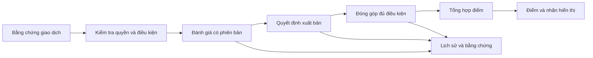
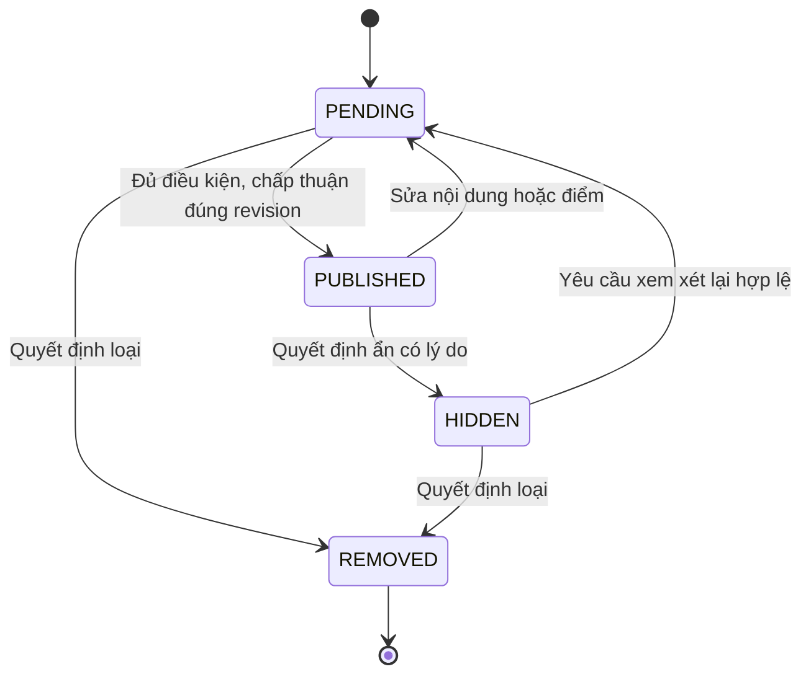

# Reputation and trust signals — Danh tiếng và tín hiệu tin cậy

## 1. Vì sao danh tiếng là một tài sản nghiệp vụ?

Trong chương **Business Assets** của module **Business Logic Security** (`SECURITY_APPLICATION_SECURITY_BUSINESS_LOGIC_SECURITY`), tài sản cần bảo vệ không chỉ là tiền, tồn kho hay dữ liệu riêng tư. **Danh tiếng** và các **tín hiệu tin cậy** cũng có thể quyết định người dùng mua gì, chọn ai và có tiếp tục sử dụng hệ thống hay không.

Một sàn giao dịch có thể dùng điểm sao, số lượt đánh giá, tỷ lệ hoàn thành đơn và huy hiệu người bán để hỗ trợ quyết định. Một ứng dụng khác có thể dùng nhãn “đã xác minh”, điểm đóng góp hoặc lịch sử xử lý yêu cầu.

Nếu những tín hiệu này có thể được tạo, sửa hoặc đếm sai, người lạm dụng có thể:

- Tự tạo hình ảnh đáng tin cậy để nhận thêm đơn hoặc quyền lợi.
- Làm giảm uy tín của đối thủ bằng đóng góp không đủ điều kiện.
- Dùng lại bằng chứng cũ cho đối tượng hoặc nội dung khác.
- Gửi yêu cầu trùng để tăng số lượt đánh giá.
- Sửa nội dung sau kiểm duyệt nhưng tiếp tục giữ nhãn đã được chấp thuận.
- Khiến người dùng hiểu một huy hiệu rộng hơn điều mà hệ thống thực sự đã kiểm tra.

Đây là các vấn đề của business logic security: từng request có thể hợp lệ về định dạng và đến từ tài khoản đã đăng nhập, nhưng chuỗi hành động tạo ra một sự khẳng định sai về độ tin cậy.

Mục tiêu là bảo vệ **ý nghĩa, nguồn gốc, phạm vi và tính nhất quán của tín hiệu**, đồng thời giữ rõ giới hạn của điều hệ thống có thể chứng minh.

## 2. Phân biệt danh tiếng, tín hiệu và bằng chứng

### 2.1. Ba khái niệm liên quan nhưng không đồng nhất

**Danh tiếng** là nhận định được tích lũy về một chủ thể, sản phẩm hoặc tổ chức. Nó chịu ảnh hưởng của trải nghiệm thực tế, thông tin hiển thị và cách hệ thống tổng hợp dữ liệu.

**Tín hiệu tin cậy** là thông tin mà hệ thống đưa ra để người khác đánh giá mức độ đáng tin, chẳng hạn điểm trung bình hoặc một huy hiệu.

**Bằng chứng** là dữ liệu có nguồn gốc và ngữ cảnh để hỗ trợ một khẳng định cụ thể: sự kiện giao hàng, kết quả xác minh một thuộc tính, quyết định kiểm duyệt hoặc lịch sử giao dịch.

Quan hệ có thể hình dung như sau:

```text
Bằng chứng có thẩm quyền
    → áp dụng chính sách
    → tạo hoặc cập nhật tín hiệu
    → ảnh hưởng nhận định và quyết định của người dùng
```

Sai lệch ở bất kỳ bước nào đều có thể làm tổn hại danh tiếng hoặc làm mất niềm tin vào chính nền tảng.

### 2.2. Mỗi tín hiệu phải có một lời khẳng định rõ ràng

| Tín hiệu | Điều có thể được khẳng định theo chính sách | Điều không thể tự suy ra |
| --- | --- | --- |
| “Đã mua hàng” | Có bằng chứng giao dịch đáp ứng điều kiện của nền tảng và gắn với người đánh giá, sản phẩm | Nội dung đánh giá là đúng hoặc không có động cơ thiên lệch |
| Điểm trung bình | Kết quả tổng hợp của tập đóng góp đủ điều kiện theo công thức đã công bố | Tất cả khách hàng đều được đại diện hoặc sản phẩm chắc chắn phù hợp |
| “Đã xác minh thông tin” | Một thuộc tính cụ thể đã được kiểm tra bằng quy trình xác định | Mọi thông tin, hành vi và năng lực của chủ thể đều đáng tin |
| Huy hiệu người bán | Các tiêu chí định nghĩa cho huy hiệu được đáp ứng trong phạm vi và thời gian tương ứng | Mọi giao dịch tương lai đều thành công |
| Số năm hoạt động | Tài khoản hoặc chủ thể có lịch sử theo mốc được lưu | Chủ thể luôn giữ cùng người kiểm soát hoặc chưa từng vi phạm |
| Số giao dịch hoàn thành | Các giao dịch được đếm đã đạt trạng thái theo quy tắc | Mỗi giao dịch tương ứng một khách hàng độc lập |

Một hệ thống an toàn không biến bằng chứng hẹp thành lời bảo chứng tuyệt đối. Ví dụ, kiểm tra địa chỉ email không đủ để hiển thị “người bán đã được xác minh toàn diện”.

### 2.3. Tính đúng của tín hiệu không đồng nghĩa chân lý về con người

Hệ thống có thể bảo đảm rằng một đánh giá được tạo từ tài khoản gắn với giao dịch đủ điều kiện. Nó thường không thể chỉ từ đó bảo đảm người viết độc lập với người bán, không bị mua chuộc hoặc mô tả khách quan.

Cần tách:

- **Bảo đảm có thể thực thi:** nguồn bằng chứng, quyền thao tác, điều kiện tham gia, tính duy nhất và công thức tổng hợp.
- **Đánh giá rủi ro:** dấu hiệu thông đồng, chất lượng nội dung hoặc quan hệ khó xác định giữa nhiều tài khoản.

Nhầm hai lớp này dễ tạo ra huy hiệu mang ý nghĩa quá rộng và cơ chế phòng vệ có vẻ mạnh hơn thực tế.

## 3. Ví dụ xuyên suốt: đánh giá sản phẩm có bằng chứng mua hàng

Bài học sử dụng một hệ thống đánh giá sản phẩm trong một tenant. Để có thể suy luận cụ thể, chính sách minh họa là:

1. Chỉ người mua gắn với một dòng hàng đã thanh toán và hoàn tất giao nhận mới được tạo đánh giá đủ điều kiện.
2. Mỗi bộ `(tenantId, buyerId, productId)` chỉ có tối đa một đánh giá hiện hành. Mua nhiều đơn không tạo thêm phiếu điểm độc lập cho cùng tài khoản và sản phẩm.
3. Điểm đánh giá là số nguyên từ 1 đến 5.
4. Chỉ nội dung đã qua quy trình xuất bản của hệ thống, ở đúng phiên bản được chấp thuận, mới được công khai và tham gia điểm tổng.
5. Khi sửa điểm hoặc nội dung, phiên bản mới phải đi lại quy trình xuất bản tương ứng; quyết định cũ không tự áp dụng.
6. Tài khoản có quan hệ với tổ chức bán hàng theo dữ liệu mà nền tảng quản lý không được tạo đánh giá tự chứng thực cho sản phẩm của tổ chức đó.
7. Hoàn tiền sau giao nhận không tự xóa lịch sử đã mua và không tự loại đánh giá tiêu cực. Việc ẩn, loại khỏi tổng hợp hoặc thu hồi nhãn phải theo lý do và quy trình riêng được xác định.

Điều kiện số 7 tránh một kiểu sai lệch: người bán hoàn tiền rồi hệ thống tự xóa mọi đánh giá không có lợi, dù khách hàng đã thực sự trải nghiệm sản phẩm.

Đây là một lựa chọn chính sách của ví dụ. Hệ thống khác có thể chọn quy tắc khác, nhưng phải mô tả rõ và áp dụng nhất quán.

### 3.1. Dữ liệu cốt lõi

```text
Review
    tenantId
    reviewId
    buyerId
    productId
    purchaseLineId
    rating
    body
    contentRevision
    approvedRevision
    publicationStatus
    eligibilityStatus
    rowVersion

PurchaseEvidence
    tenantId
    purchaseLineId
    buyerId
    productId
    sự kiện xác nhận điều kiện giao dịch
    nguồn và định danh bằng chứng

ProductRatingProjection
    tenantId
    productId
    publishedCount
    ratingSum
    projectionVersion
```

`publicationStatus` mô tả tình trạng xuất bản. `eligibilityStatus` mô tả việc đóng góp có đủ điều kiện tham gia hay không. Hai khía cạnh này cần được xét rõ, dù một triển khai đơn giản có thể biểu diễn bằng một mô hình trạng thái kết hợp.

### 3.2. Dòng chảy của tín hiệu



Mỗi mũi tên là một ranh giới cần kiểm soát. Frontend không được tự chọn một `purchaseLineId` bất kỳ rồi yêu cầu máy chủ gắn nhãn “đã mua hàng”.

## 4. Những bất biến cần bảo vệ

### 4.1. Bằng chứng phải đúng chủ thể và đối tượng

Với đánh giá đủ điều kiện `r` và bằng chứng `e`:

```text
r.tenantId = e.tenantId
r.buyerId = e.buyerId
r.productId = e.productId
r.purchaseLineId = e.purchaseLineId
```

Ngoài quan hệ định danh, bằng chứng phải chứng minh được trạng thái giao dịch theo chính sách. Một dòng hàng đã tạo nhưng chưa thanh toán hoặc chưa giao không đáp ứng điều kiện của ví dụ.

Các định danh từ request chỉ giúp chỉ ra đối tượng cần kiểm tra. Chúng không chứng minh người gọi sở hữu giao dịch.

### 4.2. Một chủ thể không được tạo nhiều đóng góp ngoài chính sách

Trong ví dụ:

```text
Số đánh giá hiện hành cho (tenantId, buyerId, productId) <= 1
```

Điều này khác với “mỗi idempotency key chỉ tạo một review”. Người dùng có thể đổi khóa, hoặc gửi hai yêu cầu đồng thời.

Khái niệm “hiện hành” phải được định nghĩa khi có xóa mềm hoặc lưu lịch sử. Có thể duy trì một bản ghi chính cho bộ ba và lưu các phiên bản riêng, thay vì tạo vô hạn bản ghi mới sau mỗi lần xóa.

### 4.3. Quyết định xuất bản phải gắn với đúng nội dung

```text
review được công khai
⇒ quyết định xuất bản hợp lệ
   ∧ approvedRevision = contentRevision
```

Nếu review đã được chấp thuận ở phiên bản 3 rồi nội dung chuyển sang phiên bản 4, hệ thống không được tiếp tục diễn giải quyết định cho phiên bản 3 là quyết định cho phiên bản 4.

### 4.4. Điểm tổng phải được tính từ đúng tập đóng góp

Đặt `EligiblePublished(p)` là tập đánh giá của sản phẩm `p` vừa đủ điều kiện vừa được công khai ở phiên bản được chấp thuận:

```text
publishedCount(p) = số phần tử của EligiblePublished(p)

ratingSum(p) = tổng rating của EligiblePublished(p)

Nếu publishedCount > 0:
    average = ratingSum / publishedCount
Nếu publishedCount = 0:
    chưa có điểm, không diễn giải thành điểm 0 sao
```

Vì rating nằm trong 1 đến 5:

```text
publishedCount >= 0
publishedCount <= ratingSum <= 5 × publishedCount
```

Các bất đẳng thức này chỉ là kiểm tra nhất quán cơ bản. Tổng sai vẫn có thể nằm trong miền hợp lệ; cần đối chiếu với dữ liệu nguồn để biết tập đóng góp có đúng không.

### 4.5. Tín hiệu phải đúng phạm vi và hiệu lực

Một huy hiệu được cấp cho một gian hàng không tự động áp dụng cho mọi gian hàng khác của cùng người quản lý. Bằng chứng cho một sản phẩm không tự động áp dụng cho sản phẩm mới được thay thế.

Với huy hiệu có thời hạn:

```text
hiển thị là còn hiệu lực
⇒ đúng subject
   ∧ đúng loại khẳng định
   ∧ đáp ứng điều kiện hiệu lực
   ∧ chưa bị thu hồi theo chính sách
```

Hệ thống cũng cần phân biệt một **sự kiện lịch sử** với một **khẳng định hiện tại**. “Đã hoàn tất một giao dịch vào tháng trước” và “hiện đáp ứng mọi tiêu chí người bán uy tín” có yêu cầu hiệu lực khác nhau.

## 5. Các cách lạm dụng cần đưa vào mô hình đe dọa

| Cách lạm dụng | Lỗi logic bị khai thác | Tài sản bị ảnh hưởng |
| --- | --- | --- |
| Đánh giá bằng đơn của người khác | Chỉ kiểm tra purchaseLineId tồn tại | Tính xác thực của nguồn đóng góp |
| Tạo nhiều review cho cùng quyền tham gia | Không có tính duy nhất theo nghiệp vụ | Điểm, số lượng và thứ hạng |
| Tự gắn huy hiệu | Cho client ghi cờ xác minh hoặc mã loại huy hiệu | Ý nghĩa của tín hiệu |
| Sửa sau kiểm duyệt | Quyết định không gắn với contentRevision | Chất lượng và tính toàn vẹn của nội dung công khai |
| Dùng nhiều tài khoản để tạo ảnh hưởng giả | Đồng nhất tài khoản với người độc lập | Tính đại diện của danh tiếng |
| Thông đồng qua giao dịch đủ hình thức | Điều kiện giao dịch quá hẹp so với lời khẳng định | Độ tin cậy của đánh giá |
| Xóa rồi tạo lại để được đếm thêm | Xóa mềm hoặc khôi phục không giữ định danh đóng góp | Công thức tổng hợp |
| Phát lại sự kiện xuất bản | Consumer tăng count cho mọi event nhận được | Tính đúng của projection |
| Áp dụng nhãn sai sản phẩm hoặc tenant | Không ràng buộc phạm vi bằng chứng | Danh tiếng của đối tượng |
| Người có quyền quản trị sửa điểm tùy ý | Quyền vận hành quá rộng, thiếu dấu vết | Cả dữ liệu và niềm tin vào nền tảng |

**Sybil** là tình huống một chủ thể kiểm soát nhiều danh tính để tạo ra hình ảnh có nhiều người độc lập. Ràng buộc một review trên mỗi tài khoản và sản phẩm chỉ giới hạn tài khoản, không chứng minh mỗi tài khoản là một người.

Tương tự, việc có giao dịch thật giúp chứng minh một điều kiện tham gia, nhưng không tự loại bỏ giao dịch thông đồng hoặc nội dung được tài trợ mà không khai báo theo chính sách nền tảng.

Cách mô hình hóa đúng là xác định điều cơ chế cứng có thể giữ, rồi bổ sung phát hiện rủi ro và quy trình xem xét cho phần không thể kết luận bằng một phép kiểm tra.

## 6. Nguồn có thẩm quyền và quyền theo đối tượng

### 6.1. Những gì client có thể gửi

Client có thể gửi nội dung mong muốn, chẳng hạn:

```text
productId
purchaseLineId muốn dùng làm bằng chứng
rating
body
expectedContentRevision khi sửa
idempotencyKey
```

Máy chủ cần tự xác định hoặc kiểm tra:

```text
tenantId và buyerId từ ngữ cảnh danh tính được xác thực
quyền trên review hiện hành
quan hệ giữa purchaseLine, buyer và product
điều kiện giao dịch
quan hệ tự đánh giá theo chính sách
trạng thái xuất bản
nhãn bằng chứng
contentRevision và rowVersion
đóng góp vào điểm tổng
```

Không cho phép mass assignment các trường như `verifiedPurchase`, `approvedRevision`, `publicationStatus`, `ratingSum` hoặc `publishedCount`. Mass assignment ở đây là việc tự động gán cả những trường mà người gọi không có quyền quyết định từ request vào model lưu trữ.

Việc đổi tên trường thành `trusted` hoặc đặt trong một DTO riêng chưa tạo ra bảo đảm nếu nó vẫn được bind từ dữ liệu client.

### 6.2. Các lệnh có quyền khác nhau

| Hành động | Phạm vi quyền tiêu biểu |
| --- | --- |
| Tạo đánh giá | Người mua đủ điều kiện trên sản phẩm tương ứng |
| Sửa đánh giá | Chủ đánh giá, đúng phiên bản và trạng thái cho phép |
| Xuất bản hoặc ẩn | Vai trò kiểm duyệt với scope phù hợp và quyết định có lý do |
| Cấp huy hiệu | Thành phần hoặc nhân sự có quyền xác nhận đúng loại bằng chứng |
| Thu hồi huy hiệu | Quy trình có quyền thu hồi trên đối tượng cụ thể |
| Tính lại điểm | Tác vụ được kiểm soát, áp dụng công thức và nguồn dữ liệu chuẩn |

Người bán không nên có quyền trực tiếp sửa sao hoặc loại các review tiêu cực khỏi điểm tổng. Nếu được báo cáo nội dung, báo cáo đó là một yêu cầu xem xét, không phải quyết định xóa.

Một tài khoản quản trị cũng không nên mặc nhiên có mọi quyền thay đổi bằng chứng. Có thể cần tách quyền xét duyệt với quyền vận hành dữ liệu theo mức tác động.

### 6.3. Bằng chứng không được chuyển nhượng ngoài chính sách

Để tránh dùng lại bằng chứng sai phạm vi, hãy ràng buộc nó với chủ thể và đối tượng cụ thể. Nếu gộp sản phẩm, chuyển quyền sở hữu cửa hàng hoặc đổi danh tính kinh doanh, cần một quy trình ánh xạ và xử lý tín hiệu phù hợp.

Ví dụ, chuyển toàn bộ đánh giá từ sản phẩm cũ sang một sản phẩm khác chỉ vì tái sử dụng mã nội bộ có thể làm người dùng hiểu sai. Định danh kỹ thuật phải giữ được ý nghĩa đối tượng mà lịch sử danh tiếng nói tới.

## 7. Vòng đời của đánh giá và quyết định xuất bản

### 7.1. Biểu diễn các bước có ý nghĩa



Đây là mô hình minh họa. Trong bài, `REMOVED` không được tự khôi phục qua lệnh sửa thông thường. Nếu nghiệp vụ có kháng nghị hoặc phục hồi, cần thêm cạnh và guard riêng.

Mỗi cạnh phải kiểm tra actor, scope, trạng thái nguồn và phiên bản. Quyền sở hữu review không tạo ra quyền tự xuất bản.

### 7.2. Không tái sử dụng quyết định cho nội dung đã đổi

Giả sử:

```text
reviewId = R
contentRevision = 8
approvedRevision = 8
rating = 5
status = PUBLISHED
```

Người dùng sửa thành rating 1 và thay nội dung:

```text
contentRevision = 9
approvedRevision không còn áp dụng cho phiên bản mới
status = PENDING
```

Cần xử lý đóng góp của phiên bản 8 theo chính sách. Ví dụ của bài tạm loại review khỏi tập công khai và điểm tổng cho đến khi phiên bản 9 được chấp thuận.

Một hệ thống khác có thể tiếp tục hiển thị phiên bản 8 trong lúc chờ. Khi đó phải lưu rõ phiên bản đang công khai, thay vì hiển thị body phiên bản 9 dưới quyết định dành cho phiên bản 8.

Đây là một lựa chọn sản phẩm ảnh hưởng trực tiếp mô hình dữ liệu và công thức điểm.

### 7.3. Huy hiệu cũng có vòng đời

Huy hiệu nên được xem như một quyết định có cấu trúc:

```text
badgeId
tenantId
subjectType và subjectId
claimType
evidenceReference
policyVersion nếu cần tái dựng
issuedAt
validUntil nếu có
revokedAt và reason nếu bị thu hồi
```

`evidenceReference` không nên trỏ tới một dữ liệu có thể bị sửa tùy ý rồi tiếp tục được diễn giải như bằng chứng ban đầu. Có thể cần snapshot hoặc phiên bản.

Nếu huy hiệu mô tả một thuộc tính hiện tại, cần quy tắc hết hạn và tái xác minh. Nếu mô tả một sự kiện lịch sử, cần tránh hiển thị nó như bảo đảm liên tục cho mọi hành vi hiện tại.

Cache huy hiệu phải tôn trọng chính sách hiệu lực và thu hồi. Nếu có khoảng trễ được chấp nhận, cần xác định nó; nếu yêu cầu chặn ngay một hành động nhạy cảm, không dùng bản sao hiển thị có thể đã cũ làm quyền quyết định.

## 8. Giữ tính duy nhất và điều kiện tham gia khi có cạnh tranh

### 8.1. Không chỉ kiểm tra “chưa có review”

Mẫu dễ lỗi:

```text
if không thấy review hiện hành:
    tạo review mới
```

Hai request đồng thời có thể cùng không thấy bản ghi rồi cùng tạo.

Với mô hình một bản ghi chính trên mỗi buyer và product, một phần cơ chế có thể là:

```sql
UNIQUE (tenant_id, buyer_id, product_id)
CHECK (rating BETWEEN 1 AND 5)
```

Các cột tham gia phải có ràng buộc null phù hợp. Nếu dùng lịch sử riêng, ràng buộc này nằm trên bản ghi chính hoặc cấu trúc đại diện cho đóng góp hiện hành.

Idempotency giúp xử lý retry của cùng command; unique constraint giữ quy tắc khi người dùng đổi khóa. Hai lớp giải quyết hai vấn đề khác nhau.

### 8.2. Quyết định tham gia phải dùng dữ liệu đúng

Trong một transaction hoặc cơ chế nhất quán tương đương:

```text
1. Xác định actor và tenant.
2. Tải purchaseLine và bằng chứng lịch sử theo scope.
3. Đối chiếu buyerId, productId và các điều kiện giao dịch.
4. Kiểm tra quan hệ tự đánh giá theo chính sách.
5. Tạo hoặc cập nhật review chính với tính duy nhất phù hợp.
6. Ghi bằng chứng và outbox cần thiết.
7. Commit.
```

Nếu chính sách xét dữ liệu hiện tại có thể thay đổi đồng thời, cần khóa, kiểm soát phiên bản hoặc cơ chế phối hợp thích hợp cho dữ liệu đó.

Một bằng chứng lịch sử bất biến về giao nhận có tính chất khác với cờ `eligible` có thể bị thu hồi. Cơ chế phải phản ánh đúng ngữ nghĩa của từng dữ liệu, không chỉ đọc một lần rồi tin mãi.

### 8.3. Sửa và xuất bản cạnh tranh

Ví dụ:

```text
A đọc review revision 8 để xuất bản.
B sửa review thành revision 9.
A ghi status = PUBLISHED bằng một update không có điều kiện.
```

Nội dung phiên bản 9 có thể xuất hiện mà chưa được xét.

Cần bảo vệ bằng cách khóa bản ghi trong lúc quyết định hoặc cập nhật có điều kiện theo revision và trạng thái:

```sql
UPDATE review
SET publication_status = 'PUBLISHED',
    approved_revision = :reviewed_revision,
    row_version = row_version + 1
WHERE tenant_id = :tenant_id
  AND review_id = :review_id
  AND content_revision = :reviewed_revision
  AND row_version = :expected_row_version
  AND publication_status = 'PENDING'
  AND eligibility_status = 'ELIGIBLE';
```

Chỉ coi thành công khi cập nhật đúng một dòng. Lệnh này minh họa điều kiện trên review; quyền kiểm duyệt và tính hợp lệ của bằng chứng vẫn cần cơ chế riêng trong cùng lập luận về tính đúng.

Nếu cập nhật 0 dòng, không tự đổi `reviewed_revision` sang phiên bản mới rồi xuất bản tiếp. Quyết định cũ không đại diện cho nội dung người xét chưa xem.

## 9. Tổng hợp điểm từ đóng góp có trạng thái

### 9.1. Tránh tăng bộ đếm theo tên sự kiện

Consumer dễ được viết như sau:

```text
Nhận ReviewPublished:
    count += 1
    sum += event.rating
```

Nếu event được gửi lại, count và sum tăng thêm. Nếu nội dung được sửa rồi xuất bản lại, cùng một review có thể bị tính như một đánh giá mới.

Nên mô hình hóa **đóng góp hiện hành của từng review**:

```text
ReviewContribution
    tenantId
    reviewId
    productId
    sourceVersion
    included
    rating
```

`included = true` khi review thuộc tập đủ điều kiện và công khai. Với đóng góp không được tính, có thể chuẩn hóa `rating = 0` trong projection đóng góp; điều này không thay đổi điểm gốc mà người dùng đã gửi.

Mỗi lần thay đổi là thay thế đóng góp cũ bằng đóng góp mới:

```text
newCount = oldCount - contributionCountBefore + contributionCountAfter

newSum = oldSum - contributionRatingBefore + contributionRatingAfter
```

### 9.2. Ví dụ Java tính phần thay đổi

```java
record RatingContribution(boolean included, int rating) {
    RatingContribution {
        if (included && (rating < 1 || rating > 5)) {
            throw new IllegalArgumentException("INVALID_RATING");
        }
        if (!included && rating != 0) {
            throw new IllegalArgumentException("EXCLUDED_MUST_BE_ZERO");
        }
    }

    static RatingContribution excluded() {
        return new RatingContribution(false, 0);
    }

    int countValue() {
        return included ? 1 : 0;
    }

    int sumValue() {
        return included ? rating : 0;
    }
}

record RatingDelta(int countChange, int sumChange) {
    static RatingDelta between(
            RatingContribution before,
            RatingContribution after) {
        return new RatingDelta(
                after.countValue() - before.countValue(),
                after.sumValue() - before.sumValue());
    }
}
```

Một chuỗi ví dụ:

| Thay đổi | Đóng góp trước | Đóng góp sau | Delta count | Delta sum |
| --- | --- | --- | ---: | ---: |
| Xuất bản lần đầu, 5 sao | Không tính | Tính 5 | +1 | +5 |
| Sửa và chờ xét lại | Tính 5 | Không tính | −1 | −5 |
| Xuất bản phiên bản mới, 4 sao | Không tính | Tính 4 | +1 | +4 |
| Ẩn theo quyết định hợp lệ | Tính 4 | Không tính | −1 | −4 |

Hàm Java chỉ minh họa phép tính. Nó không tự cung cấp idempotency, kiểm tra nguồn event, kiểm soát cạnh tranh hoặc bảo đảm rằng before là đóng góp đang lưu.

### 9.3. Áp dụng thay thế một cách nguyên tử

Một consumer sử dụng event snapshot có phiên bản đơn điệu cho từng review có thể thực hiện:

```text
BEGIN

1. Tải và bảo vệ đóng góp hiện hành của review.
   Nếu chưa có, tạo hoặc giành quyền tạo theo unique key.

2. Nếu event.sourceVersion <= contribution.sourceVersion:
       không áp dụng lại thay đổi.

3. Nếu là phiên bản mới:
       xác định đóng góp mới từ snapshot có nguồn tin cậy;
       tính delta so với đóng góp đang lưu;
       cập nhật tổng sản phẩm;
       lưu đóng góp mới và sourceVersion.

COMMIT
```

Khóa hoặc cập nhật có điều kiện phải ngăn hai consumer cùng dùng một before rồi cùng cộng delta. Cập nhật đóng góp và tổng cần nằm trong cùng ranh giới nhất quán đã chọn.

Phiên bản nguồn phải tăng với mọi thay đổi ảnh hưởng đóng góp, gồm xuất bản, sửa, ẩn, thu hồi điều kiện và khôi phục. Chỉ dùng `contentRevision` là chưa đủ nếu thao tác ẩn không thay nội dung.

Thuật toán bỏ qua phiên bản cũ phù hợp khi event mới mang snapshot đủ để xác định trạng thái đóng góp. Nếu event chỉ mang delta hoặc là một bước cần áp dụng tuần tự, không được bỏ qua các bước trung gian mà thiếu một cơ chế sắp thứ tự hoặc phục hồi phù hợp.

### 9.4. Xóa và khôi phục cũng là thay đổi đóng góp

Khi loại review khỏi điểm, cần giữ đủ dấu vết về phiên bản đã áp dụng. Nếu xóa sạch bản ghi đóng góp và quên version, một event cũ có thể làm review được tính trở lại.

Có thể giữ tombstone hoặc một mốc phiên bản đã xử lý theo thiết kế. Khôi phục cần một sự kiện hoặc command mới có phiên bản lớn hơn và điều kiện hợp lệ.

Không nên tạo reviewId mới chỉ để tránh giải quyết vòng đời cũ, vì điều đó có thể phá tính duy nhất và tạo thêm đóng góp cho cùng chủ thể.

### 9.5. Xác định mức nhất quán của điểm hiển thị

Có hai mô hình cần phân biệt:

- **Cập nhật cùng transaction:** dữ liệu nguồn, đóng góp và tổng được cập nhật trong cùng quyết định cục bộ; công thức tổng đúng tại ranh giới commit của quyết định đó.
- **Projection bất đồng bộ:** tổng có thể chậm hơn dữ liệu nguồn. Cần định danh phiên bản hoặc mốc xử lý, theo dõi độ trễ và kiểm tra tính đúng theo trạng thái nguồn tương ứng.

Không thể vừa chấp nhận queue có độ trễ vừa hứa mọi bản sao hiển thị khớp tức thời với nguồn. Với projection bất đồng bộ, cần có tiến trình tính lại hoặc đối soát từ nguồn chuẩn.

Khi so sánh số liệu trong kiểm thử hoặc đối soát, phải dùng cùng mốc nhất quán, tránh kết luận sai vì một phía đã xử lý bản cập nhật mới hơn.

Chỉ lưu count và sum chính xác rồi tính điểm trung bình để hiển thị. Không nên cập nhật trung bình bằng các phép làm tròn lặp lại, vì có thể tích lũy sai số và làm khó việc khôi phục.

## 10. Chống thao túng mà không biến tín hiệu thành lời hứa quá mức

### 10.1. Ràng buộc cứng và phát hiện rủi ro

| Lớp | Ví dụ | Giới hạn |
| --- | --- | --- |
| Ràng buộc nghiệp vụ | Một đóng góp trên mỗi buyer và product | Không xác định một người có bao nhiêu tài khoản |
| Bằng chứng giao dịch | Đúng người mua, đúng sản phẩm, đủ trạng thái | Không chứng minh ý kiến khách quan |
| Kiểm soát tần suất | Hạn chế tốc độ gửi hoặc thay đổi bất thường | Không ngăn mọi nhóm thông đồng có nhịp chậm |
| Phân tích rủi ro | Mẫu quan hệ, giao dịch, nội dung hoặc thời gian đáng chú ý | Có thể nhận định sai, cần ngữ cảnh |
| Xem xét và kháng nghị | Người có thẩm quyền đánh giá trường hợp bị gắn cờ | Cần kiểm soát quyền và tính nhất quán của quyết định |

Một cơ chế có ích không cần chứng minh được mọi thứ. Nó cần giới hạn đúng loại lạm dụng và không làm người sử dụng hiểu sai năng lực của nó.

Dữ liệu mạng, thiết bị hoặc quan hệ có thể là một tín hiệu rủi ro, nhưng không nên đồng nhất một địa chỉ mạng với một người. Những người độc lập có thể dùng chung hạ tầng.

### 10.2. Không dùng cảm xúc tích cực làm điều kiện “hợp lệ”

Một đánh giá tiêu cực không tự trở thành gian lận vì làm giảm điểm. Quy tắc tham gia và kiểm duyệt cần phân biệt nội dung không được phép với ý kiến bất lợi nhưng hợp lệ.

Tương tự, việc người dùng được hoàn tiền không tự chứng minh họ chưa từng mua hoặc chưa trải nghiệm sản phẩm. Chính sách loại bỏ review theo sự kiện tài chính cần xét ý nghĩa của bằng chứng, tránh tạo cơ chế mua lại hoặc xóa bỏ lịch sử tiêu cực.

Nếu có nội dung được tài trợ hoặc một chương trình khuyến khích đánh giá, cách phân loại và trình bày cần phản ánh chính sách đã chọn; không nên hòa chúng vào tập đóng góp mà người đọc mặc nhiên hiểu là độc lập nếu điều đó không đúng.

### 10.3. Điểm danh tiếng không phải quyền truy cập

Điểm cao có thể hỗ trợ phân tích rủi ro hoặc ưu tiên một quy trình theo chính sách. Nó không thay thế xác thực và quyền theo đối tượng.

Ví dụ, người bán điểm cao vẫn không được:

- Đọc dữ liệu riêng của người mua ngoài phạm vi.
- Tự duyệt giao dịch cần tách vai trò.
- Sửa điểm và bằng chứng của chính mình.
- Vượt hạn mức chỉ vì giao diện đang hiển thị một huy hiệu.

Nếu điểm tham gia quyết định cấp một quyền lợi, cần một rule server rõ ràng, nguồn dữ liệu phù hợp và ranh giới nhất quán tương ứng. Một điểm cache phục vụ hiển thị không tự đủ để quyết định hành động nhạy cảm.

## 11. Thiết kế cách hiển thị để giữ đúng ý nghĩa tín hiệu

### 11.1. Nhãn phải nói đúng điều được xác minh

Thay vì một nhãn rộng như “đáng tin cậy”, nên xác định người dùng cần biết thuộc tính nào và bằng chứng gì hỗ trợ thuộc tính đó.

Thông tin giải thích có thể nêu:

- Đã xác minh điều gì.
- Tín hiệu áp dụng cho chủ thể nào.
- Tiêu chí hoặc phạm vi cơ bản.
- Mốc cập nhật hoặc thời hạn nếu ảnh hưởng cách hiểu.
- Số lượng và loại đóng góp tạo ra điểm.

Không cần lộ chi tiết phát hiện gian lận để giải thích ý nghĩa một huy hiệu.

### 11.2. Điểm trung bình cần đi kèm ngữ cảnh

Điểm 5,0 từ một review có ý nghĩa khác với 4,8 từ hàng nghìn review. Hiển thị số lượng, phân bố hoặc khoảng thời gian phù hợp giúp người dùng hiểu dữ liệu.

Nếu công thức có trọng số, giảm dần theo thời gian hoặc điều chỉnh theo độ tin cậy thống kê, cần phân biệt điểm đó với trung bình cộng đơn giản. Công thức phải có phiên bản và có thể tái dựng ở mức cần thiết.

Khi chưa có đóng góp, hiển thị “chưa có đánh giá” rõ nghĩa hơn biến nó thành 0 sao hoặc một điểm mặc định giống đánh giá thật.

### 11.3. Tổng khác bộ lọc cần được diễn giải nhất quán

Số sao, số review công khai, số giao dịch và số khách hàng là các đại lượng khác nhau. Không nên gắn nhãn khiến người đọc hiểu chúng là một.

Nếu bộ lọc đang chỉ hiển thị review gần đây nhưng điểm tổng tính toàn bộ lịch sử, cần thể hiện phạm vi rõ ràng. Nếu một số review không tham gia điểm theo chính sách, việc tính và giải thích cần nhất quán.

Đối với trường hợp bị thu hồi hoặc đang chờ xem xét, phải xác định điều gì còn hiển thị và điều gì còn đóng góp. Giữ nhãn hiện tại trong cache sau khi nguồn đã thu hồi có thể làm lời khẳng định sai dù dữ liệu nền đã được sửa.

## 12. Kiểm thử tình huống lạm dụng tín hiệu tin cậy

| Bảo đảm | Tình huống cần thử | Kết quả cần quan sát |
| --- | --- | --- |
| Đúng người mua | Gửi purchaseLineId của người khác | Không tạo review đủ điều kiện hoặc nhãn đã mua hàng |
| Đúng tenant | Dùng giao dịch tenant khác | Không đọc hoặc sử dụng bằng chứng ngoài scope |
| Đúng sản phẩm | Dùng giao dịch sản phẩm A để đánh giá B | Không gắn nhầm bằng chứng |
| Đúng điều kiện | Dùng đơn chưa thanh toán hoặc chưa giao | Không đi qua guard của chính sách ví dụ |
| Không tự chứng thực | Actor thuộc tổ chức bán hàng được nhận diện | Không tạo đóng góp tự đánh giá trái chính sách |
| Tính duy nhất | Gửi hai request đồng thời, khác idempotency key | Chỉ một review chính cho buyer và product |
| Chống mass assignment | Gửi verifiedPurchase, approvedRevision hoặc status trong body | Client không quyết định các trường có thẩm quyền |
| Đúng revision | Sửa nội dung sau khi kiểm duyệt nhưng trước khi xuất bản | Không công khai phiên bản chưa được chấp thuận |
| Không đếm lại | Phát lại event xuất bản | Count và sum không tăng lần nữa |
| Chịu được sai thứ tự | Event ẩn mới tới trước event xuất bản cũ | Trạng thái cũ không làm khôi phục đóng góp |
| Sửa điểm đúng | Sửa review công khai rồi xuất bản lại | Loại đóng góp cũ và thêm đóng góp mới đúng một lần |
| Xóa và khôi phục đúng | Lặp các command ẩn, xóa, phục hồi và replay | Không âm count, không nhân đôi đóng góp |
| Giữ bằng chứng lịch sử | Hoàn tiền sau giao nhận | Xử lý theo chính sách đã nêu, không tự xóa đánh giá tiêu cực |
| Huy hiệu đúng scope | Dùng badgeId của đối tượng khác | Không hiển thị hay áp dụng nhãn sai chủ thể |
| Hết hạn và thu hồi | Cache còn dữ liệu cũ khi nguồn đổi | Hành vi tuân theo chính sách hiệu lực và mức trễ đã xác định |
| Quyền kiểm duyệt | Người bán tự gọi endpoint ẩn review của mình | Không biến quyền quản lý gian hàng thành quyền xóa đánh giá |
| Phục hồi projection | Tính lại từ nguồn và so với projection cùng mốc | Count, sum và tập đóng góp khớp |
| Không cấp quyền từ điểm | Tài khoản điểm cao gọi hành động ngoài scope | Quyền theo đối tượng vẫn được thực thi |

### 12.1. Quan sát dữ liệu sau commit

Không chỉ kiểm tra mã HTTP hoặc số sao trên một màn hình. Cần đọc lại review chính, revision, quyết định xuất bản, nguồn bằng chứng, đóng góp và tổng tương ứng.

Với projection bất đồng bộ, chờ tới mốc xử lý xác định hoặc kiểm tra trạng thái nhất quán tương ứng. Không dùng sleep cố định làm bằng chứng rằng mọi event đã được áp dụng.

Kiểm thử cạnh tranh cần cơ sở dữ liệu và cơ chế đồng bộ phù hợp, để chủ động tái tạo hai yêu cầu cùng tạo review hoặc một bên sửa trong khi bên kia xuất bản.

### 12.2. Những gì kiểm thử kỹ thuật chưa chứng minh

Một bộ kiểm thử có thể chứng minh việc đếm và ràng buộc nguồn đúng theo mô hình. Nó không tự chứng minh mọi người viết đều độc lập hoặc mọi đánh giá đều trung thực.

Phần đó cần được quản lý bằng chính sách, phân tích rủi ro, xem xét và cách truyền đạt giới hạn của tín hiệu. Kết quả kiểm thử không nên bị chuyển thành một huy hiệu bảo chứng rộng hơn phạm vi đã kiểm tra.

## 13. Vận hành, đối soát và xử lý khi tín hiệu đã sai

Các tín hiệu có ảnh hưởng đến quyết định của nhiều người cần có khả năng điều tra và phục hồi.

Dữ liệu quan sát hữu ích gồm:

- Số lần từ chối bằng chứng sai người mua, sản phẩm hoặc tenant.
- Xung đột tạo review trùng và xung đột revision.
- Độ trễ projection, số event bị bỏ qua vì cũ và lỗi áp dụng.
- Chênh lệch count, sum và đóng góp khi tính lại.
- Lịch sử cấp, thu hồi, xuất bản và ẩn với actor, lý do, scope.
- Những thay đổi bất thường cần xem xét theo chính sách rủi ro.

Chỉ lưu dữ liệu phục vụ mục tiêu đã xác định, kiểm soát quyền truy cập và tránh ghi bí mật hoặc dữ liệu cá nhân không cần thiết vào log.

Khi phát hiện điểm bị đếm sai, không nên chỉ sửa con số hiển thị. Cần xác định đóng góp nguồn, cơ chế đã gây sai, phiên bản bị ảnh hưởng và cách tính lại mà không áp dụng trùng các thay đổi đang đến.

Khi phát hiện một huy hiệu sai, cần xử lý cả dữ liệu gốc, bản sao, cache và các quyết định đang sử dụng huy hiệu theo phạm vi ảnh hưởng. Phục hồi phải đi qua đường có quyền và có dấu vết tương đương những thay đổi bình thường.

Một lần sửa projection không tự sửa được thiệt hại danh tiếng đã xảy ra. Khả năng giải thích quyết định và quy trình xem xét khiếu nại là một phần của việc duy trì niềm tin vào nền tảng.

## 14. Hồ sơ tài sản cho một tín hiệu tin cậy

Trước khi thêm một điểm số hoặc huy hiệu, hãy mô tả nó như một tài sản nghiệp vụ:

| Thành phần | Câu hỏi cần chốt |
| --- | --- |
| Lời khẳng định | Người đọc được hiểu chính xác điều gì từ tín hiệu? |
| Chủ thể | Tín hiệu nói về tài khoản, người bán, sản phẩm hay tổ chức nào? |
| Bằng chứng | Nguồn nào có thẩm quyền, có phiên bản và có thể đối chiếu? |
| Điều kiện tham gia | Ai được đóng góp, khi nào và bao nhiêu lần? |
| Vòng đời | Khi nào cấp, xuất bản, sửa, hết hạn, ẩn, thu hồi hoặc khôi phục? |
| Bất biến | Những quan hệ nào phải đúng sau mỗi quyết định và tại mốc tổng hợp? |
| Quyền | Ai được tạo, xét duyệt, điều chỉnh và xem dữ liệu nhạy cảm? |
| Cạnh tranh và retry | Khóa, version, uniqueness và idempotency được dùng ở đâu? |
| Tổng hợp | Tập nguồn, công thức, quy tắc làm tròn và phiên bản projection là gì? |
| Phát hiện lạm dụng | Dấu hiệu rủi ro nào cần xem xét, giới hạn và khả năng sai là gì? |
| Phục hồi | Có tính lại, đối soát và sửa sai có dấu vết được không? |
| Giới hạn | Tín hiệu không đủ bằng chứng để khẳng định những điều gì? |

Danh tiếng có giá trị vì người khác dùng nó để ra quyết định. Bảo vệ tài sản này đòi hỏi hệ thống giữ đúng mối liên hệ giữa lời khẳng định và bằng chứng, từ từng command đến dữ liệu tổng hợp và cách hiển thị cuối cùng.
