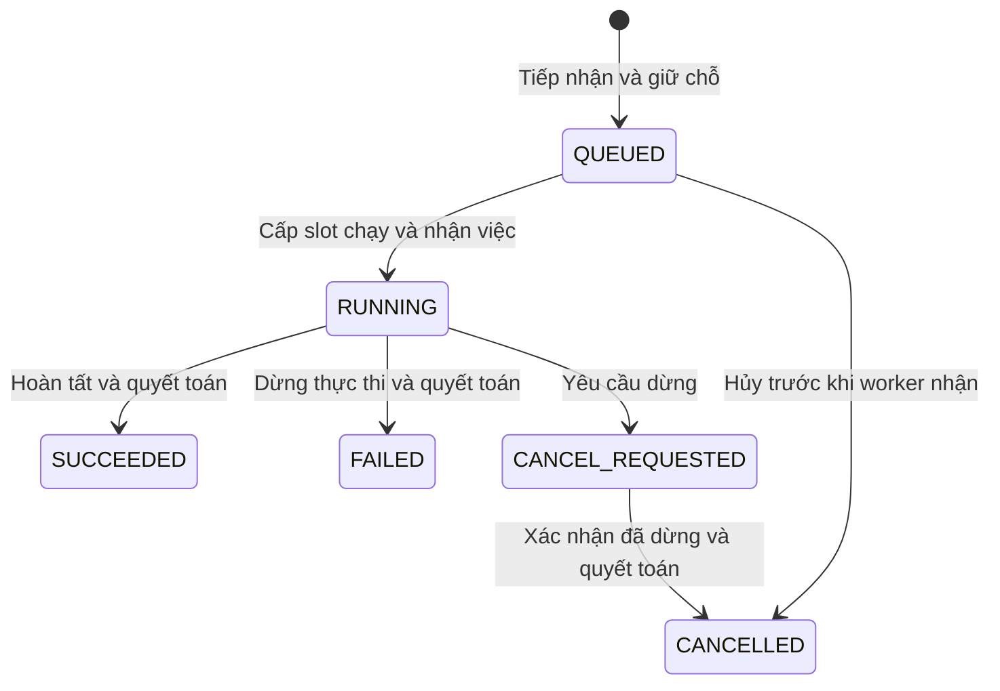

# Operational capacity and quotas — Năng lực vận hành và hạn ngạch

Một người dùng không cần truy cập trái phép hay gửi dữ liệu sai định dạng để gây thiệt hại. Họ có thể liên tục tạo báo cáo lớn, đặt chỗ rồi không sử dụng, gửi nhiều yêu cầu cần nhân viên xử lý hoặc giữ hàng trăm tác vụ ở trạng thái chờ. Từng yêu cầu có thể hợp lệ, nhưng tổng tác động làm cạn tài nguyên, tăng chi phí hoặc chiếm phần năng lực mà những người dùng khác cần.

Trong chương **Business Assets**, **operational capacity** được xem là tài sản nghiệp vụ: khả năng thực hiện công việc trong một khoảng thời gian với nguồn lực hữu hạn. **Quota** là hạn ngạch thể hiện ai được sử dụng bao nhiêu tài nguyên hoặc quyền lợi, trong phạm vi và thời hạn nào.

Bài học tập trung vào bảo vệ tài sản đó trước lạm dụng logic: chọn đúng đơn vị tính, xác định chủ thể chịu quota, giữ chỗ nguyên tử, xử lý đồng thời, retry, hủy và hết hạn. Ví dụ xuyên suốt là một dịch vụ tạo file export cho nhiều tổ chức.

## 1. Năng lực vận hành có giá trị nghiệp vụ như thế nào?

Năng lực vận hành có thể là tài nguyên kỹ thuật, nguồn lực con người hoặc khả năng phục vụ một quy trình:

| Loại năng lực | Ví dụ | Thiệt hại khi bị chiếm dụng |
| --- | --- | --- |
| Xử lý tính toán | Worker tạo báo cáo, chuyển đổi tài liệu, phân tích dữ liệu | Người dùng khác phải chờ; chi phí tăng |
| Truy cập dữ liệu | Kết nối cơ sở dữ liệu, truy vấn nặng, khả năng đọc kho tệp | Giao dịch quan trọng bị chậm hoặc hết tài nguyên |
| Hàng đợi | Số công việc chưa hoàn tất, dung lượng thông điệp | Backlog tăng và công việc mới không được tiếp nhận |
| Tích hợp có tính phí | Gửi SMS, xác minh danh tính, gọi dịch vụ đối tác | Tăng hóa đơn hoặc hết hạn mức hợp đồng |
| Xử lý của con người | Phê duyệt hồ sơ, hỗ trợ, kiểm tra thủ công | Nhân viên bị quá tải; thời gian xử lý kéo dài |
| Năng lực được đặt trước | Lịch hẹn, ca phục vụ, chỗ trong một phiên tư vấn | Người khác không thể đặt dù chỗ không được dùng |

Quota có thể xuất phát từ nhiều mục đích: phân chia công bằng, bảo vệ độ sẵn sàng, giới hạn chi phí, thực thi gói dịch vụ hoặc hạn chế rủi ro. Các mục đích này liên quan nhưng không hoàn toàn giống nhau.

Ví dụ, gói dịch vụ cho phép một tổ chức tạo 100 báo cáo mỗi tháng không có nghĩa tổ chức đó được chạy cả 100 báo cáo cùng lúc. Ngược lại, chỉ cho chạy hai báo cáo đồng thời vẫn có thể tạo hàng chục nghìn báo cáo liên tiếp trong tháng.

Năng lực dành cho quy trình nhạy cảm cũng cần được bảo vệ theo ý nghĩa nghiệp vụ. Một tổ chức liên tục gửi rồi rút hồ sơ có thể gây nhiều công việc kiểm tra thủ công dù số hồ sơ hoàn tất rất nhỏ.

## 2. Phân biệt quota, rate limit, concurrency limit và ngân sách

Các cơ chế này đo những chiều khác nhau của việc sử dụng tài nguyên.

| Cơ chế | Câu hỏi chính | Ví dụ |
| --- | --- | --- |
| Quota theo kỳ | Trong một kỳ, chủ thể được dùng tổng cộng bao nhiêu? | Tối đa 20 job được tiếp nhận trong một ngày UTC |
| Rate limit | Trong một khoảng thời gian ngắn, được gửi hoặc bắt đầu nhanh đến mức nào? | Không nhận quá một số yêu cầu trong mỗi cửa sổ thời gian |
| Concurrency limit | Tại một thời điểm, có bao nhiêu việc đang chạy? | Mỗi tổ chức tối đa hai worker đang thực thi |
| Giới hạn việc chưa hoàn tất | Có bao nhiêu việc đang chờ hoặc đang chạy? | Mỗi tổ chức tối đa ba job chưa kết thúc |
| Giới hạn mỗi thao tác | Một công việc được lớn đến mức nào? | Mỗi export tối đa 100.000 dòng |
| Ngân sách theo đơn vị công việc | Tổng lượng công việc được tiêu thụ hoặc giữ chỗ là bao nhiêu? | Tối đa 500.000 đơn vị xử lý cho một lô công việc |
| Timeout hoặc deadline | Một công việc được giữ tài nguyên bao lâu? | Dừng hoặc chuyển xử lý khi vượt thời hạn quy định |
| Giới hạn hàng đợi | Hệ thống được giữ tối đa bao nhiêu công việc đang chờ? | Không để backlog tăng không giới hạn |

Rate limit không thay thế quota. Người dùng gửi chậm nhưng liên tục vẫn có thể tiêu hết ngân sách. Quota không thay thế giới hạn đồng thời: một lượt chạy quá lớn có thể chiếm tài nguyên ngay từ lần đầu.

Giới hạn đồng thời cũng không tự tạo công bằng. Nếu một tổ chức luôn nhận được các slot vừa giải phóng, tổ chức khác vẫn có thể bị chờ lâu. Cơ chế lập lịch và phân chia năng lực chung phải phù hợp mục tiêu phục vụ.

Các giới hạn thường cần phối hợp theo nhiều chiều:

```text
Một yêu cầu được tiếp nhận khi:
  chủ thể có quyền với chức năng và dữ liệu
  và thao tác nằm trong giới hạn kích thước
  và còn quota hoặc ngân sách phù hợp
  và còn khả năng nhận công việc mới.

Một job được bắt đầu chạy khi:
  job vẫn hợp lệ
  và còn slot chạy của tổ chức
  và còn slot chạy của hệ thống.
```

## 3. Ví dụ xuyên suốt: dịch vụ export nhiều tổ chức

Giả sử nền tảng cho người dùng xuất đơn hàng thành file. Mỗi job trải qua hàng đợi, truy vấn dữ liệu, dựng nội dung rồi lưu file để tải xuống.

Chính sách minh họa gồm:

- Mỗi tổ chức được tiếp nhận tối đa 20 job trong một ngày UTC. Một job được tiếp nhận được tính một lượt dù sau đó xử lý thất bại; retry của cùng thao tác không tạo lượt tiếp nhận mới.
- Mỗi tổ chức có tối đa ba job chưa hoàn tất, tính cả `QUEUED`, `RUNNING` và `CANCEL_REQUESTED`.
- Mỗi tổ chức có tối đa hai job đang thực thi; toàn hệ thống có tối đa tám job đang thực thi.
- Mỗi export có tối đa 100.000 dòng theo hợp đồng chức năng.
- Lô job được tiếp nhận trong cùng ngày có ngân sách 500.000 đơn vị xử lý quy ước của tổ chức đó.

Trong ví dụ, một đơn vị xử lý là một dòng nguồn được đưa qua bước dựng dữ liệu export. Đây là thước đo logic đã chọn, không phải phép đo đầy đủ CPU, bộ nhớ hay số dòng mà bộ máy cơ sở dữ liệu phải quét. Vì vậy vẫn cần giới hạn truy vấn, kích thước file, thời gian và các tài nguyên kỹ thuật tương ứng.

Ngân sách của lô được gắn với **ngày tiếp nhận job**, không phải tổng công việc thực sự chạy trong từng ngày lịch. Một job tiếp nhận trước nửa đêm vẫn dùng bucket đã được gán cho nó khi chạy sau nửa đêm.

Nếu sản phẩm muốn giới hạn công việc thực sự phát sinh trong từng ngày, phải cấp và tính đơn vị theo kỳ thực thi tương ứng, kể cả khi job đi qua ranh giới ngày. Hai hợp đồng này khác nhau và không được gọi chung một cách mơ hồ là “quota mỗi ngày”.

Các con số trên dùng để minh họa cách phát biểu chính sách. Giá trị vận hành thực tế phải được lựa chọn theo năng lực hệ thống, gói dịch vụ và mục tiêu phục vụ.

## 4. Chọn đúng chủ thể và phạm vi chịu quota

Một quota có ý nghĩa khi xác định được **ai**, **tài nguyên nào**, **đơn vị nào**, **kỳ nào** và **được dùng theo chính sách nào**.

Có thể hình dung khóa của một bộ đếm theo kỳ như sau:

```text
quota key = tổ chức + loại tài nguyên + kỳ tính
```

Tùy nghiệp vụ còn có thể thêm người dùng, dự án, gói dịch vụ hoặc loại thao tác. Tuy nhiên, chia quá nhỏ sai phạm vi có thể tạo đường vượt hạn ngạch.

### 4.1. Người gửi request không luôn là chủ thể chịu quota

Nếu quyền lợi thuộc tổ chức, đặt quota chỉ theo người dùng cho phép tổ chức tạo thêm tài khoản để cộng dồn quyền lợi ngoài dự kiến. Đặt chỉ theo IP lại dễ gộp nhầm nhiều người sau cùng một mạng và bỏ sót một người dùng nhiều mạng.

Một thiết kế có thể đồng thời giới hạn theo tài khoản, tổ chức và toàn hệ thống. Mỗi tầng bảo vệ một mục tiêu; không nên coi một tầng là thay thế hoàn toàn cho các tầng khác.

`tenantId` và gói dịch vụ phải đến từ ngữ cảnh đã được máy chủ xác minh. Client không được tự đổi tổ chức chịu quota, tự nhận gói cao hơn hoặc chọn một bucket chưa dùng.

### 4.2. Phạm vi phải bao phủ các đường thực hiện tương đương

Nếu cùng một năng lực có thể được gọi qua API, giao diện, tác vụ batch và tích hợp, các đường này phải sử dụng chính sách quota phù hợp. Một endpoint cũ không tính quota có thể làm vô hiệu hóa giới hạn ở endpoint mới.

Chia một lệnh lớn thành nhiều lệnh nhỏ không được làm mất cách tính tổng mà nghiệp vụ đã quy định. Ngược lại, một API batch không nên bị tính một lượt rẻ nếu nó thực hiện hàng nghìn đơn vị công việc mà API đơn lẻ vẫn phải tính.

Cũng cần xác định quota cho tác vụ nội bộ. Tác vụ bảo trì có thể dùng phần năng lực riêng, nhưng nhãn “internal” không tự giải thích vì sao một công việc do người dùng kích hoạt được miễn mọi giới hạn.

### 4.3. Không để nguồn lực bị dùng trước ranh giới kiểm soát

Nếu hệ thống chạy một truy vấn rất nặng để ước lượng chi phí rồi mới kiểm tra quota, người dùng có thể gây tốn tài nguyên ngay cả khi request cuối cùng bị từ chối.

Nên thực hiện sớm các kiểm tra ít tốn chi phí như xác thực, quyền chức năng, kích thước tham số và giới hạn tiếp nhận. Việc ước lượng sau đó cũng cần có giới hạn tài nguyên hoặc cách tính phù hợp. Một câu `COUNT(*)` trên dữ liệu lớn không tự là thao tác rẻ.

## 5. Viết business invariant cho năng lực và quota

| Mã | Invariant trong ví dụ | Vi phạm có thể xảy ra |
| --- | --- | --- |
| Q1 | Chủ thể chỉ dùng quota của tổ chức mà mình được phép đại diện | Đổi `tenantId` để trừ vào ngân sách tổ chức khác |
| Q2 | Số job được tiếp nhận trong một bucket không vượt giới hạn của bucket | Hai request cùng thấy còn một lượt rồi cùng được nhận |
| Q3 | Tổng đơn vị đã tiêu thụ và đang giữ chỗ không vượt ngân sách có hiệu lực theo hợp đồng | Nhiều job cùng được cấp dựa trên một phần ngân sách còn lại |
| Q4 | Số job chưa hoàn tất được tính xuyên qua các kỳ lịch và không vượt giới hạn tương ứng | Qua nửa đêm, bộ đếm bị đặt về 0 dù job cũ còn chạy |
| Q5 | Retry của cùng thao tác không tạo thêm job hoặc giữ chỗ lần hai | Mất response rồi gửi lại làm chiếm hai slot |
| Q6 | Chỉ giải phóng phần năng lực và phần giữ chỗ thực sự có thể trả lại | Gửi hủy là lập tức trả slot dù worker vẫn chạy |
| Q7 | Công việc thực thi không vượt giới hạn đã được cấp mà không có kiểm tra bổ sung | Worker xử lý nhiều hơn dự toán rồi mới ghi nhận vượt quota |
| Q8 | Mọi đường thực thi dùng cùng nguồn chính sách và giao thức bộ đếm tương thích | API quản trị hoặc tác vụ nền bỏ qua kiểm soát |
| Q9 | Thay đổi hoặc miễn quota chỉ do chủ thể có quyền thực hiện và có dấu vết | Client gửi `priority=admin` để được miễn giới hạn |

Trong các invariant trên, “job chưa hoàn tất”, “đang chạy” và “đã tiêu thụ” cần có định nghĩa nhất quán. Nếu mỗi service hiểu khác nhau, số đếm có thể có vẻ đúng riêng lẻ nhưng tổng hệ thống vẫn sai.

Một quota giới hạn số lần được dùng dịch vụ không tự ngăn truy cập sai đối tượng. Người dùng còn ngân sách vẫn phải có quyền đọc những đơn được đưa vào export.

## 6. Đo lường chi phí: đếm request không luôn đủ

Một request xuất 10 dòng và một request xuất 100.000 dòng có thể chênh lệch lớn về thời gian, dữ liệu và chi phí. Nếu chỉ đếm request, người dùng có thể chọn các thao tác có chi phí cao nhất trong mỗi lượt.

Có thể chọn nhiều thước đo:

| Thước đo | Phù hợp khi | Điểm cần chú ý |
| --- | --- | --- |
| Số job được tiếp nhận | Quyền lợi được bán theo lượt | Một lượt vẫn cần giới hạn kích thước |
| Dòng hoặc tài liệu xử lý | Có đơn vị công việc tương đối rõ | Đầu ra ít không đồng nghĩa truy vấn hoặc đầu vào rẻ |
| Byte đọc, ghi hoặc xuất | Chi phí gắn với lượng dữ liệu | Nén và chuyển đổi có thể tiêu CPU khác nhau |
| Thời gian thực thi | Muốn kiểm soát thời gian giữ tài nguyên | Cần định nghĩa có tính thời gian chờ hay không |
| Lượt gọi nhà cung cấp | Dịch vụ ngoài tính phí theo lần | Retry kỹ thuật có thể tiếp tục phát sinh phí |
| Trọng số nghiệp vụ | Mỗi loại tác vụ có chi phí khác nhau | Trọng số phải do máy chủ chọn và có phiên bản chính sách |
| Số hồ sơ cần xử lý | Năng lực con người là nút thắt | Một hồ sơ có thể khác nhau về mức phức tạp |

Không có một thước đo đơn lẻ đại diện chính xác cho mọi chi phí. Có thể dùng quota logic cho quyền lợi gói dịch vụ, ngân sách cho chi phí biến đổi và giới hạn kỹ thuật cho bộ nhớ, thời gian, dung lượng.

Giá trị chi phí client gửi chỉ là dữ liệu không đáng tin. Máy chủ phải tự tính hoặc đối chiếu theo nguồn có thẩm quyền. Nếu trọng số phụ thuộc loại công việc, việc đổi tên loại thao tác trong payload không được tự làm giảm chi phí tính quota.

Dùng số nguyên với đơn vị quy ước rõ ràng thường giúp tránh sai số trong bộ đếm. Kiểu dữ liệu phải đủ lớn; cần kiểm tra số âm, tràn số và giá trị đầu vào vượt giới hạn. `units=-100` không được trở thành cách tăng ngân sách còn lại.

## 7. Giữ chỗ ngân sách trước khi làm việc

Nếu chỉ cộng vào mức sử dụng sau khi job hoàn tất, nhiều job có thể cùng chạy dựa trên cùng một phần ngân sách còn lại. Giữ chỗ giúp biểu diễn những cam kết đã cấp nhưng chưa quyết toán.

Gọi:

- `L` là ngân sách của bucket.
- `C` là số đơn vị đã tiêu thụ theo hợp đồng tính.
- `R` là tổng đơn vị đang giữ chỗ cho các job.
- `E` là phần cần giữ chỗ thêm cho một job.

Điều kiện cấp thêm là:

```text
C >= 0
R >= 0
C + R <= L

Ngân sách còn cấp được = L - C - R.
Chỉ giữ chỗ E khi E > 0 và E <= L - C - R.
```

Ví dụ, `L = 500.000`, `C = 300.000`, `R = 150.000` thì chỉ còn 50.000 đơn vị có thể cấp. Hai job cùng xin 40.000 đơn vị không thể đều được cấp nếu không có quyết định thay đổi ngân sách hợp lệ.

### 7.1. Chuyển từ giữ chỗ sang tiêu thụ

Khi một job tiêu thụ 10.000 đơn vị trong phần đã được cấp:

```text
C := C + 10.000
R := R - 10.000
```

Tổng `C + R` không tăng trong lần chuyển này. Cần lưu được phần giữ chỗ và phần sử dụng của từng job để không cho một job trừ vào cam kết của job khác hoặc quyết toán hai lần.

Khi hoàn tất, phần giữ chỗ chưa dùng có thể được giải phóng. Phần đã tiêu thụ được giữ lại theo chính sách. Job thất bại không có nghĩa các tài nguyên đã sử dụng tự trở về như chưa từng chạy.

### 7.2. Dự toán không phải giới hạn cứng

Nếu chỉ ước lượng `E = 10.000` nhưng thực tế cần 80.000 đơn vị, giữ chỗ ban đầu không tự bảo đảm an toàn. Có thể chọn một trong các cách theo hợp đồng:

- Giữ trước mức tối đa được phép cho job, rồi trả phần chưa dùng.
- Cấp theo từng batch có kích thước bị giới hạn và xin thêm trước khi xử lý batch tiếp theo.
- Dừng, thu hẹp hoặc chuyển phê duyệt khi không còn ngân sách.
- Cho phép vượt có kiểm soát nếu sản phẩm thật sự cung cấp cơ chế đó, với giới hạn và quyền rõ ràng.

Nếu phát hiện mức sử dụng sau khi tác động đã xảy ra, cơ chế chủ yếu đang đo và báo vượt; nó chưa tạo bảo đảm cứng rằng không bao giờ vượt.

Với công việc có thể dừng giữa chừng, cần định nghĩa cách ghi nhận khi worker lỗi. Một lựa chọn bảo thủ là tính tiêu thụ khi bắt đầu một batch đã được cấp, rồi chỉ hoàn lại khi có bằng chứng đủ tin cậy rằng phần đó chưa được dùng. Khi đó, đơn vị tính phải được mô tả đúng là phần công việc được tính phí hoặc ghi nhận theo quy tắc này, không khẳng định đó luôn là phép đo chính xác tuyệt đối.

### 7.3. Retry có thể tiêu thêm tài nguyên thật

Idempotency có thể ngăn tạo hai job logic, nhưng một worker chạy lại vẫn có thể tốn thêm CPU, truy vấn hoặc lượt gọi nhà cung cấp. Chính sách cần phân biệt quyền lợi khách hàng với chi phí vận hành thực tế.

Có thể không tính thêm một lượt export cho khách hàng khi retry nội bộ, nhưng vẫn cần ngân sách và giới hạn retry để bảo vệ hạ tầng. Không nên coi “cùng job” là lý do cho phép lặp xử lý vô hạn.

## 8. Đặt kiểm tra và cập nhật vào cùng cơ chế nguyên tử

Mẫu đọc rồi ghi độc lập có lỗi cạnh tranh:

```text
T1 đọc: còn một lượt tiếp nhận.
T2 đọc: còn một lượt tiếp nhận.
T1 tạo job và tăng bộ đếm.
T2 tạo job và tăng bộ đếm.
Kết quả: hai job được nhận vào một lượt còn lại.
```

Một kiểm tra `if (used < limit)` đúng về công thức vẫn có thể sai khi nhiều request chạy đồng thời.

### 8.1. Minh họa cập nhật có điều kiện

Trong ví dụ, số job chưa hoàn tất được giữ ở bản ghi năng lực theo tổ chức, độc lập với bucket theo ngày:

```sql
UPDATE tenant_capacity
SET inflight_jobs = inflight_jobs + 1
WHERE tenant_id = :trustedTenantId
  AND inflight_jobs < inflight_limit;
```

Ngân sách và lượt tiếp nhận nằm trong bucket đã xác định:

```sql
UPDATE quota_bucket
SET admitted_jobs = admitted_jobs + 1,
    reserved_units = reserved_units + :requestedUnits
WHERE tenant_id = :trustedTenantId
  AND bucket_key = :serverSelectedBucket
  AND admitted_jobs < admitted_limit
  AND :requestedUnits > 0
  AND :requestedUnits <= limit_units - consumed_units - reserved_units;
```

Cần kiểm tra số dòng bị ảnh hưởng. Không có dòng được cập nhật có thể là hết khả năng cấp hoặc dữ liệu bucket chưa được khởi tạo; ứng dụng phải xử lý đúng nguyên nhân, không tiếp tục tạo job.

Các phép cập nhật giả định bộ đếm hợp lệ, kiểu số đủ lớn và cơ sở dữ liệu cung cấp ngữ nghĩa cạnh tranh phù hợp. Có thể bổ sung ràng buộc không âm, khóa duy nhất theo phạm vi và các điều kiện nhất quán thích hợp.

Khởi tạo bucket phải do máy chủ thực hiện, với khóa duy nhất cho tổ chức và kỳ. Không được tạo một bucket mới tùy ý cho cùng kỳ mỗi lần request gặp quota cũ đã hết.

### 8.2. Một transaction cho quyết định tiếp nhận

Một luồng tiếp nhận có thể được mô tả như sau:

```text
BEGIN
  Xác thực chủ thể và kiểm tra quyền trên dữ liệu yêu cầu export.
  Nhận diện thao tác idempotent trong đúng phạm vi.
  Nếu là thao tác đã được tiếp nhận: trả kết quả liên quan, không giữ chỗ lại.
  Nếu cùng khóa nhưng nội dung khác: xử lý theo hợp đồng xung đột.
  Xác định chính sách, bucket và đơn vị giữ chỗ từ phía máy chủ.
  Tăng inflight có điều kiện; không thành công thì rollback.
  Giữ ngân sách và tăng lượt tiếp nhận có điều kiện; không thành công thì rollback.
  Tạo job và bản ghi giữ chỗ liên kết.
  Ghi thông điệp outbox để đưa job sang hàng đợi.
COMMIT
```

Nhận diện idempotency phải chống được hai request cùng tranh khóa, chẳng hạn qua ràng buộc duy nhất và xử lý xung đột đúng. Chỉ đọc “chưa có khóa” rồi cùng ghi vẫn có thể tạo trùng.

Nếu giữ slot thành công nhưng giữ ngân sách thất bại, transaction cần rollback phần giữ slot. Không nên commit nửa chừng rồi hy vọng một bước trừ bù độc lập sẽ luôn chạy.

Tạo job, giữ chỗ và ghi outbox trong cùng transaction giúp tránh nhận việc mà không có dữ liệu chuyển tiếp bền vững. Publisher có thể gửi lại thông điệp; consumer vẫn cần cơ chế nhận việc một lần theo trạng thái và định danh phù hợp.

### 8.3. Transaction không tự bao phủ mọi giới hạn

Một transaction cục bộ chỉ bảo vệ các dữ liệu và thao tác nằm trong ranh giới của nó. Nếu bộ đếm ở một hệ thống, job ở hệ thống khác và việc đặt hàng đợi ở hệ thống thứ ba, phải thiết kế giao thức phối hợp và phục hồi tương ứng.

Tương tự, giữ ngân sách theo tổ chức không tự giới hạn tám worker toàn hệ thống. Scheduler hoặc cơ chế cấp slot chạy phải bảo vệ các giới hạn thực thi liên quan.

Một khóa cục bộ trong bộ nhớ của một instance không đủ nếu nhiều instance có thể cùng tiếp nhận hoặc chạy job. Nguồn quyết định phải có tính phối hợp đúng với phạm vi triển khai.

## 9. Vòng đời job quyết định lúc nào được trả năng lực

Một phần state machine có thể là:



Sơ đồ minh họa các nhánh cần để phân tích năng lực. Hệ thống thực tế cần quy định thêm retry, timeout, xử lý lỗi chưa rõ và khả năng hoàn tất trong khi yêu cầu hủy đang tới.

### 9.1. Yêu cầu hủy không phải bằng chứng đã giải phóng tài nguyên

Nếu worker đang chạy, việc API chấp nhận hủy không có nghĩa CPU, kết nối hoặc lời gọi bên ngoài đã dừng. Trả slot ngay có thể cho job mới bắt đầu trong khi job cũ vẫn thực thi.

`CANCEL_REQUESTED` nên thể hiện ý định dừng. Chỉ khi đã xác nhận kết thúc hoặc áp dụng cơ chế thu hồi đủ mạnh mới quyết toán và trả những nguồn lực tương ứng.

Với job đang chờ, việc hủy phải tranh chấp an toàn với worker đang nhận job. Chuyển trạng thái có điều kiện giúp chỉ một bên thắng; một worker không được tiếp tục thực thi như bình thường nếu job đã hủy hợp lệ.

### 9.2. Trả slot hoặc giữ chỗ đúng một lần theo thay đổi trạng thái

Hai callback hoàn tất hoặc hai tiến trình dọn dẹp không được cùng giảm `inflight_jobs`. Có thể dùng chuyển trạng thái có điều kiện và chỉ thực hiện quyết toán khi chuyển từ trạng thái được phép sang trạng thái kết thúc thành công.

Cần duy trì nhất quán giữa trạng thái job, bản ghi giữ chỗ và bộ đếm trong cùng transaction hoặc giao thức tương ứng. Bộ đếm âm là dấu hiệu lỗi, không phải một trạng thái có lợi được dùng để nhận thêm việc.

Chính sách ví dụ không trả lại lượt tiếp nhận theo ngày sau thất bại, nhưng trả slot chưa hoàn tất khi job kết thúc thật và trả phần giữ chỗ chưa dùng. Ba việc đó khác nhau.

### 9.3. Lease hết hạn không luôn có nghĩa worker đã dừng

Lease giúp phát hiện khả năng worker mất quyền sở hữu, nhưng worker cũ có thể vẫn chạy sau khi mất kết nối hoặc bị treo một phần. Nếu chỉ hết TTL rồi cấp slot cho worker mới, có thể có hai bản thực thi đồng thời.

Tùy tài nguyên, có thể cần định danh lần thực thi, fencing token được nơi nhận tác động kiểm tra, cơ chế chấm dứt worker hoặc chờ xác nhận trạng thái trước khi tái cấp. Fencing chỉ hữu ích nếu thành phần thực hiện tác động thật sự từ chối chủ sở hữu cũ.

Nếu chưa chứng minh được tài nguyên đã được trả, nên biểu diễn trạng thái chưa rõ và phục hồi có kiểm soát theo chính sách, thay vì làm đẹp bộ đếm bằng cách đặt về 0.

### 9.4. Đối soát để phát hiện lệch trạng thái

Tác vụ đối soát có thể kiểm tra job tồn lâu, bản giữ chỗ không có job, job đã kết thúc nhưng còn giữ năng lực hoặc bộ đếm không khớp sổ giữ chỗ.

Việc sửa lệch cần phối hợp với các thay đổi đang chạy và giữ dấu vết. Tính lại tổng trong một thời điểm rồi ghi đè bộ đếm giữa lúc có request mới có thể tự tạo lỗi cạnh tranh khác.

## 10. Kỳ tính, thay đổi gói và ngoại lệ có quyền

### 10.1. Kỳ tính phải do máy chủ xác định

Cần quy định dùng UTC hay múi giờ nghiệp vụ, cửa sổ cố định hay cơ chế khác. Không dùng ngày giờ client gửi làm căn cứ chọn bucket có thẩm quyền.

Cửa sổ cố định cho phép một chủ thể dùng hết hạn ngạch sát cuối kỳ rồi dùng tiếp đầu kỳ. Đây có thể là hành vi đúng hợp đồng, nhưng tạo burst lớn. Nếu năng lực không chịu được, cần thêm giới hạn tốc độ, đồng thời hoặc cơ chế cửa sổ phù hợp; không nên gọi mọi việc dùng đúng hai kỳ liên tiếp là vượt quota.

Bộ đếm số việc đang chạy hoặc chưa hoàn tất không được reset theo ngày. Job cũ vẫn chiếm năng lực dù bucket tiếp nhận của ngày mới đã tồn tại.

### 10.2. Không tạo đường reset quota qua thay đổi tài khoản hoặc gói

Cần xác định việc nâng gói, hạ gói, chuyển dự án, đổi chủ sở hữu hoặc tái tạo tài khoản có tác động thế nào đến mức đã dùng.

Nếu mỗi lần chuyển gói hệ thống tạo một bộ đếm rỗng độc lập, người dùng có thể lặp thay đổi để nhận lại quota. Nếu quota thuộc tổ chức, chuyển người thực hiện không được làm mất chi phí hoặc giữ chỗ của công việc đang tồn tại.

Khi giảm giới hạn xuống dưới cam kết hiện có, không nên xóa mức sử dụng hoặc giả định các job đang chạy biến mất. Có thể giữ cam kết đã cấp, ngừng cấp mới cho đến khi giảm tải hoặc áp dụng chính sách chuyển đổi rõ ràng. Báo cáo cần phân biệt ngưỡng mới với những cam kết cũ đang được tôn trọng.

### 10.3. Miễn hoặc tăng quota là hành động nhạy cảm

Các trường `priority`, `plan`, `costWeight` hoặc `skipQuota` không được trở thành công tắc client tự điều khiển. Nếu có ngoại lệ cho quản trị, hỗ trợ hoặc phê duyệt tăng ngân sách, phải có quyền theo đối tượng và phạm vi cụ thể.

Một ngoại lệ có thể cần số đơn vị tối đa, thời hạn, tổ chức được áp dụng, người phê duyệt và lý do. Sử dụng lại một phê duyệt tăng quota đã hết hạn hoặc áp dụng cho tổ chức khác phải bị chặn.

Đường ưu tiên cũng cần giới hạn riêng. Nếu mọi request đều có thể tự nhận “khẩn cấp”, phần năng lực dự phòng không còn bảo vệ được công việc quan trọng.

## 11. Các tình huống lạm dụng logic cần mô hình hóa

| Tình huống | Cách invariant bị thử thách | Hướng bảo vệ |
| --- | --- | --- |
| Gửi đồng thời ở mức quota còn ít | Nhiều request cùng đọc mức còn lại cũ | Giữ chỗ hoặc tăng bộ đếm có điều kiện, kiểm tra kết quả ghi |
| Gửi lại khi mất response | Một thao tác tạo nhiều job và nhiều giữ chỗ | Idempotency có phạm vi và ràng buộc nội dung |
| Đổi khóa cho cùng mục tiêu | Chống trùng theo khóa bị xem nhầm là quota | Mỗi job mới vẫn phải chịu quota; áp dụng quy tắc nghiệp vụ cho thao tác trùng nếu có |
| Tạo nhiều tài khoản | Quota theo người dùng làm tăng quyền lợi tổ chức | Chọn phạm vi quyền lợi và các tầng giới hạn phù hợp |
| Đổi endpoint hoặc dùng batch | Có đường sử dụng năng lực không được tính | Bao phủ các đường thực thi tương đương |
| Giữ job chờ vô hạn | Không tiêu thụ nhiều nhưng chiếm backlog | Giới hạn việc chưa hoàn tất, tuổi job và hàng đợi |
| Hủy rồi tạo lại liên tục | Hoàn quota dù đã tiêu tài nguyên | Phân biệt giữ chỗ chưa dùng, mức đã dùng và lượt tiếp nhận |
| Khai chi phí thấp | Dùng dự toán do client cung cấp để cấp tài nguyên | Tính phía máy chủ, kiểm soát công việc thực tế |
| Đổi gói hoặc kỳ giả | Tạo bucket rỗng để được cấp lại | Nguồn chính sách đáng tin và lịch sử sử dụng liên tục |
| Đánh dấu tác vụ nội bộ | Bỏ qua toàn bộ kiểm soát do nhãn tự khai | Xác thực chủ thể dịch vụ và giới hạn phần năng lực nội bộ |
| Retry nội bộ vô hạn | Một job logic vẫn gây chi phí không giới hạn | Giới hạn số lần thử, thời gian và ngân sách thực thi |
| Dùng tác vụ hợp lệ nhưng luôn nặng | Rate limit số request không phản ánh chi phí | Giới hạn kích thước, đơn vị công việc và tài nguyên kỹ thuật |

Không phải mọi yêu cầu giống nhau đều là trùng trái phép. Người dùng có thể hợp lệ khi xuất cùng một dữ liệu hai lần ở hai thời điểm. Hệ thống phải định nghĩa thao tác logic và quyền lợi được tính, thay vì tự suy ra từ việc payload giống nhau.

Tương tự, việc chạm quota chưa tự chứng minh hành vi xấu. Quota là cơ chế phân bổ và bảo vệ; quyết định phát hiện lạm dụng cần thêm ngữ cảnh và không được làm sai hợp đồng dành cho người dùng hợp lệ.

## 12. Kiểm thử bằng tác động lên năng lực thật

Một test chỉ xác nhận API trả lỗi khi quota bằng 0 chưa đủ. Cần kiểm tra số job, bản giữ chỗ, bộ đếm, tác động thực thi và việc phục hồi.

| Tình huống | Thiết lập | Điều cần xác minh |
| --- | --- | --- |
| Tiếp nhận hợp lệ | Còn quota và năng lực | Một job, một lượt tiếp nhận và phần giữ chỗ tương ứng |
| Hết lượt theo kỳ | Bucket đạt giới hạn | Không tạo job hoặc giữ chỗ dở dang |
| Hết năng lực chưa hoàn tất | Đã có ba job theo chính sách ví dụ | Job mới không được nhận; bộ đếm không vượt giới hạn |
| Hai request tranh lượt cuối | Đồng bộ hai luồng cùng tranh quota | Chỉ số thao tác được cấp hợp lệ thành công |
| Nhiều instance | Request đi qua các instance khác nhau | Giới hạn không chỉ đúng trong bộ nhớ một tiến trình |
| Sai tổ chức | Client gửi tổ chức chịu quota khác | Không dùng ngân sách ngoài phạm vi được phép |
| Retry cùng thao tác | Commit xong rồi gửi lại | Không nhân đôi job, lượt hoặc giữ chỗ |
| Cùng khóa, khác dữ liệu | Đổi tham số có ý nghĩa | Phát hiện xung đột; không dùng cam kết cũ cho công việc khác |
| Ước lượng thấp | Công việc cần nhiều hơn phần giữ ban đầu | Xin thêm hoặc dừng trước phần vượt theo hợp đồng |
| Lỗi sau giữ slot | Làm bước giữ ngân sách hoặc tạo job thất bại | Slot và các thay đổi cùng transaction được rollback |
| Hàng đợi tạm ngừng | Commit outbox nhưng chưa gửi được | Có thể chuyển tiếp sau phục hồi; không tự tạo job mới |
| Thông điệp lặp | Gửi cùng job tới worker nhiều lần | Cơ chế nhận việc và quyền thực thi ngăn chạy ngoài chính sách |
| Hủy khi đang chạy | Worker chưa xác nhận dừng | Không trả sớm năng lực thực thi hoặc phần cam kết chưa xác định |
| Hoàn tất hoặc dọn dẹp lặp | Hai tiến trình cùng quyết toán | Không giảm bộ đếm hoặc hoàn giữ chỗ hai lần |
| Qua nửa đêm | Job cũ chưa kết thúc khi kỳ mới mở | Bucket theo hợp đồng đúng; năng lực đang chiếm không bị reset |
| Worker mất lease | Worker cũ vẫn có thể phát tác động | Chủ sở hữu cũ bị chặn hoặc được xử lý theo cơ chế phục hồi đã chọn |
| Thay đổi gói | Nâng, hạ hoặc đổi gói khi đã dùng quota | Không nhận lại ngân sách ngoài chính sách; giữ đúng cam kết cũ |
| Job thất bại sau khi làm việc | Đã tiêu một phần tài nguyên | Không hoàn toàn bộ mức đã dùng như thể chưa từng chạy |

Các kiểm thử cạnh tranh nên tạo được thời điểm tranh chấp thực sự, không chỉ gọi hai lần tuần tự. Với bảo đảm transaction, khóa và cập nhật có điều kiện, cần kiểm tra ở mức tích hợp với cơ sở dữ liệu tương ứng; mock bộ đếm thường không tái hiện được race condition.

Với công việc bất đồng bộ, cần chờ trạng thái hoặc điều kiện quan sát có giới hạn rõ ràng rồi kiểm tra. Ngoài response, có thể cần đếm số lần worker thực sự bắt đầu, số lượt gọi nhà cung cấp và tổng đơn vị được cấp hoặc tiêu thụ.

Các trường hợp timeout và worker lỗi cần đối chiếu cả trạng thái “chưa rõ”. Không nên để test mặc định mọi lỗi đều đồng nghĩa với tài nguyên chưa được dùng.

## 13. Theo dõi và điều chỉnh mà không mất kiểm soát

Những tín hiệu vận hành có ích gồm:

- Số công việc đang chờ, đang chạy và đang yêu cầu hủy theo tổ chức.
- Tuổi job chờ lâu nhất, thời gian xử lý và độ trễ giải phóng năng lực.
- Số đơn vị đã dùng, đang giữ chỗ và còn cấp được theo bucket.
- Tỷ lệ dự toán so với mức công việc được ghi nhận.
- Số lần bị từ chối theo nguyên nhân: quota, năng lực, quyền hoặc giới hạn kích thước.
- Số retry, giữ chỗ quá hạn, lệch bộ đếm và tác động thực thi chưa xác minh.
- Mức sử dụng năng lực chung để phát hiện một nhóm chiếm phần lớn tài nguyên.

Dữ liệu giám sát nên hỗ trợ tìm nguyên nhân thay vì chỉ có một nhãn “quota exceeded”. Tuy nhiên, response cho client không được làm lộ mức sử dụng hoặc hoạt động của tổ chức khác.

Các hành động thay đổi chính sách, cấp ngoại lệ, giữ chỗ, quyết toán và phục hồi quan trọng cần có định danh liên kết. Có thể dùng `tenantId`, `jobId`, `operationId`, `reservationId`, bucket và phiên bản chính sách để tái dựng vì sao một đơn vị đã được cấp hoặc hoàn lại.

Khi tối ưu hiệu năng bằng cache chính sách hoặc bộ đếm phân tán, cần giữ đúng bảo đảm đã công bố. Một bộ đếm gần đúng có thể thích hợp cho cảnh báo hoặc giới hạn mềm; không nên trình bày nó như hạn ngạch cứng chính xác nếu thiết kế cho phép vượt trong cạnh tranh.

## 14. Cách thiết kế một giới hạn có ý nghĩa nghiệp vụ

Với một chức năng sử dụng năng lực hữu hạn, có thể đi theo trình tự:

1. **Xác định tài sản:** tài nguyên tính toán, chi phí đối tác, backlog hay thời gian nhân viên nào cần bảo vệ?
2. **Chọn đơn vị và chủ thể:** lượt, dòng, byte, thời gian hay trọng số; thuộc người dùng, tổ chức hoặc dự án nào?
3. **Định nghĩa kỳ và thời điểm tính:** nhận job, bắt đầu, tiêu thụ từng phần hay hoàn tất; cách xử lý qua ranh giới kỳ.
4. **Phát biểu invariant:** mức tối đa, trạng thái chiếm năng lực, điều kiện giữ chỗ và điều kiện trả lại.
5. **Bao phủ đường thực thi:** API, batch, quản trị, tác vụ nền và các loại công việc tương đương.
6. **Chọn cơ chế phối hợp:** transaction, cập nhật có điều kiện, sổ giữ chỗ, idempotency, outbox và kiểm soát quyền thực thi.
7. **Thiết kế phục hồi:** retry, hủy, timeout, worker mất quyền sở hữu và tác động chưa rõ.
8. **Kiểm thử giới hạn:** cạnh tranh lượt cuối, dùng nhiều instance, đổi phạm vi, lặp yêu cầu và giải phóng hai lần.

Một hợp đồng cụ thể có thể là:

> Mỗi tổ chức chỉ có tối đa ba export chưa hoàn tất. Tiếp nhận job mới phải đồng thời ghi nhận lượt theo ngày tiếp nhận, giữ ngân sách và tạo job bền vững. Retry của cùng thao tác không giữ chỗ thêm. Yêu cầu hủy không trả slot cho đến khi xác định job không còn thực thi; phần công việc đã tiêu thụ được giữ lại theo chính sách.

Bảo vệ năng lực vận hành đòi hỏi xem xét cả tổng lượng, mức độ đồng thời, thời gian chiếm dụng và khả năng phục hồi. Quota chỉ thực sự bảo vệ tài sản khi đơn vị tính, phạm vi quyền lợi và mọi thay đổi bộ đếm cùng tuân thủ một hợp đồng nghiệp vụ rõ ràng.
