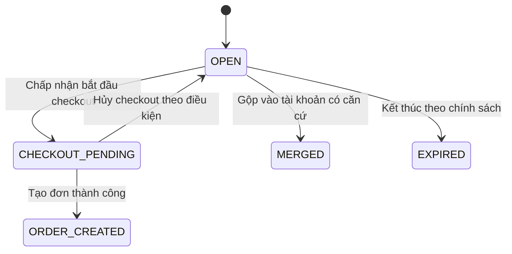

# Tác nhân khách chưa đăng nhập

## 1. Khách chưa đăng nhập là một tác nhân nghiệp vụ

**Anonymous visitor actor** là chủ thể tương tác với ứng dụng khi ứng dụng chưa xác thực họ thành một tài khoản người dùng. Trong bài này, mô hình tác nhân mô tả các chủ thể tham gia luồng nghiệp vụ và căn cứ để hệ thống cho phép hành động.

Khách chưa đăng nhập có thể xem sản phẩm, tìm kiếm, tạo giỏ hàng hoặc đặt hàng nếu chính sách hỗ trợ. Vì vậy, “chưa đăng nhập” vẫn là một ngữ cảnh cần được thiết kế quyền, phạm vi dữ liệu và giới hạn sử dụng.

Cần phân biệt ba điều:

- **Chưa xác thực tài khoản:** ứng dụng chưa có bằng chứng phù hợp để coi request thuộc một tài khoản.
- **Có ngữ cảnh khách:** server nhận diện được một phiên hoặc quyền truy cập giới hạn đã cấp cho khách.
- **Biết danh tính ngoài đời:** một yêu cầu khác, không tự xuất hiện chỉ vì có cookie, IP, email nhập vào hoặc tài khoản.

Một khách có thể là người mua hợp lệ, bot thu thập dữ liệu, người thử thay ID hoặc một tiến trình tự động. Chính sách không được dựa vào giả định rằng mọi khách đều đi theo giao diện và sử dụng chức năng đúng mục đích.

Bài học thuộc chương **Actor Model** của module **SECURITY_APPLICATION_SECURITY_BUSINESS_LOGIC_SECURITY**. Sau bài học, bạn có thể:

- Mô tả quyền và giới hạn của khách chưa đăng nhập.
- Phân biệt dữ liệu công khai với dữ liệu riêng được bảo vệ bằng ngữ cảnh khách.
- Thiết kế quyền trên giỏ hàng, đơn hàng và tài nguyên tạm của khách.
- Giữ bất biến khi checkout, retry, hết hạn và chuyển sang tài khoản đã đăng nhập.
- Xây dựng tình huống kiểm thử sửa giá, thay chủ sở hữu, chiếm tài nguyên và vượt bước.

## 2. Những gì hệ thống biết và chưa biết

### 2.1. Không có tài khoản không đồng nghĩa không có trạng thái

Một lượt xem danh mục có thể không cần tạo session. Khi khách muốn có giỏ hàng riêng, server có thể tạo một ngữ cảnh khách được bảo vệ.

| Ngữ cảnh | Hệ thống có thể biết | Chưa được suy ra |
|---|---|---|
| Lượt truy cập chưa có session | Request, kênh truy cập, thông tin mạng trong phạm vi tin cậy | Đây là một người duy nhất hoặc một khách cũ cụ thể |
| Phiên khách hợp lệ | Request có credential của một phiên khách do server cấp | Người đó có tài khoản, đã xác minh email hoặc có quyền trên phiên khác |
| Email được nhập vào form | Người gọi muốn sử dụng địa chỉ đó làm dữ liệu | Họ kiểm soát hộp thư hoặc sở hữu tài khoản cùng email |
| Challenge xác minh liên hệ đã hoàn thành | Một bằng chứng kiểm soát kênh theo phạm vi challenge | Mọi quyền của một tài khoản hoặc mọi đơn hàng có cùng địa chỉ |
| Capability hợp lệ cho một đơn | Quyền giới hạn được token đó cấp | Quyền đọc mọi đơn hoặc quyền quản trị |

**Credential của phiên** là bí mật hoặc bằng chứng mà server kiểm chứng để nối request với ngữ cảnh đã cấp. **ID chủ thể khách** là định danh nội bộ phục vụ quyền sở hữu. Hai vai trò này nên được phân biệt trong thiết kế và trong log.

Nếu hệ thống dùng một ID ngẫu nhiên như bearer credential, giá trị đó phải được bảo vệ như bí mật. Không được vừa coi nó là “chỉ là ID công khai” vừa dùng riêng việc biết ID để cấp quyền.

### 2.2. Một cookie không tương đương một người

Một người có thể xóa cookie, mở trình duyệt khác hoặc dùng nhiều thiết bị. Nhiều người có thể sử dụng chung một thiết bị hay một địa chỉ IP.

Vì vậy:

```text
Giới hạn theo phiên khách
không tự trở thành
giới hạn theo một người thực.
```

Tương tự, User-Agent hoặc dấu vân tay thiết bị là tín hiệu có giới hạn, không tự chứng minh quyền sở hữu một giỏ hàng.

Nếu dùng địa chỉ mạng trong cơ chế chống lạm dụng, cần lấy từ đường đi và proxy được cấu hình tin cậy. Không tin một header IP tùy ý do client tự gửi.

## 3. Thiết kế quyền cho khách theo hành động và đối tượng

### 3.1. Chính sách công khai phải được xác định rõ

Một route không yêu cầu đăng nhập vẫn cần quy định dữ liệu nào công khai, đối tượng nào được thao tác và điều kiện nào phải thỏa.

Ví dụ cho một cửa hàng cho phép guest checkout:

| Hành động | Khách có thể được phép | Điều kiện bảo vệ |
|---|---|---|
| Xem sản phẩm | Có | Chỉ sản phẩm và trường dữ liệu đã công bố trong cửa hàng tương ứng |
| Xem giá bán | Có | Giá có hiệu lực theo chính sách công khai; không lộ giá vốn hoặc bản nháp |
| Tìm kiếm | Có | Giới hạn truy vấn, phân trang và dữ liệu trả về |
| Tạo giỏ hàng | Có | Ngữ cảnh khách do server cấp, giới hạn tài nguyên phù hợp |
| Sửa giỏ hàng | Có, trên giỏ của mình | Đúng chủ thể khách, cửa hàng và trạng thái |
| Áp dụng mã ưu đãi | Có nếu chương trình cho phép | Backend kiểm tra điều kiện, số lượt và phạm vi; mã không tự cấp quyền |
| Giữ hàng | Tùy chính sách | TTL, hạn mức, kiểm soát cạnh tranh và điều kiện tham gia |
| Đặt đơn không có tài khoản | Có nếu hỗ trợ | Đúng giỏ, đúng nội dung, chống gửi trùng và các bước xác nhận bắt buộc |
| Xem chi tiết đơn của khách | Có thể | Credential hoặc quy trình xác minh đủ cho đúng đơn và đúng hành động |
| Duyệt hoàn tiền hoặc sửa giá nội bộ | Không thuộc quyền khách mặc định | Cần một chủ thể và chính sách quyền riêng |

Bảng này là chính sách minh họa, không phải yêu cầu mọi ứng dụng đều cho đặt hàng hoặc giữ tài nguyên khi chưa đăng nhập.

Mọi quyền được cấp nên có lý do cụ thể. Nguyên tắc từ chối mặc định và kiểm tra quyền trên mỗi request được trình bày trong [OWASP Authorization Cheat Sheet](https://cheatsheetseries.owasp.org/cheatsheets/Authorization_Cheat_Sheet.html).

### 3.2. Quyền công khai và quyền trên tài nguyên riêng khác nhau

Hai khách A và B đều được xem cùng một sản phẩm công khai. Nhưng điều đó không cho phép B xem địa chỉ nhận hàng, mã ưu đãi riêng hoặc nội dung checkout của A.

Không được biểu diễn tất cả giỏ khách bằng `ownerId = null` rồi suy ra rằng mọi request chưa đăng nhập đều cùng chủ sở hữu.

Một mô hình có thể sử dụng:

```text
Giỏ của khách:
ownerKind = GUEST
ownerId   = định danh ngữ cảnh khách đã được server kiểm chứng

Giỏ của tài khoản:
ownerKind = ACCOUNT
ownerId   = định danh tài khoản đã được xác thực
```

Loại chủ sở hữu giúp tránh nhầm lẫn giữa hai miền định danh. Chính sách còn cần xét cửa hàng, tổ chức hoặc phạm vi dữ liệu liên quan.

### 3.3. ID tài nguyên là địa chỉ tra cứu, không tự là bằng chứng quyền

Ví dụ:

```http
PATCH /carts/cart-842/items/item-7
Content-Type: application/json

{
  "quantity": 2,
  "ownerId": "guest-of-another-browser",
  "unitPrice": 1
}
```

Backend phải lấy chủ thể từ credential đã kiểm chứng, kiểm tra quyền trên giỏ và tính giá theo nguồn có thẩm quyền. Nó không nhận `ownerId` làm quyền đổi chủ hay dùng `unitPrice` làm giá được chấp nhận.

UUID khó đoán không thay thế kiểm tra quyền. Nếu hệ thống chủ động sử dụng một token bí mật như capability, phải thiết kế và bảo vệ token theo vai trò credential của nó, thay vì chỉ coi đó là ID đối tượng.

## 4. Các bất biến dành cho luồng khách

Một đặc tả có thể bắt đầu bằng các quy tắc sau:

- **ANON-01 — Phạm vi công khai:** khách chỉ nhận các dữ liệu được công bố cho đúng cửa hàng và ngữ cảnh.
- **ANON-02 — Cách ly tài nguyên khách:** mỗi giỏ hoặc bản nháp riêng chỉ được thao tác bằng chủ thể hoặc quyền đã cấp phù hợp.
- **ANON-03 — Dữ liệu có thẩm quyền:** client không được tự quyết giá, người sở hữu, số dư, quyền ưu đãi hoặc trạng thái thanh toán.
- **ANON-04 — Giới hạn chiếm dụng:** tạo phiên mới không được mặc nhiên mang lại quyền giữ vô hạn tài nguyên khan hiếm.
- **ANON-05 — Thực thi một nghiệp vụ:** retry checkout không tạo thêm đơn hoặc khoản thu ngoài chính sách.
- **ANON-06 — Chuyển quyền có căn cứ:** đăng nhập hoặc nhập email không tự cho phép nhận mọi giỏ và đơn cũ.
- **ANON-07 — Không bỏ bước:** khách phải hoàn thành các điều kiện bắt buộc trước khi hệ thống cấp kết quả tương ứng.

Mỗi quy tắc cần có vị trí thực thi và bằng chứng kiểm tra. Ví dụ ANON-02 áp dụng cho cả đọc, sửa, xóa, export, hủy và gia hạn, không chỉ trang xem giỏ.

## 5. Cấp ngữ cảnh khách và bảo vệ credential

### 5.1. Server cấp và kiểm chứng

Một thiết kế session phía server có thể hoạt động như sau:

1. Khách đọc dữ liệu công khai mà chưa cần session riêng.
2. Khi có nhu cầu trạng thái riêng, server tạo subject khách cùng credential ngẫu nhiên khó đoán.
3. Client gửi credential qua cơ chế đã thiết kế.
4. Server kiểm tra hiệu lực, hạn dùng, trạng thái thu hồi và phạm vi.
5. Use case nhận ID subject đã được kiểm chứng, không nhận bí mật session như một trường nghiệp vụ.

Không chấp nhận một `guestId` tùy ý trong body hoặc URL làm thẩm quyền sở hữu. Client có thể gửi credential hợp lệ, nhưng chính server quyết định credential đó liên hệ với subject và quyền nào.

Nên sử dụng cơ chế session hoặc token đã được triển khai phù hợp, với nguồn ngẫu nhiên mật mã và chính sách vòng đời rõ ràng. Không tự coi một chuỗi dễ đoán, timestamp hoặc email là credential của phiên khách.

### 5.2. Cookie chỉ là một phần của hàng rào

Trong ứng dụng trình duyệt dùng cookie, cấu hình minh họa là:

```http
Set-Cookie: guest_session=<opaque-secret>; Path=/; Secure; HttpOnly; SameSite=Lax
```

Giá trị trên là chỗ giữ chỗ, không phải một token sử dụng được. Phạm vi cookie, SameSite và thời hạn cần được chọn theo luồng thực tế; không mở rộng Domain tùy tiện.

Credential phải đi qua HTTPS. Các thuộc tính cookie hỗ trợ bảo vệ việc truyền và truy cập từ trình duyệt nhưng không thay thế phân quyền, kiểm tra trạng thái hoặc phòng chống XSS.

Cần tách thời hạn session, thời gian lưu giỏ và TTL giữ hàng. Giỏ có thể còn được lưu sau khi credential hết hạn, nhưng không vì vậy mà một request không có credential được đọc lại giỏ đó. Ngược lại, session còn hiệu lực không kéo dài vô hạn quyền giữ hàng.

### 5.3. Chưa đăng nhập vẫn cần xét CSRF

Nếu trình duyệt tự gửi cookie cho thao tác thay đổi giỏ, trang khác có thể tìm cách khiến trình duyệt gửi request ngoài ý định. Không nên bỏ bảo vệ CSRF chỉ vì chưa có tài khoản.

Chọn cơ chế phù hợp như token CSRF hoặc kiểm tra nguồn request theo mô hình triển khai. SameSite là một phần của thiết kế, không thay thế mọi kiểm tra. Xem [OWASP CSRF Prevention Cheat Sheet](https://cheatsheetseries.owasp.org/cheatsheets/Cross-Site_Request_Forgery_Prevention_Cheat_Sheet.html).

Không dùng GET để thực hiện hành động nghiệp vụ như thêm hàng, hủy đơn hoặc tiêu thụ mã một lần. GET có ngữ nghĩa an toàn theo [RFC 9110, mục 9.2.1](https://www.rfc-editor.org/rfc/rfc9110.html#name-safe-methods), và có thể được gọi bởi công cụ xem trước hoặc tải trước.

Nếu dùng credential được gắn chủ động trong header thay vì cookie tự gửi, cần đánh giá đúng mô hình đó. CORS không tự cấp quyền trên giỏ, và việc request dùng JSON không tự chứng minh người gửi có quyền.

## 6. Minh họa Java: biểu diễn khách một cách tường minh

Không nên dùng `userId = null` làm căn cứ duy nhất cho mọi quyết định quyền. Ví dụ Java 17 sau phân biệt lượt truy cập chưa có ngữ cảnh riêng, phiên khách hợp lệ và tài khoản đã xác thực.

Các đối tượng actor phải được tầng xác thực/session phía server tạo sau khi kiểm chứng credential. Controller không được deserialize trực tiếp chúng từ body do client gửi.

```java
import java.util.Objects;
import java.util.UUID;

public final class CartAccessPolicy {
    private CartAccessPolicy() {
    }

    public sealed interface Actor
            permits Visitor, Guest, Member {
    }

    public record Visitor() implements Actor {
    }

    public record Guest(UUID subjectId) implements Actor {
        public Guest {
            Objects.requireNonNull(subjectId, "subjectId");
        }
    }

    public record Member(UUID accountId) implements Actor {
        public Member {
            Objects.requireNonNull(accountId, "accountId");
        }
    }

    public enum OwnerKind {
        GUEST, ACCOUNT
    }

    public enum CartState {
        OPEN, CHECKOUT_PENDING, ORDER_CREATED, MERGED, EXPIRED
    }

    public record CartSnapshot(
            UUID cartId,
            UUID storefrontId,
            OwnerKind ownerKind,
            UUID ownerId,
            CartState state,
            long version) {
    }

    public static boolean canEdit(
            Actor actor,
            CartSnapshot cart,
            UUID expectedStorefrontId) {

        if (!cart.storefrontId().equals(expectedStorefrontId)) {
            return false;
        }

        if (cart.state() != CartState.OPEN) {
            return false;
        }

        if (actor instanceof Guest guest) {
            return cart.ownerKind() == OwnerKind.GUEST
                    && cart.ownerId().equals(guest.subjectId());
        }

        if (actor instanceof Member member) {
            return cart.ownerKind() == OwnerKind.ACCOUNT
                    && cart.ownerId().equals(member.accountId());
        }

        return false;
    }
}
```

Ví dụ giả định snapshot và các trường bắt buộc của nó đã được kiểm tra không null. `expectedStorefrontId` là phạm vi cửa hàng được backend xác định và chấp nhận cho luồng hiện tại.

Hàm thể hiện ba quyết định:

- Lượt truy cập chưa có subject không có quyền sửa một giỏ riêng.
- Phiên khách chỉ sửa giỏ đang mở thuộc subject của mình.
- Tài khoản chỉ sửa giỏ thuộc tài khoản theo chính sách minh họa; quyền ủy quyền khác chưa được mô hình hóa.

Đây là kiểm tra trên snapshot. Khi ghi, repository còn phải bảo vệ chủ sở hữu, trạng thái và phiên bản tương ứng để thay đổi đồng thời không làm quyết định cũ được áp dụng sai.

Một object `Guest` trong bộ nhớ không phải bằng chứng nếu bất kỳ tầng nào cũng được tự tạo từ `guestId` tùy ý. Giá trị của mô hình đến từ đường tạo actor được kiểm soát và việc mọi đường vào use case đều thực hiện chính sách.

Với endpoint yêu cầu tài khoản, credential xác thực lỗi không được âm thầm hạ cấp thành khách rồi đi qua nhánh có quyền rộng hơn. Với cookie khách hết hạn, hệ thống có thể tạo ngữ cảnh mới theo chính sách công khai, nhưng không tự nối lại dữ liệu cũ bằng ID từ request.

## 7. Checkout của khách vẫn phải giữ quy tắc nghiệp vụ

### 7.1. Các giả định của ví dụ

Cửa hàng minh họa cho khách tạo giỏ và đặt đơn mà không cần tài khoản. Tuy nhiên:

- Chủ thể khách phải có quyền trên giỏ.
- Backend kiểm tra sản phẩm đang bán, số lượng và điều kiện ưu đãi.
- Giá được xác định từ dữ liệu hoặc báo giá hợp lệ do hệ thống chấp nhận.
- Chỉ xác nhận tài nguyên theo chính sách tồn kho.
- Mỗi lần checkout logic tạo tối đa một đơn theo hợp đồng.
- Thanh toán thành công chỉ được ghi nhận từ bằng chứng đã xác minh phù hợp.
- Thông tin liên hệ được xử lý theo yêu cầu của luồng; không mặc nhiên trở thành danh tính tài khoản.

Một cửa hàng khác có thể yêu cầu xác minh liên hệ hoặc đăng nhập trước khi đặt hàng. Những bước đó phải là điều kiện backend, không chỉ là màn hình giao diện.

### 7.2. Trạng thái giỏ và trạng thái xác thực là hai chiều khác nhau



`ORDER_CREATED` không đồng nghĩa đã thanh toán hoặc đã giao hàng. Đơn hàng có vòng đời riêng.

Đăng nhập không tự đưa một giỏ đang `CHECKOUT_PENDING` về `OPEN`. Nếu cho phép đổi trạng thái tùy ý để gộp, hệ thống có thể mở lại một giỏ đã tạo đơn hoặc lặp lại ưu đãi.

### 7.3. Không tin các trường quyết định từ client

Một payload như sau không phải bằng chứng nghiệp vụ:

```json
{
  "cartId": "cart-842",
  "guestId": "guest-17",
  "totalVnd": 1,
  "emailVerified": true,
  "stockReserved": true,
  "paymentStatus": "PAID"
}
```

Backend phải nạp giỏ trong phạm vi quyền đã kiểm chứng, tính hoặc kiểm tra giá, tra bằng chứng xác minh liên hệ, reservation và thanh toán từ nguồn có thẩm quyền.

Nếu API nhận tổng tiền kỳ vọng để phát hiện thay đổi, đó là dữ liệu so sánh. Khác biệt có thể dẫn đến yêu cầu xác nhận lại, không làm giá client trở thành giá phải thu.

Các endpoint cũ, API di động và job tiếp tục checkout cũng phải đi qua cùng hàng rào phù hợp.

### 7.4. Transaction và idempotency

Một luồng cục bộ có thể điều phối:

1. Kiểm tra actor, quyền trên giỏ, chống CSRF nếu áp dụng và điều kiện đầu vào.
2. Giành quyền xử lý khóa idempotency trong phạm vi cửa hàng, subject khách và hành động.
3. Nạp và bảo vệ phiên bản giỏ đang mở; kiểm tra nội dung và chính sách hiện hành.
4. Kiểm tra hoặc tạo phần giữ tài nguyên mà không nhân đôi reservation sẵn có.
5. Tạo đơn với snapshot nội dung được chấp nhận và định danh checkout ổn định.
6. Đổi trạng thái giỏ, lưu kết quả idempotency và ý định sự kiện cần thiết.
7. Commit phần dữ liệu nằm trong cùng transaction.

Cùng khóa nhưng thay nội dung phải bị phát hiện. Hai request cùng lúc không được cùng tạo đơn trước khi bản ghi idempotency tồn tại.

Khóa mới không cho phép tạo đơn lần nữa từ một giỏ đã chuyển đổi. Vì vậy cần ràng buộc theo giỏ hoặc checkout operation, bên cạnh cơ chế deduplicate request.

Nếu có gọi nhà cung cấp thanh toán bên ngoài, transaction database không tự bao trùm khoản thu. Cần định danh thanh toán ổn định, xử lý retry và đối soát khi kết quả chưa rõ.

Nếu session khách hết hạn trong lúc response bị mất, không được chỉ dựa vào khóa idempotency để trả dữ liệu riêng cho bất kỳ ai biết khóa. Cần chính sách khôi phục hoặc bằng chứng truy cập phù hợp.

## 8. Giới hạn lạm dụng khi danh tính còn yếu

### 8.1. Tạo phiên mới là thao tác rẻ

Nếu mỗi guest session được nhận một ưu đãi hoặc giữ một ghế, kẻ lạm dụng có thể tạo nhiều session. Bảo vệ theo subject là cần thiết cho tính nhất quán, nhưng không đủ để kết luận giới hạn “mỗi người một lần”.

Cần xác định tài sản và đại lượng cần giới hạn:

| Tài sản hoặc luồng | Giới hạn có thể cần |
|---|---|
| Tạo session và giỏ | Tốc độ tạo, số đối tượng, dung lượng và thời gian lưu |
| Tìm kiếm tốn tài nguyên | Độ phức tạp, phân trang, tốc độ và ngân sách xử lý |
| Giữ hàng hoặc lịch | Tổng đang giữ, TTL, gia hạn và điều kiện tham gia |
| Mã ưu đãi | Phạm vi chiến dịch, hạn mức tổng, điều kiện chủ thể |
| Gửi email hoặc SMS | Số lần theo đích, thời gian, tổng ngân sách và bằng chứng yêu cầu |
| Tạo đơn chưa thanh toán | Số lượng và chi phí mà hệ thống đang phải duy trì |
| Tra cứu đơn | Số lần thử, phạm vi dữ liệu và kiểm chứng quyền |

Các hạn mức tổng phải được cập nhật nguyên tử khi có nhiều request cạnh tranh. Không chỉ đọc số hiện tại rồi cùng chấp nhận thêm.

### 8.2. Kết hợp tín hiệu và điều kiện nghiệp vụ

Có thể kết hợp phạm vi session, tài nguyên đích, mạng, kênh liên hệ, hành vi và ngân sách toàn hệ thống. Không coi một tín hiệu đơn lẻ là danh tính chắc chắn.

Với tài nguyên giá trị cao hoặc khan hiếm, chính sách có thể yêu cầu bước xác minh thêm hoặc hạn chế quyền của khách. Việc thêm bước cần gắn với mục tiêu cụ thể và được thực thi ở backend.

CAPTCHA có thể hỗ trợ giảm một số hành vi tự động, nhưng không xác lập chủ sở hữu giỏ, không cấp quyền phê duyệt và không bảo vệ tính nguyên tử của tồn kho. Nếu dùng kết quả challenge, server vẫn phải kiểm tra phạm vi và hiệu lực theo cơ chế triển khai.

OWASP API6 nhấn mạnh việc nhận diện luồng nhạy cảm và tác hại kinh doanh khi sử dụng quá mức. Xem [Unrestricted Access to Sensitive Business Flows](https://api-security.owasp.org/editions/2023/en/0xa6-unrestricted-access-to-sensitive-business-flows/).

### 8.3. Hạn chế dò tìm thông tin

Một route công khai không nên trả toàn bộ object nội bộ. Tạo mô hình trả về chỉ gồm trường được công bố giúp tránh lộ dữ liệu tài khoản, giá vốn, trạng thái bản nháp hoặc thông tin vận hành.

Với tra cứu đơn hoặc tài nguyên riêng, chọn phản hồi phù hợp để hạn chế lộ sự tồn tại, đồng thời kiểm soát tốc độ thử. Không trả địa chỉ, số điện thoại hoặc danh sách đơn chỉ vì người gọi nhập đúng email.

Phản hồi lỗi thống nhất không thay thế quyền trên đối tượng. Kể cả khi API luôn trả cùng một mã lỗi, backend vẫn phải bảo đảm không gây tác dụng phụ ngoài quyền.

## 9. Từ khách sang tài khoản: chuyển quyền phải có căn cứ

### 9.1. Đăng nhập và gộp giỏ là hai quyết định

Đăng nhập xác lập ngữ cảnh tài khoản theo cơ chế xác thực. Gộp giỏ là một nghiệp vụ chuyển hoặc kết hợp dữ liệu. Hai việc cần phối hợp, nhưng không nên coi đăng nhập là lệnh nhận mọi giỏ do client liệt kê.

Ví dụ nguy hiểm:

```text
Đăng nhập thành công.
Nhận sourceCartId từ body.
Đổi owner của sourceCartId sang account vừa đăng nhập.
```

Nếu không chứng minh quyền trên giỏ nguồn, người dùng có thể nhận giỏ của người khác. Việc họ đăng nhập thành công không giải quyết thiếu sót đó.

### 9.2. Những điều cần kiểm chứng khi gộp

Một luồng an toàn cho mô hình của bài cần:

1. Lấy tài khoản đích từ ngữ cảnh xác thực đã kiểm chứng.
2. Xác định subject khách nguồn qua credential hợp lệ và ngữ cảnh chuyển tiếp được server bảo vệ.
3. Kiểm tra quyền trên giỏ nguồn và quyền sửa giỏ đích.
4. Chỉ gộp trạng thái được phép; không mở lại checkout đang xử lý hoặc đơn đã tạo.
5. Áp dụng quy tắc số lượng, giá, ưu đãi và tài nguyên sau khi kết hợp.
6. Ghi kết quả gộp một lần, đánh dấu nguồn đã kết thúc và lưu liên hệ chuyển đổi cần thiết.
7. Ngăn credential cũ dùng để truy cập dữ liệu tài khoản.

Đừng tự chấp nhận một session ID do URL hoặc form đưa vào rồi nâng quyền cho nó. Session fixation có thể khiến bên biết credential từ trước tiếp tục chiếm ngữ cảnh sau khi nạn nhân đăng nhập.

Cần đổi session ID khi chuyển mức quyền và bảo vệ quan hệ giữa trạng thái trước/sau xác thực. Xem [OWASP Session Management Cheat Sheet](https://cheatsheetseries.owasp.org/cheatsheets/Session_Management_Cheat_Sheet.html).

Việc xác định subject khách nguồn phải là một phần được kiểm soát của luồng đăng nhập/gộp, không phải phép tra cứu tùy ý theo `guestId` sau khi đăng nhập.

### 9.3. Gộp dữ liệu cũng có bất biến

Nếu hai giỏ cùng có một SKU, cộng số lượng có thể vượt giới hạn mua. Nếu hai giỏ có ưu đãi không được kết hợp, giữ nguyên tất cả có thể tạo mức giảm giá trái chính sách.

Cần quyết định rõ:

- Cách kết hợp số lượng và xử lý vượt giới hạn.
- Có áp dụng lại giá hoặc báo giá nào không.
- Điều kiện ưu đãi sau khi chủ thể đổi.
- Cách giữ hoặc chuyển reservation mà không giữ trùng.
- Điều gì xảy ra nếu một giỏ đang checkout hoặc vừa thay đổi.
- Cách phản hồi khi cần người dùng xác nhận nội dung mới.

Một transaction cục bộ có thể bảo vệ phiên bản giỏ nguồn, giỏ đích, các thay đổi liên quan và trạng thái `MERGED`. Nếu nhiều hệ thống tham gia, phải có trạng thái và xử lý phục hồi tương ứng; không mặc định session store và database nghiệp vụ cùng một transaction.

Gộp lại cùng một giỏ nguồn không được cộng thêm số lượng lần nữa. Cần định danh chuyển đổi ổn định và ràng buộc nguồn chỉ được tiêu thụ một lần.

### 9.4. Request đến muộn phải bị giới hạn đúng

Một tab cũ có thể đang gửi sửa giỏ trong lúc tab khác đăng nhập và gộp. Nếu chỉ kiểm tra quyền trước rồi ghi mà không kiểm tra phiên bản/trạng thái, request cũ có thể thêm hàng vào nguồn đã chuyển đổi.

Hàng rào ghi phải phản ánh rằng nguồn đã `MERGED` và không còn được sửa như trước. Chỉ đổi cookie ở trình duyệt không đủ để dừng request đã vào server.

Trong mô hình minh họa, credential khách tham gia gộp được thu hồi sau khi xử lý phù hợp; nó không trở thành credential tài khoản. Nếu hệ thống tiếp tục giữ một ngữ cảnh khách cho mục đích khác, phạm vi còn lại cũng phải được xác định rõ.

Đăng nhập có thể thành công trong khi gộp giỏ cần giải quyết xung đột. Không nên che giấu tình trạng đó bằng cách tự chuyển owner, reset trạng thái hoặc bỏ qua nội dung cần xác nhận.

### 9.5. Không nhận đơn cũ chỉ bằng email nhập vào

Email liên hệ của guest checkout là dữ liệu nghiệp vụ. Không được tự gắn mọi đơn có cùng chuỗi email vào tài khoản chỉ vì client gửi email đó.

Kể cả khi có xác minh kênh liên hệ, chính sách nhận đơn cần xác định bằng chứng đủ cho đúng đơn, rủi ro thay đổi quyền kiểm soát địa chỉ và phạm vi thông tin được truy cập. Việc gộp giỏ không tự cho phép nhận toàn bộ lịch sử đơn hoặc hoàn tiền.

Sau khi chuyển từ guest sang account, retry của một checkout cũ vẫn phải giữ định danh nghiệp vụ và quan hệ quyền hợp lệ. Chỉ đổi phạm vi khóa idempotency từ guest sang account có thể vô tình cho phép tạo lại thao tác nếu thiếu ràng buộc theo giỏ hoặc checkout operation.

## 10. Tra cứu đơn và quyền giới hạn của khách

Một ứng dụng có thể cho khách xem đơn bằng một capability: credential cấp quyền hẹp cho một tài nguyên và hành động xác định.

Ví dụ phạm vi có thể là:

```text
Đối tượng: order-842
Hành động: xem bản tóm tắt đơn
Phạm vi: cửa hàng tương ứng
Hiệu lực: theo thời hạn và trạng thái do server kiểm tra
Quyền khác: không được tự suy ra
```

Biết số đơn và email không nhất thiết là bằng chứng đủ. Số đơn có thể công khai trên hóa đơn hoặc bị đoán; email có thể bị biết từ nguồn khác.

Capability cần khó đoán hoặc được bảo vệ theo giao thức phù hợp, có phạm vi rõ, khả năng hết hạn/thu hồi theo thiết kế và kiểm tra trạng thái phía server. Quyền đọc tóm tắt không mặc nhiên cho đổi địa chỉ, hủy, tải mọi chứng từ hoặc yêu cầu hoàn tiền.

Nếu dùng link có bí mật, cần kiểm soát nguy cơ lộ qua log, lịch sử, referrer hoặc việc chia sẻ link. Không ghi bí mật nguyên văn vào hệ thống phân tích. Một thiết kế có thể trao đổi token sang ngữ cảnh hẹp rồi tiếp tục luồng theo chính sách.

Đối với hành động thay đổi nghiệp vụ, trang mở từ link nên đưa người dùng đến bước xác nhận phù hợp thay vì tự thực thi bằng GET. Công cụ quét link không nên vô tình hủy đơn hoặc tiêu thụ một quyền thay đổi duy nhất.

Quyền dùng một lần cần được tiêu thụ nguyên tử khi hành động thực sự được chấp nhận. Quyền đọc có thể có chính sách sử dụng lại khác; không cần áp dụng cùng một quy tắc cho mọi loại capability.

## 11. Dữ liệu riêng, cache và vòng đời tài nguyên khách

### 11.1. Dữ liệu của khách vẫn có thể nhạy cảm

Giỏ hàng, địa chỉ nhận, email, số điện thoại và thông tin checkout có thể riêng tư dù chưa gắn với tài khoản. Không ghi toàn bộ request chỉ vì actor là anonymous.

Log phục vụ điều tra có thể gồm:

- Loại actor và ID subject nội bộ hoặc mã tương quan phù hợp.
- Cửa hàng, ID tài nguyên, hành động và kết quả quyết định.
- `operationId`, `requestId`, phiên bản và chuyển trạng thái.
- Mã lý do từ chối hoặc xung đột.

Không ghi raw session token, capability secret, OTP hoặc dữ liệu thanh toán bí mật. ID subject dùng trong audit không nên đồng thời là credential bí mật.

Dấu vết theo phiên giúp dựng lại chuỗi hành động trong phạm vi bằng chứng có được. Nó không tự chứng minh một người thực đã thực hiện mọi request.

### 11.2. Không cache chung response riêng

Một endpoint `/cart/current` có cùng URL cho nhiều khách nhưng trả dữ liệu khác nhau. Nếu cache dùng chung chỉ theo URL, khách B có thể nhận response của A dù policy ở origin đúng.

Phân biệt response công khai với response riêng. Với dữ liệu giỏ hoặc checkout nhạy cảm, một lựa chọn phù hợp có thể là:

```http
Cache-Control: no-store
```

Cấu hình ứng dụng, reverse proxy và CDN phải nhất quán với lựa chọn đó. Chỉ có `Set-Cookie` không phải căn cứ để mặc định mọi tầng sẽ tránh cache response.

Ngữ nghĩa `no-store` và các quy tắc cache được mô tả trong [RFC 9111: HTTP Caching](https://www.rfc-editor.org/rfc/rfc9111.html). Header cache là một hàng rào phân phối dữ liệu, không thay thế kiểm tra quyền.

### 11.3. Dọn dữ liệu không được làm mất nghĩa vụ nghiệp vụ

Tạo nhiều giỏ rỗng có thể gây chi phí lưu trữ. Cần giới hạn và quy trình hết hạn phù hợp, nhưng không xóa tùy ý các liên kết cần để xử lý thanh toán hoặc reservation đang còn nghĩa vụ.

Session hết hạn, giỏ bị dọn và reservation hết hạn là các sự kiện khác nhau. Nếu chính sách yêu cầu giải phóng tài nguyên khi kết thúc, phải thực hiện một lần qua quy trình có trạng thái; xóa một cookie không tự trả tồn kho.

Dữ liệu cần giữ cho đơn đã tạo có vòng đời riêng. Việc xóa giỏ nguồn không được làm mất định danh checkout, bằng chứng quyền hoặc khả năng xử lý một kết quả thanh toán đến muộn.

## 12. Các tình huống lạm dụng tiêu biểu

| Tình huống | Giả định sai | Hàng rào cần có |
|---|---|---|
| Thay cart ID sang giỏ khách khác | Chưa đăng nhập thì mọi giỏ đều công khai | Subject và quyền trên từng giỏ |
| Gửi owner ID trong body | Client được quyết định mình là ai | Actor từ credential đã kiểm chứng |
| Sửa giá hoặc cờ đã xác minh | Đúng kiểu JSON là đủ | Dữ liệu có thẩm quyền ở backend |
| Xóa cookie để nhận ưu đãi “mỗi người” | Một session là một người | Định nghĩa chủ thể đủ cho chính sách và giới hạn nhiều phạm vi |
| Giữ hàng bằng nhiều phiên | Một reservation nhỏ không gây hại | Hạn mức tổng, thời hạn và điều kiện tham gia |
| Dùng session khách cũ sau đăng nhập | Chỉ cần thêm account ID vào session hiện tại | Đổi credential, chuyển quyền có căn cứ |
| Gộp hai lần cùng giỏ | Callback hoặc retry chỉ xảy ra một lần | Nguồn được tiêu thụ một lần và gộp idempotent |
| Dùng token xem đơn để hủy đơn | Có quyền trên đối tượng nghĩa là có mọi hành động | Phạm vi capability theo hành động |
| Gọi trực tiếp API sau khi bỏ màn hình xác minh | UI là bước bắt buộc | State machine và guard tại backend |
| Tải response giỏ từ shared cache | Không đăng nhập nghĩa là response công khai | Chính sách cache đúng theo độ riêng tư |

Mỗi hàng phản ánh một quy tắc cụ thể. Không thể sửa toàn bộ nhóm này chỉ bằng bắt người dùng bấm CAPTCHA hoặc thêm một header kiểm tra ở gateway.

## 13. Ma trận kiểm thử tác nhân khách

| Kịch bản | Kỳ vọng nghiệp vụ |
|---|---|
| Visitor chưa có session xem sản phẩm đã công bố | Được xem đúng projection công khai |
| Visitor thử đọc sản phẩm nháp bằng ID | Không nhận dữ liệu ngoài chính sách |
| Tạo giỏ với credential khách hợp lệ | Giỏ gắn với subject và cửa hàng đúng |
| Hai khách A/B truy cập giỏ của nhau | Bị chặn ở mọi hành động riêng, không chỉ đọc |
| Client tự đặt guest ID hoặc account ID | Không thay đổi actor có thẩm quyền |
| Giỏ guest và account có giá trị ID trùng trong hai miền | Không bị nhầm chủ sở hữu |
| Gửi giá, quyền ưu đãi hoặc trạng thái thanh toán giả | Không ảnh hưởng quyết định từ nguồn có thẩm quyền |
| Cookie khách hết hạn nhưng cart ID còn đúng | Không tự khôi phục quyền bằng ID |
| Request thay đổi từ nguồn không được chấp nhận trong mô hình cookie | Bị chặn theo thiết kế CSRF |
| Retry checkout cùng khóa | Không thêm đơn, giữ chỗ hoặc khoản thu ngoài chính sách |
| Hai khóa mới checkout cùng phiên bản giỏ | Ràng buộc theo giỏ/checkout operation vẫn được giữ |
| Nhiều session khách tranh hạn mức tài nguyên chung | Hạn mức chung và tính nguyên tử vẫn có hiệu lực |
| Đăng nhập rồi gộp một giỏ không thuộc guest nguồn | Không nhận giỏ đó |
| Callback gộp lặp hoặc chạy đồng thời | Không cộng số lượng hoặc áp dụng ưu đãi hai lần |
| Tab cũ sửa giỏ vừa gộp | Bị chặn bằng trạng thái/phiên bản và quyền hiện tại |
| Dùng credential guest trước đăng nhập để đọc giỏ tài khoản | Không được cấp quyền tài khoản |
| Nhập email của người khác để tra đơn | Không nhận dữ liệu riêng chỉ từ email |
| Token chỉ được xem tóm tắt dùng để hủy hoặc sửa đơn | Bị chặn theo phạm vi hành động |
| Token của cửa hàng A dùng với tài nguyên B | Không vượt phạm vi |
| Shared cache phục vụ cùng URL cho hai guest | Không lẫn response riêng |
| Dọn giỏ trùng với xử lý thanh toán đến muộn | Không mất tham chiếu nghiệp vụ hoặc tạo lại thao tác |

Kiểm thử cần quan sát quyền, trạng thái, số đơn, reservation, khoản thu và sự kiện phát ra. HTTP 403 không chứng minh an toàn nếu backend đã gây tác dụng phụ trước khi từ chối.

Unit test có thể kiểm tra policy và trạng thái. Integration test cần xác nhận đường tạo actor, quyền trên đối tượng, cập nhật có điều kiện và idempotency. Kiểm thử trình duyệt hoặc luồng thực tế giúp đánh giá cookie, CSRF, chuyển phiên và cache.

## 14. Mẫu đặc tả cho một chức năng công khai

Khi mở một chức năng cho khách, hãy ghi rõ:

1. **Khách được làm gì:** đọc công khai, sửa tài nguyên riêng hay bắt đầu giao dịch?
2. **Bằng chứng nào được yêu cầu:** không cần session, session khách, xác minh liên hệ hoặc capability?
3. **Phạm vi đối tượng:** cửa hàng, giỏ, đơn, tài nguyên và hành động được cấp.
4. **Dữ liệu có thẩm quyền:** giá, quyền ưu đãi, trạng thái và người sở hữu lấy từ đâu.
5. **Giới hạn sử dụng:** từng request, từng phiên, tài nguyên đích và ngân sách chung.
6. **Vòng đời:** hết hạn, retry, gộp vào tài khoản và thu hồi credential.
7. **Tính nguyên tử:** thao tác nào phải cùng commit và đối tượng nào chặn thực thi lặp.
8. **Dữ liệu trả về:** trường công khai, trường riêng và chính sách cache.
9. **Bằng chứng kiểm tra:** trạng thái, sổ lượng và tác dụng phụ nào chứng minh quy tắc đúng.

Ví dụ: “khách được sửa giỏ” cần được cụ thể thành “subject khách hợp lệ chỉ sửa giỏ đang mở thuộc mình trong cửa hàng tương ứng; giá và ưu đãi được backend kiểm tra; checkout và gộp giỏ có định danh ổn định; credential khách cũ không cấp quyền tài khoản”.

## 15. Tài liệu tham khảo

- [OWASP Authorization Cheat Sheet](https://cheatsheetseries.owasp.org/cheatsheets/Authorization_Cheat_Sheet.html) — nguyên tắc quyền tối thiểu, từ chối mặc định và kiểm tra mỗi request.
- [OWASP Session Management Cheat Sheet](https://cheatsheetseries.owasp.org/cheatsheets/Session_Management_Cheat_Sheet.html) — credential phiên, bảo vệ cookie và đổi session khi thay đổi mức quyền.
- [OWASP CSRF Prevention Cheat Sheet](https://cheatsheetseries.owasp.org/cheatsheets/Cross-Site_Request_Forgery_Prevention_Cheat_Sheet.html) — bảo vệ request trình duyệt thay đổi trạng thái.
- [OWASP API6:2023 — Unrestricted Access to Sensitive Business Flows](https://api-security.owasp.org/editions/2023/en/0xa6-unrestricted-access-to-sensitive-business-flows/) — lạm dụng các luồng nhạy cảm.
- [RFC 9110, mục 9.2.1: Safe Methods](https://www.rfc-editor.org/rfc/rfc9110.html#name-safe-methods) — ngữ nghĩa phương thức an toàn.
- [RFC 9111: HTTP Caching](https://www.rfc-editor.org/rfc/rfc9111.html) — kiểm soát lưu và tái sử dụng response.

Các quyền guest checkout, trạng thái và lớp Java trong bài là minh họa. Khi triển khai, cần thay bằng chính sách khách, quan hệ dữ liệu và cơ chế xác thực/session của hệ thống cụ thể.
