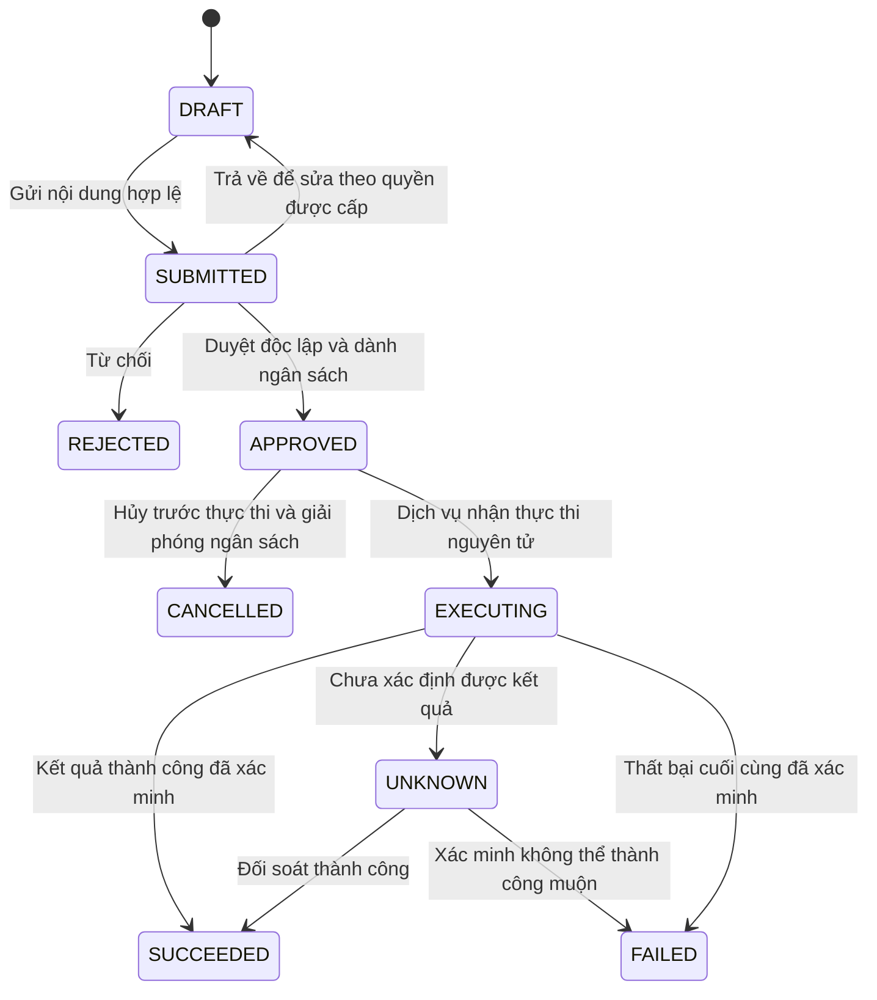

# Staff operator actor — Mô hình nhân viên vận hành trong bảo mật nghiệp vụ

## 1. Mục tiêu và phạm vi

Trong chương **Actor Model**, actor là chủ thể tham gia một quy trình nghiệp vụ: khách hàng, nhân viên, dịch vụ tự động hoặc bên tích hợp. Bài này dùng thuật ngữ theo nghĩa mô hình chủ thể và trách nhiệm; không bàn về mô hình lập trình đồng thời bằng actor.

**Staff operator** là nhân viên dùng chức năng của ứng dụng để xử lý công việc như hỗ trợ khách hàng, điều chỉnh đơn hàng, tiếp nhận hoàn tiền, duyệt yêu cầu hoặc giải quyết trạng thái lỗi. Họ thường có khả năng làm thay đổi tài sản và quyền của người khác, nên cần được mô hình hóa cụ thể hơn một tài khoản có vai trò `STAFF`.

Trong phạm vi Business Logic Security, bài học tập trung vào việc giữ quy tắc nghiệp vụ đúng khi nhân viên gọi API trực tiếp, thao tác nhầm đối tượng, vượt thẩm quyền, bỏ bước duyệt hoặc gửi lại yêu cầu. Các công cụ chính là bất biến nghiệp vụ, quyền theo đối tượng, máy trạng thái, transaction, idempotency và kiểm thử tình huống lạm dụng.

Sau bài học, bạn có thể:

- Phân biệt người thực hiện, người được đại diện, khách hàng bị tác động và dịch vụ thực thi.
- Xác định quyền của nhân viên theo hành động, tổ chức, đối tượng, hạn mức và trạng thái.
- Thiết kế tách biệt người lập với người duyệt theo danh tính con người phù hợp.
- Mô hình hóa hỗ trợ thay khách hàng, quyền tạm thời, xử lý khẩn cấp và công việc nền.
- Giữ bằng chứng trách nhiệm xuyên suốt từ lệnh của nhân viên đến tác dụng bên ngoài.
- Kiểm thử để một quyền nội bộ không trở thành đường bỏ qua quy tắc nghiệp vụ.

Ví dụ xuyên suốt là quy trình hoàn tiền giả định. Những hạn mức và vai trò trong bài chỉ phục vụ học thiết kế, không phải chính sách áp dụng chung cho mọi tổ chức.

## 2. Nhân viên nội bộ vẫn là một chủ thể cần kiểm soát

Nhân viên có thể hiểu quy trình và sử dụng công cụ nội bộ, nhưng điều đó không chứng minh mọi thao tác của họ đều được phép. Cần xét ít nhất ba nguồn sai phạm:

| Nguồn sai phạm | Ví dụ | Kiểm soát cần xem xét |
| --- | --- | --- |
| Nhầm lẫn khi làm việc hợp lệ | Đang xử lý cửa hàng A nhưng chọn đơn của cửa hàng B | Phạm vi đối tượng, ngữ cảnh rõ ràng và kiểm tra lại phía máy chủ |
| Tài khoản hoặc phiên bị chiếm | Kẻ khác sử dụng phiên của nhân viên để tạo hoàn tiền | Giới hạn quyền, xác nhận thao tác nhạy cảm, kiểm soát phiên và phát hiện bất thường |
| Nhân viên cố ý lạm dụng | Tự duyệt đề nghị hoặc thay đích nhận tiền | Tách biệt trách nhiệm, ràng buộc nghiệp vụ và bằng chứng kiểm toán |

Các nhóm này có thể tạo ra request giống nhau. Thiết kế không cần đoán ý định để chặn một yêu cầu sai quyền hoặc sai trạng thái.

### 2.1. `STAFF` không phải đặc quyền bỏ qua nghiệp vụ

Một điều kiện như sau quá rộng cho nhiều thao tác nhạy cảm:

```text
Nếu đã đăng nhập và có ROLE_STAFF:
    cho phép cập nhật đơn, trạng thái, số tiền và người nhận.
```

Nó không trả lời được nhân viên phụ trách tổ chức nào, được xử lý hồ sơ nào, có được đổi người nhận hay không và thao tác có phù hợp trạng thái hiện tại không.

Một quyết định có ý nghĩa hơn là:

```text
Nhân viên đang hoạt động
AND có quyền thực hiện đúng hành động
AND thuộc phạm vi tổ chức và đơn vị được cấp
AND có quan hệ xử lý hợp lệ với đối tượng
AND thao tác nằm trong hạn mức
AND trạng thái và phiên bản nội dung cho phép
AND đáp ứng điều kiện tách biệt trách nhiệm và xác nhận bổ sung.
```

OWASP khuyến nghị cấp quyền tối thiểu, từ chối mặc định và kiểm tra quyền trên từng yêu cầu. Với staff operator, cần cụ thể hóa những nguyên tắc đó thành quyền trên đối tượng và tình huống nghiệp vụ. [Nguồn: OWASP Authorization Cheat Sheet](https://cheatsheetseries.owasp.org/cheatsheets/Authorization_Cheat_Sheet.html).

### 2.2. Kênh nội bộ không tự chứng minh thẩm quyền

VPN, mạng nội bộ hoặc giao diện quản trị có thể giúp giới hạn nơi truy cập. Chúng không thay thế kiểm tra người gọi được làm gì với đơn hàng cụ thể.

API dành cho nhân viên, công cụ xử lý hàng loạt và job nền vẫn cần đi qua quy tắc tương ứng. Nếu một endpoint khác ghi trạng thái trực tiếp, việc kiểm tra nghiêm ngặt ở giao diện chính chưa bảo vệ được toàn bộ nghiệp vụ.

## 3. Tách đúng các danh tính trong một thao tác

Xét tình huống nhân viên hỗ trợ `S-17` lập đề nghị hoàn tiền cho khách `C-42`, sau đó dịch vụ `refund-worker` gửi lệnh tới nhà cung cấp thanh toán.

Các danh tính cần phân biệt:

| Thành phần | Ý nghĩa trong ví dụ | Nguồn đáng tin |
| --- | --- | --- |
| Tài khoản xác thực | Tài khoản nhân viên `S-17` đang dùng | Phiên hoặc token đã được xác minh |
| Con người chịu trách nhiệm | Hồ sơ nhân sự chuẩn hóa gắn với tài khoản | Nguồn quản lý danh tính được tổ chức chấp nhận |
| Chủ thể được đại diện | Khách hàng, nếu thao tác thực sự có chế độ đại diện được cho phép | Quy trình ủy quyền hoặc hỗ trợ phía máy chủ |
| Đối tượng bị tác động | Khách `C-42`, đơn và khoản thanh toán liên quan | Dữ liệu nghiệp vụ được tải đúng phạm vi |
| Chủ thể kỹ thuật thực thi | `refund-worker` | Danh tính dịch vụ đã xác thực |

Khách hàng bị tác động không tự trở thành người đã ra lệnh. Dịch vụ thực thi sau đó cũng không được làm mất dấu nhân viên đã lập và người đã duyệt.

### 3.1. Không dùng dữ liệu client để tự khai danh tính

Các trường như `staffId`, `approvedBy`, `actingAsCustomer` hoặc `tenantId` do client gửi chỉ là đầu vào. Chúng không được thay thế danh tính đã xác minh và quan hệ quyền phía máy chủ.

Nếu người dùng có thể chọn tổ chức để làm việc, máy chủ cần xác nhận quyền với tổ chức đó. Đặt tổ chức trong header không làm nó đáng tin hơn đặt trong JSON.

Khi dịch vụ chuyển tiếp ngữ cảnh cho dịch vụ khác, cần bảo vệ tính xác thực và nguồn gốc của ngữ cảnh đó theo kiến trúc đang dùng. Không tin một header danh tính được gọi trực tiếp từ bên ngoài mà không có ranh giới xác minh.

### 3.2. Danh tính tài khoản và danh tính con người có thể khác nhau

Một người có thể có tài khoản thường, tài khoản được nâng quyền hoặc tài khoản ở nhiều đơn vị. Nếu quy tắc yêu cầu hai người độc lập, so sánh hai `accountId` khác nhau là chưa đủ.

Ví dụ, nhân viên dùng tài khoản A lập đề nghị rồi dùng tài khoản B của chính mình để duyệt. Theo tài khoản, người lập và người duyệt khác nhau; theo mục tiêu kiểm soát, vẫn là tự duyệt.

Cần dùng định danh con người chuẩn hóa phù hợp với chính sách, đồng thời giữ cả tài khoản thao tác trong bằng chứng. Việc liên kết tài khoản–con người cũng cần quản lý và bảo vệ; không suy đoán chỉ từ tên hiển thị hoặc địa chỉ email do người dùng sửa.

### 3.3. Tránh tài khoản dùng chung cho quyết định cần trách nhiệm cá nhân

Một tài khoản `support-team` dùng chung khiến việc xác định ai đã lập hoặc duyệt khó tin cậy. Nếu cần một danh tính kỹ thuật dùng chung cho hệ thống, hãy tách nó khỏi danh tính nhân viên khởi tạo và quyết định phê duyệt của con người.

## 4. Hồ sơ actor cần nhiều hơn tên vai trò

Một mô tả staff operator nên bao gồm:

```text
Danh tính:
  tài khoản, con người, trạng thái làm việc và phiên xác thực

Phạm vi:
  tổ chức, đơn vị, cửa hàng, hồ sơ hoặc nhóm đối tượng được phụ trách

Năng lực:
  xem, đề nghị, sửa bản nháp, gửi duyệt, duyệt, hủy hoặc xử lý ngoại lệ

Điều kiện:
  hạn mức, trạng thái, phiên bản nội dung, thời hạn quyền và mức xác nhận

Đại diện:
  có được thao tác thay ai, bằng chế độ nào và trong mục đích nào

Trách nhiệm:
  điều kiện không tự duyệt, bằng chứng bắt buộc và giới hạn ủy quyền
```

### 4.1. Role là đầu vào của chính sách

Vai trò có thể gom các năng lực thường dùng, nhưng quyết định cuối cần xét quan hệ với tài nguyên. Nhân viên hoàn tiền của cửa hàng A không mặc nhiên có quyền với cửa hàng B. Người duyệt trong đơn vị X không tự có quyền với mọi hồ sơ trong cùng công ty.

Có thể mô tả quyết định như:

```text
allow = policy(
    staffIdentity,
    requestedAction,
    targetObject,
    currentAuthority,
    businessState,
    verifiedContext
)
```

`currentAuthority` là dữ liệu quyền có hiệu lực theo chính sách; không phải danh sách quyền cố định được sao chép từ lúc đăng nhập rồi mặc định đúng mãi.

### 4.2. Tách quyền xem, quyền đề nghị và quyền quyết định

Một nhân viên có thể cần xem trạng thái thanh toán để trả lời khách mà không cần quyền xem toàn bộ dữ liệu nhạy cảm hoặc phát lệnh hoàn tiền. Người lập đề nghị có thể nhập lý do nhưng không được sửa tổng tiền đã thu. Người duyệt có thể chấp nhận hoặc từ chối nhưng không được thay nội dung rồi giữ nguyên quyết định cũ.

Việc chia quyền theo hành động cụ thể giúp giảm phạm vi ảnh hưởng khi có nhầm lẫn hoặc tài khoản bị chiếm. Một quyền `order.update` cho phép ghi tùy ý thường che giấu quá nhiều năng lực khác nhau.

### 4.3. Lý do thao tác không phải bằng chứng được phép

Trường lý do, mã hồ sơ hỗ trợ hoặc mã sự cố có ích cho truy vết. Nhưng nhân viên biết nhập một mã có thật chưa đủ để chứng minh họ được xử lý hồ sơ đó.

Máy chủ cần kiểm tra hồ sơ thuộc đúng tổ chức, liên quan đến đối tượng và đáp ứng chính sách phân công. Tránh dùng một ô `reason` không rỗng như điều kiện duy nhất để mở quyền nhạy cảm.

## 5. Ví dụ chính sách: staff operator trong quy trình hoàn tiền

Giả sử một đơn đã thu 3.000.000 VND, khách yêu cầu hoàn 800.000 VND và hệ thống chỉ hoàn về giao dịch thanh toán gốc. Ví dụ không xét nhiều loại tiền, tranh chấp hoặc các điều chỉnh tài chính khác.

Chính sách học tập:

1. Nhân viên hỗ trợ được lập đề nghị trong hồ sơ được phân công, tối đa 1.000.000 VND mỗi đề nghị.
2. Một nhóm vận hành được cấp quyền lập với hạn mức cao hơn theo quyết định riêng; vai trò hỗ trợ thường không tự có quyền này.
3. Người duyệt được cấp hạn mức tối đa 5.000.000 VND cho các hồ sơ trong phạm vi của mình.
4. Mọi đề nghị trong ví dụ đều cần người duyệt khác con người đã lập.
5. Quyết định duyệt gắn với số tiền, đơn, giao dịch gốc, lý do có ý nghĩa và phiên bản nội dung.
6. Tổng số tiền hoàn đã xác nhận cộng phần đang dành cho hoàn không vượt số đã thu trong mô hình.
7. Nhân viên không được tự thay đích nhận tiền bằng một tài khoản tùy ý.
8. Chỉ dịch vụ thực thi được phát lệnh ra ngoài sau khi đề nghị đạt đủ điều kiện.
9. Gửi lại cùng ý định không tạo thêm lần hoàn.

Hạn mức theo mỗi đề nghị không tự ngăn chia một yêu cầu lớn thành nhiều đề nghị nhỏ. Nếu mục tiêu còn giới hạn theo đơn, khách hàng, nhân viên hoặc khoảng thời gian, phải định nghĩa và bảo vệ các giới hạn tổng đó riêng.

### 5.1. Chuyển quy tắc thành bất biến

```text
approvedByPersonId != createdByPersonId

approvedContentVersion = currentContentVersion
  tại thời điểm quyết định có hiệu lực

confirmedRefundVnd + reservedRefundVnd <= capturedVnd

refundDestination = giao dịch gốc đã được máy chủ liên kết

Mỗi ý định hoàn chỉ có một kết quả nghiệp vụ được ghi nhận,
dù lệnh hoặc callback xuất hiện nhiều lần.
```

Những bất biến này không phụ thuộc nhân viên thao tác bằng UI, API, nhập batch hay công cụ hỗ trợ. Cấp thêm vai trò cũng không tự vô hiệu hóa chúng.

## 6. Tách biệt trách nhiệm và xác nhận nội dung

### 6.1. Maker–checker phải có ý nghĩa nghiệp vụ

Trong mẫu **maker–checker**, một chủ thể lập đề nghị và một chủ thể độc lập kiểm tra, phê duyệt. Đối với chính sách trong bài, tính độc lập được xét theo con người, không chỉ tài khoản.

Các đường lách cần được xem xét:

- Người lập đổi sang tài khoản nâng quyền của mình để duyệt.
- Nhân viên thao tác thay khách rồi hệ thống ghi nhầm khách là người lập.
- Người lập tự gán vai trò duyệt thông qua một quyền quản trị khác.
- API duyệt hàng loạt thiếu kiểm tra tự duyệt dù API đơn lẻ có kiểm tra.
- Nhân viên sửa số tiền sau khi người khác đã duyệt nhưng giữ nguyên bằng chứng cũ.

Việc cấp quyền và việc dùng quyền cũng cần tách theo mục tiêu kiểm soát. Nếu một người được phép tự mở năng lực duyệt rồi dùng ngay năng lực đó cho đề nghị của mình, chỉ tách tên vai trò không tạo ra hai bên độc lập.

Hai người khác nhau vẫn có thể thông đồng. Maker–checker giảm một lớp rủi ro, không chứng minh mọi quyết định đều trung thực. Hạn mức tổng, đối soát và phát hiện mẫu tương tác bất thường có thể bổ sung theo mức rủi ro.

### 6.2. Người duyệt phải xác nhận đúng giao dịch

Màn hình duyệt nên cho thấy dữ liệu đủ để quyết định: đơn, khách hàng, số tiền, loại tiền, giao dịch gốc, lý do và phần tiền còn có thể hoàn. Máy chủ phải bảo đảm dữ liệu được thực hiện khớp với phiên bản được duyệt.

Có thể dùng `contentVersion` cho nội dung có ý nghĩa nghiệp vụ và `rowVersion` cho xung đột ghi kỹ thuật. Một thay đổi số tiền hoặc giao dịch đích làm tăng `contentVersion`; việc ghi thông tin xử lý nội bộ không nhất thiết có cùng ý nghĩa.

Khi lệnh duyệt gửi phiên bản cũ, yêu cầu xem lại nội dung. Không tự thay bằng phiên bản mới nhất rồi lặp lại quyết định mà người duyệt chưa xem.

OWASP Transaction Authorization nhấn mạnh việc xác nhận dữ liệu trọng yếu và thực thi kiểm soát phía máy chủ. Trong ví dụ này, dữ liệu trọng yếu gồm số tiền, đối tượng và giao dịch nhận hoàn. [Nguồn: OWASP Transaction Authorization Cheat Sheet](https://cheatsheetseries.owasp.org/cheatsheets/Transaction_Authorization_Cheat_Sheet.html).

### 6.3. Xác thực bổ sung không thay cho phân quyền

Một thao tác rủi ro cao có thể yêu cầu xác thực lại hoặc mức bảo đảm phù hợp trước khi quyết định. Bằng chứng đó phải do hệ thống xác minh, có hiệu lực theo chính sách và gắn đủ ngữ cảnh của thao tác cần bảo vệ.

Người vừa xác thực lại vẫn có thể sai tenant, vượt hạn mức hoặc là người lập. Không dùng kết quả xác thực bổ sung như một cờ cho phép bỏ qua toàn bộ điều kiện nghiệp vụ.

## 7. Ví dụ Java: quyết định duyệt dựa trên ngữ cảnh nhân viên

Đoạn mã sau minh họa một phần chính sách. Các record được dựng từ ngữ cảnh đã xác minh và dữ liệu phía máy chủ; constructor/mapper được giả định kiểm tra định danh bắt buộc không rỗng và miền giá trị. Không bind JSON của client trực tiếp vào các kiểu này.

`RefundApprovalScope` là kết quả tải quyền cho đúng nhân viên và hồ sơ, không phải một quyền tự khai. Những kiểm tra như bảo đảm xác thực bổ sung, chính sách phiên và ngân sách tiền cần được lớp điều phối thực hiện thêm.

```java
import java.time.Instant;
import java.util.UUID;

enum StaffMode { DIRECT, IMPERSONATING }

enum RefundState {
    DRAFT, SUBMITTED, APPROVED, EXECUTING,
    UNKNOWN, SUCCEEDED, FAILED, REJECTED, CANCELLED
}

record VerifiedStaff(
        UUID accountId, UUID personId, UUID tenantId, StaffMode mode) {}

record RefundApprovalScope(
        UUID accountId, UUID tenantId, UUID caseId,
        boolean active, boolean mayApprove,
        long limitVnd, Instant validUntil, long policyVersion) {}

record RefundView(
        UUID id, UUID tenantId, UUID caseId, UUID createdByPersonId,
        long amountVnd, long contentVersion, RefundState state) {}

record ApprovalDecision(
        UUID refundId, UUID approvedByAccountId, UUID approvedByPersonId,
        long contentVersion, long amountVnd,
        long policyVersion, Instant decidedAt) {}

final class StaffRefundPolicy {
    static ApprovalDecision approve(
            VerifiedStaff actor,
            RefundApprovalScope scope,
            RefundView refund,
            long expectedContentVersion,
            Instant now) {

        if (actor.mode() != StaffMode.DIRECT) {
            throw new IllegalStateException("DIRECT_STAFF_MODE_REQUIRED");
        }
        if (!actor.tenantId().equals(refund.tenantId())
                || !scope.tenantId().equals(refund.tenantId())
                || !scope.accountId().equals(actor.accountId())
                || !scope.caseId().equals(refund.caseId())) {
            throw new IllegalStateException("FORBIDDEN_SCOPE");
        }
        if (!scope.active() || !scope.mayApprove()
                || !now.isBefore(scope.validUntil())) {
            throw new IllegalStateException("AUTHORITY_NOT_ACTIVE");
        }
        if (actor.personId().equals(refund.createdByPersonId())) {
            throw new IllegalStateException("SELF_APPROVAL_FORBIDDEN");
        }
        if (refund.state() != RefundState.SUBMITTED) {
            throw new IllegalStateException("INVALID_REFUND_STATE");
        }
        if (refund.contentVersion() != expectedContentVersion) {
            throw new IllegalStateException("REFUND_CONTENT_CHANGED");
        }
        if (refund.amountVnd() <= 0
                || refund.amountVnd() > scope.limitVnd()) {
            throw new IllegalStateException("APPROVAL_LIMIT_EXCEEDED");
        }

        return new ApprovalDecision(
                refund.id(), actor.accountId(), actor.personId(),
                refund.contentVersion(), refund.amountVnd(),
                scope.policyVersion(), now);
    }
}
```

Điểm cần quan sát:

1. Chế độ đại diện khách hàng không được dùng để duyệt hoàn trong chính sách đang xét.
2. Kiểm tra cả quyền thuộc tài khoản nào và quyền áp dụng cho hồ sơ nào.
3. So sánh người lập với người duyệt bằng `personId` đã được chuẩn hóa.
4. Thời điểm hết hạn quyền được đánh giá từ nguồn thời gian đáng tin, không từ timestamp do client tự khai.
5. Kết quả chứa cả tài khoản, con người, số tiền và phiên bản nội dung.

`ApprovalDecision` là dữ liệu nội bộ mô tả quyết định, không phải một token mà client có thể gửi lại để tự chứng minh đã được duyệt. Nếu chuyển nó qua ranh giới dịch vụ, phải có cơ chế xác thực nguồn và kiểm tra tính áp dụng hiện hành theo thiết kế.

Hàm này chưa ghi dữ liệu và chưa ngăn hai tiến trình cùng ra quyết định trên bản sao cũ. Phần lưu quyết định, dành ngân sách hoàn và chuyển trạng thái cần được điều phối nhất quán.

## 8. Gắn quyền với máy trạng thái và transaction

### 8.1. Luồng hoàn tiền trong ví dụ



Trong mô hình này, ngân sách tiền được dành khi chuyển sang `APPROVED`. Đề nghị đang chờ duyệt chưa chiếm ngân sách đó; vì vậy, quyền duyệt không bảo đảm việc duyệt sẽ thành công nếu đề nghị khác đã dùng hết số còn lại.

Khi hoàn thành công, chuyển lượng đang dành sang lượng đã hoàn. Khi thất bại cuối cùng đã được xác minh hoặc hủy an toàn trước thực thi, giải phóng phần đang dành. Trạng thái `UNKNOWN` giữ phần ngân sách của nó cho đến khi có kết luận phù hợp.

### 8.2. Kiểm tra đúng người chưa đủ để ngăn hoàn vượt

Giả sử số tiền còn có thể hoàn là 1.000.000 VND. Hai nhân viên độc lập cùng duyệt hai đề nghị, mỗi đề nghị 800.000 VND. Cả hai có thể đúng vai trò, đúng hồ sơ và không tự duyệt, nhưng tổng 1.600.000 VND vẫn vượt khả năng hoàn.

Luồng transaction có thể tổ chức như sau:

```text
BEGIN TRANSACTION
  1. Tải và khóa bản ghi ngân sách của thanh toán gốc.
  2. Tải đề nghị đúng tenant và khóa theo thứ tự thống nhất.
  3. Tải/kiểm tra quyền, hồ sơ và điều kiện xác nhận theo chính sách.
  4. Đánh giá StaffRefundPolicy với phiên bản hiện hành.
  5. Dành ngân sách bằng cập nhật có điều kiện.
  6. Chuyển SUBMITTED → APPROVED, lưu bằng chứng người duyệt.
  7. Lưu sự kiện hoặc outbox cần thiết.
COMMIT
```

Mọi đường làm thay đổi cùng ngân sách hoặc cùng đề nghị phải tôn trọng giao ước khóa/phiên bản đó. Transaction không tự bảo vệ những câu lệnh khác ghi trực tiếp ngoài giao ước.

### 8.3. Ví dụ cập nhật ngân sách có điều kiện

```sql
UPDATE payment_refund_budget
SET reserved_refund_vnd = reserved_refund_vnd + :refund_vnd,
    row_version = row_version + 1
WHERE tenant_id = :trusted_tenant_id
  AND payment_id = :verified_original_payment_id
  AND :refund_vnd > 0
  AND :refund_vnd <= captured_vnd
                    - confirmed_refund_vnd
                    - reserved_refund_vnd;
```

Các cột tiền phải có miền giá trị và ràng buộc phù hợp, không rỗng và không âm trong mô hình. `refund_vnd`, tenant và thanh toán nguồn phải khớp đề nghị đã được kiểm tra, không lấy trực tiếp từ trường tùy ý của client.

Chỉ tiếp tục khi `affectedRows = 1`. Nếu ghi trạng thái hoặc bằng chứng duyệt thất bại, rollback cả việc dành ngân sách. Nếu kết quả cập nhật bằng 0, không được báo đã duyệt và cũng không được thử lại bằng câu lệnh bỏ điều kiện.

Đây là một phần của thao tác duyệt, không phải câu SQL thay cho phân quyền. Nếu nguồn quyền nằm ở hệ thống ngoài, cần quy định rõ tính mới và hiệu lực thu hồi; transaction cục bộ không tự khóa dữ liệu quyền bên ngoài.

### 8.4. Thực thi ra ngoài cần ý định bền vững và idempotency

Worker dùng danh tính dịch vụ để nhận đề nghị `APPROVED`, kiểm tra các điều kiện thực thi còn áp dụng và phát lệnh với định danh ổn định. Nó giữ liên kết tới người lập, người duyệt và phiên bản đã được chấp nhận.

Một khóa idempotency API giúp nhận diện retry của cùng lệnh nhân viên. Khóa nghiệp vụ trên ý định hoàn bảo vệ việc không tạo nhiều lần thực thi cho cùng đề nghị dù các lần gọi dùng khóa khác nhau. Tác dụng tại nhà cung cấp cũng cần giao thức chống trùng hoặc tra cứu phù hợp.

Timeout không chứng minh tiền chưa được hoàn. Không chuyển đề nghị về trạng thái cho phép thực thi mới chỉ vì chưa nhận được phản hồi. Cần giữ trạng thái chưa rõ và đối soát bằng định danh đã lưu.

## 9. Thao tác thay khách hàng và impersonation

### 9.1. Hỗ trợ khách không có nghĩa trở thành khách trong mọi ngữ cảnh

Có thể phân biệt:

- **Xem hỗ trợ:** nhân viên nhìn dữ liệu được phép để giải đáp.
- **Thao tác thay có phạm vi:** nhân viên dùng một chức năng được cấp, như tạo đề nghị đổi địa chỉ.
- **Impersonation:** hệ thống cho phép dùng một chế độ mang ngữ cảnh của người dùng khác theo chính sách riêng.

Không nên dùng cùng một nút hoặc một cờ để mở toàn bộ năng lực của cả nhân viên lẫn khách hàng. Quyền thực tế phải chịu giới hạn của chế độ hỗ trợ/đại diện, thẩm quyền nhân viên và chính sách của đối tượng. Nếu nghiệp vụ yêu cầu sự cho phép từ khách, điều kiện đó cũng cần được xác minh riêng.

### 9.2. Giữ cả người thực hiện lẫn người được đại diện

Ví dụ bằng chứng có thể ghi:

```text
initiatedByStaffAccount = S-17
initiatedByPerson = P-08
representedCustomer = C-42 nếu chế độ thực sự là đại diện
affectedCustomer = C-42
mode = SUPPORT_ACTION hoặc IMPERSONATION theo mô hình
action = REQUEST_REFUND
target = R-205
```

Một thao tác hỗ trợ trực tiếp trên hồ sơ khách chưa chắc là impersonation; cần dùng tên chế độ đúng nghĩa. Điều phải giữ là không làm mất người thực sự đã quyết định và không gán nhầm trách nhiệm cho khách.

Chế độ đại diện không được khiến kiểm tra tự duyệt so sánh người duyệt với khách hàng rồi bỏ qua nhân viên đã lập. Chuỗi đại diện và danh tính con người khởi tạo phải được đưa vào quy tắc tách biệt trách nhiệm.

### 9.3. Các thao tác cần cấm hoặc có luồng riêng

Theo mức rủi ro, hệ thống có thể không cho impersonation thực hiện phê duyệt tài chính, thay thông tin bảo mật, tạo ủy quyền lâu dài hoặc thay đích nhận giá trị. Nếu có nhu cầu hợp lệ, cần một thao tác nhân viên được phân quyền rõ ràng và giữ bằng chứng tương ứng.

Không để nhân viên lấy mật khẩu hoặc bí mật của khách để hỗ trợ. Một mô hình đại diện có kiểm soát giúp giữ nguồn gốc thao tác mà không biến danh tính khách thành tài khoản dùng chung.

## 10. Vòng đời quyền, quyền tạm thời và hiệu lực thu hồi

### 10.1. Nhân viên đổi vai trò thì quyền cũng cần thay đổi

Quyền có thể phụ thuộc việc còn làm việc, đơn vị phụ trách, ca trực, phân công hồ sơ và thời hạn cấp quyền. Khi một trong những điều kiện đó thay đổi, hệ thống cần xử lý phiên, cache quyền và các đường gọi liên quan theo chính sách.

Chữ ký token hợp lệ không tự chứng minh mọi thuộc tính quyền bên trong vẫn mới. Cần chọn cơ chế và độ trễ thu hồi chấp nhận được cho từng nhóm thao tác, đặc biệt khi hạn mức hoặc quyền duyệt bị giảm.

### 10.2. Quyền tạm thời cần phạm vi cụ thể

Một quyền nâng cao có thời hạn nên chỉ rõ người nhận, hành động, tenant, đối tượng hoặc nhóm hồ sơ, hạn mức, thời gian và quyết định cấp. Kết thúc thời hạn thì lệnh mới không được dùng quyền đó tiếp theo chính sách đã định nghĩa.

Không biến “nâng quyền trong 15 phút” thành quyền quản trị toàn hệ thống nếu nhu cầu chỉ là duyệt một hồ sơ. Việc nhân viên tự chọn thời hạn hoặc phạm vi không được vượt quyết định đã được chấp nhận.

Nếu yêu cầu thu hồi có hiệu lực trước mọi quyết định chưa hoàn tất, cần cơ chế đồng bộ thích hợp, như phiên bản quyền hoặc kiểm tra cùng nguồn dữ liệu có thể phối hợp. Chỉ đọc quyền một lần từ cache không bảo đảm điều kiện mạnh đó.

### 10.3. Phân biệt quyền gọi hiện tại với quyết định nghiệp vụ đã hoàn tất

Một phê duyệt hợp lệ lúc 10:00 có thể tạo một quyết định bền vững mà worker thực hiện lúc 10:05. Không nên mặc định phải tái sử dụng token của người duyệt để chạy job.

Chính sách phải xác định liệu quyết định đã duyệt còn hiệu lực khi người duyệt hết ca, bị thu hồi quyền hoặc bị đình chỉ. Tùy nghiệp vụ, có thể giữ quyết định đã hoàn tất, yêu cầu duyệt lại hoặc đóng băng nhóm thao tác chưa thực thi.

Worker dùng danh tính dịch vụ và kiểm tra hiệu lực quyết định theo quy tắc đó. Bằng chứng phê duyệt cũ không cho phép nhân viên tạo thêm lệnh mới, nhưng việc phiên cá nhân hết hạn cũng không tự quyết định mọi công việc đã cam kết phải bị hủy.

## 11. Thao tác hàng loạt và dịch vụ chạy thay nhân viên

### 11.1. Một nút bấm có thể tạo hàng nghìn quyết định

Quyền duyệt một hồ sơ không tự bao gồm quyền chọn mọi hồ sơ rồi duyệt hàng loạt. Cần xét số đối tượng, tổng giá trị, phạm vi tổ chức, thời gian xử lý và cách kiểm soát kết quả từng phần.

Nếu nhân viên phê duyệt một tập cố định, có thể lưu một manifest chứa mã đối tượng, phiên bản, số tiền hoặc dữ liệu trọng yếu và tổng hợp cần xác nhận. Một truy vấn dạng “tất cả hồ sơ phù hợp bộ lọc” có thể trả thêm đối tượng mới khi job chạy; không nên mặc định các đối tượng mới đó đã được duyệt cùng tập ban đầu.

Với danh sách có dòng trùng, cần chuẩn hóa hoặc từ chối theo hợp đồng. Không để cùng một đề nghị xuất hiện hai lần rồi tạo hai lần dành ngân sách hoặc hai lệnh hoàn.

### 11.2. Chính sách phải được áp dụng ở đơn vị công việc phù hợp

Một batch có thể gồm các đề nghị do nhiều người lập. Người duyệt vẫn không được duyệt dòng do chính mình tạo. Đối tượng ngoài tenant hoặc hồ sơ ngoài phạm vi không được trở thành hợp lệ chỉ vì nằm giữa các dòng được phép.

Nếu nghiệp vụ cần hạn mức tổng cho cả đợt, phải kiểm tra tổng đó; hạn mức từng dòng không thay thế được. Ngược lại, một lần được duyệt tổng không mặc nhiên hợp thức hóa một dòng sai người hoặc sai trạng thái.

Cần công bố rõ hợp đồng xử lý:

- **Toàn bộ hoặc không có gì:** chỉ commit khi mọi thành phần bắt buộc đều đạt, trong giới hạn transaction khả thi.
- **Thành công từng phần:** mỗi đơn vị có kết quả và định danh riêng; tổng kết không được báo tất cả thành công khi một số dòng đã bị từ chối.

Batch lớn thường cần chia công việc có giới hạn. Dù chia theo cách nào, vẫn phải có ranh giới nhất quán cho từng bất biến và cách retry không lặp tác dụng.

### 11.3. Job không được đánh mất nguồn thẩm quyền

Một thông điệp giao việc nên liên kết được:

```text
jobId và định danh thao tác từng dòng
người khởi tạo: accountId + personId
người phê duyệt và quyết định được áp dụng
tenant, mục đích và tập đối tượng đã chấp nhận
phiên bản nội dung / manifest
phiên bản chính sách hoặc quyền cần truy vết
```

Những dữ liệu này phải đến từ luồng tiếp nhận đáng tin và được bảo vệ khi truyền/lưu. Chỉ có trường `initiatedBy` trong một thông điệp do bên bất kỳ gửi chưa đủ để chứng minh quyền.

Worker xác thực bằng danh tính dịch vụ, kiểm tra nhiệm vụ phù hợp năng lực của mình và dùng quyết định nghiệp vụ theo chính sách hiệu lực đã định nghĩa. Không gán người dùng thành `SYSTEM` rồi bỏ mọi kiểm tra; cũng không lưu token cá nhân lâu dài chỉ để job giả làm nhân viên.

Các giới hạn công việc đồng thời và hàng đợi giúp một thao tác batch không làm mất khả năng xử lý của nhóm khác. Hủy job cần phân biệt phần chưa bắt đầu với phần đã gây tác dụng hoặc chưa rõ kết quả; không đặt tất cả về “chưa xử lý” để chạy lại.

## 12. Ngoại lệ và quyền xử lý khẩn cấp

### 12.1. Ngoại lệ là một năng lực được mô hình hóa

Doanh nghiệp có thể cần chuyển hồ sơ cho người thay thế, đóng băng một khoản hoàn hoặc khắc phục một trạng thái lỗi. Những nhu cầu đó nên có hành động và chính sách riêng.

Một request như sau không phải mô hình quyền đầy đủ:

```json
{
  "refundId": "R-205",
  "force": true,
  "skipApproval": true
}
```

Client có thể gửi các cờ này tùy ý. Nếu có một hành động đặc biệt hợp lệ, máy chủ phải kiểm tra năng lực đặc biệt, phạm vi, điều kiện áp dụng và bằng chứng tương ứng; không để tên trường tự quyết định quyền.

### 12.2. Break-glass không nên trở thành quyền mặc định

**Break-glass** là cơ chế sử dụng quyền đặc biệt cho tình huống đã định nghĩa, thường có phạm vi và thời gian hạn chế cùng sự giám sát phù hợp. Thiết kế cần trả lời:

- Ai có thể kích hoạt, theo căn cứ nào và cho đối tượng nào?
- Hành động đặc biệt được phép là gì; điều kiện nào vẫn phải giữ?
- Thời hạn, hạn mức và cách kết thúc quyền ra sao?
- Bằng chứng nào bắt buộc và ai kiểm tra sau đó?

Ví dụ, chuyển phân công cho một người duyệt hợp lệ khác giúp quy trình tiếp tục mà vẫn giữ tách biệt trách nhiệm. Nó khác với tự đặt đề nghị thành `SUCCEEDED` khi chưa có bằng chứng hoàn tiền.

Trong chính sách của bài, quyền đặc biệt không tự cho phép hoàn vượt số đã thu, đổi đích nhận tiền tùy ý hoặc biến kết quả chưa rõ thành thất bại. Nếu sản phẩm cần thay đổi một chính sách, đó phải là quyết định được thiết kế và áp dụng qua luồng riêng, không phải một nhánh `if admin then allow`.

### 12.3. Công cụ vận hành trực tiếp cũng nằm trong mô hình đe dọa

Nếu nhân viên có thể dùng một công cụ khác ghi SQL hoặc sửa dữ liệu trực tiếp, điều kiện ở service layer có thể bị bỏ qua. Cần xác định những quyền hạ tầng đó, giới hạn người có chúng và có quy trình thay đổi/đối soát phù hợp.

Không thể chỉ dựa vào kiểm tra trong ứng dụng để chứng minh an toàn trước một người có quyền sửa tùy ý cả dữ liệu lẫn lịch sử. Ranh giới bảo vệ phải được nêu rõ và quyền quản trị nền cần được kiểm soát theo đúng năng lực thực tế của nó.

## 13. Bằng chứng trách nhiệm và phát hiện lạm dụng

### 13.1. Log ứng dụng cần giữ ngữ cảnh quyết định

OWASP Logging Cheat Sheet nhấn mạnh thông tin thời điểm, vị trí, chủ thể và hành động, bao gồm hoạt động đặc quyền. Với staff operator, danh tính nhân viên và đối tượng bị tác động phải được giữ riêng để giải thích đúng trách nhiệm. [Nguồn: OWASP Logging Cheat Sheet](https://cheatsheetseries.owasp.org/cheatsheets/Logging_Cheat_Sheet.html).

Một bằng chứng cho quyết định duyệt hoàn có thể chứa:

```text
eventId, operationId, correlationId
actorAccountId, actorPersonId
representedSubjectId nếu có đại diện
affectedCustomerId, tenantId, caseId
refundId, originalPaymentReference
action, outcome, reasonCode
contentVersion, amountVnd
stateBefore, stateAfter
authorityReference, policyVersion
approvedByAccountId, approvedByPersonId nếu áp dụng
executedByService nếu đã thực thi
occurredAt
```

Không cần nhân bản mọi dữ liệu vào mọi log. Có thể tham chiếu bằng chứng hoặc snapshot được bảo vệ. Điều quan trọng là nối được người lập, người duyệt, dịch vụ thực thi và kết quả nghiệp vụ mà không dựa vào một tên hiển thị có thể sửa.

### 13.2. Thành công và lần thử bị từ chối có cách ghi khác nhau

Bằng chứng bắt buộc cho thay đổi đã commit nên được lưu nhất quán với thay đổi đó, như bản ghi lịch sử hoặc outbox trong cùng transaction. Nếu không lưu được bằng chứng bắt buộc, không nên báo một quyết định nhạy cảm đã được chấp nhận.

Dấu vết lần thử bị từ chối cần cơ chế vẫn tồn tại khi transaction nghiệp vụ rollback. Không ghi log thành công trước commit rồi để việc rollback tạo ấn tượng sai rằng tiền đã được hoàn.

Hạn chế quyền đọc, sửa hoặc xóa bằng chứng. Nhân viên được xử lý hoàn tiền không mặc nhiên được sửa lịch sử phê duyệt. Các trường lý do nhập tự do cần được xử lý an toàn khi ghi log để nội dung không bị hiểu thành một bản ghi giả.

Không ghi mật khẩu, token phiên, bí mật tích hợp hoặc dữ liệu thanh toán nhạy cảm không cần thiết. Khả năng kiểm toán không đòi hỏi lưu toàn bộ payload ở mọi bước.

### 13.3. Tín hiệu có ích ở mức nghiệp vụ

Có thể theo dõi:

- Nhân viên liên tục truy cập ngoài tenant hoặc ngoài hồ sơ được phân công.
- Nhiều đề nghị sát hạn mức hoặc một yêu cầu lớn bị chia thành các phần nhỏ.
- Một cặp người thường xuyên lập–duyệt cho nhau với mức tập trung bất thường.
- Thay nội dung ngay trước duyệt, chuyển phân công nhiều lần hoặc cố dùng chế độ đại diện để duyệt.
- Tăng đột biến batch, xuất dữ liệu, quyền tạm thời hoặc thao tác khẩn cấp.
- Một đề nghị có nhiều ý định thực thi, hoặc nhiều tham chiếu hoàn bên ngoài không phù hợp mô hình.

Tín hiệu bất thường là căn cứ điều tra, không tự chứng minh gian lận. Cần kết hợp ngữ cảnh phân công, khối lượng công việc và bằng chứng. Các kiểm soát phòng ngừa vẫn phải chặn yêu cầu trái điều kiện trước tác dụng phụ.

## 14. Kiểm thử actor bằng những tình huống vượt thẩm quyền

### 14.1. Ma trận kiểm thử

| Tình huống | Kết quả nghiệp vụ cần quan sát |
| --- | --- |
| Nhân viên hỗ trợ gọi thẳng API duyệt dù UI không có nút | Bị từ chối nếu không có năng lực duyệt; không đổi trạng thái hoặc dành tiền |
| Nhân viên sửa `staffId` hoặc `approvedBy` trong JSON | Không giả được danh tính hoặc bằng chứng duyệt |
| Nhân viên tenant A dùng mã đề nghị của tenant B | Không đọc hoặc thay đổi đối tượng ngoài quyền |
| Đúng tenant nhưng sai hồ sơ được phụ trách | Bị từ chối theo phạm vi đối tượng |
| Người lập dùng tài khoản thứ hai của cùng con người để duyệt | Kiểm tra tách biệt trách nhiệm vẫn chặn |
| Nhân viên lập thay khách rồi tự duyệt | Không nhầm khách thành người lập thực tế để cho phép tự duyệt |
| Lập đề nghị vượt hạn mức tạo hoặc duyệt vượt hạn mức duyệt | Bị từ chối ở đúng năng lực; thêm một vai trò không liên quan không mở quyền |
| Phê duyệt phiên bản 7 trong khi nội dung đã là 8 | Yêu cầu xem lại; không tự duyệt phiên bản mới |
| Hai đề nghị cùng tranh phần tiền còn lại | Tổng đã hoàn cộng đang dành không vượt ngân sách |
| Gửi lại cùng đề nghị qua hai khóa idempotency khác nhau | Không tạo hai ý định hoàn hoặc hai lần dành tiền |
| Cùng khóa idempotency nhưng đổi nội dung | Bị từ chối do khác ý nghĩa yêu cầu |
| Quyền tạm thời vừa hết hạn tại thời điểm quyết định | Không dùng tiếp theo hợp đồng thời gian đã định nghĩa |
| Quyền bị thu hồi nhưng phiên hoặc cache vẫn còn | Hành vi đáp ứng chính sách thu hồi đã cam kết; không mặc định token cũ đủ quyền mãi |
| Nguồn quyền lỗi hoặc thiếu thuộc tính bắt buộc | Từ chối hoặc trì hoãn có kiểm soát, không cho phép mặc định |
| Batch có dòng ngoài quyền hoặc dòng do người duyệt tự lập | Từng dòng hoặc cả batch xử lý đúng hợp đồng; không bỏ kiểm tra vì đã qua bước tổng |
| Job chạy sau khi nhân viên hết phiên | Dùng danh tính dịch vụ và quy tắc hiệu lực quyết định, không giả dùng phiên cũ |
| Người dùng gửi `force=true` hoặc sửa thời hạn nâng quyền | Không kích hoạt ngoại lệ ngoài thẩm quyền |
| Nhà cung cấp đã hoàn nhưng phản hồi bị mất | Giữ trạng thái chưa rõ, đối soát cùng ý định, không tự hoàn thêm |
| Ghi bằng chứng duyệt thất bại | Không commit một quyết định nhạy cảm thiếu bằng chứng bắt buộc |
| Nhân viên vận hành cố sửa hoặc xóa lịch sử của mình | Bị giới hạn theo quyền quản trị bằng chứng, có dấu vết phù hợp |

Mọi trường hợp bị từ chối trước thay đổi cần kiểm tra thêm trạng thái, ngân sách, outbox và số lần gọi nhà cung cấp. Một mã lỗi đúng nhưng đã phát lệnh hoàn ra ngoài vẫn là vi phạm.

### 14.2. Tầng kiểm thử và giới hạn chứng minh

**Kiểm thử đơn vị** phù hợp cho bảng quyết định theo actor: tài khoản/con người, chế độ đại diện, hồ sơ, hạn mức, thời hạn và phiên bản. Truyền thời gian cố định để kiểm tra ngay trước, đúng lúc và sau hạn quyền.

**Kiểm thử tích hợp với nguồn quyền và cơ sở dữ liệu** xác minh ánh xạ danh tính, độ mới dữ liệu quyền, giao dịch, ràng buộc và cạnh tranh. Với hai lần duyệt cùng ngân sách, dùng các transaction độc lập và điểm đồng bộ để tạo lịch chạy cần kiểm tra.

**Kiểm thử API, batch và worker** xác minh mọi đường vào đều giữ ngữ cảnh chủ thể và đi qua điểm thực thi chính sách. Không chỉ kiểm tra endpoint chính rồi giả định công cụ nội bộ cũng giống hệt.

**Kiểm thử phục hồi** mô phỏng mất phản hồi, restart worker, sự kiện lặp và thay đổi quyền giữa các bước. Đối chiếu kết quả với hợp đồng hiệu lực quyết định đã chọn; không dùng một giả định mơ hồ về “quyền phải còn” cho mọi thời điểm.

Các tình huống trên là đặc tả kiểm thử cho bài học, không phải báo cáo rằng một hệ thống cụ thể đã chạy và vượt qua chúng.

## 15. Mẫu hồ sơ staff operator cho một tính năng mới

Trước khi thêm một chức năng cho nhân viên, có thể hoàn thành hồ sơ sau:

```text
Chủ thể:
  Nhân viên nào, tài khoản nào, con người nào?
  Có danh tính dịch vụ hoặc người được đại diện không?

Mục tiêu công việc:
  Họ cần làm gì cho ai, trên tài sản hoặc quyền nào?

Năng lực và phạm vi:
  Xem / đề nghị / sửa / duyệt / hủy / thực thi / xử lý ngoại lệ.
  Tenant, đơn vị, hồ sơ, hạn mức và thời hạn nào?

Nguồn đáng tin:
  Danh tính, quan hệ phân công, quyền và trạng thái được lấy từ đâu?
  Độ mới và hiệu lực thu hồi được cam kết như thế nào?

Điều kiện nghiệp vụ:
  Trạng thái, phiên bản, dữ liệu trọng yếu, ngân sách và đích nhận giá trị.
  Quy tắc nào vẫn áp dụng khi là nhân viên hoặc đang có quyền cao?

Tách biệt trách nhiệm:
  Ai được lập, ai được duyệt, ai được cấp quyền và ai được thực thi?
  Định danh nào dùng để ngăn cùng một người đóng nhiều vai bị cấm?

Nhất quán và gửi lại:
  Transaction bảo vệ những thay đổi nào?
  Khóa API, khóa nghiệp vụ và định danh tác dụng ngoài là gì?

Đại diện, batch và công việc nền:
  Giữ nguồn gốc thao tác ra sao?
  Quyết định được dùng về sau còn hiệu lực theo chính sách nào?

Bằng chứng và kiểm thử:
  Làm sao giải thích được ai đã quyết định điều gì cho đối tượng nào?
  Những tình huống vượt thẩm quyền nào phải bị chặn không tác dụng phụ?
```

Một staff operator được mô hình hóa đầy đủ là **một danh tính có trách nhiệm, thực hiện một năng lực có giới hạn trên đối tượng cụ thể trong điều kiện xác định**. Mô hình đó giúp công cụ nội bộ phục vụ công việc cần thiết mà vẫn giữ các bất biến nghiệp vụ khi có nhầm lẫn, tài khoản bị chiếm hoặc hành vi lạm dụng.
