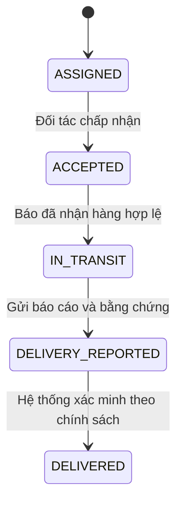

# Tác nhân tích hợp đối tác — Partner integration actor

## 1. Đối tác tích hợp là một tác nhân nghiệp vụ

Trong một hệ thống có kết nối bên ngoài, đối tác có thể tạo yêu cầu, báo cáo kết quả hoặc yêu cầu thay đổi dữ liệu qua API, webhook, message hay tệp nhập. Những hành động đó ảnh hưởng trực tiếp tới quy trình như nhận đơn, giao hàng, tính phí hoặc hoàn tiền.

**Partner integration actor** là tác nhân đại diện cho một đối tác bên ngoài khi phần mềm của họ tương tác với hệ thống theo một hợp đồng quyền hạn đã xác định.

Trong bài này, actor được hiểu là tác nhân thực hiện hành động nghiệp vụ. Tác nhân có thể là người hoặc phần mềm; với tích hợp đối tác, caller trực tiếp thường là phần mềm nhưng hành động cần được quy trách nhiệm về đúng tổ chức đối tác và danh tính tích hợp.

Một kết nối đối tác cần trả lời được:

- Tổ chức nào đang gọi, thông qua danh tính kỹ thuật nào?
- Họ hành động cho chính mình hay được một tenant ủy quyền?
- Họ được đọc, đề xuất hoặc thay đổi những đối tượng nào?
- Những dữ kiện nào họ có thẩm quyền báo cáo?
- Quyết định nào vẫn thuộc hệ thống hoặc chủ thể khác?
- Khi thông điệp bị gửi lại, đến muộn hoặc credential bị lộ, bất biến nào phải tiếp tục đúng?

Kết nối đã xác thực không làm toàn bộ payload trở thành sự thật nghiệp vụ. Một đối tác hợp lệ vẫn có thể gửi sai đối tượng, báo sai trạng thái, cố vượt quyền hoặc bị chiếm quyền điều khiển.

Sau bài này, bạn cần có thể lập hồ sơ actor của một đối tác, định nghĩa phạm vi quyền, thiết kế đường xử lý lệnh/sự kiện và viết kiểm thử lạm dụng logic tương ứng.

## 2. Ví dụ xuyên suốt: đối tác giao nhận

Một nền tảng bán hàng thuê đối tác **FulfillCo** thực hiện một số lượt giao hàng. Nền tảng phục vụ nhiều tenant là những nhà bán hàng độc lập.

Đối tác được phép:

- Đọc phần dữ liệu cần thiết của các lượt giao đang được giao cho họ.
- Chấp nhận nhiệm vụ.
- Báo đã nhận hàng để vận chuyển.
- Gửi báo cáo giao hàng và bằng chứng theo chính sách.
- Tra cứu kết quả xử lý những thông điệp của chính tích hợp đó trong phạm vi quyền.

Đối tác không có quyền tự:

- Thay đổi giá hàng hoặc giá mà khách phải thanh toán.
- Phê duyệt giảm giá, hoàn tiền hoặc chi trả cho nhà bán hàng.
- Chuyển nhiệm vụ sang đối tác khác.
- Đọc các lượt giao chưa được giao cho mình.
- Mạo danh quản trị viên của tenant.
- Gán một trạng thái cuối cùng nếu quy trình yêu cầu bước xác minh riêng.

Mã tenant, mã đối tác và mã nhiệm vụ trong payload chỉ là các tham chiếu cần kiểm tra. Quyền thực sự đến từ danh tính đã được xác thực, quan hệ ủy quyền và bản ghi giao việc phía server.

### 2.1. Hồ sơ actor mẫu

| Thuộc tính | Nội dung minh họa |
| --- | --- |
| Tổ chức đối tác | FulfillCo |
| Danh tính tích hợp | Một integration principal ổn định cho kết nối production |
| Mục tiêu hợp lệ | Nhận và cập nhật tiến độ các lượt giao được phân công |
| Kênh | API đối tác và thông điệp kết quả |
| Phạm vi dữ liệu | Nhiệm vụ được giao, còn thuộc quan hệ hợp lệ, trường dữ liệu được phép |
| Hành động | Đọc nhiệm vụ, chấp nhận, báo vận chuyển, báo giao hàng |
| Nguồn quyền | Cấu hình tích hợp, grant của tenant và quan hệ giao việc |
| Dữ kiện được cung cấp | Báo cáo vận hành và bằng chứng thuộc lượt giao |
| Rủi ro | Truy cập chéo tenant, cập nhật nhiệm vụ cũ, báo giao giả, phát lại sự kiện |
| Khi thu hồi | Ngừng chấp nhận hành động mới theo chính sách và xử lý thông điệp đang chờ có quy tắc |

Một hồ sơ như vậy giúp đánh giá tích hợp theo nghiệp vụ, thay vì chỉ có thông tin “API key đã được cấp”.

## 3. Phân biệt tổ chức, principal và credential

### 3.1. Ba lớp danh tính

| Lớp | Ý nghĩa | Ví dụ |
| --- | --- | --- |
| **Partner organization** | Tổ chức chịu trách nhiệm nghiệp vụ. | FulfillCo |
| **Integration principal** | Danh tính phần mềm được hệ thống nhận diện và cấp quyền. | Kết nối production của FulfillCo |
| **Credential** | Phương tiện chứng minh quyền sử dụng danh tính đó. | Key, chứng thư hoặc thông tin xác thực phù hợp giao thức |

Một principal có thể có nhiều credential trong giai đoạn xoay khóa. Một tổ chức có thể có nhiều principal cho các môi trường hoặc chức năng khác nhau.

Không nên dùng key hiện tại như định danh nghiệp vụ duy nhất của đối tác. Khi xoay khóa, quan hệ sở hữu nhiệm vụ, sổ idempotency và audit vẫn phải gắn với danh tính ổn định theo hợp đồng.

Ngược lại, không nên mặc định mọi principal của cùng một tổ chức có toàn bộ quyền như nhau. Kết nối chỉ đọc, kết nối production và công cụ hỗ trợ có thể có phạm vi khác nhau.

### 3.2. Phần mềm đối tác có thể mang theo người khởi tạo

Một request có thể bắt nguồn từ nhân viên đối tác thao tác trên ứng dụng của họ:

```text
Nhân viên đối tác
    → ứng dụng đối tác
    → integration principal
    → nền tảng nghiệp vụ
```

Hệ thống có thể lưu một `externalOperatorReference` phục vụ truy vết. Nhưng giá trị đó không tự trở thành một người dùng nội bộ đã xác thực.

Nếu nghiệp vụ yêu cầu quyền được ủy quyền từ một người dùng cụ thể, phải có cơ chế kiểm chứng quan hệ ủy quyền đó. Một field `onBehalfOfUserId` trong body không đủ để mạo danh người dùng.

Audit nên phân biệt:

- Principal trực tiếp được hệ thống xác thực.
- Tổ chức đối tác tương ứng.
- Chủ thể ủy quyền nếu đã được kiểm chứng.
- Tham chiếu người vận hành do đối tác cung cấp, với mức độ tin cậy phù hợp.

## 4. Phạm vi quyền: đối tác nào, cho tenant nào, trên nhiệm vụ nào?

Có thể mô hình hóa quyết định như sau:

```text
allow(partnerPrincipal, action, assignment) =
    principal đang hợp lệ
    AND integration được phép thực hiện action
    AND tenant cho phép quan hệ tích hợp này
    AND assignment hiện được giao cho đúng đối tác
    AND action hợp lệ ở trạng thái và phiên bản hiện tại
    AND các điều kiện nghiệp vụ bổ sung được thỏa
```

Đây là mô hình phân tích; cách lưu quyền và triển khai có thể khác nhau.

### 4.1. Scope chức năng cần đi cùng scope đối tượng

Một scope như `shipment.events.write` có thể cho phép gọi chức năng gửi sự kiện. Nó chưa chứng minh caller được cập nhật mọi shipment.

Hệ thống vẫn phải kiểm tra đối tượng cụ thể:

```text
assignment.partnerOrganizationId == authenticatedPartnerOrganizationId

assignment.tenantId thuộc phạm vi ủy quyền đang áp dụng

assignment.id và fulfillmentAttemptId khớp quan hệ giao việc hiện tại
```

Nếu đối tác thay mã assignment trong URL và sửa được nhiệm vụ của bên khác, đó là thiếu phân quyền ở mức đối tượng. Dùng UUID khó đoán không thay thế kiểm tra này.

### 4.2. Tenant do client chọn phải được đối chiếu

Đối tác có thể phục vụ tenant A và B, nhưng không có nghĩa mọi credential đều được dùng cho cả hai. Một header hoặc field tenant chỉ thể hiện ngữ cảnh được yêu cầu.

Server cần đối chiếu đồng thời:

- Principal có grant cho tenant đó không.
- Nhiệm vụ có thực sự thuộc tenant đó không.
- Nhiệm vụ có được giao cho tổ chức đối tác này không.
- Loại hành động có thuộc phạm vi grant không.

Chỉ kiểm tra một trong các quan hệ trên dễ tạo khoảng trống. Ví dụ, đối tác được phép kết nối với tenant A nhưng không được đọc mọi đơn chưa giao cho họ trong tenant A.

### 4.3. Đối tác gọi thay tenant và nguy cơ confused deputy

Nền tảng thường có quyền nội bộ rộng hơn đối tác. Nếu endpoint nhận `tenantId`, `orderId` và một hành động rồi thực hiện bằng tài khoản hệ thống mà không kiểm tra phạm vi caller, nền tảng có thể trở thành **confused deputy**: thành phần có quyền bị lợi dụng để thực hiện việc ngoài quyền của bên yêu cầu.

Một service nội bộ được phép cập nhật mọi đơn vẫn cần biết yêu cầu từ đối tác nào và được phép tác động đến đâu. Chuyển request qua thêm một service không mở rộng quyền hợp lệ của caller.

## 5. Những khẳng định được tin đến mức nào?

| Dữ kiện/tham số | Đối tác có thể cung cấp | Server cần xác lập hoặc kiểm chứng |
| --- | --- | --- |
| Mã nhiệm vụ | Nhiệm vụ muốn thao tác. | Nhiệm vụ tồn tại, thuộc tenant và đối tác đúng phạm vi. |
| Loại sự kiện | Báo chấp nhận, nhận hàng, giao hàng. | Loại sự kiện được phép và hợp lệ theo workflow. |
| Thời điểm xảy ra | Thời điểm vận hành do đối tác ghi nhận. | Miền giá trị, độ trễ chấp nhận, cách dùng trong quyết định. |
| Bằng chứng giao | Tham chiếu hoặc nội dung theo hợp đồng. | Bằng chứng gắn đúng nhiệm vụ, nguồn và điều kiện chất lượng/chấp nhận. |
| Phí vận chuyển đề xuất | Báo giá hoặc khoản đề xuất nếu được phép. | Giá có hiệu lực và điều kiện phê duyệt theo chính sách. |
| Mã tenant/đối tác | Dữ liệu tham chiếu nếu hợp đồng có. | Danh tính và quan hệ từ ngữ cảnh đã xác thực. |
| Kết quả hoàn tiền/chi trả | Chỉ khi có nghiệp vụ báo cáo tương ứng. | Không tự coi báo cáo vận hành là phê duyệt tài chính. |
| Trạng thái cuối cùng | Ý định hoặc báo cáo theo hợp đồng. | Quyết định chuyển trạng thái do hệ thống có thẩm quyền thực hiện. |

Một đối tác có thể là nguồn có thẩm quyền cho một loại báo cáo trong hợp đồng, nhưng không phải nguồn sự thật cho mọi hệ quả kéo theo.

Ví dụ, thông điệp giao hàng có chữ ký hợp lệ chứng minh thông điệp đến từ danh tính phù hợp theo cơ chế đã cấu hình. Nó không tự chứng minh kiện hàng đã đến đúng người. Quy trình còn phụ thuộc bằng chứng, đối chiếu và mức rủi ro mà nghiệp vụ chấp nhận.

## 6. Bất biến và state machine cho tích hợp đối tác

### 6.1. Những bất biến mẫu

```text
I1. Đối tác chỉ đọc/ghi đối tượng trong phạm vi được cấp và giao việc hợp lệ.

I2. Payload không thể thay đổi actor, tenant sở hữu, đối tác được giao,
    giá hay quyết định phê duyệt ngoài quyền.

I3. Một cập nhật chỉ tạo chuyển trạng thái hợp lệ
    trên đúng nhiệm vụ và phiên bản/cycle thực hiện.

I4. Xử lý lại cùng thông điệp không tạo thêm tác động nghiệp vụ.

I5. Sự kiện cũ không được ghi đè quyết định mới
    hoặc cập nhật nhầm một lượt thực hiện khác.

I6. Báo cáo của đối tác chỉ tạo hệ quả mà chính sách cho phép;
    các bước phê duyệt độc lập vẫn được giữ.

I7. Quyền bị thu hồi có hiệu lực theo hợp đồng thời gian đã xác định.

I8. Mỗi tác động có thể truy về principal, đối tượng, nguồn và quyết định.
```

### 6.2. Tách báo cáo giao hàng khỏi xác nhận cuối cùng



Đây là workflow minh họa, chưa bao gồm giao thất bại, hủy, đổi đối tác và giao lại.

Trong mô hình này, đối tác được báo `DELIVERY_REPORTED`; quyền xác lập `DELIVERED` thuộc bước xác minh. Nếu một sản phẩm tin đối tác đủ để tự xác nhận giao hàng, đó phải là quyền được cấp rõ ràng với điều kiện tương ứng, không phải hệ quả vô tình của việc bind field `status`.

Mỗi lần giao lại cần định danh hoặc phiên bản đủ để phân biệt. Sự kiện của lần giao cũ không được áp dụng cho lần giao mới chỉ vì cùng `orderId`.

## 7. Tiếp nhận request: danh tính kỹ thuật đi trước dữ liệu nghiệp vụ

Một đường xử lý có thể chia thành các lớp:

1. Giới hạn kích thước và xử lý định dạng theo hợp đồng.
2. Kiểm chứng thông tin xác thực của kết nối.
3. Ánh xạ sang principal, tổ chức đối tác và môi trường.
4. Kiểm tra loại hành động và phạm vi được cấp.
5. Tải đối tượng rồi kiểm tra quan hệ tenant, giao việc và phiên bản.
6. Thực thi quy tắc nghiệp vụ cùng các bảo đảm cạnh tranh.
7. Lưu kết quả, audit và ý định phát sự kiện nếu có.

Cơ chế xác thực có thể dựa trên token, chứng thư hoặc chữ ký thông điệp tùy tích hợp. Mỗi cách cần được kiểm tra theo đúng giao thức đã chọn. Việc sở hữu một secret hoặc đi từ địa chỉ mạng quen thuộc chưa đủ xác định mọi quyền nghiệp vụ.

### 7.1. Trường nào được phép xuất hiện trong lệnh?

Ví dụ lệnh báo giao hàng:

```http
POST /partner/v1/assignments/asg-731/events
Content-Type: application/json

{
  "eventId": "evt-fulfillco-5821",
  "eventType": "DELIVERY_REPORTED",
  "expectedAssignmentVersion": 8,
  "fulfillmentAttemptId": "attempt-02",
  "occurredAt": "2026-11-21T03:20:00Z",
  "proofReference": "proof-210"
}
```

Command chỉ thể hiện những dữ kiện mà đối tác được phép đề xuất. Danh tính tích hợp đến từ ngữ cảnh xác thực. Chủ sở hữu tenant, partner được giao và quyền cập nhật đến từ dữ liệu server kiểm chứng.

Không bind payload trực tiếp vào entity có các field như:

```text
tenantId
assignedPartnerId
customerPrice
refundApproved
payoutApproved
internalRiskOverride
```

Nếu cần cho đối tác đề xuất một giá trị liên quan, hãy có field và thao tác riêng thể hiện đúng ý nghĩa “đề xuất”, với kiểm tra hoặc phê duyệt tương ứng.

### 7.2. Chống phát lại ở lớp giao thức và ở lớp nghiệp vụ

Một cơ chế ký request có thể dùng thời điểm gửi hoặc nonce để hạn chế request bị chép lại. Biện pháp này không tự bảo vệ tác động nghiệp vụ nếu đối tác gửi một request mới, được ký hợp lệ, cho cùng sự kiện.

Cần phân biệt:

- Thời điểm request được gửi/ký.
- Thời điểm sự kiện nghiệp vụ được báo là đã xảy ra.
- Thời điểm server nhận và xử lý.
- Thời điểm thay đổi được chấp nhận có hiệu lực.

Một sự kiện xảy ra hôm qua có thể được chuyển đến hôm nay theo hợp đồng offline. Điều đó không có nghĩa request được phép dùng thông tin xác thực đã hết hiệu lực hoặc tự quyết định quyền theo ngày quá khứ.

Khi retry, envelope giao thức có thể thay đổi theo yêu cầu xác thực, nhưng định danh sự kiện nghiệp vụ vẫn phải ổn định.

## 8. Sự kiện trùng, phát lại và sai thứ tự

### 8.1. Hợp đồng idempotency

Trong ví dụ, khóa thông điệp có thể được xác định theo:

```text
(stableIntegrationId, eventId)
```

Phạm vi phải được thỏa thuận rõ. Nếu nguồn chỉ bảo đảm mã sự kiện duy nhất trong từng hệ thống con, cần thêm định danh hệ thống con vào khóa. Không mặc định mọi mã đều duy nhất toàn cầu.

Một bản ghi xử lý nên liên kết:

```text
principal/integration
eventId
assignmentId
fulfillmentAttemptId
businessPayloadFingerprint
processingState
resultReference
receivedAt
```

Cùng key và cùng nội dung nghiệp vụ phải được xử lý như cùng một thông điệp. Cùng key nhưng nội dung khác cần bị từ chối hoặc xử lý theo cơ chế sửa sự kiện được định nghĩa, không âm thầm ghi đè.

Fingerprint cần bao gồm các field có ý nghĩa nghiệp vụ và có cách chuẩn hóa rõ. Timestamp ký request, correlation ID hoặc key dùng để xoay khóa không nên vô tình biến một retry thành nghiệp vụ mới. Kiểm chứng chữ ký và fingerprint phục vụ hai mục đích khác nhau.

Trước khi trả kết quả đã lưu, vẫn cần thực thi chính sách xác thực và quyền đọc kết quả. Biết một event ID không cấp quyền xem dữ liệu.

### 8.2. Hai event ID khác nhau vẫn có thể tạo cùng tác động

Đối tác có thể phát hai message khác ID cùng báo một kết quả giao hàng. Khử trùng theo ID thông điệp sẽ không phát hiện đây là cùng hệ quả nghiệp vụ.

Vì vậy cần thêm bảo đảm ở miền nghiệp vụ, chẳng hạn:

- Một lượt thực hiện chỉ có một xác nhận giao thành công đang có hiệu lực theo mô hình.
- Chuyển sang trạng thái cuối không lặp lại.
- Sự kiện tạo tác vụ xác minh hoặc tác động tiếp theo được gắn với quyết định/cycle ổn định.
- Các tác động bên ngoài nhận cùng mã thao tác khi retry.

Không nên áp một khóa chung `(assignmentId, eventType)` cho mọi loại sự kiện. Một hành trình có thể có nhiều cập nhật vận chuyển hợp lệ. Khóa và điều kiện phải phản ánh tác động cần ngăn lặp, không chỉ tên trạng thái.

### 8.3. Sự kiện đến muộn không được ghi lùi trạng thái

Ví dụ:

```text
Server đã chấp nhận:
  IN_TRANSIT → DELIVERY_REPORTED

Sau đó mới nhận:
  ACCEPTED của cùng lượt thực hiện
```

Không được gán trạng thái hiện tại thành `ACCEPTED` chỉ vì message đó đến sau.

Các cách xử lý có thể gồm:

- Ghi nhận như sự kiện lịch sử không làm lùi trạng thái.
- Từ chối một chuyển đổi không còn hợp lệ.
- Chờ bổ sung thông tin hoặc đối soát nếu thiếu bước bắt buộc.
- Dùng sequence/revision do nguồn bảo đảm, trong đúng phạm vi được định nghĩa.

Thời điểm `occurredAt` do đối tác gửi không tự tạo ra thứ tự đáng tin cho mọi quyết định. Cũng không nên bỏ mọi message cũ một cách máy móc nếu nó chứa sự thật lịch sử cần lưu.

Đối với lượt giao đã hủy hoặc đã giao lại cho đối tác khác, cần kiểm tra cả assignment/cycle và chính sách hiệu lực quyền. Cùng một order không có nghĩa mọi sự kiện của mọi lần giao đều còn áp dụng được.

## 9. Thực thi lệnh với transaction và kiểm soát cạnh tranh

Giả sử hai request cùng đọc assignment phiên bản 8:

- Một request báo giao hàng.
- Request kia báo trạng thái khác hoặc hệ thống đang thay đổi giao việc.

Nếu kiểm tra trạng thái và ghi thay đổi tách rời, cả hai có thể dựa trên cùng dữ liệu đã cũ. Hệ thống cần khóa, cập nhật có điều kiện hoặc cơ chế tương đương để quyết định hợp lệ được giữ tới lúc commit.

### 9.1. Phác thảo Java ở tầng ứng dụng

```java
// Mã minh họa kiến trúc, không phụ thuộc framework cụ thể.
record PartnerEventCommand(
    String eventId,
    PartnerEventType eventType,
    long expectedAssignmentVersion,
    UUID fulfillmentAttemptId,
    Instant occurredAt,
    String proofReference
) {}

PartnerEventResult handle(
        PartnerPrincipal principal,
        UUID assignmentId,
        PartnerEventCommand command) {

    return transaction.required(() -> {
        Assignment assignment = assignments.loadForUpdate(assignmentId)
            .orElseThrow(NotFound::new);

        // Trong ví dụ, quyền hiện hành bắt buộc cả khi lấy lại kết quả cũ.
        integrationPolicy.requireActive(principal);
        access.requireCanReport(principal, assignment);
        eventPolicy.requireAllowedType(principal, command.eventType());

        InboxClaim claim = inbox.claim(
            principal.stableIntegrationId(),
            command.eventId(),
            fingerprints.of(assignmentId, command)
        );

        if (claim.isAlreadyCompletedWithSamePayload()) {
            return claim.savedResult();
        }

        assignment.requireVersion(command.expectedAssignmentVersion());
        assignment.requireAttempt(command.fulfillmentAttemptId());

        Evidence evidence = evidencePolicy.validate(
            principal, assignment, command
        );
        DomainDecision decision = workflow.acceptPartnerReport(
            assignment, command, evidence, clock.instant()
        );

        assignments.save(assignment);
        domainEvents.append(decision);
        outbox.appendFor(decision);
        audit.appendPartnerDecision(principal, assignment, decision);

        PartnerEventResult result = PartnerEventResult.from(decision);
        inbox.complete(claim, result);
        return result;
    });
}
```

Những điều tên hàm không tự bảo đảm:

- Principal phải được tạo từ cơ chế xác thực đã kiểm chứng.
- `requireCanReport` phải kiểm tra tenant, grant và quan hệ giao việc.
- `inbox.claim` phải có ràng buộc duy nhất, xử lý tranh chấp cùng key và từ chối fingerprint khác; không để lệnh tiếp tục nếu chưa sở hữu quyền xử lý claim.
- `loadForUpdate` phải thực sự khóa trong transaction đang chạy và phối hợp với các đường ghi khác.
- `workflow` chỉ cho phép chuyển đổi do đối tác được quyền yêu cầu.
- Bằng chứng phải gắn đúng assignment/cycle và nguồn dữ liệu phù hợp.
- Trạng thái, inbox, audit cục bộ và outbox trong ví dụ cần được ghi theo cùng ranh giới transaction.

Đặt kiểm tra idempotency trước kiểm tra phiên bản giúp một retry đã thành công có thể nhận lại kết quả mà không bị từ chối chỉ vì chính lần xử lý trước đã tăng phiên bản. Nhưng kiểm tra quyền đọc kết quả vẫn được thực hiện trước đó theo chính sách của ví dụ.

### 9.2. Khóa đối tượng không khóa toàn bộ hệ thống quyền

Nếu grant của đối tác nằm trong bảng khác hoặc service khác, khóa assignment không tự ngăn việc grant bị thu hồi đồng thời.

Cần xác định:

- Quyền được xét tại thời điểm tiếp nhận hay thời điểm áp dụng?
- Có chấp nhận một khoảng trễ thu hồi không?
- Có cần kiểm tra phiên bản grant khi commit hoặc trước tác động nhạy cảm không?
- Khi nguồn quyền không sẵn sàng, hành động nào được chờ và hành động nào phải từ chối?

Nếu có yêu cầu thu hồi tức thời, thiết kế phải cung cấp điểm kiểm tra đáp ứng yêu cầu đó. Một cache quyền chưa hết TTL không tự bảo đảm tính tức thời.

## 10. Xử lý bất đồng bộ và tác động tiếp theo

Một endpoint có thể lưu message vào inbox rồi trả kết quả “đã nhận”. Worker áp dụng sau đó.

Phải phân biệt:

```text
RECEIVED: thông điệp đã được lưu theo hợp đồng tiếp nhận.
APPLIED: thay đổi nghiệp vụ đã được chấp nhận và commit.
REJECTED: thông điệp không được áp dụng, có lý do.
PENDING_REVIEW: cần xác minh hoặc quyết định bổ sung.
```

Tên trạng thái có thể khác, nhưng đối tác cần biết phản hồi chỉ xác nhận tiếp nhận hay xác nhận đã áp dụng. Trả “đã giao hàng” khi mới lưu một báo cáo chưa được kiểm tra làm sai ý nghĩa hợp đồng.

### 10.1. Worker vẫn cần ngữ cảnh actor

Message đưa vào worker nên liên kết với principal, tổ chức đối tác, đối tượng và căn cứ tiếp nhận. Worker không được biến mọi message thành lệnh của một superuser nội bộ.

Nếu quyền bị thu hồi hoặc nhiệm vụ được giao lại trước khi worker chạy, cần chính sách:

- Lệnh đã được chấp nhận hợp lệ có được hoàn tất không?
- Loại hành động nào bắt buộc kiểm tra quyền hiện hành?
- Báo cáo lịch sử có được lưu nhưng không làm thay đổi trạng thái hiện tại không?

Lưu một snapshot quyền giúp giải thích quyết định lúc tiếp nhận. Nó không tự trao quyền vô thời hạn cho mọi lần xử lý tương lai.

### 10.2. Outbox không tự bảo đảm tác động bên ngoài chỉ một lần

Khi áp dụng báo cáo tạo ra sự kiện tiếp theo, outbox có thể giúp lưu trạng thái nghiệp vụ và ý định phát message trong cùng transaction.

Message vẫn có thể được gửi lặp. Consumer cần xử lý trùng và bảo vệ bất biến của chính mình.

Nếu sau xác minh giao hàng có tác động nhạy cảm như chi trả, tác động đó cần:

- Điều kiện nghiệp vụ và phê duyệt riêng theo chính sách.
- Một mã thao tác ổn định.
- Bảo đảm không tạo nghĩa vụ lặp cho cùng quyết định.
- Đối soát khi kết quả bên ngoài chưa rõ.

Một báo cáo từ đối tác không được đi xuyên chuỗi service rồi vô tình nhận quyền cao hơn ở từng bước.

### 10.3. Timeout là kết quả chưa rõ

Đối tác có thể gửi lại vì không biết request trước đã commit chưa. Nền tảng cũng có thể timeout khi gọi ngược sang đối tác.

Retry phải giữ định danh của cùng thao tác và tuân theo hợp đồng idempotency. Không tạo tác động mới chỉ để có response dễ xử lý.

Khi chưa biết bên ngoài đã thực hiện hay chưa, cần truy vấn/đối soát hoặc xử lý ngoại lệ phù hợp. Rollback database cục bộ không tự hoàn tác được tác động đã xảy ra ở hệ thống khác.

## 11. Cấp quyền, thay đổi và thu hồi tích hợp

### 11.1. Kết nối được đăng ký chưa có nghĩa tenant đã ủy quyền

Có thể tồn tại hai quyết định riêng:

1. Nền tảng nhận diện và cho phép tổ chức đối tác tích hợp.
2. Một tenant cho phép tích hợp đó thực hiện một phạm vi công việc của mình.

Đăng ký ở cấp nền tảng không tự tạo grant cho mọi tenant. Việc liên kết tenant phải do chủ thể có quyền thực hiện, với phạm vi rõ ràng.

Đối tác không được tự tạo quan hệ này chỉ bằng cách gửi một mã tenant hợp lệ. Nếu có luồng tenant tự kết nối đối tác, cần kiểm chứng người thực hiện có quyền cấp quan hệ và phạm vi yêu cầu có được phép không.

### 11.2. Xoay credential không làm đổi ý nghĩa nghiệp vụ

Trong giai đoạn xoay khóa, hai credential có thể cùng đại diện cho một integration principal. Hệ thống cần:

- Phân biệt credential dùng để xác thực với principal dùng để đánh giá quyền.
- Lưu mã credential cần thiết cho truy vết nhưng không ghi secret.
- Giữ phạm vi idempotency ổn định nếu hai credential thuộc cùng một nguồn sự kiện.
- Thu hồi credential cũ mà không làm mất lịch sử nghiệp vụ.
- Bảo đảm credential môi trường thử nghiệm không được áp dụng cho production.

Nếu mỗi credential mới tạo một không gian dedup độc lập, một sự kiện cũ có thể được phát lại qua khóa mới và tạo tác động lặp.

Ngược lại, nếu hai kết nối là những nguồn sự kiện độc lập thật sự, việc gộp chúng cần theo hợp đồng định danh; không gộp chỉ vì cùng tổ chức.

### 11.3. Thu hồi credential khác thu hồi grant

- Thu hồi một credential ngăn phương tiện đó tiếp tục xác thực.
- Thu hồi principal ngăn danh tính tích hợp tiếp tục hoạt động theo chính sách.
- Thu hồi grant của tenant chấm dứt phạm vi được tenant đó ủy quyền.
- Giao lại nhiệm vụ thay đổi quan hệ trên đối tượng cụ thể.

Các lớp này không thay thế nhau. Cấp credential mới không được tự khôi phục một grant tenant đã bị thu hồi. Đối tác vẫn có grant cho tenant cũng không có quyền cập nhật nhiệm vụ đã được giao lại cho bên khác.

### 11.4. Sự kiện lịch sử sau khi giao lại

Giả sử FulfillCo báo một mốc của lượt giao cũ sau khi nhiệm vụ đã được giao lại. Hệ thống có thể cần lưu báo cáo để đối soát, nhưng không được vì vậy sửa trạng thái của lượt giao hiện tại.

Cần tách:

```text
quyền tiếp nhận/lưu báo cáo lịch sử
quyền thay đổi trạng thái hiện tại
quyền tạo tác động tiếp theo
```

Thời điểm do đối tác khai rằng sự kiện xảy ra trước khi thu hồi không tự chứng minh họ còn quyền thực hiện thay đổi hiện tại. Nếu chính sách cho phép hồi tố, phải có căn cứ và phạm vi cụ thể.

## 12. Giới hạn dữ liệu, lưu lượng và đường vào thay thế

### 12.1. Chỉ chia sẻ phần dữ liệu phục vụ nhiệm vụ

Quyền đọc assignment không có nghĩa được đọc toàn bộ đơn hàng hoặc hồ sơ khách hàng.

Ví dụ, đối tác giao nhận có thể cần tên người nhận, địa chỉ giao và thông tin liên hệ theo chính sách. Họ thường không cần giá vốn, ghi chú rủi ro nội bộ, phương thức thanh toán đầy đủ hoặc các đơn khác của khách hàng.

Cần kiểm tra cả:

- API chi tiết.
- API danh sách và tìm kiếm.
- Xuất dữ liệu.
- URL tải bằng chứng.
- Endpoint tra cứu trạng thái message.
- Thông báo lỗi và log gửi lại cho đối tác.

Một API chi tiết được bảo vệ nhưng API danh sách trả toàn bộ tenant vẫn làm lộ dữ liệu ngoài phạm vi.

Nếu dùng URL có thời hạn để tải dữ liệu, cần xác định đối tượng, phạm vi và thời hạn được cấp; URL không được trở thành đường đọc vĩnh viễn ngoài chính sách.

### 12.2. Thông báo lỗi cần nhất quán với quyền

API cần cho đối tác biết trạng thái xử lý đủ để sửa lỗi và retry, nhưng không tiết lộ dữ liệu của nhiệm vụ ngoài quyền.

Mã lỗi có thể phân biệt dữ liệu không hợp lệ, xung đột phiên bản hoặc key trùng khác nội dung trong phạm vi được phép. Với đối tượng không được đọc, hợp đồng cần tránh tiết lộ chi tiết không cần thiết.

Lỗi nội bộ không nên trả raw token, câu truy vấn, dữ liệu tenant khác hoặc thông tin xác thực tích hợp.

### 12.3. Giới hạn lưu lượng theo tác nhân phù hợp

Rate limit theo IP có thể hỗ trợ bảo vệ hạ tầng, nhưng một đối tác có thể dùng nhiều IP. Nhiều đối tác cũng có thể đi qua hạ tầng mạng dùng chung.

Có thể cần giới hạn theo integration principal, tổ chức đối tác, tenant và loại tác vụ. Với xử lý nền, cần tránh một tích hợp gửi lượng lớn message làm các tích hợp khác bị bỏ đói.

Giới hạn kỹ thuật không thay thế bất biến nghiệp vụ. Một request duy nhất cập nhật nhầm đơn vẫn là sai, dù đối tác chưa chạm ngưỡng lưu lượng.

### 12.4. Batch, import và công cụ hỗ trợ cũng mang actor

Một tệp nhập hoặc lô sự kiện cần giữ được nguồn đối tác và kiểm tra từng đối tượng theo hợp đồng. Không chuyển cả lô thành quyền của admin chỉ vì nó được xử lý offline.

Cần xác định lô có tính nguyên tử toàn bộ hay trả kết quả từng phần. Nếu có thành công từng phần, retry phải nhận diện các item đã được xử lý để không nhân tác động.

Các endpoint phiên bản cũ, thao tác sửa tay và job đối soát cũng phải thực thi cùng bất biến hoặc có quyền ngoại lệ được ghi nhận rõ.

## 13. Những chuỗi lạm dụng cần nhận diện

| Chuỗi thao tác | Điểm yếu bị khai thác | Quy tắc cần bảo vệ |
| --- | --- | --- |
| Đổi assignment ID trong URL. | Chỉ kiểm tra API scope. | Phân quyền trên đúng nhiệm vụ. |
| Gửi tenant của khách hàng khác. | Tin tenant trong body/header. | Quan hệ principal–tenant–object. |
| Gửi `status=DELIVERED` thay báo cáo. | Bind trực tiếp entity. | Quyền ở mức thuộc tính và chuyển trạng thái. |
| Gửi giá mới kèm tiến độ giao. | Không giới hạn field đối tác được sửa. | Giá và phê duyệt có nguồn thẩm quyền riêng. |
| Dùng `onBehalfOfUserId` của admin. | Tin tham chiếu caller khai như danh tính đã kiểm chứng. | Phân biệt principal và chủ thể ủy quyền. |
| Phát lại cùng sự kiện qua credential mới. | Dedup gắn với khóa thay vì danh tính ổn định. | Một thông điệp không tạo nhiều tác động. |
| Đổi event ID rồi gửi lại cùng kết quả cuối. | Chỉ khử trùng ở lớp message. | Bất biến và khóa tác động nghiệp vụ. |
| Gửi mốc cũ sau khi giao lại. | Chỉ đối chiếu order ID. | Đúng assignment/cycle và hiệu lực quyền. |
| Tự khai thời điểm quá khứ. | Dùng thời điểm client để quyết định quyền hiện tại. | Nguồn thời gian và chính sách hồi tố. |
| Báo giao xong để kích hoạt chi trả. | Đồng nhất báo cáo đối tác với phê duyệt hệ quả. | Kiểm chứng và phân tách nhiệm vụ. |
| Bỏ qua API qua tệp nhập. | Worker xử lý mọi item bằng quyền hệ thống rộng. | Actor và phạm vi được giữ qua mọi kênh. |

Những yêu cầu này có thể hoàn toàn hợp lệ về JSON và được xác thực bằng credential thật. Tấn công logic nằm ở việc đạt một hệ quả mà quyền hoặc workflow không cho phép.

## 14. Kiểm thử tích hợp như một đối tác có chủ đích

Mỗi kiểm thử cần quan sát trạng thái đối tượng, inbox, outbox, tác động tiếp theo và dữ liệu trả về. Một response từ chối chưa đủ nếu hệ thống đã ghi trạng thái hoặc phát message trái phép trước đó.

| Tình huống | Cách thực hiện | Bằng chứng cần có |
| --- | --- | --- |
| Sai đối tác | Principal A gửi event cho assignment của B. | Không đọc/sửa được dữ liệu hoặc tạo tác động. |
| Sai tenant | Principal chỉ được tenant A ủy quyền gọi nhiệm vụ tenant B. | Không vượt phạm vi tenant. |
| Có grant nhưng chưa được giao việc | Gọi một assignment khác cùng tenant. | Grant tenant không trở thành quyền trên mọi đối tượng. |
| Field ngoài quyền | Thêm giá, tenant sở hữu hoặc cờ phê duyệt vào body. | Không thay đổi dữ kiện server quản lý. |
| Giả người ủy quyền | Gửi mã admin trong `onBehalfOfUserId`. | Không nhận quyền của admin từ field tự khai. |
| Bỏ qua bước | Báo giao khi chưa có bước bắt buộc trước đó. | Không chuyển trạng thái ngoài quy tắc. |
| Cùng key, cùng nội dung | Gửi lại sau khi mất response. | Một kết quả nghiệp vụ, không thêm outbox/tác động lặp. |
| Cùng key, khác nhiệm vụ/nội dung | Dùng lại event ID với assignment khác. | Từ chối xung đột theo hợp đồng. |
| Hai key, cùng kết quả cuối | Phát hai message cho một lượt đã hoàn tất. | Không lặp hệ quả nhạy cảm. |
| Thông điệp sai thứ tự | Gửi mốc trước sau khi đã có mốc sau. | Không ghi lùi trạng thái ngoài chính sách. |
| Sai lượt thực hiện | Sự kiện attempt cũ dùng cho attempt mới. | Không áp dụng nhầm cycle. |
| Cạnh tranh phiên bản | Hai lệnh cùng dựa trên một version. | Chỉ các cập nhật tương thích được chấp nhận; không mất quyết định. |
| Xoay credential | Gửi lại message cũ bằng credential mới của cùng principal. | Không né không gian idempotency. |
| Thu hồi grant | Principal còn xác thực được nhưng tenant đã ngắt kết nối. | Không tiếp tục thực hiện hành động mới ngoài chính sách. |
| Thu hồi khi message đang chờ | Tạm dừng worker, thu hồi, sau đó chạy lại. | Hành vi khớp quy tắc tiếp nhận/thực thi đã công bố. |
| Credential thử nghiệm | Dùng thông tin của môi trường test vào production. | Không được xác thực/cấp quyền sai môi trường. |
| Xử lý lô một phần | Một số item đã commit rồi retry cả lô. | Không nhân tác động các item đã hoàn tất. |
| Timeout tác động ngoài | Giả lập đối tác đã thực hiện nhưng mất phản hồi. | Dùng cùng operation và đối soát, không tạo việc mới tùy tiện. |
| Đọc danh sách và kết quả | Liệt kê, tra cứu receipt hoặc tải bằng chứng. | Không lộ dữ liệu ngoài phạm vi được cấp. |

### 14.1. Cạnh tranh cần được tạo có chủ đích

Để kiểm tra hai request cùng dựa trên một version, dùng điểm đồng bộ trong bộ kiểm thử để chúng cùng đến giai đoạn tranh chấp. Kiểm tra số dòng được cập nhật, số bản ghi đã commit và bất biến cuối cùng.

Các bảo đảm của unique constraint, khóa và isolation cần kiểm tra ở mức tích hợp với database phù hợp. Mock repository không chứng minh được chúng.

### 14.2. Kiểm thử lỗi giữa các bước

Mô phỏng lỗi:

- Sau khi claim message nhưng trước cập nhật assignment.
- Sau cập nhật assignment nhưng trước ghi outbox.
- Sau commit nhưng trước trả response.
- Sau gửi message ngoài nhưng trước ghi kết quả cục bộ.

Hai lỗi đầu cần được xử lý theo ranh giới transaction đã thiết kế. Lỗi sau commit cần retry trả lại kết quả phù hợp. Lỗi liên quan tác động ngoài cần idempotency hoặc đối soát; rollback cục bộ không đủ.

## 15. Audit: giải thích được ai đã làm gì và dựa vào quyền nào

Một dấu vết có thể gồm:

```text
partnerOrganizationId
stableIntegrationId
credentialReference
verifiedDelegationReference, nếu có
tenantId, assignmentId, fulfillmentAttemptId
externalEventId, operationId, correlationId
action, previousState, nextState
assignmentVersion, grantVersion / policyReference
decision, reasonCode
reportedOccurredAt, receivedAt, appliedAt
```

Các mốc thời gian phục vụ mục đích khác nhau nên cần giữ ý nghĩa rõ ràng. `reportedOccurredAt` là thời điểm đối tác khai; `receivedAt` và `appliedAt` là mốc hệ thống ghi nhận.

Không ghi secret, access token hoặc toàn bộ bằng chứng chứa thông tin nhạy cảm vào log chỉ để dễ tra cứu. Lưu tham chiếu và dữ kiện đủ giải thích quyết định theo nhu cầu.

Cần theo dõi các dấu hiệu như:

- Nhiều lần truy cập assignment ngoài quyền.
- Xung đột cùng event ID nhưng khác payload.
- Sự kiện cho attempt đã kết thúc hoặc đã giao lại.
- Tỷ lệ báo giao thiếu bằng chứng tăng.
- Sự kiện tồn đọng sau thu hồi tích hợp.
- Tác động nghiệp vụ không có nguồn sự kiện/quyết định tương ứng.

Audit giúp phát hiện và điều tra. Nó không thay thế kiểm tra quyền, state machine hoặc ràng buộc chống trùng.

## 16. Bài tập áp dụng

Một nền tảng cấp API key cho đối tác vận chuyển. Endpoint nhận:

```json
{
  "tenantId": "tenant-a",
  "orderId": "order-731",
  "partnerId": "fulfillco",
  "status": "DELIVERED",
  "deliveryFee": "1",
  "eventId": "evt-17",
  "onBehalfOfUserId": "admin-01"
}
```

Handler chỉ kiểm tra key tồn tại, tải order bằng ID, copy các field rồi lưu. Sau đó hệ thống phát sự kiện hoàn tất đơn. Dedup dùng cặp key hiện tại và event ID.

Hãy thiết kế lại:

1. Xác định organization, principal và credential trong ví dụ.
2. Chỉ ra các field phải do server xác lập và các field có thể giữ như dữ liệu đề xuất/tham chiếu.
3. Viết điều kiện phân quyền gồm tenant, quan hệ giao việc và loại hành động.
4. Tách báo cáo của đối tác khỏi quyết định cuối và hệ quả cần phê duyệt.
5. Chọn phạm vi dedup ổn định qua xoay khóa và thêm bảo vệ cho tác động nghiệp vụ.
6. Bổ sung assignment/cycle hoặc phiên bản để ngăn sự kiện của lần giao cũ.
7. Mô tả hành vi khi grant bị thu hồi lúc message đang chờ worker.
8. Viết một kiểm thử truy cập chéo tenant và một kiểm thử phát lại sau xoay credential.

Gợi ý tự đánh giá:

- Không dùng field `partnerId` hoặc `onBehalfOfUserId` để tự cấp danh tính.
- API scope đi kèm kiểm tra đối tượng cụ thể.
- Đối tác không sửa được giá hoặc quyết định phê duyệt bằng payload cập nhật tiến độ.
- Retry, khóa mới và event ID mới không tạo tác động trái bất biến.
- Quyền được giữ đúng qua worker, batch và endpoint tra cứu.
- Có thể giải thích quyết định bằng nguồn, phạm vi và phiên bản được kiểm chứng.

## 17. Những điểm cần ghi nhớ

Tác nhân tích hợp đối tác có danh tính và quyền hạn hữu hạn. Thiết kế cần nối đúng **tổ chức, principal, grant, tenant, đối tượng và hành động**, rồi tiếp tục kiểm tra trạng thái, phiên bản và bằng chứng nghiệp vụ.

Mỗi thông điệp chỉ được tạo những hệ quả mà đối tác được phép yêu cầu. State machine ngăn bỏ bước; phân quyền theo đối tượng ngăn thao tác sai phạm vi; transaction và idempotency ngăn cạnh tranh/gửi lại làm nhân tác động; chính sách thu hồi xác định quyền thay đổi theo thời gian.

Một tích hợp được bảo vệ tốt vẫn giữ các giới hạn đó khi credential hợp lệ bị lạm dụng, message đến muộn hoặc tiến trình xử lý phải chạy lại.
